# Documentação IoTDoc - Módulo 4 - Inteli

## Grupo G01 — GuaráTracking

#### Nomes dos integrantes do grupo

- Arthur Dantas Pereira Loyola
- Bruno Fernandes Ramos
- Guilherme Nunes Fernandes e Silva
- Heloísa Noda Kadota
- Luiz Gustavo Campos Cazelatto
- Pablo Marchina
- Rachel Durante Silvestre

**Orientadora:** Camila Naves Arantes

## Sumário

[1. Introdução](#c1)

[2. Metodologia](#c2)

[3. Desenvolvimento e Resultados](#c3)

[4. Conclusões e Recomendações](#c4)

[5. Referências](#c5)

 

# 1. Introdução (sprint 1)

A CerradinhoBio é uma companhia brasileira integrante do Grupo Cerradinho [3]. Atua em bioenergia a partir de cana-de-açúcar e milho: produz etanol, energia elétrica renovável gerada com biomassa, açúcar VHP e coprodutos do milho, como DDGS, WDG e óleo [4]. Suas operações estão em Chapadão do Céu (GO), onde ficam o negócio de cana e uma unidade de etanol de milho, e em Maracaju (MS), que também abriga uma unidade de etanol de milho [2]. Na safra 2025/26, a companhia registrou receita líquida consolidada de R$ 4,288 bilhões [1] e processou 5,2 milhões de toneladas de cana e 1,5 milhão de toneladas de milho; a capacidade instalada da fábrica de açúcar é de 550 mil toneladas por ano [2]. Como referência de porte de pessoal, a companhia informava cerca de 3.800 empregos diretos e indiretos em sua apresentação institucional publicada durante a safra 2024/25 [5]. A empresa se posiciona entre os maiores complexos industriais sucroenergéticos do Brasil e entre os maiores produtores de etanol do país [3, 4].

**Problema do projeto.** O acompanhamento de equipamentos enviados à manutenção externa depende de registros e contatos entre áreas e fornecedores. A dificuldade de consolidar localização, nota fiscal de remessa, prazo previsto e data de retorno reduz a visibilidade dos ativos em terceiros e exige cobranças manuais. Permanência total e atraso em relação ao prazo combinado são informações distintas e precisam ser analisadas separadamente.

## 1.1 Objetivos

**Objetivo geral.** Melhorar o controle dos equipamentos enviados a fornecedores para manutenção externa, desde a saída até o retorno.

**Objetivos específicos.** Ampliar a visibilidade dos ativos enquanto estão com terceiros; associar cada ciclo de envio à respectiva nota fiscal; distinguir permanência prolongada de atraso em relação ao prazo previsto; reduzir o esforço de consulta e cobrança manual; e preservar o histórico dos ciclos e movimentações.

## 1.2 Proposta da solução

A proposta reúne um dispositivo reutilizável, fixado ao equipamento com um lacre, e uma plataforma para consultar ativos, ciclos de manutenção, última localização e histórico. No cadastro, cada ciclo relaciona equipamento, fornecedor e nota fiscal, preservando os dados de saída e retorno. A plataforma compara o tempo decorrido desde a saída com o prazo previsto: assim, evidencia a permanência total do ativo e identifica separadamente quando o prazo combinado foi ultrapassado. A localização e o estado do ciclo ampliam a visibilidade dos equipamentos em terceiros; alertas configuráveis destacam casos para acompanhamento e pretendem reduzir consultas e cobranças manuais; o histórico registra os ciclos sucessivos; e uma API disponibiliza esses dados para análise em ferramentas de BI. No protótipo, a comunicação será demonstrada por Wi-Fi em cenário controlado. Como a disponibilidade de Wi-Fi nas oficinas de terceiros não é pressuposta, o canal de comunicação para produção será escolhido em sprint posterior, após comparação das alternativas em uma matriz que considere cobertura nos fornecedores, autonomia, confiabilidade, custo e escalabilidade, conforme o TAPI do projeto [6].

## 1.3 Justificativa

A centralização das informações pode facilitar a consulta da situação de cada equipamento, dar rastreabilidade documental aos envios e destacar casos que precisam de acompanhamento. O dispositivo reutilizável, o vínculo entre ativo, ciclo e nota fiscal, o histórico preservado entre usos e a disponibilização dos dados para BI compõem os diferenciais da proposta. A identificação mais rápida de pendências pode contribuir para reduzir o tempo de permanência e as perdas de ativos, mas esses resultados dependem do tratamento dos alertas pelos responsáveis e devem ser medidos; não são garantidos pelo protótipo, conforme os objetivos definidos no TAPI do projeto [6].

# 2. Metodologia (sprint 3)

_Descreva as etapas da metodologia RM-ODP que foram utilizadas para o desenvolvimento, citando o referencial teórico. Você deve apenas enunciar os métodos, sem dizer ainda como ele foi aplicado e quais resultados obtidos._

# 3. Desenvolvimento e Resultados 

## 3.1. Domínio de Fundamentos de Negócio

### 3.1.1. Contexto da Indústria (sprint 1)

**Parceiro:** CerradinhoBio. **Setor:** bioenergia sucroenergética e etanol de milho.

#### Concorrência

Na cana, concorrem Raízen [7, 18], São Martinho [8, 19] e bp bioenergy [9]; no milho, FS [10] e Inpasa [11]. As capacidades publicadas diferem em safra e unidade; não permitem inferir participação de mercado.

#### Modelo de negócio

A CerradinhoBio opera no modelo B2B integrado: transforma cana e milho em etanol, açúcar, bioeletricidade e coprodutos vendidos a distribuidores, indústrias e setor elétrico [4]. Eficiência, logística e preços de commodities afetam resultados [13].

#### Tendências

O etanol de milho cresce e complementa a cana; a EPE registrou 36,2 bilhões de litros de etanol no Brasil em 2025 [12]. RenovaBio e Lei do Combustível do Futuro impulsionam biometano e SAF, com metas de aviação a partir de 2027 [13–16]. A digitalização pode ampliar a visibilidade de ativos e apoiar decisões.

#### Cinco Forças de Porter — CerradinhoBio

Escala baixa/média/alta, conforme [critérios documentados](outros/3-desenvolvimento-resultados/3.1.1-contexto-industria/porter-criterios.md), Porter [17] e template [20].

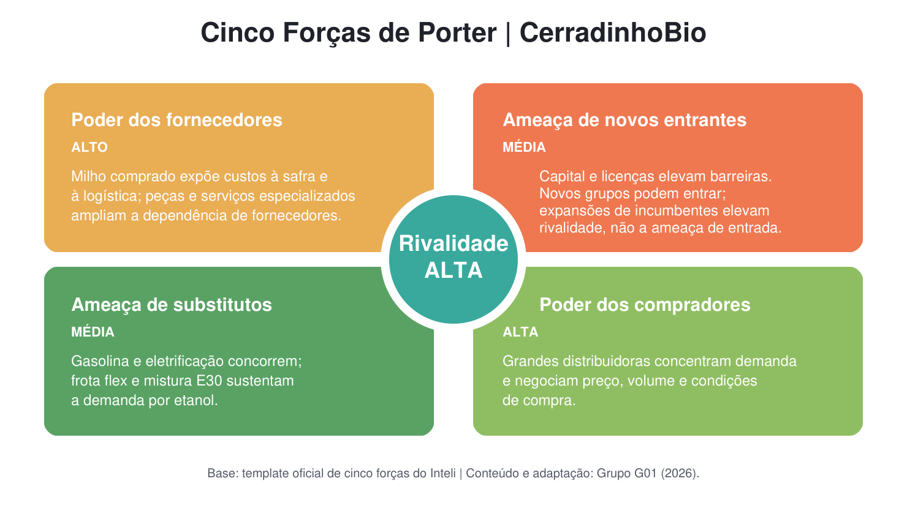

*Figura 3.1.1.1 — Cinco Forças. Fonte: template do Inteli [20]; Grupo G01 (2026).*

| Força | Intensidade | Justificativa |
|---|---|---|
| Rivalidade | Alta | Escala e commodities pressionam custos. |
| Fornecedores | Média | Insumos pesam; contratos e duas matérias-primas reduzem dependência. |
| Compradores | Média | Distribuidores negociam preço e volume. |
| Novos entrantes | Média | Capital e licenças criam barreiras. |
| Substitutos | Média | Gasolina e eletrificação competem com o etanol. |

**Síntese:** o GuaráTracking pode melhorar a visibilidade dos ativos em manutenção externa; impacto a medir no piloto [6].

### 3.1.2. Análise SWOT (sprint 1)	

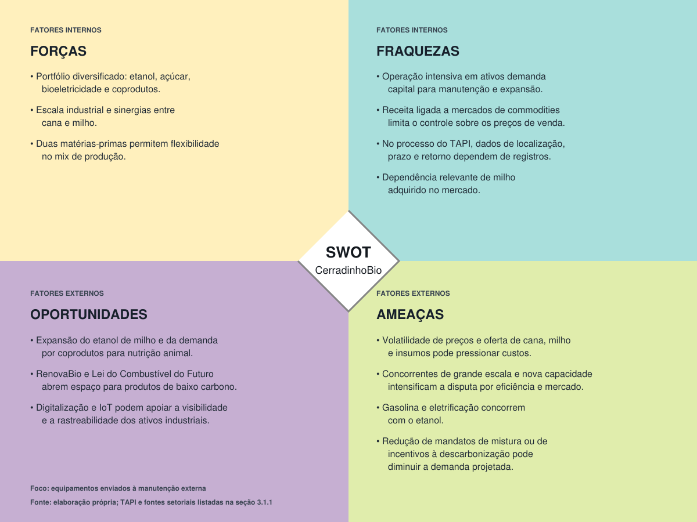

*Figura 3.1.2.1 — Análise SWOT da CerradinhoBio, com foco em equipamentos enviados à manutenção externa. Fonte: template de negócios do Inteli [42]; conteúdo: Grupo G01 (2026), com base no TAPI [6] e em dados públicos da CerradinhoBio [2, 4].*

**Escopo:** análise da CerradinhoBio, com foco nas condições do negócio e na gestão de equipamentos enviados para manutenção externa. Forças e fraquezas representam fatores internos; oportunidades e ameaças, fatores externos. A síntese considera o contexto da indústria descrito na seção 3.1.1 e o TAPI do projeto.

**Leitura para o projeto:** o portfólio diversificado e a escala de processamento da CerradinhoBio oferecem contexto favorável para testar uma rotina de rastreabilidade reutilizável. A dependência de registros e contatos entre áreas e fornecedores é uma fragilidade do processo de manutenção externa descrito no TAPI, a validar com o parceiro. A expansão do etanol e as políticas de descarbonização abrem oportunidades para a companhia; concorrência em escala, volatilidade de insumos e substitutos energéticos compõem ameaças externas. **PENDENTE DE VALIDAÇÃO:** quantificar a dor operacional (volume de remessas, tempo fora, atrasos e esforço de consulta) com os dados da última safra, ainda a serem disponibilizados conforme o TAPI.

### 3.1.3. Descrição da Solução a ser Desenvolvida (sprint 1)

#### 3.1.3.1 Problema a resolver

Registros e contatos dispersos dificultam localizar equipamentos em manutenção externa, verificar NF, prazo e retorno e exigem consultas manuais [6].

#### 3.1.3.2 Solução proposta (visão de negócios)

O GuaráTracking combina dispositivo reutilizável com lacre e cadastro digital por ciclo. Reúne equipamento, fornecedor, responsável, NF, prazo, última localização válida, estado do lacre e alertas; disponibiliza histórico e dados para consulta e BI. O piloto avaliará viabilidade, sem prometer rastreamento contínuo ou posição interna precisa.

#### 3.1.3.3 Uso previsto

Na saída, cadastrar equipamento, fornecedor, responsável, NF e prazo e instalar o dispositivo lacrado. Durante o reparo, consultar posições, tratar alertas e registrar retiradas autorizadas. No retorno, conferir, dar baixa, encerrar e liberar o dispositivo, preservando o histórico. Papéis serão validados com o parceiro.

#### 3.1.3.4 Benefícios

A solução pode centralizar dados, reduzir buscas e apoiar decisões. Ganhos serão medidos no piloto.

#### 3.1.3.5 Critério de sucesso e medida

Sucesso preliminar é completar ciclos em cinco dispositivos de teste, permitir reutilização sem vínculos simultâneos e produzir informação consultável. Metas preliminares; protocolo no [plano de validação](outros/3-desenvolvimento-resultados/validacao-e-limites-sprint1.md).

| Indicador | Medida e meta proposta |
|---|---|
| Localização | ≥90% das atualizações semanais geram posição externa válida. |
| Consulta | Situação completa em até 2 min em 90% das buscas. |
| Alertas | Falsos alertas ≤5% dos alertas analisados; latência dispositivo→destinatário ≤15 min, **meta futura não testada**. |
| Integridade | 100% dos ciclos completos, sem vínculo duplicado; testar limiar de 150 dias com datas simuladas. |

Ensaios curtos não comprovam autonomia de 150 dias; separar medidas de estimativas.

### 3.1.4. Value Proposition Canvas (sprint 1)	

Canvas do GuaráTracking para PCM, Fiscal e Logística (P1–P3), com base no TAPI [6] e no *kick-off* de 16/10/2026 [33]. Os ganhos são hipóteses a medir no piloto.

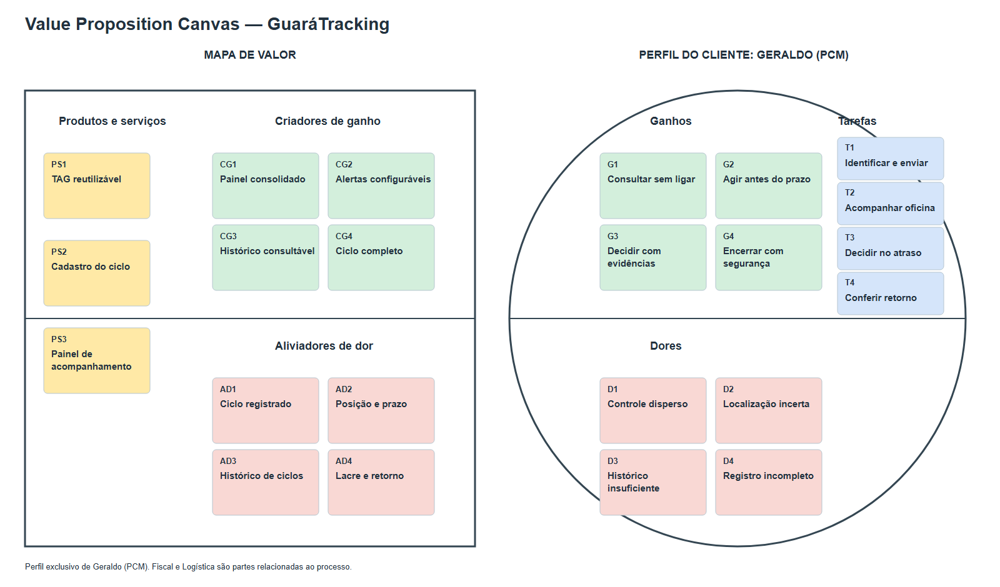

*Figura 3.1.4.1 — Value Proposition Canvas do GuaráTracking para PCM, Fiscal e Logística.*

*Fonte: template “Value Proposition Canvas - template png”, pasta de templates de negócios do Inteli [32]; conteúdo: Grupo G01 (2026).*

| Dor do cliente | Resposta do GuaráTracking | Ganho relacionado |
|---|---|---|
| D1 Controle espalhado e manual | Cadastro do ciclo (AD1) e consulta consolidada (CG1) | G1 Localizar e consultar sem ligar |
| D2 Localização e prazo incertos | Última posição (AD2), prazo separado da permanência (AD3) e alertas (CG2) | G2 Agir antes do vencimento |
| D3 Difícil decidir diante do atraso | Histórico por fornecedor (CG4) | G4 Histórico útil à gestão |
| D4 Retorno sem baixa fiscal | Retorno aguardando baixa (AD4) e baixa ligada à NF (CG3) | G3 Fechar o retorno corretamente |
| D5 Complemento de ICMS por prazo vencido, informado no *kick-off* para 2024/25; parcela ligada à manutenção externa não apurada [33] | Acompanhamento dos prazos (AD3), sem garantia de evitar incidência fiscal | G2 Agir antes do vencimento |
| D6 Lacre aberto sem registro | Alerta e registro do lacre (AD5) | G3 Fechar o retorno corretamente |
| D7 Dados espalhados entre SAP e planilhas | Dados do ciclo estruturados (AD6) e consulta pela API (CG5) | G5 Dados consolidados para o BI |

### 3.1.5. Matriz de Riscos (sprint 1)

Matriz de riscos do projeto, com níveis estimados de 10%–90% e impacto qualitativo; [justificativas detalhadas](outros/3-desenvolvimento-resultados/3.1.5-matriz-riscos/registro-riscos-aprofundado.md).

  
<strong>Figura 3.1.5.1 — Matriz de riscos do projeto</strong>

  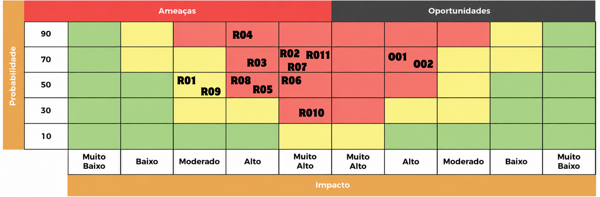
  
<em>Fonte: elaboração do Grupo G01 (2026), com base no template da disciplina.</em>

| ID | Causa e efeito | Prob. | Impacto | Justificativa | Resposta | Responsável |
|---|---|---:|---:|---|---|---|
| R01 | NF não vinculada → alerta falso. | 50% | Moderado | Kick-off prevê prorrogação. | Vincular nova NF. | Software/Fiscal |
| R02 | Metal/galpão → perda de GNSS. | 70% | Muito alto | Hipótese técnica. | Testar antenas; manter posição válida. | Hardware |
| R03 | Ensaio curto → autonomia incerta. | 70% | Alto | Ciclos podem durar um ano [6]. | Estimar pelo consumo. | Hardware |
| R04 | Sem rede → eventos retidos. | 90% | Alto | Cobertura externa incerta [6]. | Armazenar e comparar redes. | Conectividade |
| R05 | Ruído ou abertura autorizada → falso alerta. | 50% | Alto | Retirada ocorre no reparo. | Debounce e autorização. | Firmware |
| R06 | Fixação inadequada → dano. | 50% | Muito alto | Formatos variam [6]. | Usar fixação removível. | Hardware |
| R07 | Fora do escopo; trabalho futuro. | 70% | Muito alto | Previsto no TAPI [6]. | Trabalho futuro. | Hardware |
| R08 | Conectividade cara → inviabilidade. | 50% | Alto | Custo afeta a escolha. | Comparar planos. | Produto |
| R09 | Fornecedor indisponível → piloto limitado. | 50% | Moderado | Dependência externa. | Agendar e simular. | Projeto |
| R10 | Dado restrito exposto → incidente. | 30% | Muito alto | Localização e NF são restritas. | Usar dados fictícios e revisar. | Dados/LGPD |
| R11 | Retorno sem NF → ciclo fiscal aberto. | 70% | Muito alto | Kick-off exige baixa fiscal. | Conferir retorno e NF. | Processos |

**Oportunidades**

| ID | Oportunidade | Prob. | Impacto | Tratamento | Responsável |
|---|---|---:|---|---|---|
| O01 | Reutilização reduz custo por ciclo. | 70% | Alto | Validar modularidade. | Produto |
| O02 | Histórico apoia avaliação de oficinas. | 70% | Alto | Criar indicador. | Produto/BI |

### 3.1.6. Política de Privacidade de acordo com a LGPD (sprint 1)

**Minuta não homologada.** Detalhamento no [anexo de privacidade](outros/3-desenvolvimento-resultados/3.1.6-politica-privacidade/politica-privacidade-proposta.md). A demonstração usa dados fictícios; proteção legal e organizacional para dados reais exige avaliação conforme LGPD [40] e orientações da ANPD [41].

#### 3.1.6.1 Organização
CerradinhoBio é parceira; controlador e operadores dependem de definição formal.

#### 3.1.6.2 Dados
Nome, contato profissional, usuário, perfil, IP, logs, identificadores, NF e localização potencialmente vinculável a pessoas.

#### 3.1.6.3 Fontes
Cadastros, PCM/Fiscal, dispositivo e registros de acesso.

#### 3.1.6.4 Finalidades
Controlar remessas, autenticar, alertar e auditar ciclos; não avaliar desempenho individual.

#### 3.1.6.5 Bases legais
Definir por finalidade com Jurídico/encarregado: contrato, obrigação legal ou legítimo interesse quando cabível [40].

#### 3.1.6.6 Armazenamento
NVS e Serial simuladas; servidor, região e fornecedores ainda não definidos.

#### 3.1.6.7 Retenção
Prazos, backups, exclusão e responsáveis aguardam aprovação.

#### 3.1.6.8 Cookies
Painel futuro poderá usar sessão; rastreadores dependem de inventário.

#### 3.1.6.9 Compartilhamento
Operadores contratados e autoridades, nos casos autorizados ou exigidos.

#### 3.1.6.10 Segurança
Demonstração sintética; autenticação, TLS, perfis e resposta a incidentes permanecem planejados.

#### 3.1.6.11 Direitos
Confirmação, acesso, correção, eliminação cabível e outros direitos do art. 18 [40].

#### 3.1.6.12 Solicitações
Canal institucional publicado precisa de validação específica para o GuaráTracking.

#### 3.1.6.13 Encarregado
Encarregado indicado pela CerradinhoBio (**a confirmar**), sem divulgar contato não homologado.

**Aceite:** validar papéis, dados, bases, retenção, medidas e canal antes de tratar dados pessoais reais.

### 3.1.7. Bill of Material (BOM) (sprint 1)

Foi preenchida a [planilha oficial](../assets/3-desenvolvimento-resultados/3.1.7-bom/BOM-GuaraTracking-Sprint1.xlsx) [42] com **16 itens**, quantidades e valores. Preços de referência consultados em **22–23/10/2026**; conversões em dólar usam PTAX venda de **22/10/2026 (R$ 5,0383)** [35]. O [detalhamento completo](outros/3-desenvolvimento-resultados/3.1.7-bom/bom-detalhamento-sprint1.md) preserva tabelas, hipóteses e memória de custo.

| Parcela | Estimativa de referência | Limitação |
|---|---:|---|
| Materiais de um protótipo | **R$ 733,99** | Preços históricos/indicativos; sem frete, tributos e validação de estoque |
| Trabalho técnico (7 pessoas, 80 h por pessoa) | **R$ 34.105,60** | Simulação salarial, não desembolso nem proposta comercial |
| Soma contábil indicativa | **R$ 34.839,59** | **Não** representa custo aprovado de aquisição ou implantação |

O circuito simulado usa LEDs, botões, chaves e potenciômetro, enquanto o protótipo físico exige ainda GNSS, alimentação, gabinete, fixação e comunicação. O SIM7080G é apenas uma opção; cobertura, operadora, antena, compatibilidade elétrica e consumo precisam de ensaio. Quantidades e serviços para cinco dispositivos não devem ser extrapolados linearmente: montagem e desenvolvimento são parcialmente compartilhados.

**Condição de aceite:** validar SKUs, duas alternativas para itens críticos, tributos/frete, autonomia, disponibilidade, custos recorrentes e orçamento com o parceiro. A planilha é evidência de planejamento, não de compra realizada.

## 3.2. Domínio de Fundamentos de Experiência de Usuário 

### 3.2.1. Personas (sprint 1)	

#### Introdução às personas

As personas orientam o desenvolvimento da solução de rastreamento de equipamentos em manutenção externa da Cerradinho a partir dos objetivos, dificuldades e necessidades dos usuários. Os perfis consideram seus cenários de uso e letramento digital, distinguindo informações fundamentadas na pesquisa de hipóteses pendentes de validação.

#### Metodologia de construção das personas

A construção das personas partiu da análise do TAPI e das respostas do parceiro no kickoff de 16/10/2026. As informações foram organizadas por etapa do fluxo de manutenção externa, relacionando cada responsável às suas atividades, ferramentas, dificuldades e necessidades. Foram selecionados três perfis porque representam interações distintas com a solução: o PCM acompanha o equipamento, cobra o fornecedor e decide como agir diante de atrasos; o Fiscal emite a nota de remessa e registra o retorno, podendo permanecer sem informação mesmo quando o equipamento já voltou fisicamente; e a Logística consolida os dados para acompanhamento pelo BI. Essas evidências fundamentaram as personas Geraldo, Clarice e Izidio e orientaram a elaboração de seus objetivos, dores e cenários de uso.

O NotebookLM apoiou a síntese das informações do kickoff, e o Codex auxiliou na organização e redação da documentação. A IA também gerou alternativas de layout e cenas para as personas; a equipe selecionou as opções e orientou ajustes de composição e coerência com cada função. Os nomes, idades, escolaridade, valores de letramento e cenários detalhados são hipóteses ilustrativas, não dados coletados de usuários reais; deverão ser validados em entrevistas e testes de tarefa.

##### P1. Geraldo, analista de PCM (persona principal)

*Figura 3.2.1.1 — Persona 1, Geraldo, analista de PCM. Fonte: card elaborado pelo Grupo G01 (2026) com apoio do Claude (Anthropic), modelo Opus 5.5 [29]; foto do rosto: banco de imagens Magnific [28], de uso gratuito sob a licença da plataforma.*

Geraldo, analista de PCM de 38 anos e técnico em mecânica, trabalha no barracão da manutenção da usina e é, na prática, o dono do equipamento enquanto ele está fora: é ele quem avalia a peça que o mecânico trouxe, escolhe e cota a oficina, vincula a TAG, aplica o lacre, entrega o item à transportadora e depois passa horas ao telefone cobrando o fornecedor, apoiado em SAP, planilhas e e-mail (letramento digital 3 de 5). Esse trabalho, porém, acontece com dezenas de itens ao mesmo tempo, e por isso os equipamentos menos críticos acabam saindo da memória, enquanto os fornecedores prometem datas que nem sempre cumprem; sem dados à mão, Geraldo também não consegue saber se um atraso pede trazer o item de volta, usar uma peça sobressalente ou prorrogar o prazo. É por isso que o que ele espera da solução é simples: saber, sem ligar para ninguém, onde está cada item e quando ele volta, ser avisado antes de o prazo estourar e contar com o histórico de cumprimento de cada fornecedor para decidir se renova o contrato ou troca de oficina. Para a plataforma, isso significa pôr no centro uma lista de "meus itens fora" ordenada por dias para vencer, com alertas de prazo configuráveis, alerta imediato de lacre aberto e a última localização e o histórico por fornecedor ao alcance de um clique, em vez de painéis gerenciais que não ajudam quem precisa agir todos os dias.

##### P2. Clarice, analista fiscal (persona secundária)

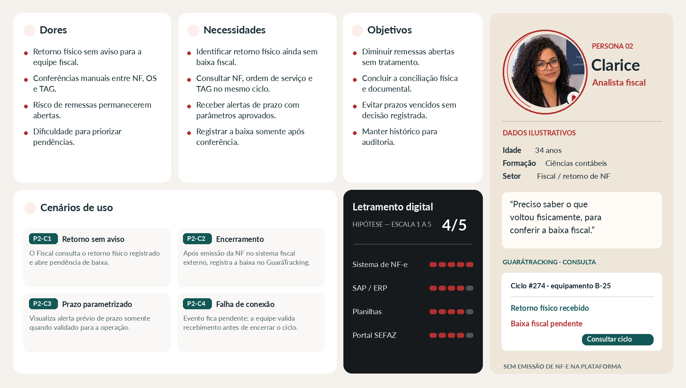

*Figura 3.2.1.2 — Persona 2, Clarice, analista fiscal. Fonte: card elaborado pelo Grupo G01 (2026) com apoio do Claude (Anthropic), modelo Opus 5.5 [29]; foto do rosto gerada no ChatGPT (OpenAI) [31] a partir do pedido "uma moça com cabelos enrolados, corporativa, responsável por emissão fiscal".*

**Escopo da versão revisada do card P2:** a NF-e é emitida no **sistema fiscal externo**, não no GuaráTracking; o retorno físico não encerra o ciclo sem baixa fiscal. Alertas legais dependem de parâmetros aprovados pelo Fiscal, e detecção automática de portaria não está implementada. A arte original foi preservada apenas como histórico de revisão. Ver [matriz de hipóteses UX](outros/3-desenvolvimento-resultados/validacao-e-limites-sprint1.md).

Clarice representa a analista fiscal responsável pela emissão das notas fiscais de remessa e pelo lançamento das notas de retorno, utilizando sistemas como SAP e Gama Soft. Diferentemente de Geraldo, não acompanha fisicamente os equipamentos: sua principal dificuldade ocorre quando um item retorna sem que o Fiscal seja informado, deixando a remessa aberta. Por isso, precisa consultar de forma integrada a identificação do dispositivo (TAG), a nota fiscal e a ordem de serviço, acompanhar prazos e identificar pendências documentais. Seu objetivo é reduzir a busca manual por informações e agir antes que essas pendências gerem consequências fiscais. Na solução, consulta alertas de prazo, verifica retornos ainda não registrados e confirma o lançamento da nota fiscal de retorno, necessário para encerrar o ciclo após a conferência do equipamento. O aviso automático de chegada à portaria é hipótese futura; lançar NF-e continua atribuição do sistema fiscal, não do GuaráTracking.

##### P3. Izidio, analista de logística (persona de inteligência)

*Figura 3.2.1.3 — Persona 3, Izidio, analista de logística. Fonte: card elaborado pelo Grupo G01 (2026) com apoio do Claude (Anthropic), modelo Opus 5.5 [29]; foto do rosto: Leonardo Dourado, no Pexels [27], de uso gratuito sob a licença Pexels [30].*

Izidio, analista de logística de 29 anos e engenheiro de produção, consolida o que saiu e o que voltou para a diretoria e acompanha o custo de ICMS por safra, trabalhando com SAP, planilhas, BI e e-mail ou Teams (letramento digital 4 de 5). O problema é que os dados vivem espalhados entre o SAP e as planilhas de cada área, de modo que ele não consegue dizer, em um instante, quantas remessas saíram na safra; para compensar, e movido por um senso de dono, acaba cobrando oficinas e prazos à mão, uma tarefa operacional que não é da sua área e que o afasta da otimização logística que deveria ser o seu foco. Por isso ele precisa de uma API que alimente o BI automaticamente, de um histórico de ciclos com datas de saída, previsão e retorno e de permanência e atraso calculados separadamente, e espera, com isso, mostrar à diretoria a evolução do ICMS por safra e manter na base todo item que não voltou, mesmo quando o ICMS já foi pago. Para a plataforma, isso reforça a prioridade de uma API robusta e de dados confiáveis, em lugar de telas operacionais, e a regra de tratar como pendente, nunca como encerrado, o ciclo sem retorno lançado, para que o número que chega à diretoria seja o que realmente aconteceu.

#### Conclusão

As personas indicam que a solução deve apresentar informações e ações adequadas às responsabilidades de cada usuário. Para Geraldo, isso significa priorizar a consulta dos equipamentos sob sua responsabilidade, os prazos, a última localização válida e os alertas que exigem intervenção. Para Clarice, o foco está na associação entre equipamento e documentos e na identificação de retornos pendentes de lançamento. Para Izidio, a necessidade é acessar históricos consistentes para consolidar dados e analisar o acompanhamento das remessas.

Essas diferenças orientam o GuaráTracking a combinar uma visão operacional dos equipamentos com o controle das pendências de cada ciclo e a disponibilização de dados para BI. A interface deve facilitar a identificação do que precisa de atenção e de quem deve agir, enquanto o histórico deve preservar a relação entre saída, acompanhamento e retorno. Assim, o rastreamento apoia decisões e a continuidade do processo entre as áreas.

#### Uso de IA na representação visual das personas

A IA foi usada para representar visualmente as personas, não para definir seu conteúdo. Objetivos, dores, necessidades e cenários já estavam escritos pela equipe a partir do kickoff e foram entregues à IA como contexto, junto com o guia de estilos do GuaráTracking, para manter cores, tipografia e ilustrações coerentes com a identidade visual do projeto.

Antes de gerar as cenas, a equipe discutiu com a IA quais objetos simbolizam o trabalho de cada função: prancheta, telefone e lacre para Geraldo; nota fiscal, calendário e o aspecto jurídico para Clarice; mapa, dados e acompanhamento do transporte para Izidio. Cada pedido gerou variações numeradas, comparadas lado a lado, e a escolha veio acompanhada de correções concretas. Na cena de Geraldo, por exemplo, a peça avulsa foi trocada por um equipamento carregado no caminhão, e a perspectiva do veículo e a posição do operador foram ajustadas em várias rodadas. Na de Izidio, o mapa passou a mostrar uma fazenda com rotas sinalizadas em verde, amarelo e vermelho.

O layout também foi revisado pela equipe: o texto corrido deu lugar a um fluxo visual com ícones por etapa, e os blocos de dores, objetivos e necessidades ganharam mais espaço. As versões finais foram exportadas em PDF e SVG para edição no Figma. Por isso, as imagens das personas são ilustrações e não registram dados do parceiro.

### 3.2.2. Jornada do Usuário e Storyboard (sprint 2)	

_Coloque aqui seu Mapa de Jornada do Usuário (seguindo as instruções na descrição do artefato)_

_Coloque aqui seu Storyboard (seguindo as instruções na descrição do artefato)_

## 3.3. Solução Técnica	

### 3.3.1. Requisitos Funcionais (sprint 1, refinar e atualizar até sprint 5)

Os requisitos abaixo saem do TAPI (MVP 1 a 7 e fluxo básico), da avaliação do protótipo e do kick-off com a Cerradinho (16/10/2026). A prioridade segue o que o parceiro chamou de indispensável no kick-off: alerta de lacre, alerta de prazo e geolocalização. Um RF só passa a `Simulado no Wokwi` depois que o caso de teste correspondente (seção 3.4.1) é executado e passa. Fica `Parcialmente simulado` quando parte dos CTs passou e outra parte foi reprovada ou bloqueada (ver a RTM na seção 3.3.4). Os IDs estão congelados: um RF removido não libera o número, e um RF novo entra no fim da lista.

| ID    | Descrição | Origem | Prioridade | Status |
|-------|-----------|--------|------------|--------|
| RF001 | O sistema deve cadastrar o equipamento com identificador próprio, descrição e foto. | TAPI MVP 1 | Alta | Planejado |
| RF002 | O sistema deve abrir um ciclo de manutenção externa com NF de remessa (número e data de emissão), fornecedor, responsável e prazo previsto de retorno. | TAPI MVP 3 | Alta | Planejado |
| RF003 | O sistema deve vincular um dispositivo a um ciclo de manutenção aberto. | TAPI MVP 3 | Alta | Planejado |
| RF004 | O sistema deve recusar o vínculo de um dispositivo que já está em um ciclo ativo. | Fluxo básico | Alta | Simulado no Wokwi |
| RF005 | O sistema deve coletar a posição GNSS na rotina de envio e guardar a última localização válida com data e hora. | TAPI MVP 2 | Alta | Parcialmente simulado |
| RF006 | O sistema deve monitorar o lacre e detectar sua abertura ou rompimento. | TAPI MVP 5 | Alta | Parcialmente simulado |
| RF007 | O sistema deve registrar a retirada autorizada e a reaplicação do lacre sem gerar alerta de violação. | TAPI MVP 5 | Alta | Simulado no Wokwi |
| RF008 | O sistema deve conectar-se à rede Wi‑Fi e reconectar automaticamente quando a conexão cair. | Avaliação do protótipo | Alta | Planejado |
| RF009 | O sistema deve publicar status e eventos no broker MQTT, em JSON, no tópico do dispositivo. | TAPI MVP 6 | Alta | Planejado |
| RF010 | O sistema deve guardar os eventos gerados sem conexão e enviá-los na ordem em que ocorreram quando a conexão voltar. | TAPI MVP 5 | Alta | Parcialmente simulado |
| RF011 | O sistema deve enviar um status periódico, semanal por padrão e configurável. | TAPI MVP 4 | Alta | Simulado no Wokwi |
| RF012 | O sistema deve calcular os dias fora a partir da data de emissão da NF de remessa. | TAPI MVP 4; Kick-off com a Cerradinho (16/10/2026) | Alta | Planejado |
| RF013 | O sistema deve emitir um alerta de atraso quando os dias fora passam do prazo previsto de retorno. | TAPI MVP 3 | Alta | Simulado no Wokwi |
| RF014 | O sistema deve emitir um alerta de permanência quando os dias fora atingem o limiar do ciclo (150 dias por padrão, configurável). | TAPI MVP 4 | Alta | Simulado no Wokwi |
| RF015 | O sistema deve listar os equipamentos fora com última localização válida, dias fora, prazo, bateria e estado do lacre. | TAPI MVP 6 | Alta | Planejado |
| RF016 | O sistema deve encerrar o ciclo somente com a NF de retorno lançada e o lacre fechado. | Fluxo básico | Alta | Simulado no Wokwi |
| RF017 | O sistema deve liberar o dispositivo do ciclo encerrado para um novo vínculo, preservando o histórico. | TAPI MVP 3; fluxo básico | Alta | Planejado |
| RF018 | O sistema deve notificar o responsável do ciclo a cada alerta, com o e-mail como canal inicial. | Fluxo básico; Kick-off com a Cerradinho (16/10/2026) | Alta | Planejado |
| RF019 | O sistema deve medir o nível de bateria e enviá-lo em cada mensagem. | TAPI MVP 6 | Média | Simulado no Wokwi |
| RF020 | O sistema deve cadastrar os dispositivos na plataforma, cada um com identificador e credencial próprios. | TAPI MVP 3 | Média | Planejado |
| RF021 | O sistema deve atribuir a cada usuário um `usuario_id` único e permanente, gerado pela plataforma, vinculado à sua credencial individual e ao seu perfil de acesso, e autenticar esse usuário para acessar o painel. | TAPI MVP 6 | Média | Planejado |
| RF022 | O sistema deve exibir gráficos e mapa com equipamentos por faixa de dias fora, alertas por tipo e última posição de cada equipamento. | TAPI MVP 6 | Média | Planejado |
| RF023 | O sistema deve atribuir cada alerta ao responsável pelo ciclo e permitir que esse responsável, após autenticação, registre a ciência e o tratamento com decisão, data e justificativa. | Fluxo básico | Média | Planejado |
| RF024 | O sistema deve oferecer uma API autenticada e documentada para consulta dos dados por ferramentas de BI. | TAPI MVP 6 | Média | Planejado |
| RF025 | O sistema deve emitir um alerta quando um dispositivo passa do período esperado sem se comunicar. | Kick-off com a Cerradinho (16/10/2026) | Média | Planejado |
| RF026 | O sistema deve emitir um alerta quando os dias fora atingem a data limite legal do ciclo. | Kick-off com a Cerradinho (16/10/2026) | Média | Planejado |
| RF027 | O sistema deve emitir um alerta quando o nível de bateria fica abaixo do limite mínimo. | TAPI MVP 6 | Média | Simulado no Wokwi |
| RF028 | O sistema deve avisar antecipadamente ao vencimento do prazo de retorno, com antecedência configurada pelo parceiro. | Necessidade das personas; VPC | Média | Planejado (não simulado) |
| RF029 | O sistema deve marcar retorno físico recebido e pendência de baixa fiscal como estados distintos, sem encerrar o ciclo. | Kick-off; P2-C2 | Alta | Planejado (não simulado) |

Itens técnicos da avaliação: coleta de dados via sensor (RF005, RF006, RF019) · definição de devices na plataforma (RF003, RF020) · chave de identificação de usuário e acesso ao dashboard (RF021) · conexão Wi‑Fi (RF008) · formatação de dados para MQTT (RF009) · representação gráfica dos dados coletados (RF015, RF022).

### 3.3.2. Regras de Negócio (sprint 1, refinar até sprint 5)

As regras abaixo restringem o comportamento descrito nos RFs da seção 3.3.1 e vêm das mesmas fontes: TAPI e kick-off com a Cerradinho (16/10/2026), além do regulamento do ICMS de Goiás no caso do prazo legal. Valores marcados como `PENDENTE DE VALIDAÇÃO` são propostas preliminares que dependem de confirmação do parceiro; quando usados em casos de teste da seção 3.4.1, não representam aprovação do parceiro. Os casos de teste da 3.4.1 indicam qual RN verificam.

| ID   | Descrição | Origem | RF associado |
|------|-----------|--------|--------------|
| RN01 | Um dispositivo só pode estar vinculado a um ciclo ativo por vez, e um equipamento só pode ter um ciclo ativo por vez. | Fluxo básico | RF003, RF004 |
| RN02 | Um ciclo só pode ser aberto com NF de remessa (número e data de emissão), fornecedor, responsável e prazo previsto de retorno preenchidos. | TAPI MVP 3 | RF002 |
| RN03 | O limiar de permanência é de 150 dias por padrão e pode ser alterado em cada ciclo para qualquer número inteiro de dias maior que zero. | TAPI MVP 4; Kick-off com a Cerradinho (16/10/2026) | RF014 |
| RN04 | Atraso e permanência são alertas distintos, podem estar ativos ao mesmo tempo e cada um é emitido uma única vez por ciclo. | TAPI MVP 3 e 4 | RF013, RF014 |
| RN05 | A abertura do lacre sem autorização vigente é violação crítica e é enviada na hora, fora da rotina de status periódico. | TAPI MVP 5 | RF006 |
| RN06 | A autorização de retirada vale por 3 dias a partir do registro; a abertura do lacre depois desse prazo é tratada como violação. Prazo de 3 dias: `PENDENTE DE VALIDAÇÃO` | TAPI MVP 5 | RF007 |
| RN07 | O status periódico é enviado a cada 7 dias por padrão, com frequência configurável até diária. | TAPI MVP 4 | RF011 |
| RN08 | Uma posição GNSS é válida quando o receptor tem fix, a posição traz data e hora do próprio GNSS e o HDOP é de no máximo 2,0. A última localização válida só é atualizada com uma posição válida; sem ela, a anterior é mantida. Última comunicação e última localização válida são registradas em campos distintos. HDOP máximo de 2,0: `PENDENTE DE VALIDAÇÃO` | TAPI MVP 6 | RF005, RF015 |
| RN09 | Sem conexão, o dispositivo guarda até 8 eventos; com a fila cheia, descarta o evento não crítico mais antigo e preserva individualmente as violações enquanto houver espaço; excedentes críticos são **agregados por quantidade e primeira/última ocorrência**, sem manter todos os payloads individuais. Cada evento individual mantém a hora em que ocorreu, e a plataforma registra a hora de recebimento à parte. Capacidade de 8 eventos: `PENDENTE DE VALIDAÇÃO` | TAPI MVP 5 | RF010 |
| RN10 | O alerta de bateria baixa é emitido uma vez quando o nível fica abaixo de 20% e só volta a ser emitido depois que o nível passa de 25%. Leitura zero é falha do sensor, não bateria vazia. Limites de 20% e 25%: `PENDENTE DE VALIDAÇÃO` | TAPI MVP 6 | RF019, RF027 |
| RN11 | O encerramento do ciclo é recusado enquanto o lacre estiver aberto ou a NF de retorno não estiver lançada, e o histórico do ciclo encerrado nunca é apagado. | Fluxo básico | RF016, RF017 |
| RN12 | Uma prorrogação (retorno e nova remessa simbólicos) abre um novo ciclo do mesmo equipamento e do mesmo dispositivo, e os dias fora passam a contar da emissão da nova NF de remessa. | Kick-off com a Cerradinho (16/10/2026) | RF012, RF017 |
| RN13 | Os limites fiscais variam com UF, tipo de operação, legislação vigente e eventuais prorrogações; a plataforma só aplicará regra parametrizada e validada pelo Fiscal. Os exemplos históricos de 270/360 dias **não são prazos universais** e estão `PENDENTES DE VALIDAÇÃO` | RCTE/GO (Decreto nº 4.852/1997), art. 79, I, "s", 1 (270 dias, saída interna) e Anexo IX, art. 6º, IV (360 dias, saída interestadual), na redação do Decreto nº 7.815/2013; Kick-off com a Cerradinho (16/10/2026) | RF012, RF026 |
| RN14 | Um dispositivo é considerado sem comunicação quando passa de dois intervalos de status periódico sem enviar nenhuma mensagem (14 dias com o padrão de 7 dias); o alerta é emitido uma vez e só volta a ser emitido depois de uma nova comunicação. Dois intervalos: `PENDENTE DE VALIDAÇÃO` | Kick-off com a Cerradinho (16/10/2026) | RF025 |
| RN15 | O painel e a API só respondem a usuário autenticado; sem credencial válida, o acesso é negado e nenhum dado é exibido. | TAPI MVP 6 | RF021, RF024 |
| RN16 | Mensagem de dispositivo não cadastrado ou com credencial inválida é rejeitada e não altera nenhum ciclo. | TAPI MVP 3 | RF020 |
| RN17 | Cada usuário possui um `usuario_id` único, gerado pela plataforma e não reutilizado nem alterado após o cadastro. A credencial e o perfil de acesso são vinculados a esse identificador; o `usuario_id` identifica o usuário nos registros de auditoria sem expor sua credencial. | RF021; especificação preliminar do projeto | RF021, RF023 |
| RN18 | Cada alerta é atribuído ao responsável do ciclo. Esse responsável deve registrar, após autenticação, a ciência e uma decisão de tratamento com justificativa em até 1 dia útil após a emissão. O prazo de 1 dia útil é `PENDENTE DE VALIDAÇÃO` com a Cerradinho. O registro inclui o `usuario_id` do responsável e data/hora, é preservado no histórico e não substitui registros anteriores; alertas sem tratamento dentro do prazo permanecem pendentes e são destacados no painel. | RF018, RF023; Fluxo básico. Prazo de 1 dia útil: `PENDENTE DE VALIDAÇÃO` com a Cerradinho | RF018, RF021, RF023 |
| RN19 | O alerta preventivo é diferente do atraso e requer antecedência configurada por ciclo; sem parâmetro aprovado, não emitir nem apresentar como implementado. | VPC; hipótese UX | RF013, RF028 |
| RN20 | Retorno físico registrado não significa baixa fiscal. O ciclo continua pendente até registro válido da NF de retorno e conferência do lacre. | Fluxo Fiscal; P2-C2 | RF016, RF029 |

**Compatibilidade entre as regras de negócio e o protótipo atual.** A tabela abaixo mostra como o firmware da seção 3.4.1 trata as regras que ele já cobre; as diferenças indicadas não representam requisitos já atendidos.

| Regra | Situação no protótipo atual |
|---|---|
| RN05 — envio da violação fora da rotina periódica | Preservar registro local independente de GNSS/rede. Entrega ao servidor ainda não implementada; manter limites de latência pendentes com o parceiro. “Na hora” não define SLA nem garante entrega sem conexão. |
| RN08 — data/hora GNSS e HDOP máximo de 2,0 | O firmware atual verifica validade, idade e satélites, mas não aplica esse limite de HDOP nem persiste data/hora absoluta. Registrar adequação futura do driver LC76G-PA [24]; limite de HDOP ainda pendente. |
| RN09 — fila de 8 com prioridade para críticos | Implementada na fila de eventos sem rede (8 eventos, descarte do não crítico mais antigo, reenvio na ordem com `dia_ocorrencia`). Com a fila só de violações, a 9ª violação em diante entra num único registro de resumo (`VIOLACAO_LACRE_RESUMO`, com quantidade e primeira/última ocorrência), persistido na NVS e enviado depois das 8 no reenvio; o resumo preserva somente contagem e extremos temporais, **não cada violação individual**. Só eventos não críticos que não cabem são contados em `perdidos`. A política de agregação deve ser confirmada com o parceiro. O registro local de 16 entradas na NVS (CT21) continua separado. |
| RN10 — leitura zero considerada falha | Implementada: ADC = 0 gera `SENSOR_BATERIA_FALHA` e nenhum `BATERIA_BAIXA` (CT13). No dispositivo físico, o diagnóstico elétrico do divisor ainda depende do CT30 previsto no [planejamento de energia e GNSS](outros/3-desenvolvimento-resultados/3.4.1-prototipo-wokwi/planejamento-energia-gnss.md). |
| RN11 — encerramento exige lacre fechado e NF de retorno | As duas recusas foram verificadas no CT16. No simulador, `NF` no Serial representa o lançamento da NF de retorno e segurar `BTN_CICLO` por 2 s solicita o encerramento. No reteste de 23/10/2026, o CT14 confirmou JSON com ciclo inativo e dias zero, reutilização e contador acumulado. A persistência do histórico após corte de energia não foi verificada. |

### 3.3.3. Requisitos Não Funcionais — ISO/IEC 25010:2011 (sprints 2 a 5)

#### Demandas de negócio que fundamentam os RNFs

As oito características de qualidade do produto adotadas aqui seguem a **ISO/IEC 25010:2011** [54]; a edição de 2023 reorganizou esse modelo. O mapeamento relaciona o TAPI [6], o kick-off com a Cerradinho de 16/10/2026 [33] e as personas da seção 3.2.1. Geraldo (P1/PCM), Clarice (P2/Fiscal) e Izidio (P3/Logística) são **perfis construídos pelo grupo**, não depoimentos individuais. A associação de cada demanda às características ISO é uma interpretação técnica; valores citados no alinhamento ainda não constituem critérios de aceitação aprovados.

| Característica / ID | Demanda do negócio e fonte | Justificativa e rastreabilidade | Lacunas e validações |
|---|---|---|---|
| **Adequação funcional — RNF01** | O TAPI [6] (MVP 2–6) prevê localização válida, vínculo TAG–ciclo–NF, histórico e alertas de prazo e lacre; o kick-off [33] destacou equipamentos esquecidos e retorno físico sem baixa fiscal. | A completude das funções permite a P1 Geraldo acompanhar pendências, a P2 Clarice reconciliar retornos e a P3 Izidio consolidar o histórico. Relação: RF002, RF005, RF006, RF014, RF016, RF017 e RF029. | A cobertura funcional depende de verificação dos fluxos e das regras de encerramento; funcionalidades planejadas não são consideradas implementadas. |
| **Eficiência de desempenho — RNF02** | O TAPI [6] (MVP 4 e 7) prevê status semanal configurável e ensaio de consumo. No kick-off [33], o parceiro indicou **autonomia de até 1 ano** como referência para cobrir cerca de **99% dos períodos fora**, sem fixar meta formal. Para violação do lacre, pediu aviso o mais imediato possível e considerou **10 a 30 minutos aceitáveis** como referência, sem esperar o ciclo semanal [33]. | P1 Geraldo precisa de informação útil antes que a bateria se esgote e de alerta de lacre em tempo oportuno. Tempo de resposta (detecção local versus entrega ao servidor), uso de GNSS, transmissão e repouso determinam latência e consumo. Relação: RF005, RF006, RF008, RF011, RF019, RF027, RN05, RN07 e RN08. | Autonomia mínima, condições de ensaio e limite de latência ponta a ponta **pendentes de validação**. Sem cobertura, a ocorrência é armazenada para envio posterior; a faixa de 10–30 min não é garantia offline. Consumo físico exige CT27, e latências exigem ensaio separado de detecção e entrega. |
| **Compatibilidade — RNF03** | O TAPI [6] (MVP 6) requer API para BI. No kick-off [33], foram mencionados **SAP** (remessas, NF e retorno), **Gama Soft** no fiscal e o **BI da diretoria**; o campo complementar da NF foi considerado para levar o número da TAG. | A interoperabilidade entre dados de ciclo, NF e TAG deve permitir a P2 Clarice conferir pendências e a P3 Izidio consumir indicadores sem recadastro. Relação: RF002, RF017, RF024 e RN15. | Contrato, autenticação e esquema de dados da API ainda não foram definidos; a solução não declara integração produtiva com SAP, Gama Soft ou BI corporativo. |
| **Usabilidade — RNF04** | O TAPI [6] exige consulta de status, localização e alertas; o kick-off [33] descreveu o acompanhamento manual. Os cenários das personas distinguem tarefas de PCM, Fiscal e Logística. | P1 Geraldo precisa priorizar pendências; P2 Clarice, diferenciar retorno físico de baixa fiscal; P3 Izidio, consultar histórico. A interface deve reduzir ambiguidades e erros de interpretação. Relação: RF015, RF018, RF022, RF023 e RF029. | Tempo de execução, acessibilidade e compreensão das tarefas não foram testados com usuários reais. |
| **Confiabilidade — RNF05** | O TAPI [6] (MVP 5) prevê armazenar eventos durante períodos sem rede e reenviá-los após a reconexão; o kick-off [33] indicou que os caminhões não têm internet garantida nos trajetos. | A disponibilidade dos registros, a tolerância a falhas de comunicação e a recuperação após desconexão permitem a P1 Geraldo acompanhar ocorrências e a P3 Izidio consultar um histórico íntegro. Relação: RF005, RF006, RF010, RF025 e RN08–RN09. | Capacidade e saturação da fila, perdas, confirmação de entrega e duração offline ainda exigem validação. CT18 e CT22 registram limitações (seção 3.3.4); não há demonstração de entrega fim a fim. |
| **Segurança — RNF06** | O TAPI [6] (MVP 5–6) prevê aviso de lacre e acesso controlado. O kick-off [33] distinguiu abertura autorizada de violação. Identificadores, localização e registros fiscais exigem avaliação segundo a LGPD [40] e orientações da ANPD [41]. | A integridade dos eventos e a confidencialidade dos dados permitem a P1 Geraldo investigar violações, a P2 Clarice confiar nos vínculos e a P3 Izidio consumir dados pertinentes. Relação: RF006, RF007, RF020, RF021, RF023, RF024, RN05 e RN15–RN18. | Lacre físico e cibersegurança são controles distintos. Perfis, retenção, base legal, criptografia e resposta a incidentes ainda exigem definição com TI/Jurídico; os controles de produção não estão comprovados. |
| **Manutenibilidade — RNF07** | O uso repetido do dispositivo, previsto no TAPI [6], exige diagnosticar e corrigir firmware e software ao longo dos ciclos. O [planejamento de energia e GNSS](outros/3-desenvolvimento-resultados/3.4.1-prototipo-wokwi/planejamento-energia-gnss.md) define o **RNF-SUP01**, com ensaios reproduzíveis por versão, configuração e estímulos; a reutilização física prevista no TAPI [6] é contexto operacional. | **Analisabilidade, modificabilidade e testabilidade** (ISO/IEC 25010:2011 [54]) permitem localizar defeitos, alterar regras e repetir testes sem comprometer histórico e vínculos de P1 Geraldo e P3 Izidio. Relação: RF017, RF025, RN01 e RN11. | Diagnósticos, testes de regressão, separação de componentes e critérios de manutenção técnica permanecem em definição. Manutenção externa do ativo não equivale à manutenibilidade do software. |
| **Portabilidade — RNF08** | O TAPI [6] exige comparar alternativas de comunicação; a seção 1.2 usa **Wi-Fi somente no protótipo**, não como premissa nas oficinas. O [planejamento técnico](outros/3-desenvolvimento-resultados/3.4.1-prototipo-wokwi/planejamento-energia-gnss.md) compara os módulos **Quectel LC76G-PA** e **u-blox MAX-M10S** [23, 24]. | **Adaptabilidade e substituibilidade** (ISO/IEC 25010:2011 [54]) fundamentam trocar o canal de comunicação por alternativa de produção e substituir o módulo GNSS preservando a lógica de aquisição, transmissão e ciclo. É proposta arquitetural para manter a solução adaptável às condições de P1 Geraldo, não mera movimentação física do equipamento. Relação: RF005, RF008, RF009, RF010, RF011 e RN08. | O canal de produção e a equivalência de interfaces GNSS não foram validados. A solução de produção não pressupõe Wi-Fi nos fornecedores, localização precisa em interiores ou rastreamento contínuo em tempo real. |

**Leitura transversal das demandas prioritárias:** autonomia da bateria → **RNF02** (e RNF05); operação sem cobertura → **RNF05** e RNF08; lacre e tempo de alerta → **RNF01, RNF02, RNF05 e RNF06**; LGPD → **RNF06**; API para BI → **RNF03** (e RNF01).

**Lacunas de validação:** o documento original do TAPI é fornecido pelo parceiro e não está anexado a esta documentação. Permanecem em aberto os limites formais de autonomia e latência, os cenários de rede ausente, a política de acesso e privacidade e o contrato da API. As referências de 1 ano, 99% e 10–30 minutos provêm do alinhamento [33], não de medições nem de SLA acordado. Ensaios de resistência à água, previstos no TAPI [6], ficam como trabalho futuro.

#### Requisitos não funcionais e critérios de aceitação (RNF01 a RNF08)

As justificativas de negócio estão relacionadas acima; o texto verificável dos requisitos e seus critérios de aceitação seguem em definição, conforme os ensaios e validações aplicáveis.

| Característica (ISO/IEC 25010:2011) | ID | Requisito Não Funcional | Métrica / Critério de Aceitação | Justificativa (demanda do negócio) | Justificativa de Ausência (se aplicável) |
|---|---|---|---|---|---|
| Adequação Funcional | RNF01 | O sistema deve cobrir de ponta a ponta o fluxo de um ciclo de manutenção externa: abrir o ciclo com a NF de remessa, vincular a TAG, registrar a última localização válida, emitir os alertas de atraso, permanência e lacre e encerrar o ciclo com a NF de retorno e o lacre fechado, preservando o histórico. | Todos os RFs de prioridade Alta (RF001 a RF018 e RF029) com caso de teste aprovado na RTM (3.3.4) e ao menos um ciclo completo executado, da abertura ao encerramento, sem nenhuma etapa fora do sistema. RF sem teste aprovado fica registrado como pendente. | Acompanhamento de ativos, alertas e reconciliação fiscal; P1/P2/P3 ([6], [33], seção 3.2.1). | |
| Eficiência de Desempenho | RNF02 | O sistema deve entregar à plataforma o alerta de violação do lacre em até 30 minutos após a detecção, quando houver conexão, e o dispositivo deve ter autonomia estimada de pelo menos 1 ano no perfil de status semanal. | Latência: percentil 95 do tempo entre a estabilização do contato do lacre e o recebimento pela plataforma de até 30 minutos em um lote controlado de 30 estímulos (ensaio de latência CT32 do planejamento de energia e GNSS). Autonomia: carga diária medida na alimentação do conjunto (CT27) que leve a autonomia estimada a pelo menos 365 dias com a bateria adotada. Os valores de 30 minutos e 1 ano são as referências do kick-off [33]; os limites formais e a bateria dependem de validação com o parceiro. | Autonomia de referência até 1 ano e latência de alerta de lacre de referência 10–30 min, ambas pendentes de meta formal; P1 ([6], [33]). | |
| Compatibilidade | RNF03 | ... | ... | API para BI e coerência com SAP, Gama Soft, TAG e NF; P2/P3 ([6], [33]). | |
| Usabilidade | RNF04 | ... | ... | Consultas e pendências para PCM, Fiscal e Logística; P1/P2/P3 ([33], seção 3.2.1). | |
| Confiabilidade | RNF05 | ... | ... | Persistência de eventos sem conexão e recuperação após reconexão; P1/P3 ([6], [33]). | |
| Segurança | RNF06 | ... | ... | Controle de lacre e acesso responsável aos dados; P1/P2/P3 ([6], [33], [40]). | |
| Manutenibilidade | RNF07 | ... | ... | Diagnóstico reproduzível e evolução de firmware/software (RNF-SUP01); P1/P3 ([6], [54]). | |
| Portabilidade | RNF08 | ... | ... | Troca de canal de comunicação e substituição de módulo GNSS sem alterar a lógica do ciclo; P1 ([6], [23], [24], [54]). | |

### 3.3.4. Matriz de Rastreabilidade (RTM) (sprints 1 a 5)

A Matriz de Rastreabilidade (RTM) relaciona os requisitos funcionais (RF) e as regras de negócio (RN) aos casos de teste e às evidências de verificação. Ela permite identificar a cobertura de cada requisito e acompanhar as pendências de validação.

| Persona | RF    | RN   | Caso de Teste | Evidência        |
|---------|-------|------|---------------|------------------|
| P1 Geraldo — P1-C1 Saída com TAG e lacre | RF001 | Não se aplica — o cadastro do equipamento não tem restrição própria; as restrições começam na abertura do ciclo (RN02) | Planejado — CT a definir | Planejado, sprint a definir |
| P1 Geraldo — P1-C1 Saída com TAG e lacre | RF002 | RN02 | Planejado — CT a definir | Planejado, sprint a definir |
| P1 Geraldo — P1-C1 Saída com TAG e lacre | RF003 | RN01 | Planejado — CT a definir | Planejado, sprint a definir |
| P1 Geraldo — P1-C1 Saída com TAG e lacre | RF004 | RN01 | CT15 | [CT15](../assets/3-desenvolvimento-resultados/3.4.1-prototipo-wokwi/ct15.png) |
| P1 Geraldo — P1-C4 Falha | RF005 | RN08 | CT19, CT20, CT22 | [CT19](../assets/3-desenvolvimento-resultados/3.4.1-prototipo-wokwi/ct19.png) e [CT20](../assets/3-desenvolvimento-resultados/3.4.1-prototipo-wokwi/ct20.png) — APROVADOS no simulador; [CT22](../assets/3-desenvolvimento-resultados/3.4.1-prototipo-wokwi/ct22.png) — **REPROVADO no ambiente**: referência e NVS retidas, mas `uptime_ms` não reiniciou ([log](../assets/3-desenvolvimento-resultados/3.4.1-prototipo-wokwi/CT22.serial.txt)) |
| P1 Geraldo — P1-C3 Lacre aberto | RF006 | RN05 | CT05, CT07, CT18 | [CT05](../assets/3-desenvolvimento-resultados/3.4.1-prototipo-wokwi/ct05Evento.png), [CT07](../assets/3-desenvolvimento-resultados/3.4.1-prototipo-wokwi/ct07.png); [CT18](../assets/3-desenvolvimento-resultados/3.4.1-prototipo-wokwi/ct18Original.png) — **REPROVADO**: quatro de 20 transições estáveis de 200 ms perdidas sem rede ([log original](../assets/3-desenvolvimento-resultados/3.4.1-prototipo-wokwi/CT18-original.serial.txt)) |
| P1 Geraldo — P1-C3 Lacre aberto | RF007 | RN06 | CT06, CT11 | [CT06](../assets/3-desenvolvimento-resultados/3.4.1-prototipo-wokwi/ct06Retirada.png), [CT11](../assets/3-desenvolvimento-resultados/3.4.1-prototipo-wokwi/ct11.png) |
| P2 Clarice — P2-C4 Falha (associação direta) | RF008 | Não se aplica — sem RN específica | CT08, CT09 | [CT08](../assets/3-desenvolvimento-resultados/3.4.1-prototipo-wokwi/ct08.png), [CT09](../assets/3-desenvolvimento-resultados/3.4.1-prototipo-wokwi/ct09.png) (BLOQUEADO para confirmação do servidor) |
| P1 Geraldo — P1-C2 Acompanhamento | RF009 | Não se aplica — sem RN específica | CT01, CT02 | [CT01](../assets/3-desenvolvimento-resultados/3.4.1-prototipo-wokwi/ct01.png), [CT02](../assets/3-desenvolvimento-resultados/3.4.1-prototipo-wokwi/ct02.png) — diagnóstico e saída Serial observados; publicação MQTT não comprovada |
| P2 Clarice — P2-C4 Falha | RF010 | RN09 | CT08, CT09, CT10, CT21, CT22 | [CT08](../assets/3-desenvolvimento-resultados/3.4.1-prototipo-wokwi/ct08.png), [CT09](../assets/3-desenvolvimento-resultados/3.4.1-prototipo-wokwi/ct09.png) (BLOQUEADO para confirmação do servidor), [CT10](../assets/3-desenvolvimento-resultados/3.4.1-prototipo-wokwi/ct10.png); [CT21](../assets/3-desenvolvimento-resultados/3.4.1-prototipo-wokwi/ct21.png) — APROVADO no limite de 16 diagnósticos NVS ([log](../assets/3-desenvolvimento-resultados/3.4.1-prototipo-wokwi/CT21.serial.txt)); [CT22](../assets/3-desenvolvimento-resultados/3.4.1-prototipo-wokwi/ct22.png) — **REPROVADO no ambiente** no critério de reinício de `uptime_ms`, com retenção das filas verificada ([log](../assets/3-desenvolvimento-resultados/3.4.1-prototipo-wokwi/CT22.serial.txt)) |
| P1 Geraldo — P1-C2 Acompanhamento | RF011 | RN07 | CT02 | [CT02](../assets/3-desenvolvimento-resultados/3.4.1-prototipo-wokwi/ct02.png) |
| P1 Geraldo — P1-C2 Acompanhamento; P2 Clarice — P2-C3 Prazo legal; P3 Izidio — P3-C2 ICMS por safra | RF012 | RN12, RN13 | CT03, CT04 | [CT03](../assets/3-desenvolvimento-resultados/3.4.1-prototipo-wokwi/ct03.png), [CT04](../assets/3-desenvolvimento-resultados/3.4.1-prototipo-wokwi/ct04.png) |
| P1 Geraldo — P1-C2 Acompanhamento; P3 Izidio — P3-C2 ICMS por safra | RF013 | RN04 | CT03 | [CT03](../assets/3-desenvolvimento-resultados/3.4.1-prototipo-wokwi/ct03.png) |
| P1 Geraldo — P1-C2 Acompanhamento; P3 Izidio — P3-C2 ICMS por safra | RF014 | RN03, RN04 | CT04 | [CT04](../assets/3-desenvolvimento-resultados/3.4.1-prototipo-wokwi/ct04.png) |
| P1 Geraldo — P1-C2 Acompanhamento; P1-C4 Falha | RF015 | RN08 | CT19, CT20, CT22 | [CT19](../assets/3-desenvolvimento-resultados/3.4.1-prototipo-wokwi/ct19.png) e [CT20](../assets/3-desenvolvimento-resultados/3.4.1-prototipo-wokwi/ct20.png) — APROVADOS no simulador; [CT22](../assets/3-desenvolvimento-resultados/3.4.1-prototipo-wokwi/ct22.png) — **REPROVADO no ambiente**: referência e NVS retidas, mas `uptime_ms` não reiniciou ([log](../assets/3-desenvolvimento-resultados/3.4.1-prototipo-wokwi/CT22.serial.txt)) |
| P2 Clarice — P2-C2 Encerramento do ciclo; P3 Izidio — P3-C3 Falha | RF016 | RN11 | CT14, CT16 | [CT14 corrigido](../assets/3-desenvolvimento-resultados/3.4.1-prototipo-wokwi/ct14Corrigido.png) — APROVADO com dois encerramentos, ciclo inativo e dias zero ([log do reteste de 23/10](../assets/3-desenvolvimento-resultados/3.4.1-prototipo-wokwi/CT14-2026-10-23.serial.txt)); CT16 APROVADO nas recusas por [lacre aberto](../assets/3-desenvolvimento-resultados/3.4.1-prototipo-wokwi/ct16CorrigidoLacreAberto.png) e [NF ausente](../assets/3-desenvolvimento-resultados/3.4.1-prototipo-wokwi/ct16CorrigidoNfAusente.png) |
| P2 Clarice — P2-C2 Encerramento do ciclo; P3 Izidio — P3-C1 Histórico para o BI | RF017 | RN11, RN12 | CT14 | [CT14 corrigido](../assets/3-desenvolvimento-resultados/3.4.1-prototipo-wokwi/ct14Corrigido.png) — APROVADO: [reutilização no ciclo 2](../assets/3-desenvolvimento-resultados/3.4.1-prototipo-wokwi/ct14CorrigidoReutilizado.png) e contador de encerramentos 1/2 ([log do reteste de 23/10](../assets/3-desenvolvimento-resultados/3.4.1-prototipo-wokwi/CT14-2026-10-23.serial.txt)); histórico após corte físico de energia ainda pendente |
| P1 Geraldo — P1-C2 Acompanhamento; P2 Clarice — P2-C1 Retorno sem aviso | RF018 | Não se aplica — sem RN específica | Planejado — CT a definir | Planejado, sprint a definir |
| P1 Geraldo — P1-C2 Acompanhamento (associação indireta) | RF019 | RN10 | CT12, CT13, CT23 | [CT12](../assets/3-desenvolvimento-resultados/3.4.1-prototipo-wokwi/ct12.png), [CT13](../assets/3-desenvolvimento-resultados/3.4.1-prototipo-wokwi/ct13Isolado.png); [CT23](../assets/3-desenvolvimento-resultados/3.4.1-prototipo-wokwi/ct23.png) — APROVADO com percentuais sintéticos 0/50/100%, uma falha do sensor em zero e nenhum alerta falso de bateria baixa ([log CT17/CT23](../assets/3-desenvolvimento-resultados/3.4.1-prototipo-wokwi/CT17-CT23.serial.txt)) |
| P1 Geraldo — P1-C1 Saída com TAG e lacre | RF020 | RN16 | Planejado — CT a definir | Planejado, sprint a definir |
| P1 Geraldo — P1-C2 Acompanhamento (associação transversal) | RF021 | RN15, RN17 | Planejado — CT a definir | Planejado, sprint a definir |
| P1 Geraldo — P1-C2 Acompanhamento; P3 Izidio — P3-C2 ICMS por safra | RF022 | Não se aplica — requisito de apresentação dos dados; o acesso ao painel é regido pela RN15 (RF021) | Planejado — CT a definir | Planejado, sprint a definir |
| P1 Geraldo — P1-C2 Acompanhamento; P1 Geraldo — P1-C3 Lacre aberto | RF023 | RN18 | Planejado — CT a definir | Planejado, sprint a definir |
| P3 Izidio — P3-C1 Histórico para o BI | RF024 | RN15 | Planejado — CT a definir | Planejado, sprint a definir |
| P1 Geraldo — P1-C4 Falha | RF025 | RN14 | Planejado — CT a definir | Planejado, sprint a definir |
| P2 Clarice — P2-C3 Prazo legal | RF026 | RN13 | Planejado — CT a definir | Planejado, sprint a definir |
| P1 Geraldo — P1-C2 Acompanhamento | RF027 | RN10 | CT12, CT13, CT23 | [CT12](../assets/3-desenvolvimento-resultados/3.4.1-prototipo-wokwi/ct12.png), [CT13](../assets/3-desenvolvimento-resultados/3.4.1-prototipo-wokwi/ct13Isolado.png); [CT23](../assets/3-desenvolvimento-resultados/3.4.1-prototipo-wokwi/ct23.png) — APROVADO com percentuais sintéticos 0/50/100%, uma falha do sensor em zero e nenhum alerta falso de bateria baixa ([log CT17/CT23](../assets/3-desenvolvimento-resultados/3.4.1-prototipo-wokwi/CT17-CT23.serial.txt)) |
| P1 Geraldo — P1-C2 Prazo preventivo | RF028 | RN19 | CT-F28 (futuro) | Planejado: alerta pré-vencimento ainda não implementado, validar com parceiro |
| P2 Clarice — P2-C2 Retorno físico pendente | RF029 | RN20, RN11 | CT-F29 (futuro) | Planejado: separar recebimento físico, conferência, baixa NF e encerramento |

**Casos de teste transversais:** [CT17](../assets/3-desenvolvimento-resultados/3.4.1-prototipo-wokwi/ct17.png) (APROVADO no simulador, [log](../assets/3-desenvolvimento-resultados/3.4.1-prototipo-wokwi/CT17-CT23.serial.txt)) e CT35 ([desligado](../assets/3-desenvolvimento-resultados/3.4.1-prototipo-wokwi/ct35Desligado.png), [religado](../assets/3-desenvolvimento-resultados/3.4.1-prototipo-wokwi/ct35.png)) verificam aspectos transversais e, por isso, não são atribuídos a um RF ou a uma RN específicos nesta matriz.

Os resultados dos CT17–CT23 correspondem às execuções de 23/10/2026 descritas na seção 3.4.1, com capturas, logs, configuração e limitações. As aprovações são funcionais no simulador; CT18 e CT22 permanecem reprovados, e CT09 depende da confirmação de entrega pelo servidor.

A proposta de RNFs, a máquina de estados de energia (com os modos de economia do ESP32 [21]) e os CT24–CT34 estão no [planejamento de energia e GNSS](outros/3-desenvolvimento-resultados/3.4.1-prototipo-wokwi/planejamento-energia-gnss.md), que compara o LC76G-PA escolhido com o u-blox MAX-M10S [23, 24], para revisão nas próximas sprints.

**Legenda de prova:** `Simulado` comprova comportamento no Wokwi, `Host` valida funções isoladas, `Planejado` carece de implementação e `Bloqueado` carece de infraestrutura/ACK externo. A existência de JSON na Serial não comprova MQTT, dashboard, autenticação ou notificação.

**Regras de associação:** CT08–09 tratam **chave de rede simulada**, não teste de Wi-Fi RF008; CT19–20 validam amostragem GNSS, não listagem de dashboard RF015; CT14 valida encerramento/reuso simulado, não consulta ao histórico persistente completo RF017; CT03–04 exercitam relógio acelerado, não a data fiscal da NF RF012. Esses requisitos seguem planejados em sua totalidade. [Matriz de cobertura detalhada e CTs futuros](outros/3-desenvolvimento-resultados/validacao-e-limites-sprint1.md).
### 3.3.5. Arquitetura da Solução (sprint 3)

_Vídeo de explicação sobre a arquitetura da solução: (coloque aqui o link do vídeo)_

_Descreva a arquitetura técnica da solução de forma detalhada (visão de arquitetura).

Justifique como a arquitetura suporta os requisitos funcionais e não funcionais.

O diagrama de arquitetura deve:_
- _Mostrar microcontroladores, incluindo descrições de sua função no sistema (por exemplo: "Irá processar o sinal dos sensores a cada X minutos")_
- _Mostrar sensores, incluindo descrição de função e especificações técnicas do tipo de informação que será coletada_
- _Mostrar apresentadores de informação (displays), incluindo descrição de que tipo de informação será apresentada (por exemplo, "Mostrar temperatura dos sensores")_
- _Mostrar atuadores, caso existam na solução, incluindo descrições do que irão acionar (por exemplo, "Ligar motor de irrigação durante x minutos")_
- _Mostrar o broker MQTT e o dashboard que é a interface do usuário_
- _Mostrar ligações entre os elementos (com fio ou sem fio) – incluindo conexões com sensores e atuadores, conexão com WiFi, entre outros_

### 3.3.6. Arquitetura do Protótipo(sprint 4)	

_Vídeo de explicação sobre a arquitetura do protótipo físico: (coloque aqui o link do vídeo)_

_Descreva as tecnologias utilizadas de forma detalhada (visão de tecnologia).

Descreva a arquitetura usando um diagrama de blocos similar à visão anterior, porém especificando as tecnologias utilizadas. O diagrama de arquitetura deve:_
- _Mostrar microcontroladores, incluindo descrições de sua função no sistema (por exemplo: "Irá processar o sinal dos sensores a cada X minutos")_
- _Mostrar sensores, incluindo descrição de função e especificações técnicas do tipo de informação que será coletada_
- _Mostrar apresentadores de informação (displays), incluindo descrição de que tipo de informação será apresentada (por exemplo, "Mostrar temperatura dos sensores")_
- _Mostrar atuadores, caso existam na solução, incluindo descrições do que irão acionar (por exemplo, "Ligar motor de irrigação durante x minutos")_
- _Mostrar o broker MQTT e o dashboard que é a interface do usuário_
- _Mostrar ligações entre os elementos (com fio ou sem fio) – incluindo conexões com sensores e atuadores, conexão com WiFi, entre outros._
_Faça uma tabela dos possíveis componentes utilizados. Todos os componentes devem estar presentes na arquitetura._

| **Componente** | **Descrição** | **Tipo** | 
|----------|----------|----------|
|E.g. ESP32 WROOM 32 Devkit|E.g. Trata-se de um microcontrolador amplamente usado na indústria e em projetos educacionais, que possui interfaces mais amigáveis para conexão de componentes diversos...|E.g. Microcontrolador|
|E.g. sensor XPTO|E.g. Este sensor mede o sinal de XYZ em unidades q/s, e possui tolerância de abcd...|E.g. Sensor|

### 3.3.7. Arquitetura Refinada da Solução (sprint 5)	

_Descreva a revisão da arquitetura técnica da solução de forma detalhada (visão de arquitetura).  

Justifique como a arquitetura suporta os requisitos funcionais e não funcionais.  

A revisão deverá incluir comentários sobre cada ponto levantado, mostrando como os ajustes foram realizados, além da descrição da arquitetura revisada._

## 3.4. Resultados	

_Nesta seção, detalhe os resultados obtidos com a implementação, de acordo com o disposto nas subseções._

### 3.4.1. Protótipo Inicial do Projeto usando o Simulador Wokwi (sprint 1)

**Link do protótipo:** https://wokwi.com/projects/478276108359405569

**Circuito principal (21/10/2026):** o arquivo de referência no repositório é
[`src/firmware/prototipo_wokwi/diagram.json`](../src/firmware/prototipo_wokwi/diagram.json),
com ESP32 DevKit v1, GPS/GNSS customizado, lacre no GPIO27, potenciômetro no GPIO34,
LEDs verde/amarelo/vermelho/azul nos GPIO25/26/23/14, botões nos GPIO33/13 e chave
de rede no GPIO18. O [guia do circuito](../src/firmware/prototipo_wokwi/README.md)
contém a pinagem e o roteiro de diagnóstico. As configurações `wokwi.toml` e
`wokwi.weekly.toml` ficam nessa mesma pasta e são selecionadas por **Wokwi: Select Config File**.
O projeto público acima representa a versão anterior; a Figura 1 e as evidências dos CTs abaixo mostram o circuito local integrado usado nas execuções de 22/10/2026. A publicação da versão integrada segue o [procedimento do guia do circuito](../src/firmware/prototipo_wokwi/README.md#publicação-no-wokwi-web).
Em 28/10/2026 o circuito passou ao **protótipo V2**: os quatro LEDs deram lugar a um LCD 16x2 I2C (GPIO21/22), aos botões de avançar e voltar (GPIO25/26) e a um buzzer (GPIO23); o botão de ciclo passou ao GPIO14, e lacre, chaves, bateria, GNSS e o botão de autorização mantiveram a pinagem. A descrição do circuito e as rodadas de 22 e 23/10/2026 referem-se ao V1; a validação do V2 está na [rodada V2](#rodada-v2).

**Estrutura do código.** O firmware (`src/firmware/main.cpp`) tem `setup()` e `loop()` e funções auxiliares chamadas por eles, como `readSeal()`, `readButtons()`, `updateCycle()` e `updateDisplay()`. No V2, a interface local é controlada pela classe própria `ScreenController` (`include/screen_controller.h`): a instância `screens` monta as cinco telas do LCD e a navegação circular, e é usada no `setup()` e a cada passagem do `loop()` por `updateDisplay()`. A classe tem teste em host (`tests/screen_controller_tests.cpp`). No V1, a classe própria era a `IndicatorController`, que controlava os quatro LEDs; as aprovações de 22 e 23/10/2026 valem para aquela versão, e CT18 e CT22 continuam reprovados. O firmware atual captura as bordas do lacre em ISR, com o debounce temporal decidido em função auxiliar (`include/seal_debounce.h`); o teste em host com 20 transições foi aprovado e a rodada V2 usou essa versão, mas o CT18 continua REPROVADO até novo ensaio cronometrado no Wokwi.

Na Sprint 1 o dispositivo é simulado no Wokwi com um ESP32 DevKit, placa suportada pelo simulador [25]. Cada entrada do circuito representa uma situação física do rastreador: o lacre (`SW_LACRE`), a disponibilidade de conexão (`SW_REDE`), a autorização de retirada (`BTN_AUTORIZAR`), o encerramento ou vínculo de ciclo (`BTN_CICLO`) e o nível da bateria (`POT_BATERIA`). Os LEDs representam estados para inspeção e o Monitor Serial mostra os registros JSON. Não há transporte implementado para servidor ou broker. A integração local inclui GNSS simulado; a validação do hardware GNSS permanece para a Sprint 2.

Na integração atual, o firmware principal já tem o ciclo (CT02–CT04): conta os dias
fora, envia o `STATUS` ao ligar e o `STATUS_SEMANAL` a cada 7 dias, e emite os alertas
de atraso e de permanência. Verde indica lacre íntegro, amarelo pisca no atraso e fica
fixo na permanência, vermelho pisca na violação e azul pisca com a rede simulada
indisponível. O firmware também trata o lacre com retirada autorizada (CT05–CT16),
a fila de eventos sem rede, o debounce dos botões, o alerta de bateria e o encerramento
e o vínculo de ciclo, e a chave ON/OFF (`SW_ENERGIA`, GPIO19) registra o desligamento lógico (CT35).
Os dias do ciclo são contados por um relógio de 64 bits que acumula os intervalos do `millis()`, então a volta do contador de 32 bits (~49,7 dias) não trava o `weekly` antes dos 150 dias. O contexto do ciclo e do lacre e a fila de eventos sem rede ficam na NVS e são restaurados ao reiniciar: o ciclo continua com o mesmo `ciclo_id` e `dias_fora`, e o `STATUS` de inicialização informa `contexto_restaurado`. Sem RTC, o tempo com o ESP32 sem energia não é contado [22]. Ligar com o lacre aberto passa pela mesma detecção e gera `VIOLACAO_LACRE`.
A chave de rede não desliga o Wi-Fi virtual; os estados são apresentados separadamente.

**Tempo e parâmetros atuais.** O firmware principal usa `demo` com coleta a cada 30 s ou `weekly` com sete dias. No `demo`, o ciclo usa a escala `1 s = 1 dia` dos CT02–CT04 (`Config::DayMs`); no `weekly`, o dia é real. O intervalo de coleta é contado a partir da conclusão da coleta anterior, incluindo nova espera de fix quando necessária.

| Parâmetro técnico atual | Valor / comportamento | Fonte |
|---|---|---|
| Intervalo de coleta | 30 s (`demo`) / 7 dias (`weekly`) | `Config::SampleIntervalMs` |
| Espera máxima por fix / idade máxima do fix | 10 s / 3 s | `Config::GpsWaitMs` / `Config::FixMaxAgeMs` |
| Debounce do lacre / dos botões | 60 ms / 50 ms, com detecção por borda | `Config::SealDebounceMs` / `Config::ButtonDebounceMs` |
| Registro local de diagnóstico na NVS (`q0`–`q15`) | 16 registros de amostras de GPS e `seal_changed`; antigos preservados, novo apenas na Serial se cheio. Separado da fila de eventos de negócio | `Config::QueueCapacity` e `enqueue()` |
| Fila de eventos sem rede | 8 eventos, persistidos na NVS (`p0`–`p7`); cheia, descarta o não crítico mais antigo; reenvio na ordem ao reconectar | `EVENT_QUEUE_CAPACITY` em `include/event_queue.h` |
| Janela de autorização | 3 dias medidos em ms a partir do registro da autorização | `Config::AuthorizationWindowDays` e `seal_opened()` |
| Movimento entre coletas válidas | Distância estritamente maior que 100 m | `Config::MovementThresholdM` |
| Heartbeat / tentativa de reconexão Wi-Fi | 2 s / 30 s quando desconectado | `Config::HeartbeatMs` / `Config::WifiRetryMs` |

**Valores propostos para testes de negócio.** O RF012 exige contar os dias fora desde a emissão da NF de remessa. No protótipo atual, a contagem parte do início do ciclo e usa tempo acelerado no `demo`; os ensaios não validam leitura de uma NF real nem data/hora absoluta. A tabela seguinte informa os valores usados nos testes de negócio. O TAPI fixa a referência de 150 dias para permanência e o status semanal; as demais metas dependem do parceiro. Tempo de chegada da autorização e possibilidade de autorização antecipada continuam **PENDENTE DE VALIDAÇÃO**.

| Parâmetro | Valor de teste | Origem |
|---|---|---|
| Status periódico | 7 dias | TAPI ("uma vez por semana, com frequência ajustável") |
| Limiar de permanência | 150 dias (também testado com 10) | TAPI ("150 dias como referência inicial"; MVP 4 pede outros limiares) |
| Prazo previsto de retorno | 5 dias | Valor de teste — `PENDENTE DE VALIDAÇÃO` |
| Janela de autorização de retirada | 3 dias | Valor de teste — `PENDENTE DE VALIDAÇÃO` |
| Capacidade da fila sem conexão | 8 eventos | Valor de teste — `PENDENTE DE VALIDAÇÃO` (RN09) |
| Bateria baixa / recuperada | 20% / 25% | Valor de teste — `PENDENTE DE VALIDAÇÃO` |

**LEDs simultâneos.** Cada LED representa um estado independente e podem acender juntos: verde e vermelho seguem o estado estável do lacre, amarelo segue o ciclo (piscando no atraso, fixo na permanência) e azul pisca com a rede simulada indisponível. O verde pisca durante a retirada autorizada, e todos os LEDs apagam com a chave ON/OFF desligada.

**Do simulador ao dispositivo real.** O alvo principal compila `src/firmware/main.cpp`. O `sketch.ino` da pasta do circuito é um teste independente de bancada. A migração física exige validar interfaces, alimentação, sensores e firmware; não é apenas trocar fontes de leitura.

| Componente no Wokwi | O que representa no dispositivo real |
|---|---|
| ESP32 DevKit | Microcontrolador do rastreador |
| SW_LACRE (chave deslizante) | Sensor do lacre (laço de continuidade ou reed switch) |
| BTN_AUTORIZAR (botão) | Autorização de retirada registrada pelo responsável (no produto, vinda da plataforma) |
| SW_ENERGIA (chave deslizante) | Desligamento lógico no simulador; corte físico entre bateria e ESP32 ainda a validar |
| BTN_CICLO (botão) | Encerramento do ciclo ou novo vínculo, feitos na conferência de retorno |
| POT_BATERIA (potenciômetro) | Percentual sintético; medição física, calibração e diagnóstico do divisor ainda pendentes |
| SW_REDE (chave deslizante) | Disponibilidade simulada, independente do Wi-Fi; sem rede, guarda eventos de negócio; ao reconectar, reenvia pela Serial e esvazia a fila, sem confirmação de servidor |
| LEDs | Diagnóstico local; política futura de indicação e duração depende da implementação |
| Monitor Serial (JSON) | Registro local; não comprova publicação MQTT ou recebimento pela plataforma |

A versão inicial pública não inclui localização. O circuito principal local inclui
GPS/GNSS customizado nos GPIO16/17, feito com a API de chips customizados do Wokwi [26]; ele não modela recepção de satélites nem consumo real.

**Situação dos CT01–CT16 e do CT35:** executados no Wokwi em 22/10/2026, com resultados resumidos abaixo, prints e logs externos. A aprovação indicada se limita ao comportamento funcional observado no simulador. O CT09 permanece **BLOQUEADO** para confirmação de entrega pelo servidor; o CT14 foi corrigido e **APROVADO no reteste de 23/10/2026**, com confirmação das duas recusas do CT16 na mesma versão. As medições exatas de 1 Hz e das fronteiras de debounce não foram realizadas. Os RF/RN e IDs foram preservados, sem alterar o esperado para aprovar falhas. CT17–CT23 foram executados em 23/10/2026, com resultados na tabela complementar abaixo, e CT24–CT34 permanecem reservados no [planejamento de energia e GNSS](outros/3-desenvolvimento-resultados/3.4.1-prototipo-wokwi/planejamento-energia-gnss.md). Testes de lógica em `tests/model_tests.c` são evidência separada da execução no Wokwi e da validação física. O protótipo V2 foi executado novamente em 30/10/2026, na [rodada V2](#rodada-v2).

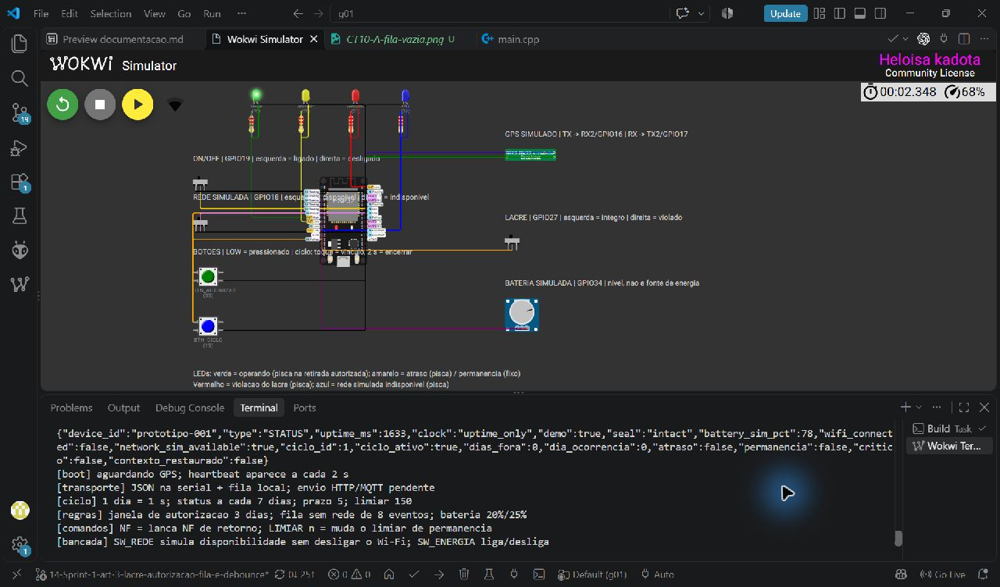

*Figura 1 — CT01: inicialização do circuito integrado no Wokwi, com lacre íntegro e dias fora iguais a zero. Fonte: captura real do simulador Wokwi for VS Code, realizada nesta sessão de testes em 22/10/2026.*

**CT#** | **Bloco** | **Componente de entrada** | **Leitura da entrada** | **Componente de saída** | **Leitura da saída** | **Descrição**
|----------|----------|----------|----------|----------|----------|----------|
|CT01|Inicialização|SW_LACRE e SW_REDE|Lacre fechado e rede disponível ao ligar|LED verde; Serial|Verde fixo, demais apagados; JSON `STATUS` com `dias_fora=0`, `seal="intact"`|Esperado: Ao ligar com o lacre íntegro e conexão, o dispositivo indica operação normal e publica o primeiro status (RF009).|
|CT02|Status periódico|Relógio simulado (1 s = 1 dia)|Dias 7 e 14 de ciclo|Serial|Um `STATUS_SEMANAL` no dia 7 e outro no dia 14, nenhum fora desses dias|Esperado: O status é enviado a cada 7 dias, como pede o TAPI (RF011, RF009; RN07).|
|CT03|Prazo e atraso|Relógio simulado (1 s = 1 dia)|`dias_fora` passa do prazo previsto (5) e fica abaixo do limiar|LED amarelo; Serial|Amarelo piscando a 1 Hz; `ALERTA_ATRASO` emitido uma única vez|Esperado: O equipamento passou da data prevista de retorno, o que é diferente de permanência prolongada (RF013, RF012; RN04).|
|CT04|Permanência|Relógio simulado (1 s = 1 dia)|`dias_fora` atinge o limiar (rodar com 10 e com 150)|LED amarelo; Serial|Amarelo fixo; `ALERTA_PERMANENCIA` emitido uma única vez em cada rodada|Esperado: Testa o limiar configurável com o valor de referência e um valor alternativo, como pede o MVP 4 do TAPI (RF014, RF012; RN03, RN04).|
|CT05|Lacre|SW_LACRE|Lacre aberto sem autorização|LED vermelho; Serial|Vermelho piscando; `VIOLACAO_LACRE` é registrado sem esperar GNSS/rede, fora da rotina semanal|Esperado: Abertura não autorizada gera registro local; medir entrega separadamente da detecção local, com limite a validar com o parceiro (RF006; RN05).|
|CT06|Retirada autorizada|BTN_AUTORIZAR e SW_LACRE|Botão pressionado; lacre aberto dentro da janela de 3 dias e depois fechado|LED verde; Serial|Verde piscando durante a retirada; `RETIRADA_AUTORIZADA` sem alerta; ao fechar, `LACRE_REAPLICADO` e verde fixo|Esperado: Fluxo de retirada autorizada para o reparo, com reaplicação do lacre (RF007; RN06).|
|CT07|Autorização expirada|BTN_AUTORIZAR e SW_LACRE|Botão pressionado; lacre aberto depois de mais de 3 dias|LED vermelho; Serial|Mesmo resultado do CT05: `VIOLACAO_LACRE`|Esperado: Autorização vencida não libera a abertura (RF006; RN05, RN06).|
|CT08|Sem conexão|SW_REDE e SW_LACRE|Rede indisponível; lacre aberto sem autorização|LEDs azul e vermelho; Serial|Azul e vermelho piscando; nada publicado; `VIOLACAO_LACRE` guardada na fila; Serial mostra `[FILA] 1 pendente`|Esperado: Sem conexão, o evento crítico deve ficar guardado para envio posterior dentro da capacidade disponível; saturação é tratada no CT10 (RF010, RF008; RN05, RN09).|
|CT09|Reconexão|SW_REDE|Rede volta a ficar disponível|LED azul; Serial|Eventos pendentes publicados na ordem, com o dia original de ocorrência; azul apaga|Esperado: Ao reconectar, registros confirmados pelo servidor são removidos sem perder o horário de ocorrência (RF010, RF008; RN09).|
|CT10|Fila cheia|SW_REDE, SW_LACRE e entradas que geram eventos|Rodada A: rede indisponível; mais de 8 eventos gerados, com uma violação entre eles. Rodada B: rede indisponível; 12 violações seguidas; depois religar a rede|Serial|A: `FILA_CHEIA`; descarta o evento não crítico mais antigo; a violação continua na fila. B: as 8 primeiras violações ficam na fila e as 4 seguintes entram no resumo (`[FILA] 8 pendentes + resumo de 4 violacao(oes)`); ao religar, saem as 8 na ordem e depois um `VIOLACAO_LACRE_RESUMO` com `quantidade=4`, `dia_primeira` e `dia_ultima`; o resumo é zerado|Esperado: Com a fila no limite, há descarte priorizando críticos; violações excedentes perdem payload individual e preservam apenas contagem e extremos temporais (RF010; RN09).|
|CT11|Ruído de botão|BTN_AUTORIZAR|Pressões rápidas (ruído de contato) e depois o botão segurado por 3 s|Serial|Um único `AUTORIZACAO_REGISTRADA` por pressão real (debounce de 50 ms, detecção por borda); segurar não repete o evento|Esperado: Leituras falsas do botão não geram autorizações em duplicidade (RF007).|
|CT12|Bateria|POT_BATERIA|Nível abaixo de 20%, depois acima de 25%|Serial|`BATERIA_BAIXA` uma única vez; só rearma depois de superar 25%, conforme RN10 (histerese)|Esperado: O alerta de bateria não fica oscilando perto do limite (RF019, RF027; RN10).|
|CT13|Falha do sensor de bateria|POT_BATERIA|Potenciômetro no mínimo (ADC = 0, representa divisor desconectado)|Serial|`SENSOR_BATERIA_FALHA`; nenhum `BATERIA_BAIXA` falso|Esperado: Leitura impossível é tratada como falha do sensor, não como bateria vazia. No dispositivo físico, o diagnóstico elétrico fica para o CT30 (RF019, RF027; RN10).|
|CT14|Encerramento|BTN_CICLO, SW_LACRE e comando `NF`|NF de retorno lançada (`NF` no Serial); lacre fechado; botão segurado por 2 s|Serial|`CICLO_ENCERRADO` com `ciclos_encerrados` somando um; `dias_fora` zera; um toque curto depois abre o `CICLO_INICIADO` com o `ciclo_id` seguinte|Esperado: Encerrar o ciclo libera o dispositivo sem apagar o histórico (RF016, RF017; RN11).|
|CT15|Vínculo simultâneo|BTN_CICLO|Ciclo ativo; toque curto (tentativa de novo vínculo)|Serial|`VINCULO_RECUSADO`; o ciclo atual continua igual|Esperado: Impede vínculos simultâneos indevidos, como pede o TAPI (RF004; RN01).|
|CT16|Encerramento recusado|BTN_CICLO, SW_LACRE e comando `NF`|Rodada A: lacre aberto e NF lançada. Rodada B: lacre fechado e NF ausente; segurar o botão por 2 s em ambas|Serial|`ENCERRAMENTO_RECUSADO` com `motivo` `lacre_aberto` (A) ou `nf_retorno_ausente` (B); o ciclo continua ativo|Esperado: O ciclo só pode ser encerrado com o lacre fechado e a NF de retorno lançada (RF016; RN11).|
|CT35|Desligamento|SW_ENERGIA|Chave ON/OFF para a direita e depois de volta para a esquerda|LEDs; Serial|Ao desligar, `DISPOSITIVO_DESLIGADO` e todos os LEDs apagados; ao religar, novo `STATUS` e LEDs de volta ao estado do ciclo|Esperado: O desligamento fica registrado, porque pode indicar tentativa de burlar o rastreio. É um desligamento lógico: o ESP32 continua alimentado, para de ler entradas e de publicar, e o relógio do ciclo continua contando; o corte real de energia fica para o protótipo físico. Numerado como CT35 porque os CT24 a CT34 estão reservados no planejamento de energia e GNSS.|

#### Resultados da execução da Sprint 1 — 22 e 23/10/2026

**Ambiente e configuração.** Wokwi for VS Code 4.0.1; circuito `src/firmware/prototipo_wokwi/diagram.json`; firmware `demo`; 1 s simulado = 1 dia; prazo de retorno 5 dias; autorização 3 dias; fila de 8 eventos; limiares de permanência 150 e 10 em ciclos distintos. Rede simulada independente do Wi-Fi. Operação e captura automatizadas por Codex, a pedido do grupo; entradas acionadas na interface real e comandos `NF`/`LIMIAR` enviados pela Serial local, sem ajustar variáveis internas para aprovar os testes.

| Rodada | Versão do firmware | SHA-256 do binário demo |
|---|---|---|
| CT01–CT16 e CT35, 22/10/2026 | `7317dd9`, sem alterações locais de firmware durante os ensaios | `E3A60385B943E5B5230535E85D1F9F7426F529F241CB59B9B8A5FCA669AB6F49` |
| Reteste CT14/CT16, 23/10/2026 | `7777594`, com estado do ciclo atualizado antes de publicar o encerramento | `103531CD7BE0D802035A2A6687D21DC33297BBB741177B91772ECCEC6AA6E601` |

**Critério e evidências.** Os resultados abaixo usam os critérios dos CTs, RFs e RNs desta seção. As aprovações se limitam ao comportamento funcional observado no simulador. As capturas mostram estados da execução; contagens, ordem e não repetição foram conferidas nos logs vinculados.

| CT | Situação | Resultado observado | Evidência e log |
|---|---|---|---|
| CT01 | APROVADO no simulador | `STATUS` com lacre íntegro e dias zero; somente verde aceso. Wi-Fi conectou depois do primeiro JSON; não comprova publicação MQTT. | [Print](../assets/3-desenvolvimento-resultados/3.4.1-prototipo-wokwi/ct01.png) · [Log A][serial-a] |
| CT02 | APROVADO no simulador | Um `STATUS_SEMANAL` no dia 7 e outro no dia 14, sem emissão intermediária. | [Dia 7](../assets/3-desenvolvimento-resultados/3.4.1-prototipo-wokwi/ct02.png) · [Dia 14](../assets/3-desenvolvimento-resultados/3.4.1-prototipo-wokwi/ct02Dia14.png) · [Log B][serial-b] |
| CT03 | APROVADO no alerta funcional | Um único `ALERTA_ATRASO`, no dia 6. Amarelo observado piscando; frequência exata de 1 Hz não medida. | [Print](../assets/3-desenvolvimento-resultados/3.4.1-prototipo-wokwi/ct03.png) · [Log B][serial-b] |
| CT04 | APROVADO no simulador | Um `ALERTA_PERMANENCIA` no dia 150 e outro no dia 10, em ciclos distintos. | [150 dias](../assets/3-desenvolvimento-resultados/3.4.1-prototipo-wokwi/ct04.png) · [10 dias](../assets/3-desenvolvimento-resultados/3.4.1-prototipo-wokwi/ct04Limiar10.png) · [Log 150][serial-150] · [Log ciclo 2][serial-ciclos] |
| CT05 | APROVADO na detecção local | Abertura sem autorização válida gerou violação crítica fora da rotina semanal; vermelho observado piscando. | [Print](../assets/3-desenvolvimento-resultados/3.4.1-prototipo-wokwi/ct05Evento.png) · [Log B][serial-b] |
| CT06 | APROVADO no simulador | Retirada autorizada 337 ms após autorização, sem violação nessa retirada; fechamento gerou `LACRE_REAPLICADO`. | [Retirada](../assets/3-desenvolvimento-resultados/3.4.1-prototipo-wokwi/ct06Retirada.png) · [Reaplicação](../assets/3-desenvolvimento-resultados/3.4.1-prototipo-wokwi/ct06.png) · [Log B][serial-b] |
| CT07 | APROVADO no simulador | Abertura depois de vencer a janela gerou `VIOLACAO_LACRE`, sem `RETIRADA_AUTORIZADA`. | [Print](../assets/3-desenvolvimento-resultados/3.4.1-prototipo-wokwi/ct07.png) · [Log A][serial-a] |
| CT08 | APROVADO no armazenamento simulado | Sem rede simulada, violação guardada; fila com um pendente e LEDs vermelho/azul acesos. | [Print](../assets/3-desenvolvimento-resultados/3.4.1-prototipo-wokwi/ct08.png) · [Log B][serial-b] |
| CT09 | **BLOQUEADO** para aprovação integral | Dois eventos reenviados pela Serial, na ordem e com dias originais; fila zero. Falta confirmação do servidor exigida pelo CT. | [Antes](../assets/3-desenvolvimento-resultados/3.4.1-prototipo-wokwi/ct09Antes.png) · [Depois](../assets/3-desenvolvimento-resultados/3.4.1-prototipo-wokwi/ct09.png) · [Log B][serial-b] |
| CT10 | APROVADO na fila/reenvio simulado | A: violação preservada e não críticos mais antigos descartados. B: oito violações individuais e resumo de quatro, depois fila zero. | [Rodada A](../assets/3-desenvolvimento-resultados/3.4.1-prototipo-wokwi/ct10AViolacaoPreservada.png) · [Resumo B](../assets/3-desenvolvimento-resultados/3.4.1-prototipo-wokwi/ct10.png) · [Log da fila][serial-fila] |
| CT11 | APROVADO nos estímulos aplicados | Três pressões curtas geraram três autorizações; uma pressão mantida gerou somente uma. Fronteira exata de 50 ms não medida. | [Evento](../assets/3-desenvolvimento-resultados/3.4.1-prototipo-wokwi/ct11.png) · [Pressão mantida](../assets/3-desenvolvimento-resultados/3.4.1-prototipo-wokwi/ct11PressaoMantida.png) · [Log A][serial-a] |
| CT12 | APROVADO no simulador | Sequência 17% → 22% → 17% → 31% → 17% gerou somente dois alertas, confirmando rearme acima de 25%. | [Print](../assets/3-desenvolvimento-resultados/3.4.1-prototipo-wokwi/ct12.png) · [Log A][serial-a] |
| CT13 | APROVADO no diagnóstico simulado | Partindo de 78%, entrada zero gerou uma falha do sensor e nenhum `BATERIA_BAIXA`. | [Print isolado](../assets/3-desenvolvimento-resultados/3.4.1-prototipo-wokwi/ct13Isolado.png) · [Log C][serial-c] |
| CT14 | **APROVADO no reteste de 23/10/2026** | Dois encerramentos com `ciclo_ativo=false`, `dias_fora=0` e contadores 1/2. Toque curto após o primeiro iniciou o ciclo 2 com dias zero; o lacre permaneceu fechado durante todo o primeiro ciclo. | [Encerramento corrigido](../assets/3-desenvolvimento-resultados/3.4.1-prototipo-wokwi/ct14Corrigido.png) · [Reutilização](../assets/3-desenvolvimento-resultados/3.4.1-prototipo-wokwi/ct14CorrigidoReutilizado.png) · [Segundo encerramento](../assets/3-desenvolvimento-resultados/3.4.1-prototipo-wokwi/ct14CorrigidoSegundoCiclo.png) · [Log do reteste][serial-reteste] |
| CT15 | APROVADO no simulador | Novo vínculo recusado com `motivo=ciclo_ativo`; ciclo 1 permaneceu ativo. | [Print](../assets/3-desenvolvimento-resultados/3.4.1-prototipo-wokwi/ct15.png) · [Log B][serial-b] |
| CT16 | APROVADO nas duas recusas | Recusou lacre aberto com NF e lacre fechado sem NF, mantendo o ciclo ativo; ambas as condições foram confirmadas novamente na versão corrigida. | [Lacre aberto](../assets/3-desenvolvimento-resultados/3.4.1-prototipo-wokwi/ct16CorrigidoLacreAberto.png) · [NF ausente](../assets/3-desenvolvimento-resultados/3.4.1-prototipo-wokwi/ct16CorrigidoNfAusente.png) · [Log do reteste][serial-reteste] |
| CT35 | APROVADO no desligamento lógico observado | Desligamento registrado, LEDs apagados e 26,535 s simulados sem novas mensagens; novo `STATUS` e LEDs restaurados ao religar. | [Desligado](../assets/3-desenvolvimento-resultados/3.4.1-prototipo-wokwi/ct35Desligado.png) · [Religado](../assets/3-desenvolvimento-resultados/3.4.1-prototipo-wokwi/ct35.png) · [Log A][serial-a] |

**Correção e validação do CT14.** A falha original era publicar `CICLO_ENCERRADO` antes de desativar o ciclo e zerar os dias. A ordem foi corrigida, sem alterar o critério esperado. No reteste de 23/10/2026, os encerramentos em `uptime_ms=91417` e `215814` trouxeram ciclo inativo, dias zero e contadores 1 e 2; a reutilização em `118236` iniciou o ciclo 2 com dias zero. As recusas do CT16 por NF ausente (`132328`) e lacre aberto com NF (`176792`) mantiveram o ciclo ativo. Os ambientes `demo`/`weekly` compilaram e `scripts/verify.ps1` passou. Capturas e logs anteriores foram preservados como histórico.

**Limitações e pendências.** CT09 depende de transporte e confirmação do servidor: a saída na Serial e o esvaziamento da fila não comprovam entrega. Não foram validados precisão de 1 Hz/debounce, retenção após corte de energia, autonomia, diagnóstico elétrico da bateria ou contagem de dias por NF real. CT04 tem logs por intervalo: a rodada de 150 dias foi gravada aproximadamente do dia 84 até depois do limiar; o log do ciclo 2 cobre o limiar 10. No primeiro `STATUS` após religar no CT35, os dias ainda eram os anteriores ao desligamento; os registros seguintes atualizaram a contagem para incluir o intervalo desligado.

Os limites exatos de bateria em 20% e 25% e os demais novos cenários de falha combinada continuam pendentes, com numeração a partir do CT36; CT24–CT34 permanecem reservados. Abrir e fechar o lacre enquanto o dispositivo está desligado não foi ensaiado nesta rodada e continua como discussão de regra com o grupo.

Os logs ficam em `assets/3-desenvolvimento-resultados/3.4.1-prototipo-wokwi/`, acessíveis pelos links de cada CT. O Log A contém dois boots; as contagens usam o segundo, a partir do segundo `ets Jul 29 2019`. O log do reteste de 23/10 começa na confirmação de NF do ciclo 1 e segue até depois do segundo encerramento. Os blocos a seguir exibem as capturas sem reproduzir a Serial inteira no documento; o CT01 já aparece na Figura 1.

[serial-a]: ../assets/3-desenvolvimento-resultados/3.4.1-prototipo-wokwi/CT01-CT07-CT11-CT12-CT35-execucao.serial.txt
[serial-b]: ../assets/3-desenvolvimento-resultados/3.4.1-prototipo-wokwi/CT02-CT03-CT05-CT06-CT08-CT09-CT15-execucao.serial.txt
[serial-c]: ../assets/3-desenvolvimento-resultados/3.4.1-prototipo-wokwi/CT13-isolado.serial.txt
[serial-150]: ../assets/3-desenvolvimento-resultados/3.4.1-prototipo-wokwi/CT04-limiar150.serial.txt
[serial-ciclos]: ../assets/3-desenvolvimento-resultados/3.4.1-prototipo-wokwi/CT04-CT14-CT16-execucao.serial.txt
[serial-fila]: ../assets/3-desenvolvimento-resultados/3.4.1-prototipo-wokwi/CT10-execucao.serial.txt
[serial-reteste]: ../assets/3-desenvolvimento-resultados/3.4.1-prototipo-wokwi/CT14-2026-10-23.serial.txt

CT02 — Status periódico

*Figura 3.4.1-CT02 — Status semanal do dia 7; o dia 14 está na captura complementar. Fonte: captura real do simulador Wokwi for VS Code, 22/10/2026.*

Capturas complementares: [Dia 14](../assets/3-desenvolvimento-resultados/3.4.1-prototipo-wokwi/ct02Dia14.png).

CT03 — Prazo e atraso

*Figura 3.4.1-CT03 — Alerta de atraso no dia 6, antes do status semanal. Fonte: captura real do simulador Wokwi for VS Code, 22/10/2026.*

CT04 — Permanência em 150 e 10 dias

*Figura 3.4.1-CT04 — Alerta de permanência com limiar de 150 dias. Fonte: captura real do simulador Wokwi for VS Code, 22/10/2026.*

Capturas complementares: [Limiar 10](../assets/3-desenvolvimento-resultados/3.4.1-prototipo-wokwi/ct04Limiar10.png) · [Confirmação de configuração](../assets/3-desenvolvimento-resultados/3.4.1-prototipo-wokwi/CT04-configuracao.serial.txt).

CT05 — Violação do lacre

*Figura 3.4.1-CT05 — Violação crítica registrada e LED vermelho aceso. Fonte: captura real do simulador Wokwi for VS Code, 22/10/2026.*

Capturas complementares: [Estado posterior, em outra fase do piscar](../assets/3-desenvolvimento-resultados/3.4.1-prototipo-wokwi/ct05.png).

CT06 — Retirada autorizada e reaplicação

*Figura 3.4.1-CT06 — Retirada autorizada dentro da janela de três dias simulados. Fonte: captura real do simulador Wokwi for VS Code, 22/10/2026.*

Capturas complementares: [Reaplicação do lacre](../assets/3-desenvolvimento-resultados/3.4.1-prototipo-wokwi/ct06.png).

CT07 — Autorização expirada

*Figura 3.4.1-CT07 — Violação após a autorização vencer. Fonte: captura real do simulador Wokwi for VS Code, 22/10/2026.*

CT08 — Evento sem conexão

*Figura 3.4.1-CT08 — Violação guardada com um evento pendente e LEDs azul/vermelho acesos. Fonte: captura real do simulador Wokwi for VS Code, 22/10/2026.*

CT09 — Reconexão — BLOQUEADO para confirmação do servidor

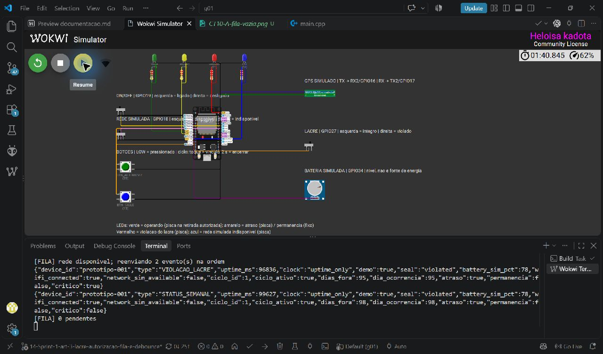

*Figura 3.4.1-CT09 — Reenvio local ordenado e fila zero; não comprova confirmação do servidor. Fonte: captura real do simulador Wokwi for VS Code, 22/10/2026.*

Capturas complementares: [Dois eventos pendentes antes de reconectar](../assets/3-desenvolvimento-resultados/3.4.1-prototipo-wokwi/ct09Antes.png).

CT10 — Fila cheia — rodadas A e B

Pré-condição das duas rodadas: ciclo inativo, fila inicialmente vazia, lacre fechado e rede indisponível, evitando status periódicos na contagem. Na rodada A, uma violação e dez alterações `LIMIAR 201` a `210` provocaram três descartes dos não críticos mais antigos; a violação e os eventos 204–210 foram reenviados. Na B, doze aberturas sem autorização, separadas por onze fechamentos estáveis, produziram oito violações individuais e resumo de quatro; ambos foram esvaziados ao reconectar. Houve uma interrupção do capturador entre o armazenamento inicial da violação A e os dez comandos; os intervalos ausentes não foram reconstruídos.

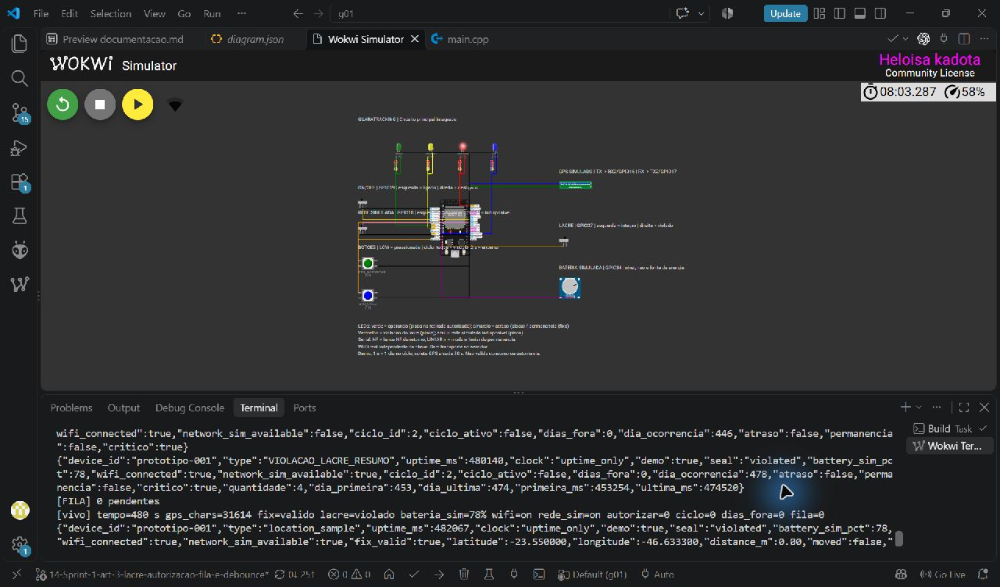

*Figura 3.4.1-CT10 — Resumo de quatro violações enviado após oito individuais, com fila esvaziada. Fonte: captura real do simulador Wokwi for VS Code, 22/10/2026.*

Capturas complementares: [A: fila cheia](../assets/3-desenvolvimento-resultados/3.4.1-prototipo-wokwi/ct10ACheia.png) · [A: violação preservada](../assets/3-desenvolvimento-resultados/3.4.1-prototipo-wokwi/ct10AViolacaoPreservada.png) · [A: fila zero](../assets/3-desenvolvimento-resultados/3.4.1-prototipo-wokwi/ct10AFilaVazia.png) · [B: início do resumo](../assets/3-desenvolvimento-resultados/3.4.1-prototipo-wokwi/ct10BResumoIniciado.png) · [B: oito mais quatro pendentes](../assets/3-desenvolvimento-resultados/3.4.1-prototipo-wokwi/ct10BCheiaResumo4.png).

CT11 — Ruído e pressão mantida do botão

Foram aplicadas três pressões curtas e uma mantida, com o bounce padrão do Wokwi. A pressão mantida apareceu nos heartbeats de 62 a 88 s sem repetir a autorização. A fronteira de 50 ms não foi medida.

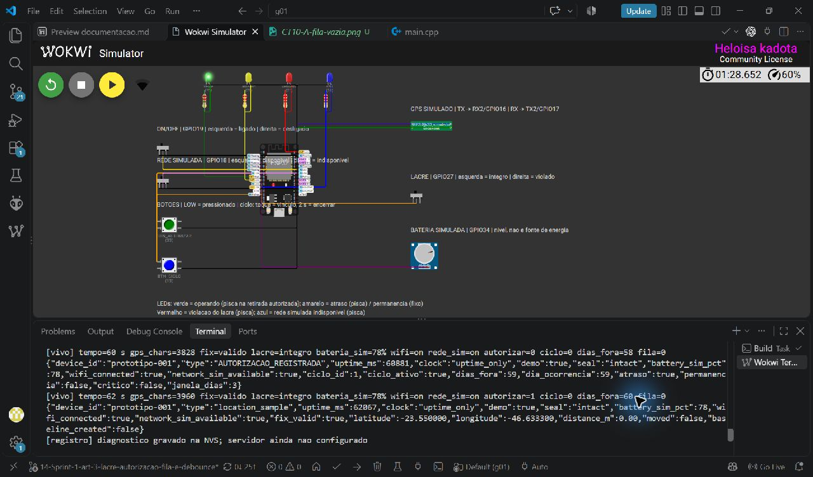

*Figura 3.4.1-CT11 — Uma autorização registrada na pressão mantida, sem repetição nos heartbeats seguintes. Fonte: captura real do simulador Wokwi for VS Code, 22/10/2026.*

Capturas complementares: [Botão mantido pressionado](../assets/3-desenvolvimento-resultados/3.4.1-prototipo-wokwi/ct11PressaoMantida.png).

CT12 — Bateria baixa e histerese

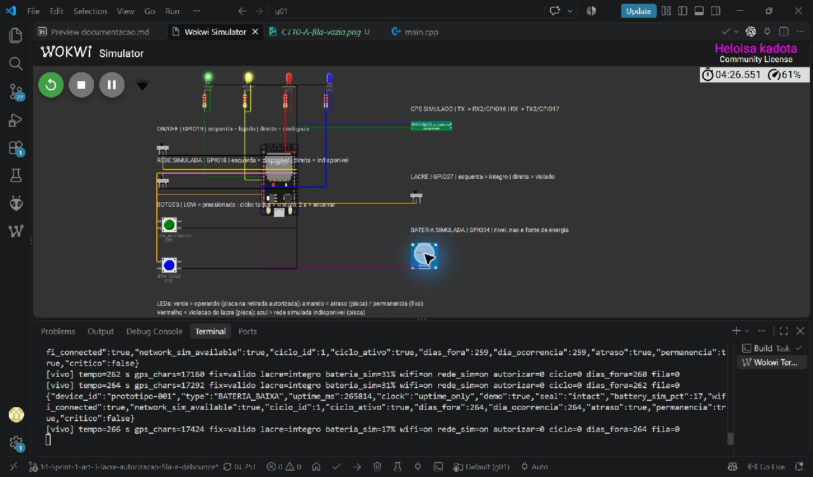

*Figura 3.4.1-CT12 — Segundo alerta somente após recuperação acima de 25% e nova queda. Fonte: captura real do simulador Wokwi for VS Code, 22/10/2026.*

Capturas complementares: [Primeiro alerta](../assets/3-desenvolvimento-resultados/3.4.1-prototipo-wokwi/ct12PrimeiroAlerta.png) · [22%](../assets/3-desenvolvimento-resultados/3.4.1-prototipo-wokwi/ct12RecuperacaoInsuficiente.png) · [Nova queda sem repetição](../assets/3-desenvolvimento-resultados/3.4.1-prototipo-wokwi/ct12SemRepeticao.png) · [Recuperação em 31%](../assets/3-desenvolvimento-resultados/3.4.1-prototipo-wokwi/ct12Recuperacao.png).

CT13 — Falha do sensor de bateria

*Figura 3.4.1-CT13 — Entrada zero depois de bateria saudável gera falha do sensor, sem alerta falso de bateria baixa. Fonte: captura real do simulador Wokwi for VS Code, 22/10/2026.*

Capturas complementares: [Rodada adicional](../assets/3-desenvolvimento-resultados/3.4.1-prototipo-wokwi/ct13.png).

CT14 — Encerramento e reutilização — APROVADO

*Figura 3.4.1-CT14 — Encerramento corrigido: `ciclo_ativo=false`, `dias_fora=0` e contador 1. Fonte: captura real do simulador Wokwi for VS Code, 23/10/2026.*

Capturas complementares: [Ciclo 2 iniciado com dias zero](../assets/3-desenvolvimento-resultados/3.4.1-prototipo-wokwi/ct14CorrigidoReutilizado.png) · [Segundo encerramento com contador 2](../assets/3-desenvolvimento-resultados/3.4.1-prototipo-wokwi/ct14CorrigidoSegundoCiclo.png). A [captura anterior à correção](../assets/3-desenvolvimento-resultados/3.4.1-prototipo-wokwi/ct14.png) foi preservada como histórico e não representa o resultado do reteste.

CT15 — Recusa de vínculo simultâneo

*Figura 3.4.1-CT15 — Vínculo recusado enquanto o ciclo atual está ativo. Fonte: captura real do simulador Wokwi for VS Code, 22/10/2026.*

CT16 — Encerramento recusado — rodadas A e B

*Figura 3.4.1-CT16 — Recusa por lacre aberto, mesmo com NF de retorno lançada, na versão corrigida. Fonte: captura real do simulador Wokwi for VS Code, 23/10/2026.*

Captura complementar: [Recusa por NF ausente com lacre fechado](../assets/3-desenvolvimento-resultados/3.4.1-prototipo-wokwi/ct16CorrigidoNfAusente.png).

CT35 — Desligamento lógico e religamento

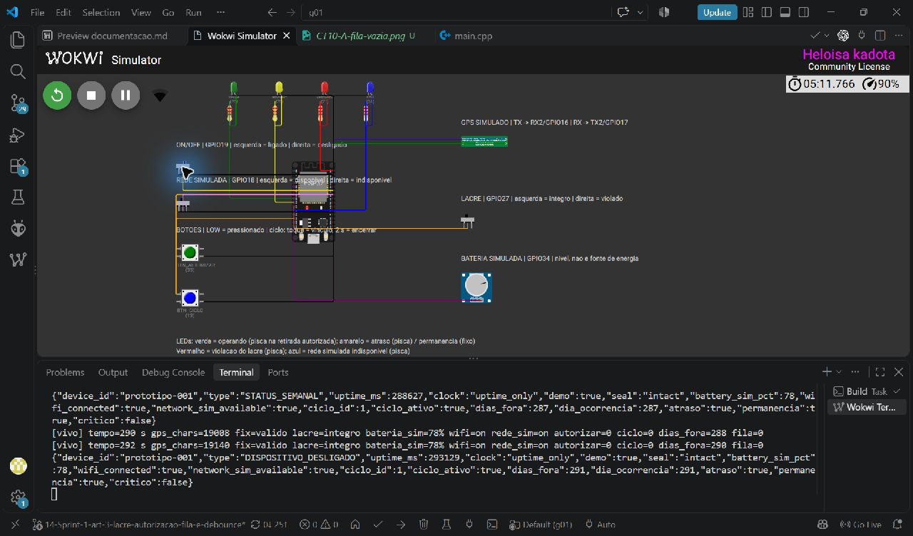

*Figura 3.4.1-CT35 — Desligamento registrado e quatro LEDs apagados. Fonte: captura real do simulador Wokwi for VS Code, 22/10/2026.*

Capturas complementares: [Novo STATUS e LEDs restaurados ao religar](../assets/3-desenvolvimento-resultados/3.4.1-prototipo-wokwi/ct35.png).

#### CT17–CT23 — ensaios complementares: execução de 23/10/2026

**Situação:** CT17, CT19, CT20, CT21 e CT23 **APROVADOS no simulador**; CT18 e CT22 **REPROVADOS**, mantendo os critérios esperados da tabela. Execução por automação local no Wokwi for VS Code 4.0.1, em 23/10/2026. O resultado caracteriza comportamento funcional simulado.

**Configuração e reprodução:** base `7777594`, ESP32 DevKit v1, ambiente `demo`, dia de 1 s, coleta de 30 s, espera GNSS de 10 s, validade de fix de 3 s e debounce do lacre de 60 ms. CT17/CT23 e a contraprova do CT18 usam o binário original (SHA-256 `103531CD7BE0D802035A2A6687D21DC33297BBB741177B91772ECCEC6AA6E601`). CT18–CT22 também usam a [instrumentação isolada de ensaio](../tests/wokwi-complementares/README.md), que inclui a lógica de produção sem mudanças e acrescenta leitura NVS, reinício e diagnóstico pelo GPIO32; SHA-256 do binário instrumentado: `2AC42AA1EB4208ECC696E74FBE4D0A3EF2DCFBA6964FEC661D918F2344A0F8AA`. O gerador fornece pulsos digitais e NMEA nos mesmos GPIOs do circuito principal; constantes e esperados não foram ajustados. Os diagramas são gerados separadamente pelo roteiro, preservando o circuito de produção.

Os logs completos ficam em arquivos externos, vinculados nos resultados. A NVS começa vazia em cada rodada nova; o CT22 reinicia a CPU na mesma instância para manter a flash. As sondas leem `q0..q15`, `p0..p7`, `pmeta`, `ctx` e `previous` diretamente com `Preferences`. Mensagens `[ensaio]` identificam a instrumentação e não são eventos de negócio.

| CT | Pré-condição e procedimento | Resultado esperado / medição | Limitação ou preparação |
|---|---|---|---|
| CT17 | Acionar lacre, autorização, ciclo, chave de rede e chave ON/OFF individualmente; repetir com rede simulada indisponível e lacre aberto. | Heartbeat mostra a leitura bruta dos dois botões, `dias_fora`, `fila` e separa `wifi` de `rede_sim`. Os LEDs seguem o estado de negócio: verde fixo com lacre íntegro e piscando na retirada autorizada, vermelho piscando na violação, amarelo no atraso/permanência e azul piscando com a rede simulada indisponível. Os botões geram os eventos de autorização e de ciclo dos CT06–CT16. | Diagnóstico de bancada. Não interpretar LED como confirmação de servidor. |
| CT18 | Com captura temporal controlada, aplicar pulsos de 20 e 40 ms no lacre, depois 10 aberturas/fechamentos estáveis de 200 ms; repetir durante espera por fix e com rede indisponível. | Zero eventos nos pulsos curtos observados; um `seal_changed` por transição estável, sem repetição enquanto o nível é mantido, com `authorized_removal=true` só na retirada autorizada; abertura sem autorização gera também `VIOLACAO_LACRE` (CT05). Registrar `L_det = t_registro_local − t_estabilizacao_contato`, perdas e duplicações; ampliar para 30 estímulos por condição ao medir p95. | Exige injeção temporizada; cliques manuais não comprovam milissegundos. Debounce atual de 60 ms; limite máximo de latência pendente. |
| CT19 | Rodada A: iniciar sem fix. Rodada B: obter posição válida, invalidar o fix e aguardar próxima coleta. Rodada C: interromper NMEA por mais de 3 s antes de solicitar nova coleta. | Sem fix recente, emitir `location_unavailable` após a espera configurada de 10 s, mais latência de processamento medida. Latitude/longitude atuais e `moved` são `null`; histórico é preservado quando disponível. O lacre continua respondendo durante a espera. | Rodada C exige controle da emissão UART no ensaio. Não aceitar só a passagem do tempo com NMEA válido chegando. A referência de comparação é a coleta válida anterior, distinta do último fix observado. |
| CT20 | Com memória de teste sem referência e fix contínuo, coletar primeiro ponto; depois pontos sintéticos separados por aproximadamente 50 m e 150 m da respectiva coleta anterior. Observar ao menos três coletas em `demo`. | Primeiro ponto: `baseline_created=true`, distância e `moved` nulos. Nas seguintes, `moved=false` para 50 m e `true` para 150 m. Com fix disponível, intervalo de 30 s mais latência de processamento; registrar desvio. | Comparar coletas válidas consecutivas. Testar fronteira de 100 m em teste matemático separado, considerando arredondamento; não alegar sete dias medidos com demo de 30 s. |
| CT21 | Iniciar fila vazia em memória de teste; gerar 17 registros, contando também coletas automáticas. Inspecionar chaves `q0` a `q15`; alternar a chave de rede. | Os primeiros 16 ocupam a fila; o 17º aparece na Serial com aviso de limite e não substitui os anteriores. A chave de rede não esvazia a fila. Medir quantos registros ficaram somente na Serial. | Caracteriza a limitação atual; confirmação de entrega, prioridade e reenvio continuam pendentes. Inspeção de NVS exige ferramenta/instrumentação de teste; capacidade final e prioridade ainda pendentes. |
| CT22 | Salvar posição A e registros conhecidos, com ciclo ativo há alguns dias e eventos na fila sem rede; reiniciar preservando flash/NVS. Sem novo fix, observar saída; depois coletar B. | Referência A, registro de diagnóstico, fila de eventos, `ciclo_id`, `dias_fora` e estado do lacre permanecem; `STATUS` com `contexto_restaurado=true`. Histórico após reinício sem idade conhecida apresenta `last_valid_age_ms=null`; novo ponto B compara com A. `uptime_ms` reinicia e não deve ser tratado como horário absoluto. | Confirmar preservação de flash no ambiente usado; se indisponível no simulador, executar em hardware. Sem acesso à NVS, não aprovar retenção da fila apenas pelo JSON da posição. |
| CT23 | Mover potenciômetro ao mínimo, meio e máximo; observar heartbeat/JSON. | Percentual sintético permanece entre 0 e 100 e acompanha a entrada; o mínimo absoluto (ADC = 0) gera `SENSOR_BATERIA_FALHA`, conforme a RN10 e o CT13. Não emitir conclusão de bateria desconectada, autonomia ou tensão física com esses dados. | ADC e percentual simulados não são medição de estado de carga de uma bateria real. |

**Resultados medidos e evidências**

| CT | Situação | Resultado observado | Evidência / log completo |
|---|---|---|---|
| CT17 | APROVADO | Leituras brutas dos dois botões, autorização/retirada, recusa de encerramento, rede indisponível com Wi-Fi conectado, fila e desligamento/religamento observados. LEDs acompanharam os estados; frequência exata não medida. | [Print](../assets/3-desenvolvimento-resultados/3.4.1-prototipo-wokwi/ct17.png) · [Serial](../assets/3-desenvolvimento-resultados/3.4.1-prototipo-wokwi/CT17-CT23.serial.txt) |
| CT18 | **REPROVADO** | Pulsos de 20/40 ms ignorados. Binário original: 20/20 transições com rede e 16/20 sem rede (4 perdas); sem duplicação observada. Rodada instrumentada: 20/20 e 14/20, respectivamente. | [Original](../assets/3-desenvolvimento-resultados/3.4.1-prototipo-wokwi/ct18Original.png) · [Serial original](../assets/3-desenvolvimento-resultados/3.4.1-prototipo-wokwi/CT18-original.serial.txt) · [Serial instrumentada](../assets/3-desenvolvimento-resultados/3.4.1-prototipo-wokwi/CT18.serial.txt) |
| CT19 | APROVADO | Três saídas sem fix em 11.630/81.630/151.630 ms, com latitude/longitude/`moved` nulos; histórico preservado nas duas últimas. NMEA interrompido de 120 a 160 s, contador parado em 7.788 caracteres. Seis transições do lacre detectadas durante as três esperas. | [Print](../assets/3-desenvolvimento-resultados/3.4.1-prototipo-wokwi/ct19.png) · [Serial](../assets/3-desenvolvimento-resultados/3.4.1-prototipo-wokwi/CT19.serial.txt) |
| CT20 | APROVADO | Primeiro ponto criou referência. Depois, 50,04 m → `moved=false` e 150,11 m → `true`; coletas em 2.068/32.067/62.067 ms, intervalos de 29.999/30.000 ms (desvios −1/0 ms de 30 s). | [Print](../assets/3-desenvolvimento-resultados/3.4.1-prototipo-wokwi/ct20.png) · [Serial](../assets/3-desenvolvimento-resultados/3.4.1-prototipo-wokwi/CT20.serial.txt) |
| CT21 | APROVADO | NVS inicialmente vazia; 17 registros gerados (1 coleta + 16 transições). `q0..q15` iguais aos primeiros 16 JSON, preservados nas sondas de 21/28 s após alternar a rede; 1 registro somente na Serial e 1 aviso de limite. | [Print NVS](../assets/3-desenvolvimento-resultados/3.4.1-prototipo-wokwi/ct21.png) · [Serial](../assets/3-desenvolvimento-resultados/3.4.1-prototipo-wokwi/CT21.serial.txt) |
| CT22 | **REPROVADO no ambiente** | `q0..q2` e `p0..p3` conhecidos antes do reset reapareceram sem alterações; referência A, lacre aberto e ciclo 1 retidos, `STATUS` restaurado com 42 dias. Sem fix: idade histórica nula; B comparou com A (150,11 m). Porém `uptime_ms` continuou crescente após o reinício (novo `STATUS` em 46.419 ms), contrariando o esperado. | [Sem fix após reset](../assets/3-desenvolvimento-resultados/3.4.1-prototipo-wokwi/ct22.png) · [B](../assets/3-desenvolvimento-resultados/3.4.1-prototipo-wokwi/ct22PontoB.png) · [Serial](../assets/3-desenvolvimento-resultados/3.4.1-prototipo-wokwi/CT22.serial.txt) |
| CT23 | APROVADO | Entrada mínima/meio/máxima resultou em 0/50/100%; todos os percentuais entre 0 e 100. Zero gerou 1 `SENSOR_BATERIA_FALHA`, sem `BATERIA_BAIXA` falso na rodada. | [Print](../assets/3-desenvolvimento-resultados/3.4.1-prototipo-wokwi/ct23.png) · [Serial](../assets/3-desenvolvimento-resultados/3.4.1-prototipo-wokwi/CT17-CT23.serial.txt) |

**Medições e pendências:** no CT18 instrumentado, a latência entre a borda e o primeiro byte do JSON foi de 60,523 a 64,926 ms com rede disponível (20 transições). A associação temporal da sonda ficou inválida em parte da rodada sem rede; os valores dessa condição foram descartados, sem editar o log bruto. A contagem foi conferida também no binário original. Não se calculou p95: faltam 30 estímulos por condição e um limite de latência acordado. A retirada autorizada positiva está na execução do CT17; as aberturas do CT18 ocorreram sem autorização.

No CT22, o log registra `SW_CPU_RESET` seguido de `TG1WDT_SYS_RESET`; a retenção NVS foi verificada, mas o relógio de uptime não reiniciou no Wokwi. A causa e o comportamento em hardware permanecem pendentes; não foi alterado o esperado para aprovar o caso. As falhas dos CT18/CT22 exigem investigação e reteste. Corte físico de energia, entrega ao servidor e validação elétrica continuam fora do que estas capturas comprovam.

CT17 — Diagnóstico das entradas e estados

*Figura 3.4.1-CT17 — Rede simulada indisponível, Wi-Fi conectado e lacre violado. Fonte: captura real do simulador Wokwi for VS Code, 23/10/2026.*

Capturas complementares: [Autorização](../assets/3-desenvolvimento-resultados/3.4.1-prototipo-wokwi/ct17Autorizacao.png) · [Retirada autorizada](../assets/3-desenvolvimento-resultados/3.4.1-prototipo-wokwi/ct17RetiradaAutorizada.png) · [Botão de ciclo](../assets/3-desenvolvimento-resultados/3.4.1-prototipo-wokwi/ct17Ciclo.png) · [Autorização sem rede](../assets/3-desenvolvimento-resultados/3.4.1-prototipo-wokwi/ct17AutorizacaoSemRede.png) · [Desligado](../assets/3-desenvolvimento-resultados/3.4.1-prototipo-wokwi/ct17Desligado.png) · [Religado](../assets/3-desenvolvimento-resultados/3.4.1-prototipo-wokwi/ct17Religado.png).

CT18 — Transições cronometradas — REPROVADO

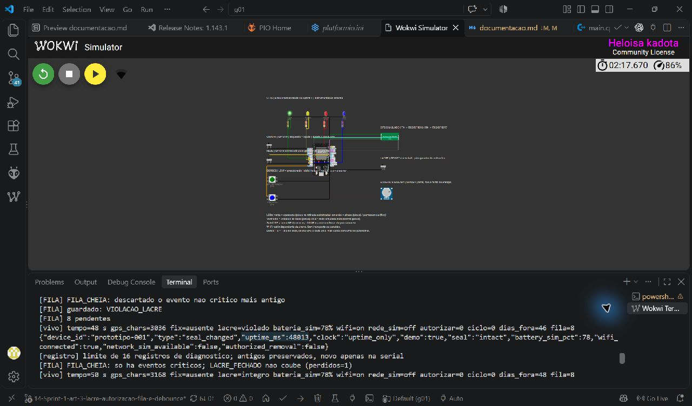

*Figura 3.4.1-CT18 — Contraprova com o binário original e rede indisponível. Fonte: captura real do simulador Wokwi for VS Code, 23/10/2026.*

Capturas complementares: [Rodada instrumentada](../assets/3-desenvolvimento-resultados/3.4.1-prototipo-wokwi/ct18.png).

CT19 — Ausência de fix e interrupção NMEA

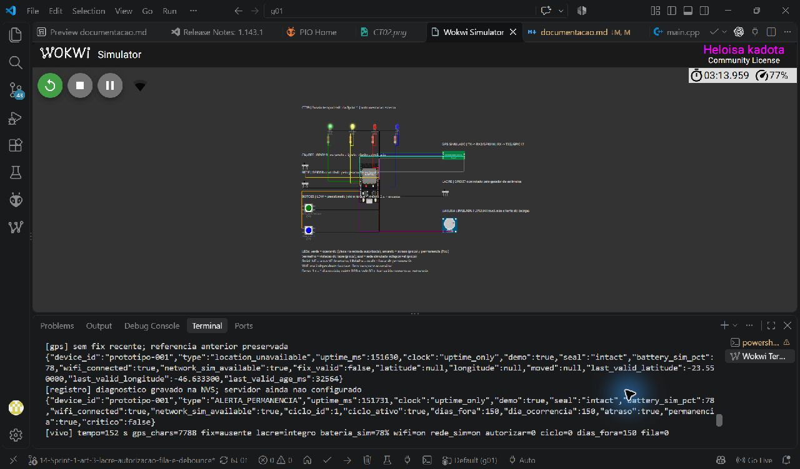

*Figura 3.4.1-CT19 — Coleta sem NMEA com coordenadas atuais nulas e histórico preservado. Fonte: captura real do simulador Wokwi for VS Code, 23/10/2026.*

Capturas complementares: [Fix inválido com NMEA ativo](../assets/3-desenvolvimento-resultados/3.4.1-prototipo-wokwi/ct19FixInvalido.png).

CT20 — Comparação entre coletas válidas

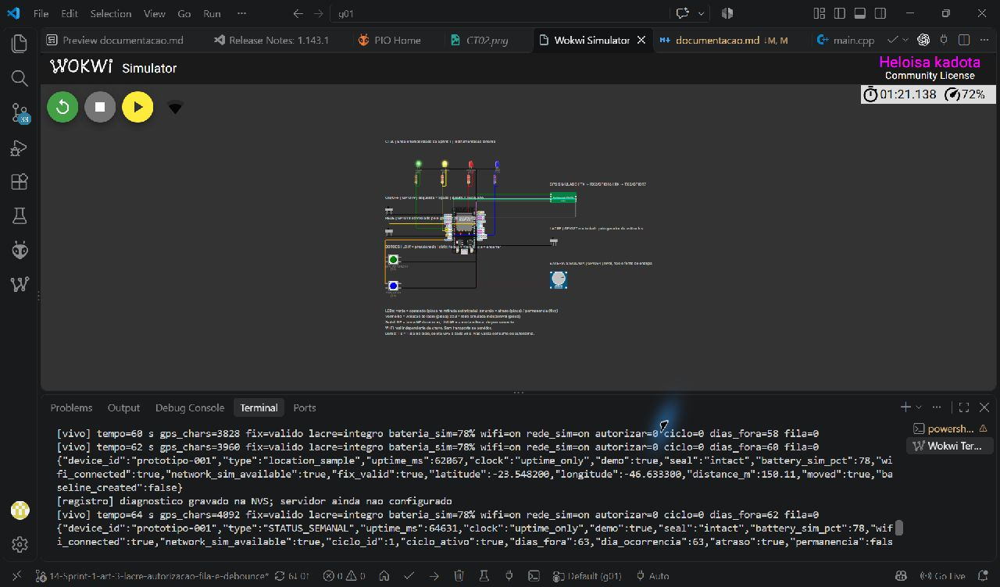

*Figura 3.4.1-CT20 — Deslocamento consecutivo de 150,11 m com moved=true. Fonte: captura real do simulador Wokwi for VS Code, 23/10/2026.*

Capturas complementares: [Deslocamento de 50,04 m com moved=false](../assets/3-desenvolvimento-resultados/3.4.1-prototipo-wokwi/ct2050m.png).

CT21 — Limite de diagnóstico na NVS

*Figura 3.4.1-CT21 — q15 preservada na inspeção posterior à alternância da rede. Fonte: captura real do simulador Wokwi for VS Code, 23/10/2026.*

CT22 — Retenção no reinício — REPROVADO no ambiente

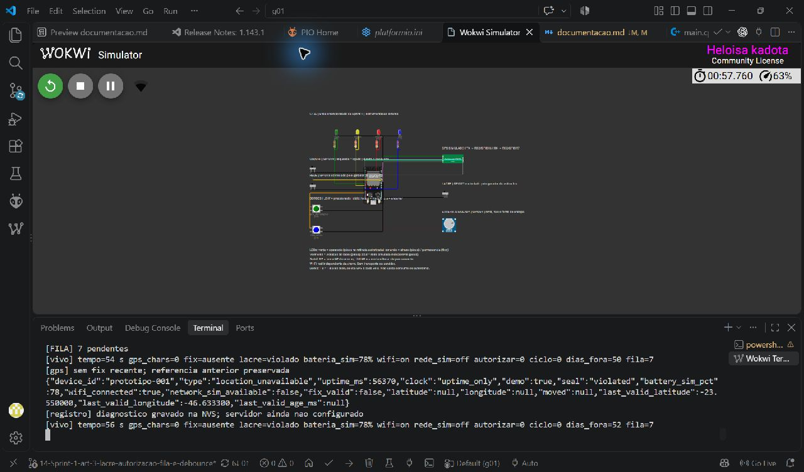

*Figura 3.4.1-CT22 — Histórico restaurado sem fix novo e com idade desconhecida nula. Fonte: captura real do simulador Wokwi for VS Code, 23/10/2026.*

Capturas complementares: [Ponto B comparado com A após reinício](../assets/3-desenvolvimento-resultados/3.4.1-prototipo-wokwi/ct22PontoB.png).

CT23 — Faixa da entrada de bateria simulada

*Figura 3.4.1-CT23 — Potenciômetro no máximo com leitura sintética de 100%. Fonte: captura real do simulador Wokwi for VS Code, 23/10/2026.*

Capturas complementares: [Mínimo e falha do sensor](../assets/3-desenvolvimento-resultados/3.4.1-prototipo-wokwi/ct23Minimo.png) · [Meio em 50%](../assets/3-desenvolvimento-resultados/3.4.1-prototipo-wokwi/ct23Meio.png).

#### Rodada do protótipo V2 — 30/10/2026

O V2 trocou a interface local (LEDs por LCD, botões de navegação e buzzer) e passou a exigir 3 s pressionados nos botões de autorização e de ciclo. Os eventos JSON e as regras de negócio são os do V1, já cobertos por `tests/model_tests.c` e por `tests/screen_controller_tests.cpp`. Por isso, os CTs foram repetidos com os mesmos RF/RN e o mesmo critério de negócio, e apenas os componentes de entrada e saída foram adaptados à nova interface. As aprovações do V1 ficam preservadas acima.

| CT | Procedimento ou saída no V2 | O que permanece do critério |
|---|---|---|
| CT01 | LCD aceso na tela "NF da remessa" no lugar do verde fixo | `STATUS` com `dias_fora=0` e lacre íntegro |
| CT03 | Tela de prazo com "ATRASO: N dias" no lugar do amarelo piscando | Um único `ALERTA_ATRASO` |
| CT04 | Sem indicação no LCD; o alerta aparece só na Serial | Um único `ALERTA_PERMANENCIA` no limiar |
| CT05, CT07 | Mensagem "VIOLACAO registrada" e buzzer intermitente por até 30 s no lugar do vermelho | `VIOLACAO_LACRE` crítico, fora da rotina |
| CT06 | Autorização exige segurar o botão por 3 s; mensagem "Retirada autorizada" no lugar do verde piscando | `RETIRADA_AUTORIZADA` sem violação e `LACRE_REAPLICADO` |
| CT08, CT09 | Mensagens "Sem sinal / na fila: N" e "Sinal ok / enviados: N" no lugar do azul | Violação guardada e reenvio na ordem, com o dia original |
| CT11 | Toques curtos não registram nada; segurar 3 s registra uma autorização | Ruído e pressão mantida não duplicam a autorização |
| CT14, CT16 | Encerrar e iniciar o ciclo exigem segurar 3 s, no lugar de 2 s e do toque curto | Encerramento só com lacre fechado e NF de retorno |
| CT15 | O mesmo gesto inicia ou encerra; com ciclo ativo ele cai no encerramento | Nenhum segundo ciclo simultâneo (RN01) |
| CT17 | Navegação circular pelas cinco telas e leitura bruta de AVANÇAR/VOLTAR no heartbeat | Diagnóstico das entradas |
| CT35 | LCD e luz de fundo apagados e buzzer mudo no lugar dos LEDs apagados | `DISPOSITIVO_DESLIGADO`, silêncio e novo `STATUS` |

CT02, CT10, CT12, CT13 e CT23 não mudaram, porque suas saídas já eram só a Serial.

**Ambiente e reprodução.** Wokwi CLI 0.29.0; circuito `src/firmware/prototipo_wokwi/diagram.json` (V2); ESP32 DevKit v1; firmware `demo` com 1 s simulado = 1 dia, prazo de 5 dias, autorização de 3 dias e fila de 8 eventos. SHA-256 do binário: `EF905DB9E8DD0BD71407006E46EBB0801AB2FF41DF03504048DB11B3C0DEBA1F`. As entradas foram acionadas pelos controles do próprio circuito (chaves, botões e potenciômetro) e pelos comandos `NF` e `LIMIAR` na Serial, conforme os cenários de [`tests/wokwi-ci/`](../tests/wokwi-ci/run_cts.py). O script `run_cts.py` confere em cada log as contagens, a ordem, a não repetição e o silêncio no desligamento. As capturas são o conteúdo do LCD lido do simulador, não a tela inteira do circuito. Todas as rodadas usam o mesmo binário, sem ajuste de constantes ou de esperados; os cenários do CT11, dos CT12/CT13/CT23 e dos CT14–CT16 foram repetidos depois de uma queda de conexão com o servidor do simulador, que deixou seus primeiros logs vazios.

| CT | Situação | Resultado observado | Evidência e log |
|---|---|---|---|
| CT01 | APROVADO no simulador | `STATUS` com `dias_fora=0`, lacre íntegro e contexto não restaurado; LCD em "NF da remessa / nao informada". | [LCD](../assets/3-desenvolvimento-resultados/3.4.1-prototipo-wokwi/ct01V2.png) · [Log][v2-ciclo] |
| CT02 | APROVADO no simulador | `STATUS_SEMANAL` somente nos dias 7 e 14. | [Log][v2-ciclo] |
| CT03 | APROVADO no simulador | Um único `ALERTA_ATRASO`, no dia 6; LCD "Prazo: dia 7/5 / ATRASO: 2 dias". | [LCD](../assets/3-desenvolvimento-resultados/3.4.1-prototipo-wokwi/ct03V2.png) · [Log][v2-ciclo] |
| CT04 | APROVADO com limiar 10; **NÃO EXECUTADO** com 150 | Um único `ALERTA_PERMANENCIA`, no dia 10. A rodada de 150 dias chegou ao dia 92 e foi interrompida pelo limite de 5 min de conexão do plano do Wokwi CLI. | [LCD](../assets/3-desenvolvimento-resultados/3.4.1-prototipo-wokwi/ct04Limiar10V2.png) · [Log][v2-limiar10] |
| CT05 | APROVADO na detecção local | `VIOLACAO_LACRE` com `critico=true` e `LACRE_FECHADO` ao fechar; LCD "VIOLACAO registrada". | [LCD](../assets/3-desenvolvimento-resultados/3.4.1-prototipo-wokwi/ct05V2.png) · [Log][v2-lacre] |
| CT06 | APROVADO no simulador | Autorização após 3 s pressionado, `RETIRADA_AUTORIZADA` sem violação e `LACRE_REAPLICADO`; LCD "Retirada autorizada". | [LCD](../assets/3-desenvolvimento-resultados/3.4.1-prototipo-wokwi/ct06V2.png) · [Log][v2-lacre] |
| CT07 | APROVADO no simulador | Abertura 4,5 s após a autorização gerou `VIOLACAO_LACRE`, sem `RETIRADA_AUTORIZADA`. | [Log][v2-lacre] |
| CT08 | APROVADO no armazenamento simulado | Sem rede, a violação foi guardada (`[FILA] 1 pendente`) e nenhum JSON foi publicado antes da reconexão. | [LCD](../assets/3-desenvolvimento-resultados/3.4.1-prototipo-wokwi/ct08V2.png) · [Log][v2-fila] |
| CT09 | **BLOQUEADO** para aprovação integral | Dois eventos reenviados na ordem, com o dia e o uptime da ocorrência; fila zero e LCD "Sinal ok / enviados: 2". Continua faltando a confirmação do servidor. | [LCD](../assets/3-desenvolvimento-resultados/3.4.1-prototipo-wokwi/ct09V2.png) · [Log][v2-fila] |
| CT10 | APROVADO na fila/reenvio simulado | A: três descartes de não críticos, violação preservada e `LIMIAR` 204–210 reenviados. B: oito violações individuais e `VIOLACAO_LACRE_RESUMO` com `quantidade=4`. | [Log A][v2-fila-a] · [Log B][v2-fila-b] |
| CT11 | APROVADO nos estímulos aplicados | Dois pulsos de 20 ms ignorados, três toques de 300 ms soltos antes de 3 s sem registro e uma única autorização em 6 s pressionado; LCD com a contagem "segure mais 2 s". | [LCD](../assets/3-desenvolvimento-resultados/3.4.1-prototipo-wokwi/ct11V2Contagem.png) · [Log][v2-botao] |
| CT12 | APROVADO no simulador | Sequência 16% → 22% → 16% → 30% → 16% gerou dois `BATERIA_BAIXA`, com rearme acima de 25%. | [Log][v2-bateria] |
| CT13 | APROVADO no diagnóstico simulado | Partindo de 77%, entrada zero gerou um `SENSOR_BATERIA_FALHA` e nenhum `BATERIA_BAIXA`. | [Log][v2-bateria] |
| CT14 | APROVADO no simulador | `CICLO_ENCERRADO` com `ciclo_ativo=false`, `dias_fora=0` e contador 1; novo gesto abriu o ciclo 2 com dias zero. | [LCD](../assets/3-desenvolvimento-resultados/3.4.1-prototipo-wokwi/ct14V2.png) · [Log][v2-ciclo-fim] |
| CT15 | APROVADO no critério do V2 | Com o ciclo 2 ativo, o gesto gerou `ENCERRAMENTO_RECUSADO` (`nf_retorno_ausente`) e nenhum segundo ciclo; `VINCULO_RECUSADO` não ocorreu. | [Log][v2-ciclo-fim] |
| CT16 | APROVADO nas duas recusas | `nf_retorno_ausente` com lacre fechado e `lacre_aberto` com NF lançada; ciclo mantido ativo. | [Log][v2-ciclo-fim] |
| CT17 | APROVADO no simulador | Cinco toques em AVANÇAR voltaram à tela 1 e um em VOLTAR levou à tela 5; o heartbeat mostrou `avancar=1 voltar=1` com os dois pressionados. | [Prazo](../assets/3-desenvolvimento-resultados/3.4.1-prototipo-wokwi/ct17V2Tela2.png) · [Posição](../assets/3-desenvolvimento-resultados/3.4.1-prototipo-wokwi/ct17V2Tela3.png) · [Bateria](../assets/3-desenvolvimento-resultados/3.4.1-prototipo-wokwi/ct17V2Tela4.png) · [Lacre](../assets/3-desenvolvimento-resultados/3.4.1-prototipo-wokwi/ct17V2Tela5.png) · [Log][v2-interface] |
| CT23 | APROVADO no simulador | Entrada mínima, média e máxima resultaram em 0%, 50% e 100%, sempre dentro de 0 a 100%. | [Log][v2-bateria] |
| CT35 | APROVADO no desligamento lógico observado | `DISPOSITIVO_DESLIGADO`, LCD apagado e 5 s simulados sem heartbeat nem JSON; ao religar, novo `STATUS` e LCD de volta. | [Desligado](../assets/3-desenvolvimento-resultados/3.4.1-prototipo-wokwi/ct35V2Desligado.png) · [Religado](../assets/3-desenvolvimento-resultados/3.4.1-prototipo-wokwi/ct35V2Religado.png) · [Log][v2-interface] |

[v2-ciclo]: ../assets/3-desenvolvimento-resultados/3.4.1-prototipo-wokwi/v2-ct01-ct03.serial.txt
[v2-limiar10]: ../assets/3-desenvolvimento-resultados/3.4.1-prototipo-wokwi/v2-ct04-limiar10.serial.txt
[v2-lacre]: ../assets/3-desenvolvimento-resultados/3.4.1-prototipo-wokwi/v2-ct05-ct07.serial.txt
[v2-fila]: ../assets/3-desenvolvimento-resultados/3.4.1-prototipo-wokwi/v2-ct08-ct09.serial.txt
[v2-fila-a]: ../assets/3-desenvolvimento-resultados/3.4.1-prototipo-wokwi/v2-ct10a.serial.txt
[v2-fila-b]: ../assets/3-desenvolvimento-resultados/3.4.1-prototipo-wokwi/v2-ct10b.serial.txt
[v2-botao]: ../assets/3-desenvolvimento-resultados/3.4.1-prototipo-wokwi/v2-ct11.serial.txt
[v2-bateria]: ../assets/3-desenvolvimento-resultados/3.4.1-prototipo-wokwi/v2-ct12-ct13-ct23.serial.txt
[v2-ciclo-fim]: ../assets/3-desenvolvimento-resultados/3.4.1-prototipo-wokwi/v2-ct14-ct16.serial.txt
[v2-interface]: ../assets/3-desenvolvimento-resultados/3.4.1-prototipo-wokwi/v2-ct17-ct35.serial.txt

**Achados e limitações.** Os resultados caracterizam o comportamento funcional simulado do V2. Ficaram registrados:

- **RN01 sem teste de recusa.** Como o mesmo gesto inicia ou encerra o ciclo, a recusa `VINCULO_RECUSADO` do firmware não é mais alcançável por nenhuma entrada. O CT15 comprova que não se abre um segundo ciclo, mas a recusa em si fica sem teste até existir outra origem de vínculo, como um comando da plataforma.
- **Permanência sem indicação local.** No V1, o amarelo fixo indicava a permanência. No V2, o LCD mostra só o atraso, como na captura do CT04, e o `ALERTA_PERMANENCIA` aparece apenas na Serial.
- **Buzzer não medido.** O som e a duração de 30 s não foram verificados automaticamente. Na primeira violação de cada rodada, o log registra uma vez `ledc_get_duty: LEDC is not initialized`, emitido pela biblioteca do ESP32 no primeiro `tone()`; as violações seguintes não repetem o aviso e nenhum evento foi afetado.
- **Não repetidos no V2.** O CT04 com 150 dias, por limite do plano do Wokwi CLI, e os CT18–CT22, que dependem da [instrumentação complementar](../tests/wokwi-complementares/README.md). Os resultados de 23/10/2026 continuam valendo para o V1, inclusive as reprovações do CT18 e do CT22.
- **Continua fora do alcance destas capturas:** entrega ao servidor, precisão de 1 Hz e das fronteiras de debounce, consumo e validação elétrica.

Capturas do LCD na rodada V2

*Figura 3.4.1-CT01-V2 — LCD na inicialização, tela da NF da remessa. Fonte: captura do LCD no simulador Wokwi (Wokwi CLI), 30/10/2026.*

*Figura 3.4.1-CT03-V2 — Tela de prazo no dia 7 com atraso de dois dias. Fonte: captura do LCD no simulador Wokwi (Wokwi CLI), 30/10/2026.*

*Figura 3.4.1-CT04-V2 — Tela de prazo após o alerta de permanência com limiar 10; o LCD não indica a permanência. Fonte: captura do LCD no simulador Wokwi (Wokwi CLI), 30/10/2026.*

*Figura 3.4.1-CT11-V2 — Contagem exibida enquanto o botão de autorização está pressionado. Fonte: captura do LCD no simulador Wokwi (Wokwi CLI), 30/10/2026.*

*Figura 3.4.1-CT35-V2 — LCD e luz de fundo apagados com a chave ON/OFF desligada. Fonte: captura do LCD no simulador Wokwi (Wokwi CLI), 30/10/2026.*

Capturas complementares: [CT05 violação](../assets/3-desenvolvimento-resultados/3.4.1-prototipo-wokwi/ct05V2.png) · [CT06 retirada autorizada](../assets/3-desenvolvimento-resultados/3.4.1-prototipo-wokwi/ct06V2.png) · [CT08 violação sem rede](../assets/3-desenvolvimento-resultados/3.4.1-prototipo-wokwi/ct08V2.png) · [CT09 reenvio](../assets/3-desenvolvimento-resultados/3.4.1-prototipo-wokwi/ct09V2.png) · [CT14 encerramento](../assets/3-desenvolvimento-resultados/3.4.1-prototipo-wokwi/ct14V2.png) · [CT35 religado](../assets/3-desenvolvimento-resultados/3.4.1-prototipo-wokwi/ct35V2Religado.png).

**Próximas sprints.** As seções seguintes mantêm as orientações e os exemplos originais do template. Seus exemplos de CT não são resultados de execução. A proposta de evolução do circuito e os CT24–CT34 estão no [planejamento de energia e GNSS](outros/3-desenvolvimento-resultados/3.4.1-prototipo-wokwi/planejamento-energia-gnss.md).

### 3.4.2. Protótipo Físico do Projeto (offline) (sprint 2)	

_Aqui você deve registrar diversas situações de teste, indicando exemplos de leitura (entrada) e escrita (saída) apresentadas pelo seu sistema físico. Estes registros serão utilizados para testar seus componentes, portanto, descreva várias situações, incluindo não apenas casos de sucesso, mas também de possíveis falhas nas leituras de entradas e saídas.  
Siga as nomenclaturas e convenções já utilizadas anteriormente, e não se esqueça dos alinhamentos de negócios e experiência do usuário para pensar em situações representativas. Inclua figuras do protótipo físico e descrições dos testes realizados para ilustrar o funcionamento do protótipo. Continue a numeração de CT a partir da tabela anterior. A tabela a seguir serve como exemplo._

**CT#** | **Descrição** | **Pré-condição** | **Procedimento de teste** | **Pós-condição/Resultado esperado** | **Observações** (opcional)
|----------|----------|----------|----------|----------|----------|
|CT11|ex. Verificação de conexão de rede bem-sucedida. | ex. O dispositivo está desligado.| ex. Ligue o dispositivo, aguarde alguns segundos e verifique se ele estabelece uma conexão bem-sucedida com a rede Wi-Fi. | ex. O LED verde indicador de conexão acende de forma contínua, sinalizando uma conexão bem-sucedida à rede. |

### 3.4.3. Protótipo do Projeto com MQTT e I2C (sprint 3)	

_Aqui você deve registrar diversas situações de uso de seu sistema como um todo, indicando exemplos de ação do usuário e resposta do sistema, apontando como o ambiente deverá estar configurado para receber a ação e produzir a resposta. Estes registros serão utilizados para testar seu sistema, portanto, descreva várias situações, incluindo não apenas casos de sucesso, mas também de falha nos comportamentos do sistema.  
Siga as nomenclaturas e convenções já utilizadas anteriormente, e não se esqueça dos alinhamentos de negócios e experiência do usuário para pensar em situações representativas. Inclua figuras do protótipo físico e dashboards, além de descrições dos testes realizados para ilustrar o funcionamento do protótipo. Continue a numeração de CT a partir da tabela anterior. A tabela a seguir serve como exemplo._

**CT#** | **Configuração do ambiente** | **Ação do usuário** | **Resposta esperada do sistema** 
|----------|----------|----------|----------|
|CT21|ex. precisa de um computador conectado na interface, dois ou mais dispositivos que simulem o posicionamento de um item X no espaço físico etc. | ex. usuário logado busca a localização do item X, que está ativo e operando normalmente | ex. interface do sistema acessa os dados da última localização registrada do item X e apresenta, constando local e horário de última atualização | 

### 3.4.4. Protótipo Físico do Projeto (online) (sprint 4)	

_Aqui você deve registrar diversas situações de uso de seu sistema como um todo, indicando exemplos de ação do usuário e resposta do sistema, apontando como o ambiente deverá estar configurado para receber a ação e produzir a resposta. Estes registros serão utilizados para testar seu sistema, portanto, descreva várias situações, incluindo não apenas casos de sucesso, mas também de falha nos comportamentos do sistema.  
**Desta vez, utilize diagramas de sequência UML para descrever os fluxos de teste do sistema.**  
Siga as nomenclaturas e convenções já utilizadas anteriormente, e não se esqueça dos alinhamentos de negócios e experiência do usuário para pensar em situações representativas. Inclua figuras do protótipo físico e dashboards, além de descrições dos testes realizados para ilustrar o funcionamento do protótipo._

### 3.4.5. Protótipo Final do Projeto (sprint 5)	

_Registre as situações de uso do sistema revisadas utilizando a modelagem UML para descrever os fluxos de teste.  
Também inclua figuras da versão final do protótipo físico e dashboards, além de descrições dos testes realizados para ilustrar o funcionamento do protótipo._

## 4. Conclusões e Recomendações

_Escreva, de forma resumida, sobre os principais resultados do seu projeto e faça recomendações formais ao seu parceiro de projeto em relação ao uso dessa solução. Você pode aproveitar este espaço para comentar sobre possíveis materiais extras._

## 5. Referências

1. CERRADINHOBIO. *CerradinhoBio supera R$ 1,5 bilhão de EBITDA e amplia lucro em 90% na Safra 2025/2026*. Disponível em: https://www.cerradinhobio.com.br/news/cerradinhobio-supera-r-15-bilhao-de-ebitda-e-amplia-lucro-em-90-na-safra-2025-2026/. Acesso em: 15 out. 2026.
2. CERRADINHOBIO. *Nossos Números/Dados de Produção*. Disponível em: https://www.cerradinhobio.com.br/a-companhia/nossos-numeros-dados-de-producao/. Acesso em: 15 out. 2026.
3. CERRADINHOBIO. *CerradinhoBio*. Disponível em: https://www.cerradinhobio.com.br/negocios-e-atividades/cerradinhobio/. Acesso em: 15 out. 2026.
4. CERRADINHOBIO. *Nossos Produtos*. Disponível em: https://www.cerradinhobio.com.br/negocios-e-atividades/nossos-produtos/. Acesso em: 15 out. 2026.
5. CERRADINHOBIO. *CerradinhoBio tem 3T24/25 com aumento de receita, expansão da produção de açúcar e melhora nos indicadores financeiros*. Disponível em: https://www.cerradinhobio.com.br/news/cerradinhobio-tem-3t24-25-com-aumento-de-receita-expansao-da-producao-de-acucar-e-melhora-nos-indicadores-financeiros/. Acesso em: 15 out. 2026.
6. CERRADINHO. *TAPI Cerradinho: Rastreamento de Ativos IoT*. Documento de referência do projeto fornecido pelo parceiro, 2026.
7. RAÍZEN. *Relatório integrado — safra 2024/25*. Disponível em: https://www.raizen.com.br/archives_files/archive81-raizen-rs24-25.pdf. Acesso em: 19 out. 2026.
8. SÃO MARTINHO. *Relatório da Administração — safra 2024/25*. Disponível em: https://ri.saomartinho.com.br/Download.aspx?Arquivo=MTU+51Kmm5DdaZuzsVXkAw%3D%3D&IdCanal=3kK+JHozjxal5isJwnwwEA%3D%3D&linguagem=pt. Acesso em: 19 out. 2026.
9. BP. *bp bioenergy — operações e capacidade de produção no Brasil*. Disponível em: https://www.bp.com/pt_br/brazil/home/produtos-e-servicos/bp-bunge-bioenergia.html. Acesso em: 19 out. 2026.
10. FS. *Etanol, unidades e capacidade de produção*. Disponível em: https://www.fs.agr.br/. Acesso em: 19 out. 2026.
11. INPASA. *Inauguração da unidade de Balsas e capacidade instalada*. Disponível em: https://www.inpasa.com.br/sala-de-imprensa/inpasa-inaugura-nova-unidade-em-balsas-ma-com-investimento-de-r-2-5-bilhoes-e-reforca-lideranca-no-etanol-de-graos/1023408. Acesso em: 19 out. 2026.
12. EPE. *Análise de Conjuntura dos Biocombustíveis 2025*. Disponível em: https://www.epe.gov.br/pt/publicacoes-dados-abertos/publicacoes/analise-de-conjuntura-dos-biocombustiveis-2025. Acesso em: 19 out. 2026.
13. ANP. *RenovaBio — metas, CBIOs e comprovação*. Disponível em: https://www.gov.br/anp/pt-br/assuntos/renovabio. Acesso em: 19 out. 2026.
14. BRASIL. *Lei nº 14.993, de 8 de outubro de 2024 — Lei do Combustível do Futuro*. Disponível em: https://www.planalto.gov.br/ccivil_03/_ato2023-2026/2024/lei/l14993.htm. Acesso em: 19 out. 2026.
15. ANP. *Combustível Sustentável de Aviação (SAF)*. Disponível em: https://www.gov.br/anp/pt-br/assuntos/saf. Acesso em: 19 out. 2026.
16. ANP. *Biometano*. Disponível em: https://www.gov.br/anp/pt-br/assuntos/producao-e-fornecimento-de-biocombustiveis/biometano. Acesso em: 19 out. 2026.
17. ROCK CONTENT. *As 5 forças de Porter: o que são, para que servem e como aplicar?* Disponível em: https://rockcontent.com/br/blog/5-forcas-de-porter/. Acesso em: 19 out. 2026.
18. RAÍZEN. *Raízen e produtores de cana-de-açúcar debatem perspectivas para o ano-safra no Fórum de Mercado*. Disponível em: https://www.raizen.com.br/sala-de-imprensa/raizen-e-produtores-de-cana-de-acucar-debatem-perspectivas-para-o-ano-safra-no-forum-de-mercado. Acesso em: 20 out. 2026.
19. SÃO MARTINHO. *Formulário de Referência 2025*. Disponível em: https://ri.saomartinho.com.br/Download.aspx?Arquivo=zp29unVyAKR4rxhHtOgKfQ%3D%3D&IdCanal=3kK+JHozjxal5isJwnwwEA%3D%3D&linguagem=pt. Acesso em: 20 out. 2026.
20. INTELI. *5 forças template.jpeg*. Pasta de templates de negócios do projeto, 2022. Disponível em: https://drive.google.com/file/d/1Kr8A2GRrTDUFi5JslJQd7LWVOwyn8E_c/view. Acesso em: 20 out. 2026.
21. ESPRESSIF SYSTEMS. *Sleep Modes — ESP32, ESP-IDF v4.4.3*. Disponível em: https://docs.espressif.com/projects/esp-idf/en/v4.4.3/esp32/api-reference/system/sleep_modes.html. Acesso em: 21 out. 2026.
22. ESPRESSIF SYSTEMS. *System Time — ESP32, ESP-IDF v4.4.3*. Disponível em: https://docs.espressif.com/projects/esp-idf/en/v4.4.3/esp32/api-reference/system/system_time.html. Acesso em: 21 out. 2026.
23. U-BLOX. *MAX-M10S Data Sheet*. UBX-20035208, revisão R08, 30 jan. 2026. Disponível em: https://content.u-blox.com/sites/default/files/MAX-M10S_DataSheet_UBX-20035208.pdf. Acesso em: 21 out. 2026.
24. QUECTEL. *LC76G Series Hardware Design*. Versão 1.3, 25 nov. 2024. Disponível em: https://www.quectel.com/content/uploads/2023/05/Quectel_LC76G_Series_Hardware_Design_V1.3.pdf. Acesso em: 21 out. 2026.
25. WOKWI. *Supported Hardware*. Disponível em: https://docs.wokwi.com/getting-started/supported-hardware. Acesso em: 21 out. 2026.
26. WOKWI. *Custom Chips API — Getting Started*. Disponível em: https://docs.wokwi.com/chips-api/getting-started. Acesso em: 21 out. 2026.
27. DOURADO, Leonardo. *Adulto sorridente com óculos de sol na Bahia ao ar livre*. Pexels. Disponível em: https://www.pexels.com/pt-br/foto/adulto-sorridente-com-oculos-de-sol-na-bahia-ao-ar-livre-33504932/. Acesso em: 23 out. 2026.
28. MAGNIFIC. *Homem sênior que sorri*. Disponível em: https://www.magnific.com/br/fotos-gratis/homem-senior-que-sorri_990260.htm. Acesso em: 23 out. 2026.
29. ANTHROPIC. *Claude*, modelo Opus 5.5. Assistente de IA usado na diagramação e nas ilustrações dos cards das personas. Disponível em: https://claude.ai. Acesso em: 23 out. 2026.
30. PEXELS. *Licença*. Disponível em: https://www.pexels.com/pt-br/licenca/. Acesso em: 23 out. 2026.
31. OPENAI. *ChatGPT*. Assistente de IA usado para gerar a foto do rosto da persona Clarice. Disponível em: https://chatgpt.com. Acesso em: 23 out. 2026.
32. INTELI. *Value Proposition Canvas - template png*. Pasta de templates de negócios do projeto, 2022. Disponível em: https://drive.google.com/file/d/1vom1OaLU4NgDpoQ9vIaJ2lpS2YoGcUjM/view. Acesso em: 22 out. 2026.
33. CERRADINHO. *Kick-off do projeto de rastreamento de ativos com o parceiro*. Reunião de alinhamento, 16 out. 2026.
34. DIGIKEY. *Quectel LC76GPATA*. Preço de referência US$ 49,10 e consulta de estoque. Disponível em: https://www.digikey.com/en/products/detail/quectel/LC76GPATA/26239330. Acesso em: 22 out. 2026.
35. BANCO CENTRAL DO BRASIL. *Cotações e boletins — dólar dos Estados Unidos, PTAX de venda*. Cotação de 22 out. 2026: R$ 5,0383 por US$ 1. Disponível em: https://ptax.bcb.gov.br/ptax_internet/consultarUltimaCotacaoDolar.do. Acesso em: 22 out. 2026.
36. PORTAL SALÁRIO. *Engenheiro de hardware computacional — CBO 2122-10*. Base salarial do Novo CAGED; valor horário de referência: R$ 68,47. Disponível em: https://www.salario.com.br/profissao/engenheiro-de-hardware-computacional-cbo-212210/. Acesso em: 23 out. 2026.
37. PORTAL SALÁRIO. *Pesquisador em ciências da computação e informática — CBO 2031-05*. Base salarial do Novo CAGED; valor horário de referência: R$ 54,95. Disponível em: https://www.salario.com.br/profissao/pesquisador-em-ciencias-da-computacao-e-informatica-cbo-203105/. Acesso em: 23 out. 2026.
38. PORTAL SALÁRIO. *Analista de sistemas — CBO 2124-05*. Base salarial do Novo CAGED; valor horário de referência: R$ 40,28. Disponível em: https://www.salario.com.br/profissao/analista-de-sistemas-informatica-cbo-212405/. Acesso em: 23 out. 2026.
39. PORTAL SALÁRIO. *Engenheiro de software computacional básico — CBO 2122-15*. Base salarial do Novo CAGED; valor horário de referência: R$ 70,73. Disponível em: https://www.salario.com.br/profissao/engenheiro-de-software-computacional-basico-cbo-212215/. Acesso em: 23 out. 2026.
40. BRASIL. *Lei nº 13.709, de 14 de agosto de 2018 — Lei Geral de Proteção de Dados Pessoais (texto compilado)*. Disponível em: https://www.planalto.gov.br/ccivil_03/_ato2015-2018/2018/lei/l13709compilado.htm. Acesso em: 23 out. 2026.
41. AUTORIDADE NACIONAL DE PROTEÇÃO DE DADOS. *Guia orientativo para definições dos agentes de tratamento de dados pessoais e do encarregado*. Disponível em: https://www.gov.br/anpd/pt-br/centrais-de-conteudo/materiais-educativos-e-publicacoes/guia-orientativo-para-definicoes-dos-agentes-de-tratamento-de-dados-pessoais-e-do-encarregado. Acesso em: 23 out. 2026.
42. INTELI. *Templates de Negócios do Módulo 4*. Pasta compartilhada da disciplina. Disponível em: https://drive.google.com/drive/folders/1lTqisJ_gxxtc5J5aXM8ula2kQ4MsII_M?usp=sharing. Acesso em: 23 out. 2026.
43. DIGIKITS. *ESP32 DevKit V1 WiFi Bluetooth ESP-WROOM-32*. Disponível em: https://www.digikits.com.br/esp32. Acesso em: 23 out. 2026.
44. SOLDERED. *Active GPS antenna, SMA connector*. Preço de referência US$ 14,65. Disponível em: https://soldered.com/products/active-gps-antenna-sma-connector. Acesso em: 23 out. 2026.
45. ADAFRUIT INDUSTRIES. *Lithium Ion Battery — 3.7 V 2000 mAh*. Micro Center; preço de referência US$ 12,49. Disponível em: https://www.microcenter.com/quickView/503621/adafruit-industries-lithium-ion-battery-37v-2000mah. Acesso em: 23 out. 2026.
46. SHOPEE. *Módulo carregador USB Tipo C bateria TP4056*. Anúncio via Escorrega o Preço. Disponível em: https://escorregaopreco.com.br/ofertas/shopee/2115649. Acesso em: 23 out. 2026.
47. CAMELCAMELCAMEL. *MC-38 Surface Mount Wired NC Door Sensor Alarm Magnetic Reed Switch, 10 pares*. Histórico de preço Amazon; referência US$ 14,59 por 10 pares. Disponível em: https://camelcamelcamel.com/product/B0FXH9PTWR. Acesso em: 23 out. 2026.
48. NEWEGG BUSINESS. *Caixa de junção ABS IP65 100 × 68 × 50 mm*. Preço de referência US$ 10,99. Disponível em: https://www.neweggbusiness.com/p/9B-072-001K-007A7. Acesso em: 23 out. 2026.
49. MAGAZINE LUIZA. *Abraçadeira de nylon Melfi 3,6 × 300 mm, 100 peças*. Preço de referência R$ 28,55. Disponível em: https://www.magazineluiza.com.br/busca/abracadeira+nylon+melfi+branca+48mmx300mm+com+100+pecas/. Acesso em: 23 out. 2026.
50. ROBOTSHOP. *M5Stack SIM7080G CAT-M/NB-IoT Unit*. Preço de referência US$ 38,84. Disponível em: https://www.robotshop.com/es/products/m5stack-sim7080g-cat-m-nb-iot-unit. Acesso em: 23 out. 2026.
51. MAGAZINE LUIZA. *Placa fenolite 10 × 10 furada, kit com 3 placas*. Preço de referência R$ 46,97 o kit. Disponível em: https://m.magazineluiza.com.br/busca/kit+fenolite/. Acesso em: 23 out. 2026.
52. CURTO CIRCUITO. *LEDs, resistores, chaves táteis e jumpers*. Disponível em: https://curtocircuito.com.br/componentes/leds. Acesso em: 23 out. 2026.
53. ROBOCORE. *Mini chave liga-desliga e potenciômetro linear 10 kΩ*. Disponível em: https://www.robocore.net/botao-chave. Acesso em: 23 out. 2026.
54. ISO/IEC. *ISO/IEC 25010:2011 — Systems and software engineering — Systems and software Quality Requirements and Evaluation (SQuaRE) — System and software quality models*. 1ª ed., 2011 (substituída pela edição de 2023). Disponível em: https://www.iso.org/standard/35733.html. Acesso em: 28 out. 2026.
