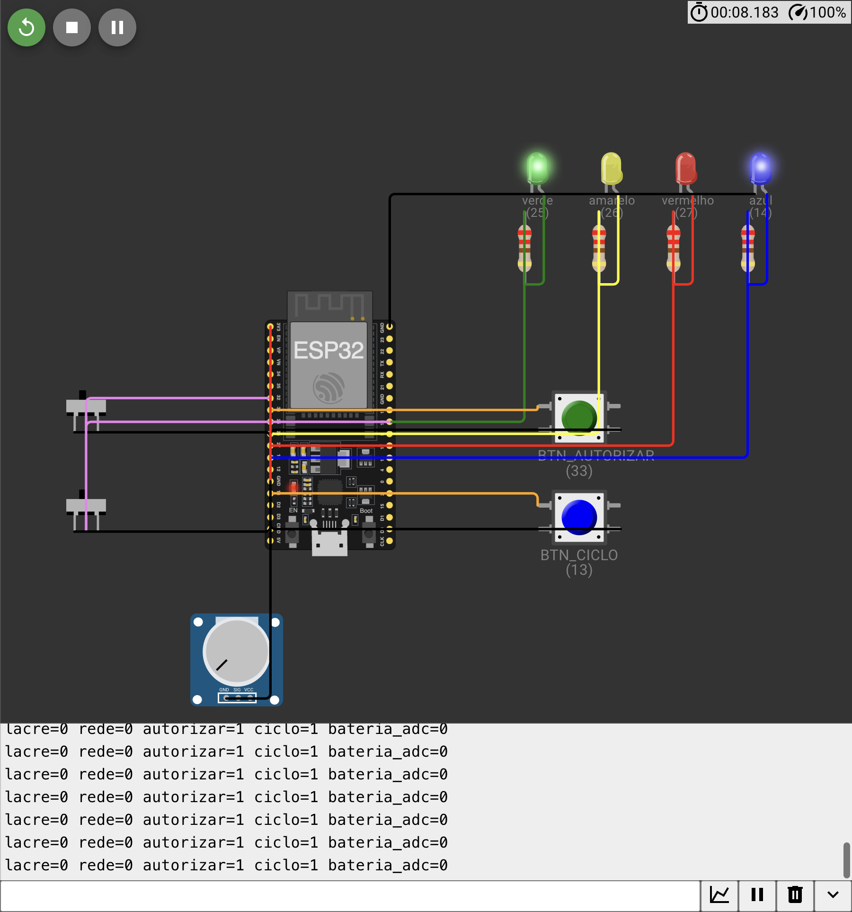

# Documentação IoTDoc - Módulo 4 - Inteli

**_Os trechos em itálico servem apenas como guia para o preenchimento da seção. Por esse motivo, não devem fazer parte da documentação final_**

## Nome do Grupo

#### Nomes dos integrantes do grupo

## Sumário

[1. Introdução](#c1)

[2. Metodologia](#c2)

[3. Desenvolvimento e Resultados](#c3)

[4. Conclusões e Recomendações](#c4)

[5. Referências](#c5)

 

# 1. Introdução (sprint 1)

A CerradinhoBio é uma companhia brasileira de capital aberto, com ações negociadas na B3, e integra o Grupo Cerradinho [3]. Atua em bioenergia a partir de cana-de-açúcar e milho: produz etanol, energia elétrica renovável gerada com biomassa, açúcar VHP e coprodutos do milho, como DDGS, WDG e óleo [4]. Suas operações estão em Chapadão do Céu (GO), onde ficam o negócio de cana e uma unidade de etanol de milho, e em Maracaju (MS), que também abriga uma unidade de etanol de milho [2]. Na safra 2025/26, a companhia registrou receita líquida consolidada de R$ 4,288 bilhões [1] e processou 5,2 milhões de toneladas de cana e 1,5 milhão de toneladas de milho; a capacidade instalada da fábrica de açúcar é de 550 mil toneladas por ano [2]. Como referência de porte de pessoal, a companhia informava cerca de 3.800 empregos diretos e indiretos em sua apresentação institucional publicada durante a safra 2024/25 [5]. A empresa se posiciona entre os maiores complexos industriais sucroenergéticos do Brasil [3] e entre os maiores produtores de etanol do país [4].

**Problema do projeto.** O acompanhamento de equipamentos enviados à manutenção externa depende de registros e contatos entre áreas e fornecedores. A dificuldade de consolidar localização, nota fiscal de remessa, prazo previsto e data de retorno reduz a visibilidade dos ativos em terceiros e exige cobranças manuais. Permanência total e atraso em relação ao prazo combinado são informações distintas e precisam ser analisadas separadamente.

## 1.1 Objetivos

**Objetivo geral.** Melhorar o controle dos equipamentos enviados a fornecedores para manutenção externa, desde a saída até o retorno.

**Objetivos específicos.** Ampliar a visibilidade dos ativos enquanto estão com terceiros; associar cada ciclo de envio à respectiva nota fiscal; distinguir permanência prolongada de atraso em relação ao prazo previsto; reduzir o esforço de consulta e cobrança manual; e preservar o histórico dos ciclos e movimentações.

## 1.2 Proposta da solução

A proposta reúne um dispositivo reutilizável, fixado ao equipamento com um lacre, e uma plataforma para consultar ativos, ciclos de manutenção, última localização e histórico. No cadastro, cada ciclo relaciona equipamento, fornecedor e nota fiscal, preservando os dados de saída e retorno. A plataforma compara o tempo decorrido desde a saída com o prazo previsto: assim, evidencia a permanência total do ativo e identifica separadamente quando o prazo combinado foi ultrapassado. A localização e o estado do ciclo ampliam a visibilidade dos equipamentos em terceiros; alertas configuráveis destacam casos para acompanhamento e pretendem reduzir consultas e cobranças manuais; o histórico registra os ciclos sucessivos; e uma API disponibiliza esses dados para análise em ferramentas de BI. No protótipo, a comunicação será demonstrada por Wi-Fi em cenário controlado. Como a disponibilidade de Wi-Fi nas oficinas de terceiros não é pressuposta, o canal de comunicação para produção será escolhido em sprint posterior, após comparação das alternativas em uma matriz que considere cobertura nos fornecedores, autonomia, confiabilidade, custo e escalabilidade [6].

## 1.3 Justificativa

A centralização das informações pode facilitar a consulta da situação de cada equipamento, dar rastreabilidade documental aos envios e destacar casos que precisam de acompanhamento. O dispositivo reutilizável, o vínculo entre ativo, ciclo e nota fiscal, o histórico preservado entre usos e a disponibilização dos dados para BI compõem os diferenciais da proposta. A identificação mais rápida de pendências pode contribuir para reduzir o tempo de permanência e as perdas de ativos, mas esses resultados dependem do tratamento dos alertas pelos responsáveis e devem ser medidos; não são garantidos pelo protótipo [6].

# 2. Metodologia (sprint 3)

_Descreva as etapas da metodologia RM-ODP que foram utilizadas para o desenvolvimento, citando o referencial teórico. Você deve apenas enunciar os métodos, sem dizer ainda como ele foi aplicado e quais resultados obtidos._

# 3. Desenvolvimento e Resultados 

## 3.1. Domínio de Fundamentos de Negócio

_Link para os templates de negócios: https://drive.google.com/drive/folders/1lTqisJ_gxxtc5J5aXM8ula2kQ4MsII_M?usp=sharing_

### 3.1.1. Contexto da Indústria (sprint 1)	

**Parceiro:** CerradinhoBio
**Setor analisado:** bioenergia e indústria sucroenergética brasileira, incluindo etanol de cana e de milho, açúcar, bioeletricidade e coprodutos.

#### Concorrência

A CerradinhoBio compete com grupos integrados de açúcar, etanol e bioenergia e, no segmento de etanol de milho, com produtores especializados. Entre os principais concorrentes estão a **Raízen**, a **São Martinho** e a **bp bioenergy** (antiga joint venture BP Bunge Bioenergia, adquirida integralmente pela bp em 2024). Para comparar a escala no segmento de cana, as empresas divulgam capacidade anual de moagem de aproximadamente 105 milhões de toneladas para a Raízen e 32 milhões para a bp bioenergy; a São Martinho projeta capacidade plena de 24 milhões de toneladas na safra 2026/27. No etanol de milho, a **FS** informa capacidade anual de 2,6 bilhões de litros e a **Inpasa** reporta 5,8 bilhões após a expansão de suas unidades. São indicadores de capacidade na mesma unidade de medida dentro de cada matéria-prima, mas publicados em períodos diferentes; não representam produção realizada no mesmo ano nem participação de mercado. [7, 9–12, 19–20]

#### Modelo de negócio

A CerradinhoBio opera um modelo B2B integrado e intensivo em ativos: transforma cana-de-açúcar e milho em etanol, açúcar VHP, bioeletricidade e coprodutos de milho destinados principalmente à nutrição animal, comercializados para distribuidores de combustíveis, clientes industriais e de alimentos para animais, compradores de açúcar e agentes do setor elétrico. A diversificação entre matérias-primas e produtos permite ajustar o mix de produção às condições de mercado; a venda de coprodutos também ajuda a compensar parte do custo do milho. A companhia participa ainda do mercado de créditos de descarbonização (CBIOs) por meio de sua produção certificada no RenovaBio. O desempenho depende de escala e eficiência agrícola e industrial, logística de matéria-prima e produtos, capital para manutenção e expansão e exposição à sazonalidade e à volatilidade dos preços de commodities. Na safra 2025/26, a empresa informou processamento de 5,2 milhões de toneladas de cana e 1,5 milhão de toneladas de milho, além de produção equivalente de 865 mil m³ de etanol hidratado, dos quais 687 milhões de litros vieram do milho. [2, 4, 8, 14]

#### Tendências

O setor amplia a produção de etanol de milho, que complementa a oferta de cana e aproveita a disponibilidade de grãos e a demanda por coprodutos; a EPE registrou produção total brasileira de etanol de 36,2 bilhões de litros em 2025, com expansão do milho compensando a queda da cana. O RenovaBio e os CBIOs mantêm um mecanismo de incentivo à descarbonização, enquanto a Lei do Combustível do Futuro cria oportunidades e novas exigências para biometano e combustível sustentável de aviação (SAF): para operadores aéreos, a redução mínima de emissões começa em 1% em 2027 e cresce gradualmente até 10% em 2037. Outra frente é digitalizar a manutenção e a gestão de ativos industriais — por exemplo, consolidar registros, localização, prazos e alertas — para dar mais visibilidade à operação e apoiar decisões com dados; os benefícios dependem da qualidade da implantação e da atuação dos responsáveis. [13–17]

#### Cinco Forças de Porter — perspectiva da CerradinhoBio

Escala qualitativa: **baixa**, **média** ou **alta**. A intensidade indica quanto a força tende a pressionar a atratividade e a rentabilidade da CerradinhoBio no setor, consideradas as condições descritas abaixo. A figura foi preenchida sobre o template oficial de cinco forças disponibilizado para o projeto. [18, 21]

*Figura — Cinco Forças de Porter, preenchidas pela perspectiva da CerradinhoBio.*  
*Fonte: template [“5 forças template.jpeg”](https://drive.google.com/file/d/1Kr8A2GRrTDUFi5JslJQd7LWVOwyn8E_c/view), pasta de templates de negócios do Inteli; conteúdo e adaptação: Grupo G01 (2026). [21]*

| Força | Intensidade | Justificativa do ponto de vista da CerradinhoBio |
|---|---|---|
| **Rivalidade entre concorrentes** | **Alta** | Há grandes grupos de cana com escala e portfólios diversificados e produtores de milho em rápida expansão. Etanol e açúcar são produtos amplamente negociados e sujeitos a preços de mercado; isso limita a diferenciação puramente pelo produto e intensifica a disputa por eficiência agrícola e industrial, matéria-prima, logística e contratos de venda. A flexibilidade entre cana, milho, açúcar, energia e coprodutos pode ajudar a CerradinhoBio a responder a ciclos de preço, mas exige disciplina de custos e investimento. |
| **Poder de barganha dos fornecedores** | **Médio** | O milho, a cana adquirida de terceiros onde aplicável, fertilizantes, combustíveis, peças e equipamentos especializados podem pressionar custos, especialmente diante de sazonalidade, distância logística ou fornecedores concentrados. Em contrapartida, há alternativas de fornecimento para vários insumos, contratos e possibilidade de integração/produção agrícola própria; a operação com duas matérias-primas também reduz a dependência de uma única cadeia. O poder varia por insumo, região e safra, portanto recomenda-se acompanhar concentração e custo posto na usina por categoria. |
| **Poder de barganha dos compradores** | **Média** | Parte relevante da produção é vendida em mercados de commodities e passa por distribuidores, tradings e compradores industriais com escala, capacidade de comparar fornecedores e negociar grandes volumes. Isso limita a influência individual do produtor sobre o preço. A diversificação entre etanol, açúcar, energia, coprodutos e CBIOs amplia os canais de receita e reduz a dependência de um único comprador, embora cada mercado tenha sua própria concentração, especificação e dinâmica contratual. |
| **Ameaça de novos entrantes** | **Média** | Uma nova usina de cana ou biorrefinaria de milho exige capital elevado, escala, acesso confiável à matéria-prima, logística, licenciamento, tecnologia e tempo de implantação e ramp-up, o que cria barreiras importantes. Ainda assim, empresas do agronegócio e investidores podem financiar unidades novas, especialmente no milho, onde grãos e infraestrutura regional favorecem projetos. A entrada de novos grupos pode elevar a ameaça; ampliações realizadas por empresas já atuantes não são novos entrantes e reforçam principalmente a rivalidade entre concorrentes. |
| **Ameaça de produtos substitutos** | **Média** | Gasolina e outros combustíveis podem competir com o etanol no transporte; eletrificação, eficiência energética e outras rotas de baixo carbono podem reduzir demanda de longo prazo. Para açúcar, existem adoçantes alternativos; para energia e coprodutos, há outras fontes e ingredientes. Por outro lado, a mistura obrigatória de etanol na gasolina, a frota flex, as metas de descarbonização e a versatilidade do portfólio ajudam a sustentar mercados atuais e a abrir novas aplicações, como SAF e biometano. |

#### Síntese estratégica

O ambiente competitivo é mais pressionado pela rivalidade e pelo poder dos compradores, pois escala, custos e preços de commodities têm peso elevado. Para a CerradinhoBio, as prioridades estratégicas são preservar eficiência e confiabilidade dos ativos, proteger o abastecimento de cana e milho, ampliar a flexibilidade de mix e desenvolver canais de maior valor para coprodutos e combustíveis de baixo carbono. A digitalização da manutenção pode apoiar a disponibilidade e a gestão patrimonial; no projeto de rastreamento, sua contribuição específica é aumentar a visibilidade de equipamentos em manutenção externa, sem pressupor redução de prazo ou perdas antes de medir os resultados do piloto. [6]

### 3.1.2. Análise SWOT (sprint 1)	

_A entrega deve ser realizada no formato de quadrante (template), semelhante ao template disponibilizado. Em forças e fraquezas considerar aspectos internos e em oportunidades e ameaças, aspectos externos. Essa análise deve ser feita com relação ao parceiro, por exemplo a Rede Gazeta._   

### 3.1.3. Descrição da Solução a ser Desenvolvida (sprint 1)	

#### 3.1.3.1 Qual é o problema a ser resolvido

#### 3.1.3.2 Qual a solução proposta (visão de negócios)

#### 3.1.3.3 Como a solução proposta deverá ser utilizada

#### 3.1.3.4 Quais os benefícios trazidos pela solução proposta

#### 3.1.3.5 Qual será o critério de sucesso e qual medida será utilizada para o avaliar
	
### 3.1.4. Value Proposition Canvas (sprint 1)	

_O Canvas da proposta de valor deve ser feito considerando a solução que vocês estão desenvolvendo. Usar o template disponível no drive da turma._     

### 3.1.5. Matriz de Riscos (sprint 1)

  
<strong>Figura 1 — Matriz de riscos do projeto</strong>

  
  
<em>Fonte: Elaborado pelos autores (2026).</em>

Probabilidade: 10%, 30%, 50%, 70% ou 90%; impacto: muito baixo a muito alto. Os códigos seguem esses cruzamentos. 150 dias é limiar de alerta, não autonomia.

| ID | Causa e efeito | Prob. | Impacto | Justificativa | Resposta | Responsável |
|---|---|---:|---:|---|---|---|
| R01 | Safra atrasada → diagnóstico impreciso. | 50% | Moderado | Dependência externa. | Mitigar: validar hipóteses. | Negócios |
| R02 | Cobertura ou metal → perda do GNSS. | 70% | Muito alto | Obstáculos degradam sinais. | Mitigar: guardar posição e testar antenas. | Hardware |
| R03 | Ensaio curto → autonomia incerta. | 70% | Alto | Ciclos prolongados. | Mitigar: medir e projetar consumo. | Hardware |
| R04 | Oficina sem Wi-Fi → eventos retidos. | 90% | Alto | Rede externa incerta. | Mitigar: armazenar e avaliar celular. | Conectividade |
| R05 | Ruído ou abertura autorizada → falso alerta. | 50% | Alto | Eventos legítimos parecem violações. | Mitigar: debounce e autorização. | Firmware |
| R06 | Fixação inadequada → dano ou reparo prejudicado. | 50% | Muito alto | Formatos variam. | Evitar: fixação removível testada. | Hardware |
| R07 | Água ou lavagem → falha eletrônica. | 70% | Muito alto | Exposição provável. | Mitigar: vedação e ensaio. | Hardware |
| R08 | Conectividade cara → escala inviável. | 50% | Alto | Custo recorrente. | Mitigar: comparar tecnologias e planos. | Produto |
| R09 | Fornecedores indisponíveis → piloto limitado. | 50% | Moderado | Dependência de terceiros. | Mitigar: antecipar agenda e simular. | PO |
| R10 | Dado restrito publicado → exposição indevida. | 30% | Muito alto | Informações sensíveis. | Evitar: dados fictícios e revisão. | Dados/LGPD |

**Oportunidades:** O01 — rastreador reutilizável reduz custo por ciclo (70%; alto; explorar modularidade; Produto). O02 — integração com BI agiliza decisões (70%; alto; explorar API autenticada; Software).

### 3.1.6. Política de Privacidade de acordo com a LGPD (sprint 1)	

Política preliminar, sem aprovação jurídica da CerradinhoBio.

#### 3.1.6.1 Informações gerais

A solução acompanha equipamentos da CerradinhoBio em manutenção externa.

#### 3.1.6.2 Tratamento de dados

O tratamento seguirá a LGPD. Correspondência com o rascunho de RF do Luis: **PENDENTE DE VALIDAÇÃO**.

#### 3.1.6.3 Dados coletados

Serão tratados nome, e-mail corporativo, cargo, perfil, logs, IP e horário dos usuários; responsáveis por ciclos e alertas; e contatos profissionais de fornecedores. Dados do equipamento não são pessoais por si só; sua localização pode identificar indiretamente o motorista.

#### 3.1.6.4 Fonte dos dados

Fontes: titulares, responsáveis, fornecedores, painel e equipamentos.

#### 3.1.6.5 Finalidades

Servirão à autenticação, acesso, auditoria, ciclos, alertas, suporte e comunicação. Será mantida apenas a última posição válida, atualizada semanalmente, sem rastreamento contínuo, conforme restrições 1 e 5 do TAPI.

#### 3.1.6.6 Armazenamento

Cadastros, logs, ciclos e alertas ficarão no backend/banco em nuvem; mensagens, no broker. Provedor, região e tecnologias: **PENDENTE DE VALIDAÇÃO**.

#### 3.1.6.7 Retenção

Cadastros e permissões serão conservados enquanto ativos; logs, pelo período de auditoria; ciclos e alertas, enquanto necessários ao histórico; contatos, durante a relação operacional; localização, até sua substituição semanal; cookies, durante a sessão. Depois, haverá exclusão ou anonimização. Prazos: **PENDENTE DE VALIDAÇÃO**.

#### 3.1.6.8 Cookies

Se previstos no painel, serão usados somente cookies de sessão necessários.

#### 3.1.6.9 Compartilhamento

O compartilhamento necessário abrangerá provedores de nuvem, broker e conectividade.

#### 3.1.6.10 Segurança

Serão aplicados autenticação, acesso restrito, auditoria e proteção de credenciais.

#### 3.1.6.11 Direitos dos titulares

O titular poderá pedir confirmação, acesso, correção, anonimização, bloqueio, eliminação e informações sobre compartilhamento.

#### 3.1.6.12 Exercício dos direitos

Solicitações serão recebidas pelo canal oficial, terão identidade e escopo verificados, serão registradas, analisadas e respondidas. Canal: **PENDENTE DE VALIDAÇÃO**.

#### 3.1.6.13 DPO/Encarregado

O encarregado e seu contato serão indicados pela CerradinhoBio: **PENDENTE DE VALIDAÇÃO**.

### 3.1.7. Bill of Material (BOM) (sprint 1)
_BOM (Bill of Material) pode ser definido como uma lista completa de materiais, que detalha todos os itens necessários para construir, fabricar ou reparar um produto. Deve-se preencher o template fornecido.

## 3.2. Domínio de Fundamentos de Experiência de Usuário 

### 3.2.1. Personas (sprint 1)	

#### Introdução às personas

#### Introdução às personas

As personas orientam o desenvolvimento da solução de rastreamento de equipamentos em manutenção externa da Cerradinho a partir dos objetivos, dificuldades e necessidades dos usuários. Os perfis consideram seus cenários de uso e letramento digital, distinguindo informações fundamentadas na pesquisa de hipóteses pendentes de validação.

### 3.2.2. Jornada do Usuário e Storyboard (sprint 2)	

_Coloque aqui seu Mapa de Jornada do Usuário (seguindo as instruções na descrição do artefato)_

_Coloque aqui seu Storyboard (seguindo as instruções na descrição do artefato)_

## 3.3. Solução Técnica	

_Nesta seção, detalhe a especificação da solução, de acordo com o disposto nas subseções._

### 3.3.1. Requisitos Funcionais (sprint 1, refinar e atualizar até sprint 5)

*Liste os RF numerados de forma objetiva e verificável. Cada RF deve poder ser convertido em caso de teste.*

| ID    | Descrição | Prioridade | Status       |
|-------|-----------|------------|--------------|
| RF001 | ...       | Alta       | Implementado |
| RF002 | ...       | Média      | Planejado    |

### 3.3.2. Regras de Negócio (sprint 1, refinar até sprint 5)

*Numere e redija as RN de forma implementável e testável. Toda RN deve ter pelo menos um teste automatizado associado a partir da sprint 3.*

| ID   | Descrição | RF associado |
|------|-----------|--------------|
| RN12 | Uma prorrogação (retorno e nova remessa simbólicos) abre um novo ciclo do mesmo equipamento e do mesmo dispositivo, e os dias fora passam a contar da emissão da nova NF de remessa. Origem: Kick-off com a Cerradinho (16/10/2026). | RF012, RF017 |
| RN13 | A data limite legal do ciclo é de 270 dias para destino em GO e de 360 dias para destino fora de GO, contados da emissão da NF de remessa. Origem: Kick-off com a Cerradinho (16/10/2026). `PENDENTE DE VALIDAÇÃO` | RF012 |

### 3.3.3. Requisitos Não Funcionais — 8 Eixos ISO/IEC 25010 (sprints 2 a 5)

*Preencha os 8 eixos. Cada eixo deve ter ao menos um RNF verificável (com métrica, limite ou critério concreto) ou justificativa explícita de ausência. Evolua do conceitual (sprint 2) ao técnico mensurável (sprint 5).*

| Eixo                     | Requisito | Métrica / Critério | Justificativa |
|--------------------------|-----------|--------------------|---------------|
| USAB — Usabilidade       | ...       | ...                | ...           |
| CONF — Confiabilidade    | ...       | ...                | ...           |
| DES — Desempenho         | ...       | p95 < X ms         | ...           |
| SUP — Suportabilidade    | ...       | ...                | ...           |
| SEG — Segurança          | ...       | ...                | ...           |
| CAP — Capacidade         | ...       | ...                | ...           |
| REST — Restrições Design | ...       | ...                | ...           |
| ORG — Organizacionais    | ...       | ...                | ...           |

### 3.3.4. Matriz de Rastreabilidade (RTM) (sprints 1 a 5)

_A RTM consolida a rastreabilidade completa do sistema. Um elo quebrado invalida toda a cadeia — mantenha-a atualizada a cada sprint. Referencie os casos de testes a partir das tabelas definidas na seção 3.4.x_

| Persona | RF    | RN   | Caso de Teste | Evidência        |
|---------|-------|------|---------------|------------------|
| ...     | RF001 | RN01 | CT02  | print, log, relatório de cobertura |

### 3.3.5. Arquitetura da Solução (sprint 3)

_Vídeo de explicação sobre a arquitetura da solução: (coloque aqui o link do vídeo)_

_Descreva a arquitetura técnica da solução de forma detalhada (visão de arquitetura).

Justifique como a arquitetura suporta os requisitos funcionais e não funcionais.

O diagrama de arquitetura deve:_
- _Mostrar microcontroladores, incluindo descrições de sua função no sistema (por exemplo: "Irá processar o sinal dos sensores a cada X minutos")_
- _Mostrar sensores, incluindo descrição de função e especificações técnicas do tipo de informação que será coletada_
- _Mostrar apresentadores de informação (displays), incluindo descrição de que tipo de informação será apresentada (por exemplo, "Mostrar temperatura dos sensores")_
- _Mostrar atuadores, caso existam na solução, incluindo descrições do que irão acionar (por exemplo, "Ligar motor de irrigação durante x minutos")_
- _Mostrar o broker MQTT e o dashboard que é a interface do usuário_
- _Mostrar ligações entre os elementos (com fio ou sem fio) – incluindo conexões com sensores e atuadores, conexão com WiFi, entre outros_

### 3.3.6. Arquitetura do Protótipo(sprint 4)	

_Vídeo de explicação sobre a arquitetura do protótipo físico: (coloque aqui o link do vídeo)_

_Descreva as tecnologias utilizadas de forma detalhada (visão de tecnologia).

Descreva a arquitetura usando um diagrama de blocos similar à visão anterior, porém especificando as tecnologias utilizadas. O diagrama de arquitetura deve:_
- _Mostrar microcontroladores, incluindo descrições de sua função no sistema (por exemplo: "Irá processar o sinal dos sensores a cada X minutos")_
- _Mostrar sensores, incluindo descrição de função e especificações técnicas do tipo de informação que será coletada_
- _Mostrar apresentadores de informação (displays), incluindo descrição de que tipo de informação será apresentada (por exemplo, "Mostrar temperatura dos sensores")_
- _Mostrar atuadores, caso existam na solução, incluindo descrições do que irão acionar (por exemplo, "Ligar motor de irrigação durante x minutos")_
- _Mostrar o broker MQTT e o dashboard que é a interface do usuário_
- _Mostrar ligações entre os elementos (com fio ou sem fio) – incluindo conexões com sensores e atuadores, conexão com WiFi, entre outros._
_Faça uma tabela dos possíveis componentes utilizados. Todos os componentes devem estar presentes na arquitetura._

| **Componente** | **Descrição** | **Tipo** | 
|----------|----------|----------|
|E.g. ESP32 WROOM 32 Devkit|E.g. Trata-se de um microcontrolador amplamente usado na indústria e em projetos educacionais, que possui interfaces mais amigáveis para conexão de componentes diversos...|E.g. Microcontrolador|
|E.g. sensor XPTO|E.g. Este sensor mede o sinal de XYZ em unidades q/s, e possui tolerância de abcd...|E.g. Sensor|

### 3.3.7. Arquitetura Refinada da Solução (sprint 5)	

_Descreva a revisão da arquitetura técnica da solução de forma detalhada (visão de arquitetura).  

Justifique como a arquitetura suporta os requisitos funcionais e não funcionais.  

A revisão deverá incluir comentários sobre cada ponto levantado, mostrando como os ajustes foram realizados, além da descrição da arquitetura revisada._

## 3.4. Resultados	

_Nesta seção, detalhe os resultados obtidos com a implementação, de acordo com o disposto nas subseções._

### 3.4.1. Protótipo Inicial do Projeto usando o Simulador Wokwi (sprint 1)

**Link do protótipo:** https://wokwi.com/projects/478276108359405569

Na Sprint 1 o dispositivo é simulado no Wokwi com um ESP32 DevKit. Cada entrada do circuito representa uma situação física do rastreador: o lacre (`SW_LACRE`), a disponibilidade de conexão (`SW_REDE`), a autorização de retirada (`BTN_AUTORIZAR`), o encerramento ou vínculo de ciclo (`BTN_CICLO`) e o nível da bateria (`POT_BATERIA`). Os LEDs mostram o estado que, no produto, seria enviado à plataforma, e o Monitor Serial mostra os eventos em JSON, que representam a mensagem MQTT. Não há rede nem broker reais nesta sprint. A localização (GNSS) fica para a Sprint 2.

**Tempo simulado.** Para testar prazos de dias sem esperar dias, 1 segundo de simulação equivale a 1 dia (`SEGUNDOS_POR_DIA = 1`).

**Valores de teste.** Os parâmetros abaixo são valores de teste, `PENDENTE DE VALIDAÇÃO` com a Cerradinho. O TAPI fixa apenas a referência de 150 dias para permanência e o status semanal; os demais serão definidos com o parceiro.

| Parâmetro | Valor de teste | Origem |
|---|---|---|
| Status periódico | 7 dias | TAPI ("uma vez por semana, com frequência ajustável") |
| Limiar de permanência | 150 dias (também testado com 10) | TAPI ("150 dias como referência inicial"; MVP 4 pede outros limiares) |
| Prazo previsto de retorno | 5 dias | Valor de teste — `PENDENTE DE VALIDAÇÃO` |
| Janela de autorização de retirada | 3 dias | Valor de teste — `PENDENTE DE VALIDAÇÃO` |
| Capacidade da fila sem conexão | 8 eventos | Valor de teste — `PENDENTE DE VALIDAÇÃO` |
| Bateria baixa / recuperada | 20% / 25% | Valor de teste — `PENDENTE DE VALIDAÇÃO` |

**LEDs simultâneos.** Cada LED representa um estado independente e podem acender juntos (por exemplo, vermelho de violação e azul de sem rede no CT08). O verde só fica fixo quando não há violação.

**Do simulador ao dispositivo real.** Cada componente do circuito representa uma parte do rastreador que será montado na Sprint 2. A lógica de decisão do `sketch.ino` é a mesma; mudam apenas as fontes das leituras.

| Componente no Wokwi | O que representa no dispositivo real |
|---|---|
| ESP32 DevKit | Microcontrolador do rastreador |
| SW_LACRE (chave deslizante) | Sensor do lacre (laço de continuidade ou reed switch) |
| BTN_AUTORIZAR (botão) | Autorização de retirada registrada pelo responsável (no produto, vinda da plataforma) |
| BTN_CICLO (botão) | Encerramento do ciclo ou novo vínculo, feitos na conferência de retorno |
| POT_BATERIA (potenciômetro) | Leitura da tensão da bateria por divisor resistivo |
| SW_REDE (chave deslizante) | Estado da conexão Wi‑Fi do ESP32, que cai e volta a se conectar (RF008) |
| LEDs | Estados que, no produto, viram mensagens enviadas à plataforma |
| Monitor Serial (JSON) | Mensagem MQTT publicada no broker |

Fica fora desta simulação a localização (GNSS), prevista para a Sprint 2.

Cada CT indica entre parênteses o requisito funcional (RF) e a regra de negócio (RN) que verifica. CT01 e CT11 não testam uma regra de negócio específica: verificam a inicialização e a leitura confiável do botão.

*Figura 1 — Circuito do protótipo no Wokwi, com o Monitor Serial aberto.*

Fonte: elaboração própria, captura do simulador Wokwi.

**CT#** | **Bloco** | **Componente de entrada** | **Leitura da entrada** | **Componente de saída** | **Leitura da saída** | **Descrição**
|----------|----------|----------|----------|----------|----------|----------|
|CT01|Inicialização|SW_LACRE e SW_REDE|Lacre fechado e rede disponível ao ligar|LED verde; Serial|Verde fixo, demais apagados; JSON `STATUS` com `dias_fora=0`, `lacre="fechado"`|Sucesso. Ao ligar com o lacre íntegro e conexão, o dispositivo indica operação normal e publica o primeiro status (RF009).|
|CT02|Status periódico|Relógio simulado (1 s = 1 dia)|Dias 7 e 14 de ciclo|Serial|Um `STATUS_SEMANAL` no dia 7 e outro no dia 14, nenhum fora desses dias|Sucesso. O status é enviado a cada 7 dias, como pede o TAPI (RF011, RF009; RN07).|
|CT03|Prazo e atraso|Relógio simulado (1 s = 1 dia)|`dias_fora` passa do prazo previsto (5) e fica abaixo do limiar|LED amarelo; Serial|Amarelo piscando a 1 Hz; `ALERTA_ATRASO` emitido uma única vez|Sucesso. O equipamento passou da data prevista de retorno, o que é diferente de permanência prolongada (RF013, RF012; RN04).|
|CT04|Permanência|Relógio simulado (1 s = 1 dia)|`dias_fora` atinge o limiar (rodar com 10 e com 150)|LED amarelo; Serial|Amarelo fixo; `ALERTA_PERMANENCIA` emitido uma única vez em cada rodada|Sucesso. Testa o limiar configurável com o valor de referência e um valor alternativo, como pede o MVP 4 do TAPI (RF014, RF012; RN03, RN04).|
|CT05|Lacre|SW_LACRE|Lacre aberto sem autorização|LED vermelho; Serial|Vermelho piscando; `VIOLACAO_LACRE` sai na hora, fora da rotina semanal|Violação. Abertura não autorizada gera alerta imediato (RF006; RN05).|
|CT06|Retirada autorizada|BTN_AUTORIZAR e SW_LACRE|Botão pressionado; lacre aberto dentro da janela de 3 dias e depois fechado|LED verde; Serial|Verde piscando durante a retirada; `RETIRADA_AUTORIZADA` sem alerta; ao fechar, `LACRE_REAPLICADO` e verde fixo|Sucesso. Fluxo de retirada autorizada para o reparo, com reaplicação do lacre (RF007; RN06).|
|CT07|Autorização expirada|BTN_AUTORIZAR e SW_LACRE|Botão pressionado; lacre aberto depois de mais de 3 dias|LED vermelho; Serial|Mesmo resultado do CT05: `VIOLACAO_LACRE`|Falha tratada. Autorização vencida não libera a abertura (RF006; RN05, RN06).|
|CT08|Sem conexão|SW_REDE e SW_LACRE|Rede indisponível; lacre aberto sem autorização|LEDs azul e vermelho; Serial|Azul e vermelho piscando; nada publicado; `VIOLACAO_LACRE` guardada na fila; Serial mostra `[FILA] 1 pendente`|Falha tratada. Sem conexão, o evento crítico não se perde: fica guardado para envio posterior (RF010, RF008; RN05, RN09).|
|CT09|Reconexão|SW_REDE|Rede volta a ficar disponível|LED azul; Serial|Eventos pendentes publicados na ordem, com o dia original de ocorrência; azul apaga|Sucesso. Ao reconectar, a fila é esvaziada sem perder a hora em que cada evento aconteceu (RF010, RF008; RN09).|
|CT10|Fila cheia|SW_REDE e entradas que geram eventos|Rede indisponível; mais de 8 eventos gerados|Serial|`FILA_CHEIA`; descarta o evento não crítico mais antigo; nenhuma violação perdida|Falha tratada. Com a fila no limite, só eventos não críticos são descartados (RF010; RN09).|
|CT11|Ruído de botão|BTN_AUTORIZAR|Pressões rápidas (ruído de contato) e depois o botão segurado por 3 s|Serial|Um único evento por pressão real (debounce de 50 ms, detecção por borda); segurar não repete o evento|Falha tratada. Leituras falsas do botão não geram autorizações em duplicidade (RF007).|
|CT12|Bateria|POT_BATERIA|Nível abaixo de 20%, depois acima de 25%|Serial|`BATERIA_BAIXA` uma única vez; não repete até voltar a 25% (histerese)|Sucesso. O alerta de bateria não fica oscilando perto do limite (RF019; RN10).|
|CT13|Falha do sensor de bateria|POT_BATERIA|Potenciômetro no mínimo (ADC = 0, representa divisor desconectado)|Serial|`SENSOR_BATERIA_FALHA`; nenhum `BATERIA_BAIXA` falso|Falha tratada. Leitura impossível é tratada como falha do sensor, não como bateria vazia (RF019; RN10).|
|CT14|Encerramento|BTN_CICLO e SW_LACRE|Lacre fechado; botão segurado por 2 s|Serial|`CICLO_ENCERRADO`; `dias_fora` zera; `ciclo_id` sobe; contador de ciclos preservado|Sucesso. Encerrar o ciclo libera o dispositivo sem apagar o histórico (RF016, RF017; RN11).|
|CT15|Vínculo simultâneo|BTN_CICLO|Ciclo ativo; toque curto (tentativa de novo vínculo)|Serial|`VINCULO_RECUSADO`; o ciclo atual continua igual|Falha tratada. Impede vínculos simultâneos indevidos, como pede o TAPI (RF004; RN01).|
|CT16|Encerramento recusado|BTN_CICLO e SW_LACRE|Lacre aberto; botão segurado por 2 s|Serial|`ENCERRAMENTO_RECUSADO`; o ciclo continua ativo|Falha tratada. O ciclo só pode ser encerrado com o lacre fechado (RF016; RN11).|

<!-- Para cada CT, a issue #20 acrescenta a figura assets/wokwi/CTnn.png e duas ou três linhas sobre o teste executado. -->

### 3.4.2. Protótipo Físico do Projeto (offline) (sprint 2)	

_Aqui você deve registrar diversas situações de teste, indicando exemplos de leitura (entrada) e escrita (saída) apresentadas pelo seu sistema físico. Estes registros serão utilizados para testar seus componentes, portanto, descreva várias situações, incluindo não apenas casos de sucesso, mas também de possíveis falhas nas leituras de entradas e saídas.  
Siga as nomenclaturas e convenções já utilizadas anteriormente, e não se esqueça dos alinhamentos de negócios e experiência do usuário para pensar em situações representativas. Inclua figuras do protótipo físico e descrições dos testes realizados para ilustrar o funcionamento do protótipo. Continue a numeração de CT a partir da tabela anterior. A tabela a seguir serve como exemplo._

**CT#** | **Descrição** | **Pré-condição** | **Procedimento de teste** | **Pós-condição/Resultado esperado** | **Observações** (opcional)
|----------|----------|----------|----------|----------|----------|
|CT11|ex. Verificação de conexão de rede bem-sucedida. | ex. O dispositivo está desligado.| ex. Ligue o dispositivo, aguarde alguns segundos e verifique se ele estabelece uma conexão bem-sucedida com a rede Wi-Fi. | ex. O LED verde indicador de conexão acende de forma contínua, sinalizando uma conexão bem-sucedida à rede. |

### 3.4.3. Protótipo do Projeto com MQTT e I2C (sprint 3)	

_Aqui você deve registrar diversas situações de uso de seu sistema como um todo, indicando exemplos de ação do usuário e resposta do sistema, apontando como o ambiente deverá estar configurado para receber a ação e produzir a resposta. Estes registros serão utilizados para testar seu sistema, portanto, descreva várias situações, incluindo não apenas casos de sucesso, mas também de falha nos comportamentos do sistema.  
Siga as nomenclaturas e convenções já utilizadas anteriormente, e não se esqueça dos alinhamentos de negócios e experiência do usuário para pensar em situações representativas. Inclua figuras do protótipo físico e dashboards, além de descrições dos testes realizados para ilustrar o funcionamento do protótipo. Continue a numeração de CT a partir da tabela anterior. A tabela a seguir serve como exemplo._

**CT#** | **Configuração do ambiente** | **Ação do usuário** | **Resposta esperada do sistema** 
|----------|----------|----------|----------|
|CT21|ex. precisa de um computador conectado na interface, dois ou mais dispositivos que simulem o posicionamento de um item X no espaço físico etc. | ex. usuário logado busca a localização do item X, que está ativo e operando normalmente | ex. interface do sistema acessa os dados da última localização registrada do item X e apresenta, constando local e horário de última atualização | 

### 3.4.4. Protótipo Físico do Projeto (online) (sprint 4)	

_Aqui você deve registrar diversas situações de uso de seu sistema como um todo, indicando exemplos de ação do usuário e resposta do sistema, apontando como o ambiente deverá estar configurado para receber a ação e produzir a resposta. Estes registros serão utilizados para testar seu sistema, portanto, descreva várias situações, incluindo não apenas casos de sucesso, mas também de falha nos comportamentos do sistema.  
**Desta vez, utilize diagramas de sequência UML para descrever os fluxos de teste do sistema.**  
Siga as nomenclaturas e convenções já utilizadas anteriormente, e não se esqueça dos alinhamentos de negócios e experiência do usuário para pensar em situações representativas. Inclua figuras do protótipo físico e dashboards, além de descrições dos testes realizados para ilustrar o funcionamento do protótipo._

### 3.4.5. Protótipo Final do Projeto (sprint 5)	

_Registre as situações de uso do sistema revisadas utilizando a modelagem UML para descrever os fluxos de teste.  
Também inclua figuras da versão final do protótipo físico e dashboards, além de descrições dos testes realizados para ilustrar o funcionamento do protótipo._

## 4. Conclusões e Recomendações

_Escreva, de forma resumida, sobre os principais resultados do seu projeto e faça recomendações formais ao seu parceiro de projeto em relação ao uso dessa solução. Você pode aproveitar este espaço para comentar sobre possíveis materiais extras._

## 5. Referências

1. CERRADINHOBIO. *CerradinhoBio supera R$ 1,5 bilhão de EBITDA e amplia lucro em 90% na Safra 2025/2026*. Disponível em: https://www.cerradinhobio.com.br/news/cerradinhobio-supera-r-15-bilhao-de-ebitda-e-amplia-lucro-em-90-na-safra-2025-2026/. Acesso em: 15 out. 2026.
2. CERRADINHOBIO. *Nossos Números/Dados de Produção*. Disponível em: https://www.cerradinhobio.com.br/a-companhia/nossos-numeros-dados-de-producao/. Acesso em: 19 out. 2026.
3. CERRADINHOBIO. *CerradinhoBio*. Disponível em: https://www.cerradinhobio.com.br/negocios-e-atividades/cerradinhobio/. Acesso em: 15 out. 2026.
4. CERRADINHOBIO. *Nossos Produtos*. Disponível em: https://www.cerradinhobio.com.br/negocios-e-atividades/nossos-produtos/. Acesso em: 15 out. 2026.
5. CERRADINHOBIO. *CerradinhoBio tem 3T24/25 com aumento de receita, expansão da produção de açúcar e melhora nos indicadores financeiros*. Disponível em: https://www.cerradinhobio.com.br/news/cerradinhobio-tem-3t24-25-com-aumento-de-receita-expansao-da-producao-de-acucar-e-melhora-nos-indicadores-financeiros/. Acesso em: 15 out. 2026.
6. CERRADINHO. *TAPI Cerradinho: Rastreamento de Ativos IoT*. Documento de referência do projeto fornecido pelo parceiro, 2026.
7. RAÍZEN. *Relatório integrado — safra 2024/25*. Disponível em: https://www.raizen.com.br/archives_files/archive81-raizen-rs24-25.pdf. Acesso em: 19 out. 2026.
8. CERRADINHOBIO. *Nossos produtos*. Disponível em: https://www.cerradinhobio.com.br/negocios-e-atividades/nossos-produtos/. Acesso em: 19 out. 2026.
9. SÃO MARTINHO. *Relatório da Administração — safra 2024/25*. Disponível em: https://ri.saomartinho.com.br/Download.aspx?Arquivo=MTU+51Kmm5DdaZuzsVXkAw%3D%3D&IdCanal=3kK+JHozjxal5isJwnwwEA%3D%3D&linguagem=pt. Acesso em: 19 out. 2026.
10. BP. *bp bioenergy — operações e capacidade de produção no Brasil*. Disponível em: https://www.bp.com/pt_br/brazil/home/produtos-e-servicos/bp-bunge-bioenergia.html. Acesso em: 19 out. 2026.
11. FS. *Etanol, unidades e capacidade de produção*. Disponível em: https://www.fs.agr.br/. Acesso em: 19 out. 2026.
12. INPASA. *Inauguração da unidade de Balsas e capacidade instalada*. Disponível em: https://www.inpasa.com.br/sala-de-imprensa/inpasa-inaugura-nova-unidade-em-balsas-ma-com-investimento-de-r-2-5-bilhoes-e-reforca-lideranca-no-etanol-de-graos/1023408. Acesso em: 19 out. 2026.
13. EPE. *Análise de Conjuntura dos Biocombustíveis 2025*. Disponível em: https://www.epe.gov.br/pt/publicacoes-dados-abertos/publicacoes/analise-de-conjuntura-dos-biocombustiveis-2025. Acesso em: 19 out. 2026.
14. ANP. *RenovaBio — metas, CBIOs e comprovação*. Disponível em: https://www.gov.br/anp/pt-br/assuntos/renovabio. Acesso em: 19 out. 2026.
15. BRASIL. *Lei nº 14.993, de 8 de outubro de 2024 — Lei do Combustível do Futuro*. Disponível em: https://www.planalto.gov.br/ccivil_03/_ato2023-2026/2024/lei/l14993.htm. Acesso em: 19 out. 2026.
16. ANP. *Combustível Sustentável de Aviação (SAF)*. Disponível em: https://www.gov.br/anp/pt-br/assuntos/saf. Acesso em: 19 out. 2026.
17. ANP. *Biometano*. Disponível em: https://www.gov.br/anp/pt-br/assuntos/producao-e-fornecimento-de-biocombustiveis/biometano. Acesso em: 19 out. 2026.
18. ROCK CONTENT. *As 5 forças de Porter: o que são, para que servem e como aplicar?* Disponível em: https://rockcontent.com/br/blog/5-forcas-de-porter/. Acesso em: 19 out. 2026.
19. RAÍZEN. *Raízen e produtores de cana-de-açúcar debatem perspectivas para o ano-safra no Fórum de Mercado*. Disponível em: https://www.raizen.com.br/sala-de-imprensa/raizen-e-produtores-de-cana-de-acucar-debatem-perspectivas-para-o-ano-safra-no-forum-de-mercado. Acesso em: 20 out. 2026.
20. SÃO MARTINHO. *Formulário de Referência 2025*. Disponível em: https://ri.saomartinho.com.br/Download.aspx?Arquivo=zp29unVyAKR4rxhHtOgKfQ%3D%3D&IdCanal=3kK+JHozjxal5isJwnwwEA%3D%3D&linguagem=pt. Acesso em: 20 out. 2026.
21. INTELI. *5 forças template.jpeg*. Pasta de templates de negócios do projeto, 2022. Disponível em: https://drive.google.com/file/d/1Kr8A2GRrTDUFi5JslJQd7LWVOwyn8E_c/view. Acesso em: 20 out. 2026.
