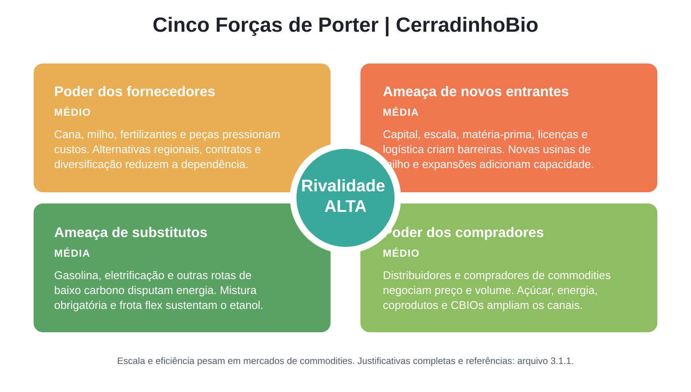

# Documentação IoTDoc - Módulo 4 - Inteli

**_Os trechos em itálico servem apenas como guia para o preenchimento da seção. Por esse motivo, não devem fazer parte da documentação final_**

## Nome do Grupo

#### Nomes dos integrantes do grupo

## Sumário

[1. Introdução](#c1)

[2. Metodologia](#c2)

[3. Desenvolvimento e Resultados](#c3)

[4. Conclusões e Recomendações](#c4)

[5. Referências](#c5)

 

# 1. Introdução (sprint 1)

_Apresente de forma sucinta o parceiro de negócio, seu porte, local, área de atuação e posicionamento no mercado. Maiores detalhes deverão ser descritos na seção 4. Descreva resumidamente o problema a ser resolvido (sem ainda mencionar a solução)._

## 1.1 Objetivos

_Descreva os objetivos gerais e específicos do seu parceiro de negócios, sem entrar em méritos técnicos ou especificações de tecnologia. Aqui importa o objetivo em si, não os meios para se chegar até lá._

## 1.2 Proposta da solução

_Descreva resumidamente sua proposta de solução (em alto nível) e como essa solução pretende resolver o problema, atendendo os objetivos listados na seção anterior._

## 1.3 Justificativa

_Faça uma breve defesa de sua proposta de solução, escreva sobre seus potenciais, seus benefícios e como ela se diferencia._

# 2. Metodologia (sprint 3)

_Descreva as etapas da metodologia RM-ODP que foram utilizadas para o desenvolvimento, citando o referencial teórico. Você deve apenas enunciar os métodos, sem dizer ainda como ele foi aplicado e quais resultados obtidos._

# 3. Desenvolvimento e Resultados 

## 3.1. Domínio de Fundamentos de Negócio

_Link para os templates de negócios: https://drive.google.com/drive/folders/1lTqisJ_gxxtc5J5aXM8ula2kQ4MsII_M?usp=sharing_

### 3.1.1. Contexto da Indústria (sprint 1)	

**Parceiro:** CerradinhoBio
**Setor analisado:** bioenergia e indústria sucroenergética brasileira, incluindo etanol de cana e de milho, açúcar, bioeletricidade e coprodutos.

#### Concorrência

A CerradinhoBio compete com grupos integrados de açúcar, etanol e bioenergia e, no segmento de etanol de milho, com produtores especializados. Entre os concorrentes relevantes estão a **Raízen**, que opera uma plataforma de produção, distribuição e comercialização de energia e biocombustíveis, com 35 usinas e 5,1 milhões de toneladas de açúcar produzidas na safra 2024/25; a **São Martinho**, que processou 21,8 milhões de toneladas de cana e 511,4 mil toneladas de milho em 2024/25, comercializando 1,2 bilhão de litros de etanol; e a **bp bioenergy** (antiga joint venture BP Bunge Bioenergia, adquirida integralmente pela bp em 2024), com 11 usinas, capacidade de moagem de 32 milhões de toneladas de cana e capacidade anual de 1,7 milhão de m³ de etanol. No etanol de milho, destacam-se a **FS**, com capacidade anual informada de 2,6 bilhões de litros de etanol, e a **Inpasa**, que reporta capacidade de 5,8 bilhões de litros por ano após a expansão de suas unidades. Os números têm bases e períodos diferentes (capacidade instalada, processamento ou volume comercializado) e, portanto, indicam escala e presença competitiva, não participação de mercado diretamente comparável. [7, 9–12]

#### Modelo de negócio

A CerradinhoBio opera um modelo B2B integrado e intensivo em ativos: transforma cana-de-açúcar e milho em etanol, açúcar VHP, bioeletricidade e coprodutos de milho destinados principalmente à nutrição animal, comercializados para distribuidores de combustíveis, clientes industriais e de alimentos para animais, compradores de açúcar e agentes do setor elétrico. A diversificação entre matérias-primas e produtos permite ajustar o mix de produção às condições de mercado; a venda de coprodutos também ajuda a compensar parte do custo do milho. A companhia participa ainda do mercado de créditos de descarbonização (CBIOs) por meio de sua produção certificada no RenovaBio. O desempenho depende de escala e eficiência agrícola e industrial, logística de matéria-prima e produtos, capital para manutenção e expansão e exposição à sazonalidade e à volatilidade dos preços de commodities. Na safra 2025/26, a empresa informou processamento de 5,2 milhões de toneladas de cana e 1,5 milhão de toneladas de milho, além de produção equivalente de 865 mil m³ de etanol hidratado, dos quais 687 milhões de litros vieram do milho. [2, 4, 8, 14]

#### Tendências

O setor amplia a produção de etanol de milho, que complementa a oferta de cana e aproveita a disponibilidade de grãos e a demanda por coprodutos; a EPE registrou produção total brasileira de etanol de 36,2 bilhões de litros em 2025, com expansão do milho compensando a queda da cana. O RenovaBio e os CBIOs mantêm um mecanismo de incentivo à descarbonização, enquanto a Lei do Combustível do Futuro cria oportunidades e novas exigências para biometano e combustível sustentável de aviação (SAF): para operadores aéreos, a redução mínima de emissões começa em 1% em 2027 e cresce gradualmente até 10% em 2037. Outra frente é digitalizar a manutenção e a gestão de ativos industriais — por exemplo, consolidar registros, localização, prazos e alertas — para dar mais visibilidade à operação e apoiar decisões com dados; os benefícios dependem da qualidade da implantação e da atuação dos responsáveis. [13–17]

#### Cinco Forças de Porter — perspectiva da CerradinhoBio

Escala qualitativa: **baixa**, **média** ou **alta**. A intensidade indica quanto a força tende a pressionar a atratividade e a rentabilidade da CerradinhoBio no setor, consideradas as condições descritas abaixo. A análise segue o template de cinco forças disponibilizado para o projeto. [18]

| Força | Intensidade | Justificativa do ponto de vista da CerradinhoBio |
|---|---|---|
| **Rivalidade entre concorrentes** | **Alta** | Há grandes grupos de cana com escala e portfólios diversificados e produtores de milho em rápida expansão. Etanol e açúcar são produtos amplamente negociados e sujeitos a preços de mercado; isso limita a diferenciação puramente pelo produto e intensifica a disputa por eficiência agrícola e industrial, matéria-prima, logística e contratos de venda. A flexibilidade entre cana, milho, açúcar, energia e coprodutos pode ajudar a CerradinhoBio a responder a ciclos de preço, mas exige disciplina de custos e investimento. |
| **Poder de barganha dos fornecedores** | **Médio** | O milho, a cana adquirida de terceiros onde aplicável, fertilizantes, combustíveis, peças e equipamentos especializados podem pressionar custos, especialmente diante de sazonalidade, distância logística ou fornecedores concentrados. Em contrapartida, há alternativas de fornecimento para vários insumos, contratos e possibilidade de integração/produção agrícola própria; a operação com duas matérias-primas também reduz a dependência de uma única cadeia. O poder varia por insumo, região e safra, portanto recomenda-se acompanhar concentração e custo posto na usina por categoria. |
| **Poder de barganha dos compradores** | **Médio-alto** | Parte relevante da produção é vendida em mercados de commodities e passa por distribuidores, tradings e compradores industriais com escala, capacidade de comparar fornecedores e negociação de grandes volumes. Isso limita a influência individual do produtor sobre o preço. A diversificação entre etanol, açúcar, energia, coprodutos e CBIOs amplia os canais de receita e reduz a dependência de um único comprador, embora cada mercado tenha sua própria concentração, especificação e dinâmica contratual. |
| **Ameaça de novos entrantes** | **Média** | Uma nova usina de cana ou biorrefinaria de milho exige capital elevado, escala, acesso confiável à matéria-prima, logística, licenciamento, tecnologia e tempo de implantação e ramp-up, o que cria barreiras importantes. Ainda assim, empresas do agronegócio e investidores podem financiar novas unidades ou ampliações, especialmente no milho, onde novos projetos aproveitam grãos e infraestrutura regional. A expansão anunciada por competidores mostra que a ameaça vem tanto de novos grupos quanto de capacidade adicional de incumbentes. |
| **Ameaça de produtos substitutos** | **Média** | Gasolina e outros combustíveis podem competir com o etanol no transporte; eletrificação, eficiência energética e outras rotas de baixo carbono podem reduzir demanda de longo prazo. Para açúcar, existem adoçantes alternativos; para energia e coprodutos, há outras fontes e ingredientes. Por outro lado, a mistura obrigatória de etanol na gasolina, a frota flex, as metas de descarbonização e a versatilidade do portfólio ajudam a sustentar mercados atuais e a abrir novas aplicações, como SAF e biometano. |

#### Síntese estratégica

O ambiente competitivo é mais pressionado pela rivalidade e pelo poder dos compradores, pois escala, custos e preços de commodities têm peso elevado. Para a CerradinhoBio, as prioridades estratégicas são preservar eficiência e confiabilidade dos ativos, proteger o abastecimento de cana e milho, ampliar a flexibilidade de mix e desenvolver canais de maior valor para coprodutos e combustíveis de baixo carbono. A digitalização da manutenção pode apoiar a disponibilidade e a gestão patrimonial; no projeto de rastreamento, sua contribuição específica é aumentar a visibilidade de equipamentos em manutenção externa, sem pressupor redução de prazo ou perdas antes de medir os resultados do piloto. [6]

### 3.1.2. Análise SWOT (sprint 1)	

_A entrega deve ser realizada no formato de quadrante (template), semelhante ao template disponibilizado. Em forças e fraquezas considerar aspectos internos e em oportunidades e ameaças, aspectos externos. Essa análise deve ser feita com relação ao parceiro, por exemplo a Rede Gazeta._   

### 3.1.3. Descrição da Solução a ser Desenvolvida (sprint 1)	

#### 3.1.3.1 Qual é o problema a ser resolvido

#### 3.1.3.2 Qual a solução proposta (visão de negócios)

#### 3.1.3.3 Como a solução proposta deverá ser utilizada

#### 3.1.3.4 Quais os benefícios trazidos pela solução proposta

#### 3.1.3.5 Qual será o critério de sucesso e qual medida será utilizada para o avaliar
	
### 3.1.4. Value Proposition Canvas (sprint 1)	

_O Canvas da proposta de valor deve ser feito considerando a solução que vocês estão desenvolvendo. Usar o template disponível no drive da turma._     

### 3.1.5. Matriz de Riscos (sprint 1)	

_A Matriz de Risco deve ser desenhada considerando o projeto que os alunos estão criando. Deve ser entregue no template disponível no drive da turma. Os alunos devem enumerar os riscos, distribuí-los na matriz e justificar suas decisões._     

### 3.1.6. Política de Privacidade de acordo com a LGPD (sprint 1)	

_A Política de privacidade para o projeto de acordo com a LGPD deve ser escrita considerando o projeto que os alunos estão criando. Os pontos a seguir precisam ser apresentados. O aluno pode utilizar  o Gerador de Política de Privacidade (https://www.nuvemshop.com.br/ferramentas/gerador-politica-de-privacidade), criado pela Nuvemshop e, de acordo com a empresa, já adaptado a LGPD para ter uma prévia e ajustar de acordo com o seu projeto._

#### 3.1.6.1 Informações gerais sobre a empresa / organização

#### 3.1.6.2 Informações sobre o tratamento de dados

#### 3.1.6.3 Quais são os dados coletados

#### 3.1.6.4 Onde os dados são coletados 

#### 3.1.6.5 Para quais finalidades os dados serão utilizadas

#### 3.1.6.6 Onde os dados ficam armazenados 

#### 3.1.6.7 Qual o período de armazenamento dos dados (retenção)

#### 3.1.6.8 Uso de cookies e/ou tecnologias semelhantes

#### 3.1.6.9 Com quem esses dados são compartilhados (parceiros, fornecedores, subcontratados)

#### 3.1.6.10 Informações sobre medidas de segurança adotadas pela empresa

#### 3.1.6.11 Orientações sobre como a empresa/organização atende aos direitos dos usuários

#### 3.1.6.12 Informações sobre como o titular de dados pode solicitar e exercer os seus direitos

#### 3.1.6.13 Informações de contato do Data Protection Officer (DPO) ou encarregado de proteção de dados da organização

### 3.1.7. Bill of Material (BOM) (sprint 1)
_BOM (Bill of Material) pode ser definido como uma lista completa de materiais, que detalha todos os itens necessários para construir, fabricar ou reparar um produto. Deve-se preencher o template fornecido.

## 3.2. Domínio de Fundamentos de Experiência de Usuário 

### 3.2.1. Personas (sprint 1)	

_Coloque aqui suas Personas (seguindo as instruções na descrição do artefato)_

### 3.2.2. Jornada do Usuário e Storyboard (sprint 2)	

_Coloque aqui seu Mapa de Jornada do Usuário (seguindo as instruções na descrição do artefato)_

_Coloque aqui seu Storyboard (seguindo as instruções na descrição do artefato)_

## 3.3. Solução Técnica	

_Nesta seção, detalhe a especificação da solução, de acordo com o disposto nas subseções._

### 3.3.1. Requisitos Funcionais (sprint 1, refinar e atualizar até sprint 5)

*Liste os RF numerados de forma objetiva e verificável. Cada RF deve poder ser convertido em caso de teste.*

| ID    | Descrição | Prioridade | Status       |
|-------|-----------|------------|--------------|
| RF001 | ...       | Alta       | Implementado |
| RF002 | ...       | Média      | Planejado    |

### 3.3.2. Regras de Negócio (sprint 1, refinar até sprint 5)

*Numere e redija as RN de forma implementável e testável. Toda RN deve ter pelo menos um teste automatizado associado a partir da sprint 3.*

| ID   | Descrição | RF associado |
|------|-----------|--------------|
| RN01 | ...       | RF001        |
| RN02 | ...       | RF001        |

### 3.3.3. Requisitos Não Funcionais — 8 Eixos ISO/IEC 25010 (sprints 2 a 5)

*Preencha os 8 eixos. Cada eixo deve ter ao menos um RNF verificável (com métrica, limite ou critério concreto) ou justificativa explícita de ausência. Evolua do conceitual (sprint 2) ao técnico mensurável (sprint 5).*

| Eixo                     | Requisito | Métrica / Critério | Justificativa |
|--------------------------|-----------|--------------------|---------------|
| USAB — Usabilidade       | ...       | ...                | ...           |
| CONF — Confiabilidade    | ...       | ...                | ...           |
| DES — Desempenho         | ...       | p95 < X ms         | ...           |
| SUP — Suportabilidade    | ...       | ...                | ...           |
| SEG — Segurança          | ...       | ...                | ...           |
| CAP — Capacidade         | ...       | ...                | ...           |
| REST — Restrições Design | ...       | ...                | ...           |
| ORG — Organizacionais    | ...       | ...                | ...           |

### 3.3.4. Matriz de Rastreabilidade (RTM) (sprints 1 a 5)

_A RTM consolida a rastreabilidade completa do sistema. Um elo quebrado invalida toda a cadeia — mantenha-a atualizada a cada sprint. Referencie os casos de testes a partir das tabelas definidas na seção 3.4.x_

| Persona | RF    | RN   | Caso de Teste | Evidência        |
|---------|-------|------|---------------|------------------|
| ...     | RF001 | RN01 | CT02  | print, log, relatório de cobertura |

### 3.3.5. Arquitetura da Solução (sprint 3)

_Vídeo de explicação sobre a arquitetura da solução: (coloque aqui o link do vídeo)_

_Descreva a arquitetura técnica da solução de forma detalhada (visão de arquitetura).

Justifique como a arquitetura suporta os requisitos funcionais e não funcionais.

O diagrama de arquitetura deve:_
- _Mostrar microcontroladores, incluindo descrições de sua função no sistema (por exemplo: "Irá processar o sinal dos sensores a cada X minutos")_
- _Mostrar sensores, incluindo descrição de função e especificações técnicas do tipo de informação que será coletada_
- _Mostrar apresentadores de informação (displays), incluindo descrição de que tipo de informação será apresentada (por exemplo, "Mostrar temperatura dos sensores")_
- _Mostrar atuadores, caso existam na solução, incluindo descrições do que irão acionar (por exemplo, "Ligar motor de irrigação durante x minutos")_
- _Mostrar o broker MQTT e o dashboard que é a interface do usuário_
- _Mostrar ligações entre os elementos (com fio ou sem fio) – incluindo conexões com sensores e atuadores, conexão com WiFi, entre outros_

### 3.3.6. Arquitetura do Protótipo(sprint 4)	

_Vídeo de explicação sobre a arquitetura do protótipo físico: (coloque aqui o link do vídeo)_

_Descreva as tecnologias utilizadas de forma detalhada (visão de tecnologia).

Descreva a arquitetura usando um diagrama de blocos similar à visão anterior, porém especificando as tecnologias utilizadas. O diagrama de arquitetura deve:_
- _Mostrar microcontroladores, incluindo descrições de sua função no sistema (por exemplo: "Irá processar o sinal dos sensores a cada X minutos")_
- _Mostrar sensores, incluindo descrição de função e especificações técnicas do tipo de informação que será coletada_
- _Mostrar apresentadores de informação (displays), incluindo descrição de que tipo de informação será apresentada (por exemplo, "Mostrar temperatura dos sensores")_
- _Mostrar atuadores, caso existam na solução, incluindo descrições do que irão acionar (por exemplo, "Ligar motor de irrigação durante x minutos")_
- _Mostrar o broker MQTT e o dashboard que é a interface do usuário_
- _Mostrar ligações entre os elementos (com fio ou sem fio) – incluindo conexões com sensores e atuadores, conexão com WiFi, entre outros._
_Faça uma tabela dos possíveis componentes utilizados. Todos os componentes devem estar presentes na arquitetura._

| **Componente** | **Descrição** | **Tipo** | 
|----------|----------|----------|
|E.g. ESP32 WROOM 32 Devkit|E.g. Trata-se de um microcontrolador amplamente usado na indústria e em projetos educacionais, que possui interfaces mais amigáveis para conexão de componentes diversos...|E.g. Microcontrolador|
|E.g. sensor XPTO|E.g. Este sensor mede o sinal de XYZ em unidades q/s, e possui tolerância de abcd...|E.g. Sensor|

### 3.3.7. Arquitetura Refinada da Solução (sprint 5)	

_Descreva a revisão da arquitetura técnica da solução de forma detalhada (visão de arquitetura).  

Justifique como a arquitetura suporta os requisitos funcionais e não funcionais.  

A revisão deverá incluir comentários sobre cada ponto levantado, mostrando como os ajustes foram realizados, além da descrição da arquitetura revisada._

## 3.4. Resultados	

_Nesta seção, detalhe os resultados obtidos com a implementação, de acordo com o disposto nas subseções._

### 3.4.1.Protótipo Inicial do Projeto usando o Simulador Wokwi (sprint 1)

_Preencha aqui o link para o protótipo inicial no Wokwi_

_Abaixo você deve registrar diversas situações de teste, indicando exemplos de leitura (entrada) e escrita (saída) apresentadas pelo seu sistema no simulador. Estes registros serão utilizados para testar seus componentes, portanto, descreva várias situações, incluindo não apenas casos de sucesso, mas também de possíveis falhas nas leituras de entradas e saídas.  
Siga as nomenclaturas e convenções já utilizadas anteriormente, e não se esqueça dos alinhamentos de negócios e experiência do usuário para pensar em situações representativas. Inclua figuras do simulador e descreva os testes realizados para ilustrar o funcionamento do protótipo simulado. A tabela a seguir serve como exemplo._

**CT#** | **Bloco** | **Componente de entrada** | **Leitura da entrada** | **Componente de saída** | **Leitura da saída** | **Descrição**
|----------|----------|----------|----------|----------|----------|----------|
|CT01|ex. medidor de umidade relativa do ar|ex. “sensor de umidade XPTO”| < 100 | ex. led amarelo | piscante em intervalo de 1s | quando a umidade está baixa, o led amarelo pisca

### 3.4.2. Protótipo Físico do Projeto (offline) (sprint 2)	

_Aqui você deve registrar diversas situações de teste, indicando exemplos de leitura (entrada) e escrita (saída) apresentadas pelo seu sistema físico. Estes registros serão utilizados para testar seus componentes, portanto, descreva várias situações, incluindo não apenas casos de sucesso, mas também de possíveis falhas nas leituras de entradas e saídas.  
Siga as nomenclaturas e convenções já utilizadas anteriormente, e não se esqueça dos alinhamentos de negócios e experiência do usuário para pensar em situações representativas. Inclua figuras do protótipo físico e descrições dos testes realizados para ilustrar o funcionamento do protótipo. Continue a numeração de CT a partir da tabela anterior. A tabela a seguir serve como exemplo._

**CT#** | **Descrição** | **Pré-condição** | **Procedimento de teste** | **Pós-condição/Resultado esperado** | **Observações** (opcional)
|----------|----------|----------|----------|----------|----------|
|CT11|ex. Verificação de conexão de rede bem-sucedida. | ex. O dispositivo está desligado.| ex. Ligue o dispositivo, aguarde alguns segundos e verifique se ele estabelece uma conexão bem-sucedida com a rede Wi-Fi. | ex. O LED verde indicador de conexão acende de forma contínua, sinalizando uma conexão bem-sucedida à rede. |

### 3.4.3. Protótipo do Projeto com MQTT e I2C (sprint 3)	

_Aqui você deve registrar diversas situações de uso de seu sistema como um todo, indicando exemplos de ação do usuário e resposta do sistema, apontando como o ambiente deverá estar configurado para receber a ação e produzir a resposta. Estes registros serão utilizados para testar seu sistema, portanto, descreva várias situações, incluindo não apenas casos de sucesso, mas também de falha nos comportamentos do sistema.  
Siga as nomenclaturas e convenções já utilizadas anteriormente, e não se esqueça dos alinhamentos de negócios e experiência do usuário para pensar em situações representativas. Inclua figuras do protótipo físico e dashboards, além de descrições dos testes realizados para ilustrar o funcionamento do protótipo. Continue a numeração de CT a partir da tabela anterior. A tabela a seguir serve como exemplo._

**CT#** | **Configuração do ambiente** | **Ação do usuário** | **Resposta esperada do sistema** 
|----------|----------|----------|----------|
|CT21|ex. precisa de um computador conectado na interface, dois ou mais dispositivos que simulem o posicionamento de um item X no espaço físico etc. | ex. usuário logado busca a localização do item X, que está ativo e operando normalmente | ex. interface do sistema acessa os dados da última localização registrada do item X e apresenta, constando local e horário de última atualização | 

### 3.4.4. Protótipo Físico do Projeto (online) (sprint 4)	

_Aqui você deve registrar diversas situações de uso de seu sistema como um todo, indicando exemplos de ação do usuário e resposta do sistema, apontando como o ambiente deverá estar configurado para receber a ação e produzir a resposta. Estes registros serão utilizados para testar seu sistema, portanto, descreva várias situações, incluindo não apenas casos de sucesso, mas também de falha nos comportamentos do sistema.  
**Desta vez, utilize diagramas de sequência UML para descrever os fluxos de teste do sistema.**  
Siga as nomenclaturas e convenções já utilizadas anteriormente, e não se esqueça dos alinhamentos de negócios e experiência do usuário para pensar em situações representativas. Inclua figuras do protótipo físico e dashboards, além de descrições dos testes realizados para ilustrar o funcionamento do protótipo._

### 3.4.5. Protótipo Final do Projeto (sprint 5)	

_Registre as situações de uso do sistema revisadas utilizando a modelagem UML para descrever os fluxos de teste.  
Também inclua figuras da versão final do protótipo físico e dashboards, além de descrições dos testes realizados para ilustrar o funcionamento do protótipo._

## 4. Conclusões e Recomendações

_Escreva, de forma resumida, sobre os principais resultados do seu projeto e faça recomendações formais ao seu parceiro de projeto em relação ao uso dessa solução. Você pode aproveitar este espaço para comentar sobre possíveis materiais extras._

## 5. Referências

1. CERRADINHOBIO. *CerradinhoBio supera R$ 1,5 bilhão de EBITDA e amplia lucro em 90% na Safra 2025/2026*. Disponível em: https://www.cerradinhobio.com.br/news/cerradinhobio-supera-r-15-bilhao-de-ebitda-e-amplia-lucro-em-90-na-safra-2025-2026/. Acesso em: 15 out. 2026.
2. CERRADINHOBIO. *Nossos Números/Dados de Produção*. Disponível em: https://www.cerradinhobio.com.br/a-companhia/nossos-numeros-dados-de-producao/. Acesso em: 19 out. 2026.
3. CERRADINHOBIO. *CerradinhoBio*. Disponível em: https://www.cerradinhobio.com.br/negocios-e-atividades/cerradinhobio/. Acesso em: 15 out. 2026.
4. CERRADINHOBIO. *Nossos Produtos*. Disponível em: https://www.cerradinhobio.com.br/negocios-e-atividades/nossos-produtos/. Acesso em: 15 out. 2026.
5. CERRADINHOBIO. *CerradinhoBio tem 3T24/25 com aumento de receita, expansão da produção de açúcar e melhora nos indicadores financeiros*. Disponível em: https://www.cerradinhobio.com.br/news/cerradinhobio-tem-3t24-25-com-aumento-de-receita-expansao-da-producao-de-acucar-e-melhora-nos-indicadores-financeiros/. Acesso em: 15 out. 2026.
6. CERRADINHO. *TAPI Cerradinho: Rastreamento de Ativos IoT*. Documento de referência do projeto fornecido pelo parceiro, 2026.
7. RAÍZEN. *Relatório integrado — safra 2024/25*. Disponível em: https://www.raizen.com.br/archives_files/archive81-raizen-rs24-25.pdf. Acesso em: 19 out. 2026.
8. CERRADINHOBIO. *Nossos produtos*. Disponível em: https://www.cerradinhobio.com.br/negocios-e-atividades/nossos-produtos/. Acesso em: 19 out. 2026.
9. SÃO MARTINHO. *Relatório da Administração — safra 2024/25*. Disponível em: https://ri.saomartinho.com.br/Download.aspx?Arquivo=MTU+51Kmm5DdaZuzsVXkAw%3D%3D&IdCanal=3kK+JHozjxal5isJwnwwEA%3D%3D&linguagem=pt. Acesso em: 19 out. 2026.
10. BP. *bp bioenergy — operações e capacidade de produção no Brasil*. Disponível em: https://www.bp.com/pt_br/brazil/home/produtos-e-servicos/bp-bunge-bioenergia.html. Acesso em: 19 out. 2026.
11. FS. *Etanol, unidades e capacidade de produção*. Disponível em: https://www.fs.agr.br/. Acesso em: 19 out. 2026.
12. INPASA. *Inauguração da unidade de Balsas e capacidade instalada*. Disponível em: https://www.inpasa.com.br/sala-de-imprensa/inpasa-inaugura-nova-unidade-em-balsas-ma-com-investimento-de-r-2-5-bilhoes-e-reforca-lideranca-no-etanol-de-graos/1023408. Acesso em: 19 out. 2026.
13. EPE. *Análise de Conjuntura dos Biocombustíveis 2025*. Disponível em: https://www.epe.gov.br/pt/publicacoes-dados-abertos/publicacoes/analise-de-conjuntura-dos-biocombustiveis-2025. Acesso em: 19 out. 2026.
14. ANP. *RenovaBio — metas, CBIOs e comprovação*. Disponível em: https://www.gov.br/anp/pt-br/assuntos/renovabio. Acesso em: 19 out. 2026.
15. BRASIL. *Lei nº 14.993, de 8 de outubro de 2024 — Lei do Combustível do Futuro*. Disponível em: https://www.planalto.gov.br/ccivil_03/_ato2023-2026/2024/lei/l14993.htm. Acesso em: 19 out. 2026.
16. ANP. *Combustível Sustentável de Aviação (SAF)*. Disponível em: https://www.gov.br/anp/pt-br/assuntos/saf. Acesso em: 19 out. 2026.
17. ANP. *Biometano*. Disponível em: https://www.gov.br/anp/pt-br/assuntos/producao-e-fornecimento-de-biocombustiveis/biometano. Acesso em: 19 out. 2026.
18. ROCK CONTENT. *As 5 forças de Porter: o que são, para que servem e como aplicar?* Disponível em: https://rockcontent.com/br/blog/5-forcas-de-porter/. Acesso em: 19 out. 2026.
