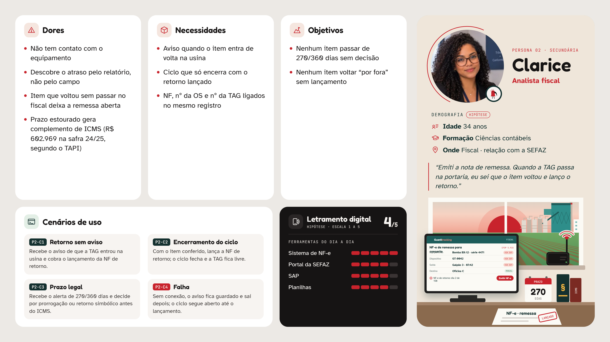
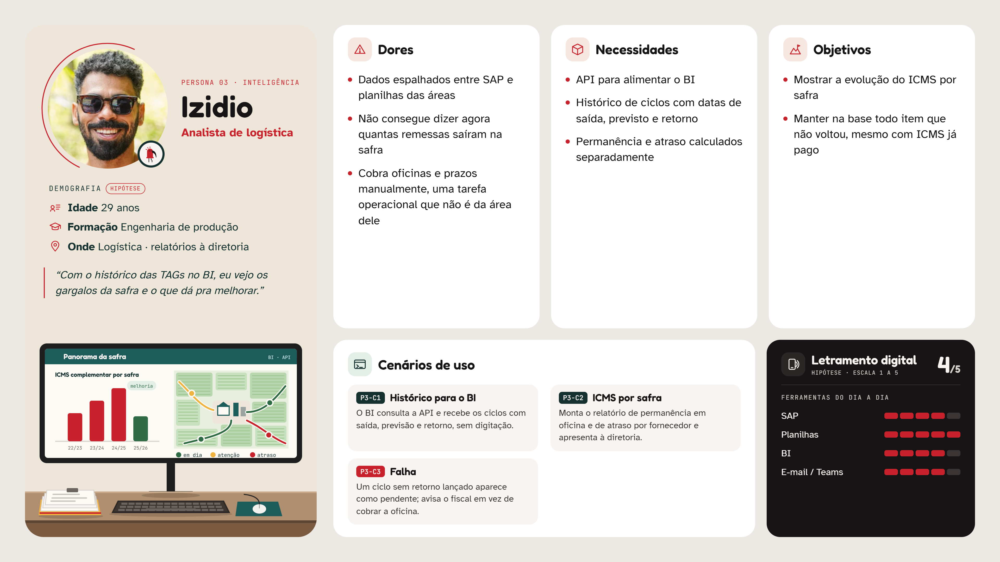

# Documentação IoTDoc - Módulo 4 - Inteli

## Nome do Grupo

#### Nomes dos integrantes do grupo

## Sumário

[1. Introdução](#c1)

[2. Metodologia](#c2)

[3. Desenvolvimento e Resultados](#c3)

[4. Conclusões e Recomendações](#c4)

[5. Referências](#c5)

 

# 1. Introdução (sprint 1)

A CerradinhoBio é uma companhia brasileira de capital aberto, com ações negociadas na B3, e integra o Grupo Cerradinho [3]. Atua em bioenergia a partir de cana-de-açúcar e milho: produz etanol, energia elétrica renovável gerada com biomassa, açúcar VHP e coprodutos do milho, como DDGS, WDG e óleo [4]. Suas operações estão em Chapadão do Céu (GO), onde ficam o negócio de cana e uma unidade de etanol de milho, e em Maracaju (MS), que também abriga uma unidade de etanol de milho [2]. Na safra 2025/26, a companhia registrou receita líquida consolidada de R$ 4,288 bilhões [1] e processou 5,2 milhões de toneladas de cana e 1,5 milhão de toneladas de milho; a capacidade instalada da fábrica de açúcar é de 550 mil toneladas por ano [2]. Como referência de porte de pessoal, a companhia informava cerca de 3.800 empregos diretos e indiretos em sua apresentação institucional publicada durante a safra 2024/25 [5]. A empresa se posiciona entre os maiores complexos industriais sucroenergéticos do Brasil e entre os maiores produtores de etanol do país [3, 4].

**Problema do projeto.** O acompanhamento de equipamentos enviados à manutenção externa depende de registros e contatos entre áreas e fornecedores. A dificuldade de consolidar localização, nota fiscal de remessa, prazo previsto e data de retorno reduz a visibilidade dos ativos em terceiros e exige cobranças manuais. Permanência total e atraso em relação ao prazo combinado são informações distintas e precisam ser analisadas separadamente.

## 1.1 Objetivos

**Objetivo geral.** Melhorar o controle dos equipamentos enviados a fornecedores para manutenção externa, desde a saída até o retorno.

**Objetivos específicos.** Ampliar a visibilidade dos ativos enquanto estão com terceiros; associar cada ciclo de envio à respectiva nota fiscal; distinguir permanência prolongada de atraso em relação ao prazo previsto; reduzir o esforço de consulta e cobrança manual; e preservar o histórico dos ciclos e movimentações.

## 1.2 Proposta da solução

A proposta reúne um dispositivo reutilizável, fixado ao equipamento com um lacre, e uma plataforma para consultar ativos, ciclos de manutenção, última localização e histórico. No cadastro, cada ciclo relaciona equipamento, fornecedor e nota fiscal, preservando os dados de saída e retorno. A plataforma compara o tempo decorrido desde a saída com o prazo previsto: assim, evidencia a permanência total do ativo e identifica separadamente quando o prazo combinado foi ultrapassado. A localização e o estado do ciclo ampliam a visibilidade dos equipamentos em terceiros; alertas configuráveis destacam casos para acompanhamento e pretendem reduzir consultas e cobranças manuais; o histórico registra os ciclos sucessivos; e uma API disponibiliza esses dados para análise em ferramentas de BI. No protótipo, a comunicação será demonstrada por Wi-Fi em cenário controlado. Como a disponibilidade de Wi-Fi nas oficinas de terceiros não é pressuposta, o canal de comunicação para produção será escolhido em sprint posterior, após comparação das alternativas em uma matriz que considere cobertura nos fornecedores, autonomia, confiabilidade, custo e escalabilidade, conforme o TAPI do projeto [6].

## 1.3 Justificativa

A centralização das informações pode facilitar a consulta da situação de cada equipamento, dar rastreabilidade documental aos envios e destacar casos que precisam de acompanhamento. O dispositivo reutilizável, o vínculo entre ativo, ciclo e nota fiscal, o histórico preservado entre usos e a disponibilização dos dados para BI compõem os diferenciais da proposta. A identificação mais rápida de pendências pode contribuir para reduzir o tempo de permanência e as perdas de ativos, mas esses resultados dependem do tratamento dos alertas pelos responsáveis e devem ser medidos; não são garantidos pelo protótipo, conforme os objetivos definidos no TAPI do projeto [6].

# 2. Metodologia (sprint 3)

_Descreva as etapas da metodologia RM-ODP que foram utilizadas para o desenvolvimento, citando o referencial teórico. Você deve apenas enunciar os métodos, sem dizer ainda como ele foi aplicado e quais resultados obtidos._

# 3. Desenvolvimento e Resultados 

## 3.1. Domínio de Fundamentos de Negócio

### 3.1.1. Contexto da Indústria (sprint 1)

**Parceiro:** CerradinhoBio. **Setor:** bioenergia sucroenergética e etanol de milho.

#### Concorrência

Na cana, concorrem Raízen [7, 18], São Martinho [8, 19] e bp bioenergy [9]; no milho, FS [10] e Inpasa [11]. Capacidades divulgadas: Raízen 105, bp 32 e São Martinho 24 milhões t/ano; FS 2,6 e Inpasa 5,8 bilhões l/ano. Safras diferentes impedem inferir participação.

#### Modelo de negócio

A CerradinhoBio opera no modelo B2B integrado: transforma cana e milho em etanol, açúcar, bioeletricidade e coprodutos vendidos a distribuidores, indústrias e setor elétrico [4]. Diversificação e CBIOs ampliam receitas; eficiência, logística e preços de commodities afetam resultados [13].

#### Tendências

O etanol de milho cresce e complementa a cana; a EPE registrou 36,2 bilhões de litros de etanol no Brasil em 2025 [12]. RenovaBio e Lei do Combustível do Futuro impulsionam biometano e SAF, com metas de aviação a partir de 2027 [13–16]. A digitalização pode ampliar a visibilidade de ativos e apoiar decisões.

#### Cinco Forças de Porter — CerradinhoBio

A intensidade indica a pressão sobre a atratividade do setor: baixa, média ou alta. Análise baseada em Porter [17] e no template do Inteli [20].

*Figura 3.1.1.1 — Cinco Forças. Fonte: template do Inteli [20]; Grupo G01 (2026).*

| Força | Intensidade | Justificativa |
|---|---|---|
| Rivalidade | Alta | Escala e commodities pressionam custos. |
| Fornecedores | Média | Insumos pesam; contratos e duas matérias-primas reduzem dependência. |
| Compradores | Média | Distribuidores negociam preço e volume. |
| Novos entrantes | Média | Capital e licenças criam barreiras. |
| Substitutos | Média | Gasolina e eletrificação competem com o etanol. |

**Síntese:** eficiência, abastecimento diversificado e confiabilidade dos ativos são prioridades. O GuaráTracking pode dar visibilidade à manutenção externa; seus efeitos serão medidos no piloto [6].

### 3.1.2. Análise SWOT (sprint 1)	

*Figura 3.1.2.1 — Análise SWOT da CerradinhoBio, com foco em equipamentos enviados à manutenção externa. Fonte: template de negócios do Inteli [42]; conteúdo: Grupo G01 (2026), com base no TAPI [6] e em dados públicos da CerradinhoBio [2, 4].*

**Escopo:** análise da CerradinhoBio, com foco nas condições do negócio e na gestão de equipamentos enviados para manutenção externa. Forças e fraquezas representam fatores internos; oportunidades e ameaças, fatores externos. A síntese considera o contexto da indústria descrito na seção 3.1.1 e o TAPI do projeto.

**Leitura para o projeto:** o portfólio diversificado e a escala de processamento da CerradinhoBio oferecem contexto favorável para testar uma rotina de rastreabilidade reutilizável. A dependência de registros e contatos entre áreas e fornecedores é uma fragilidade do processo de manutenção externa descrito no TAPI, a validar com o parceiro. A expansão do etanol e as políticas de descarbonização abrem oportunidades para a companhia; concorrência em escala, volatilidade de insumos e substitutos energéticos compõem ameaças externas. **PENDENTE DE VALIDAÇÃO:** quantificar a dor operacional (volume de remessas, tempo fora, atrasos e esforço de consulta) com os dados da última safra, ainda a serem disponibilizados conforme o TAPI.

### 3.1.3. Descrição da Solução a ser Desenvolvida (sprint 1)

#### 3.1.3.1 Problema a resolver

Registros e contatos dispersos dificultam localizar equipamentos em manutenção externa, verificar NF, prazo e retorno e exigem consultas manuais [6].

#### 3.1.3.2 Solução proposta (visão de negócios)

O GuaráTracking combina dispositivo reutilizável com lacre e cadastro digital por ciclo. Reúne equipamento, fornecedor, responsável, NF, prazo, última localização válida, estado do lacre e alertas; disponibiliza histórico e dados para consulta e BI. O piloto avaliará utilidade e viabilidade antes de eventual expansão. Não pressupõe rastreamento contínuo nem localização precisa em ambientes internos.

#### 3.1.3.3 Uso previsto

Na saída, cadastrar equipamento, fornecedor, responsável, NF e prazo e instalar o dispositivo lacrado. Durante o reparo, consultar posições periódicas e tratar alertas; registrar retiradas autorizadas e eventos sem conexão. No retorno, conferir, dar baixa, encerrar e liberar o dispositivo, preservando o histórico. Papéis serão validados com o parceiro.

#### 3.1.3.4 Benefícios

A solução pode centralizar dados, reduzir buscas e apoiar decisões. Os ganhos dependem do tratamento dos alertas e serão medidos no piloto.

#### 3.1.3.5 Critério de sucesso e medida

Sucesso é completar o ciclo em cinco dispositivos reais ou representativos, reutilizá-los sem vínculos duplicados e fornecer dados úteis. As metas abaixo serão validadas com a CerradinhoBio.

| Indicador | Medida e meta proposta |
|---|---|
| Localização | ≥90% das atualizações semanais geram posição externa válida. |
| Consulta | Situação completa em até 2 min em 90% das buscas. |
| Alertas | Falsos alertas ≤5%; violação notificada em até 15 min com conexão. |
| Integridade | 100% dos ciclos completos, sem vínculo duplicado; testar limiar de 150 dias com datas simuladas. |

Ensaios curtos não comprovam autonomia de 150 dias; separar medidas de estimativas.

### 3.1.4. Value Proposition Canvas (sprint 1)	

Canvas do GuaráTracking para PCM, Fiscal e Logística (P1–P3), com base no TAPI [6] e no *kick-off* de 16/10/2026 [33]. Os ganhos são hipóteses a medir no piloto.

*Figura 3.1.4.1 — Value Proposition Canvas do GuaráTracking para PCM, Fiscal e Logística.*

*Fonte: template “Value Proposition Canvas - template png”, pasta de templates de negócios do Inteli [32]; conteúdo: Grupo G01 (2026).*

| Dor do cliente | Resposta do GuaráTracking | Ganho relacionado |
|---|---|---|
| D1 Controle espalhado e manual | Cadastro do ciclo (AD1) e consulta consolidada (CG1) | G1 Localizar e consultar sem ligar |
| D2 Localização e prazo incertos | Última posição (AD2), prazo separado da permanência (AD3) e alertas (CG2) | G2 Agir antes do vencimento |
| D3 Difícil decidir diante do atraso | Histórico por fornecedor (CG4) | G4 Histórico útil à gestão |
| D4 Retorno sem baixa fiscal | Retorno aguardando baixa (AD4) e baixa ligada à NF (CG3) | G3 Fechar o retorno corretamente |
| D5 Complemento de ICMS por prazo vencido, informado no *kick-off* para 2024/25; parcela ligada à manutenção externa não apurada [33] | Acompanhamento dos prazos (AD3), sem garantia de evitar incidência fiscal | G2 Agir antes do vencimento |
| D6 Lacre aberto sem registro | Alerta e registro do lacre (AD5) | G3 Fechar o retorno corretamente |
| D7 Dados espalhados entre SAP e planilhas | Dados do ciclo estruturados (AD6) e consulta pela API (CG5) | G5 Dados consolidados para o BI |

### 3.1.5. Matriz de Riscos (sprint 1)

A matriz prioriza riscos do projeto. Probabilidade: 10%–90%; impacto: muito baixo–muito alto. Posições são estimativas.

  
<strong>Figura 3.1.5.1 — Matriz de riscos do projeto</strong>

  
  
<em>Fonte: elaboração do Grupo G01 (2026), com base no template da disciplina.</em>

| ID | Causa e efeito | Prob. | Impacto | Justificativa | Resposta | Responsável |
|---|---|---:|---:|---|---|---|
| R01 | NF não vinculada → alerta falso. | 50% | Moderado | Kick-off prevê prorrogação. | Vincular nova NF. | Software/Fiscal |
| R02 | Metal/galpão → perda de GNSS. | 70% | Muito alto | Hipótese técnica. | Testar antenas; manter posição válida. | Hardware |
| R03 | Ensaio curto → autonomia incerta. | 70% | Alto | Ciclos podem durar um ano [6]. | Estimar pelo consumo. | Hardware |
| R04 | Sem rede → eventos retidos. | 90% | Alto | Cobertura externa incerta [6]. | Armazenar e comparar redes. | Conectividade |
| R05 | Ruído ou abertura autorizada → falso alerta. | 50% | Alto | Retirada ocorre no reparo. | Debounce e autorização. | Firmware |
| R06 | Fixação inadequada → dano. | 50% | Muito alto | Formatos variam [6]. | Usar fixação removível. | Hardware |
| R07 | Água/lavagem → falha. | 70% | Muito alto | Exposição prevista [6]. | Vedar e ensaiar. | Hardware |
| R08 | Conectividade cara → inviabilidade. | 50% | Alto | Custo afeta a escolha. | Comparar planos. | Produto |
| R09 | Fornecedor indisponível → piloto limitado. | 50% | Moderado | Dependência externa. | Agendar e simular. | Projeto |
| R10 | Dado restrito exposto → incidente. | 30% | Muito alto | Localização e NF são restritas. | Usar dados fictícios e revisar. | Dados/LGPD |
| R11 | Retorno sem NF → ciclo fiscal aberto. | 70% | Muito alto | Kick-off exige baixa fiscal. | Conferir retorno e NF. | Processos |

**Oportunidades**

| ID | Oportunidade | Prob. | Impacto | Tratamento | Responsável |
|---|---|---:|---|---|---|
| O01 | Reutilização reduz custo por ciclo. | 70% | Alto | Validar modularidade. | Produto |
| O02 | Histórico apoia avaliação de oficinas. | 70% | Alto | Criar indicador. | Produto/BI |

### 3.1.6. Política de Privacidade de acordo com a LGPD (sprint 1)

Política preliminar do GuaráTracking, sujeita à validação da CerradinhoBio e alinhada à LGPD [40] e à orientação da ANPD [41].

#### 3.1.6.1 Informações gerais

A solução acompanha equipamentos do parceiro em manutenção externa; controlador e operador serão confirmados antes do piloto.

#### 3.1.6.2 Tratamento de dados

O tratamento abrange dados de usuários e responsáveis por ciclos e alertas (RF002, RF018, RF021, RF023; RN15).

#### 3.1.6.3 Dados coletados

Nome, e-mail corporativo, cargo, perfil, credenciais, IP, logs, horários e contatos profissionais; localização pode identificar indiretamente o motorista.

#### 3.1.6.4 Fonte dos dados

Titulares, responsáveis, fornecedores, painel e dispositivos.

#### 3.1.6.5 Finalidades

Autenticação, operação dos ciclos, alertas, auditoria, suporte e comunicação; posição válida será semanal, sem rastreamento contínuo [6].

#### 3.1.6.6 Armazenamento

Dados e logs ficarão em nuvem; eventos, no broker. Provedor, região e tecnologias: **PENDENTE DE VALIDAÇÃO**.

#### 3.1.6.7 Retenção

Manter dados só pelo período necessário; prazos de ciclos, logs e contatos: **PENDENTE DE VALIDAÇÃO**.

#### 3.1.6.8 Cookies

Se usados, serão cookies de sessão necessários.

#### 3.1.6.9 Compartilhamento

Somente com provedores necessários de nuvem, broker e conectividade.

#### 3.1.6.10 Segurança

Aplicar autenticação, acesso restrito, auditoria e proteção de credenciais.

#### 3.1.6.11 Direitos dos titulares

Garantir confirmação, acesso, correção, anonimização, bloqueio, eliminação e informação sobre compartilhamento [40, 41].

#### 3.1.6.12 Exercício dos direitos

Receber, verificar, registrar e responder solicitações; canal oficial: **PENDENTE DE VALIDAÇÃO**.

#### 3.1.6.13 DPO/Encarregado

Nome e contato do encarregado indicado pelo controlador: **PENDENTE DE VALIDAÇÃO** [41].

### 3.1.7. Bill of Material (BOM) (sprint 1)

BOM preliminar para um dispositivo, organizada conforme a planilha do Inteli [42]. Referências são propostas; especificações e cotações pendentes serão confirmadas antes da construção [6]. Valores são em reais.

| Categoria | Quantidade | Referência proposta | Código / modelo do fabricante | Valor do componente |
|---|---:|---|---|---:|
| Microcontrolador | 1 | U1 | ESP32 DevKit V1 | Pendente |
| GNSS | 1 | U2 | Quectel LC76G-PA / LC76GPATA | R$ 247,38 [34, 35] |
| Antena GNSS | 1 | ANT1 | Compatibilidade/modelo a selecionar | Pendente |
| Bateria | 1 | BT1 | Capacidade a definir pelo ensaio | Pendente |
| Alimentação | 1 conjunto | U3 | Regulador e circuito de carga/backup a definir | Pendente |
| Sensor e lacre | 1 conjunto | S1 | Contato e lacre reutilizável a especificar | Pendente |
| Gabinete | 1 | ENC1 | Modelo resistente à água a selecionar | Pendente |
| Fixação e cabos | 1 conjunto | FIX1 | Fixação removível a especificar | Pendente |
| Comunicação externa | 1 solução | COM1 | Tecnologia e plano após teste de cobertura | Pendente |
| PCI, passivos e LEDs | 1 conjunto | PCB1 | Componentes e montagem a detalhar | Pendente |

O preço GNSS foi consultado em 22/10/2026; o distribuidor indicava estoque zerado. Não inclui frete, tributos nem encargos [34, 35].

**Mão de obra estimada:** 40 dias, 2 horas/dia por pessoa (80 h); referências salariais, não cotações [36–39].

| Perfil (CBO) | Pessoas | R$/h | Subtotal (R$) |
|---|---:|---:|---:|
| Engenheiro de hardware computacional (2122-10) | 3 | 68,47 | 16.432,80 |
| Pesquisador em ciências da computação (2031-05) | 2 | 54,95 | 8.792,00 |
| Analista de sistemas (2124-05) | 1 | 40,28 | 3.222,40 |
| Engenheiro de software (2122-15) | 1 | 70,73 | 5.658,40 |
| **Total** | **7** |  | **34.105,60** |

Subtotal quantificado: R$ 34.352,98 (mão de obra e apenas o GNSS); exclui itens pendentes, frete, tributos e encargos.

## 3.2. Domínio de Fundamentos de Experiência de Usuário 

### 3.2.1. Personas (sprint 1)	

#### Introdução às personas

As personas orientam o desenvolvimento da solução de rastreamento de equipamentos em manutenção externa da Cerradinho a partir dos objetivos, dificuldades e necessidades dos usuários. Os perfis consideram seus cenários de uso e letramento digital, distinguindo informações fundamentadas na pesquisa de hipóteses pendentes de validação.

#### Metodologia de construção das personas

A construção das personas partiu da análise do TAPI e das respostas do parceiro no kickoff de 16/10/2026. As informações foram organizadas por etapa do fluxo de manutenção externa, relacionando cada responsável às suas atividades, ferramentas, dificuldades e necessidades. Foram selecionados três perfis porque representam interações distintas com a solução: o PCM acompanha o equipamento, cobra o fornecedor e decide como agir diante de atrasos; o Fiscal emite a nota de remessa e registra o retorno, podendo permanecer sem informação mesmo quando o equipamento já voltou fisicamente; e a Logística consolida os dados para acompanhamento pelo BI. Essas evidências fundamentaram as personas Geraldo, Clarice e Izidio e orientaram a elaboração de seus objetivos, dores e cenários de uso.

O NotebookLM apoiou a síntese das informações do kickoff, e o Codex auxiliou na organização e redação da documentação. A IA também gerou alternativas de layout e cenas para as personas; a equipe selecionou as opções e orientou ajustes de composição e coerência com cada função. Os nomes são fictícios, os cenários foram elaborados a partir do fluxo identificado.

##### P1. Geraldo, analista de PCM (persona principal)

*Figura 3.2.1.1 — Persona 1, Geraldo, analista de PCM. Fonte: card elaborado pelo Grupo G01 (2026) com apoio do Claude (Anthropic), modelo Opus 5.5 [29]; foto do rosto: banco de imagens Magnific [28], de uso gratuito sob a licença da plataforma.*

Geraldo, analista de PCM de 38 anos e técnico em mecânica, trabalha no barracão da manutenção da usina e é, na prática, o dono do equipamento enquanto ele está fora: é ele quem avalia a peça que o mecânico trouxe, escolhe e cota a oficina, vincula a TAG, aplica o lacre, entrega o item à transportadora e depois passa horas ao telefone cobrando o fornecedor, apoiado em SAP, planilhas e e-mail (letramento digital 3 de 5). Esse trabalho, porém, acontece com dezenas de itens ao mesmo tempo, e por isso os equipamentos menos críticos acabam saindo da memória, enquanto os fornecedores prometem datas que nem sempre cumprem; sem dados à mão, Geraldo também não consegue saber se um atraso pede trazer o item de volta, usar uma peça sobressalente ou prorrogar o prazo. É por isso que o que ele espera da solução é simples: saber, sem ligar para ninguém, onde está cada item e quando ele volta, ser avisado antes de o prazo estourar e contar com o histórico de cumprimento de cada fornecedor para decidir se renova o contrato ou troca de oficina. Para a plataforma, isso significa pôr no centro uma lista de "meus itens fora" ordenada por dias para vencer, com alertas de prazo configuráveis, alerta imediato de lacre aberto e a última localização e o histórico por fornecedor ao alcance de um clique, em vez de painéis gerenciais que não ajudam quem precisa agir todos os dias.

##### P2. Clarice, analista fiscal (persona secundária)

*Figura 3.2.1.2 — Persona 2, Clarice, analista fiscal. Fonte: card elaborado pelo Grupo G01 (2026) com apoio do Claude (Anthropic), modelo Opus 5.5 [29]; foto do rosto gerada no ChatGPT (OpenAI) [31] a partir do pedido "uma moça com cabelos enrolados, corporativa, responsável por emissão fiscal".*

Clarice representa a analista fiscal responsável pela emissão das notas fiscais de remessa e pelo lançamento das notas de retorno, utilizando sistemas como SAP e Gama Soft. Diferentemente de Geraldo, não acompanha fisicamente os equipamentos: sua principal dificuldade ocorre quando um item retorna sem que o Fiscal seja informado, deixando a remessa aberta. Por isso, precisa consultar de forma integrada a identificação do dispositivo (TAG), a nota fiscal e a ordem de serviço, acompanhar prazos e identificar pendências documentais. Seu objetivo é reduzir a busca manual por informações e agir antes que essas pendências gerem consequências fiscais. Na solução, consulta alertas de prazo, verifica retornos ainda não registrados e confirma o lançamento da nota fiscal de retorno, necessário para encerrar o ciclo após a conferência do equipamento. Um aviso automático de chegada à portaria poderá apoiar esse acompanhamento, mas permanece como proposta do grupo a ser discutida com o parceiro.

##### P3. Izidio, analista de logística (persona de inteligência)

*Figura 3.2.1.3 — Persona 3, Izidio, analista de logística. Fonte: card elaborado pelo Grupo G01 (2026) com apoio do Claude (Anthropic), modelo Opus 5.5 [29]; foto do rosto: Leonardo Dourado, no Pexels [27], de uso gratuito sob a licença Pexels [30].*

Izidio, analista de logística de 29 anos e engenheiro de produção, consolida o que saiu e o que voltou para a diretoria e acompanha o custo de ICMS por safra, trabalhando com SAP, planilhas, BI e e-mail ou Teams (letramento digital 4 de 5). O problema é que os dados vivem espalhados entre o SAP e as planilhas de cada área, de modo que ele não consegue dizer, em um instante, quantas remessas saíram na safra; para compensar, e movido por um senso de dono, acaba cobrando oficinas e prazos à mão, uma tarefa operacional que não é da sua área e que o afasta da otimização logística que deveria ser o seu foco. Por isso ele precisa de uma API que alimente o BI automaticamente, de um histórico de ciclos com datas de saída, previsão e retorno e de permanência e atraso calculados separadamente, e espera, com isso, mostrar à diretoria a evolução do ICMS por safra e manter na base todo item que não voltou, mesmo quando o ICMS já foi pago. Para a plataforma, isso reforça a prioridade de uma API robusta e de dados confiáveis, em lugar de telas operacionais, e a regra de tratar como pendente, nunca como encerrado, o ciclo sem retorno lançado, para que o número que chega à diretoria seja o que realmente aconteceu.

#### Conclusão

As personas indicam que a solução deve apresentar informações e ações adequadas às responsabilidades de cada usuário. Para Geraldo, isso significa priorizar a consulta dos equipamentos sob sua responsabilidade, os prazos, a última localização válida e os alertas que exigem intervenção. Para Clarice, o foco está na associação entre equipamento e documentos e na identificação de retornos pendentes de lançamento. Para Izidio, a necessidade é acessar históricos consistentes para consolidar dados e analisar o acompanhamento das remessas.

Essas diferenças orientam o GuaráTracking a combinar uma visão operacional dos equipamentos com o controle das pendências de cada ciclo e a disponibilização de dados para BI. A interface deve facilitar a identificação do que precisa de atenção e de quem deve agir, enquanto o histórico deve preservar a relação entre saída, acompanhamento e retorno. Assim, o rastreamento apoia decisões e a continuidade do processo entre as áreas.

#### Uso de IA na representação visual das personas

A IA foi usada para representar visualmente as personas, não para definir seu conteúdo. Objetivos, dores, necessidades e cenários já estavam escritos pela equipe a partir do kickoff e foram entregues à IA como contexto, junto com o guia de estilos do GuaráTracking, para manter cores, tipografia e ilustrações coerentes com a identidade visual do projeto.

Antes de gerar as cenas, a equipe discutiu com a IA quais objetos simbolizam o trabalho de cada função: prancheta, telefone e lacre para Geraldo; nota fiscal, calendário e o aspecto jurídico para Clarice; mapa, dados e acompanhamento do transporte para Izidio. Cada pedido gerou variações numeradas, comparadas lado a lado, e a escolha veio acompanhada de correções concretas. Na cena de Geraldo, por exemplo, a peça avulsa foi trocada por um equipamento carregado no caminhão, e a perspectiva do veículo e a posição do operador foram ajustadas em várias rodadas. Na de Izidio, o mapa passou a mostrar uma fazenda com rotas sinalizadas em verde, amarelo e vermelho.

O layout também foi revisado pela equipe: o texto corrido deu lugar a um fluxo visual com ícones por etapa, e os blocos de dores, objetivos e necessidades ganharam mais espaço. As versões finais foram exportadas em PDF e SVG para edição no Figma. Por isso, as imagens das personas são ilustrações e não registram dados do parceiro.

### 3.2.2. Jornada do Usuário e Storyboard (sprint 2)	

_Coloque aqui seu Mapa de Jornada do Usuário (seguindo as instruções na descrição do artefato)_

_Coloque aqui seu Storyboard (seguindo as instruções na descrição do artefato)_

## 3.3. Solução Técnica	

### 3.3.1. Requisitos Funcionais (sprint 1, refinar e atualizar até sprint 5)

Os requisitos abaixo saem do TAPI (MVP 1 a 7 e fluxo básico), da avaliação do protótipo e do kick-off com a Cerradinho (16/10/2026). A prioridade segue o que o parceiro chamou de indispensável no kick-off: alerta de lacre, alerta de prazo e geolocalização. Um RF só passa a `Simulado no Wokwi` depois que o caso de teste correspondente (seção 3.4.1) é executado e passa. Os IDs estão congelados: um RF removido não libera o número, e um RF novo entra no fim da lista.

| ID    | Descrição | Origem | Prioridade | Status |
|-------|-----------|--------|------------|--------|
| RF001 | O sistema deve cadastrar o equipamento com identificador próprio, descrição e foto. | TAPI MVP 1 | Alta | Planejado |
| RF002 | O sistema deve abrir um ciclo de manutenção externa com NF de remessa (número e data de emissão), fornecedor, responsável e prazo previsto de retorno. | TAPI MVP 3 | Alta | Planejado |
| RF003 | O sistema deve vincular um dispositivo a um ciclo de manutenção aberto. | TAPI MVP 3 | Alta | Planejado |
| RF004 | O sistema deve recusar o vínculo de um dispositivo que já está em um ciclo ativo. | Fluxo básico | Alta | Planejado |
| RF005 | O sistema deve coletar a posição GNSS na rotina de envio e guardar a última localização válida com data e hora. | TAPI MVP 2 | Alta | Planejado |
| RF006 | O sistema deve monitorar o lacre e detectar sua abertura ou rompimento. | TAPI MVP 5 | Alta | Planejado |
| RF007 | O sistema deve registrar a retirada autorizada e a reaplicação do lacre sem gerar alerta de violação. | TAPI MVP 5 | Alta | Planejado |
| RF008 | O sistema deve conectar-se à rede Wi‑Fi e reconectar automaticamente quando a conexão cair. | Avaliação do protótipo | Alta | Planejado |
| RF009 | O sistema deve publicar status e eventos no broker MQTT, em JSON, no tópico do dispositivo. | TAPI MVP 6 | Alta | Planejado |
| RF010 | O sistema deve guardar os eventos gerados sem conexão e enviá-los na ordem em que ocorreram quando a conexão voltar. | TAPI MVP 5 | Alta | Planejado |
| RF011 | O sistema deve enviar um status periódico, semanal por padrão e configurável. | TAPI MVP 4 | Alta | Planejado |
| RF012 | O sistema deve calcular os dias fora a partir da data de emissão da NF de remessa. | TAPI MVP 4; Kick-off com a Cerradinho (16/10/2026) | Alta | Planejado |
| RF013 | O sistema deve emitir um alerta de atraso quando os dias fora passam do prazo previsto de retorno. | TAPI MVP 3 | Alta | Planejado |
| RF014 | O sistema deve emitir um alerta de permanência quando os dias fora atingem o limiar do ciclo (150 dias por padrão, configurável). | TAPI MVP 4 | Alta | Planejado |
| RF015 | O sistema deve listar os equipamentos fora com última localização válida, dias fora, prazo, bateria e estado do lacre. | TAPI MVP 6 | Alta | Planejado |
| RF016 | O sistema deve encerrar o ciclo somente com a NF de retorno lançada e o lacre fechado. | Fluxo básico | Alta | Planejado |
| RF017 | O sistema deve liberar o dispositivo do ciclo encerrado para um novo vínculo, preservando o histórico. | TAPI MVP 3; fluxo básico | Alta | Planejado |
| RF018 | O sistema deve notificar o responsável do ciclo a cada alerta, com o e-mail como canal inicial. | Fluxo básico; Kick-off com a Cerradinho (16/10/2026) | Alta | Planejado |
| RF019 | O sistema deve medir o nível de bateria e enviá-lo em cada mensagem. | TAPI MVP 6 | Média | Planejado |
| RF020 | O sistema deve cadastrar os dispositivos na plataforma, cada um com identificador e credencial próprios. | TAPI MVP 3 | Média | Planejado |
| RF021 | O sistema deve atribuir a cada usuário um `usuario_id` único e permanente, gerado pela plataforma, vinculado à sua credencial individual e ao seu perfil de acesso, e autenticar esse usuário para acessar o painel. | TAPI MVP 6 | Média | Planejado |
| RF022 | O sistema deve exibir gráficos e mapa com equipamentos por faixa de dias fora, alertas por tipo e última posição de cada equipamento. | TAPI MVP 6 | Média | Planejado |
| RF023 | O sistema deve atribuir cada alerta ao responsável pelo ciclo e permitir que esse responsável, após autenticação, registre a ciência e o tratamento com decisão, data e justificativa. | Fluxo básico | Média | Planejado |
| RF024 | O sistema deve oferecer uma API autenticada e documentada para consulta dos dados por ferramentas de BI. | TAPI MVP 6 | Média | Planejado |
| RF025 | O sistema deve emitir um alerta quando um dispositivo passa do período esperado sem se comunicar. | Kick-off com a Cerradinho (16/10/2026) | Média | Planejado |
| RF026 | O sistema deve emitir um alerta quando os dias fora atingem a data limite legal do ciclo. | Kick-off com a Cerradinho (16/10/2026) | Média | Planejado |
| RF027 | O sistema deve emitir um alerta quando o nível de bateria fica abaixo do limite mínimo. | TAPI MVP 6 | Média | Planejado |

Itens técnicos da avaliação: coleta de dados via sensor (RF005, RF006, RF019) · definição de devices na plataforma (RF003, RF020) · chave de identificação de usuário e acesso ao dashboard (RF021) · conexão Wi‑Fi (RF008) · formatação de dados para MQTT (RF009) · representação gráfica dos dados coletados (RF015, RF022).

### 3.3.2. Regras de Negócio (sprint 1, refinar até sprint 5)

As regras abaixo restringem o comportamento descrito nos RFs da seção 3.3.1 e vêm das mesmas fontes: TAPI e kick-off com a Cerradinho (16/10/2026), além do regulamento do ICMS de Goiás no caso do prazo legal. Valores marcados como `PENDENTE DE VALIDAÇÃO` são propostas preliminares que dependem de confirmação do parceiro; quando usados em casos de teste da seção 3.4.1, não representam aprovação do parceiro. Os casos de teste da 3.4.1 indicam qual RN verificam.

| ID   | Descrição | Origem | RF associado |
|------|-----------|--------|--------------|
| RN01 | Um dispositivo só pode estar vinculado a um ciclo ativo por vez, e um equipamento só pode ter um ciclo ativo por vez. | Fluxo básico | RF003, RF004 |
| RN02 | Um ciclo só pode ser aberto com NF de remessa (número e data de emissão), fornecedor, responsável e prazo previsto de retorno preenchidos. | TAPI MVP 3 | RF002 |
| RN03 | O limiar de permanência é de 150 dias por padrão e pode ser alterado em cada ciclo para qualquer número inteiro de dias maior que zero. | TAPI MVP 4; Kick-off com a Cerradinho (16/10/2026) | RF014 |
| RN04 | Atraso e permanência são alertas distintos, podem estar ativos ao mesmo tempo e cada um é emitido uma única vez por ciclo. | TAPI MVP 3 e 4 | RF013, RF014 |
| RN05 | A abertura do lacre sem autorização vigente é violação crítica e é enviada na hora, fora da rotina de status periódico. | TAPI MVP 5 | RF006 |
| RN06 | A autorização de retirada vale por 3 dias a partir do registro; a abertura do lacre depois desse prazo é tratada como violação. Prazo de 3 dias: `PENDENTE DE VALIDAÇÃO` | TAPI MVP 5 | RF007 |
| RN07 | O status periódico é enviado a cada 7 dias por padrão, com frequência configurável até diária. | TAPI MVP 4 | RF011 |
| RN08 | Uma posição GNSS é válida quando o receptor tem fix, a posição traz data e hora do próprio GNSS e o HDOP é de no máximo 2,0. A última localização válida só é atualizada com uma posição válida; sem ela, a anterior é mantida. Última comunicação e última localização válida são registradas em campos distintos. HDOP máximo de 2,0: `PENDENTE DE VALIDAÇÃO` | TAPI MVP 6 | RF005, RF015 |
| RN09 | Sem conexão, o dispositivo guarda até 8 eventos; com a fila cheia, descarta o evento não crítico mais antigo e nunca descarta uma violação. Cada evento mantém a hora em que ocorreu, e a plataforma registra a hora de recebimento à parte. Capacidade de 8 eventos: `PENDENTE DE VALIDAÇÃO` | TAPI MVP 5 | RF010 |
| RN10 | O alerta de bateria baixa é emitido uma vez quando o nível fica abaixo de 20% e só volta a ser emitido depois que o nível passa de 25%. Leitura zero é falha do sensor, não bateria vazia. Limites de 20% e 25%: `PENDENTE DE VALIDAÇÃO` | TAPI MVP 6 | RF019, RF027 |
| RN11 | O encerramento do ciclo é recusado enquanto o lacre estiver aberto ou a NF de retorno não estiver lançada, e o histórico do ciclo encerrado nunca é apagado. | Fluxo básico | RF016, RF017 |
| RN12 | Uma prorrogação (retorno e nova remessa simbólicos) abre um novo ciclo do mesmo equipamento e do mesmo dispositivo, e os dias fora passam a contar da emissão da nova NF de remessa. | Kick-off com a Cerradinho (16/10/2026) | RF012, RF017 |
| RN13 | A data limite legal do ciclo é de 270 dias para destino em GO e de 360 dias para destino fora de GO, contados da saída, ou seja, da emissão da NF de remessa. Vigência dos prazos: `PENDENTE DE VALIDAÇÃO` com o fiscal da Cerradinho | RCTE/GO (Decreto nº 4.852/1997), art. 79, I, "s", 1 (270 dias, saída interna) e Anexo IX, art. 6º, IV (360 dias, saída interestadual), na redação do Decreto nº 7.815/2013; Kick-off com a Cerradinho (16/10/2026) | RF012, RF026 |
| RN14 | Um dispositivo é considerado sem comunicação quando passa de dois intervalos de status periódico sem enviar nenhuma mensagem (14 dias com o padrão de 7 dias); o alerta é emitido uma vez e só volta a ser emitido depois de uma nova comunicação. Dois intervalos: `PENDENTE DE VALIDAÇÃO` | Kick-off com a Cerradinho (16/10/2026) | RF025 |
| RN15 | O painel e a API só respondem a usuário autenticado; sem credencial válida, o acesso é negado e nenhum dado é exibido. | TAPI MVP 6 | RF021, RF024 |
| RN16 | Mensagem de dispositivo não cadastrado ou com credencial inválida é rejeitada e não altera nenhum ciclo. | TAPI MVP 3 | RF020 |
| RN17 | Cada usuário possui um `usuario_id` único, gerado pela plataforma e não reutilizado nem alterado após o cadastro. A credencial e o perfil de acesso são vinculados a esse identificador; o `usuario_id` identifica o usuário nos registros de auditoria sem expor sua credencial. | RF021; especificação preliminar do projeto | RF021, RF023 |
| RN18 | Cada alerta é atribuído ao responsável do ciclo. Esse responsável deve registrar, após autenticação, a ciência e uma decisão de tratamento com justificativa em até 1 dia útil após a emissão. O prazo de 1 dia útil é `PENDENTE DE VALIDAÇÃO` com a Cerradinho. O registro inclui o `usuario_id` do responsável e data/hora, é preservado no histórico e não substitui registros anteriores; alertas sem tratamento dentro do prazo permanecem pendentes e são destacados no painel. | RF018, RF023; Fluxo básico. Prazo de 1 dia útil: `PENDENTE DE VALIDAÇÃO` com a Cerradinho | RF018, RF021, RF023 |

**Compatibilidade entre as regras de negócio e o protótipo atual.** A tabela abaixo mostra como o firmware da seção 3.4.1 trata as regras que ele já cobre; as diferenças indicadas não representam requisitos já atendidos.

| Regra | Situação no protótipo atual |
|---|---|
| RN05 — envio da violação fora da rotina periódica | Preservar registro local independente de GNSS/rede. Entrega ao servidor ainda não implementada; manter limites de latência pendentes com o parceiro. “Na hora” não define SLA nem garante entrega sem conexão. |
| RN08 — data/hora GNSS e HDOP máximo de 2,0 | O firmware atual verifica validade, idade e satélites, mas não aplica esse limite de HDOP nem persiste data/hora absoluta. Registrar adequação futura do driver LC76G-PA; limite de HDOP ainda pendente. |
| RN09 — fila de 8 com prioridade para críticos | Implementada na fila de eventos sem rede (8 eventos, descarte do não crítico mais antigo, reenvio na ordem com `dia_ocorrencia`). Com a fila só de violações, a 9ª violação em diante entra num único registro de resumo (`VIOLACAO_LACRE_RESUMO`, com quantidade e primeira/última ocorrência), persistido na NVS e enviado depois das 8 no reenvio; nenhuma violação é perdida. Só eventos não críticos que não cabem são contados em `perdidos`. A política de agregação deve ser confirmada com o parceiro. O registro local de 16 entradas na NVS (CT21) continua separado. |
| RN10 — leitura zero considerada falha | Implementada: ADC = 0 gera `SENSOR_BATERIA_FALHA` e nenhum `BATERIA_BAIXA` (CT13). No dispositivo físico, o diagnóstico elétrico do divisor ainda depende do CT30 previsto no [planejamento de energia e GNSS](outros/planejamento-energia-gnss.md). |
| RN11 — encerramento exige lacre fechado e NF de retorno | Implementada no `BTN_CICLO` (segurar 2 s). No simulador, a NF de retorno é lançada pelo comando `NF` no Monitor Serial, que representa o lançamento na plataforma. |

### 3.3.3. Requisitos Não Funcionais — 8 Eixos ISO/IEC 25010 (sprints 2 a 5)

*Preencha os 8 eixos. Cada eixo deve ter ao menos um RNF verificável (com métrica, limite ou critério concreto) ou justificativa explícita de ausência. Evolua do conceitual (sprint 2) ao técnico mensurável (sprint 5).*

| Eixo                     | Requisito | Métrica / Critério | Justificativa |
|--------------------------|-----------|--------------------|---------------|
| USAB — Usabilidade       | ...       | ...                | ...           |
| CONF — Confiabilidade    | ...       | ...                | ...           |
| DES — Desempenho         | ...       | p95 < X ms         | ...           |
| SUP — Suportabilidade    | ...       | ...                | ...           |
| SEG — Segurança          | ...       | ...                | ...           |
| CAP — Capacidade         | ...       | ...                | ...           |
| REST — Restrições Design | ...       | ...                | ...           |
| ORG — Organizacionais    | ...       | ...                | ...           |

### 3.3.4. Matriz de Rastreabilidade (RTM) (sprints 1 a 5)

| Persona | RF    | RN   | Caso de Teste | Evidência        |
|---------|-------|------|---------------|------------------|
| P1 Geraldo — P1-C1 Saída com TAG e lacre | RF001 | Não se aplica — o cadastro do equipamento não tem restrição própria; as restrições começam na abertura do ciclo (RN02) | Planejado — CT a definir | Planejado, sprint a definir |
| P1 Geraldo — P1-C1 Saída com TAG e lacre | RF002 | RN02 | Planejado — CT a definir | Planejado, sprint a definir |
| P1 Geraldo — P1-C1 Saída com TAG e lacre | RF003 | RN01 | Planejado — CT a definir | Planejado, sprint a definir |
| P1 Geraldo — P1-C1 Saída com TAG e lacre | RF004 | RN01 | CT15 | `assets/wokwi/CT15.png` — PENDENTE DE EVIDÊNCIA |
| P1 Geraldo — P1-C4 Falha | RF005 | RN08 | CT19, CT20, CT22 | `assets/wokwi/CT19.png`, `assets/wokwi/CT20.png`, `assets/wokwi/CT22.png` — PENDENTE DE EVIDÊNCIA |
| P1 Geraldo — P1-C3 Lacre aberto | RF006 | RN05 | CT05, CT07, CT18 | `assets/wokwi/CT05.png`, `assets/wokwi/CT07.png`, `assets/wokwi/CT18.png` — PENDENTE DE EVIDÊNCIA |
| P1 Geraldo — P1-C3 Lacre aberto | RF007 | RN06 | CT06, CT11 | `assets/wokwi/CT06.png`, `assets/wokwi/CT11.png` — PENDENTE DE EVIDÊNCIA |
| P2 Clarice — P2-C4 Falha (associação direta) | RF008 | Não se aplica — requisito técnico de conectividade; o comportamento sem conexão é regido pela RN09 (RF010) | CT08, CT09 | `assets/wokwi/CT08.png`, `assets/wokwi/CT09.png` — PENDENTE DE EVIDÊNCIA |
| P1 Geraldo — P1-C2 Acompanhamento | RF009 | Não se aplica — define formato e canal de envio; quando cada mensagem sai é regido pela RN05 e pela RN07 | CT01, CT02 | `assets/wokwi/CT01.png`, `assets/wokwi/CT02.png` — PENDENTE DE EVIDÊNCIA |
| P2 Clarice — P2-C4 Falha | RF010 | RN09 | CT08, CT09, CT10, CT21, CT22 | `assets/wokwi/CT08.png`, `assets/wokwi/CT09.png`, `assets/wokwi/CT10.png`, `assets/wokwi/CT21.png`, `assets/wokwi/CT22.png` — PENDENTE DE EVIDÊNCIA |
| P1 Geraldo — P1-C2 Acompanhamento | RF011 | RN07 | CT02 | `assets/wokwi/CT02.png` — PENDENTE DE EVIDÊNCIA |
| P1 Geraldo — P1-C2 Acompanhamento; P2 Clarice — P2-C3 Prazo legal; P3 Izidio — P3-C2 ICMS por safra | RF012 | RN12, RN13 | CT03, CT04 | `assets/wokwi/CT03.png`, `assets/wokwi/CT04.png` — PENDENTE DE EVIDÊNCIA |
| P1 Geraldo — P1-C2 Acompanhamento; P3 Izidio — P3-C2 ICMS por safra | RF013 | RN04 | CT03 | `assets/wokwi/CT03.png` — PENDENTE DE EVIDÊNCIA |
| P1 Geraldo — P1-C2 Acompanhamento; P3 Izidio — P3-C2 ICMS por safra | RF014 | RN03, RN04 | CT04 | `assets/wokwi/CT04.png` — PENDENTE DE EVIDÊNCIA |
| P1 Geraldo — P1-C2 Acompanhamento; P1-C4 Falha | RF015 | RN08 | CT19, CT20, CT22 | `assets/wokwi/CT19.png`, `assets/wokwi/CT20.png`, `assets/wokwi/CT22.png` — PENDENTE DE EVIDÊNCIA |
| P2 Clarice — P2-C2 Encerramento do ciclo; P3 Izidio — P3-C3 Falha | RF016 | RN11 | CT14, CT16 | `assets/wokwi/CT14.png`, `assets/wokwi/CT16.png` — PENDENTE DE EVIDÊNCIA |
| P2 Clarice — P2-C2 Encerramento do ciclo; P3 Izidio — P3-C1 Histórico para o BI | RF017 | RN11, RN12 | CT14 | `assets/wokwi/CT14.png` — PENDENTE DE EVIDÊNCIA |
| P1 Geraldo — P1-C2 Acompanhamento; P2 Clarice — P2-C1 Retorno sem aviso | RF018 | Não se aplica — define o canal da notificação; a emissão dos alertas é regida pelas RN04, RN05, RN10, RN13 e RN14, e o prazo de tratamento pela RN18 | Planejado — CT a definir | Planejado, sprint a definir |
| P1 Geraldo — P1-C2 Acompanhamento (associação indireta) | RF019 | RN10 | CT12, CT13, CT23 | `assets/wokwi/CT12.png`, `assets/wokwi/CT13.png`, `assets/wokwi/CT23.png` — PENDENTE DE EVIDÊNCIA |
| P1 Geraldo — P1-C1 Saída com TAG e lacre | RF020 | RN16 | Planejado — CT a definir | Planejado, sprint a definir |
| P1 Geraldo — P1-C2 Acompanhamento (associação transversal) | RF021 | RN15, RN17 | Planejado — CT a definir | Planejado, sprint a definir |
| P1 Geraldo — P1-C2 Acompanhamento; P3 Izidio — P3-C2 ICMS por safra | RF022 | Não se aplica — requisito de apresentação dos dados; o acesso ao painel é regido pela RN15 (RF021) | Planejado — CT a definir | Planejado, sprint a definir |
| P1 Geraldo — P1-C2 Acompanhamento; P1 Geraldo — P1-C3 Lacre aberto | RF023 | RN18 | Planejado — CT a definir | Planejado, sprint a definir |
| P3 Izidio — P3-C1 Histórico para o BI | RF024 | RN15 | Planejado — CT a definir | Planejado, sprint a definir |
| P1 Geraldo — P1-C4 Falha | RF025 | RN14 | Planejado — CT a definir | Planejado, sprint a definir |
| P2 Clarice — P2-C3 Prazo legal | RF026 | RN13 | Planejado — CT a definir | Planejado, sprint a definir |
| P1 Geraldo — P1-C2 Acompanhamento | RF027 | RN10 | CT12, CT13, CT23 | `assets/wokwi/CT12.png`, `assets/wokwi/CT13.png`, `assets/wokwi/CT23.png` — PENDENTE DE EVIDÊNCIA |

**Casos de teste transversais:** CT17 (`assets/wokwi/CT17.png` — PENDENTE DE EVIDÊNCIA) e CT35 (`assets/wokwi/CT35.png` — PENDENTE DE EVIDÊNCIA) verificam aspectos transversais e, por isso, não são atribuídos a um RF ou a uma RN específicos nesta matriz.

A proposta de RNFs, a máquina de estados de energia e os CT24–CT34 estão no [planejamento de energia e GNSS](outros/planejamento-energia-gnss.md), para revisão nas próximas sprints.

### 3.3.5. Arquitetura da Solução (sprint 3)

_Vídeo de explicação sobre a arquitetura da solução: (coloque aqui o link do vídeo)_

_Descreva a arquitetura técnica da solução de forma detalhada (visão de arquitetura).

Justifique como a arquitetura suporta os requisitos funcionais e não funcionais.

O diagrama de arquitetura deve:_
- _Mostrar microcontroladores, incluindo descrições de sua função no sistema (por exemplo: "Irá processar o sinal dos sensores a cada X minutos")_
- _Mostrar sensores, incluindo descrição de função e especificações técnicas do tipo de informação que será coletada_
- _Mostrar apresentadores de informação (displays), incluindo descrição de que tipo de informação será apresentada (por exemplo, "Mostrar temperatura dos sensores")_
- _Mostrar atuadores, caso existam na solução, incluindo descrições do que irão acionar (por exemplo, "Ligar motor de irrigação durante x minutos")_
- _Mostrar o broker MQTT e o dashboard que é a interface do usuário_
- _Mostrar ligações entre os elementos (com fio ou sem fio) – incluindo conexões com sensores e atuadores, conexão com WiFi, entre outros_

### 3.3.6. Arquitetura do Protótipo(sprint 4)	

_Vídeo de explicação sobre a arquitetura do protótipo físico: (coloque aqui o link do vídeo)_

_Descreva as tecnologias utilizadas de forma detalhada (visão de tecnologia).

Descreva a arquitetura usando um diagrama de blocos similar à visão anterior, porém especificando as tecnologias utilizadas. O diagrama de arquitetura deve:_
- _Mostrar microcontroladores, incluindo descrições de sua função no sistema (por exemplo: "Irá processar o sinal dos sensores a cada X minutos")_
- _Mostrar sensores, incluindo descrição de função e especificações técnicas do tipo de informação que será coletada_
- _Mostrar apresentadores de informação (displays), incluindo descrição de que tipo de informação será apresentada (por exemplo, "Mostrar temperatura dos sensores")_
- _Mostrar atuadores, caso existam na solução, incluindo descrições do que irão acionar (por exemplo, "Ligar motor de irrigação durante x minutos")_
- _Mostrar o broker MQTT e o dashboard que é a interface do usuário_
- _Mostrar ligações entre os elementos (com fio ou sem fio) – incluindo conexões com sensores e atuadores, conexão com WiFi, entre outros._
_Faça uma tabela dos possíveis componentes utilizados. Todos os componentes devem estar presentes na arquitetura._

| **Componente** | **Descrição** | **Tipo** | 
|----------|----------|----------|
|E.g. ESP32 WROOM 32 Devkit|E.g. Trata-se de um microcontrolador amplamente usado na indústria e em projetos educacionais, que possui interfaces mais amigáveis para conexão de componentes diversos...|E.g. Microcontrolador|
|E.g. sensor XPTO|E.g. Este sensor mede o sinal de XYZ em unidades q/s, e possui tolerância de abcd...|E.g. Sensor|

### 3.3.7. Arquitetura Refinada da Solução (sprint 5)	

_Descreva a revisão da arquitetura técnica da solução de forma detalhada (visão de arquitetura).  

Justifique como a arquitetura suporta os requisitos funcionais e não funcionais.  

A revisão deverá incluir comentários sobre cada ponto levantado, mostrando como os ajustes foram realizados, além da descrição da arquitetura revisada._

## 3.4. Resultados	

_Nesta seção, detalhe os resultados obtidos com a implementação, de acordo com o disposto nas subseções._

### 3.4.1. Protótipo Inicial do Projeto usando o Simulador Wokwi (sprint 1)

**Link do protótipo:** https://wokwi.com/projects/478276108359405569

**Circuito principal (21/10/2026):** o arquivo de referência no repositório é
[`src/firmware/prototipo_wokwi/diagram.json`](../src/firmware/prototipo_wokwi/diagram.json),
com ESP32 DevKit v1, GPS/GNSS customizado, lacre no GPIO27, potenciômetro no GPIO34,
LEDs verde/amarelo/vermelho/azul nos GPIO25/26/23/14, botões nos GPIO33/13 e chave
de rede no GPIO18. O [guia do circuito](../src/firmware/prototipo_wokwi/README.md)
contém a pinagem e o roteiro de diagnóstico. As configurações `wokwi.toml` e
`wokwi.weekly.toml` ficam nessa mesma pasta e são selecionadas por **Wokwi: Select Config File**.
O projeto público acima e a Figura 1 representam a versão anterior.

Na Sprint 1 o dispositivo é simulado no Wokwi com um ESP32 DevKit. Cada entrada do circuito representa uma situação física do rastreador: o lacre (`SW_LACRE`), a disponibilidade de conexão (`SW_REDE`), a autorização de retirada (`BTN_AUTORIZAR`), o encerramento ou vínculo de ciclo (`BTN_CICLO`) e o nível da bateria (`POT_BATERIA`). Os LEDs representam estados para inspeção e o Monitor Serial mostra os registros JSON. Não há transporte implementado para servidor ou broker. A integração local inclui GNSS simulado; a validação do hardware GNSS permanece para a Sprint 2.

Na integração atual, o firmware principal já tem o ciclo (CT02–CT04): conta os dias
fora, envia o `STATUS` ao ligar e o `STATUS_SEMANAL` a cada 7 dias, e emite os alertas
de atraso e de permanência. Verde indica lacre íntegro, amarelo pisca no atraso e fica
fixo na permanência, vermelho pisca na violação e azul pisca com a rede simulada
indisponível. O firmware também trata o lacre com retirada autorizada (CT05–CT16),
a fila de eventos sem rede, o debounce dos botões, o alerta de bateria e o encerramento
e o vínculo de ciclo, e a chave ON/OFF (`SW_ENERGIA`, GPIO19) registra o desligamento lógico (CT35).
Os dias do ciclo são contados por um relógio de 64 bits que acumula os intervalos do `millis()`, então a volta do contador de 32 bits (~49,7 dias) não trava o `weekly` antes dos 150 dias. O contexto do ciclo e do lacre e a fila de eventos sem rede ficam na NVS e são restaurados ao reiniciar: o ciclo continua com o mesmo `ciclo_id` e `dias_fora`, e o `STATUS` de inicialização informa `contexto_restaurado`. Sem RTC, o tempo com o ESP32 sem energia não é contado. Ligar com o lacre aberto passa pela mesma detecção e gera `VIOLACAO_LACRE`.
A chave de rede não desliga o Wi-Fi virtual; os estados são apresentados separadamente.

**Tempo e parâmetros atuais.** O firmware principal usa `demo` com coleta a cada 30 s ou `weekly` com sete dias. No `demo`, o ciclo usa a escala `1 s = 1 dia` dos CT02–CT04 (`Config::DayMs`); no `weekly`, o dia é real. O intervalo de coleta é contado a partir da conclusão da coleta anterior, incluindo nova espera de fix quando necessária.

| Parâmetro técnico atual | Valor / comportamento | Fonte |
|---|---|---|
| Intervalo de coleta | 30 s (`demo`) / 7 dias (`weekly`) | `Config::SampleIntervalMs` |
| Espera máxima por fix / idade máxima do fix | 10 s / 3 s | `Config::GpsWaitMs` / `Config::FixMaxAgeMs` |
| Debounce do lacre / dos botões | 60 ms / 50 ms, com detecção por borda | `Config::SealDebounceMs` / `Config::ButtonDebounceMs` |
| Registro local de diagnóstico na NVS (`q0`–`q15`) | 16 registros de amostras de GPS e `seal_changed`; antigos preservados, novo apenas na Serial se cheio. Separado da fila de eventos de negócio | `Config::QueueCapacity` e `enqueue()` |
| Fila de eventos sem rede | 8 eventos, persistidos na NVS (`p0`–`p7`); cheia, descarta o não crítico mais antigo; reenvio na ordem ao reconectar | `EVENT_QUEUE_CAPACITY` em `include/event_queue.h` |
| Janela de autorização | 3 dias medidos em ms a partir do registro da autorização | `Config::AuthorizationWindowDays` e `seal_opened()` |
| Movimento entre coletas válidas | Distância estritamente maior que 100 m | `Config::MovementThresholdM` |
| Heartbeat / tentativa de reconexão Wi-Fi | 2 s / 30 s quando desconectado | `Config::HeartbeatMs` / `Config::WifiRetryMs` |

**Valores propostos para testes de negócio.** Nos cenários de ciclo, a contagem de dias fora parte da emissão da NF de remessa, conforme RF012; não corresponde ao `uptime_ms` atual. A tabela seguinte não substitui a configuração atual. O TAPI fixa a referência de 150 dias para permanência e o status semanal; as demais metas dependem do parceiro. Tempo de chegada da autorização e possibilidade de autorização antecipada continuam **PENDENTE DE VALIDAÇÃO**.

| Parâmetro | Valor de teste | Origem |
|---|---|---|
| Status periódico | 7 dias | TAPI ("uma vez por semana, com frequência ajustável") |
| Limiar de permanência | 150 dias (também testado com 10) | TAPI ("150 dias como referência inicial"; MVP 4 pede outros limiares) |
| Prazo previsto de retorno | 5 dias | Valor de teste — `PENDENTE DE VALIDAÇÃO` |
| Janela de autorização de retirada | 3 dias | Valor de teste — `PENDENTE DE VALIDAÇÃO` |
| Capacidade da fila sem conexão | 8 eventos | Valor de teste — `PENDENTE DE VALIDAÇÃO` (RN09) |
| Bateria baixa / recuperada | 20% / 25% | Valor de teste — `PENDENTE DE VALIDAÇÃO` |

**LEDs simultâneos.** Cada LED representa um estado independente e podem acender juntos: verde e vermelho seguem o estado estável do lacre, amarelo segue o ciclo (piscando no atraso, fixo na permanência) e azul pisca com a rede simulada indisponível. O verde pisca durante a retirada autorizada, e todos os LEDs apagam com a chave ON/OFF desligada.

**Do simulador ao dispositivo real.** O alvo principal compila `src/firmware/main.cpp`. O `sketch.ino` da pasta do circuito é um teste independente de bancada. A migração física exige validar interfaces, alimentação, sensores e firmware; não é apenas trocar fontes de leitura.

| Componente no Wokwi | O que representa no dispositivo real |
|---|---|
| ESP32 DevKit | Microcontrolador do rastreador |
| SW_LACRE (chave deslizante) | Sensor do lacre (laço de continuidade ou reed switch) |
| BTN_AUTORIZAR (botão) | Autorização de retirada registrada pelo responsável (no produto, vinda da plataforma) |
| SW_ENERGIA (chave deslizante) | Botão ON/OFF entre a bateria e o ESP32 |
| BTN_CICLO (botão) | Encerramento do ciclo ou novo vínculo, feitos na conferência de retorno |
| POT_BATERIA (potenciômetro) | Percentual sintético; medição física, calibração e diagnóstico do divisor ainda pendentes |
| SW_REDE (chave deslizante) | Disponibilidade simulada, independente do Wi-Fi; hoje não interrompe transporte nem esvazia fila |
| LEDs | Diagnóstico local; política futura de indicação e duração depende da implementação |
| Monitor Serial (JSON) | Registro local; não comprova publicação MQTT ou recebimento pela plataforma |

A versão inicial pública não inclui localização. O circuito principal local inclui
GPS/GNSS customizado nos GPIO16/17; ele não modela recepção de satélites nem consumo real.

**Situação dos CT01–CT16 e do CT35:** todos estão implementados no firmware principal, e as regras de ciclo, lacre, fila e bateria são verificadas nos testes de lógica de `tests/model_tests.c`. A execução no Wokwi é registrada com os prints de cada CT. Seus RF/RN seguem as definições de 3.3.1/3.3.2; divergências com a implementação estão explicitadas em 3.3.2. CT17–CT23 caracterizam funções atuais. Os CT24–CT34 de evolução e validação física ficam no [planejamento de energia e GNSS](outros/planejamento-energia-gnss.md). Compilação e testes matemáticos isolados não comprovam aprovação destes cenários.

*Figura 1 — Circuito anterior do protótipo no Wokwi, com o Monitor Serial aberto, antes da integração local do GPS.*

Fonte: elaboração própria, captura do simulador Wokwi.

**CT#** | **Bloco** | **Componente de entrada** | **Leitura da entrada** | **Componente de saída** | **Leitura da saída** | **Descrição**
|----------|----------|----------|----------|----------|----------|----------|
|CT01|Inicialização|SW_LACRE e SW_REDE|Lacre fechado e rede disponível ao ligar|LED verde; Serial|Verde fixo, demais apagados; JSON `STATUS` com `dias_fora=0`, `seal="intact"`|Esperado: Ao ligar com o lacre íntegro e conexão, o dispositivo indica operação normal e publica o primeiro status (RF009).|
|CT02|Status periódico|Relógio simulado (1 s = 1 dia)|Dias 7 e 14 de ciclo|Serial|Um `STATUS_SEMANAL` no dia 7 e outro no dia 14, nenhum fora desses dias|Esperado: O status é enviado a cada 7 dias, como pede o TAPI (RF011, RF009; RN07).|
|CT03|Prazo e atraso|Relógio simulado (1 s = 1 dia)|`dias_fora` passa do prazo previsto (5) e fica abaixo do limiar|LED amarelo; Serial|Amarelo piscando a 1 Hz; `ALERTA_ATRASO` emitido uma única vez|Esperado: O equipamento passou da data prevista de retorno, o que é diferente de permanência prolongada (RF013, RF012; RN04).|
|CT04|Permanência|Relógio simulado (1 s = 1 dia)|`dias_fora` atinge o limiar (rodar com 10 e com 150)|LED amarelo; Serial|Amarelo fixo; `ALERTA_PERMANENCIA` emitido uma única vez em cada rodada|Esperado: Testa o limiar configurável com o valor de referência e um valor alternativo, como pede o MVP 4 do TAPI (RF014, RF012; RN03, RN04).|
|CT05|Lacre|SW_LACRE|Lacre aberto sem autorização|LED vermelho; Serial|Vermelho piscando; `VIOLACAO_LACRE` é registrado sem esperar GNSS/rede, fora da rotina semanal|Esperado: Abertura não autorizada gera registro local; medir entrega separadamente da detecção local, com limite a validar com o parceiro (RF006; RN05).|
|CT06|Retirada autorizada|BTN_AUTORIZAR e SW_LACRE|Botão pressionado; lacre aberto dentro da janela de 3 dias e depois fechado|LED verde; Serial|Verde piscando durante a retirada; `RETIRADA_AUTORIZADA` sem alerta; ao fechar, `LACRE_REAPLICADO` e verde fixo|Esperado: Fluxo de retirada autorizada para o reparo, com reaplicação do lacre (RF007; RN06).|
|CT07|Autorização expirada|BTN_AUTORIZAR e SW_LACRE|Botão pressionado; lacre aberto depois de mais de 3 dias|LED vermelho; Serial|Mesmo resultado do CT05: `VIOLACAO_LACRE`|Esperado: Autorização vencida não libera a abertura (RF006; RN05, RN06).|
|CT08|Sem conexão|SW_REDE e SW_LACRE|Rede indisponível; lacre aberto sem autorização|LEDs azul e vermelho; Serial|Azul e vermelho piscando; nada publicado; `VIOLACAO_LACRE` guardada na fila; Serial mostra `[FILA] 1 pendente`|Esperado: Sem conexão, o evento crítico deve ficar guardado para envio posterior dentro da capacidade disponível; saturação é tratada no CT10 (RF010, RF008; RN05, RN09).|
|CT09|Reconexão|SW_REDE|Rede volta a ficar disponível|LED azul; Serial|Eventos pendentes publicados na ordem, com o dia original de ocorrência; azul apaga|Esperado: Ao reconectar, registros confirmados pelo servidor são removidos sem perder o horário de ocorrência (RF010, RF008; RN09).|
|CT10|Fila cheia|SW_REDE, SW_LACRE e entradas que geram eventos|Rodada A: rede indisponível; mais de 8 eventos gerados, com uma violação entre eles. Rodada B: rede indisponível; 12 violações seguidas; depois religar a rede|Serial|A: `FILA_CHEIA`; descarta o evento não crítico mais antigo; a violação continua na fila. B: as 8 primeiras violações ficam na fila e as 4 seguintes entram no resumo (`[FILA] 8 pendentes + resumo de 4 violacao(oes)`); ao religar, saem as 8 na ordem e depois um `VIOLACAO_LACRE_RESUMO` com `quantidade=4`, `dia_primeira` e `dia_ultima`; o resumo é zerado|Esperado: Com a fila no limite, só eventos não críticos são descartados e nenhuma violação é perdida; as excedentes são agregadas num único registro (RF010; RN09).|
|CT11|Ruído de botão|BTN_AUTORIZAR|Pressões rápidas (ruído de contato) e depois o botão segurado por 3 s|Serial|Um único `AUTORIZACAO_REGISTRADA` por pressão real (debounce de 50 ms, detecção por borda); segurar não repete o evento|Esperado: Leituras falsas do botão não geram autorizações em duplicidade (RF007).|
|CT12|Bateria|POT_BATERIA|Nível abaixo de 20%, depois acima de 25%|Serial|`BATERIA_BAIXA` uma única vez; não repete até voltar a 25% (histerese)|Esperado: O alerta de bateria não fica oscilando perto do limite (RF019, RF027; RN10).|
|CT13|Falha do sensor de bateria|POT_BATERIA|Potenciômetro no mínimo (ADC = 0, representa divisor desconectado)|Serial|`SENSOR_BATERIA_FALHA`; nenhum `BATERIA_BAIXA` falso|Esperado: Leitura impossível é tratada como falha do sensor, não como bateria vazia. No dispositivo físico, o diagnóstico elétrico fica para o CT30 (RF019, RF027; RN10).|
|CT14|Encerramento|BTN_CICLO, SW_LACRE e comando `NF`|NF de retorno lançada (`NF` no Serial); lacre fechado; botão segurado por 2 s|Serial|`CICLO_ENCERRADO` com `ciclos_encerrados` somando um; `dias_fora` zera; um toque curto depois abre o `CICLO_INICIADO` com o `ciclo_id` seguinte|Esperado: Encerrar o ciclo libera o dispositivo sem apagar o histórico (RF016, RF017; RN11).|
|CT15|Vínculo simultâneo|BTN_CICLO|Ciclo ativo; toque curto (tentativa de novo vínculo)|Serial|`VINCULO_RECUSADO`; o ciclo atual continua igual|Esperado: Impede vínculos simultâneos indevidos, como pede o TAPI (RF004; RN01).|
|CT16|Encerramento recusado|BTN_CICLO, SW_LACRE e comando `NF`|Rodada A: lacre aberto e NF lançada. Rodada B: lacre fechado e NF ausente; segurar o botão por 2 s em ambas|Serial|`ENCERRAMENTO_RECUSADO` com `motivo` `lacre_aberto` (A) ou `nf_retorno_ausente` (B); o ciclo continua ativo|Esperado: O ciclo só pode ser encerrado com o lacre fechado e a NF de retorno lançada (RF016; RN11).|
|CT35|Desligamento|SW_ENERGIA|Chave ON/OFF para a direita e depois de volta para a esquerda|LEDs; Serial|Ao desligar, `DISPOSITIVO_DESLIGADO` e todos os LEDs apagados; ao religar, novo `STATUS` e LEDs de volta ao estado do ciclo|Esperado: O desligamento fica registrado, porque pode indicar tentativa de burlar o rastreio. É um desligamento lógico: o ESP32 continua alimentado, para de ler entradas e de publicar, e o relógio do ciclo continua contando; o corte real de energia fica para o protótipo físico. Numerado como CT35 porque os CT24 a CT34 estão reservados no planejamento de energia e GNSS.|

#### Casos aplicáveis ao firmware integrado atual

**Situação: planejados; nenhuma execução destes CTs foi realizada nesta revisão documental.** Usar o circuito local e o ambiente `demo`, registrar as alterações locais e as constantes efetivas. Começar com memória de teste conhecida quando exigido, preservando qualquer dado anterior. Registrar versão do firmware, log Serial completo e estímulos; inspecionar NVS quando o critério exigir conteúdo persistido. Uma mensagem de log sozinha não comprova retenção após falta de energia.

| CT | Pré-condição e procedimento | Resultado esperado / medição | Limitação ou preparação |
|---|---|---|---|
| CT17 | Acionar lacre, autorização, ciclo, chave de rede e chave ON/OFF individualmente; repetir com rede simulada indisponível e lacre aberto. | Heartbeat mostra a leitura bruta dos dois botões, `dias_fora`, `fila` e separa `wifi` de `rede_sim`. Os LEDs seguem o estado de negócio: verde fixo com lacre íntegro e piscando na retirada autorizada, vermelho piscando na violação, amarelo no atraso/permanência e azul piscando com a rede simulada indisponível. Os botões geram os eventos de autorização e de ciclo dos CT06–CT16. | Diagnóstico de bancada. Não interpretar LED como confirmação de servidor. |
| CT18 | Com captura temporal controlada, aplicar pulsos de 20 e 40 ms no lacre, depois 10 aberturas/fechamentos estáveis de 200 ms; repetir durante espera por fix e com rede indisponível. | Zero eventos nos pulsos curtos observados; um `seal_changed` por transição estável, sem repetição enquanto o nível é mantido, com `authorized_removal=true` só na retirada autorizada; abertura sem autorização gera também `VIOLACAO_LACRE` (CT05). Registrar `L_det = t_registro_local − t_estabilizacao_contato`, perdas e duplicações; ampliar para 30 estímulos por condição ao medir p95. | Exige injeção temporizada; cliques manuais não comprovam milissegundos. Debounce atual de 60 ms; limite máximo de latência pendente. |
| CT19 | Rodada A: iniciar sem fix. Rodada B: obter posição válida, invalidar o fix e aguardar próxima coleta. Rodada C: interromper NMEA por mais de 3 s antes de solicitar nova coleta. | Sem fix recente, emitir `location_unavailable` após a espera configurada de 10 s, mais latência de processamento medida. Latitude/longitude atuais e `moved` são `null`; histórico é preservado quando disponível. O lacre continua respondendo durante a espera. | Rodada C exige controle da emissão UART no ensaio. Não aceitar só a passagem do tempo com NMEA válido chegando. A referência de comparação é a coleta válida anterior, distinta do último fix observado. |
| CT20 | Com memória de teste sem referência e fix contínuo, coletar primeiro ponto; depois pontos sintéticos separados por aproximadamente 50 m e 150 m da respectiva coleta anterior. Observar ao menos três coletas em `demo`. | Primeiro ponto: `baseline_created=true`, distância e `moved` nulos. Nas seguintes, `moved=false` para 50 m e `true` para 150 m. Com fix disponível, intervalo de 30 s mais latência de processamento; registrar desvio. | Comparar coletas válidas consecutivas. Testar fronteira de 100 m em teste matemático separado, considerando arredondamento; não alegar sete dias medidos com demo de 30 s. |
| CT21 | Iniciar fila vazia em memória de teste; gerar 17 registros, contando também coletas automáticas. Inspecionar chaves `q0` a `q15`; alternar a chave de rede. | Os primeiros 16 ocupam a fila; o 17º aparece na Serial com aviso de limite e não substitui os anteriores. A chave de rede não esvazia a fila. Medir quantos registros ficaram somente na Serial. | Caracteriza a limitação atual; confirmação de entrega, prioridade e reenvio continuam pendentes. Inspeção de NVS exige ferramenta/instrumentação de teste; capacidade final e prioridade ainda pendentes. |
| CT22 | Salvar posição A e registros conhecidos, com ciclo ativo há alguns dias e eventos na fila sem rede; reiniciar preservando flash/NVS. Sem novo fix, observar saída; depois coletar B. | Referência A, registro de diagnóstico, fila de eventos, `ciclo_id`, `dias_fora` e estado do lacre permanecem; `STATUS` com `contexto_restaurado=true`. Histórico após reinício sem idade conhecida apresenta `last_valid_age_ms=null`; novo ponto B compara com A. `uptime_ms` reinicia e não deve ser tratado como horário absoluto. | Confirmar preservação de flash no ambiente usado; se indisponível no simulador, executar em hardware. Sem acesso à NVS, não aprovar retenção da fila apenas pelo JSON da posição. |
| CT23 | Mover potenciômetro ao mínimo, meio e máximo; observar heartbeat/JSON. | Percentual sintético permanece entre 0 e 100 e acompanha a entrada; o mínimo absoluto (ADC = 0) gera `SENSOR_BATERIA_FALHA`, conforme a RN10 e o CT13. Não emitir conclusão de bateria desconectada, autonomia ou tensão física com esses dados. | ADC e percentual simulados não são medição de estado de carga de uma bateria real. |

**Registro de execução a preencher para cada CT:** data; responsável; versão e alterações locais; configuração; ambiente; pré-condições; estímulos e quantidade de repetições; resultado medido; critério utilizado; situação (`NÃO EXECUTADO`, `BLOQUEADO`, `APROVADO` ou `REPROVADO`); evidência; limitações. Fotos do simulador podem ficar em `assets/wokwi/CTnn.png`; medições e logs anonimizados devem acompanhar o registro, sem usar relatórios internos como evidência. Não criar arquivos de evidência vazios nem marcar teste aprovado antes da execução.

**Próximas sprints.** As seções seguintes mantêm as orientações e os exemplos originais do template. Seus exemplos de CT não são resultados de execução. A proposta de evolução do circuito e os CT24–CT34 estão no [planejamento de energia e GNSS](outros/planejamento-energia-gnss.md).

### 3.4.2. Protótipo Físico do Projeto (offline) (sprint 2)	

_Aqui você deve registrar diversas situações de teste, indicando exemplos de leitura (entrada) e escrita (saída) apresentadas pelo seu sistema físico. Estes registros serão utilizados para testar seus componentes, portanto, descreva várias situações, incluindo não apenas casos de sucesso, mas também de possíveis falhas nas leituras de entradas e saídas.  
Siga as nomenclaturas e convenções já utilizadas anteriormente, e não se esqueça dos alinhamentos de negócios e experiência do usuário para pensar em situações representativas. Inclua figuras do protótipo físico e descrições dos testes realizados para ilustrar o funcionamento do protótipo. Continue a numeração de CT a partir da tabela anterior. A tabela a seguir serve como exemplo._

**CT#** | **Descrição** | **Pré-condição** | **Procedimento de teste** | **Pós-condição/Resultado esperado** | **Observações** (opcional)
|----------|----------|----------|----------|----------|----------|
|CT11|ex. Verificação de conexão de rede bem-sucedida. | ex. O dispositivo está desligado.| ex. Ligue o dispositivo, aguarde alguns segundos e verifique se ele estabelece uma conexão bem-sucedida com a rede Wi-Fi. | ex. O LED verde indicador de conexão acende de forma contínua, sinalizando uma conexão bem-sucedida à rede. |

### 3.4.3. Protótipo do Projeto com MQTT e I2C (sprint 3)	

_Aqui você deve registrar diversas situações de uso de seu sistema como um todo, indicando exemplos de ação do usuário e resposta do sistema, apontando como o ambiente deverá estar configurado para receber a ação e produzir a resposta. Estes registros serão utilizados para testar seu sistema, portanto, descreva várias situações, incluindo não apenas casos de sucesso, mas também de falha nos comportamentos do sistema.  
Siga as nomenclaturas e convenções já utilizadas anteriormente, e não se esqueça dos alinhamentos de negócios e experiência do usuário para pensar em situações representativas. Inclua figuras do protótipo físico e dashboards, além de descrições dos testes realizados para ilustrar o funcionamento do protótipo. Continue a numeração de CT a partir da tabela anterior. A tabela a seguir serve como exemplo._

**CT#** | **Configuração do ambiente** | **Ação do usuário** | **Resposta esperada do sistema** 
|----------|----------|----------|----------|
|CT21|ex. precisa de um computador conectado na interface, dois ou mais dispositivos que simulem o posicionamento de um item X no espaço físico etc. | ex. usuário logado busca a localização do item X, que está ativo e operando normalmente | ex. interface do sistema acessa os dados da última localização registrada do item X e apresenta, constando local e horário de última atualização | 

### 3.4.4. Protótipo Físico do Projeto (online) (sprint 4)	

_Aqui você deve registrar diversas situações de uso de seu sistema como um todo, indicando exemplos de ação do usuário e resposta do sistema, apontando como o ambiente deverá estar configurado para receber a ação e produzir a resposta. Estes registros serão utilizados para testar seu sistema, portanto, descreva várias situações, incluindo não apenas casos de sucesso, mas também de falha nos comportamentos do sistema.  
**Desta vez, utilize diagramas de sequência UML para descrever os fluxos de teste do sistema.**  
Siga as nomenclaturas e convenções já utilizadas anteriormente, e não se esqueça dos alinhamentos de negócios e experiência do usuário para pensar em situações representativas. Inclua figuras do protótipo físico e dashboards, além de descrições dos testes realizados para ilustrar o funcionamento do protótipo._

### 3.4.5. Protótipo Final do Projeto (sprint 5)	

_Registre as situações de uso do sistema revisadas utilizando a modelagem UML para descrever os fluxos de teste.  
Também inclua figuras da versão final do protótipo físico e dashboards, além de descrições dos testes realizados para ilustrar o funcionamento do protótipo._

## 4. Conclusões e Recomendações

_Escreva, de forma resumida, sobre os principais resultados do seu projeto e faça recomendações formais ao seu parceiro de projeto em relação ao uso dessa solução. Você pode aproveitar este espaço para comentar sobre possíveis materiais extras._

## 5. Referências

1. CERRADINHOBIO. *CerradinhoBio supera R$ 1,5 bilhão de EBITDA e amplia lucro em 90% na Safra 2025/2026*. Disponível em: https://www.cerradinhobio.com.br/news/cerradinhobio-supera-r-15-bilhao-de-ebitda-e-amplia-lucro-em-90-na-safra-2025-2026/. Acesso em: 15 out. 2026.
2. CERRADINHOBIO. *Nossos Números/Dados de Produção*. Disponível em: https://www.cerradinhobio.com.br/a-companhia/nossos-numeros-dados-de-producao/. Acesso em: 15 out. 2026.
3. CERRADINHOBIO. *CerradinhoBio*. Disponível em: https://www.cerradinhobio.com.br/negocios-e-atividades/cerradinhobio/. Acesso em: 15 out. 2026.
4. CERRADINHOBIO. *Nossos Produtos*. Disponível em: https://www.cerradinhobio.com.br/negocios-e-atividades/nossos-produtos/. Acesso em: 15 out. 2026.
5. CERRADINHOBIO. *CerradinhoBio tem 3T24/25 com aumento de receita, expansão da produção de açúcar e melhora nos indicadores financeiros*. Disponível em: https://www.cerradinhobio.com.br/news/cerradinhobio-tem-3t24-25-com-aumento-de-receita-expansao-da-producao-de-acucar-e-melhora-nos-indicadores-financeiros/. Acesso em: 15 out. 2026.
6. CERRADINHO. *TAPI Cerradinho: Rastreamento de Ativos IoT*. Documento de referência do projeto fornecido pelo parceiro, 2026.
7. RAÍZEN. *Relatório integrado — safra 2024/25*. Disponível em: https://www.raizen.com.br/archives_files/archive81-raizen-rs24-25.pdf. Acesso em: 19 out. 2026.
8. SÃO MARTINHO. *Relatório da Administração — safra 2024/25*. Disponível em: https://ri.saomartinho.com.br/Download.aspx?Arquivo=MTU+51Kmm5DdaZuzsVXkAw%3D%3D&IdCanal=3kK+JHozjxal5isJwnwwEA%3D%3D&linguagem=pt. Acesso em: 19 out. 2026.
9. BP. *bp bioenergy — operações e capacidade de produção no Brasil*. Disponível em: https://www.bp.com/pt_br/brazil/home/produtos-e-servicos/bp-bunge-bioenergia.html. Acesso em: 19 out. 2026.
10. FS. *Etanol, unidades e capacidade de produção*. Disponível em: https://www.fs.agr.br/. Acesso em: 19 out. 2026.
11. INPASA. *Inauguração da unidade de Balsas e capacidade instalada*. Disponível em: https://www.inpasa.com.br/sala-de-imprensa/inpasa-inaugura-nova-unidade-em-balsas-ma-com-investimento-de-r-2-5-bilhoes-e-reforca-lideranca-no-etanol-de-graos/1023408. Acesso em: 19 out. 2026.
12. EPE. *Análise de Conjuntura dos Biocombustíveis 2025*. Disponível em: https://www.epe.gov.br/pt/publicacoes-dados-abertos/publicacoes/analise-de-conjuntura-dos-biocombustiveis-2025. Acesso em: 19 out. 2026.
13. ANP. *RenovaBio — metas, CBIOs e comprovação*. Disponível em: https://www.gov.br/anp/pt-br/assuntos/renovabio. Acesso em: 19 out. 2026.
14. BRASIL. *Lei nº 14.993, de 8 de outubro de 2024 — Lei do Combustível do Futuro*. Disponível em: https://www.planalto.gov.br/ccivil_03/_ato2023-2026/2024/lei/l14993.htm. Acesso em: 19 out. 2026.
15. ANP. *Combustível Sustentável de Aviação (SAF)*. Disponível em: https://www.gov.br/anp/pt-br/assuntos/saf. Acesso em: 19 out. 2026.
16. ANP. *Biometano*. Disponível em: https://www.gov.br/anp/pt-br/assuntos/producao-e-fornecimento-de-biocombustiveis/biometano. Acesso em: 19 out. 2026.
17. ROCK CONTENT. *As 5 forças de Porter: o que são, para que servem e como aplicar?* Disponível em: https://rockcontent.com/br/blog/5-forcas-de-porter/. Acesso em: 19 out. 2026.
18. RAÍZEN. *Raízen e produtores de cana-de-açúcar debatem perspectivas para o ano-safra no Fórum de Mercado*. Disponível em: https://www.raizen.com.br/sala-de-imprensa/raizen-e-produtores-de-cana-de-acucar-debatem-perspectivas-para-o-ano-safra-no-forum-de-mercado. Acesso em: 20 out. 2026.
19. SÃO MARTINHO. *Formulário de Referência 2025*. Disponível em: https://ri.saomartinho.com.br/Download.aspx?Arquivo=zp29unVyAKR4rxhHtOgKfQ%3D%3D&IdCanal=3kK+JHozjxal5isJwnwwEA%3D%3D&linguagem=pt. Acesso em: 20 out. 2026.
20. INTELI. *5 forças template.jpeg*. Pasta de templates de negócios do projeto, 2022. Disponível em: https://drive.google.com/file/d/1Kr8A2GRrTDUFi5JslJQd7LWVOwyn8E_c/view. Acesso em: 20 out. 2026.
21. ESPRESSIF SYSTEMS. *Sleep Modes — ESP32, ESP-IDF v4.4.3*. Disponível em: https://docs.espressif.com/projects/esp-idf/en/v4.4.3/esp32/api-reference/system/sleep_modes.html. Acesso em: 21 out. 2026.
22. ESPRESSIF SYSTEMS. *System Time — ESP32, ESP-IDF v4.4.3*. Disponível em: https://docs.espressif.com/projects/esp-idf/en/v4.4.3/esp32/api-reference/system/system_time.html. Acesso em: 21 out. 2026.
23. U-BLOX. *MAX-M10S Data Sheet*. UBX-20035208, revisão R08, 30 jan. 2026. Disponível em: https://content.u-blox.com/sites/default/files/MAX-M10S_DataSheet_UBX-20035208.pdf. Acesso em: 21 out. 2026.
24. QUECTEL. *LC76G Series Hardware Design*. Versão 1.3, 25 nov. 2024. Disponível em: https://www.quectel.com/content/uploads/2023/05/Quectel_LC76G_Series_Hardware_Design_V1.3.pdf. Acesso em: 21 out. 2026.
25. WOKWI. *Supported Hardware*. Disponível em: https://docs.wokwi.com/getting-started/supported-hardware. Acesso em: 21 out. 2026.
26. WOKWI. *Custom Chips API — Getting Started*. Disponível em: https://docs.wokwi.com/chips-api/getting-started. Acesso em: 21 out. 2026.
27. DOURADO, Leonardo. *Adulto sorridente com óculos de sol na Bahia ao ar livre*. Pexels. Disponível em: https://www.pexels.com/pt-br/foto/adulto-sorridente-com-oculos-de-sol-na-bahia-ao-ar-livre-33504932/. Acesso em: 23 out. 2026.
28. MAGNIFIC. *Homem sênior que sorri*. Disponível em: https://www.magnific.com/br/fotos-gratis/homem-senior-que-sorri_990260.htm. Acesso em: 23 out. 2026.
29. ANTHROPIC. *Claude*, modelo Opus 5.5. Assistente de IA usado na diagramação e nas ilustrações dos cards das personas. Disponível em: https://claude.ai. Acesso em: 23 out. 2026.
30. PEXELS. *Licença*. Disponível em: https://www.pexels.com/pt-br/licenca/. Acesso em: 23 out. 2026.
31. OPENAI. *ChatGPT*. Assistente de IA usado para gerar a foto do rosto da persona Clarice. Disponível em: https://chatgpt.com. Acesso em: 23 out. 2026.
32. INTELI. *Value Proposition Canvas - template png*. Pasta de templates de negócios do projeto, 2022. Disponível em: https://drive.google.com/file/d/1vom1OaLU4NgDpoQ9vIaJ2lpS2YoGcUjM/view. Acesso em: 22 out. 2026.
33. CERRADINHO. *Kick-off do projeto de rastreamento de ativos com o parceiro*. Reunião de alinhamento, 16 out. 2026.
34. DIGIKEY. *Quectel LC76GPATA*. Preço de referência US$ 49,10 e consulta de estoque. Disponível em: https://www.digikey.com/en/products/detail/quectel/LC76GPATA/26239330. Acesso em: 22 out. 2026.
35. BANCO CENTRAL DO BRASIL. *Cotações e boletins — dólar dos Estados Unidos, PTAX de venda*. Cotação de 22 out. 2026: R$ 5,0383 por US$ 1. Disponível em: https://ptax.bcb.gov.br/ptax_internet/consultarUltimaCotacaoDolar.do. Acesso em: 22 out. 2026.
36. PORTAL SALÁRIO. *Engenheiro de hardware computacional — CBO 2122-10*. Base salarial do Novo CAGED; valor horário de referência: R$ 68,47. Disponível em: https://www.salario.com.br/profissao/engenheiro-de-hardware-computacional-cbo-212210/. Acesso em: 23 out. 2026.
37. PORTAL SALÁRIO. *Pesquisador em ciências da computação e informática — CBO 2031-05*. Base salarial do Novo CAGED; valor horário de referência: R$ 54,95. Disponível em: https://www.salario.com.br/profissao/pesquisador-em-ciencias-da-computacao-e-informatica-cbo-203105/. Acesso em: 23 out. 2026.
38. PORTAL SALÁRIO. *Analista de sistemas — CBO 2124-05*. Base salarial do Novo CAGED; valor horário de referência: R$ 40,28. Disponível em: https://www.salario.com.br/profissao/analista-de-sistemas-informatica-cbo-212405/. Acesso em: 23 out. 2026.
39. PORTAL SALÁRIO. *Engenheiro de software computacional básico — CBO 2122-15*. Base salarial do Novo CAGED; valor horário de referência: R$ 70,73. Disponível em: https://www.salario.com.br/profissao/engenheiro-de-software-computacional-basico-cbo-212215/. Acesso em: 23 out. 2026.
40. BRASIL. *Lei nº 13.709, de 14 de agosto de 2018 — Lei Geral de Proteção de Dados Pessoais (texto compilado)*. Disponível em: https://www.planalto.gov.br/ccivil_03/_ato2015-2018/2018/lei/l13709compilado.htm. Acesso em: 23 out. 2026.
41. AUTORIDADE NACIONAL DE PROTEÇÃO DE DADOS. *Guia orientativo para definições dos agentes de tratamento de dados pessoais e do encarregado*. Disponível em: https://www.gov.br/anpd/pt-br/centrais-de-conteudo/materiais-educativos-e-publicacoes/guia-orientativo-para-definicoes-dos-agentes-de-tratamento-de-dados-pessoais-e-do-encarregado. Acesso em: 23 out. 2026.
42. INTELI. *Templates de Negócios do Módulo 4*. Pasta compartilhada da disciplina. Disponível em: https://drive.google.com/drive/folders/1lTqisJ_gxxtc5J5aXM8ula2kQ4MsII_M?usp=sharing. Acesso em: 23 out. 2026.
