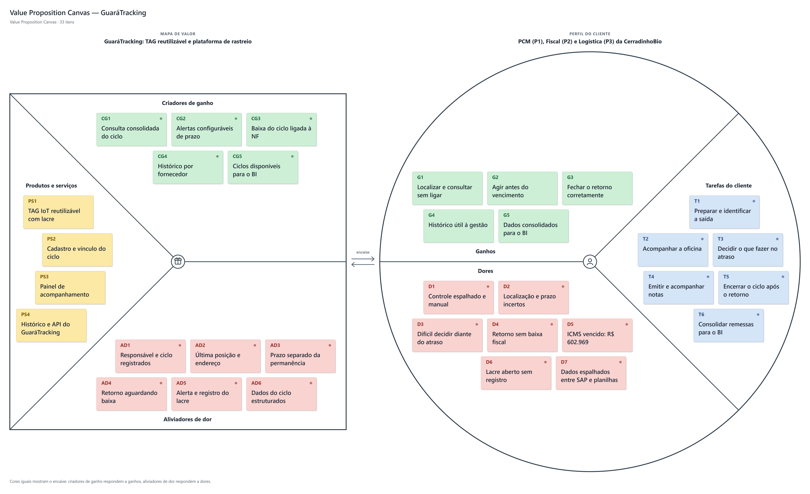
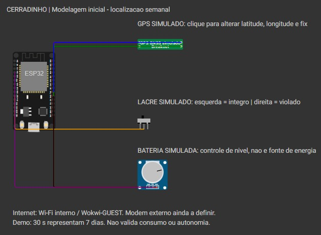
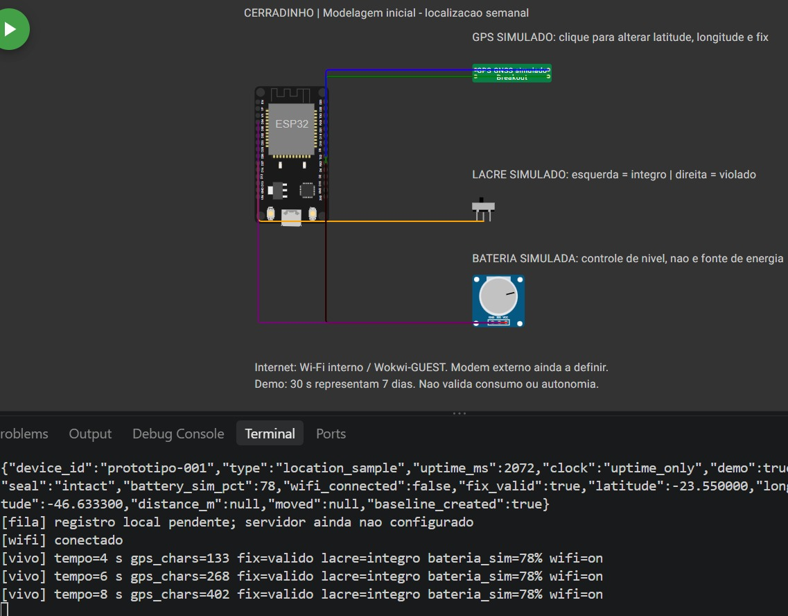
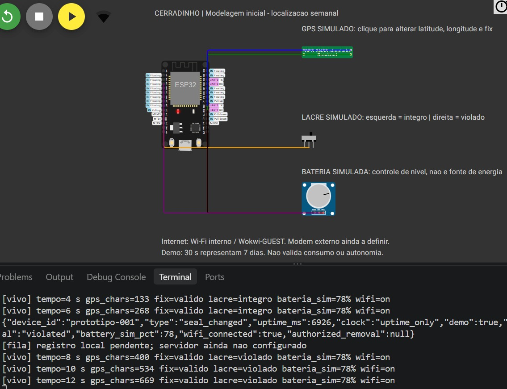

# Documentação IoTDoc - Módulo 4 - Inteli

## Nome do Grupo

#### Nomes dos integrantes do grupo

## Sumário

[1. Introdução](#c1)

[2. Metodologia](#c2)

[3. Desenvolvimento e Resultados](#c3)

[4. Conclusões e Recomendações](#c4)

[5. Referências](#c5)

 

# 1. Introdução (sprint 1)

A CerradinhoBio é uma companhia brasileira de capital aberto, integrante do Grupo Cerradinho, que atua em bioenergia e produtos agrícolas renováveis [3]. Produz etanol de cana e de milho, açúcar VHP, bioeletricidade e coprodutos destinados à nutrição animal [4]. Suas operações estão em Chapadão do Céu (GO) e Maracaju (MS) [2]. Na safra 2025/26, registrou receita líquida de R$ 4,288 bilhões e processou 5,2 milhões de toneladas de cana e 1,5 milhão de toneladas de milho; a fábrica de açúcar tem capacidade instalada de 550 mil toneladas anuais [1, 2]. Na safra 2024/25, informou cerca de 3.800 empregos diretos e indiretos [5]. A empresa se posiciona entre os maiores produtores de etanol do país, com operações industriais de grande escala e portfólio diversificado [3, 4].

**Problema do projeto.** O acompanhamento de equipamentos enviados à manutenção externa depende de registros e contatos entre áreas e fornecedores. A dificuldade de consolidar localização, nota fiscal de remessa, prazo previsto e data de retorno reduz a visibilidade dos ativos em terceiros e exige cobranças manuais. Permanência total e atraso em relação ao prazo combinado são informações distintas e precisam ser analisadas separadamente.

## 1.1 Objetivos

**Objetivo geral.** Melhorar o controle dos equipamentos enviados a fornecedores para manutenção externa, desde a saída até o retorno.

**Objetivos específicos.** Ampliar a visibilidade dos ativos enquanto estão com terceiros; associar cada ciclo de envio à respectiva nota fiscal; distinguir permanência prolongada de atraso em relação ao prazo previsto; reduzir o esforço de consulta e cobrança manual; e preservar o histórico dos ciclos e movimentações.

## 1.2 Proposta da solução

A proposta reúne um dispositivo reutilizável, fixado ao equipamento com um lacre, e uma plataforma para consultar ativos, ciclos de manutenção, última localização e histórico. No cadastro, cada ciclo relaciona equipamento, fornecedor e nota fiscal, preservando os dados de saída e retorno. A plataforma compara o tempo decorrido desde a saída com o prazo previsto: assim, evidencia a permanência total do ativo e identifica separadamente quando o prazo combinado foi ultrapassado. A localização e o estado do ciclo ampliam a visibilidade dos equipamentos em terceiros; alertas configuráveis destacam casos para acompanhamento e pretendem reduzir consultas e cobranças manuais; o histórico registra os ciclos sucessivos; e uma API disponibiliza esses dados para análise em ferramentas de BI. No protótipo, a comunicação será demonstrada por Wi-Fi em cenário controlado. Como a disponibilidade de Wi-Fi nas oficinas de terceiros não é pressuposta, o canal de comunicação para produção será escolhido em sprint posterior, após comparação das alternativas em uma matriz que considere cobertura nos fornecedores, autonomia, confiabilidade, custo e escalabilidade [6].

## 1.3 Justificativa

A centralização das informações pode facilitar a consulta da situação de cada equipamento, dar rastreabilidade documental aos envios e destacar casos que precisam de acompanhamento. O dispositivo reutilizável, o vínculo entre ativo, ciclo e nota fiscal, o histórico preservado entre usos e a disponibilização dos dados para BI compõem os diferenciais da proposta. A identificação mais rápida de pendências pode contribuir para reduzir o tempo de permanência e as perdas de ativos, mas esses resultados dependem do tratamento dos alertas pelos responsáveis e devem ser medidos; não são garantidos pelo protótipo [6].

# 2. Metodologia (sprint 3)

_Descreva as etapas da metodologia RM-ODP que foram utilizadas para o desenvolvimento, citando o referencial teórico. Você deve apenas enunciar os métodos, sem dizer ainda como ele foi aplicado e quais resultados obtidos._

# 3. Desenvolvimento e Resultados 

## 3.1. Domínio de Fundamentos de Negócio

### 3.1.1. Contexto da Indústria (sprint 1)	

**Parceiro:** CerradinhoBio
**Setor:** bioenergia e indústria sucroenergética (etanol, açúcar, bioeletricidade e coprodutos).

#### Concorrência

Concorrentes incluem **Raízen**, **São Martinho** e **bp bioenergy** na cana, além de **FS** e **Inpasa** no milho. Escala, região e matéria-prima variam; capacidades de safras distintas não representam produção ou participação de mercado. [7, 9–12, 19–20]

#### Modelo de negócio

O modelo B2B transforma cana e milho em etanol, açúcar, energia e coprodutos vendidos a distribuidores, indústrias e setor elétrico. A diversificação e os CBIOs ampliam receitas; eficiência, logística e preços de commodities afetam o desempenho. [2, 4, 8, 14]

#### Tendências

O etanol de milho complementa a cana. RenovaBio, SAF e biometano impulsionam a descarbonização; a Lei do Combustível do Futuro prevê metas para a aviação a partir de 2027. Digitalizar a manutenção pode consolidar registros e apoiar decisões. [13–17]

#### Cinco Forças de Porter — perspectiva da CerradinhoBio

Escala: **baixa**, **média** ou **alta**, conforme a pressão sobre a atratividade do setor. [18]

*Figura — Cinco Forças da CerradinhoBio. Fonte: Grupo G01 (2026), adaptado do template Inteli [21].*

| Força | Intensidade | Justificativa do ponto de vista da CerradinhoBio |
|---|---|---|
| **Rivalidade entre concorrentes** | **Alta** | Escala e commodities pressionam custos e contratos. |
| **Poder dos fornecedores** | **Médio** | Insumos elevam custos; contratos e duas matérias-primas reduzem dependência. |
| **Poder dos compradores** | **Média** | Distribuidores negociam preço e volume; diversificação amplia canais. |
| **Novos entrantes** | **Média** | Capital e licenças criam barreiras; há projetos de milho. |
| **Produtos substitutos** | **Média** | Gasolina e eletrificação competem; mistura obrigatória sustenta o etanol. |

#### Síntese estratégica

Rivalidade e poder dos compradores pressionam custos. Eficiência e abastecimento diversificado são prioridades. O GuaráTracking amplia a visibilidade dos ativos em manutenção; efeitos serão medidos no piloto. [6]

### 3.1.2. Análise SWOT (sprint 1)	

|  |  |
|---|---|
| **Forças (internas):** portfólio diversificado de matérias-primas e produtos, escala e flexibilidade de mix. [2–4] | **Fraquezas (internas):** operação intensiva em ativos, com demanda de capital, manutenção e logística; exposição à sazonalidade e a commodities. [2, 4] |
| **Oportunidades (externas):** crescimento do etanol de milho, RenovaBio e demanda por SAF e biometano. [13–17] | **Ameaças (externas):** concorrentes de grande escala, volatilidade de insumos e substitutos como gasolina e eletrificação. [7, 9–17] |

### 3.1.3. Descrição da Solução a ser Desenvolvida (sprint 1)	

#### 3.1.3.1 Problema a resolver
Registros e contatos dispersos dificultam acompanhar localização, NF, prazo e retorno dos equipamentos em manutenção externa e exigem consultas manuais. [6]

#### 3.1.3.2 Solução proposta (visão de negócios)
Uma TAG reutilizável com lacre e uma plataforma reúnem equipamento, fornecedor, NF, prazo, última localização válida e histórico. A solução separa permanência total de atraso, registra eventos do lacre e permite consultar os ciclos pela interface e por API, para alimentar ferramentas de BI. [6]

#### 3.1.3.3 Uso previsto
Na saída, o responsável registra equipamento, fornecedor, NF e prazo e vincula a TAG lacrada. Durante o reparo, acompanha posição, ciclo e alertas. No retorno, registra conferência e baixa, encerra o ciclo e libera a TAG preservando o histórico. [6]

#### 3.1.3.4 Benefícios
A centralização pode reduzir buscas manuais, antecipar cobranças, vincular ativo e documento fiscal, preservar histórico por fornecedor e apoiar análises gerenciais. Os ganhos serão avaliados no piloto. [6]

#### 3.1.3.5 Critério de sucesso e medida

Sucesso significa completar saída, acompanhamento e retorno, mantendo vínculo com NF e histórico após reutilizar a TAG. Mediremos completude dos ciclos, atualizações recebidas na frequência definida, acerto dos alertas, consultas manuais por ciclo e registro de retorno. Metas e linha de base serão definidas com o parceiro antes do piloto. [6]
	
### 3.1.4. Value Proposition Canvas (sprint 1)	

O *Value Proposition Canvas* apresenta o mapa de valor do GuaráTracking e o perfil de PCM (P1), Fiscal (P2) e Logística (P3) da CerradinhoBio, descritos na seção 3.2.1. A síntese considera o TAPI [6] e o *kick-off* com o parceiro em 16/10/2026 [23]. A solução combina TAG reutilizável com lacre, painel, histórico e API para consulta dos ciclos e alimentação do BI. Os ganhos são hipóteses a medir no piloto.

*Figura — Value Proposition Canvas do GuaráTracking para PCM, Fiscal e Logística.*
*Fonte: template “Value Proposition Canvas - template png”, pasta de templates de negócios do Inteli [22]; conteúdo: Grupo G01 (2026).*

| Dor do cliente | Resposta do GuaráTracking | Ganho |
|---|---|---|
| D1 Controle espalhado e manual | Cadastro do ciclo (AD1) e consulta consolidada (CG1) | G1 Localizar e consultar sem ligar |
| D2 Localização e prazo incertos | Última posição (AD2), prazo separado da permanência (AD3) e alertas (CG2) | G2 Agir antes do vencimento |
| D3 Difícil decidir diante do atraso | Histórico por fornecedor (CG4) | G4 Histórico útil à gestão |
| D4 Retorno sem baixa fiscal | Estado “retorno aguardando baixa” (AD4) e baixa ligada à NF (CG3) | G3 Fechar o retorno corretamente |
| D5 Complemento de ICMS por prazo vencido na safra 2024/25; parcela ligada à manutenção externa não apurada [23] | Acompanhamento dos prazos (AD3) | G2 Agir antes do vencimento |
| D6 Lacre aberto sem registro | Alerta e registro do lacre (AD5) | G3 Fechar o retorno corretamente |
| D7 Dados espalhados entre SAP e planilhas | Dados do ciclo estruturados (AD6) e consulta pela API (CG5) | G5 Dados consolidados para o BI |

### 3.1.5. Matriz de Riscos (sprint 1)	

### 3.1.6. Política de Privacidade de acordo com a LGPD (sprint 1)	

#### 3.1.6.1 Informações gerais sobre a empresa / organização

#### 3.1.6.2 Informações sobre o tratamento de dados

#### 3.1.6.3 Quais são os dados coletados

#### 3.1.6.4 Onde os dados são coletados 

#### 3.1.6.5 Para quais finalidades os dados serão utilizados

#### 3.1.6.6 Onde os dados ficam armazenados 

#### 3.1.6.7 Qual o período de armazenamento dos dados (retenção)

#### 3.1.6.8 Uso de cookies e/ou tecnologias semelhantes

#### 3.1.6.9 Com quem esses dados são compartilhados (parceiros, fornecedores, subcontratados)

#### 3.1.6.10 Informações sobre medidas de segurança adotadas pela empresa

#### 3.1.6.11 Orientações sobre como a empresa/organização atende aos direitos dos usuários

#### 3.1.6.12 Informações sobre como o titular de dados pode solicitar e exercer os seus direitos

#### 3.1.6.13 Informações de contato do Data Protection Officer (DPO) ou encarregado de proteção de dados da organização

### 3.1.7. Bill of Material (BOM) (sprint 1)

O orçamento considera o item de hardware explicitamente identificado na documentação técnica da sprint: o módulo GNSS Quectel LC76G (PA). O preço é uma referência consultada em 22 out. 2026 e convertida pela cotação PTAX de venda do dólar na mesma data; não inclui frete, tributos de importação ou encargos de compra. A consulta ao distribuidor indicava estoque zerado, portanto o valor não representa disponibilidade para aquisição imediata. [24, 25]

| Categoria | Item / perfil | Quantidade | Horas por pessoa | Valor unitário | Subtotal |
|---|---|---:|---:|---:|---:|
| Material | Módulo GNSS Quectel LC76G (PA), código LC76GPATA | 1 | — | R$ 247,38 | R$ 247,38 |
| Mão de obra | Engenheiro da computação (referência CBO 2122-10) | 3 | 80 | R$ 68,47/h | R$ 16.432,80 |
| Mão de obra | Cientista da computação (referência CBO 2031-05) | 2 | 80 | R$ 54,95/h | R$ 8.792,00 |
| Mão de obra | Analista de sistemas de informação (CBO 2124-05) | 1 | 80 | R$ 40,28/h | R$ 3.222,40 |
| Mão de obra | Engenheiro de software (CBO 2122-15) | 1 | 80 | R$ 70,73/h | R$ 5.658,40 |
| **Total de materiais** |  |  |  |  | **R$ 247,38** |
| **Total de mão de obra** |  | **7** | **560** |  | **R$ 34.105,60** |
| **Total estimado** | Materiais + mão de obra |  |  |  | **R$ 34.352,98** |

**Premissas da mão de obra:** 40 dias de trabalho, 2 horas por dia para cada integrante (80 horas por pessoa). Os valores horários são referências salariais médias por ocupação, usando os CBOs indicados como aproximação dos cargos solicitados; não são cotações de contratação. O cálculo não inclui encargos trabalhistas, benefícios, tributos, administração ou margem de fornecedor. O total de materiais cobre apenas o componente identificado na fonte da sprint; itens sem especificação e cotação confirmadas ficam fora do subtotal até validação da BOM. [26–29]

## 3.2. Domínio de Fundamentos de Experiência de Usuário 

### 3.2.1. Personas (sprint 1)	

#### Introdução às personas

As personas orientam o desenvolvimento da solução de rastreamento de equipamentos em manutenção externa da Cerradinho a partir dos objetivos, dificuldades e necessidades dos usuários. Os perfis consideram seus cenários de uso e letramento digital, distinguindo informações fundamentadas na pesquisa de hipóteses pendentes de validação.

### 3.2.2. Jornada do Usuário e Storyboard (sprint 2)	

_Coloque aqui seu Mapa de Jornada do Usuário (seguindo as instruções na descrição do artefato)_

_Coloque aqui seu Storyboard (seguindo as instruções na descrição do artefato)_

## 3.3. Solução Técnica	

_Nesta seção, detalhe a especificação da solução, de acordo com o disposto nas subseções._

### 3.3.1. Requisitos Funcionais (sprint 1, refinar e atualizar até sprint 5)

*Liste os RF numerados de forma objetiva e verificável. Cada RF deve poder ser convertido em caso de teste.*

| ID    | Descrição | Prioridade | Status       |
|-------|-----------|------------|--------------|
| RF001 | ...       | Alta       | Implementado |
| RF002 | ...       | Média      | Planejado    |
| RF003 | Disponibilizar por API os dados de saída, prazo e retorno dos ciclos para consumo por ferramenta de BI. | Média | Planejado |

### 3.3.2. Regras de Negócio (sprint 1, refinar até sprint 5)

*Numere e redija as RN de forma implementável e testável. Toda RN deve ter pelo menos um teste automatizado associado a partir da sprint 3.*

| ID   | Descrição | RF associado |
|------|-----------|--------------|
| RN01 | ...       | RF001        |
| RN02 | ...       | RF001        |

### 3.3.3. Requisitos Não Funcionais — 8 Eixos ISO/IEC 25010 (sprints 2 a 5)

*Preencha os 8 eixos. Cada eixo deve ter ao menos um RNF verificável (com métrica, limite ou critério concreto) ou justificativa explícita de ausência. Evolua do conceitual (sprint 2) ao técnico mensurável (sprint 5).*

| Eixo                     | Requisito | Métrica / Critério | Justificativa |
|--------------------------|-----------|--------------------|---------------|
| USAB — Usabilidade       | ...       | ...                | ...           |
| CONF — Confiabilidade    | ...       | ...                | ...           |
| DES — Desempenho         | ...       | p95 < X ms         | ...           |
| SUP — Suportabilidade    | ...       | ...                | ...           |
| SEG — Segurança          | ...       | ...                | ...           |
| CAP — Capacidade         | ...       | ...                | ...           |
| REST — Restrições Design | ...       | ...                | ...           |
| ORG — Organizacionais    | ...       | ...                | ...           |

### 3.3.4. Matriz de Rastreabilidade (RTM) (sprints 1 a 5)

_A RTM consolida a rastreabilidade completa do sistema. Um elo quebrado invalida toda a cadeia — mantenha-a atualizada a cada sprint. Referencie os casos de testes a partir das tabelas definidas na seção 3.4.x_

| Persona | RF    | RN   | Caso de Teste | Evidência        |
|---------|-------|------|---------------|------------------|
| ...     | RF001 | RN01 | CT02  | print, log, relatório de cobertura |

### 3.3.5. Arquitetura da Solução (sprint 3)

_Vídeo de explicação sobre a arquitetura da solução: (coloque aqui o link do vídeo)_

_Descreva a arquitetura técnica da solução de forma detalhada (visão de arquitetura).

Justifique como a arquitetura suporta os requisitos funcionais e não funcionais.

O diagrama de arquitetura deve:_
- _Mostrar microcontroladores, incluindo descrições de sua função no sistema (por exemplo: "Irá processar o sinal dos sensores a cada X minutos")_
- _Mostrar sensores, incluindo descrição de função e especificações técnicas do tipo de informação que será coletada_
- _Mostrar apresentadores de informação (displays), incluindo descrição de que tipo de informação será apresentada (por exemplo, "Mostrar temperatura dos sensores")_
- _Mostrar atuadores, caso existam na solução, incluindo descrições do que irão acionar (por exemplo, "Ligar motor de irrigação durante x minutos")_
- _Mostrar o broker MQTT e o dashboard que é a interface do usuário_
- _Mostrar ligações entre os elementos (com fio ou sem fio) – incluindo conexões com sensores e atuadores, conexão com WiFi, entre outros_

### 3.3.6. Arquitetura do Protótipo(sprint 4)	

_Vídeo de explicação sobre a arquitetura do protótipo físico: (coloque aqui o link do vídeo)_

_Descreva as tecnologias utilizadas de forma detalhada (visão de tecnologia).

Descreva a arquitetura usando um diagrama de blocos similar à visão anterior, porém especificando as tecnologias utilizadas. O diagrama de arquitetura deve:_
- _Mostrar microcontroladores, incluindo descrições de sua função no sistema (por exemplo: "Irá processar o sinal dos sensores a cada X minutos")_
- _Mostrar sensores, incluindo descrição de função e especificações técnicas do tipo de informação que será coletada_
- _Mostrar apresentadores de informação (displays), incluindo descrição de que tipo de informação será apresentada (por exemplo, "Mostrar temperatura dos sensores")_
- _Mostrar atuadores, caso existam na solução, incluindo descrições do que irão acionar (por exemplo, "Ligar motor de irrigação durante x minutos")_
- _Mostrar o broker MQTT e o dashboard que é a interface do usuário_
- _Mostrar ligações entre os elementos (com fio ou sem fio) – incluindo conexões com sensores e atuadores, conexão com WiFi, entre outros._
_Faça uma tabela dos possíveis componentes utilizados. Todos os componentes devem estar presentes na arquitetura._

| **Componente** | **Descrição** | **Tipo** | 
|----------|----------|----------|
|E.g. ESP32 WROOM 32 Devkit|E.g. Trata-se de um microcontrolador amplamente usado na indústria e em projetos educacionais, que possui interfaces mais amigáveis para conexão de componentes diversos...|E.g. Microcontrolador|
|E.g. sensor XPTO|E.g. Este sensor mede o sinal de XYZ em unidades q/s, e possui tolerância de abcd...|E.g. Sensor|

### 3.3.7. Arquitetura Refinada da Solução (sprint 5)	

_Descreva a revisão da arquitetura técnica da solução de forma detalhada (visão de arquitetura).  

Justifique como a arquitetura suporta os requisitos funcionais e não funcionais.  

A revisão deverá incluir comentários sobre cada ponto levantado, mostrando como os ajustes foram realizados, além da descrição da arquitetura revisada._

## 3.4. Resultados	

_Nesta seção, detalhe os resultados obtidos com a implementação, de acordo com o disposto nas subseções._

### 3.4.1. Protótipo Inicial do Projeto usando o Simulador Wokwi (sprint 1)

O protótipo usa ESP32 DevKit v1, GPS/GNSS customizado, chave para simular o lacre
e potenciômetro para simular o nível de bateria. O circuito está em
[diagram.json](../diagram.json), com firmware e configuração Wokwi no próprio
repositório. As instruções para executar pelo VS Code estão no
[README do projeto](../README.md).

No ambiente `demo`, o intervalo de coleta é de 30 segundos. A comparação usa a
última posição válida e uma tolerância inicial de 100 m. O monitor serial mostra
GPS, lacre, bateria sintética e registros locais; não há envio ao servidor
implementado. A simulação não comprova consumo, autonomia ou funcionamento físico.

#### Situações de teste

A tabela descreve as ações no simulador e as saídas esperadas.

| CT# | Bloco | Entrada / ação no simulador | Saída esperada no monitor serial |
|---|---|---|---|
| CT01 | Diagnóstico e GPS | Iniciar `demo`, com `fixValid=1` e coordenadas padrão | `[boot]`, `[vivo]` a cada 2 s e primeiro `location_sample` com `baseline_created=true` em memória limpa |
| CT02 | Localização | Manter a posição por mais de 30 s | Distância próxima de zero e `moved=false` |
| CT03 | Localização | Alterar latitude de -23.5500 para -23.5400, sem reiniciar | Distância maior que 1 km e `moved=true`; na coleta seguinte sem nova alteração, `moved=false` |
| CT04 | Falha e recuperação do GPS | Alterar `fixValid` para 0, aguardar coleta e timeout de 10 s; retornar a 1 | `location_unavailable`, sem apagar a referência; recuperação comparada à última posição válida |
| CT05 | Lacre | Mover a chave para a direita e depois para a esquerda | Eventos `seal_changed` com `violated` e `intact`, sem aguardar o intervalo de coleta |
| CT06 | Bateria simulada | Girar o potenciômetro entre níveis distintos | Mudança de `bateria_sim` no heartbeat e de `battery_sim_pct` nos eventos seguintes |

#### Evidências visuais da montagem e da execução

As capturas da montagem, da saída serial e da alteração do lacre estão em
`assets/wokwi/3.4.1/`, na ordem apresentada abaixo.

##### Figura 1 — Circuito completo

*Figura 1 — Montagem completa do protótipo simulado no Wokwi.*

Fonte: elaboração própria, captura do simulador Wokwi.

##### Figura 2 — Monitor serial em execução

*Figura 2 — Diagnóstico serial com fix de GPS válido, lacre íntegro e bateria simulada em 78%.*

Fonte: elaboração própria, captura do simulador Wokwi.

##### Figura 3 — Alteração do lacre

*Figura 3 — Alteração do lacre para violado, com evento `seal_changed` e atualização do diagnóstico serial.*

Fonte: elaboração própria, captura do simulador Wokwi.

### 3.4.2. Protótipo Físico do Projeto (offline) (sprint 2)	

_Aqui você deve registrar diversas situações de teste, indicando exemplos de leitura (entrada) e escrita (saída) apresentadas pelo seu sistema físico. Estes registros serão utilizados para testar seus componentes, portanto, descreva várias situações, incluindo não apenas casos de sucesso, mas também de possíveis falhas nas leituras de entradas e saídas.  
Siga as nomenclaturas e convenções já utilizadas anteriormente, e não se esqueça dos alinhamentos de negócios e experiência do usuário para pensar em situações representativas. Inclua figuras do protótipo físico e descrições dos testes realizados para ilustrar o funcionamento do protótipo. Continue a numeração de CT a partir da tabela anterior. A tabela a seguir serve como exemplo._

**CT#** | **Descrição** | **Pré-condição** | **Procedimento de teste** | **Pós-condição/Resultado esperado** | **Observações** (opcional)
|----------|----------|----------|----------|----------|----------|
|CT11|ex. Verificação de conexão de rede bem-sucedida. | ex. O dispositivo está desligado.| ex. Ligue o dispositivo, aguarde alguns segundos e verifique se ele estabelece uma conexão bem-sucedida com a rede Wi-Fi. | ex. O LED verde indicador de conexão acende de forma contínua, sinalizando uma conexão bem-sucedida à rede. |

### 3.4.3. Protótipo do Projeto com MQTT e I2C (sprint 3)	

_Aqui você deve registrar diversas situações de uso de seu sistema como um todo, indicando exemplos de ação do usuário e resposta do sistema, apontando como o ambiente deverá estar configurado para receber a ação e produzir a resposta. Estes registros serão utilizados para testar seu sistema, portanto, descreva várias situações, incluindo não apenas casos de sucesso, mas também de falha nos comportamentos do sistema.  
Siga as nomenclaturas e convenções já utilizadas anteriormente, e não se esqueça dos alinhamentos de negócios e experiência do usuário para pensar em situações representativas. Inclua figuras do protótipo físico e dashboards, além de descrições dos testes realizados para ilustrar o funcionamento do protótipo. Continue a numeração de CT a partir da tabela anterior. A tabela a seguir serve como exemplo._

**CT#** | **Configuração do ambiente** | **Ação do usuário** | **Resposta esperada do sistema** 
|----------|----------|----------|----------|
|CT21|ex. precisa de um computador conectado na interface, dois ou mais dispositivos que simulem o posicionamento de um item X no espaço físico etc. | ex. usuário logado busca a localização do item X, que está ativo e operando normalmente | ex. interface do sistema acessa os dados da última localização registrada do item X e apresenta, constando local e horário de última atualização | 

### 3.4.4. Protótipo Físico do Projeto (online) (sprint 4)	

_Aqui você deve registrar diversas situações de uso de seu sistema como um todo, indicando exemplos de ação do usuário e resposta do sistema, apontando como o ambiente deverá estar configurado para receber a ação e produzir a resposta. Estes registros serão utilizados para testar seu sistema, portanto, descreva várias situações, incluindo não apenas casos de sucesso, mas também de falha nos comportamentos do sistema.  
**Desta vez, utilize diagramas de sequência UML para descrever os fluxos de teste do sistema.**  
Siga as nomenclaturas e convenções já utilizadas anteriormente, e não se esqueça dos alinhamentos de negócios e experiência do usuário para pensar em situações representativas. Inclua figuras do protótipo físico e dashboards, além de descrições dos testes realizados para ilustrar o funcionamento do protótipo._

### 3.4.5. Protótipo Final do Projeto (sprint 5)	

_Registre as situações de uso do sistema revisadas utilizando a modelagem UML para descrever os fluxos de teste.  
Também inclua figuras da versão final do protótipo físico e dashboards, além de descrições dos testes realizados para ilustrar o funcionamento do protótipo._

## 4. Conclusões e Recomendações

_Escreva, de forma resumida, sobre os principais resultados do seu projeto e faça recomendações formais ao seu parceiro de projeto em relação ao uso dessa solução. Você pode aproveitar este espaço para comentar sobre possíveis materiais extras._

## 5. Referências

1. CERRADINHOBIO. *CerradinhoBio supera R$ 1,5 bilhão de EBITDA e amplia lucro em 90% na Safra 2025/2026*. Disponível em: https://www.cerradinhobio.com.br/news/cerradinhobio-supera-r-15-bilhao-de-ebitda-e-amplia-lucro-em-90-na-safra-2025-2026/. Acesso em: 15 out. 2026.
2. CERRADINHOBIO. *Nossos Números/Dados de Produção*. Disponível em: https://www.cerradinhobio.com.br/a-companhia/nossos-numeros-dados-de-producao/. Acesso em: 19 out. 2026.
3. CERRADINHOBIO. *CerradinhoBio*. Disponível em: https://www.cerradinhobio.com.br/negocios-e-atividades/cerradinhobio/. Acesso em: 15 out. 2026.
4. CERRADINHOBIO. *Nossos Produtos*. Disponível em: https://www.cerradinhobio.com.br/negocios-e-atividades/nossos-produtos/. Acesso em: 15 out. 2026.
5. CERRADINHOBIO. *CerradinhoBio tem 3T24/25 com aumento de receita, expansão da produção de açúcar e melhora nos indicadores financeiros*. Disponível em: https://www.cerradinhobio.com.br/news/cerradinhobio-tem-3t24-25-com-aumento-de-receita-expansao-da-producao-de-acucar-e-melhora-nos-indicadores-financeiros/. Acesso em: 15 out. 2026.
6. CERRADINHO. *TAPI Cerradinho: Rastreamento de Ativos IoT*. Documento de referência do projeto fornecido pelo parceiro, 2026.
7. RAÍZEN. *Relatório integrado — safra 2024/25*. Disponível em: https://www.raizen.com.br/archives_files/archive81-raizen-rs24-25.pdf. Acesso em: 19 out. 2026.
8. CERRADINHOBIO. *Nossos produtos*. Disponível em: https://www.cerradinhobio.com.br/negocios-e-atividades/nossos-produtos/. Acesso em: 19 out. 2026.
9. SÃO MARTINHO. *Relatório da Administração — safra 2024/25*. Disponível em: https://ri.saomartinho.com.br/Download.aspx?Arquivo=MTU+51Kmm5DdaZuzsVXkAw%3D%3D&IdCanal=3kK+JHozjxal5isJwnwwEA%3D%3D&linguagem=pt. Acesso em: 19 out. 2026.
10. BP. *bp bioenergy — operações e capacidade de produção no Brasil*. Disponível em: https://www.bp.com/pt_br/brazil/home/produtos-e-servicos/bp-bunge-bioenergia.html. Acesso em: 19 out. 2026.
11. FS. *Etanol, unidades e capacidade de produção*. Disponível em: https://www.fs.agr.br/. Acesso em: 19 out. 2026.
12. INPASA. *Inauguração da unidade de Balsas e capacidade instalada*. Disponível em: https://www.inpasa.com.br/sala-de-imprensa/inpasa-inaugura-nova-unidade-em-balsas-ma-com-investimento-de-r-2-5-bilhoes-e-reforca-lideranca-no-etanol-de-graos/1023408. Acesso em: 19 out. 2026.
13. EPE. *Análise de Conjuntura dos Biocombustíveis 2025*. Disponível em: https://www.epe.gov.br/pt/publicacoes-dados-abertos/publicacoes/analise-de-conjuntura-dos-biocombustiveis-2025. Acesso em: 19 out. 2026.
14. ANP. *RenovaBio — metas, CBIOs e comprovação*. Disponível em: https://www.gov.br/anp/pt-br/assuntos/renovabio. Acesso em: 19 out. 2026.
15. BRASIL. *Lei nº 14.993, de 8 de outubro de 2024 — Lei do Combustível do Futuro*. Disponível em: https://www.planalto.gov.br/ccivil_03/_ato2023-2026/2024/lei/l14993.htm. Acesso em: 19 out. 2026.
16. ANP. *Combustível Sustentável de Aviação (SAF)*. Disponível em: https://www.gov.br/anp/pt-br/assuntos/saf. Acesso em: 19 out. 2026.
17. ANP. *Biometano*. Disponível em: https://www.gov.br/anp/pt-br/assuntos/producao-e-fornecimento-de-biocombustiveis/biometano. Acesso em: 19 out. 2026.
18. ROCK CONTENT. *As 5 forças de Porter: o que são, para que servem e como aplicar?* Disponível em: https://rockcontent.com/br/blog/5-forcas-de-porter/. Acesso em: 19 out. 2026.
19. RAÍZEN. *Raízen e produtores de cana-de-açúcar debatem perspectivas para o ano-safra no Fórum de Mercado*. Disponível em: https://www.raizen.com.br/sala-de-imprensa/raizen-e-produtores-de-cana-de-acucar-debatem-perspectivas-para-o-ano-safra-no-forum-de-mercado. Acesso em: 20 out. 2026.
20. SÃO MARTINHO. *Formulário de Referência 2025*. Disponível em: https://ri.saomartinho.com.br/Download.aspx?Arquivo=zp29unVyAKR4rxhHtOgKfQ%3D%3D&IdCanal=3kK+JHozjxal5isJwnwwEA%3D%3D&linguagem=pt. Acesso em: 20 out. 2026.
21. INTELI. *5 forças template.jpeg*. Pasta de templates de negócios do projeto, 2022. Disponível em: https://drive.google.com/file/d/1Kr8A2GRrTDUFi5JslJQd7LWVOwyn8E_c/view. Acesso em: 20 out. 2026.
22. INTELI. *Value Proposition Canvas - template png*. Pasta de templates de negócios do projeto, 2022. Disponível em: https://drive.google.com/file/d/1vom1OaLU4NgDpoQ9vIaJ2lpS2YoGcUjM/view. Acesso em: 22 out. 2026.
23. CERRADINHO. *Kick-off do projeto de rastreamento de ativos com o parceiro*. Reunião de alinhamento, 16 out. 2026.
24. DIGIKEY. *Quectel LC76GPATA*. Preço de referência US$ 49,10 e consulta de estoque. Disponível em: https://www.digikey.com.br/en/products/detail/quectel/LC76GPATA/26239330. Acesso em: 22 out. 2026.
25. BANCO CENTRAL DO BRASIL. *Cotações e boletins — dólar dos Estados Unidos, PTAX de venda*. Cotação de 22 out. 2026: R$ 5,0383 por US$ 1. Disponível em: https://ptax.bcb.gov.br/ptax_internet/consultarUltimaCotacaoDolar.do. Acesso em: 22 out. 2026.
26. PORTAL SALÁRIO. *Engenheiro de hardware computacional — CBO 2122-10*. Base salarial do Novo CAGED; valor horário de referência: R$ 68,47. Disponível em: https://www.salario.com.br/profissao/engenheiro-de-hardware-computacional-cbo-212210/. Acesso em: 23 out. 2026.
27. PORTAL SALÁRIO. *Pesquisador em ciências da computação e informática — CBO 2031-05*. Base salarial do Novo CAGED; valor horário de referência: R$ 54,95. Disponível em: https://www.salario.com.br/profissao/pesquisador-em-ciencias-da-computacao-e-informatica-cbo-203105/. Acesso em: 23 out. 2026.
28. PORTAL SALÁRIO. *Analista de sistemas — CBO 2124-05*. Base salarial do Novo CAGED; valor horário de referência: R$ 40,28. Disponível em: https://www.salario.com.br/profissao/analista-de-sistemas-informatica-cbo-212405/. Acesso em: 23 out. 2026.
29. PORTAL SALÁRIO. *Engenheiro de software computacional básico — CBO 2122-15*. Base salarial do Novo CAGED; valor horário de referência: R$ 70,73. Disponível em: https://www.salario.com.br/profissao/engenheiro-de-software-computacional-basico-cbo-212215/. Acesso em: 23 out. 2026.
