# Documentação IoTDoc - Módulo 4 - Inteli

## Grupo G01 — GuaráTracking

#### Nomes dos integrantes do grupo

- Arthur Dantas Pereira Loyola
- Bruno Fernandes Ramos
- Guilherme Nunes Fernandes e Silva
- Heloísa Noda Kadota
- Luiz Gustavo Campos Cazelatto
- Pablo Marchina
- Rachel Durante Silvestre

**Orientadora:** Camila Naves Arantes


## Sumário

[1. Introdução](#c1)

[2. Metodologia](#c2)

[3. Desenvolvimento e Resultados](#c3)

[4. Conclusões e Recomendações](#c4)

[5. Referências](#c5)

[6. Anexos](#c6)

<br>


# <a name="c1"></a>1. Introdução (sprint 1)

A CerradinhoBio é uma companhia brasileira integrante do Grupo Cerradinho [3]. Atua em bioenergia a partir de cana-de-açúcar e milho: produz etanol, energia elétrica renovável gerada com biomassa, açúcar VHP e coprodutos do milho, como DDGS, WDG e óleo [4]. Suas operações estão em Chapadão do Céu (GO), onde ficam o negócio de cana e uma unidade de etanol de milho, e em Maracaju (MS), que também abriga uma unidade de etanol de milho [2]. Na safra 2025/26, a companhia registrou receita líquida consolidada de R$ 4,288 bilhões [1] e processou 5,2 milhões de toneladas de cana e 1,5 milhão de toneladas de milho; a capacidade instalada da fábrica de açúcar é de 550 mil toneladas por ano [2]. Como referência de porte de pessoal, a companhia informava cerca de 3.800 empregos diretos e indiretos em sua apresentação institucional publicada durante a safra 2024/25 [5]. Em posicionamento comparável, a companhia era apontada em 2026 como a **terceira maior produtora de etanol de milho do Brasil, atrás de Inpasa e FS**, segmento que já respondia por cerca de 70% de seu resultado [59]. Esse dado situa sua relevância no mercado sem confundir capacidade instalada, moagem e produção de safras distintas.

**Problema do projeto.** O acompanhamento de equipamentos enviados à manutenção externa depende de registros e contatos entre áreas e fornecedores. A dificuldade de consolidar localização, nota fiscal de remessa, prazo previsto e data de retorno reduz a visibilidade dos ativos em terceiros e exige cobranças manuais. Permanência total e atraso em relação ao prazo combinado são informações distintas e precisam ser analisadas separadamente.

## 1.1 Objetivos

**Objetivo geral.** Melhorar o controle dos equipamentos enviados a fornecedores para manutenção externa, desde a saída até o retorno.

**Objetivos específicos.** Ampliar a visibilidade dos ativos enquanto estão com terceiros; associar cada ciclo de envio à respectiva nota fiscal; distinguir permanência prolongada de atraso em relação ao prazo previsto; reduzir o esforço de consulta e cobrança manual; e preservar o histórico dos ciclos e movimentações.

## 1.2 Proposta da solução

A proposta é criar uma solução reutilizável de acompanhamento dos equipamentos enviados à manutenção externa. Cada envio será tratado como um ciclo associado ao equipamento, ao fornecedor, à nota fiscal e ao prazo de retorno, com consulta centralizada da última localização conhecida, da situação do lacre e do histórico. A solução distinguirá o tempo total de permanência do atraso em relação ao prazo combinado e destacará ocorrências que exigem atuação dos responsáveis. Dessa forma, pretende ampliar a visibilidade dos ativos em terceiros, reduzir consultas e cobranças manuais, apoiar a baixa correta no retorno e preservar informações úteis para decisões sobre fornecedores e ciclos futuros. As escolhas de arquitetura, integração e comunicação pertencem às seções técnicas e serão definidas e validadas ao longo do projeto.

## 1.3 Justificativa

A centralização das informações pode facilitar a consulta da situação de cada equipamento, dar rastreabilidade documental aos envios e destacar casos que precisam de acompanhamento. O dispositivo reutilizável, o vínculo entre ativo, ciclo e nota fiscal, o histórico preservado entre usos e a disponibilização dos dados para BI compõem os diferenciais da proposta. A identificação mais rápida de pendências pode contribuir para reduzir o tempo de permanência e as perdas de ativos, mas esses resultados dependem do tratamento dos alertas pelos responsáveis e devem ser medidos; não são garantidos pelo protótipo, conforme os objetivos definidos no TAPI do projeto [6].

# <a name="c2"></a>2. Metodologia (sprint 3)

## 2.1. Referencial teórico

O RM-ODP (*Reference Model for Open Distributed Processing*, ou Modelo de Referência para Processamento Distribuído Aberto) fornece uma estrutura conceitual para especificar sistemas distribuídos. Seu referencial reúne conceitos de modelagem, pontos de vista, transparências de distribuição e avaliação de conformidade, permitindo tratar diferentes interesses de um mesmo sistema [[64]](#ref-64). A recomendação ITU-T X.903, publicada também como ISO/IEC 10746-3, define a arquitetura desse modelo e as regras de consistência entre suas especificações [[65]](#ref-65).

Os pontos de vista são perspectivas complementares de descrição. Sua organização não determina fases sequenciais obrigatórias: especificações podem ser desenvolvidas em paralelo e relacionadas por verificações de consistência [[64, seção 9.5]](#ref-64). Neste documento, cada ponto de vista é tratado como uma etapa de especificação; a ordem de apresentação abaixo organiza o texto, sem prescrever um ciclo de desenvolvimento.

## 2.2. Pontos de vista do RM-ODP

A metodologia adota os cinco pontos de vista do RM-ODP — empresarial, de informação, computacional, de engenharia e de tecnologia —, que a norma considera um conjunto necessário e suficiente para especificar um sistema distribuído [[65, seção 4.1]](#ref-65). Cada ponto de vista tem uma linguagem própria, com conceitos e regras de estruturação, descrita a seguir [[65, seção 4.2.2]](#ref-65).

**Ponto de vista empresarial** (*enterprise*). Define o propósito, o escopo e as políticas do sistema em seu ambiente. O sistema e o ambiente são representados como uma **comunidade**: um conjunto de objetos reunidos para atingir um objetivo, expresso em um contrato. A especificação identifica os **papéis** desempenhados pelo sistema e pelos demais participantes, as **atividades** realizadas e as **políticas** que regem as interações, o uso de recursos e as obrigações do ambiente. Cada papel é caracterizado por permissões, obrigações, proibições e comportamento esperado; requisitos legais, de segurança e códigos de prática entram como contratos de ambiente [[65, seções 5.1–5.2]](#ref-65).

**Ponto de vista de informação** (*information*). Define o significado das informações tratadas pelo sistema e de seu processamento, independentemente de como são representadas ou armazenadas. A especificação descreve **objetos de informação**, seus relacionamentos e três tipos de esquema: o **invariante**, com as condições que devem ser sempre verdadeiras; o **estático**, com o estado dos objetos em um instante; e o **dinâmico**, com as mudanças de estado permitidas [[65, seções 6, 6.1 e 6.2]](#ref-65).

**Ponto de vista computacional** (*computational*). Decompõe funcionalmente o sistema em **objetos computacionais** que interagem por **interfaces**, sem fixar ainda onde cada objeto será executado. As interfaces podem ser de **sinal**, de **operação** (anúncios, sem resposta, ou interrogações, com resposta) ou de **fluxo** (*stream*), e cada uma tem uma assinatura que define as interações aceitas. Ligações entre interfaces podem ser representadas por **objetos de ligação** (*binding objects*) [[65, seções 7.1–7.2]](#ref-65).

**Ponto de vista de engenharia** (*engineering*). Descreve os mecanismos e funções de infraestrutura que permitem a interação distribuída entre os objetos computacionais. Sua linguagem organiza o sistema em **nós** (unidades localizadas no espaço que reúnem funções de processamento, armazenamento e comunicação), **cápsulas**, **clusters** e **objetos básicos de engenharia**. A comunicação entre objetos de nós diferentes ocorre por **canais**, compostos por *stubs*, *binders*, objetos de protocolo e, quando há fronteiras entre domínios, interceptadores. Cabe também à engenharia descrever como são realizadas as transparências de distribuição. Essas transparências, que ocultam dos usuários aspectos como localização e falhas, são exigidas nas especificações empresarial, de informação e computacional [[65, seções 4.4 e 8.1–8.2]](#ref-65).

**Ponto de vista de tecnologia** (*technology*). Define as tecnologias escolhidas para implementar o sistema. A especificação apresenta **objetos de tecnologia** que representam os componentes de hardware e software e os enlaces de comunicação entre eles; associa cada objeto a um **padrão implementável**; e indica as informações adicionais que a implementação deve fornecer para teste (IXIT) [[65, seções 9.1–9.2]](#ref-65).

Uma especificação pode reunir um ou mais pontos de vista, mantendo coerência entre os termos e as restrições compartilhadas [[65, seção 4.2.2]](#ref-65). A norma define correspondências de consistência entre as especificações computacional e de informação, de engenharia e computacional, e de tecnologia e de engenharia [[65, seção 10]](#ref-65).

## 2.3. Métodos e atividades de trabalho

Os procedimentos registrados na documentação compreendem análise documental e levantamento de requisitos, especificação de regras e comportamentos, prototipação e testes. Suas finalidades metodológicas seguem a caracterização do SWEBOK Guide [[66, capítulos 1, 5 e 18]](#ref-66):

- **Análise documental e levantamento de requisitos:** identificar necessidades, objetivos e restrições a partir de documentos e do diálogo com as partes interessadas; organizar requisitos funcionais e de qualidade para orientar a especificação [[66, capítulo 1, seções 2–4]](#ref-66).
- **Especificação de regras e comportamentos:** enunciar condições, ações, estados e respostas esperadas em linguagem natural estruturada, tornando explícitas as restrições do domínio e o comportamento requerido [[66, capítulo 1, seções 4.1–4.2]](#ref-66).
- **Prototipação em simulação e bancada:** construir representações parciais e executáveis para examinar hipóteses de comportamento e viabilidade e apoiar o refinamento da especificação [[66, capítulo 1, seções 5.2–5.3; capítulo 18, seções 6.2–6.3]](#ref-66).
- **Testes orientados por requisitos:** definir condições de execução e resultados esperados, exercitar comportamentos e comparar as observações com os critérios especificados, preservando a relação entre requisito e caso de teste [[66, capítulo 5, seções 5.2.2 e 5.2.4; capítulo 1, seção 7.3]](#ref-66).

Essas atividades admitem retomadas para detalhar ou corrigir especificações. O refinamento acrescenta detalhes à descrição, enquanto a verificação de consistência examina a compatibilidade entre descrições do mesmo sistema [[64, seções 9.1, 9.2 e 9.5]](#ref-64).

# <a name="c3"></a>3. Desenvolvimento e Resultados 

## 3.1. Domínio de Fundamentos de Negócio

### 3.1.1. Contexto da Indústria (sprint 1)

**Parceiro:** CerradinhoBio. **Setor:** bioenergia sucroenergética e etanol de milho.

#### Concorrência

Raízen, São Martinho e bp bioenergy concorrem com a CerradinhoBio na cadeia da cana por matéria-prima, eficiência e mercados de etanol, açúcar e energia [7–9, 18–19]. FS e Inpasa disputam originação de milho, etanol e coprodutos [10–11]. Em 2026, a CerradinhoBio era apontada como a terceira maior produtora brasileira de etanol de milho, atrás dessas duas empresas [59]. Dados de períodos diferentes caracterizam escala, mas não permitem calcular participação de mercado.

#### Modelo de negócio

A CerradinhoBio opera em modelo B2B integrado: transforma cana e milho e vende etanol, açúcar VHP, bioeletricidade e coprodutos a distribuidores, indústrias e setor elétrico [4]. A diversificação gera receitas complementares e flexibilidade de mix, mas o resultado continua exposto a commodities, originação do milho, produtividade, logística e utilização dos ativos. Escala e eficiência são bases da competição.

#### Tendências

O etanol de milho complementa a sazonalidade da cana; o Brasil produziu 36,2 bilhões de litros de etanol em 2025 [12]. Desde agosto de 2025, a gasolina comum contém 30% de etanol anidro (E30) [60]. RenovaBio e a Lei do Combustível do Futuro estimulam produtos de baixo carbono, biometano e SAF [13–16]. Digitalização e sensoriamento ganham espaço para reduzir indisponibilidade e acompanhar ativos industriais.

#### Cinco Forças de Porter — CerradinhoBio

Escala baixa/média/alta, conforme [critérios documentados](outros/3-desenvolvimento-resultados/3.1.1-contexto-industria/porter-criterios.md), Porter [17] e template [20].


*Figura 3.1.1.1 — Cinco Forças. Fonte: template do Inteli [20]; Grupo G01 (2026).*

| Força | Intensidade | Justificativa |
|---|---|---|
| Rivalidade | Alta | Grandes grupos disputam matéria-prima, eficiência e canais em produtos pouco diferenciados; expansão de capacidade intensifica a concorrência. |
| Fornecedores | Alta | Milho comprado expõe a safra e logística; peças e serviços especializados ampliam dependência. |
| Compradores | Alta | Grandes distribuidoras concentram compras e negociam preço, volume e condições. |
| Novos entrantes | Média | Capital, licenciamento, escala, grãos e logística criam barreiras, embora grupos financiados continuem expandindo. |
| Substitutos | Média | Gasolina e eletrificação concorrem; frota flex e E30 sustentam a demanda. |

**Síntese:** o GuaráTracking pode melhorar a visibilidade dos ativos em manutenção externa; impacto a medir no piloto [6].

### 3.1.2. Análise SWOT (sprint 1)	


*Figura 3.1.2.1 — Análise SWOT da CerradinhoBio, com foco em equipamentos enviados à manutenção externa. Fonte: template de negócios do Inteli [42]; conteúdo: Grupo G01 (2026), com base no TAPI [6] e em dados públicos da CerradinhoBio [2, 4].*

**Escopo:** análise da CerradinhoBio, com foco nas condições do negócio e na gestão de equipamentos enviados para manutenção externa. Forças e fraquezas representam fatores internos; oportunidades e ameaças, fatores externos. A síntese considera o contexto da indústria descrito na seção 3.1.1 e o TAPI do projeto.

**Leitura para o projeto:** escala e sinergias entre cana e milho favorecem a operação; a compra de milho e os registros dispersos da manutenção externa são fragilidades internas. Expansão do etanol e políticas de descarbonização criam oportunidades; concorrência, volatilidade e possível redução de mandatos de mistura ou incentivos ameaçam a demanda. A dimensão da dor operacional ainda depende de dados do parceiro [6].

### 3.1.3. Descrição da Solução a ser Desenvolvida (sprint 1)

#### 3.1.3.1 Problema a resolver

Registros dispersos dificultam localizar o equipamento, relacionar sua nota fiscal, comparar permanência e prazo e confirmar o retorno. Isso exige cobranças manuais, pode atrasar a baixa fiscal e limita o histórico por fornecedor [6, 33].

#### 3.1.3.2 Solução proposta (visão de negócios)

O GuaráTracking acompanhará cada remessa com identificador reutilizável lacrado e registro digital do ciclo. Reunirá equipamento, fornecedor, responsável, nota fiscal, prazo, última localização conhecida, lacre, alertas e histórico. O piloto avaliará utilidade e viabilidade, sem prometer rastreamento contínuo, localização interna precisa ou implantação corporativa.

#### 3.1.3.3 Uso previsto

Na saída, cadastra-se equipamento, fornecedor, nota fiscal e prazo; depois, vincula-se o identificador lacrado. Durante o reparo, o PCM consulta a situação, prioriza cobranças e registra retiradas autorizadas. No retorno, confere o ativo, encaminha a baixa fiscal, encerra o ciclo e libera o identificador, preservando o histórico.

#### 3.1.3.4 Benefícios

A consulta centralizada pretende reduzir ligações, planilhas paralelas e tempo para descobrir localização, prazo e responsável. O vínculo com a nota fiscal torna o retorno visível ao Fiscal. Alertas de atraso, permanência e lacre ajudam o PCM a priorizar cobranças; o histórico por fornecedor evidencia recorrências. Esses ganhos dependem do tratamento dos alertas e serão medidos.

#### 3.1.3.5 Critério de sucesso e medida

Sucesso é cadastrar ao menos cinco equipamentos reais ou representativos e concluir ciclos preservando histórico, sem exigir um dispositivo por cadastro [6]. O piloto deve demonstrar menor esforço de consulta, encaminhamento do retorno à baixa fiscal e histórico consultável por fornecedor. Metas preliminares; protocolo no [plano de validação](outros/3-desenvolvimento-resultados/validacao-e-limites-sprint1.md).

| Indicador | Medida e meta proposta |
|---|---|
| Localização | ≥90% das atualizações semanais geram posição externa válida. |
| Consulta | Situação completa em até 2 min em 90% das buscas. |
| Esforço operacional | Redução ≥30% no tempo mediano de consulta; meta a validar. |
| Fechamento fiscal | 100% dos retornos do lote sinalizados ao fluxo de baixa. |
| Histórico do fornecedor | 100% dos ciclos encerrados consultáveis por fornecedor, com prazo previsto, retorno e ocorrências preservados. |
| Alertas | Falsos alertas ≤5% dos alertas analisados; latência dispositivo→destinatário ≤15 min, **meta futura não testada**. |
| Integridade | 100% dos ciclos completos, sem vínculo duplicado; testar limiar de 150 dias com datas simuladas. |

Ensaios curtos não comprovam autonomia de 150 dias; separar medidas de estimativas.

### 3.1.4. Value Proposition Canvas (sprint 1)	

Perfil do cliente: Geraldo, analista de PCM (P1), com base no TAPI [6] e no *kick-off* [33]. Fiscal e Logística participam do processo, mas ficam fora deste perfil. Ganhos são hipóteses para o piloto.


*Figura 3.1.4.1 — Value Proposition Canvas do GuaráTracking para Geraldo (PCM).*

*Fonte: template “Value Proposition Canvas - template png”, pasta de templates de negócios do Inteli [32]; conteúdo: Grupo G01 (2026).*

| Tarefa de Geraldo | Dor | Aliviador | Ganho | Criador de ganho |
|---|---|---|---|---|
| T1 Identificar e enviar o equipamento | D1 Controle disperso em planilhas e ligações | AD1 Ciclo, responsável e fornecedor registrados | G1 Consultar sem ligar | CG1 Painel consolidado |
| T2 Acompanhar oficina e prazo | D2 Localização e prazo incertos | AD2 Última posição válida e prazo visível | G2 Agir antes do vencimento | CG2 Alertas configuráveis |
| T3 Decidir diante do atraso | D3 Falta histórico para cobrar ou renegociar | AD3 Histórico de ciclos por fornecedor | G3 Decidir com evidências | CG3 Histórico consultável |
| T4 Conferir retorno e lacre | D4 Abertura ou retorno sem registro | AD4 Estado do lacre e retorno registrados | G4 Encerrar o acompanhamento com segurança | CG4 Consulta do ciclo completo |

### 3.1.5. Matriz de Riscos (sprint 1)

Matriz de riscos de **execução e entrega do projeto**, com níveis estimados de 10%–90% e impacto qualitativo. Falhas operacionais do produto — como ausência de GNSS, rede ou autonomia — são tratadas como requisitos e cenários de teste, e não como riscos de gestão. A figura abaixo reflete os IDs e níveis da tabela revisada; as [justificativas detalhadas](outros/3-desenvolvimento-resultados/3.1.5-matriz-riscos/registro-riscos-aprofundado.md) registram a versão vigente.

<div align="center">
  <p><strong>Figura 3.1.5.1 — Matriz de riscos do projeto</strong></p>
  
  <p><em>Fonte: elaboração do Grupo G01 (2026), com base no template da disciplina.</em></p>
</div>

| ID | Causa e efeito | Prob. | Impacto | Justificativa | Resposta | Responsável |
|---|---|---:|---:|---|---|---|
| R01 | Dados do parceiro atrasarem → piloto pouco representativo. | 70% | Alto | Volumes e tempos seguem pendentes [6]. | Dados mínimos anonimizados e massa sintética. | Projeto/Parceiro |
| R02 | Sem acesso a equipamento/oficina → testes incompletos. | 50% | Muito alto | Depende de agenda, segurança e terceiro. | Reservar janela e percurso alternativo. | Projeto/Parceiro |
| R03 | Componente indisponível → montagem atrasada. | 70% | Alto | GNSS sem estoque e itens importados [34]. | Duas alternativas e data-limite de compra. | Hardware/Compras |
| R04 | Escopo crescer → MVP incompleto. | 50% | Alto | Muitas frentes e prazo acadêmico fixo. | Controlar mudanças e priorizar TAPI. | Produto/Projeto |
| R05 | Retrabalho consumir a equipe → integração atrasada. | 50% | Alto | Frentes dependentes amplificam defeitos tardios. | Marcos, revisão cruzada e reserva de integração. | Projeto/Equipe |
| R06 | Conectividade decidida tarde → arquitetura/BOM abertas. | 50% | Alto | Cobertura e preço não validados. | Data de decisão e critérios objetivos. | Produto/Conectividade |
| R07 | Custo superar hipótese → piloto não aprovado. | 70% | Alto | Recorrência, reposição, frete e tributos sem orçamento. | Orçar cenários de 1 e 5 dispositivos. | Produto/Compras |
| R08 | API/BI indefinida → integração parcial. | 50% | Moderado | Sistemas e credenciais corporativas indisponíveis. | Contrato documentado e cliente de teste. | Software/TI |
| R09 | Dado restrito publicado → incidente. | 30% | Muito alto | Dados sintéticos reduzem chance; NF/localização elevam impacto. | Anonimizar, revisar e bloquear segredos. | Dados/LGPD |
| R10 | Validação tardia → correções fora do prazo. | 50% | Alto | Papéis e metas ainda têm pendências. | Checkpoints, responsáveis e prazos. | Projeto/Parceiro |

**Oportunidades**

| ID | Oportunidade | Prob. | Impacto | Tratamento | Responsável |
|---|---|---:|---|---|---|
| O01 | Dados anonimizados antecipados → métricas realistas. | 50% | Alto | Preparar modelo mínimo. | Projeto/Dados |
| O02 | Oficina participar → teste em contexto real. | 30% | Alto | Agendar roteiro controlado. | Projeto/Parceiro |

### 3.1.6. Política de Privacidade de acordo com a LGPD (sprint 1)

**Minuta não homologada.** Detalhamento no [anexo de privacidade](outros/3-desenvolvimento-resultados/3.1.6-politica-privacidade/politica-privacidade-proposta.md). A demonstração usa dados fictícios; proteção legal e organizacional para dados reais exige avaliação conforme LGPD [40] e orientações da ANPD [41].

#### 3.1.6.1 Organização
CerradinhoBio é parceira; controlador e operadores dependem de definição formal.

#### 3.1.6.2 Dados
Nome, contato profissional, usuário, perfil, IP, logs, identificadores, NF e localização potencialmente vinculável a pessoas.

#### 3.1.6.3 Fontes
Cadastros, PCM/Fiscal, dispositivo e registros de acesso.

#### 3.1.6.4 Finalidades
Controlar remessas, autenticar, alertar e auditar ciclos; não avaliar desempenho individual.

#### 3.1.6.5 Bases legais
Definir por finalidade com Jurídico/encarregado. **Execução de contrato** (art. 7º, V) só poderá sustentar dados do titular que seja parte do contrato ou de procedimento solicitado por ele; não deve ser aplicada genericamente a empregados, motoristas ou contatos de fornecedores. Para autenticação, segurança e rastreabilidade, avaliar **legítimo interesse** (art. 7º, IX) com teste de balanceamento, necessidade, transparência e oposição. Documentos fiscais podem exigir obrigação legal, conforme validação jurídica [40].

#### 3.1.6.6 Armazenamento
NVS e Serial simuladas; servidor, região e fornecedores ainda não definidos.

#### 3.1.6.7 Retenção
Prazos, backups, exclusão e responsáveis aguardam aprovação.

#### 3.1.6.8 Cookies
Painel futuro poderá usar sessão; rastreadores dependem de inventário.

#### 3.1.6.9 Compartilhamento
Operadores contratados e autoridades, nos casos autorizados ou exigidos.

#### 3.1.6.10 Segurança
Demonstração sintética; autenticação, TLS, perfis e resposta a incidentes permanecem planejados.

#### 3.1.6.11 Direitos
Confirmação, acesso, correção, eliminação cabível e outros direitos do art. 18 [40].

#### 3.1.6.12 Solicitações
Usar o canal institucional de privacidade somente após confirmação formal de que ele atende solicitações relacionadas ao GuaráTracking. O procedimento deve identificar o solicitante, registrar a demanda e encaminhá-la ao controlador dentro dos prazos aplicáveis.

#### 3.1.6.13 Encarregado
Encarregado e contato indicados pela CerradinhoBio (**a confirmar**), sem divulgar dado não homologado. A gerência do projeto deve obter a confirmação do Jurídico/encarregado **até 10 dias úteis antes do início do piloto com dados reais**; sem ela, o piloto continuará restrito a dados fictícios ou anonimizados.

**Aceite:** até 10 dias úteis antes do piloto, a gerência do projeto deve registrar a aprovação de papéis, dados, bases, retenção, medidas de segurança, canal e encarregado. Sem aprovação, não haverá tratamento de dados pessoais reais.

### 3.1.7. Bill of Material (BOM) (sprint 1)

A [planilha oficial](../assets/3-desenvolvimento-resultados/3.1.7-bom/BOM-GuaraTracking-Sprint1.xlsx) [42], revisada em 04/11/2026, distingue itens de campo, bancada, consumíveis, conectividade e serviços. Inclui LCD, buzzer, chaves de simulação, lacres, chip e plano de dados. O pacote de lacres tem preço indicativo de R$ 95,58 [55]. A [memória inicial](outros/3-desenvolvimento-resultados/3.1.7-bom/bom-detalhamento-sprint1.md) registra a estimativa anterior; a planilha contém a versão vigente.

| Parcela | Estimativa de referência | Limitação |
|---|---:|---|
| Materiais e itens de bancada já precificados | **R$ 828,97** | Parcial; quatro preços dos itens ainda faltam |
| Trabalho técnico (7 pessoas, 80 h por pessoa) | **R$ 34.105,60** | Simulação salarial, não desembolso nem proposta comercial |
| Subtotal conhecido | **R$ 34.934,57** | Não representa o custo completo nem orçamento aprovado |

Há dois cenários para cinco equipamentos: piloto sequencial com um dispositivo e simultâneo com cinco. Os totais completos permanecem vazios até cotar conectividade, frete e tributos. Display, buzzer e gabinete adequado à exposição à água também exigem especificação e cotação. O SIM7080G é apenas uma opção; cobertura, antena, compatibilidade elétrica e consumo precisam de ensaio. Serviços e itens de bancada são compartilhados.

**Condição de aceite:** validar SKUs, autonomia estimada por consumo medido, vedação IP67/IP68 ou limite de exposição, disponibilidade, custos recorrentes e orçamento com o parceiro. A planilha registra planejamento, sem comprovar compra.

## 3.2. Domínio de Fundamentos de Experiência de Usuário 

### 3.2.1. Personas

#### Introdução às personas

As personas orientam o desenvolvimento da solução de rastreamento de equipamentos em manutenção externa da Cerradinho a partir dos objetivos, dificuldades e necessidades dos usuários. Os perfis consideram seus cenários de uso e letramento digital, distinguindo informações fundamentadas na pesquisa de hipóteses pendentes de validação.

#### Metodologia de construção das personas

A construção das personas partiu da análise do TAPI e das respostas do parceiro no kickoff de 16/10/2026. As informações foram organizadas por etapa do fluxo de manutenção externa, relacionando cada responsável às suas atividades, ferramentas, dificuldades e necessidades. Foram selecionados três perfis porque representam interações distintas com a solução: o PCM acompanha o equipamento, cobra o fornecedor e decide como agir diante de atrasos; o Fiscal emite a nota de remessa e registra o retorno, podendo permanecer sem informação mesmo quando o equipamento já voltou fisicamente; e a Logística consolida os dados para acompanhamento pelo BI. Essas evidências fundamentaram as personas Geraldo, Clarice e Izidio e orientaram a elaboração de seus objetivos, dores e cenários de uso.

Para complementar essa análise, foram consultadas referências de formação profissional: o SENAI relaciona a gestão da manutenção à rastreabilidade de registros e à análise de indicadores [56], reforçando a necessidade de Geraldo de fundamentar decisões sobre os equipamentos; o Senac destaca a conferência e a escrituração de documentos fiscais [57], relacionadas à conciliação documental de Clarice; e inclui custos e melhoria dos processos na formação em logística [58], complementando a atuação analítica de Izidio. Essas referências contextualizam os papéis profissionais, sem comprovar características individuais dos usuários da Cerradinho.

O NotebookLM apoiou a síntese das informações do kickoff, e o Codex auxiliou na organização e redação da documentação. A IA também gerou alternativas de layout e cenas para as personas; a equipe selecionou as opções e orientou ajustes de composição e coerência com cada função. Os nomes, idades, escolaridade, valores de letramento e cenários detalhados são hipóteses ilustrativas, não dados coletados de usuários reais; deverão ser validados em entrevistas e testes de tarefa.

#### Uso de IA na representação visual das personas

A IA foi usada para representar visualmente as personas, não para definir seu conteúdo. Objetivos, dores, necessidades e cenários já estavam escritos pela equipe a partir do kickoff e foram entregues à IA como contexto, junto com o guia de estilos do GuaráTracking, para manter cores, tipografia e ilustrações coerentes com a identidade visual do projeto.

Antes de gerar as cenas, a equipe discutiu com a IA quais objetos simbolizam o trabalho de cada função: prancheta, telefone e lacre para Geraldo; nota fiscal, calendário e o aspecto jurídico para Clarice; mapa, dados e acompanhamento do transporte para Izidio. Cada pedido gerou variações numeradas, comparadas lado a lado, e a escolha veio acompanhada de correções concretas. Na cena de Geraldo, por exemplo, a peça avulsa foi trocada por um equipamento carregado no caminhão, e a perspectiva do veículo e a posição do operador foram ajustadas em várias rodadas. Na de Izidio, o mapa passou a mostrar uma fazenda com rotas sinalizadas em verde, amarelo e vermelho.

O layout também foi revisado pela equipe: o texto corrido deu lugar a um fluxo visual com ícones por etapa, e os blocos de dores, objetivos e necessidades ganharam mais espaço. As versões finais foram exportadas em PDF e SVG para edição no Figma. Por isso, as imagens das personas são ilustrações e não registram dados do parceiro.

##### P1. Geraldo, analista de PCM (persona principal)

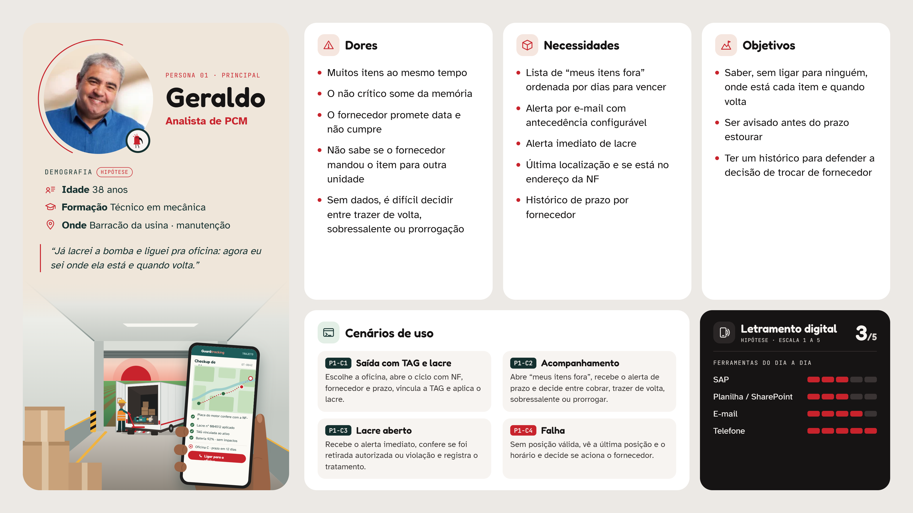

*Figura 3.2.1.1 — Persona 1, Geraldo, analista de PCM. Fonte: card elaborado pelo Grupo G01 (2026) com apoio do Claude (Anthropic), modelo Opus 5.5 [29]; foto do rosto: banco de imagens Magnific [28], de uso gratuito sob a licença da plataforma.*

Geraldo, analista de PCM de 38 anos e técnico em mecânica, trabalha no barracão da manutenção da usina e é, na prática, o dono do equipamento enquanto ele está fora: é ele quem avalia a peça que o mecânico trouxe, escolhe e cota a oficina, vincula a TAG, aplica o lacre, entrega o item à transportadora e depois passa horas ao telefone cobrando o fornecedor, apoiado em SAP, planilhas e e-mail (letramento digital 3 de 5). Esse trabalho, porém, acontece com dezenas de itens ao mesmo tempo, e por isso os equipamentos menos críticos acabam saindo da memória, enquanto os fornecedores prometem datas que nem sempre cumprem; sem dados à mão, Geraldo também não consegue saber se um atraso pede trazer o item de volta, usar uma peça sobressalente ou prorrogar o prazo. É por isso que o que ele espera da solução é simples: saber, sem ligar para ninguém, onde está cada item e quando ele volta, ser avisado antes de o prazo estourar e contar com o histórico de cumprimento de cada fornecedor para decidir se renova o contrato ou troca de oficina. Para a plataforma, isso significa pôr no centro uma lista de "meus itens fora" ordenada por dias para vencer, com alertas de prazo configuráveis, alerta imediato de lacre aberto e a última localização e o histórico por fornecedor ao alcance de um clique, em vez de painéis gerenciais que não ajudam quem precisa agir todos os dias.

##### P2. Clarice, analista fiscal (persona secundária)


*Figura 3.2.1.2 — Persona 2, Clarice, analista fiscal. Fonte: card elaborado pelo Grupo G01 (2026) com apoio do Claude (Anthropic), modelo Opus 5.5 [29]; foto do rosto gerada no ChatGPT (OpenAI) [31] a partir do pedido "uma moça com cabelos enrolados, corporativa, responsável por emissão fiscal".*

**Escopo da versão revisada do card P2:** a NF-e é emitida no **sistema fiscal externo**, não no GuaráTracking; o retorno físico não encerra o ciclo sem baixa fiscal. Alertas legais dependem de parâmetros aprovados pelo Fiscal, e detecção automática de portaria não está implementada. A arte original foi preservada apenas como histórico de revisão. Ver [matriz de hipóteses UX](outros/3-desenvolvimento-resultados/validacao-e-limites-sprint1.md).

Clarice representa a analista fiscal responsável pela emissão das notas fiscais de remessa e pelo lançamento das notas de retorno, utilizando sistemas como SAP e Gama Soft. Diferentemente de Geraldo, não acompanha fisicamente os equipamentos: sua principal dificuldade ocorre quando um item retorna sem que o Fiscal seja informado, deixando a remessa aberta. Por isso, precisa consultar de forma integrada a identificação do dispositivo (TAG), a nota fiscal e a ordem de serviço, acompanhar prazos e identificar pendências documentais. Seu objetivo é reduzir a busca manual por informações e agir antes que essas pendências gerem consequências fiscais. Na solução, consulta alertas de prazo, verifica retornos ainda não registrados e confirma o lançamento da nota fiscal de retorno, necessário para encerrar o ciclo após a conferência do equipamento. O aviso automático de chegada à portaria é hipótese futura; lançar NF-e continua atribuição do sistema fiscal, não do GuaráTracking.

##### P3. Izidio, analista de logística (persona de inteligência)


*Figura 3.2.1.3 — Persona 3, Izidio, analista de logística. Fonte: card elaborado pelo Grupo G01 (2026) com apoio do Claude (Anthropic), modelo Opus 5.5 [29]; foto do rosto: Leonardo Dourado, no Pexels [27], de uso gratuito sob a licença Pexels [30].*

Izidio, analista de logística de 29 anos e engenheiro de produção, consolida o que saiu e o que voltou para a diretoria e acompanha o custo de ICMS por safra, trabalhando com SAP, planilhas, BI e e-mail ou Teams (letramento digital 4 de 5). O problema é que os dados vivem espalhados entre o SAP e as planilhas de cada área, de modo que ele não consegue dizer, em um instante, quantas remessas saíram na safra; para compensar, e movido por um senso de dono, acaba cobrando oficinas e prazos à mão, uma tarefa operacional que não é da sua área e que o afasta da otimização logística que deveria ser o seu foco. Por isso ele precisa consolidar informações confiáveis sem refazer a coleta a cada relatório, dispor de um histórico de ciclos com datas de saída, previsão e retorno e de permanência e atraso calculados separadamente, e espera, com isso, mostrar à diretoria a evolução do ICMS por safra e manter na base todo item que não voltou, mesmo quando o ICMS já foi pago. Para a plataforma, isso reforça a prioridade de uma API robusta e de dados confiáveis, em lugar de telas operacionais, e a regra de tratar como pendente, nunca como encerrado, o ciclo sem retorno lançado, para que o número que chega à diretoria seja o que realmente aconteceu.

#### Conclusão

As personas indicam que a solução deve apresentar informações e ações adequadas às responsabilidades de cada usuário. Para Geraldo, isso significa priorizar a consulta dos equipamentos sob sua responsabilidade, os prazos, a última localização válida e os alertas que exigem intervenção. Para Clarice, o foco está na associação entre equipamento e documentos e na identificação de retornos pendentes de lançamento. Para Izidio, a necessidade é acessar históricos consistentes para consolidar dados e analisar o acompanhamento das remessas.

Essas diferenças orientam o GuaráTracking a combinar uma visão operacional dos equipamentos com o controle das pendências de cada ciclo e a disponibilização de dados para BI. A interface deve facilitar a identificação do que precisa de atenção e de quem deve agir, enquanto o histórico deve preservar a relação entre saída, acompanhamento e retorno. Assim, o rastreamento apoia decisões e a continuidade do processo entre as áreas.


### 3.2.2. Jornada do Usuário e Storyboard (sprint 2)	

#### Jornada do Usuário

A jornada do usuário é um mapa da experiência de uma pessoa ao realizar uma atividade em um contexto específico. Ela organiza as etapas do início ao fim e relaciona ações, pensamentos, sentimentos e pontos de contato com pessoas, ferramentas ou serviços. Essa visão ajuda a identificar momentos de incerteza, dificuldades e oportunidades de melhoria. No projeto Guarátracking, a jornada atual mostra como Geraldo acompanha o envio de um equipamento para manutenção externa, permitindo compreender onde a solução proposta pode apoiar seu trabalho.

#### Metodologia de elaboração das jornadas e uso de IA

A elaboração das jornadas partiu da persona de Geraldo, do fluxo de manutenção externa descrito no TAPI e das informações obtidas no kick-off com a Cerradinho. A equipe organizou o processo em etapas e definiu, para cada uma, as ações, os pensamentos, os sentimentos, os pontos de contato e as dificuldades do usuário. Em seguida, a jornada atual foi usada como base para representar a experiência futura com o apoio do GuaráTracking.

O ChatGPT foi utilizado como ferramenta de apoio durante esse processo. A equipe forneceu à IA o conteúdo das jornadas e o guia de estilos do projeto; a ferramenta auxiliou na adequação visual ao guia, na formatação das informações, na revisão gramatical e na criação dos gráficos. Os resultados foram conferidos e ajustados pela equipe para preservar a coerência com a persona, com o fluxo do parceiro e com a identidade visual do GuaráTracking.

#### Jornada atual de Geraldo

A Figura 3.2.2.1 apresenta o ciclo atual de manutenção externa pela perspectiva de Geraldo: seis etapas — preparar, escolher oficina, aprovar e enviar, acompanhar reparo, tratar atraso, retornar e encerrar. Essas etapas cobrem o recebimento da demanda até a conferência do equipamento e a confirmação da regularização fiscal. O cenário usa o motor fictício AT-001 e a Oficina Skibidy, nome fictício sem relação com fornecedor real.

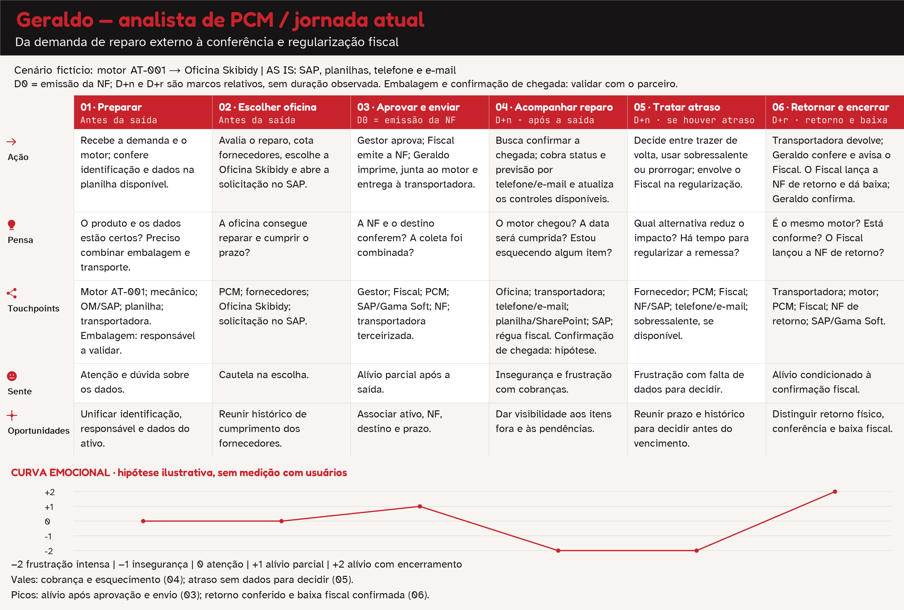

*Figura 3.2.2.1 — Jornada atual de Geraldo. Fonte: elaboração própria com base no kick-off da Cerradinho, na persona da seção 3.2.1 e no TAPI [6].*

O mapa relaciona as responsabilidades e dificuldades relatadas pelo parceiro aos objetivos de Geraldo, organizando o ciclo em seis etapas. Pensamentos, sentimentos e curva emocional são interpretações ilustrativas, não resultados de entrevistas ou medições. O responsável pela embalagem e a rotina de confirmação de chegada ao fornecedor permanecem a validar com o parceiro.

Os principais insights são:

- **Fragmentação:** dados distribuídos entre SAP, planilhas, e-mail e telefone exigem conciliação manual; reunir os registros facilita o acompanhamento por responsável.
- **Dependência do fornecedor:** informações sobre reparo e previsão de retorno dependem de respostas externas; o histórico de cumprimento pode apoiar decisões diante de atraso.
- **Risco de esquecimento:** itens menos críticos podem deixar de receber acompanhamento; a régua fiscal não informa onde estão nem o andamento do reparo.
- **Fechamento físico e fiscal separados:** receber o equipamento não encerra a remessa; a conferência e a confirmação do lançamento fiscal precisam estar relacionadas para evitar pendências.

#### Jornada futura de Geraldo

A Figura 3.2.2.2 acompanha Geraldo (P1) nas seis fases da jornada atual, com o motor fictício AT-001 e a Oficina Skibidy. Gestor, Fiscal, transportadora e fornecedor aparecem nos pontos de contato; a última linha explicita as responsabilidades do projeto.

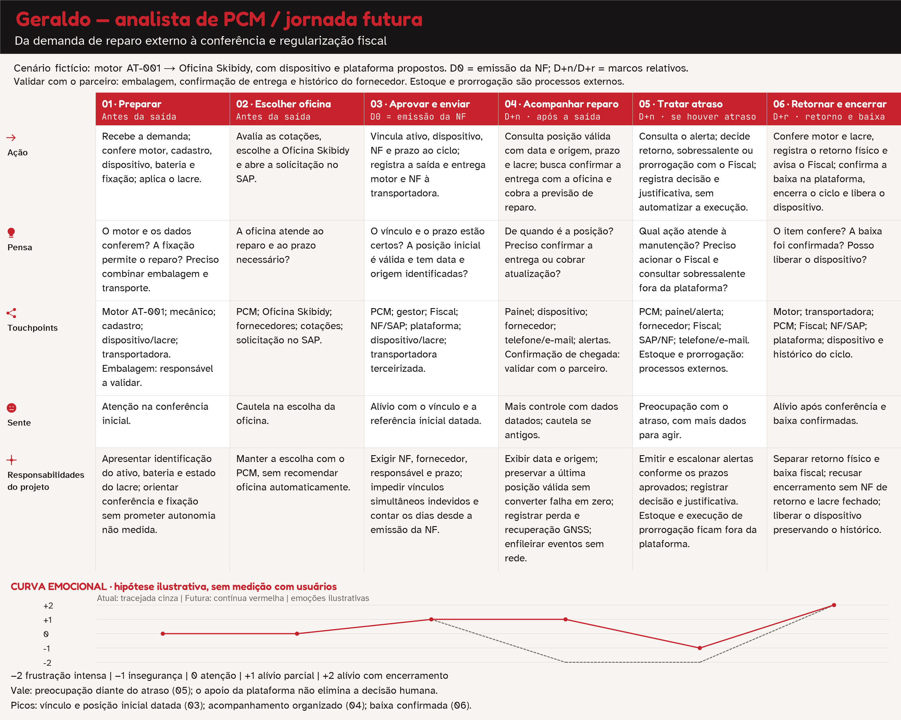

*Figura 3.2.2.2 — Jornada futura de Geraldo. Fonte: elaboração própria com base no kick-off da Cerradinho, na persona da seção 3.2.1 e no TAPI [6].*

A experiência é proposta; sentimentos e curvas são ilustrativos. A posição semanal e datada não comprova entrega nem andamento do reparo. Perda de sinal GNSS e falta de rede são situações distintas: a última posição válida é preservada, e eventos sem conexão aguardam envio.

| O que muda | Requisitos |
|---|---|
| Dados reunidos por equipamento e responsável. | Cadastro do ciclo, RF002; vínculo exclusivo, RF003–RF004; dias desde a NF, RF012. |
| Consulta com indicação de atualidade e falhas. | Posição datada, RF005; consulta de status, RF015; fila sem rede, RF010; perda e recuperação GNSS, RF031. |
| Pendências orientam a decisão do PCM. | Alerta de atraso, RF013; tratamento com justificativa, RF023; escalonamento por e-mail, RF030. |
| Retorno conferido até a baixa fiscal e reutilização. | Encerramento condicionado, RF016; histórico do dispositivo, RF017; retorno e baixa separados, RF029. |

Embalagem e confirmação manual de entrega exigem validação. Histórico de fornecedores, consulta de estoque, execução da prorrogação e registro de quem recebeu na oficina são hipóteses sem RF específico; sua inclusão depende de validação e compatibilidade com os RNFs.

#### Storyboard

Um storyboard é uma representação visual sequencial utilizada para demonstrar como uma situação acontece ao longo do tempo. Por meio de cenas organizadas em ordem, ele apresenta o contexto, as ações do usuário, os problemas encontrados e a interação com a solução proposta.

#### Metodologia de elaboração do storyboard e uso de IA

A construção do storyboard começou pela definição da persona, do contexto, do problema e da sequência de acontecimentos que deveria ser representada. O Codex foi utilizado como ferramenta de apoio para consultar e organizar as informações sobre a persona e os prazos presentes na narrativa, revisar a gramática e a coerência do roteiro e gerar as imagens das cenas. O guia de estilos do GuaráTracking foi fornecido como referência para orientar a composição visual, e as imagens geradas passaram por ajustes para manter a identidade do projeto e a continuidade entre as cenas. A equipe revisou o texto, a sequência narrativa e o resultado visual antes de consolidar a versão final.

#### O nosso storyboard

O storyboard acompanha Geraldo, analista de PCM responsável pelos equipamentos enviados à manutenção externa. A história mostra sua atuação após uma bomba centrífuga ultrapassar o prazo de retorno combinado com a oficina e o GuaráTracking emitir um alerta de atraso, permitindo que ele consulte os dados e tome uma decisão.

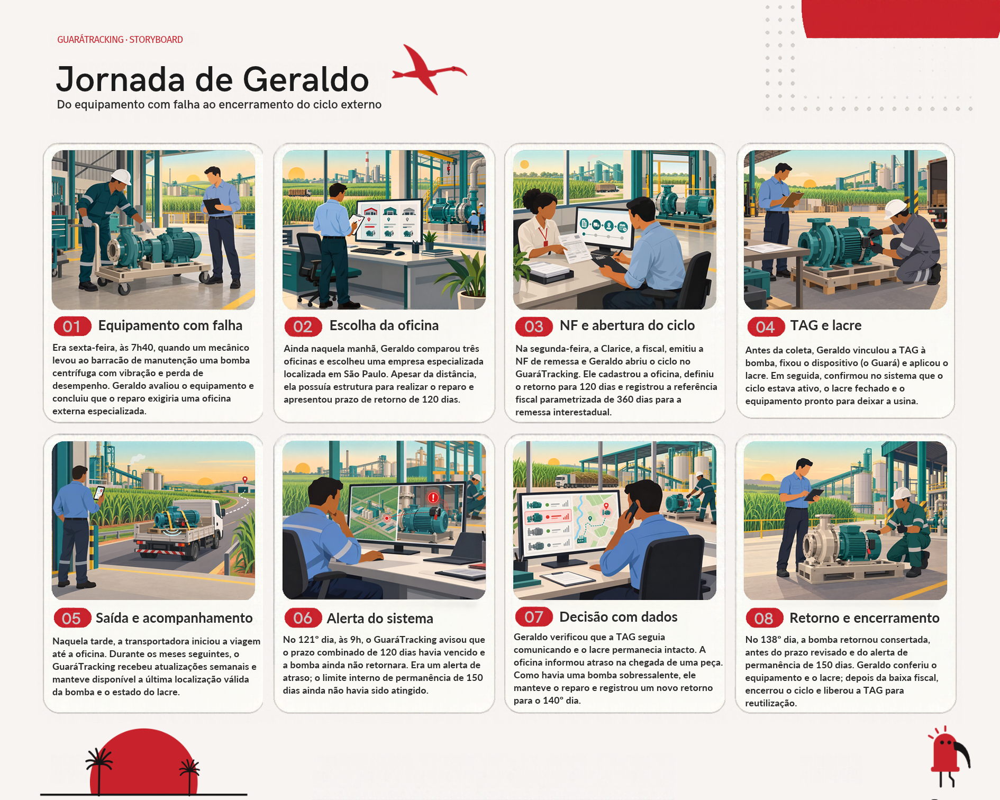

*Figura 3.2.2.3 — Storyboard de Geraldo. Fonte: elaboração própria do Grupo G01 (2026), com apoio do Codex, com base no kick-off da Cerradinho, na persona da seção 3.2.1, no TAPI [6] e no template da disciplina.*

#### Visão complementar da jornada

Como atividade complementar realizada em sala de aula, o grupo representou a jornada do GuaráTracking a partir de duas perspectivas: aquilo que o usuário conhece e percebe durante a experiência e aquilo que a equipe compreende sobre o funcionamento interno da solução.

A primeira perspectiva reúne as interações e informações relevantes para o usuário, como o vínculo do equipamento, o acompanhamento da remessa e a visualização de localização, prazo, nota fiscal e estado do lacre. A segunda apresenta a interpretação do grupo sobre os processos que sustentam essa experiência, incluindo a atuação do dispositivo IoT, a comunicação com a plataforma, o monitoramento do lacre e o processamento dos eventos pelo sistema.

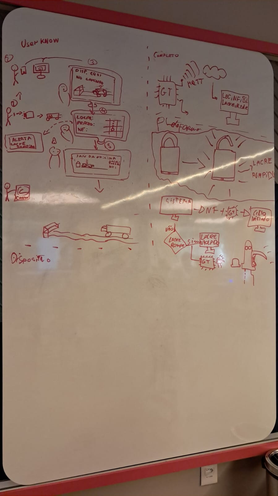

*Figura 3.2.2.4 — Visão complementar da jornada do GuaráTracking, elaborada durante uma atividade em sala de aula. Fonte: elaboração própria do Grupo G01 (2026).*

A representação evidencia que o usuário não precisa conhecer toda a complexidade interna da solução para acompanhar o equipamento e tomar decisões. Para a equipe, entretanto, observar as duas perspectivas ajuda a relacionar cada informação apresentada ao usuário com os processos e componentes que podem torná-la disponível.

Por se tratar de uma construção exploratória realizada pelo grupo, a figura não representa um fluxo definitivo ou validado pelo parceiro. Seu objetivo é registrar a compreensão desenvolvida durante a atividade e apoiar o refinamento futuro da experiência e da arquitetura do GuaráTracking.

## 3.3. Solução Técnica	

### 3.3.1. Requisitos Funcionais (sprint 1, refinar e atualizar até sprint 5)

Os requisitos abaixo saem do TAPI (MVP 1 a 7 e fluxo básico), da avaliação do protótipo e do kick-off com a Cerradinho (16/10/2026). A prioridade segue o que o parceiro chamou de indispensável no kick-off: alerta de lacre, alerta de prazo e geolocalização. Um RF só passa a `Simulado no Wokwi` depois que o caso de teste correspondente (seção 3.4.1) é executado e passa. Fica `Parcialmente simulado` quando parte dos CTs passou e outra parte foi reprovada ou bloqueada (ver a RTM na seção 3.3.4). Os IDs estão congelados: um RF removido não libera o número, e um RF novo entra no fim da lista. Até 03/11/2026 não havia testes físicos executados. A coluna Status mantém a classificação do simulador; a coluna "Wokwi V2 e protótipo físico" distingue as rodadas Wokwi dos cenários de bancada executados em 05/11/2026 (seção 3.4.2). A RTM da seção 3.3.4 detalha os vínculos e limites: aprovação de um cenário físico não significa atendimento integral do RF. Essa rodada foi feita antes de o firmware passar a ligar sem ciclo (RN21); as células marcadas "rodada de 02 e 03/11/2026" vêm da repetição com o boot sem ciclo, e os CT36 a CT42 vêm da execução da interface local do V2.

**Atualização da Sprint 2 e dependências de qualidade.** RF015, RF021–RF024 e RF029 continuam dependentes de painel, API, autenticação, integração ou fluxo fiscal para atendimento completo; os RNF03, RNF04 e RNF06 definem como esses fluxos serão aceitos. As verificações do LCD local (RF034) não comprovam autenticação ou operação no painel. RF005, RF010 e RF017 têm evidências físicas locais, mas a posição GNSS não teve precisão medida, a entrega ao servidor não foi confirmada e a consulta ao histórico integral após reutilização continua pendente (RNF01 e RNF05). As pendências de regras de reconexão, contrato MQTT e escalonamento constam da RTM como **RN a definir**, porque o parceiro ainda não homologou parâmetros; isso não significa regra implementada.

| ID    | Descrição | Origem | Prioridade | Status | Wokwi V2 e protótipo físico |
|-------|-----------|--------|------------|--------|---|
| RF001 | O sistema deve cadastrar o equipamento com identificador próprio, descrição e foto. | TAPI MVP 1 | Alta | Planejado | Sem CT no V2; protótipo físico pendente |
| RF002 | O sistema deve abrir um ciclo de manutenção externa com NF de remessa (número e data de emissão), fornecedor, responsável e prazo previsto de retorno. | TAPI MVP 3 | Alta | Parcialmente simulado | Verificado em parte no simulador Wokwi V2 (CT39: registro, exibição e recusas da NF da remessa); fornecedor, responsável e prazo previsto não exercitados; Cobertura física parcial: CT47 e CT59 verificam vínculo e entrada da NF; cadastro completo na plataforma pendente |
| RF003 | O sistema deve vincular um dispositivo a um ciclo de manutenção aberto. | TAPI MVP 3 | Alta | Simulado no Wokwi | Verificado no simulador Wokwi V2 (CT14: novo vínculo após o encerramento; CT44: vínculo no boot sem ciclo, rodada de 02 e 03/11/2026); Verificado no protótipo físico (CT47) |
| RF004 | O sistema deve recusar o vínculo de um dispositivo que já está em um ciclo ativo. | Fluxo básico | Alta | Parcialmente simulado | **Histórico Wokwi V2:** CT15 não abriu um segundo ciclo, mas não exercitou `VINCULO_RECUSADO`. **Correção #113:** o comando local `VINCULAR` alcança a recusa com `motivo=ciclo_ativo`; CT15-HOST aprovado em `demo` e `weekly`, preservando ciclo/NF/identidade. Roteiro Wokwi atualizado, **sem reteste executado**; validação física e concorrência na plataforma pendentes. |
| RF005 | O sistema deve coletar a posição GNSS na rotina de envio e guardar a última localização válida com data e hora. | TAPI MVP 2 | Alta | Parcialmente simulado | Verificado em parte no simulador Wokwi V2 (CT43: idade da última posição no LCD em segundos e minutos, rodada de 02 e 03/11/2026); horas, dias e restauração após reinício pendentes; Verificado no protótipo físico (CT52: fix e coleta de posição); Cobertura física parcial: CT52 verifica fix/coleta com NEO-6M e CT66 perda de dados; precisão e histórico completo pendentes |
| RF006 | O sistema deve monitorar o lacre e detectar sua abertura ou rompimento. | TAPI MVP 5 | Alta | Parcialmente simulado (reteste de 05/11 aprovado; ver RTM) | Verificado em parte no simulador Wokwi V2 (CT05, CT07, CT38); CT18 reprovado na rodada de 02 e 03/11/2026 e aprovado no reteste de 05/11/2026, depois da correção do debounce; Verificado no protótipo físico (CT50); CT61/CT65 ampliam detecção e CT69 verifica violação com ciclo ativo; contato definitivo ainda não ensaiado |
| RF007 | O sistema deve registrar a retirada autorizada e a reaplicação do lacre sem gerar alerta de violação. | TAPI MVP 5 | Alta | Simulado no Wokwi | Verificado no simulador Wokwi V2 (CT06, CT07, CT11; CT38 e CT42 para a retirada autorizada sem alarme e a mensagem de lacre reaplicado); Verificado no protótipo físico (CT49); CT49 sem ciclo ativo, complementado por CT53/CT57 com ciclo |
| RF008 | O sistema deve conectar-se à rede Wi‑Fi e reconectar automaticamente quando a conexão cair. | Avaliação do protótipo | Alta | Planejado | Sem CT no V2; protótipo físico pendente |
| RF009 | O sistema deve publicar status e eventos no broker MQTT, em JSON, no tópico do dispositivo. | TAPI MVP 6 | Alta | Planejado | Sem CT no V2; protótipo físico pendente |
| RF010 | O sistema deve guardar os eventos gerados sem conexão e enviá-los na ordem em que ocorreram quando a conexão voltar. | TAPI MVP 5 | Alta | Parcialmente simulado | Verificado em parte no simulador Wokwi V2 (CT08, CT10, CT42); no CT08 a violação foi guardada na fila, mas a tela "Sem sinal" não foi executada; CT09 bloqueado; Verificado no protótipo físico (CT63, CT64: fila e reenvio local, sem confirmação do servidor); Cobertura física parcial: CT63/CT64 verificam fila/reenvio na Serial; confirmação pelo servidor pendente |
| RF011 | O sistema deve enviar um status periódico, semanal por padrão e configurável. | TAPI MVP 4 | Alta | Simulado no Wokwi | Verificado no simulador Wokwi V2 (CT02); protótipo físico pendente |
| RF012 | O sistema deve calcular os dias fora a partir da data de emissão da NF de remessa. | TAPI MVP 4; Kick-off com a Cerradinho (16/10/2026) | Alta | Planejado | Sem CT no V2; protótipo físico pendente |
| RF013 | O sistema deve emitir um alerta de atraso quando os dias fora passam do prazo previsto de retorno. | TAPI MVP 3 | Alta | Simulado no Wokwi | Verificado no simulador Wokwi V2 (CT03, CT37); protótipo físico pendente |
| RF014 | O sistema deve emitir um alerta de permanência quando os dias fora atingem o limiar do ciclo (150 dias por padrão, configurável). | TAPI MVP 4 | Alta | Simulado no Wokwi | Verificado no simulador Wokwi V2 (CT04 com limiar 10 e com 150, rodada de 02 e 03/11/2026); protótipo físico pendente |
| RF015 | O sistema deve listar os equipamentos fora com última localização válida, dias fora, prazo, bateria e estado do lacre. | TAPI MVP 6 | Alta | Planejado | Sem CT de listagem no V2; painel e acesso autenticado (RN15, RNF06) dependem de plataforma; CT19/CT20 não demonstram listagem nem login |
| RF016 | O sistema deve encerrar o ciclo somente com a NF de retorno lançada e o lacre fechado. | Fluxo básico | Alta | Simulado no Wokwi | Verificado no simulador Wokwi V2 (CT14, CT16); Verificado no protótipo físico (CT56, CT57, CT58) |
| RF017 | O sistema deve liberar o dispositivo do ciclo encerrado para um novo vínculo, preservando o histórico. | TAPI MVP 3; fluxo básico | Alta | Parcialmente simulado | Verificado em parte no simulador Wokwi V2 (CT14); histórico após corte de energia pendente; CT62 comprova restauração de ciclo/lacre após corte; consulta ao histórico integral e reutilização completa permanecem pendentes |
| RF018 | O sistema deve notificar o responsável do ciclo a cada alerta, com o e-mail como canal inicial. | Fluxo básico; Kick-off com a Cerradinho (16/10/2026) | Alta | Planejado | Sem CT no V2; protótipo físico pendente |
| RF019 | O sistema deve medir o nível de bateria e enviá-lo em cada mensagem. | TAPI MVP 6 | Média | Simulado no Wokwi | Verificado no simulador Wokwi V2 (CT12, CT13, CT23); diagnóstico elétrico da bateria depende do protótipo físico; CT51 e CT60 físicos verificam diagnóstico e histerese com potenciômetro, sem bateria real |
| RF020 | O sistema deve cadastrar os dispositivos na plataforma, cada um com identificador e credencial próprios. | TAPI MVP 3 | Média | Planejado | Sem CT no V2; protótipo físico pendente |
| RF021 | O sistema deve atribuir a cada usuário um `usuario_id` único e permanente, gerado pela plataforma, vinculado à sua credencial individual e ao seu perfil de acesso, e autenticar esse usuário para acessar o painel. | TAPI MVP 6 | Média | Planejado | Plataforma e CT-F21 não executados; RN15/RN17 e RNF06.1/RNF06.7 pendentes; botões locais não autentificam o usuário |
| RF022 | O sistema deve exibir gráficos e mapa com equipamentos por faixa de dias fora, alertas por tipo e última posição de cada equipamento. | TAPI MVP 6 | Média | Planejado | CT-F22 planejado; gráficos e mapa dependem do painel e de RN15, não são provados pelos CTs do LCD |
| RF023 | O sistema deve atribuir cada alerta ao responsável pelo ciclo e permitir que esse responsável, após autenticação, registre a ciência e o tratamento com decisão, data e justificativa. | Fluxo básico | Média | Planejado | CT-F23 planejado; plataforma, trilha de auditoria, RN15/RN18 e RNF06.2/RNF06.7 ainda não verificados |
| RF024 | O sistema deve oferecer uma API autenticada e documentada para consulta dos dados por ferramentas de BI. | TAPI MVP 6 | Média | Planejado | CT-F24 planejado; contrato JSON, interoperabilidade (RNF03) e autenticação/autorização (RNF06) não verificados |
| RF025 | O sistema deve emitir um alerta quando um dispositivo passa do período esperado sem se comunicar. | Kick-off com a Cerradinho (16/10/2026) | Média | Planejado | Sem CT no V2; protótipo físico pendente |
| RF026 | O sistema deve emitir um alerta quando os dias fora atingem a data limite legal do ciclo. | Kick-off com a Cerradinho (16/10/2026) | Média | Planejado | Sem CT no V2; protótipo físico pendente |
| RF027 | O sistema deve emitir um alerta quando o nível de bateria fica abaixo do limite mínimo. | TAPI MVP 6 | Média | Simulado no Wokwi | Verificado no simulador Wokwi V2 (CT12, CT13); Cobertura física parcial: CT60 verifica histerese com potenciômetro, sem bateria real |
| RF028 | O sistema deve avisar antecipadamente ao vencimento do prazo de retorno, com antecedência configurada pelo parceiro. | Necessidade das personas; VPC | Média | Planejado | Sem CT no V2; protótipo físico pendente |
| RF029 | O sistema deve marcar retorno físico recebido e pendência de baixa fiscal como estados distintos, sem encerrar o ciclo. | Kick-off; P2-C2 | Alta | Planejado | Sem CT no V2; protótipo físico pendente |
| RF030 | O sistema deve escalar o alerta por e-mail conforme os dias restantes para o vencimento, do requisitante ao coordenador e depois ao diretor, nos moldes do escalonamento que o parceiro já usa. | Kick-off com a Cerradinho (16/10/2026) | Média | Planejado | Sem CT no V2; protótipo físico pendente |
| RF031 | O sistema deve registrar a perda da posição GNSS uma única vez, no início da falha e com o motivo, e a recuperação uma única vez, no retorno da posição, com o tempo sem posição e a contagem de coletas sem fix; os dois eventos são não críticos e seguem a fila sem conexão (RN22). | Firmware V2 (`GNSS_SEM_FIX`, `GNSS_RECUPERADO`); TAPI MVP 2; persona P1-C4 Falha | Média | Parcialmente simulado | CT45 verificado no Wokwi para sem_fix; CT66 físico verifica sem_dados e recuperação. Sinal_fraco e perda de fix sem rede (CT67 planejado) permanecem pendentes; cobertura parcial, conforme a RTM |
| RF032 | O dispositivo deve sinalizar localmente a violação do lacre: LED vermelho com pulso curto a cada segundo enquanto o lacre estiver violado e buzzer intermitente por no máximo 30 s, parando antes se o lacre fechar. Duração de 30 s: `PENDENTE DE VALIDAÇÃO` | TAPI MVP 5; rubrica do protótipo físico (Artefato 5) | Média | Simulado no Wokwi | Verificado no simulador Wokwi V2 (CT38: alarme na violação, parada ao fechar e aos 30 s, LED pulsando com o lacre violado, [vídeo do LED](../assets/3-desenvolvimento-resultados/3.4.1-prototipo-wokwi/ct38-led.mkv)); a cadência elétrica do buzzer não foi medida; Cobertura física parcial: CT50/CT69 verificam LED e som/parada ao fechar; duração e frequência do buzzer não medidas |
| RF033 | O dispositivo deve registrar a NF da remessa informada pela plataforma (simulada pelo comando `REMESSA` na Serial), com até 15 caracteres entre letras, dígitos, hífen, ponto e barra, somente com ciclo ativo, exibi-la no LCD e recusar entrada inválida ou sem ciclo, preservando a NF anterior. | Firmware V2; TAPI MVP 3; persona P1-C1 | Média | Simulado no Wokwi | Verificado no simulador Wokwi V2 (CT39); a plataforma ainda não envia a NF; Cobertura física parcial: CT59 verifica recusa de caractere inválido e registro pela Serial; demais limites e integração à plataforma pendentes |
| RF034 | O dispositivo deve permitir consultar no LCD, por dois botões de navegação circular, a NF da remessa, o prazo (dias restantes, vence hoje, atraso ou sem ciclo ativo), a última posição, a bateria e o estado do lacre, e apagar o LCD e a luz de fundo após 15 s sem interação, com o primeiro toque só acendendo a tela. Uma variação de 3 pontos na bateria simulada também acende o LCD na tela de bateria. Tempo de 15 s: `PENDENTE DE VALIDAÇÃO` | Firmware V2; TAPI MVP 6; persona P1-C2 | Média | Simulado no Wokwi | Verificado no simulador Wokwi V2 (CT36, CT37, CT40); a economia de energia do apagamento não foi medida; Verificado no protótipo físico (CT46); CT54 verifica ON/OFF, CT55 apagamento/despertar e CT52 apresentação da posição; sem ensaio com usuários |
| RF035 | O dispositivo deve mostrar no LCD a contagem "segure mais N s" ao segurar os botões de autorizar, iniciar e encerrar o ciclo, cancelar a ação se o botão for solto antes de 3 s e exibir por 2 s uma mensagem para lacre reaplicado, lacre fechado após violação, sem sinal e sinal recuperado. | Firmware V2; persona P1-C3 | Média | Simulado no Wokwi | Verificado no simulador Wokwi V2 (CT41, CT42); a mensagem "enviados" é reenvio simulado, sem confirmação de servidor; Cobertura física parcial: CT47/CT48/CT49/CT50/CT53/CT56–CT58/CT69 verificam gestos e mensagens locais; não comprovam todos os tempos e cenários do RF |

Itens técnicos da avaliação: coleta de dados via sensor (RF005, RF006, RF019) · definição de devices na plataforma (RF003, RF020) · chave de identificação de usuário e acesso ao dashboard (RF021) · conexão Wi‑Fi (RF008) · formatação de dados para MQTT (RF009) · representação gráfica dos dados coletados (RF015, RF022).

### 3.3.2. Regras de Negócio (sprint 1, refinar até sprint 5)

As regras abaixo restringem o comportamento descrito nos RFs da seção 3.3.1 e vêm das mesmas fontes: TAPI e kick-off com a Cerradinho (16/10/2026), além do regulamento do ICMS de Goiás no caso do prazo legal. Valores marcados como `PENDENTE DE VALIDAÇÃO` são propostas preliminares que dependem de confirmação do parceiro; quando usados em casos de teste da seção 3.4.1, não representam aprovação do parceiro. Os casos de teste da 3.4.1 indicam qual RN verificam.

| ID   | Descrição | Origem | RF associado |
|------|-----------|--------|--------------|
| RN01 | Um dispositivo só pode estar vinculado a um ciclo ativo por vez, e um equipamento só pode ter um ciclo ativo por vez. | Fluxo básico | RF003, RF004 |
| RN02 | Um ciclo só pode ser aberto com NF de remessa (número e data de emissão), fornecedor, responsável e prazo previsto de retorno preenchidos. | TAPI MVP 3 | RF002, RF033 |
| RN03 | O limiar de permanência é de 150 dias por padrão e pode ser alterado em cada ciclo para qualquer número inteiro de dias maior que zero. | TAPI MVP 4; Kick-off com a Cerradinho (16/10/2026) | RF014 |
| RN04 | Atraso e permanência são alertas distintos, podem estar ativos ao mesmo tempo e cada um é emitido uma única vez por ciclo. | TAPI MVP 3 e 4 | RF013, RF014 |
| RN05 | A abertura do lacre sem autorização vigente é violação crítica e é enviada na hora, fora da rotina de status periódico. | TAPI MVP 5 | RF006, RF032 |
| RN06 | A autorização de retirada vale por 3 dias a partir do registro; a abertura do lacre depois desse prazo é tratada como violação. Prazo de 3 dias: `PENDENTE DE VALIDAÇÃO` | TAPI MVP 5 | RF007 |
| RN07 | O status periódico é enviado a cada 7 dias por padrão, com frequência configurável até diária. | TAPI MVP 4 | RF011 |
| RN08 | Uma posição GNSS é válida quando o receptor tem fix, a posição traz data e hora do próprio GNSS e o HDOP é de no máximo 2,0. A última localização válida só é atualizada com uma posição válida; sem ela, a anterior é mantida. Última comunicação e última localização válida são registradas em campos distintos. HDOP máximo de 2,0: `PENDENTE DE VALIDAÇÃO` | TAPI MVP 6 | RF005, RF015, RF031 |
| RN09 | Sem conexão, o dispositivo guarda até 8 eventos; com a fila cheia, descarta o evento não crítico mais antigo e preserva individualmente as violações enquanto houver espaço; excedentes críticos são **agregados por quantidade e primeira/última ocorrência**, sem manter todos os payloads individuais. Cada evento individual mantém a hora em que ocorreu, e a plataforma registra a hora de recebimento à parte. Capacidade de 8 eventos: `PENDENTE DE VALIDAÇÃO` | TAPI MVP 5 | RF010, RF031 |
| RN10 | O alerta de bateria baixa é emitido uma vez quando o nível fica abaixo de 20% e só volta a ser emitido depois que o nível passa de 25%. Leitura zero é falha do sensor, não bateria vazia. Limites de 20% e 25%: `PENDENTE DE VALIDAÇÃO` | TAPI MVP 6 | RF019, RF027 |
| RN11 | O encerramento do ciclo é recusado enquanto o lacre estiver aberto ou a NF de retorno não estiver lançada, e o histórico do ciclo encerrado nunca é apagado. | Fluxo básico | RF016, RF017 |
| RN12 | Uma prorrogação (retorno e nova remessa simbólicos) abre um novo ciclo do mesmo equipamento e do mesmo dispositivo, e os dias fora passam a contar da emissão da nova NF de remessa. | Kick-off com a Cerradinho (16/10/2026) | RF012, RF017 |
| RN13 | Os limites fiscais variam com UF, tipo de operação, legislação vigente e eventuais prorrogações; a plataforma só aplicará regra parametrizada e validada pelo Fiscal. No kick-off, o parceiro confirmou 270 dias para remessa dentro de GO e 360 dias para fora de GO como prazos do caso apresentado; eles **não são prazos universais**, e a parametrização final fica sob validação do Fiscal | RCTE/GO (Decreto nº 4.852/1997), art. 79, I, "s", 1 (270 dias, saída interna) e Anexo IX, art. 6º, IV (360 dias, saída interestadual), na redação do Decreto nº 7.815/2013; Kick-off com a Cerradinho (16/10/2026) | RF012, RF026 |
| RN14 | Um dispositivo é considerado sem comunicação quando passa de dois intervalos de status periódico sem enviar nenhuma mensagem (14 dias com o padrão de 7 dias); o alerta é emitido uma vez e só volta a ser emitido depois de uma nova comunicação. Dois intervalos: `PENDENTE DE VALIDAÇÃO` | Kick-off com a Cerradinho (16/10/2026) | RF025 |
| RN15 | O painel e a API só respondem a usuário autenticado; sem credencial válida, o acesso é negado e nenhum dado é exibido. | TAPI MVP 6 | RF015, RF021, RF022, RF023, RF024 |
| RN16 | Mensagem de dispositivo não cadastrado ou com credencial inválida é rejeitada e não altera nenhum ciclo. | TAPI MVP 3 | RF020 |
| RN17 | Cada usuário possui um `usuario_id` único, gerado pela plataforma e não reutilizado nem alterado após o cadastro. A credencial e o perfil de acesso são vinculados a esse identificador; o `usuario_id` identifica o usuário nos registros de auditoria sem expor sua credencial. | RF021; especificação preliminar do projeto | RF021, RF023 |
| RN18 | Cada alerta é atribuído ao responsável do ciclo. Esse responsável deve registrar, após autenticação, a ciência e uma decisão de tratamento com justificativa em até 1 dia útil após a emissão. O prazo de 1 dia útil é `PENDENTE DE VALIDAÇÃO` com a Cerradinho. O registro inclui o `usuario_id` do responsável e data/hora, é preservado no histórico e não substitui registros anteriores; alertas sem tratamento dentro do prazo permanecem pendentes e são destacados no painel. | RF018, RF023; Fluxo básico. Prazo de 1 dia útil: `PENDENTE DE VALIDAÇÃO` com a Cerradinho | RF018, RF021, RF023 |
| RN19 | O alerta preventivo é diferente do atraso e requer antecedência configurada por ciclo; sem parâmetro aprovado, não emitir nem apresentar como implementado. | VPC; hipótese UX | RF013, RF028 |
| RN20 | Retorno físico registrado não significa baixa fiscal. O ciclo continua pendente até registro válido da NF de retorno e conferência do lacre. | Fluxo Fiscal; P2-C2 | RF016, RF029 |
| RN21 | O dispositivo liga sem ciclo ativo (`ciclo_ativo=false`, `dias_fora=0`) e só abre o ciclo quando o responsável mantém o botão de ciclo pressionado por 3 s (vínculo); sem ciclo ativo, os dias fora não são contados. Gesto de 3 s: `PENDENTE DE VALIDAÇÃO` | TAPI MVP 3; firmware V2 | RF002, RF003 |
| RN22 | A perda da posição GNSS gera um único `GNSS_SEM_FIX` na primeira coleta sem posição válida, com o motivo (`sem_fix`, `sem_dados` ou `sinal_fraco`), sem repetir nas coletas seguintes; o retorno gera um único `GNSS_RECUPERADO`. Os dois são não críticos e entram na fila da RN09. Critérios dos motivos (5 s sem dados NMEA; até 3 satélites visíveis é sinal fraco): `PENDENTE DE VALIDAÇÃO` | TAPI MVP 2; firmware V2 (`include/gnss_rules.h`) | RF031, RF005, RF010 |

**Compatibilidade entre as regras de negócio e o protótipo atual.** A tabela abaixo mostra como o firmware da seção 3.4.1 trata as regras que ele já cobre; as diferenças indicadas não representam requisitos já atendidos.

| Regra | Situação no protótipo atual |
|---|---|
| RN05 — envio da violação fora da rotina periódica | Preservar registro local independente de GNSS/rede. Entrega ao servidor ainda não implementada. No kick-off, o parceiro pediu o aviso “o mais imediato possível”, aceitando 10 a 30 minutos; isso é referência, não SLA formal, e não garante entrega sem conexão. |
| RN08 — data/hora GNSS e HDOP máximo de 2,0 | O firmware atual verifica validade, idade e satélites, mas não aplica esse limite de HDOP nem persiste data/hora absoluta. Registrar adequação futura do driver LC76G-PA [24]; limite de HDOP ainda pendente. O firmware V2 passou a registrar a perda e o retorno da posição (RN22), mas isso não substitui o critério de HDOP. |
| RN09 — fila de 8 com prioridade para críticos | Implementada na fila de eventos sem rede (8 eventos, descarte do não crítico mais antigo, reenvio na ordem com `dia_ocorrencia`). Com a fila só de violações, a 9ª violação em diante entra num único registro de resumo (`VIOLACAO_LACRE_RESUMO`, com quantidade e primeira/última ocorrência), persistido na NVS e enviado depois das 8 no reenvio; o resumo preserva somente contagem e extremos temporais, **não cada violação individual**. Só eventos não críticos que não cabem são contados em `perdidos`. A política de agregação deve ser confirmada com o parceiro. O registro local de 16 entradas na NVS (CT21) continua separado. |
| RN10 — leitura zero considerada falha | Implementada: ADC = 0 gera `SENSOR_BATERIA_FALHA` e nenhum `BATERIA_BAIXA` (CT13). No dispositivo físico, o diagnóstico elétrico do divisor ainda depende do CT30 previsto no [planejamento de energia e GNSS](outros/3-desenvolvimento-resultados/3.4.1-prototipo-wokwi/planejamento-energia-gnss.md). |
| RN06 — autorização de retirada por 3 dias | Implementada no `demo` com janela de 3 dias simulados (1 s = 1 dia): a abertura 4,5 s depois da autorização gerou violação (CT07). O prazo de 3 dias é valor de teste, sem confirmação do parceiro; a autorização ainda é um botão de bancada, sem canal da plataforma. |
| RN11 — encerramento exige lacre fechado e NF de retorno | As duas recusas foram verificadas no CT16. No simulador, `NF` no Serial representa o lançamento da NF de retorno e segurar `BTN_CICLO` por 2 s (V1) ou 3 s (V2) solicita o encerramento. No reteste de 23/10/2026, o CT14 confirmou JSON com ciclo inativo e dias zero, reutilização e contador acumulado. A persistência do histórico após corte de energia não foi verificada. |
| RN14 — dispositivo sem comunicação | Não implementada no firmware: não há controle de silêncio do dispositivo nem CT. Depende da plataforma, que recebe as mensagens. |
| RN21 — boot sem ciclo e vínculo por 3 s | Implementada no firmware V2. O `STATUS` de boot informa `ciclo_ativo=false`, e o ciclo 1 só começa com CICLO segurado por 3 s. CT44 aprovado no simulador na rodada de 02 e 03/11/2026; a rodada V2 de 30/10/2026 foi anterior a esse comportamento. |
| RN22 — eventos de falha do GNSS | Implementada no firmware V2 (`GNSS_SEM_FIX` e `GNSS_RECUPERADO`, não críticos). CT45 aprovado no simulador para o motivo `sem_fix` (rodada de 02 e 03/11/2026). No simulador, o chip GPS só alterna entre fix e sem fix, então os motivos `sem_dados` e `sinal_fraco` só podem ser verificados no protótipo físico. |

### 3.3.3. Requisitos Não Funcionais — ISO/IEC 25010:2011 (sprints 2 a 5)

Um requisito não funcional (RNF) descreve a qualidade com que o sistema cumpre suas funções, e não uma função em si. Aqui, "o sistema" é o conjunto formado pelo dispositivo, pela comunicação e pelo painel. Os RNFs partem das condições reais do projeto: o ciclo semanal de remessa para conserto, a operação sem cobertura nos trajetos e nas oficinas, o alerta de abertura do lacre, a proteção dos dados pela LGPD [40] e a bateria que precisa durar todo o período fora. As oito categorias seguem expressamente o modelo de qualidade de produto da **ISO/IEC 25010:2011** [54], que contém oito características. A edição ISO/IEC 25010:2023 [61] tem nove características e terminologia revista, não adotadas nesta classificação. Cada categoria tem um RNF (RNF01 a RNF08), que se desdobra em RNFs específicos de ID RNF0X.Y, e todo RNF específico traz um critério de aceitação com meta mensurável e um método de verificação.

As ligações de cada RNF com o TAPI [6], o kick-off com a Cerradinho de 16/10/2026 [33] e as personas da seção 3.2.1 são interpretação do grupo e dependem de validação. Geraldo (P1), Clarice (P2) e Izidio (P3) são perfis construídos pelo grupo, não depoimentos individuais. Nas metas, quatro marcações indicam o grau de certeza do número:

- **meta da equipe:** número definido pelo grupo, ainda sem aprovação do parceiro;
- **a medir:** valor a confirmar no primeiro ensaio;
- **limite a validar:** sem número; depende de decisão do parceiro, do Fiscal, de Jurídico ou de TI;
- **referência do parceiro:** valor dito no kick-off [33]; não é medição nem SLA acordado.

Neste texto, "violação" é a abertura do lacre sem autorização vigente (RN05); "TAG" é o nome que o parceiro usa para o dispositivo vinculado ao equipamento (RF003); "fix" é a posição válida fornecida pelo receptor GNSS.

Nas verificações e nas situações, os casos de teste seguem o vocabulário das seções 3.3.4 e 3.4: **planejado** (caso definido, ainda não executado), **CT a definir** (ainda sem caso), **pendente** (parte ainda não comprovada de um CT já executado, como no CT43) e **bloqueado** (CT que depende de algo externo, como o CT09, que espera a confirmação do servidor). **Depende de plataforma** indica o que só se verifica quando painel, API ou transporte existirem, e **provisório** indica o que se aceita hoje enquanto o limite não vem.

#### Categorias e demandas de negócio

Cada linha relaciona uma categoria da ISO/IEC 25010 [54] às demandas do negócio e à rastreabilidade dos RNFs; as fichas abaixo não repetem as demandas.

| Categoria / ID | Demanda do negócio e fonte | Justificativa e rastreabilidade | Lacunas e validações |
|---|---|---|---|
| **Adequação funcional — RNF01** | O TAPI [6] (MVP 2–6) prevê localização válida, vínculo TAG–ciclo–NF, histórico e alertas de prazo e lacre; o kick-off [33] destacou equipamentos esquecidos e retorno físico sem baixa fiscal. | A completude das funções permite a P1 Geraldo acompanhar pendências, a P2 Clarice reconciliar retornos e a P3 Izidio consolidar o histórico. Relação: RF002, RF005, RF006, RF014, RF016, RF017 e RF029. | A cobertura funcional depende de verificação dos fluxos e das regras de encerramento; funcionalidades planejadas não são consideradas implementadas. |
| **Eficiência de desempenho — RNF02** | O TAPI [6] (MVP 4 e 7) prevê status semanal configurável e ensaio de consumo. No kick-off [33], o parceiro indicou **autonomia de até 1 ano** como referência para cobrir cerca de **99% dos períodos fora**, sem fixar meta formal. Para violação do lacre, pediu aviso o mais imediato possível e considerou **10 a 30 minutos aceitáveis** como referência, sem esperar o ciclo semanal [33]. | P1 Geraldo precisa de informação útil antes que a bateria se esgote e de alerta de lacre em tempo oportuno. Tempo de resposta (detecção local versus entrega ao servidor), uso de GNSS, transmissão e repouso determinam latência e consumo. Relação: RF005, RF006, RF008, RF011, RF019, RF027, RN05, RN07 e RN08. | Autonomia mínima, condições de ensaio e limite de latência ponta a ponta **a validar**. Sem cobertura, a ocorrência é armazenada para envio posterior; a faixa de 10–30 min não é garantia offline. Consumo físico exige CT27, e latências exigem ensaio separado de detecção e entrega. |
| **Compatibilidade — RNF03** | O TAPI [6] (MVP 6) requer API para BI. No kick-off [33], foram mencionados **SAP** (remessas, NF e retorno), **Gama Soft** no fiscal e o **BI da diretoria**; o campo complementar da NF foi considerado para levar o número da TAG. | A interoperabilidade entre dados de ciclo, NF e TAG deve permitir a P2 Clarice conferir pendências e a P3 Izidio consumir indicadores sem recadastro. Relação: RF002, RF005, RF017, RF024 e RF029; RN08, RN15 e RN20. | Os limites de publicação e resposta, o formato JSON e os campos mínimos são propostas a homologar; endpoints, versionamento, autorização detalhada e contrato completo da API ainda não foram definidos. Não há integração produtiva comprovada com SAP, Gama Soft ou BI corporativo. |
| **Usabilidade — RNF04** | O TAPI [6] exige consulta de status, localização e alertas; o kick-off [33] descreveu o acompanhamento manual. Os cenários das personas distinguem tarefas de PCM, Fiscal e Logística. | P1 Geraldo precisa priorizar pendências; P2 Clarice, diferenciar retorno físico de baixa fiscal; P3 Izidio, consultar histórico. A interface deve reduzir ambiguidades e erros de interpretação. Relação: RF015, RF017, RF022, RF023 e RF029; RN08 e RN20. | Tempo de execução, acessibilidade e compreensão das tarefas não foram testados com usuários reais; os limiares propostos para usabilidade ainda dependem de validação com o parceiro. |
| **Confiabilidade — RNF05** | O TAPI [6] (MVP 5) prevê armazenar eventos durante períodos sem rede e reenviá-los após a reconexão; o kick-off [33] indicou que os caminhões não têm internet garantida nos trajetos. | A disponibilidade dos registros, a tolerância a falhas de comunicação e a recuperação após desconexão permitem a P1 Geraldo acompanhar ocorrências e a P3 Izidio consultar um histórico íntegro. Relação: RF005, RF006, RF010, RF025 e RN08–RN09. | Capacidade e saturação da fila, perdas, confirmação de entrega e duração offline ainda exigem validação. CT18 e CT22 registram limitações (seção 3.3.4); não há demonstração de entrega fim a fim. |
| **Segurança — RNF06** | O TAPI [6] (MVP 5–6) prevê aviso de lacre e acesso controlado. O kick-off [33] distinguiu abertura autorizada de violação. Identificadores, localização e registros fiscais exigem avaliação segundo a LGPD [40] e orientações da ANPD [41]. | A integridade dos eventos e a confidencialidade dos dados permitem a P1 Geraldo investigar violações, a P2 Clarice confiar nos vínculos e a P3 Izidio consumir dados pertinentes. Relação: RF006, RF007, RF020, RF021, RF023, RF024, RN05 e RN15–RN18. | Lacre físico e cibersegurança são controles distintos. Perfis, retenção, base legal, criptografia e resposta a incidentes ainda exigem definição com TI/Jurídico; os controles de produção não estão comprovados. |
| **Manutenibilidade — RNF07** | O uso repetido do dispositivo, previsto no TAPI [6], exige diagnosticar e corrigir firmware e software ao longo dos ciclos. O [planejamento de energia e GNSS](outros/3-desenvolvimento-resultados/3.4.1-prototipo-wokwi/planejamento-energia-gnss.md) define o **RNF-SUP01**, com ensaios reproduzíveis por versão, configuração e estímulos; a reutilização física prevista no TAPI [6] é contexto operacional. | **Analisabilidade, modificabilidade e testabilidade** (ISO/IEC 25010:2011 [54]) permitem localizar defeitos, alterar regras e repetir testes sem comprometer histórico e vínculos de P1 Geraldo e P3 Izidio. Relação: RF017, RF025, RN01 e RN11. | Diagnósticos, testes de regressão, separação de componentes e critérios de manutenção técnica permanecem em definição. Manutenção externa do ativo não equivale à manutenibilidade do software. |
| **Portabilidade — RNF08** | O TAPI [6] exige comparar alternativas de comunicação; a seção 1.2 usa **Wi-Fi somente no protótipo**, não como premissa nas oficinas. O [planejamento técnico](outros/3-desenvolvimento-resultados/3.4.1-prototipo-wokwi/planejamento-energia-gnss.md) compara os módulos **Quectel LC76G-PA** e **u-blox MAX-M10S** [23, 24] e define o **RNF-SUP02** para verificar a correspondência entre o simulador e o LC76G-PA físico. | **Adaptabilidade e substituibilidade** (ISO/IEC 25010:2011 [54]) fundamentam trocar o canal de comunicação por alternativa de produção e substituir o módulo GNSS preservando a lógica de aquisição, transmissão e ciclo. É proposta arquitetural para manter a solução adaptável às condições de P1 Geraldo, não mera movimentação física do equipamento. Relação: RF005, RF008, RF009, RF010, RF011 e RN08. | O canal de produção e a equivalência de interfaces GNSS não foram validados. A solução de produção não pressupõe Wi-Fi nos fornecedores, localização precisa em interiores ou rastreamento contínuo em tempo real. |

#### Requisitos não funcionais e critérios de aceitação (RNF01 a RNF08)

A prioridade segue o método MoSCoW em português: **Deve ter** é indispensável ao uso; **Deveria ter** é importante, mas permite operação com limitações; **Poderia ter** é uma melhoria opcional, incorporada se houver capacidade; **Não terá nesta entrega** fica fora do escopo da entrega atual. RNF07.3 usa Poderia ter; nenhuma linha usa Não terá nesta entrega. A prioridade da categoria é a mais alta de seus requisitos específicos.

A tabela resume as oito categorias; as fichas detalham critérios, verificação, prioridade, RFs, RNs e fontes. As demandas e suas relações com as personas estão na tabela de categorias; a seção 3.3.4 relaciona RFs e RNs aos testes. Os critérios do [planejamento de energia e GNSS](outros/3-desenvolvimento-resultados/3.4.1-prototipo-wokwi/planejamento-energia-gnss.md) são incorporados às fichas: RNF07 corresponde a RNF-SUP01 e RNF08.2 a RNF-SUP02. A troca de transporte é adicional a RNF-SUP02. RNF-REST02 corresponde a RNF08.4, RNF08.5 e RNF08.6, que tratam da adaptabilidade ao ambiente físico de operação, sem criar uma nona categoria.

| ID | Categoria (subcaracterística) | Requisito | Prioridade (MoSCoW) | Justificativa da prioridade | Fonte |
|---|---|---|---|---|---|
| RNF01 | Adequação funcional (completude e corretude funcional) | O sistema deve cobrir o ciclo completo de manutenção e registrar a localização e o estado do lacre de modo que correspondam à situação real. | Deve ter | É o núcleo do rastreamento: sem posição e lacre corretos, os demais alertas perdem o sentido. | TAPI [6] (MVP 2 e 5); kick-off [33] |
| RNF02 | Eficiência de desempenho (comportamento no tempo e utilização de recursos) | O sistema deve entregar ao painel o alerta de violação do lacre sem esperar o ciclo semanal e manter o dispositivo em operação durante o período fora com a bateria. | Deve ter | Um aviso tardio ou uma bateria esgotada deixa o equipamento sem acompanhamento durante o período fora. | TAPI [6] (MVP 4 e 7); kick-off [33] |
| RNF03 | Compatibilidade (interoperabilidade) | O sistema deve entregar os dados do ciclo em formato estruturado, por API autenticada, para uso pelos sistemas do parceiro sem recadastro. | Deveria ter | O TAPI [6] pede a API para BI, mas a integração produtiva com os sistemas corporativos está fora do escopo. | TAPI [6] (MVP 6); kick-off [33] |
| RNF04 | Usabilidade (operabilidade) | O sistema deve permitir que um operador sem treino entenda o estado do equipamento no dispositivo e no painel. | Deve ter | Apresentar como atual uma posição que não é atual induz decisão errada; as demais consultas melhoram a leitura, mas as funções operam sem elas. | Personas (seção 3.2.1); kick-off [33] |
| RNF05 | Confiabilidade (tolerância a falhas e recuperabilidade) | O sistema deve continuar operando sem cobertura, guardar as leituras e os eventos e enviá-los depois, na ordem em que ocorreram. | Deve ter | Sem essa tolerância, eventos de lacre se perdem e o alerta não chega. | TAPI [6] (MVP 5); kick-off [33] |
| RNF06 | Segurança (confidencialidade e responsabilização) | O sistema deve liberar o acesso ao painel e à API apenas por perfil, registrar quem trata cada alerta, rejeitar autorizações e dispositivos inválidos e proteger os dados conforme a LGPD. | Deve ter | A LGPD [40] obriga a proteger localização, NF e identificadores, e uma autorização forjada passaria por abertura legítima. | LGPD [40]; ANPD [41]; TAPI [6] (MVP 5 e 6); kick-off [33] |
| RNF07 | Manutenibilidade (analisabilidade, modificabilidade e testabilidade) | O sistema deve permitir diagnóstico reproduzível, com a versão do firmware e a configuração de cada ensaio registradas. | Deveria ter | Sustenta a evolução do firmware entre as sprints sem alterar o ciclo em campo. | TAPI [6]; ISO/IEC 25010 [54]; RNF-SUP01 do planejamento de energia e GNSS |
| RNF08 | Portabilidade (adaptabilidade e substituibilidade) | O sistema deve permitir trocar o canal de comunicação e o módulo GNSS sem reescrever a lógica do ciclo. | Deve ter | A troca de canal e de módulo é importante, mas o ciclo opera sem ela; a fixação, o contato do lacre e a antena (RNF08.4 a RNF08.6) são indispensáveis ao uso físico. | TAPI [6]; módulos LC76G-PA e MAX-M10S [23, 24]; ISO/IEC 25010 [54] |

#### Quadro de aceitação das oito características

O quadro resume critérios, testes e estado de cada característica. A aceitação exige evidência de execução e, onde indicado, validação do parceiro; metas não homologadas não são SLAs pactuados.

| Característica e pergunta norteadora | Critério mensurável de referência | Teste verificável | Estado na Sprint 2 |
|---|---|---|---|
| **RNF01 — Adequação funcional** — A localização e o estado do lacre registrados correspondem à realidade? | **RNF01.1:** 100% das posições aceitas cumprem RN08; **RNF01.2:** 0 estados incorretos em 20 transições controladas. | CT19/CT20, CT52/CT66 (posição); CT18/CT61/CT65 (lacre); conjunto ponta a ponta RNF01.3 ainda requerido. | **Parcial:** há evidências locais, sem precisão GNSS medida nem ciclo completo na plataforma. |
| **RNF02 — Eficiência de desempenho** — O alerta chega a tempo e a bateria dura o período fora? | **RNF02.1:** p95 ≤30 min em 30 violações **com rede** (meta provisória); **RNF02.2:** autonomia calculada ≥365 dias. | CT32 (carimbo de ocorrência × recebimento real) e CT27 (corrente do conjunto e cálculo). | **Não medido:** testes de latência fim a fim e consumo ainda planejados. |
| **RNF03 — Compatibilidade** — Os dados servem aos sistemas que o parceiro já usa? | **RNF03.1:** 12/12 ciclos fictícios conformes ao contrato JSON/UTF-8/ISO 8601, sem divergência de vínculos. | CT-F24 com esquema e cliente de teste independente; CT-F02 para campo complementar de NF. | **Planejado:** API e contrato não implementados/homologados. |
| **RNF04 — Usabilidade** — Quem opera entende o estado do equipamento sem treino? | **RNF04.1:** ≥5/6 acertos por perfil (≥83,3%) nas tarefas; **RNF04.2:** 0 posições sem fix rotuladas como atuais. | CT-U01 com 9 participantes; CT43/CT52/CT66 para posicionamento/idade. | **Parcial no LCD; CT-U01 planejado:** sem validação do painel com usuários. |
| **RNF05 — Confiabilidade** — O sistema segue funcionando sem cobertura e preserva os registros? | **RNF05.1:** 0 eventos ausentes/duplicados por transição estável; **RNF05.3:** ordem preservada e 0 violações perdidas dentro da fila de 8 eventos. | CT18/CT61/CT65, CT10/CT63/CT64 e CT09 para ACK de servidor. | **Parcial local:** CT09 bloqueado; reenvio Serial não é entrega ao servidor. |
| **RNF06 — Segurança** — Só quem deve acessa os dados, e cada ação fica registrada? | **RNF06.1:** 0 acessos sem credencial válida; **RNF06.7:** 0 acessos fora da matriz de permissões e 100% dos permitidos corretos. | CT-F21/CT-F24 (autenticação e autorização); CT-F23 (auditoria). | **Planejado:** painel, API, perfis e testes de segurança ainda inexistentes. |
| **RNF07 — Manutenibilidade** — Dá para diagnosticar, alterar e testar sem refazer o sistema? | **RNF07.1:** 100% dos ensaios com campos de diagnóstico; **RNF07.2:** 0 novas regressões de RN01/RN11. | Revisão de registros CT17/CT24/CT29 e verificação local versionada. | **Parcial:** existem testes e logs, sem auditoria integral da completude. |
| **RNF08 — Portabilidade** — Dá para trocar o canal de comunicação e o módulo GNSS sem reescrever o ciclo? | **RNF08.1:** 0 mudanças nas regras RN07–RN09 e 100% dos cenários aplicáveis aprovados após troca do adaptador. | Comparação de arquivos alterados e repetição de CT02/CT08/CT09/CT10/CT14; CT26/CT28 para LC76G-PA. | **Planejado:** troca de transporte e equivalência do GNSS não comprovadas. |

##### RNF01 — Adequação funcional (completude e corretude funcional)

| ID | Requisito | Critério de aceitação (meta mensurável) | Verificação | Prioridade | RF e RN relacionados | Fonte |
|---|---|---|---|---|---|---|
| RNF01.1 | O sistema deve guardar como última localização válida apenas posições que cumpram a RN08. | 100% das posições gravadas cumprem a RN08 (fix, data e hora do GNSS, HDOP de no máximo 2,0, limite a validar (parceiro)), e nenhuma coleta sem fix vira coordenada: meta da equipe, a medir. Provisório: HDOP de 2,0 da RN08, até o parceiro validar. Distância máxima entre a posição registrada e o ponto de referência de um percurso externo controlado: limite a validar (parceiro). | Comparar os registros com os pontos de referência de um percurso controlado (simulador: CT19, CT20, CT22 e CT43; protótipo físico: CT52 e CT66). | Deve ter | RF005, RF031; RN08, RN22 | TAPI [6] (MVP 2 e 6) |
| RNF01.2 | O sistema deve registrar o estado do lacre (fechado, aberto com autorização ou violado) correspondente à situação física. | Zero transições estáveis registradas com estado trocado em um lote controlado de 20 transições: meta da equipe, a medir. A contagem de perdas e duplicações sem rede fica no RNF05.1. | Comparar o estado registrado com o roteiro de transições aplicado à chave do lacre (simulador: CT05, CT07 e CT18; protótipo físico: CT49, CT50, CT61 e CT69; planejados: CT24 e CT31). | Deve ter | RF006, RF007; RN05, RN06 | TAPI [6] (MVP 5); kick-off [33] |
| RNF01.3 | O sistema deve cobrir o ciclo completo de manutenção externa, da abertura com NF e vínculo da TAG ao encerramento com NF de retorno e lacre fechado, preservando histórico, posição e alertas. | Conjunto de CTs do ciclo completo (abertura com NF e vínculo da TAG, posição, alertas de atraso, permanência e lacre, encerramento com NF de retorno e lacre fechado) com resultado aprovado, e ao menos um ciclo completo executado sem etapa fora do sistema: meta da equipe, a medir. Requisito sem teste aprovado permanece sem aprovação. | Conferir na RTM (seção 3.3.4) o resultado dos CTs ligados aos RFs do ciclo e executar o fluxo completo, incluindo os alertas e a reconciliação do retorno físico com a baixa fiscal. No protótipo físico, CT47 (abrir o ciclo) e CT56, CT57 e CT58 (recusas e encerramento) cobrem parte do fluxo. Depende de plataforma e dos testes de ponta a ponta. | Deve ter | RF002, RF003, RF004, RF005, RF006, RF013, RF014, RF016, RF017, RF029; RN01, RN02, RN04, RN11, RN20, RN21 | TAPI [6]; kick-off [33]; personas (seção 3.2.1) |

- **Situação:** Simulador: CT19 e CT20 aprovados; CT43 parcialmente aprovado (segundos/minutos; horas, dias e restauração pendentes); CT22 reprovado no ambiente (seção 3.4.1), repetido no protótipo físico como CT62, aprovado para uptime e contexto de ciclo/lacre, sem comprovar toda a fila ou última posição; CT18 reprovado na rodada de 02 e 03/11/2026 e aprovado no reteste de 05/11/2026, repetido no protótipo físico como CT65, aprovado com ressalva. Protótipo físico (05/11/2026, ESP32 real, lacre simulado por botão e módulo GNSS NEO-6M, não o LC76G-PA): CT69 aprovado; CT49, CT50, CT52 e CT61 aprovados com ressalva (no CT52, o primeiro fix levou cerca de 9 minutos); CT66 aprovado; a precisão da posição não foi medida. CT24 e CT31 planejados. RNF01.3: dos 10 RFs do ciclo, 4 estão simulados no Wokwi (RF003, RF013, RF014, RF016), 5 parcialmente simulados (RF002, RF004, RF005, RF006, RF017) e 1 planejado (RF029); RF003, RF005, RF006 e RF016 têm ensaios físicos diretamente associados (CT47, CT52, CT50, CT56 a CT58), e a RTM registra também apoio parcial a RF002 (CT47/CT59) e RF017 (CT62), sem aprovação integral desses requisitos; o ciclo completo de ponta a ponta ainda não foi executado (depende de plataforma).

##### RNF02 — Eficiência de desempenho (comportamento no tempo e utilização de recursos)

| ID | Requisito | Critério de aceitação (meta mensurável) | Verificação | Prioridade | RF e RN relacionados | Fonte |
|---|---|---|---|---|---|---|
| RNF02.1 | O sistema deve entregar o alerta de violação do lacre ao painel sem esperar o ciclo semanal. | Até 30 minutos após a estabilização do contato, no percentil 95 de um lote de 30 estímulos com conexão: meta da equipe, a medir. A faixa de 10 a 30 minutos é referência do parceiro [33], sem meta formal (limite a validar, parceiro). Provisório: aceitar 30 minutos até haver meta formal. | Medir o tempo entre a estabilização do contato e o recebimento no painel (`L_alerta`), com relógios sincronizados (CT32, planejado). O alerta sem conexão fica guardado e não entra nessa conta. | Deve ter | RF006, RF009, RF018; RN05 | Kick-off [33]; TAPI [6] (MVP 5) |
| RNF02.2 | O sistema deve operar durante o período fora com a mesma bateria. | Autonomia estimada de pelo menos 365 dias no perfil de status semanal. Até 1 ano, cobrindo cerca de 99% dos períodos fora, é referência do parceiro [33]; meta formal: limite a validar (parceiro). Provisório: aceitar 365 dias estimados. | Medir a carga na alimentação do conjunto, sem USB em paralelo, e calcular a autonomia (CT27, planejado). A autonomia é estimada; um ensaio curto não comprova um ano de operação. | Deve ter | RF011, RF019, RF027; RN07, RN10 | Kick-off [33]; TAPI [6] (MVP 4 e 7) |
| RNF02.3 | O sistema deve limitar o tempo ativo de GNSS e de comunicação em cada coleta. | Espera de fix de até 10 s por coleta (valor atual do firmware); orçamento de GNSS e de rádio por ciclo: limite a validar (parceiro). Provisório: só a espera de 10 s; sem critério de aceite para o orçamento por ciclo. | Medir a duração por estado, as tentativas e as falhas (CT26 e CT28, planejados). | Deveria ter | RF005, RF008, RF011; RN07, RN08 | TAPI [6] (MVP 4); RNF-DES02 do planejamento |
| RNF02.4 | O sistema deve medir separadamente a detecção local do lacre e a chegada da autorização ao dispositivo. | `L_det` (registro local menos estabilização do contato) e `L_aut` (validação no dispositivo menos emissão na plataforma): limite a validar (parceiro); registrar percentil 95, máximo e perdas em 30 estímulos por condição: meta da equipe, a medir. Provisório: sem limite definido, só se registram as medidas. | Relógios sincronizados e ensaios de latência e de autorização (CT32 e CT34, planejados); a medida de `L_aut` exige o canal de autorização implementado. | Deveria ter | RF006, RF007; RN05, RN06 | RNF-DES01 do planejamento; kick-off [33] |

- **Situação:** Nenhuma medição de latência, consumo ou tempo ativo foi feita no protótipo físico: CT26 a CT34 planejados. Os CT46 a CT69 verificam comportamento, não latência nem autonomia. **Conciliação de metas:** KPI-04 (≤15 min, alvo futuro de aviso ao responsável) e RNF02.1 (p95 ≤30 min, entrega ao painel com conexão) são medidas distintas. Ambas permanecem sem homologação e sem comprovação por ensaio.

##### RNF03 — Compatibilidade (interoperabilidade)

| ID | Requisito | Critério de aceitação (meta mensurável) | Verificação | Prioridade | RF e RN relacionados | Fonte |
|---|---|---|---|---|---|---|
| RNF03.1 | O sistema deve entregar dados do ciclo por API autenticada e documentada para BI, em JSON/UTF-8, com datas ISO 8601 e fuso horário. | 12/12 ciclos de teste conformes ao contrato (esquema, codificação e datas): meta da equipe, a medir. | Validar esquema, codificação e datas em 12 ciclos fictícios, sem duplicações (composição no detalhamento). CT-F24 (planejado). | Deveria ter | RF002, RF005, RF009, RF015, RF017, RF024, RF029; RN08, RN15, RN20 | TAPI [6] (MVP 6); kick-off [33] |
| RNF03.2 | O sistema deve permitir que o número da TAG acompanhe a NF no campo complementar. | Em 12/12 ciclos fictícios, o identificador da TAG permanece idêntico entre o registro de origem, o campo complementar simulado da NF e o ciclo recuperado, com zero truncamentos: **meta da equipe, a medir**. Uso efetivo do campo e formato permitido: **limite a validar (Fiscal)**; sem esse aceite, não há aprovação da integração fiscal. | Conferir a TAG em 12 NFs fictícias com diferentes comprimentos permitidos, comparando valor de entrada, representação no campo complementar e recuperação no ciclo. CT-F02 (planejado); obter aceite do Fiscal antes de tratar o campo como contrato de integração. | Deveria ter | RF002; RN02 | Kick-off [33] |
| RNF03.3 | O sistema deve preservar na API os vínculos e os estados de origem do ciclo. | 100% dos campos do ciclo reconciliados com a origem (lista no detalhamento); desconhecidos retornam null, sem trocar vínculos na reutilização nem confundir retorno físico com encerramento fiscal: meta da equipe, a medir. | Comparar a API com a origem nos 12 ciclos; um cliente BI deve obter os 12 ciclos só pela API, sem tratamento manual. CT-F24 (planejado). | Deveria ter | RF002, RF005, RF009, RF015, RF017, RF024, RF029; RN08, RN15, RN20 | TAPI [6] (MVP 6); kick-off [33] |
| RNF03.4 | O sistema deve tornar visível na API, em até 5 minutos, cada alteração persistida na plataforma. | Cada uma de 5 alterações persistidas visível na API em até 5 minutos: meta da equipe, a medir (tempo também relevante ao RNF02). A publicação começa na persistência na plataforma e não cobre o período offline. | Consultar a API até refletir cada alteração e registrar as latências. CT-F24 (planejado). | Deveria ter | RF002, RF005, RF009, RF015, RF017, RF024, RF029; RN08, RN15, RN20 | TAPI [6] (MVP 6); kick-off [33] |
| RNF03.5 | O sistema deve responder às consultas da API em tempo limitado. | Percentil 95 do tempo de resposta de no máximo 2 s em 30 consultas autenticadas: meta da equipe, a medir (tempo também relevante ao RNF02). | Registrar os tempos das 30 consultas, o status HTTP e os payloads. CT-F24 (planejado). | Deveria ter | RF002, RF005, RF009, RF015, RF017, RF024, RF029; RN08, RN15, RN20 | TAPI [6] (MVP 6); kick-off [33] |

**Detalhamento dos critérios**

- **RNF03.1 — detalhamento:** os 12 ciclos fictícios incluem ciclos abertos e encerrados, retorno sem baixa fiscal, GNSS ausente e reutilização de TAG; validar esquema, codificação, datas e vínculos, sem duplicações. O contrato detalhado, os limites e as condições de carga dependem de homologação com parceiro, TI e Fiscal (limite a validar), e não há integração produtiva comprovada.
- **RNF03.3 — detalhamento:** campos reconciliados com a origem: IDs de ciclo, equipamento e TAG; vínculos com a NF de remessa e de retorno; datas de saída, de retorno físico e de baixa fiscal; estado; última posição válida com data e hora; dias fora; alertas; bateria; lacre.

- **Situação:** contrato, autenticação e esquema da API ainda não definidos; verificações planejadas na RTM; depende de plataforma.

##### RNF04 — Usabilidade (operabilidade)

| ID | Requisito | Critério de aceitação (meta mensurável) | Verificação | Prioridade | RF e RN relacionados | Fonte |
|---|---|---|---|---|---|---|
| RNF04.1 | O sistema deve permitir que os perfis PCM, Fiscal e Logística consultem alertas, posição, retorno físico, pendência fiscal e histórico no painel. | Com 9 participantes representativos (3 por perfil), pelo menos 5 de 6 acertos por perfil (mínimo 83,3%; 15 de 18 no total, distribuídos em ≥5 acertos por perfil): meta da equipe, a medir. | Teste moderado com dados e roteiro padronizados e sem ajuda, 2 tarefas por participante (roteiro no detalhamento). CT-U01 (planejado). | Deveria ter | RF015, RF017, RF022, RF023, RF029; RN08, RN20 | TAPI [6] (MVP 6); kick-off [33]; personas (seção 3.2.1) |
| RNF04.2 | O sistema deve apresentar a posição atual, a histórica e a ausente de forma distinta. | Nenhuma posição sem fix mostrada como atual, e a idade da última posição sempre visível: meta da equipe, a medir. | Comparar o JSON e a tela em coletas com e sem fix (simulador: CT19, CT22 e CT43; protótipo físico: CT52). | Deve ter | RF005, RF015, RF031, RF034; RN08, RN22 | TAPI [6] (MVP 2 e 6); RNF-USAB01 do planejamento |
| RNF04.3 | O sistema deve permitir que cada perfil conclua as tarefas de consulta do painel em tempo curto. | Mediana de conclusão de no máximo 3 minutos por perfil, nas 6 tarefas de cada perfil: meta da equipe, a medir. Trata-se de tarefas compostas de interpretação; o KPI-02 do piloto (consulta simples completa ≤2 min em 90% das buscas) é uma medição distinta, mantida na seção 3.1.3. | Registrar o tempo de cada tarefa no mesmo ensaio do RNF04.1 e calcular a mediana por perfil. CT-U01 (planejado). | Deveria ter | RF015, RF017, RF022, RF023, RF029; RN08, RN20 | TAPI [6] (MVP 6); kick-off [33]; personas (seção 3.2.1) |
| RNF04.4 | O sistema deve distinguir, no painel, o retorno físico do ciclo encerrado. | Zero interpretações de retorno físico sem baixa fiscal como ciclo encerrado: meta da equipe, a medir. | Registrar as interpretações dos participantes na tarefa do perfil Fiscal (retorno físico sem baixa fiscal). CT-U01 (planejado). | Deveria ter | RF015, RF017, RF022, RF023, RF029; RN08, RN20 | TAPI [6] (MVP 6); kick-off [33]; personas (seção 3.2.1) |

**Detalhamento dos critérios**

- **RNF04.1 — detalhamento:** tarefas do ensaio: o PCM localiza um alerta e interpreta a posição e o horário; o Fiscal localiza um retorno físico e reconhece a pendência fiscal; a Logística consulta o histórico e filtra as pendências por ciclo. Registrar tempos, acertos, erros e dificuldades por perfil. As verificações de LCD CT36, CT37 e CT40 a CT42 no simulador e CT46 e CT55 no protótipo físico não substituem este ensaio.

- **Situação:** Simulador: CT36, CT37, CT40, CT41 e CT42 aprovados; CT43 parcialmente aprovado (segundos/minutos; horas, dias e restauração pendentes). Protótipo físico: CT46 (navegação das telas) e CT55 (apagar e acordar o LCD) aprovados, e CT52 (tela "Ultima posicao / ha N s") aprovado com ressalva; o potenciômetro com mau contato foi corrigido antes do CT55. O teste com pessoas ainda não foi feito (CT-U01 planejado; depende de plataforma, porque o painel não existe).

##### RNF05 — Confiabilidade (tolerância a falhas e recuperabilidade)

| ID | Requisito | Critério de aceitação (meta mensurável) | Verificação | Prioridade | RF e RN relacionados | Fonte |
|---|---|---|---|---|---|---|
| RNF05.1 | O sistema deve registrar cada mudança estável do lacre uma única vez, sem rede e sem duplicar por ruído. | Zero eventos ausentes ou duplicados por transição estável e zero eventos para pulsos menores que 60 ms (debounce atual) em um lote controlado: meta da equipe, a medir. | Contar eventos ausentes, extras e falsos alertas (simulador: CT18; protótipo físico: CT61 e CT65; planejados: CT24 e CT31). | Deve ter | RF006, RF010; RN05, RN09 | TAPI [6] (MVP 5); RNF-CONF01 do planejamento |
| RNF05.2 | O sistema deve preservar os registros confirmados e a última posição válida após um reinício. | Zero registros já confirmados como gravados perdidos e zero referência de posição inválida aceita em um lote de reinícios: meta da equipe, a medir. | Comparar o conteúdo da memória antes e depois dos reinícios (simulador: CT21 e CT22; protótipo físico: CT62; planejados: CT29, CT33 e CT68). | Deve ter | RF005, RF010, RF017; RN08, RN09, RN11 | TAPI [6] (MVP 5); RNF-CONF02 do planejamento |
| RNF05.3 | O sistema deve reenviar, na ordem em que ocorreram, os eventos guardados sem conexão, preservando as violações do lacre dentro da capacidade da fila. | Zero violações perdidas dentro da capacidade da fila (8 eventos, valor atual do firmware, RN09), toda perda ou resumo informado no reenvio, zero eventos duplicados e ordem preservada: meta da equipe, a medir. Saturação e `D_offline` no detalhamento. | Encher a fila com eventos mistos e só com violações, restaurar a rede, reiniciar durante o reenvio e conferir o recebimento pela plataforma (simulador: CT09 e CT10; protótipo físico: CT63 e CT64, sem confirmação do servidor; planejados: CT33 e CT67; o CT67 confere o evento na fila sem rede e a fila zerando quando a rede volta, como evidência local, sem comprovar o recebimento pela plataforma). | Deve ter | RF010, RF031; RN09, RN22 | TAPI [6] (MVP 5); kick-off [33]; RNF-CAP01 do planejamento |
| RNF05.4 | O sistema deve tratar cada estímulo estável do lacre ou do temporizador uma única vez, sem reiniciar prazos. | Um tratamento por estímulo estável, sem despertares repetidos pelo mesmo nível mantido, e nenhum prazo reiniciado pelo despertar; tolerância do relógio e pulso mínimo detectável: limite a validar. Provisório: só a regra de um tratamento por estímulo; sem critério de aceite para os dois limites. | Repetir estímulos e suspensões e comparar o estado antes e depois (CT24, CT25 e CT29, planejados), também no ESP32 físico. | Deveria ter | RF006, RF011, RF013, RF014; RN03, RN04, RN07 | RNF-REST01 do planejamento |

**Detalhamento dos critérios**

- **RNF05.3 — detalhamento:** com a fila cheia, sai o evento não crítico mais antigo e as violações são preservadas; da 9ª violação em diante só a quantidade e a primeira e a última ocorrência são guardadas (RN09). Capacidade final: limite a validar (parceiro). Duração máxima sem conexão (`D_offline`): limite a validar (parceiro). Provisório: aceitar a capacidade atual de 8 eventos; sem critério de aceite para a duração sem conexão.

- **Situação:** Simulador: CT21 aprovado; CT18 reprovado no ensaio histórico de 23/10 (4 de 20 transições estáveis perdidas sem rede) e na rodada de 02 e 03/11/2026 (pulsos curtos lidos como abertura) e aprovado no reteste de 05/11/2026, repetido no protótipo físico como CT65, aprovado com ressalva; CT22 reprovado no ambiente, repetido no protótipo físico como CT62, aprovado para uptime e contexto de ciclo/lacre, sem comprovar toda a fila ou última posição; CT09 bloqueado, por falta da confirmação de entrega pelo servidor. Protótipo físico (05/11/2026): CT62 (reinício real, com o contexto restaurado), CT63 (fila e reenvio na ordem) e CT64 (fila cheia, com 8 violações individuais e 2 agregadas) aprovados, e CT61 (76 transições sem duplicação) e CT65 (pulsos de 20 e 40 ms sem evento) aprovados com ressalva, por usarem botão ou jumper no lugar do contato do lacre; no CT63 e no CT64, reenviar significa publicar na Serial, sem confirmação de entrega. CT24, CT25, CT29 e CT68 (corte durante a gravação) planejados; CT33 e CT67 planejados.

##### RNF06 — Segurança (confidencialidade e responsabilização)

| ID | Requisito | Critério de aceitação (meta mensurável) | Verificação | Prioridade | RF e RN relacionados | Fonte |
|---|---|---|---|---|---|---|
| RNF06.1 | O sistema deve permitir acesso ao painel e à API somente com credencial válida. | Zero acessos sem credencial válida: meta da equipe, a medir. | Testar a ausência de credencial e a credencial inválida no painel e diretamente na API. CT-F21 e CT-F24 (planejado). | Deve ter | RF021, RF024; RN15 | TAPI [6] (MVP 6); política de privacidade (seção 3.1.6) |
| RNF06.2 | O sistema deve registrar quem trata cada alerta. | 100% dos tratamentos registrados com `usuario_id`, data e hora, decisão e justificativa (RN17 e RN18): meta da equipe, a medir. | Revisar o histórico de tratamento dos alertas. CT-F23 (planejado). | Deve ter | RF021, RF023; RN17, RN18 | TAPI [6] (MVP 6) |
| RNF06.3 | O sistema deve aceitar apenas autorização de retirada do lacre válida, dentro do prazo e não revogada. | Zero comandos de autorização adulterados, de outro dispositivo ou ciclo, expirados ou revogados aceitos, inclusive com o relógio incerto: meta da equipe, a medir. Política sem rede e prazo de 3 dias (RN06): limite a validar (parceiro). Provisório: o prazo de 3 dias é valor de teste. | Enviar comandos válidos e inválidos em lote (CT34, planejado). | Deve ter | RF007; RN06 | Kick-off [33]; TAPI [6] (MVP 5); RNF-SEG01 do planejamento |
| RNF06.4 | O sistema deve rejeitar mensagens de dispositivo não cadastrado ou com credencial inválida. | Zero mensagens de dispositivo não cadastrado ou com credencial inválida alterando um ciclo (RN16): meta da equipe, a medir. | Enviar mensagens de dispositivos não cadastrados e com credencial inválida e conferir os ciclos (CT-F20 (planejado)). | Deve ter | RF020; RN16 | TAPI [6] (MVP 3); RNF-SEG01 do planejamento |
| RNF06.5 | O sistema deve cifrar em trânsito a comunicação entre o dispositivo, a plataforma e o painel. | 100% das conexões usam TLS (a seção 3.1.6.10 prevê TLS como planejado): meta da equipe, a medir. | Inspecionar o tráfego do ensaio e a configuração da plataforma (depende de plataforma; CT-F09, CT-F21 e CT-F24 (planejado)). | Deve ter | RF009, RF021, RF024; RN15 | LGPD [40]; ANPD [41] |
| RNF06.6 | O sistema deve tratar dados pessoais reais somente depois da validação da política de privacidade. | Zero dados reais tratados antes de validar papéis, dados, bases legais, retenção, medidas e canal (aceite da seção 3.1.6). | Conferir o aceite da seção 3.1.6 com TI e Jurídico. | Deve ter | RF021, RF023; RN17, RN18 | LGPD [40]; ANPD [41] |
| RNF06.7 | O sistema deve limitar cada perfil às operações e aos recursos que a sua permissão autoriza. | Zero operações ou dados liberados fora das permissões e 100% dos casos permitidos da matriz de acesso executados com o resultado esperado: meta da equipe, a medir. Matriz perfil × operação × recurso: limite a validar (parceiro) antes do ensaio. | Testar a credencial válida de cada perfil em casos permitidos e negados, no painel e na API (leitura e alteração de recursos restritos); registrar resultado esperado e observado por célula da matriz. CT-F21 e CT-F24 (planejado); depende de plataforma. | Deve ter | RF021, RF024; RN15 | TAPI [6] (MVP 6); política de privacidade (seção 3.1.6) |

- **Situação:** CT34 planejado. A autorização de retirada continua sendo um botão de bancada: os CT49, CT53 e CT57 passaram no protótipo físico, mas verificam o comportamento do botão e não comprovam segurança. Painel e autenticação ainda não existem. Base legal, retenção e criptografia em repouso são limite a validar (Jurídico e TI, seção 3.1.6); o RNF06.5 depende de plataforma.

##### RNF07 — Manutenibilidade (analisabilidade, modificabilidade e testabilidade)

| ID | Requisito | Critério de aceitação (meta mensurável) | Verificação | Prioridade | RF e RN relacionados | Fonte |
|---|---|---|---|---|---|---|
| RNF07.1 | O sistema deve registrar os dados necessários ao diagnóstico reproduzível de cada ensaio. | 100% das execuções registram os campos do diagnóstico (lista no detalhamento), com os campos não aplicáveis indicados explicitamente: meta da equipe, a medir. | Revisar CT17 (simulador) e CT24 e CT29 (planejados), sem expor credenciais nem dados reais. | Deveria ter | Transversal | RNF-SUP01 e RNF-ORG01 do planejamento; ISO/IEC 25010 [54] |
| RNF07.2 | O sistema deve manter as regras do ciclo verificáveis em computador, sem regressões no vínculo, encerramento e histórico. | Verificação local aprovada e zero novas falhas nos testes afetados de RN01 e RN11 em relação à linha de base antes de cada entrega: meta da equipe, a medir. | Executar os testes de regras de include/ e a verificação local; registrar versão, configuração e comparação com a linha de base, inclusive preservação do histórico. | Deveria ter | RF003, RF004, RF016, RF017; RN01, RN11 | ISO/IEC 25010 [54] (testabilidade); RNF-SUP01 do planejamento |
| RNF07.3 | O sistema deve permitir reproduzir um defeito a partir do registro do ensaio. | Um defeito observado em ensaio é reproduzido em **2/2 execuções independentes** com os mesmos estímulos, versão e configuração, sem acesso ao dispositivo físico: meta da equipe, a medir. | CT-Q01 (planejado): usar um registro real anonimizado de defeito, reproduzi-lo duas vezes em ambiente isolado e comparar a condição de falha e a sequência de estados. | Poderia ter | Transversal | RNF-SUP01 do planejamento |
| RNF07.4 | O sistema deve produzir sequências de estados e eventos repetíveis para o mesmo cenário e a mesma configuração. | Zero divergências não justificadas na sequência lógica de estados e eventos ao repetir duas vezes o mesmo cenário e a mesma configuração: meta da equipe, a medir. | CT-Q02 (planejado): repetir duas vezes o mesmo cenário, versão e configuração e comparar estados/eventos, explicitando variações físicas e temporais; guardar os dois logs e o diff. | Deveria ter | Transversal | RNF-SUP01 e RNF-ORG01 do planejamento; ISO/IEC 25010 [54] |

**Detalhamento dos critérios**

- **RNF07.1 — detalhamento:** campos registrados em cada execução: versão, configuração não sensível, estímulos, estados, causa de despertar, eventos com ID quando aplicável, referência e qualidade do relógio, resultado medido e evidência anonimizada. Os logs não expõem credenciais nem dados reais.

- **Situação:** CT17 aprovado no simulador; CT24 e CT29 planejados. Os ensaios físicos CT46 a CT69 registram o SHA-256 do firmware, a data e a Serial; a conferência dos demais campos do diagnóstico depende dos CT24 e CT29, planejados.

##### RNF08 — Portabilidade (adaptabilidade e substituibilidade)

| ID | Requisito | Critério de aceitação (meta mensurável) | Verificação | Prioridade | RF e RN relacionados | Fonte |
|---|---|---|---|---|---|---|
| RNF08.1 | O sistema deve permitir trocar o canal de comunicação sem alterar as regras do ciclo. | A troca do Wi-Fi pelo canal de produção altera apenas o adaptador de comunicação, com zero alterações nas regras RN07–RN09 e 100% dos cenários aplicáveis com resultado esperado: meta da equipe, a medir. | Revisar arquivos alterados e repetir CT02, CT08, CT09 e CT10 (formatação, fila/reenvio e periodicidade), além de CT03, CT04 e CT14 (ciclo); registrar diferenças do canal. Depende de plataforma (seleção e implementação do transporte). | Deveria ter | RF008, RF009, RF010, RF011; RN07, RN08, RN09 | TAPI [6]; planejamento de energia e GNSS |
| RNF08.2 | O sistema deve usar o mesmo driver GNSS e as mesmas decisões de localização no Wokwi e no Quectel LC76G-PA físico, preservando as regras do ciclo. | 100% dos cenários do contrato de simulação da seção 5 do planejamento executados, com zero divergências não justificadas nas decisões do driver e zero alterações na RN08: meta da equipe, a medir. | CT26 e CT28 (planejados): comparar o comportamento do driver no Wokwi e no módulo físico (cenários no detalhamento). A simulação não substitui a medição física. | Deveria ter | RF005, RF031; RN08, RN22 | Módulos [23, 24]; RNF-SUP02 e contrato da seção 5 do planejamento |
| RNF08.3 | O sistema deve permitir trocar o módulo GNSS sem alterar as regras do ciclo. | A troca pelo u-blox MAX-M10S fica restrita ao adaptador do módulo, sem mudar o ciclo, e CT19 e CT20 passam com o novo módulo: meta da equipe, a medir. | Revisar os arquivos alterados na troca e repetir CT19 e CT20 com o novo módulo. | Deveria ter | RF005, RF031; RN08, RN22 | Módulos [23, 24]; RNF-SUP02 e contrato da seção 5 do planejamento |
| RNF08.4 | O sistema deve manter a fixação e o invólucro de modo que permitam a operação sem danificar o equipamento nem impedir o reparo. | Em **20 operações controladas** de fixação/remoção/reaplicação e em um ensaio de vibração com condições documentadas, **0 desprendimentos, 0 danos ao equipamento e 0 impedimentos ao reparo**: meta da equipe, a medir. Intensidade, duração e deslocamento admissível: limite a validar (parceiro). | CT31 (planejado): aplicar a fixação, a abertura e reaplicação do lacre e a vibração, e medir o deslocamento. | Deve ter | RF005, RF006, RF019, RF027; RN05, RN08, RN10 | TAPI [6] (MVP 7); RNF-REST02 do planejamento |
| RNF08.5 | O sistema deve manter o contato do lacre funcionando antes e depois da fixação e da vibração. | Em **20 aberturas/fechamentos antes e 20 depois** do ensaio de fixação/vibração, **0 falhas de contato, 0 falsos alertas e 0 violações estáveis não detectadas**: meta da equipe, a medir. O contato definitivo ainda exige ensaio. | CT31 (planejado): medir a latência e contar falhas de contato, violações detectadas e falsos alertas antes e depois. | Deve ter | RF006; RN05 | TAPI [6] (MVP 7); RNF-REST02 do planejamento |
| RNF08.6 | O sistema deve manter a aquisição GNSS com a antena instalada no invólucro. | Ao menos **18/20 aquisições válidas (90%) a céu aberto**, com antena no invólucro e condições controladas: meta inicial da equipe alinhada ao indicador de localização da seção 3.1.3, **não homologada**. Medir também taxa de fix, tempo até fix e erro comparativos com/sem invólucro. Limites finais de erro, tempo e orçamento: **a validar (parceiro)**; não reivindicar aprovação integral antes dessa definição. | CT28 (planejado): ensaiar a antena no invólucro, próxima a metal, a céu aberto e sob cobertura, registrando erro, tempo e taxa de fix. | Deve ter | RF005; RN08 | TAPI [6] (MVP 7); RNF-REST02 do planejamento |

**Detalhamento dos critérios**

- **RNF08.2 — detalhamento:** cenários do contrato: capturas UART; NMEA e checksum; fix válido, inválido e desatualizado; ausência de sinal e interrupção da UART; comandos e respostas PAIR; aquisição; desligamento; backup mantido e perdido; retomada. Declarar as funções não simuladas, os tempos sintéticos e o consumo estimado, e registrar a versão de hardware, firmware e protocolo adquirida.
- **RNF08.4 a RNF08.6 — detalhamento:** correspondem ao RNF-REST02 do planejamento e tratam da adaptabilidade ao ambiente físico de operação, o que justifica a categoria Portabilidade (adaptabilidade, ISO/IEC 25010 [54]); complementam o RNF01 e o RNF05. Temperatura, poeira, vibração, força de fixação, duração, número de repetições, deslocamento admissível e limites GNSS: a validar antes do ensaio; sem eles, registrar as medições e manter o RNF sem aprovação. Registrar condições, duração, configuração e fotos anonimizadas.

- **Situação:** Canal de produção e equivalência de interfaces GNSS não validados; CT26 e CT28 planejados; adaptação do simulador ainda não feita. Os ensaios físicos de GNSS (CT52 e CT66) usaram o NEO-6M, e não o LC76G-PA, e não verificam a equivalência com o simulador nem a troca de módulo. Canal de comunicação de produção: limite a validar (parceiro), porque o Wi-Fi não é premissa nas oficinas. CT28 e CT31 planejados; limites físicos e GNSS: limite a validar (parceiro). Não atribuir classificação de proteção nem certificação sem os ensaios correspondentes.

Ensaios de resistência à água, previstos no TAPI [6], ficam como trabalho futuro.

### 3.3.4. Matriz de Rastreabilidade (RTM) (sprints 1 a 5)

<!-- Revisão da issue #79 / MR !62: @pablo.marchina; revisor @arthur.loyola. Issue #113: comando local VINCULAR e CT15-HOST; CT-F03 segue planejado para concorrência na plataforma. -->

A Matriz de Rastreabilidade (RTM) relaciona os requisitos funcionais (RF), as regras de negócio (RN) e os requisitos não funcionais (RNF) aos casos de teste e às evidências de verificação. Ela permite identificar a cobertura de cada requisito e acompanhar as pendências de validação.

**Resumo de cobertura — conferido em 06/11/2026.** Dos 35 RFs da seção 3.3.1, 12 estão classificados como **Simulado no Wokwi**, 7 como **Parcialmente simulado** e 16 como **Planejado**. Essa contagem descreve o status de simulação, não aceitação integral nem validação física. Há 22 cenários físicos executados e 2 planejados; os limites estão na [cobertura física](#rtm-cobertura-fisica).

**Cobertura das regras.** Há asserções diretas sobre partes de 12 RNs (RN01, RN03–RN11, RN21 e RN22). As outras 10 — **RN02 e RN12–RN20** — não têm cenário executado que teste diretamente sua regra principal: RN02 tem apoio de cadastro da NF, mas falta abertura com todos os campos; RN20 tem apoio de recusas de encerramento, mas falta distinguir retorno físico de baixa fiscal. RN12/RN13 dependem de cálculo e parametrização fiscal; RN14, de monitor de silêncio na plataforma, ainda não implementado; RN15–RN18, de autenticação, cadastro e tratamento; RN19, de antecedência preventiva. Os cenários CT-F02, CT-F12, CT-F17, CT-F18, CT-F20, CT-F21, CT-F23–CT-F26, CT-F28 e CT-F29 permanecem [planejados](outros/3-desenvolvimento-resultados/validacao-e-limites-sprint1.md#cenarios-planejados). RN08 tem cobertura parcial de retenção/validade: o limite de HDOP ≤2,0 e a data/hora absoluta não são aplicados pelo firmware atual.

**Critério de agregação.** Uma associação CT→RF/RN indica alcance, não aprovação automática. Só se considera um critério integralmente aprovado quando todas as suas asserções obrigatórias passam no ambiente e na versão declarados; falha mantém o caso reprovado, e asserção não executada mantém a cobertura parcial ou planejada. Resultados históricos permanecem vinculados à rodada original; um reteste aprova apenas as asserções reexecutadas. Evidência de Serial ou retenção local não comprova painel, transporte ou entrega ao servidor.

**Evidências do simulador:** a tabela funcional mantém as referências históricas; a tabela de execução V2 abaixo acrescenta os prints e logs da rodada de 02–03/11/2026. O [inventário V1/V2](../assets/3-desenvolvimento-resultados/3.4.1-prototipo-wokwi/ISSUE-74-RTM.md) reúne configuração, limites e arquivos complementares. Uma aprovação se limita ao cenário e ao ambiente executados; não comprova o requisito inteiro nem valida o hardware. CT09 permanece bloqueado; CT18 teve reprovações históricas, mas passou nas contagens no reteste de 05/11/2026; CT22 segue **REPROVADO (parcial: uptime)** na execução V1, com retenção observada descrita por asserção abaixo. CT62 e CT65 são novos ensaios físicos, com limites próprios. Fonte das tabelas de evidência: elaboração do grupo a partir dos registros da seção 3.4.1.

| Persona | RF    | RN   | Caso de Teste | Evidência        |
|---------|-------|------|---------------|------------------|
| P1 Geraldo — P1-C1 Saída com TAG e lacre | RF001 | Não se aplica — o cadastro do equipamento não tem restrição própria; as restrições começam na abertura do ciclo (RN02) | CT-F01 (planejado) | Não executado; cenário e dependências no [plano de testes planejados](outros/3-desenvolvimento-resultados/validacao-e-limites-sprint1.md#cenarios-planejados). |
| P1 Geraldo — P1-C1 Saída com TAG e lacre | RF002 | RN02, RN21 | CT39 (NF da remessa); CT-F02 (planejado: abertura completa); CT47 (físico), CT59 (físico) | [CT39](../assets/3-desenvolvimento-resultados/3.4.1-prototipo-wokwi/ct39NfRegistrada.png) — APROVADO no simulador: registro, exibição e recusas da NF da remessa; CT-F02 não executado, incluindo fornecedor, responsável e prazo; ver [evidências físicas e limites](#rtm-cobertura-fisica) abaixo. |
| P1 Geraldo — P1-C1 Saída com TAG e lacre | RF003 | RN01, RN21 | CT14, CT44; CT-F03 (planejado); CT47 (físico), CT62 (físico) | [CT14 corrigido](../assets/3-desenvolvimento-resultados/3.4.1-prototipo-wokwi/ct14CorrigidoReutilizado.png) — APROVADO: reutilização no ciclo 2; CT44 — APROVADO no simulador: boot com `ciclo_ativo=false` e vínculo por 3 s ([iniciado](../assets/3-desenvolvimento-resultados/3.4.1-prototipo-wokwi/ct44Iniciado.png), [log](../assets/3-desenvolvimento-resultados/3.4.1-prototipo-wokwi/ct44-vinculo.serial.txt); rodada de 02 e 03/11/2026); CT-F03 não executado; ver [evidências físicas e limites](#rtm-cobertura-fisica) abaixo. |
| P1 Geraldo — P1-C1 Saída com TAG e lacre | RF004 | RN01 | CT15 histórico (V1/V2); CT15-HOST (#113); CT-F03 (planejado) | [CT15 histórico](../assets/3-desenvolvimento-resultados/3.4.1-prototipo-wokwi/ct15.png): no V2, **PARCIAL**, sem recusa por entrada acessível à época. **CT15-HOST aprovado** (demo e weekly): [`VINCULAR` por `readCommands()`](../src/firmware/main.cpp), [teste de integração host](../tests/firmware_link_command_tests.cpp) e [verificação local](../scripts/verify-host.sh); `VINCULO_RECUSADO` com `motivo=ciclo_ativo`, preservando ID, NF, estado e encerramento pelo botão. [Cenário Wokwi atualizado](../tests/wokwi-ci/ct14-16-encerramento.yaml), mas não executado após a correção. **CT-F03 ainda planejado** para concorrência na plataforma com dois dispositivos. |
| P1 Geraldo — P1-C4 Falha | RF005 | RN08, RN22; HDOP ≤2,0 e data/hora absoluta não implementados nem cobertos | CT19, CT20, CT22, CT43 (parcial); CT52 (físico), CT66 (físico), CT67 (planejado) | [CT19](../assets/3-desenvolvimento-resultados/3.4.1-prototipo-wokwi/ct19.png) e [CT20](../assets/3-desenvolvimento-resultados/3.4.1-prototipo-wokwi/ct20.png) — APROVADOS no simulador; [CT22](../assets/3-desenvolvimento-resultados/3.4.1-prototipo-wokwi/ct22.png) — **REPROVADO (parcial: uptime)**: referência e NVS retidas, mas `uptime_ms` não reiniciou ([log](../assets/3-desenvolvimento-resultados/3.4.1-prototipo-wokwi/CT22.serial.txt)); CT43 — APROVADO em segundos e minutos para a idade da última posição no LCD, com horas, dias e restauração pendentes ([minutos](../assets/3-desenvolvimento-resultados/3.4.1-prototipo-wokwi/ct43Minutos.png), [log](../assets/3-desenvolvimento-resultados/3.4.1-prototipo-wokwi/ct43-posicao.serial.txt); rodada de 02 e 03/11/2026); ver [evidências físicas e limites](#rtm-cobertura-fisica) abaixo. |
| P1 Geraldo — P1-C3 Lacre aberto | RF006 | RN05 | CT05, CT07, CT18, CT38; CT50 (físico), CT61 (físico), CT65 (físico), CT69 (físico) | [CT05](../assets/3-desenvolvimento-resultados/3.4.1-prototipo-wokwi/ct05Evento.png), [CT07](../assets/3-desenvolvimento-resultados/3.4.1-prototipo-wokwi/ct07.png); [CT18](../assets/3-desenvolvimento-resultados/3.4.1-prototipo-wokwi/ct18Original.png) — **REPROVADO**: quatro de 20 transições estáveis de 200 ms perdidas sem rede ([log original](../assets/3-desenvolvimento-resultados/3.4.1-prototipo-wokwi/CT18-original.serial.txt)); repetido no V2 também REPROVADO, com pulsos curtos lidos como abertura sem rede ([log](../assets/3-desenvolvimento-resultados/3.4.1-prototipo-wokwi/v2-ct18.serial.txt); rodada de 02 e 03/11/2026); [CT38](../assets/3-desenvolvimento-resultados/3.4.1-prototipo-wokwi/ct38Violacao.png) — APROVADO no simulador: alarme local na violação; ver [evidências físicas e limites](#rtm-cobertura-fisica) abaixo. CT18 APROVADO nas contagens no reteste de 05/11/2026 ([log](../assets/3-desenvolvimento-resultados/3.4.1-prototipo-wokwi/v2-ct18-reteste.serial.txt)), sem apagar as reprovações históricas. |
| P1 Geraldo — P1-C3 Lacre aberto | RF007 | RN06 | CT06, CT07, CT11, CT38, CT42; CT49 (físico), CT53 (físico), CT57 (físico) | [CT06](../assets/3-desenvolvimento-resultados/3.4.1-prototipo-wokwi/ct06Retirada.png), [CT11](../assets/3-desenvolvimento-resultados/3.4.1-prototipo-wokwi/ct11.png); [CT38](../assets/3-desenvolvimento-resultados/3.4.1-prototipo-wokwi/ct38RetiradaAutorizada.png) e [CT42](../assets/3-desenvolvimento-resultados/3.4.1-prototipo-wokwi/ct42Reaplicado.png) — APROVADOS no simulador: retirada autorizada sem alarme e mensagem de lacre reaplicado; ver [evidências físicas e limites](#rtm-cobertura-fisica) abaixo. |
| P2 Clarice — P2-C4 Falha (associação direta) | RF008 | RN a definir — política de reconexão Wi-Fi | CT08, CT09; CT-F08 (planejado) | [CT08](../assets/3-desenvolvimento-resultados/3.4.1-prototipo-wokwi/ct08.png), [CT09](../assets/3-desenvolvimento-resultados/3.4.1-prototipo-wokwi/ct09.png) (BLOQUEADO para confirmação do servidor); CT-F08 não executado. CT08/CT09 são apoio sobre fila e rede simulada, sem comprovação de conexão ou reconexão Wi-Fi real. |
| P1 Geraldo — P1-C2 Acompanhamento | RF009 | RN a definir — contrato de publicação e confirmação MQTT | CT01, CT02; CT-F09 (planejado) | [CT01](../assets/3-desenvolvimento-resultados/3.4.1-prototipo-wokwi/ct01.png), [CT02](../assets/3-desenvolvimento-resultados/3.4.1-prototipo-wokwi/ct02.png) — diagnóstico e saída Serial observados; publicação MQTT não comprovada; CT-F09 não executado. |
| P2 Clarice — P2-C4 Falha | RF010 | RN09, RN22 | CT08, CT09, CT10, CT21, CT22, CT42; CT63 (físico), CT64 (físico), CT65 (físico), CT67 (planejado), CT68 (planejado) | [CT08](../assets/3-desenvolvimento-resultados/3.4.1-prototipo-wokwi/ct08.png), [CT09](../assets/3-desenvolvimento-resultados/3.4.1-prototipo-wokwi/ct09.png) (BLOQUEADO para confirmação do servidor), [CT10](../assets/3-desenvolvimento-resultados/3.4.1-prototipo-wokwi/ct10.png); [CT21](../assets/3-desenvolvimento-resultados/3.4.1-prototipo-wokwi/ct21.png) — APROVADO no limite de 16 diagnósticos NVS ([log](../assets/3-desenvolvimento-resultados/3.4.1-prototipo-wokwi/CT21.serial.txt)); [CT22](../assets/3-desenvolvimento-resultados/3.4.1-prototipo-wokwi/ct22.png) — **REPROVADO (parcial: uptime)** no critério de reinício de `uptime_ms`, com retenção das filas verificada ([log](../assets/3-desenvolvimento-resultados/3.4.1-prototipo-wokwi/CT22.serial.txt)); [CT42](../assets/3-desenvolvimento-resultados/3.4.1-prototipo-wokwi/ct42SemSinal.png) — APROVADO no simulador: mensagens "Sem sinal / na fila" e "Sinal ok / enviados" (reenvio simulado); no CT08 a tela "Sem sinal" não foi executada, e a captura mostra a mesma tela do CT05; ver [evidências físicas e limites](#rtm-cobertura-fisica) abaixo. |
| P1 Geraldo — P1-C2 Acompanhamento | RF011 | RN07 | CT02 | [CT02](../assets/3-desenvolvimento-resultados/3.4.1-prototipo-wokwi/ct02.png) |
| P1 Geraldo — P1-C2 Acompanhamento; P2 Clarice — P2-C3 Prazo legal; P3 Izidio — P3-C2 ICMS por safra | RF012 | RN12, RN13 | CT03, CT04; CT-F12 (planejado) | [CT03](../assets/3-desenvolvimento-resultados/3.4.1-prototipo-wokwi/ct03.png), [CT04](../assets/3-desenvolvimento-resultados/3.4.1-prototipo-wokwi/ct04.png); CT-F12 não executado. CT03/CT04 usam relógio acelerado e não comprovam cálculo a partir da emissão da NF. |
| P1 Geraldo — P1-C2 Acompanhamento; P3 Izidio — P3-C2 ICMS por safra | RF013 | RN04 | CT03, CT37 | [CT03](../assets/3-desenvolvimento-resultados/3.4.1-prototipo-wokwi/ct03.png); [CT37](../assets/3-desenvolvimento-resultados/3.4.1-prototipo-wokwi/ct37Atraso.png) — APROVADO no simulador: "ATRASO: N dias" no LCD |
| P1 Geraldo — P1-C2 Acompanhamento; P3 Izidio — P3-C2 ICMS por safra | RF014 | RN03, RN04 | CT04 | [CT04](../assets/3-desenvolvimento-resultados/3.4.1-prototipo-wokwi/ct04.png); CT04 com limiar 10 e com 150 APROVADO no V2 ([limiar 150](../assets/3-desenvolvimento-resultados/3.4.1-prototipo-wokwi/ct04Limiar150V2.png), [log](../assets/3-desenvolvimento-resultados/3.4.1-prototipo-wokwi/v2-ct04-limiar150.serial.txt); rodada de 02 e 03/11/2026) |
| P1 Geraldo — P1-C2 Acompanhamento; P1-C4 Falha | RF015 | RN08; HDOP ≤2,0 e data/hora absoluta não implementados nem cobertos | CT19, CT20, CT22; CT-F15 (planejado) | [CT19](../assets/3-desenvolvimento-resultados/3.4.1-prototipo-wokwi/ct19.png) e [CT20](../assets/3-desenvolvimento-resultados/3.4.1-prototipo-wokwi/ct20.png) — APROVADOS no simulador; [CT22](../assets/3-desenvolvimento-resultados/3.4.1-prototipo-wokwi/ct22.png) — **REPROVADO (parcial: uptime)**: referência e NVS retidas, mas `uptime_ms` não reiniciou ([log](../assets/3-desenvolvimento-resultados/3.4.1-prototipo-wokwi/CT22.serial.txt)); CT-F15 não executado. As capturas de GNSS não comprovam a listagem de equipamentos no painel. |
| P2 Clarice — P2-C2 Encerramento do ciclo; P3 Izidio — P3-C3 Falha | RF016 | RN11 | CT14, CT16; CT56 (físico), CT57 (físico), CT58 (físico) | [CT14 corrigido](../assets/3-desenvolvimento-resultados/3.4.1-prototipo-wokwi/ct14Corrigido.png) — APROVADO com dois encerramentos, ciclo inativo e dias zero ([log do reteste de 23/10](../assets/3-desenvolvimento-resultados/3.4.1-prototipo-wokwi/CT14-2026-10-23.serial.txt)); CT16 APROVADO nas recusas por [lacre aberto](../assets/3-desenvolvimento-resultados/3.4.1-prototipo-wokwi/ct16CorrigidoLacreAberto.png) e [NF ausente](../assets/3-desenvolvimento-resultados/3.4.1-prototipo-wokwi/ct16CorrigidoNfAusente.png); ver [evidências físicas e limites](#rtm-cobertura-fisica) abaixo. |
| P2 Clarice — P2-C2 Encerramento do ciclo; P3 Izidio — P3-C1 Histórico para o BI | RF017 | RN11, RN12 | CT14; CT-F17 (planejado); CT62 (físico), CT68 (planejado) | [CT14 corrigido](../assets/3-desenvolvimento-resultados/3.4.1-prototipo-wokwi/ct14Corrigido.png) — APROVADO: [reutilização no ciclo 2](../assets/3-desenvolvimento-resultados/3.4.1-prototipo-wokwi/ct14CorrigidoReutilizado.png) e contador de encerramentos 1/2 ([log do reteste de 23/10](../assets/3-desenvolvimento-resultados/3.4.1-prototipo-wokwi/CT14-2026-10-23.serial.txt)); histórico após corte físico de energia ainda pendente; CT-F17 não executado; ver [evidências físicas e limites](#rtm-cobertura-fisica) abaixo. |
| P1 Geraldo — P1-C2 Acompanhamento; P2 Clarice — P2-C1 Retorno sem aviso | RF018 | RN18 | CT-F18 (planejado) | Não executado; cenário e dependências no [plano de testes planejados](outros/3-desenvolvimento-resultados/validacao-e-limites-sprint1.md#cenarios-planejados). |
| P1 Geraldo — P1-C2 Acompanhamento (associação indireta) | RF019 | RN10 | CT12, CT13, CT23; CT51 (físico), CT60 (físico) | [CT12](../assets/3-desenvolvimento-resultados/3.4.1-prototipo-wokwi/ct12.png), [CT13](../assets/3-desenvolvimento-resultados/3.4.1-prototipo-wokwi/ct13Isolado.png); [CT23](../assets/3-desenvolvimento-resultados/3.4.1-prototipo-wokwi/ct23.png) — APROVADO com percentuais sintéticos 0/50/100%, uma falha do sensor em zero e nenhum alerta falso de bateria baixa ([log CT17/CT23](../assets/3-desenvolvimento-resultados/3.4.1-prototipo-wokwi/CT17-CT23.serial.txt)); ver [evidências físicas e limites](#rtm-cobertura-fisica) abaixo. CT12/CT13/CT23 repetidos e aprovados em 04–05/11/2026 ([log](../assets/3-desenvolvimento-resultados/3.4.1-prototipo-wokwi/v2-ct12-ct13-ct23-reteste.serial.txt)); sem ensaio de autonomia. |
| P1 Geraldo — P1-C1 Saída com TAG e lacre | RF020 | RN16 | CT-F20 (planejado) | Não executado; cenário e dependências no [plano de testes planejados](outros/3-desenvolvimento-resultados/validacao-e-limites-sprint1.md#cenarios-planejados). |
| P1 Geraldo — P1-C2 Acompanhamento (associação transversal) | RF021 | RN15, RN17 | CT-F21 (planejado) | Não executado; cenário e dependências no [plano de testes planejados](outros/3-desenvolvimento-resultados/validacao-e-limites-sprint1.md#cenarios-planejados). |
| P1 Geraldo — P1-C2 Acompanhamento; P3 Izidio — P3-C2 ICMS por safra | RF022 | RN15 (acesso autenticado ao painel); sem regra de negócio adicional para renderização dos gráficos | CT-F22 (planejado) | Não executado; cenário e dependências no [plano de testes planejados](outros/3-desenvolvimento-resultados/validacao-e-limites-sprint1.md#cenarios-planejados). |
| P1 Geraldo — P1-C2 Acompanhamento; P1 Geraldo — P1-C3 Lacre aberto | RF023 | RN15, RN18 | CT-F23 (planejado) | Não executado; cenário e dependências no [plano de testes planejados](outros/3-desenvolvimento-resultados/validacao-e-limites-sprint1.md#cenarios-planejados). |
| P3 Izidio — P3-C1 Histórico para o BI | RF024 | RN15 | CT-F24 (planejado) | Não executado; cenário e dependências no [plano de testes planejados](outros/3-desenvolvimento-resultados/validacao-e-limites-sprint1.md#cenarios-planejados). |
| P1 Geraldo — P1-C4 Falha | RF025 | RN14 | CT-F25 (planejado) | Não executado; cenário e dependências no [plano de testes planejados](outros/3-desenvolvimento-resultados/validacao-e-limites-sprint1.md#cenarios-planejados). |
| P2 Clarice — P2-C3 Prazo legal | RF026 | RN13 | CT-F26 (planejado) | Não executado; cenário e dependências no [plano de testes planejados](outros/3-desenvolvimento-resultados/validacao-e-limites-sprint1.md#cenarios-planejados). |
| P1 Geraldo — P1-C2 Acompanhamento | RF027 | RN10 | CT12, CT13, CT23; CT60 (físico) | [CT12](../assets/3-desenvolvimento-resultados/3.4.1-prototipo-wokwi/ct12.png), [CT13](../assets/3-desenvolvimento-resultados/3.4.1-prototipo-wokwi/ct13Isolado.png); [CT23](../assets/3-desenvolvimento-resultados/3.4.1-prototipo-wokwi/ct23.png) — APROVADO com percentuais sintéticos 0/50/100%, uma falha do sensor em zero e nenhum alerta falso de bateria baixa ([log CT17/CT23](../assets/3-desenvolvimento-resultados/3.4.1-prototipo-wokwi/CT17-CT23.serial.txt)); ver [evidências físicas e limites](#rtm-cobertura-fisica) abaixo. CT12/CT13/CT23 repetidos e aprovados em 04–05/11/2026 ([log](../assets/3-desenvolvimento-resultados/3.4.1-prototipo-wokwi/v2-ct12-ct13-ct23-reteste.serial.txt)); sem ensaio de autonomia. |
| P1 Geraldo — P1-C2 Prazo preventivo | RF028 | RN19 | CT-F28 (planejado) | Planejado: alerta pré-vencimento ainda não implementado, validar com parceiro |
| P2 Clarice — P2-C2 Retorno físico pendente | RF029 | RN20, RN11 | CT-F29 (planejado) | Planejado: separar recebimento físico, conferência, baixa NF e encerramento |
| P1 Geraldo — P1-C2 Acompanhamento | RF030 | RN a definir — faixas e destinatários do escalonamento; tratamento do alerta segue a RN18 | CT-F30 (planejado) | Não executado; cenário e dependências no [plano de testes planejados](outros/3-desenvolvimento-resultados/validacao-e-limites-sprint1.md#cenarios-planejados). |
| P1 Geraldo — P1-C4 Falha | RF031 | RN22, RN08, RN09; HDOP ≤2,0 e data/hora absoluta não implementados nem cobertos | CT45; CT66 (físico), CT67 (planejado) | CT45 — APROVADO no simulador para o motivo `sem_fix`, com os dois eventos não críticos na fila e reenviados na ordem; `sem_dados` não exercitado nessa rodada (coberto depois pelo CT66 físico); `sinal_fraco` sem teste ([fila](../assets/3-desenvolvimento-resultados/3.4.1-prototipo-wokwi/ct45Fila.png), [log sem rede](../assets/3-desenvolvimento-resultados/3.4.1-prototipo-wokwi/ct45-gnss.serial.txt); rodada de 02 e 03/11/2026); ver [evidências físicas e limites](#rtm-cobertura-fisica) abaixo. |
| P1 Geraldo — P1-C3 Lacre aberto | RF032 | RN05 | CT38; CT50 (físico), CT69 (físico) | [Violação](../assets/3-desenvolvimento-resultados/3.4.1-prototipo-wokwi/ct38Violacao.png), [fechado](../assets/3-desenvolvimento-resultados/3.4.1-prototipo-wokwi/ct38Fechado.png), [limite de 30 s](../assets/3-desenvolvimento-resultados/3.4.1-prototipo-wokwi/ct38Limite30s.png) e [retirada autorizada](../assets/3-desenvolvimento-resultados/3.4.1-prototipo-wokwi/ct38RetiradaAutorizada.png) — APROVADO no simulador, com quatro vídeos, entre eles o [vídeo do LED](../assets/3-desenvolvimento-resultados/3.4.1-prototipo-wokwi/ct38-led.mkv); cadência elétrica do buzzer não medida; ver [evidências físicas e limites](#rtm-cobertura-fisica) abaixo. |
| P1 Geraldo — P1-C1 Saída com TAG e lacre | RF033 | RN02 | CT39; CT59 (físico) | [CT39](../assets/3-desenvolvimento-resultados/3.4.1-prototipo-wokwi/ct39NfRegistrada.png) — APROVADO no simulador: NF registrada e exibida, 15 caracteres aceitos, recusas por caractere inválido, comprimento e falta de ciclo ([6 capturas](../assets/3-desenvolvimento-resultados/3.4.1-prototipo-wokwi/ct39SemCiclo.png)); ver [evidências físicas e limites](#rtm-cobertura-fisica) abaixo. |
| P1 Geraldo — P1-C2 Acompanhamento | RF034 | Não se aplica — comportamento de interface definido no RF; metas de usabilidade nos RNFs | CT36, CT37, CT40; CT46 (físico), CT52 (físico), CT54 (físico), CT55 (físico) | [CT36](../assets/3-desenvolvimento-resultados/3.4.1-prototipo-wokwi/ct36Nf.png), [CT37](../assets/3-desenvolvimento-resultados/3.4.1-prototipo-wokwi/ct37AntesPrazo.png) e [CT40](../assets/3-desenvolvimento-resultados/3.4.1-prototipo-wokwi/ct40Apagado.png) — APROVADOS no simulador: navegação circular, prazo no LCD e apagamento com despertar; ver [evidências físicas e limites](#rtm-cobertura-fisica) abaixo. CT40 repetido e aprovado em 05/11/2026: [apagado](../assets/3-desenvolvimento-resultados/3.4.1-prototipo-wokwi/ct40ApagadoReteste.png), [primeiro avançar](../assets/3-desenvolvimento-resultados/3.4.1-prototipo-wokwi/ct40PrimeiroAvancarReteste.png), [segundo avançar](../assets/3-desenvolvimento-resultados/3.4.1-prototipo-wokwi/ct40SegundoAvancarReteste.png), [primeiro voltar](../assets/3-desenvolvimento-resultados/3.4.1-prototipo-wokwi/ct40PrimeiroVoltarReteste.png), [segundo voltar](../assets/3-desenvolvimento-resultados/3.4.1-prototipo-wokwi/ct40SegundoVoltarReteste.png). |
| P1 Geraldo — P1-C3 Lacre aberto | RF035 | RN21 (início) e RN11 (encerramento); feedback e duração das mensagens definidos no RF | CT41, CT42; CT47 (físico), CT48 (físico), CT49 (físico), CT50 (físico), CT53 (físico), CT56 (físico), CT57 (físico), CT58 (físico), CT69 (físico) | [CT41](../assets/3-desenvolvimento-resultados/3.4.1-prototipo-wokwi/ct41ContagemAutorizar.png) e [CT42](../assets/3-desenvolvimento-resultados/3.4.1-prototipo-wokwi/ct42AposViolacao.png) — APROVADOS no simulador: contagem dos 3 s, soltura antecipada e mensagens temporárias; ver [evidências físicas e limites](#rtm-cobertura-fisica) abaixo. |


**Casos de teste transversais:** [CT17](../assets/3-desenvolvimento-resultados/3.4.1-prototipo-wokwi/ct17.png) (APROVADO no simulador, [log](../assets/3-desenvolvimento-resultados/3.4.1-prototipo-wokwi/CT17-CT23.serial.txt)) e CT35 ([desligado](../assets/3-desenvolvimento-resultados/3.4.1-prototipo-wokwi/ct35Desligado.png), [religado](../assets/3-desenvolvimento-resultados/3.4.1-prototipo-wokwi/ct35.png)) verificam aspectos transversais e, por isso, não são atribuídos a um RF ou a uma RN específicos nesta matriz.

Os resultados dos CT17–CT23 correspondem às execuções de 23/10/2026 descritas na seção 3.4.1, com capturas, logs, configuração e limitações. As aprovações são funcionais no simulador; CT22 permanece reprovado, CT18 foi aprovado no reteste de 05/11/2026, e CT09 depende da confirmação de entrega pelo servidor.

A proposta de RNFs, a máquina de estados de energia (com os modos de economia do ESP32 [21]) e os CT24–CT34 estão no [planejamento de energia e GNSS](outros/3-desenvolvimento-resultados/3.4.1-prototipo-wokwi/planejamento-energia-gnss.md), que compara o LC76G-PA escolhido com o u-blox MAX-M10S [23, 24], para revisão nas próximas sprints.


**Legenda de prova:** `Físico` comprova somente o cenário de bancada e suas limitações, `Simulado` comprova comportamento no Wokwi, `Host` valida funções isoladas, `Planejado` carece de implementação e `Bloqueado` carece de infraestrutura/ACK externo. A existência de JSON na Serial não comprova MQTT, dashboard, autenticação ou notificação.

**Regras de associação:** CT08–09 tratam **chave de rede simulada**, não teste de Wi-Fi RF008; CT19–20 validam amostragem GNSS, não listagem de dashboard RF015; CT14 valida encerramento/reuso simulado, não consulta ao histórico persistente completo RF017; CT03–04 exercitam relógio acelerado, não a data fiscal da NF RF012. Esses requisitos seguem planejados em sua totalidade. [Matriz de cobertura detalhada e CTs planejados](outros/3-desenvolvimento-resultados/validacao-e-limites-sprint1.md).

#### Resultados por asserção: CT18 e CT22

Os sufixos abaixo identificam asserções dos casos existentes, não novas execuções. CT18.a/CT18.b foram reexecutadas em 05/11/2026; CT22.a–CT22.c descrevem a mesma rodada histórica de 23/10/2026.

| Asserção / rodada | RF e RN relacionados | Resultado observado | Evidência e limite |
|---|---|---|---|
| CT18.a — transições estáveis, reteste 05/11 | RF006 / RN05 | APROVADO nas contagens: 20 transições por condição | [Log do reteste](../assets/3-desenvolvimento-resultados/3.4.1-prototipo-wokwi/v2-ct18-reteste.serial.txt); não mede latência externa nem contato definitivo. |
| CT18.b — pulsos de 20/40 ms, reteste 05/11 | RF006 / RN05 | APROVADO nas contagens: nenhum evento nesses pulsos | Mesmo [log](../assets/3-desenvolvimento-resultados/3.4.1-prototipo-wokwi/v2-ct18-reteste.serial.txt); as reprovações de 23/10 e 02–03/11 permanecem históricas. |
| CT22.a — reinício do uptime, V1 | RF005, RF010, RF015 / RN08, RN09 | REPROVADO: `uptime_ms` continuou crescente após reset | [Log CT22](../assets/3-desenvolvimento-resultados/3.4.1-prototipo-wokwi/CT22.serial.txt); caso global **REPROVADO (parcial: uptime)**. |
| CT22.b — retenção das filas, V1 | RF010 / RN09 | Retenção observada: `q0..q2` e `p0..p3` reapareceram sem alterações | Mesmo [log CT22](../assets/3-desenvolvimento-resultados/3.4.1-prototipo-wokwi/CT22.serial.txt); não prova todos os cortes durante gravação nem ACK. |
| CT22.c — retenção da referência, V1 | RF005; apoio RF015 / RN08 | Retenção observada: referência A preservada e B comparado com A (150,11 m) | Mesmo [log CT22](../assets/3-desenvolvimento-resultados/3.4.1-prototipo-wokwi/CT22.serial.txt); sem fix, idade histórica nula. Não comprova painel, data/hora absoluta ou HDOP. |

#### Evidências da repetição no Wokwi V2

Esta tabela oferece a visão inversa CT→RF/RN e complementa a coluna Evidência da RTM, sem substituir resultados V1. As associações incluem apoio parcial, com os limites da tabela funcional; não significam cobertura integral. Ausência de print individual não significa ausência de execução quando há log; ausência de reteste mantém apenas o resultado histórico. Os CT36–CT45 acima pertencem ao Wokwi V2, na seção 3.4.1.

| CT | RF associado | RN associada | Situação V2 (02–03/11/2026) | Evidência disponível | Limite de cobertura |
| --- | --- | --- | --- | --- | --- |
| CT01 | RF009 | — | APROVADO (simulador) | [ct01V2.png](../assets/3-desenvolvimento-resultados/3.4.1-prototipo-wokwi/ct01V2.png); [v2-ct01-ct03.serial.txt](../assets/3-desenvolvimento-resultados/3.4.1-prototipo-wokwi/v2-ct01-ct03.serial.txt) | Boot sem ciclo: STATUS e NF não informada; envio à plataforma não verificado. |
| CT02 | RF009, RF011 | RN07 | APROVADO (simulador) | [v2-ct01-ct03.serial.txt](../assets/3-desenvolvimento-resultados/3.4.1-prototipo-wokwi/v2-ct01-ct03.serial.txt) | STATUS_SEMANAL nos dias 7 e 14 após vínculo; sem PNG V2 individual. |
| CT03 | RF012, RF013 | RN04, RN12, RN13 | APROVADO (simulador) | [ct03V2.png](../assets/3-desenvolvimento-resultados/3.4.1-prototipo-wokwi/ct03V2.png); [v2-ct01-ct03.serial.txt](../assets/3-desenvolvimento-resultados/3.4.1-prototipo-wokwi/v2-ct01-ct03.serial.txt) | ALERTA_ATRASO único no dia 6; LCD mostra atraso. |
| CT04 | RF012, RF014 | RN03, RN04, RN12, RN13 | APROVADO (limiares 10 e 150) | [ct04Limiar10V2.png](../assets/3-desenvolvimento-resultados/3.4.1-prototipo-wokwi/ct04Limiar10V2.png), [ct04Limiar150V2.png](../assets/3-desenvolvimento-resultados/3.4.1-prototipo-wokwi/ct04Limiar150V2.png); [v2-ct04-limiar10.serial.txt](../assets/3-desenvolvimento-resultados/3.4.1-prototipo-wokwi/v2-ct04-limiar10.serial.txt), [v2-ct04-limiar150.serial.txt](../assets/3-desenvolvimento-resultados/3.4.1-prototipo-wokwi/v2-ct04-limiar150.serial.txt) | ALERTA_PERMANENCIA único em cada limiar na Serial; o LCD não indica a permanência. |
| CT05 | RF006 | RN05 | APROVADO (detecção local) | [ct05V2.png](../assets/3-desenvolvimento-resultados/3.4.1-prototipo-wokwi/ct05V2.png); [v2-ct05-ct07.serial.txt](../assets/3-desenvolvimento-resultados/3.4.1-prototipo-wokwi/v2-ct05-ct07.serial.txt) | Violação e fechamento locais; plataforma não validada. |
| CT06 | RF007 | RN06 | APROVADO (simulador) | [ct06V2.png](../assets/3-desenvolvimento-resultados/3.4.1-prototipo-wokwi/ct06V2.png); [v2-ct05-ct07.serial.txt](../assets/3-desenvolvimento-resultados/3.4.1-prototipo-wokwi/v2-ct05-ct07.serial.txt) | Retirada autorizada e lacre reaplicado no simulador. |
| CT07 | RF006, RF007 | RN05, RN06 | APROVADO (simulador) | [v2-ct05-ct07.serial.txt](../assets/3-desenvolvimento-resultados/3.4.1-prototipo-wokwi/v2-ct05-ct07.serial.txt) | Autorização expirada produz violação; sem PNG V2 próprio. |
| CT08 | RF008, RF010 | RN09, RN22 | PARCIAL (fila aprovada; tela não executada) | [v2-ct08-ct09.serial.txt](../assets/3-desenvolvimento-resultados/3.4.1-prototipo-wokwi/v2-ct08-ct09.serial.txt) | Fila sem rede comprovada; tela "Sem sinal" não executada e sem captura. |
| CT09 | RF008, RF010 | RN09, RN22 | BLOQUEADO (ACK do servidor) | [ct09V2.png](../assets/3-desenvolvimento-resultados/3.4.1-prototipo-wokwi/ct09V2.png); [v2-ct08-ct09.serial.txt](../assets/3-desenvolvimento-resultados/3.4.1-prototipo-wokwi/v2-ct08-ct09.serial.txt) | Reenvio e fila zero na Serial; entrega/ACK no servidor não comprovados. |
| CT10 | RF010 | RN09, RN22 | APROVADO (fila simulada) | [v2-ct10a.serial.txt](../assets/3-desenvolvimento-resultados/3.4.1-prototipo-wokwi/v2-ct10a.serial.txt), [v2-ct10b.serial.txt](../assets/3-desenvolvimento-resultados/3.4.1-prototipo-wokwi/v2-ct10b.serial.txt) | Descarte de não críticos, preservação de violação e resumo de quatro; sem PNG V2. |
| CT11 | RF007 | RN06 | APROVADO (estímulos manuais) | [ct11V2Contagem.png](../assets/3-desenvolvimento-resultados/3.4.1-prototipo-wokwi/ct11V2Contagem.png); [v2-ct11.serial.txt](../assets/3-desenvolvimento-resultados/3.4.1-prototipo-wokwi/v2-ct11.serial.txt) | Gestos curtos e um longo; não foram aplicados pulsos automáticos de 20 ms. |
| CT12 | RF019, RF027 | RN10 | APROVADO (simulador) | [v2-ct12-ct13-ct23.serial.txt](../assets/3-desenvolvimento-resultados/3.4.1-prototipo-wokwi/v2-ct12-ct13-ct23.serial.txt) | Histerese com entrada sintética; sem medição da bateria física. |
| CT13 | RF019, RF027 | RN10 | APROVADO (diagnóstico simulado) | [v2-ct12-ct13-ct23.serial.txt](../assets/3-desenvolvimento-resultados/3.4.1-prototipo-wokwi/v2-ct12-ct13-ct23.serial.txt) | ADC zero gera falha; não testa divisor real. |
| CT14 | RF003, RF016, RF017 | RN01, RN11, RN12, RN21 | APROVADO (simulador) | [ct14V2.png](../assets/3-desenvolvimento-resultados/3.4.1-prototipo-wokwi/ct14V2.png); [v2-ct14-ct16.serial.txt](../assets/3-desenvolvimento-resultados/3.4.1-prototipo-wokwi/v2-ct14-ct16.serial.txt) | Encerramento e abertura do ciclo 2 no V2; manter reteste V1 de 23/10. |
| CT15 | RF004 | RN01 | PARCIAL (histórico Wokwi V2) | [v2-ct14-ct16.serial.txt](../assets/3-desenvolvimento-resultados/3.4.1-prototipo-wokwi/v2-ct14-ct16.serial.txt) | Rodada anterior à #113: sem segundo ciclo, mas sem `VINCULO_RECUSADO`. Preservado como evidência histórica; reteste Wokwi do cenário atualizado pendente. |
| CT15-HOST (#113) | RF003, RF004, RF016, RF017 | RN01, RN11 | **APROVADO (host, demo + weekly; não Wokwi)** | [Teste automatizado](../tests/firmware_link_command_tests.cpp) · [roteiro host](../scripts/verify-host.sh) | Por `Serial.inject()` → `readCommands()` → `requestLink()`, a tentativa `VINCULAR` com ciclo ativo emite uma recusa e preserva ID, NF remessa/retorno, dias e contexto; sem ciclo inicia vínculo, e o botão de 3 s conserva encerramento/recusas. Não testa o backend, a placa física ou Wokwi após a correção. |
| CT16 | RF016 | RN11 | APROVADO (duas recusas) | [v2-ct14-ct16.serial.txt](../assets/3-desenvolvimento-resultados/3.4.1-prototipo-wokwi/v2-ct14-ct16.serial.txt) | NF ausente e lacre aberto impedem encerramento; sem PNG V2 próprio. |
| CT17 | Transversal | — | APROVADO (interface simulada) | [ct17V2Tela2.png](../assets/3-desenvolvimento-resultados/3.4.1-prototipo-wokwi/ct17V2Tela2.png), [ct17V2Tela3.png](../assets/3-desenvolvimento-resultados/3.4.1-prototipo-wokwi/ct17V2Tela3.png), [ct17V2Tela4.png](../assets/3-desenvolvimento-resultados/3.4.1-prototipo-wokwi/ct17V2Tela4.png), [ct17V2Tela5.png](../assets/3-desenvolvimento-resultados/3.4.1-prototipo-wokwi/ct17V2Tela5.png); [v2-ct17-ct35.serial.txt](../assets/3-desenvolvimento-resultados/3.4.1-prototipo-wokwi/v2-ct17-ct35.serial.txt) | Navegação circular no LCD; evidência transversal. |
| CT18 | RF006 | RN05 | REPROVADO (abertura falsa sem rede) | [v2-ct18.serial.txt](../assets/3-desenvolvimento-resultados/3.4.1-prototipo-wokwi/v2-ct18.serial.txt) | Pulsos de 20/40 ms lidos como abertura; falsa VIOLACAO_LACRE, sem latência instrumentada. |
| CT19 | RF005, RF015 | RN08, RN22 | NÃO REEXECUTADO NO V2 | Sem evidência V2; consultar a execução V1 na tabela funcional. | Manter somente resultado V1 (23/10); sem alegar evidência V2. |
| CT20 | RF005, RF015 | RN08, RN22 | NÃO REEXECUTADO NO V2 | Sem evidência V2; consultar a execução V1 na tabela funcional. | Manter somente resultado V1 (23/10); sem alegar evidência V2. |
| CT21 | RF010 | RN09, RN22 | NÃO REEXECUTADO NO V2 | Sem evidência V2; consultar a execução V1 na tabela funcional. | Manter somente resultado V1 (23/10); sem alegar evidência V2. |
| CT22 | RF005, RF010, RF015 | RN08, RN09, RN22 | NÃO REEXECUTADO NO V2 | Sem evidência V2; consultar a execução V1 na tabela funcional. | CT22 segue REPROVADO no V1; não houve reteste V2. |
| CT23 | RF019, RF027 | RN10 | APROVADO (entrada sintética) | [v2-ct12-ct13-ct23.serial.txt](../assets/3-desenvolvimento-resultados/3.4.1-prototipo-wokwi/v2-ct12-ct13-ct23.serial.txt) | Entrada sintética 0/50/100%; não calibra bateria física. |
| CT35 | Transversal | — | PARCIAL (religamento; silêncio pendente) | [ct35V2Desligado.png](../assets/3-desenvolvimento-resultados/3.4.1-prototipo-wokwi/ct35V2Desligado.png), [ct35V2Religado.png](../assets/3-desenvolvimento-resultados/3.4.1-prototipo-wokwi/ct35V2Religado.png); [v2-ct17-ct35.serial.txt](../assets/3-desenvolvimento-resultados/3.4.1-prototipo-wokwi/v2-ct17-ct35.serial.txt) | Desligamento/religamento observados; silêncio durante intervalo sem captura Serial. |

#### Rastreabilidade dos requisitos não funcionais

Os IDs remetem às fichas da seção 3.3.3. Cada vínculo indica verificação parcial ou planejada, não aprovação do RNF inteiro. **Conferência de regra de acesso:** RN15 é transversal às consultas/tratamentos do painel RF015/RF022/RF023, além dos RF021/RF024 que implementam autenticação. O RF034 pertence ao LCD local e **não** está submetido à RN15; seus CTs não comprovam login no painel, que permanece dependente de plataforma. No RF015, os CT19/20/22 avaliam posição (RN08), **não** autenticação (RN15): a regra de acesso é dependência transversal da futura listagem, a testar pelo CT-F21/CT-F15. Os CT-F e CT-U01 estão descritos no [plano de testes planejados](outros/3-desenvolvimento-resultados/validacao-e-limites-sprint1.md#cenarios-planejados); CT24–CT34 estão no [planejamento de energia e GNSS](outros/3-desenvolvimento-resultados/3.4.1-prototipo-wokwi/planejamento-energia-gnss.md) e CT-Q01/CT-Q02 constam do mesmo plano de testes planejados. Capturas e logs dos testes executados estão nas tabelas acima; os ensaios planejados ainda não possuem evidência de execução.

| RNF / característica | RF relacionados | RN relacionadas | Verificação por requisito específico | Evidência disponível | Situação e lacuna |
|---|---|---|---|---|---|
| RNF01 — Adequação funcional | RF002, RF003, RF004, RF005, RF006, RF007, RF013, RF014, RF016, RF017, RF029, RF031 | RN01, RN02, RN04, RN05, RN06, RN08, RN11, RN20, RN21, RN22 | RNF01.1: CT19, CT20, CT22, CT43; RNF01.2: CT05, CT07, CT18, CT24, CT31; RNF01.3: CT02–CT07, CT14–CT16, CT37–CT39, CT44 e CT-F01, CT-F02, CT-F03, CT-F08, CT-F09, CT-F12, CT-F15, CT-F17, CT-F18, CT-F29; apoio físico: CT47–CT50, CT52, CT53, CT56–CT59, CT61, CT65, CT66, CT69; CT67 planejado | Registros Wokwi das tabelas acima; CT24, CT31 e CT-F não executados; ensaios físicos e limites na tabela abaixo | Parcial: CT18 aprovado nas contagens em 05/11, preservadas reprovações anteriores; CT22 histórico reprovado. A bancada cobre funções locais, sem todos os RFs do ciclo previstos em RNF01.3 nem ciclo completo na plataforma; precisão GNSS e contato definitivo pendentes. |
| RNF02 — Eficiência de desempenho | RF005, RF006, RF007, RF008, RF009, RF011, RF018, RF019, RF027 | RN05, RN06, RN07, RN08, RN10 | RNF02.1: CT32; RNF02.2: CT27; RNF02.3: CT26, CT28; RNF02.4: CT32, CT34 | Ensaios planejados, sem medição física de carga ou recebimento na plataforma | Não verificado: 365 dias e p95 de 30 minutos são referências provisórias; orçamento por ciclo, L_det e L_aut dependem de limites a validar. Serial e intervalo simulado não comprovam essas metas. |
| RNF03 — Compatibilidade | RF002, RF005, RF009, RF015, RF017, RF024, RF029 | RN02, RN08, RN15, RN20 | RNF03.1, RNF03.3, RNF03.4 e RNF03.5: CT-F24, com CT-F02, CT-F15, CT-F17 e CT-F29 como apoio; RNF03.2: CT-F02 e conferência da TAG no campo complementar de NF fictícia | Nenhum ensaio de API executado | Planejado: CT-F24 deve seguir o lote e os critérios de RNF03.1 e RNF03.3–RNF03.5 (12 ciclos, 5 alterações e 30 consultas), sem tratar o cenário genérico como aprovação. Campo complementar da NF depende do Fiscal; contrato e limites da API dependem de homologação. |
| RNF04 — Usabilidade | RF005, RF015, RF017, RF022, RF023, RF029, RF031, RF034 | RN08, RN20, RN22 | RNF04.1, RNF04.3 e RNF04.4: CT-U01, com CT-F15, CT-F17, CT-F22, CT-F23 e CT-F29 como apoio funcional; RNF04.2: CT19, CT22, CT43; apoio físico a RNF04.2: CT52, CT66; CT67 planejado | CT19 aprovado no simulador; CT22 reprovado no ambiente; CT43 parcial em segundos/minutos. CT36, CT37 e CT40–CT42 comprovam somente comportamento do LCD; CT52/CT66 físicos com limites abaixo, interface CT46/CT55 apenas funcional | Parcial: o ensaio moderado de 9 participantes/18 tarefas não foi executado. O KPI-02 anterior é indicador de piloto e não substitui os critérios específicos de RNF04.1, RNF04.3 e RNF04.4. Não há aprovação de acessibilidade ou compreensão por usuários. |
| RNF05 — Confiabilidade | RF005, RF006, RF010, RF011, RF013, RF014, RF017, RF031 | RN03, RN04, RN05, RN07, RN08, RN09, RN11, RN22 | RNF05.1: CT18, CT24, CT31; RNF05.2: CT21, CT22, CT29, CT33; RNF05.3: CT09, CT10, CT33; RNF05.4: CT24, CT25, CT29; RNF05.1: CT61, CT65; RNF05.2: CT62 e CT68 (planejado); RNF05.3: CT63, CT64 e CT67 (planejado) | CT18 reprovado nas rodadas anteriores e aprovado nas contagens em 05/11; CT65 físico aprovado com ressalva. CT22 histórico reprovado; CT62 aprova reinício de uptime e restauração de ciclo/lacre. CT63/CT64 aprovam fila e reenvio na Serial; CT09 BLOQUEADO por ACK. | Cobertura parcial: persistência de toda a fila e posição, recebimento sem duplicações na plataforma e suspensão ainda não comprovados. CT24–CT34 e CT67/CT68 permanecem planejados. |
| RNF06 — Segurança | RF007, RF009, RF020, RF021, RF023, RF024 | RN06, RN15, RN16, RN17, RN18 | RNF06.1 e RNF06.7: CT-F21 e CT-F24; RNF06.2: CT-F23; RNF06.3: CT34; RNF06.4: CT-F20; RNF06.5: inspeção de tráfego/configuração nos CT-F09, CT-F21 e CT-F24; RNF06.6: aceite documental da política da seção 3.1.6 | Nenhum teste de segurança executado; CT06/CT07/CT11 só verificam autorização local, sem canal autenticado | Não verificado: matriz de acesso, canal autenticado, TLS e aceite TI/Jurídico pendentes. Botão local e lacre físico não comprovam cibersegurança. |
| RNF07 — Manutenibilidade | RF003, RF004, RF016, RF017; aspectos transversais | RN01, RN11; aspectos transversais | RNF07.1: CT17, CT24, CT29; RNF07.4: CT-Q02 (repetição de cenário por versão/configuração, planejado); RNF07.2: testes de regras, CT15-HOST (#113) e verificação local; RNF07.3: CT-Q01 (reprodução de defeito a partir do registro, planejado) | [Roteiro host](../scripts/verify-host.sh), [CT15-HOST](../tests/firmware_link_command_tests.cpp), [verificação Windows](../scripts/verify.ps1) e logs CT17 disponíveis; CT24/CT29 não executados | Parcial como insumo: CT15-HOST exercita um caso de regressão de RN01/RN11, mas não comprova a meta de 100% dos registros completos, duas repetições sem divergência nem reprodução de um defeito. CT-Q01/Q02 permanecem planejados. |
| RNF08 — Portabilidade | RF005, RF006, RF008, RF009, RF010, RF011, RF019, RF027, RF031 | RN05, RN07, RN08, RN09, RN10, RN22 | RNF08.1: repetir CT02, CT03, CT04, CT08, CT09, CT10, CT14 após troca de transporte; RNF08.2: CT26, CT28; RNF08.3: repetir CT19/CT20 após troca pelo MAX-M10S; RNF08.4 e RNF08.5: CT31; RNF08.6: CT28 (planejados) | Simulador e bancada com NEO-6M, sem comparativo de transporte nem equivalência ao LC76G-PA | Não verificado: exige transporte de produção escolhido, comparação do driver com LC76G-PA e contrato de simulação. Resultados anteriores à troca não comprovam substituibilidade. Os RNF08.4–RNF08.6 são requisitos físicos complementares de adaptação ao ambiente, não evidência de portabilidade do software. |
| RNF-REST02 — referência técnica de RNF08.4, RNF08.5 e RNF08.6 | RF005, RF006, RF019, RF027 | RN05, RN08, RN10 | CT28 (antena/invólucro), CT31 (fixação/lacre) | Ensaios físicos planejados, sem evidência | Pendente: condições e limites físicos/GNSS a validar antes do ensaio; não implica certificação; restrições físicas desdobradas em RNF08.4–RNF08.6 na seção 3.3.3. |

<a name="rtm-cobertura-fisica"></a>

#### Cobertura do protótipo físico

A seção 3.4.2 registra 22 testes executados (CT46–CT66 e CT69) e dois planejados (CT67 e CT68). A tabela relaciona todos eles aos requisitos; a aprovação é do cenário descrito, não de todo RF ou RNF. Os procedimentos, binários e condições de bancada permanecem na seção 3.4.2. Fonte: registros do grupo de 05/11/2026. Vídeos e logs documentam a execução; fotos do LCD tiradas separadamente são ilustrativas.

Para conferir a cadeia entrada–estado–saída exigida no protótipo offline, consultar CT49 (retirada autorizada, LED apagado), CT51 (ADC zero, mensagem de falha) e CT69 (abertura sem autorização, LED pulsando; fechamento, LED apagado). Os três têm pré-condição, procedimento e pós-condição na seção 3.4.2. No CT51, manter o LED apagado é um critério esperado; o log comprova a falha analógica, enquanto a cobertura visual deve ser conferida no vídeo. Os CT56, CT57, CT59, CT64 e CT66 ampliam os cenários de falha.

| CT | RF relacionado | RN relacionada | RNF / alcance | Situação na seção 3.4.2 | Evidência de execução | Limite de cobertura |
|---|---|---|---|---|---|---|
| CT46 | RF034 | — | Apoio à interface; RNF04.1 não ensaiado | APROVADO | [Vídeo](../assets/3-desenvolvimento-resultados/3.4.2-prototipo-fisico-offline/ct46Navegacao.mp4) · [Serial](../assets/3-desenvolvimento-resultados/3.4.2-prototipo-fisico-offline/ct46-navegacao.serial.txt) | Navegação local; não é teste com usuários. |
| CT47 | RF003, RF035; apoio RF002 | RN01, RN21 | RNF01.3 | APROVADO | [Vídeo](../assets/3-desenvolvimento-resultados/3.4.2-prototipo-fisico-offline/ct47AbrirCiclo.mp4) · [Serial](../assets/3-desenvolvimento-resultados/3.4.2-prototipo-fisico-offline/ct47-abrir-ciclo.serial.txt) | Vínculo por botão, sem cadastro completo na plataforma. |
| CT48 | RF035 | RN21; contexto RN06 | RNF01.3 | APROVADO | [Vídeo](../assets/3-desenvolvimento-resultados/3.4.2-prototipo-fisico-offline/ct48ToqueCurto.mp4) · [Serial](../assets/3-desenvolvimento-resultados/3.4.2-prototipo-fisico-offline/ct48-toque-curto.serial.txt) | Soltura antes de 3 s; não valida autenticação. |
| CT49 | RF007, RF035 | RN06 | RNF01.2 | APROVADO, com ressalva | [Vídeo](../assets/3-desenvolvimento-resultados/3.4.2-prototipo-fisico-offline/ct49RetiradaAutorizada.mp4) · [Serial](../assets/3-desenvolvimento-resultados/3.4.2-prototipo-fisico-offline/ct49-retirada-autorizada.serial.txt) | Sem ciclo ativo; CT57 complementa a retirada com ciclo. |
| CT50 | RF006, RF032, RF035 | RN05 | RNF01.2 | APROVADO, com ressalva | [Vídeo](../assets/3-desenvolvimento-resultados/3.4.2-prototipo-fisico-offline/ct50Violacao.mp4) · [Serial](../assets/3-desenvolvimento-resultados/3.4.2-prototipo-fisico-offline/ct50-violacao.serial.txt) | Sem ciclo ativo; CT69 complementa. Buzzer ouvido, sem duração medida. |
| CT51 | RF019 | RN10 | Apoio funcional; RNF02.2 não ensaiado | APROVADO, com ressalva | [Vídeo](../assets/3-desenvolvimento-resultados/3.4.2-prototipo-fisico-offline/ct51FalhaSensor.mp4) · [Serial](../assets/3-desenvolvimento-resultados/3.4.2-prototipo-fisico-offline/ct51-falha-sensor.serial.txt) | Jumper manual com oscilações: 8 falhas e 3 alertas em várias tentativas. Não é bateria real. |
| CT52 | RF005, RF034 | RN08 | RNF01.1, RNF04.2 | APROVADO, com ressalva | [Vídeo](../assets/3-desenvolvimento-resultados/3.4.2-prototipo-fisico-offline/ct52GnssFix.mp4) · [Serial](../assets/3-desenvolvimento-resultados/3.4.2-prototipo-fisico-offline/ct52-gnss-com-fix.serial.txt) | NEO-6M a céu aberto; fix inicial em cerca de 9 min e reinício entre fix e coletas. Precisão e equivalência ao LC76G-PA não medidas. |
| CT53 | RF007, RF035 | RN06 | Apoio RNF01.2 | APROVADO | [Vídeo](../assets/3-desenvolvimento-resultados/3.4.2-prototipo-fisico-offline/ct53Ct57AutorizacaoRecusa.mp4) · [Serial](../assets/3-desenvolvimento-resultados/3.4.2-prototipo-fisico-offline/ct53-autorizacao.serial.txt) | Registro local da autorização, sem abertura e sem canal autenticado. |
| CT54 | RF034; transversal | — | Apoio à interface; sem medição de energia | APROVADO | [Vídeo](../assets/3-desenvolvimento-resultados/3.4.2-prototipo-fisico-offline/ct54OnOff.mp4) · [Serial](../assets/3-desenvolvimento-resultados/3.4.2-prototipo-fisico-offline/ct54-on-off.serial.txt) | Desligamento lógico com silêncio Serial; complementa CT35 sem alterar a rodada histórica. |
| CT55 | RF034 | — | Apoio à interface; RNF04.1 não ensaiado | APROVADO | [Vídeo](../assets/3-desenvolvimento-resultados/3.4.2-prototipo-fisico-offline/ct55LcdApagaAcorda.mp4) · [Serial](../assets/3-desenvolvimento-resultados/3.4.2-prototipo-fisico-offline/ct55-lcd-apaga-acorda.serial.txt) | Apagamento em cerca de 15 s e despertar; consumo não medido. |
| CT56 | RF016, RF035 | RN11 | RNF01.3 | APROVADO | [Vídeo](../assets/3-desenvolvimento-resultados/3.4.2-prototipo-fisico-offline/ct56RecusaSemNf.mp4) · [Serial](../assets/3-desenvolvimento-resultados/3.4.2-prototipo-fisico-offline/ct56-recusa-sem-nf.serial.txt) | Recusa sem NF; não valida integração fiscal. |
| CT57 | RF016, RF007, RF035 | RN11, RN06 | RNF01.2, RNF01.3 | APROVADO | [Vídeo](../assets/3-desenvolvimento-resultados/3.4.2-prototipo-fisico-offline/ct53Ct57AutorizacaoRecusa.mp4) · [Serial](../assets/3-desenvolvimento-resultados/3.4.2-prototipo-fisico-offline/ct57-recusa-lacre-aberto.serial.txt) | Retirada autorizada e reaplicação com ciclo ativo; recusa de encerramento com lacre aberto. |
| CT58 | RF016, RF035 | RN11 | RNF01.3 | APROVADO | [Vídeo](../assets/3-desenvolvimento-resultados/3.4.2-prototipo-fisico-offline/ct58EncerrarCiclo.mp4) · [Serial](../assets/3-desenvolvimento-resultados/3.4.2-prototipo-fisico-offline/ct58-encerrar-ciclo.serial.txt) | Comando NF simula o lançamento fiscal; não comprova histórico integral. |
| CT59 | RF033; apoio RF002 | RN02 | RNF01.3 | APROVADO, com ressalva | [Vídeo](../assets/3-desenvolvimento-resultados/3.4.2-prototipo-fisico-offline/ct59NfInvalida.mp4) · [Serial](../assets/3-desenvolvimento-resultados/3.4.2-prototipo-fisico-offline/ct59-nf-invalida.serial.txt) | Serial comprova recusa de caractere inválido; vídeo só mostra a tela final. |
| CT60 | RF019, RF027 | RN10 | Apoio funcional; RNF02.2 não ensaiado | APROVADO | [Vídeo](../assets/3-desenvolvimento-resultados/3.4.2-prototipo-fisico-offline/ct60LimiaresBateria.mp4) · [Serial](../assets/3-desenvolvimento-resultados/3.4.2-prototipo-fisico-offline/ct60-limiares-bateria.serial.txt) | Histerese com potenciômetro; sem bateria real, calibração ou autonomia. |
| CT61 | RF006 | RN05 | RNF01.2, RNF05.1 | APROVADO, com ressalva | [Vídeo](../assets/3-desenvolvimento-resultados/3.4.2-prototipo-fisico-offline/ct61ContatoLacre.mp4) · [Serial](../assets/3-desenvolvimento-resultados/3.4.2-prototipo-fisico-offline/ct61-contato-lacre.serial.txt) | 76 transições com botão; uma linha corrompida contada por tempo/alternância. Até 105 ms é tempo interno, não L_det externo. |
| CT62 | Apoio RF003, RF017 | RN01, RN11 | RNF05.2 | APROVADO | [Vídeo](../assets/3-desenvolvimento-resultados/3.4.2-prototipo-fisico-offline/ct62ReinicioReal.mp4) · [Serial](../assets/3-desenvolvimento-resultados/3.4.2-prototipo-fisico-offline/ct62-reinicio-real.serial.txt) | Restaura ciclo/lacre e reinicia uptime; não comprova fila completa, última posição nem histórico integral. |
| CT63 | RF010 | RN09 | RNF05.3 | APROVADO | [Vídeo](../assets/3-desenvolvimento-resultados/3.4.2-prototipo-fisico-offline/ct63FilaReenvio.mp4) · [Serial](../assets/3-desenvolvimento-resultados/3.4.2-prototipo-fisico-offline/ct63-fila-reenvio.serial.txt) | Reenvio ordenado na Serial, sem ACK de servidor; CT09 continua bloqueado. |
| CT64 | RF010 | RN09 | RNF05.3 | APROVADO | [Vídeo](../assets/3-desenvolvimento-resultados/3.4.2-prototipo-fisico-offline/ct64FilaCheia.mp4) · [Serial](../assets/3-desenvolvimento-resultados/3.4.2-prototipo-fisico-offline/ct64-fila-cheia.serial.txt) | Oito violações individuais e duas agregadas; sem dez payloads individuais nem ACK. |
| CT65 | RF006; apoio RF010 | RN05, RN09 | RNF01.2, RNF05.1 | APROVADO, com ressalva | [Serial](../assets/3-desenvolvimento-resultados/3.4.2-prototipo-fisico-offline/ct65-pulsos-lacre.serial.txt) | Jumper e firmware de teste: 20 transições por condição, zero eventos nos pulsos 20/40 ms; sem contato definitivo, vídeo ou latência externa. |
| CT66 | RF031; apoio RF005 | RN22, RN08 | Apoio RNF01.1, RNF04.2 | APROVADO | [Vídeo](../assets/3-desenvolvimento-resultados/3.4.2-prototipo-fisico-offline/ct66GnssSemDados.mp4) · [Serial](../assets/3-desenvolvimento-resultados/3.4.2-prototipo-fisico-offline/ct66-gnss-sem-dados.serial.txt) | Perda de dados e recuperação; sinal_fraco e perda de fix sem rede não validados. |
| CT67 | RF005, RF010, RF031 | RN08, RN09, RN22 | RNF01.1, RNF04.2, RNF05.3 | PLANEJADO — NÃO EXECUTADO | Sem evidência de execução; roteiro na seção 3.4.2. | PLANEJADO, NÃO EXECUTADO; sem fix e sem rede. Não substitui todos os cenários CT26. |
| CT68 | RF010; apoio RF017 | RN09, RN11 | RNF05.2 | PLANEJADO — NÃO EXECUTADO | Sem evidência de execução; roteiro na seção 3.4.2. | PLANEJADO, NÃO EXECUTADO; corte durante gravação, condicionado à repetibilidade. Não substitui CT29. |
| CT69 | RF006, RF032, RF035 | RN05 | RNF01.2 | APROVADO | [Vídeo](../assets/3-desenvolvimento-resultados/3.4.2-prototipo-fisico-offline/ct69ViolacaoFechamento.mp4) · [Serial](../assets/3-desenvolvimento-resultados/3.4.2-prototipo-fisico-offline/ct69-violacao-fechamento.serial.txt) | Ciclo ativo; LED com período de 1 s e parada ao fechar. Som ouvido, duração/frequência não medidas. |

Os CT24–CT34 continuam planejados. A aprovação do CT62 não reclassifica retroativamente o CT22 nem comprova todas as condições do CT29; CT65 não valida fixação definitiva; CT63/CT64 não resolvem o ACK do CT09. O NEO-6M da bancada não demonstra a equivalência ao LC76G-PA exigida por RNF08.2.

### 3.3.5. Arquitetura da Solução (sprint 3)

#### Visão geral

A arquitetura do protótipo da Sprint 3 organiza o GuaráTracking em três partes: **dispositivo**, responsável pela aquisição e pelas decisões locais; **rede**, que dará acesso à plataforma por Wi-Fi; e **plataforma**, responsável por receber mensagens MQTT, preservar o histórico e apresentar os dados ao usuário. O ESP32 mantém a lógica do lacre, do ciclo e da interface local mesmo sem acesso à plataforma. A comunicação MQTT permitirá distribuir status e eventos aos serviços interessados sem acoplar os sensores ao dashboard.

A Figura 1 representa o hardware de bancada e o caminho previsto para sua integração online. Os blocos verdes indicam implementação local existente; os cinza identificam alimentação, diagnóstico e entradas de teste; os âmbar tracejados indicam integrações planejadas. Há código de conexão e retentativa Wi-Fi, mas publicação/assinatura MQTT, processamento remoto, banco e dashboard ainda precisam ser implementados e verificados. As tecnologias da plataforma não foram escolhidas; os blocos definem responsabilidades, sem atribuir serviços ou fornecedores ao projeto.


*Figura 1 — Arquitetura do protótipo GuaráTracking da Sprint 3. Linhas contínuas representam ligações locais existentes; linhas tracejadas representam o caminho de comunicação planejado. Fonte: elaboração do grupo, com base no firmware, na configuração e na montagem descrita na seção 3.4.2. Os IDs indicam requisitos apoiados pela arquitetura, sem comprovar seu atendimento integral.*

[Abrir diagrama em SVG](../assets/3-desenvolvimento-resultados/3.3.5-arquitetura-solucao/arquiteturaSprint3.svg) · [Fonte editável em Mermaid](../assets/3-desenvolvimento-resultados/3.3.5-arquitetura-solucao/arquiteturaSprint3.mmd).

#### Componentes e conexões

O controlador físico é um ESP32-DevKitC; no Wokwi, o circuito usa um ESP32 DevKit v1. Ambos executam o firmware Arduino com os mesmos sinais definidos em `include/config.h`. O firmware usa TinyGPSPlus para interpretar o GNSS, LiquidCrystal_I2C para o LCD e Preferences para acesso à memória não volátil (NVS). A tabela detalha as conexões do protótipo; os intervalos são parâmetros configurados, e não medições de latência ou consumo.

| Elemento e situação | Função e informação | Interface e ligação | Parâmetros e limites |
|---|---|---|---|
| ESP32 — existente | Processar posição, lacre, bateria simulada, ciclo, comandos locais, LCD e alarmes; guardar contexto e eventos. | GPIO, ADC1, UART2, I2C e NVS; Wi-Fi em modo estação. | O laço principal atende as entradas enquanto ligado logicamente; o lacre também captura bordas por interrupção. Coleta GNSS e status têm temporizadores distintos, detalhados abaixo. |
| GPS GY-GPS6MV2 com NEO-6M e antena — existente na bancada | Receber posição GPS: latitude/longitude em graus decimais, data/hora e indicadores de recepção/fix. | UART2, NMEA, 9.600 bit/s, 8N1; TX do módulo → RX do ESP32/GPIO16; RX do módulo ← TX/GPIO17, opcional na montagem. | O firmware aceita posição com coordenadas válidas, idade de até 3 s e contagem válida de satélites maior que zero. A idade da última posição é apresentada no LCD; a precisão física ainda não foi medida. |
| Entrada de lacre — simulada por botão na bancada e por chave no Wokwi | Representar abertura/fechamento; classificar retirada autorizada, violação e reaplicação. | GPIO27 como entrada digital com pull-up interno; contato/botão ligado ao GND. Na bancada, cada toque alterna o estado lógico. | Debounce de 60 ms; captura de bordas separada do processamento. O botão não valida a fixação nem o contato definitivo do lacre. |
| Potenciômetro de 10 kΩ — simulação de bateria | Produzir percentual sintético de 0 a 100% e permitir testar bateria baixa e falha de entrada. | Extremidades em 3,3 V e GND; cursor → GPIO34/ADC1; leitura de 12 bits (0–4.095). | Verificação a cada 200 ms, com média de 16 leituras. Limiares configurados: alerta abaixo de 20% e rearme acima de 25%, ainda sujeitos a validação; ADC zero representa falha da entrada. Não mede carga ou autonomia de bateria real. |
| LCD 16×2 — existente | Mostrar NF de remessa, prazo/dias fora, existência e idade da última posição, bateria e estado do lacre; apresentar confirmações e contagem dos gestos. | I2C, endereço `0x27`; SDA/GPIO21 e SCL/GPIO22; barramento configurado em 50 kHz. | Cinco telas com navegação circular. A tela de posição mostra disponibilidade/idade, sem coordenadas. Apaga visor e luz de fundo após 15 s sem interação; o primeiro toque apenas desperta o visor. |
| Botões AVANÇAR e VOLTAR — existentes | Consultar a tela seguinte ou anterior, sem alterar o ciclo. | GPIO25 e GPIO26, respectivamente; entradas com pull-up e fechamento ao GND. | Debounce de 50 ms. A interface distingue navegação de comandos de alteração. |
| Botões CICLO e AUTORIZAR — existentes | Iniciar/tentar encerrar ciclo e registrar autorização local de retirada do lacre. | GPIO14 e GPIO33, respectivamente; entradas com pull-up e fechamento ao GND. | Exigem 3 s pressionados; soltar antes cancela a ação. A janela de autorização usa 3 dias do relógio do ciclo como valor de teste, pendente de validação. Esses botões não autenticam um usuário. |
| Controles REDE e ON/OFF — simulação de bancada | Alternar disponibilidade de rede simulada e ligar/desligar logicamente as tarefas do protótipo. | GPIO18 e GPIO19; botões na bancada, chaves no Wokwi. | REDE alterna a cada toque na bancada; ON/OFF exige 3 s. A rede simulada não desliga o rádio Wi-Fi. ON/OFF não corta a alimentação USB nem equivale a deep sleep. |
| LED vermelho com resistor de 220 Ω — existente | Sinalizar visualmente a violação do lacre. | GPIO13 → resistor → anodo; catodo no GND. | Pulso configurado de 150 ms a cada 1 s enquanto o lacre estiver violado e o dispositivo ligado logicamente. |
| Buzzer — existente | Emitir alarme sonoro de violação; é uma saída informacional, sem acionar equipamento externo. | GPIO23, PWM pelo periférico LEDC; retorno ao GND. | Frequência configurada de 2.700 Hz; alternância de 500 ms ligado/500 ms desligado, por até 30 s ou até o lacre fechar. O limite de 30 s permanece pendente de validação; não representa medição nesta entrega. |
| NVS — existente | Manter contexto de ciclo/lacre/NF, referência de posição, fila de eventos e registros de diagnóstico. | Memória flash interna, acessada por Preferences. | Fila de negócio de 8 eventos, separada dos 16 registros de diagnóstico. Capacidades, descarte e limites de restauração são descritos no fluxo. |
| Alimentação e diagnóstico — existentes | Energizar a bancada e permitir observar registros JSON e estado de execução. | USB do computador; UART0/Serial a 115.200 bit/s. GND comum entre placa e periféricos. | Na montagem documentada, 5 V alimentam placa, LCD e breakout GPS; 3,3 V alimentam o potenciômetro. Essa alimentação do breakout não especifica a tensão do componente NEO-6M isolado. Não ligar uma célula diretamente ao GPIO34. |

A [folha de dados oficial do NEO-6](https://content.u-blox.com/sites/default/files/products/documents/NEO-6_DataSheet_%28GPS.G6-HW-09005%29.pdf), seções 1.12 e 1.15, fundamenta o uso de NMEA sobre UART e a configuração de 9.600 bit/s. Data/hora e qualidade de recepção disponíveis no receptor não significam que o protótipo já persista todos esses campos. O código atual não aplica o limite de HDOP nem a validação de data/hora exigidos pela RN08; essa diferença permanece como pendência de RF005/RNF01.1. O uso do GPIO34/ADC1 evita a disputa do ADC2 com o Wi-Fi, descrita na [documentação oficial do ADC do ESP32](https://docs.espressif.com/projects/esp-idf/en/v4.2.1/esp32/api-reference/peripherals/adc.html). As demais ligações e configurações foram conferidas no firmware e na montagem física da seção 3.4.2.

#### Fluxo de funcionamento

**Inicialização e escalas de tempo.** Ao iniciar, o ESP32 configura os periféricos, tenta restaurar o contexto e a referência de posição na NVS e inicia a conexão Wi-Fi. Sem contexto anterior válido, inicia sem ciclo ativo. O GNSS é lido continuamente pelo laço principal, enquanto a rotina de coleta fecha amostras na inicialização e, depois, conforme o intervalo configurado. O status periódico é gerado pelo relógio do ciclo, separadamente da amostra GNSS.

| Tarefa | `demo` e `bancada` | `weekly` | Implicação |
|---|---|---|---|
| Coleta GNSS | Na inicialização e intervalo de 30 s após a coleta anterior. | Na inicialização e intervalo de 7 dias após a coleta anterior. | Em cada solicitação, usa fix recente ou aguarda até 10 s; o tempo de espera pode ampliar o intervalo observado. |
| Relógio do ciclo | 1 s real representa 1 dia do ciclo. | 1 dia corresponde a 24 h de execução. | O ensaio acelerado não mede passagem de dias reais nem comprova cálculo pela data de emissão da NF. |
| Status periódico | A cada 7 dias simulados, cerca de 7 s de execução com ciclo ativo. | A cada 7 dias do ciclo ativo. | Não deve ser confundido com a coleta GNSS de 30 s na demonstração. |
| Lacre e bateria | Lacre por transição; bateria verificada a cada 200 ms. | Mesma lógica local. | A violação é processada sem esperar o status semanal; a chegada remota ainda depende da integração. |
| Retentativa Wi-Fi | A cada 30 s enquanto desconectado, no código atual. | Mesma configuração. | A existência da chamada de reconexão não comprova recuperação física nem entrega MQTT. |

**Aquisição, ciclo e apresentação.** Uma coleta válida estabelece ou atualiza a referência; coletas seguintes podem calcular deslocamento entre posições válidas. Sem fix recente, o registro indica ausência de posição atual e preserva a referência anterior, sem substituí-la por coordenadas zero. A referência restaurada após reinício é histórica e tem idade desconhecida; o LCD mostra “salva, sem idade”. O relógio atual usa tempo de execução e contexto salvo; não reconstitui o tempo transcorrido com a alimentação removida. Assim, a data/hora fiscal da NF e o horário absoluto do evento ainda exigem integração e validação.

As regras locais emitem eventos de atraso, permanência, bateria baixa e lacre. O gesto de autorização registra uma janela de teste; uma abertura dentro dessa janela gera retirada autorizada e a reaplicação não gera violação. Abertura sem autorização gera evento e ativa LED/buzzer, independentemente da disponibilidade simulada de rede. O encerramento exige ciclo ativo, lacre fechado e indicação local de NF de retorno. LCD e alarmes informam o operador na bancada; a consulta ao mapa, ao histórico completo e ao tratamento de alertas caberá ao dashboard.

**Persistência e operação sem conexão.** Existem dois armazenamentos distintos. O diagnóstico GNSS e de transições usa até 16 registros (`q0` a `q15`); ao esgotar esse espaço, preserva os anteriores e imprime os novos apenas na Serial. Ele não é uma fila de telemetria com entrega remota. Já a fila de negócio usa 8 posições (`p0` a `p7`) para eventos gerados quando a chave de rede simulada indica indisponibilidade. Quando cheia, descarta o evento não crítico mais antigo para admitir o próximo; se todas as posições forem críticas, rejeita novos não críticos e agrega as violações excedentes em um resumo com quantidade e instantes da primeira/última ocorrência. O resumo não preserva o detalhe individual de cada violação excedente.

Na volta da disponibilidade simulada, o firmware imprime os eventos preservados na ordem e depois o resumo. O envio atual usa `Serial.println`, retira itens da fila e não aguarda confirmação externa. A decisão de enfileirar depende da entrada simulada, não da sessão Wi-Fi/MQTT real. Portanto, nem “rede disponível” nem JSON na Serial comprovam RF009 ou entrega ao servidor. A persistência tenta repetir gravações com falha, mas a atualização da fila envolve várias chaves NVS e não é transacional; corte durante a gravação pode produzir restauração parcial. Os ensaios existentes e suas ressalvas constam das seções 3.3.4 e 3.4.2.

**Caminho online planejado.** O ESP32 publicará status/eventos JSON em tópicos associados ao dispositivo e assinará um canal de comandos. O ponto de acesso Wi-Fi de teste fornecerá a conexão IP; o broker distribuirá as mensagens aos assinantes. O serviço de aplicação consumirá a telemetria, validará identidade e vínculo com o ciclo e persistirá os dados. O dashboard consultará esse serviço para apresentar última posição e idade, dias fora, prazo, bateria, lacre, mapa e histórico. O canal web previsto é HTTPS, com autenticação e permissões por perfil. Os tópicos, o formato final das mensagens, o QoS, as credenciais e as interfaces de persistência ainda precisam ser definidos; os nomes do JSON de diagnóstico atual não constituem um contrato MQTT homologado.

No sentido inverso, uma ação autenticada no dashboard será validada pelo serviço, publicada como comando no broker e recebida pela assinatura do ESP32, pela mesma conexão Wi-Fi. Esse caminho permitirá encaminhar vínculo/configuração e autorização de retirada ao dispositivo, com validação de dispositivo, ciclo, prazo e permissão. O botão local e os comandos da Serial apenas exercitam comportamentos de bancada. A [especificação MQTT da OASIS](https://docs.oasis-open.org/mqtt/mqtt/v3.1.1/mqtt-v3.1.1.html), seções 3.3, 3.4 e 3.8, fundamenta publicação, confirmação e assinatura; a confirmação do protocolo, quando usada, não demonstra por si só gravação no banco nem atualização do painel. A integração deverá verificar esses pontos separadamente, inclusive em reconexões e reenvios.

#### Suporte aos requisitos

As tabelas relacionam mecanismos arquiteturais aos requisitos das seções 3.3.1 e 3.3.3. **Suporte** significa que existe uma responsabilidade atribuída ao componente; a situação de atendimento continua sendo a registrada na RTM. Recursos planejados não passam a implementados pela presença no diagrama.

| Requisitos funcionais | Mecanismo e justificativa | Limitação atual |
|---|---|---|
| RF001–RF004, RF016–RF017, RF020, RF029 | O serviço e o armazenamento previstos manterão cadastro, vínculo único, estados de retorno e histórico entre reutilizações. O ESP32 já mantém contexto e recusas locais de vínculo/encerramento. | Cadastro completo, concorrência na plataforma, credenciais por dispositivo, distinção fiscal do retorno e consulta ao histórico integral ainda dependem da plataforma. |
| RF005, RF031 | GPS, validação local e referência NVS permitem distinguir fix novo, referência histórica e indisponibilidade; eventos registram perda/recuperação de posição. | Precisão em percurso, critério completo da RN08, data/hora e integração remota ainda não comprovados integralmente. |
| RF006–RF007, RF032 | Entrada de lacre com debounce, janela de autorização, LED e buzzer permitem detectar e sinalizar transições sem depender do painel. | Contato definitivo e autorização remota segura ainda exigem implementação/ensaios; o gesto local não comprova identidade. |
| RF008–RF010 | Wi-Fi previsto para bancada, publicação/assinatura MQTT e fila local separam conexão, transporte e armazenamento temporário. | Código de Wi-Fi e fila existentes; MQTT e confirmação de persistência remota pendentes. A perda real da rede ainda não governa a fila. |
| RF011–RF014, RF019, RF027 | Temporizadores, regras de prazo/permanência e ADC permitem exercitar status periódico, atraso e bateria baixa localmente. | Data de emissão da NF como origem dos dias fora e bateria real pendentes; intervalo ajustável em configuração não comprova configuração remota. |
| RF015, RF021–RF023, RF033–RF035 | LCD e botões permitem consulta e confirmação local; dashboard e serviço previstos oferecerão consultas consolidadas e tratamento autenticado. | NF chega hoje pela Serial; mapa, gráficos, login, ciência de alertas e trilha do tratamento ainda não existem no painel. |
| RF018, RF024–RF026, RF028, RF030 | A evolução do serviço prevê API autenticada para BI, notificações e regras de ausência de comunicação, vencimento, antecipação e escalonamento. | São extensões além da integração básica da Sprint 3; canais, parâmetros fiscais e escalonamento ainda dependem de definição/validação. |

| Requisito não funcional | Mecanismo arquitetural e justificativa | Evidência necessária e limite |
|---|---|---|
| RNF01 — Adequação funcional | Validação de posição, estados do lacre e regras locais de ciclo evitam tratar ausência de fix como posição atual e permitem aplicar as condições de abertura/encerramento. | Ensaiar RN08 completa e ciclo de ponta a ponta; os cenários locais não comprovam todas as funções da plataforma. |
| RNF02 — Eficiência de desempenho | Processamento do lacre por evento evita aguardar a semana; temporizadores limitam espera por fix e apagamento do LCD reduz seu tempo aceso. | Medir latência até o painel, carga e consumo. O limite provisório de p95 ≤30 min para alerta com conexão e a autonomia estimada de 365 dias da seção 3.3.3 são metas, não resultados. O GNSS/rádio continuam alimentados e não há deep sleep no firmware atual. |
| RNF03 — Compatibilidade | MQTT desacoplará produtores e consumidores; serviço/API previstos permitirão consulta estruturada dos ciclos por BI sem acoplar a ferramenta ao hardware. | Contrato, datas, autenticação e preservação de vínculos na API ainda precisam ser implementados e ensaiados; JSON Serial não comprova interoperabilidade. |
| RNF04 — Usabilidade | LCD com cinco telas, idade da posição, mensagens e gestos de confirmação oferece consulta local; dashboard previsto concentrará mapa, alertas e histórico por perfil. | Executar os ensaios com usuários e verificar estados atuais/históricos/ausentes. Funcionamento do LCD não valida compreensão ou operação do painel. |
| RNF05 — Confiabilidade | NVS, contexto restaurável e fila por criticidade permitem recuperar parte do estado e preservar eventos durante a indisponibilidade simulada. | Validar falha real da conexão, corte durante gravação e entrega remota. Limite de 8 eventos, resumo de violações, descarte não crítico e gravação não transacional impedem afirmar histórico integral ou entrega garantida. |
| RNF06 — Segurança | Serviço, credenciais individuais de dispositivo, autenticação do usuário, permissões e TLS em trânsito são responsabilidades previstas para proteger telemetria e comandos. | Esses mecanismos ainda não foram implementados/validados; botão não autentica operador. Validar autorização, rejeição de credenciais, auditoria e política de privacidade antes do uso de dados reais. |
| RNF07 — Manutenibilidade | Regras locais separadas em cabeçalhos, configuração central e diagnóstico Serial permitem testar lógica em computador e reproduzir cenários no Wokwi/bancada. | Manter versão, configuração e registros de ensaio; os testes isolados não substituem a integração. Logs e evidências devem seguir os critérios de reprodução da seção 3.3.3. |
| RNF08 — Portabilidade | A separação de regras de ciclo, leitura GNSS e futuro transporte permite concentrar trocas de módulo/canal nos adaptadores, sem deslocar a lógica de negócio ao dashboard. | A substituição de transporte/GNSS ainda exige implementação e regressão; montagem, contato, antena e invólucro exigem ensaios físicos próprios. A estrutura atual não comprova essas trocas. |

#### Limitações e evolução

O Wi-Fi representa uma rede controlada para integração do protótipo; não se pressupõe acesso à rede corporativa nem cobertura nas oficinas. O canal de comunicação para uso externo permanece em avaliação. O NEO-6M é o módulo de bancada; o Quectel LC76G-PA previsto na BOM e eventual modem celular não integram o circuito aqui descrito. Alimentação USB, potenciômetro, botão de lacre e ON/OFF lógico não comprovam autonomia, sensor definitivo ou suspensão de baixo consumo. Também permanece necessária a validação elétrica dos periféricos e dos níveis de sinal na evolução da montagem.

Para completar o caminho online, será necessário implementar o transporte MQTT e sua integração com a fila, o consumidor de mensagens, a persistência e o dashboard; validar o canal de comandos e distinguir confirmação de transporte de confirmação de aplicação. O recebimento remoto de coordenadas precisa ser ligado à coleta GNSS: os registros locais de posição e os eventos de negócio seguem hoje caminhos distintos. Depois, a evolução da plataforma deverá incorporar API/BI, notificações, cadastro completo, conciliação fiscal e histórico de reutilização. Essas dependências não alteram os estados de atendimento já registrados nas seções 3.3.1 a 3.3.4.


### 3.3.6. Arquitetura do Protótipo(sprint 4)	

_Vídeo de explicação sobre a arquitetura do protótipo físico: (coloque aqui o link do vídeo)_

_Descreva as tecnologias utilizadas de forma detalhada (visão de tecnologia).

Descreva a arquitetura usando um diagrama de blocos similar à visão anterior, porém especificando as tecnologias utilizadas. O diagrama de arquitetura deve:_
- _Mostrar microcontroladores, incluindo descrições de sua função no sistema (por exemplo: "Irá processar o sinal dos sensores a cada X minutos")_
- _Mostrar sensores, incluindo descrição de função e especificações técnicas do tipo de informação que será coletada_
- _Mostrar apresentadores de informação (displays), incluindo descrição de que tipo de informação será apresentada (por exemplo, "Mostrar temperatura dos sensores")_
- _Mostrar atuadores, caso existam na solução, incluindo descrições do que irão acionar (por exemplo, "Ligar motor de irrigação durante x minutos")_
- _Mostrar o broker MQTT e o dashboard que é a interface do usuário_
- _Mostrar ligações entre os elementos (com fio ou sem fio) – incluindo conexões com sensores e atuadores, conexão com WiFi, entre outros._
_Faça uma tabela dos possíveis componentes utilizados. Todos os componentes devem estar presentes na arquitetura._

| **Componente** | **Descrição** | **Tipo** | 
|----------|----------|----------|
|E.g. ESP32 WROOM 32 Devkit|E.g. Trata-se de um microcontrolador amplamente usado na indústria e em projetos educacionais, que possui interfaces mais amigáveis para conexão de componentes diversos...|E.g. Microcontrolador|
|E.g. sensor XPTO|E.g. Este sensor mede o sinal de XYZ em unidades q/s, e possui tolerância de abcd...|E.g. Sensor|

### 3.3.7. Arquitetura Refinada da Solução (sprint 5)	

_Descreva a revisão da arquitetura técnica da solução de forma detalhada (visão de arquitetura). <br>

Justifique como a arquitetura suporta os requisitos funcionais e não funcionais. <br>

A revisão deverá incluir comentários sobre cada ponto levantado, mostrando como os ajustes foram realizados, além da descrição da arquitetura revisada._


## 3.4. Resultados	

**Onde estávamos e onde estamos.** A tabela resume a evolução dos casos de teste entre as duas sprints; os detalhes estão nas seções 3.4.1 e 3.4.2.

| | Sprint 1 (até 24/10/2026) | Sprint 2 (até 06/11/2026) |
|---|---|---|
| Protótipo | Wokwi V1, com LEDs e chaves | Wokwi V2, com LCD, buzzer e LED de violação, e protótipo físico na protoboard |
| CTs antigos | 24 executados no Wokwi (CT01–CT23 e CT35): 21 aprovados, CT18 e CT22 reprovados e CT09 bloqueado | 20 refatorados para o [V2](#rodada-v2) e executados de novo: as saídas passaram dos LEDs para o LCD, o buzzer e o LED de violação, e os casos com ciclo ganharam o passo de vínculo. No V2, CT08, CT15 e CT35 ficaram parciais e CT19 a CT22 não foram repetidos; CT18 aprovado no reteste de 05/11 e no físico (CT65); CT22 repetido no físico (CT62) e aprovado; CT09 segue bloqueado à espera do servidor |
| CTs novos | — | 10 no Wokwi V2 ([CT36–CT42](#cts36-42-interface-v2) e [CT43–CT45](#cts43-45)): 9 aprovados e CT43 parcial; 22 físicos (CT46–CT66 e CT69): todos aprovados, 7 com ressalva (CT49, CT50, CT51, CT52, CT59, CT61 e CT65) |
| Planejados | CT24–CT34 (energia, hardware e comunicação) | CT24–CT34, mais CT67 e CT68 no físico |

### 3.4.1. Protótipo Inicial do Projeto usando o Simulador Wokwi (sprint 1)

**Link do protótipo:** https://wokwi.com/projects/478276108359405569

**Circuito principal (21/10/2026):** o arquivo de referência no repositório é
[`src/firmware/prototipo_wokwi/diagram.json`](../src/firmware/prototipo_wokwi/diagram.json),
com ESP32 DevKit v1, GPS/GNSS customizado, lacre no GPIO27, potenciômetro no GPIO34,
LEDs verde/amarelo/vermelho/azul nos GPIO25/26/23/14, botões nos GPIO33/13 e chave
de rede no GPIO18. O [guia do circuito](../src/firmware/prototipo_wokwi/README.md)
contém a pinagem e o roteiro de diagnóstico. As configurações `wokwi.toml` e
`wokwi.weekly.toml` ficam nessa mesma pasta e são selecionadas por **Wokwi: Select Config File**.
O projeto público acima representa a versão anterior; a Figura 1 e as evidências dos CTs abaixo mostram o circuito local integrado usado nas execuções de 22/10/2026. A publicação da versão integrada segue o [procedimento do guia do circuito](../src/firmware/prototipo_wokwi/README.md#publicação-no-wokwi-web).
Em 28/10/2026 o circuito passou ao **protótipo V2**: os quatro LEDs deram lugar a um LCD 16x2 I2C (GPIO21/22), aos botões de avançar e voltar (GPIO25/26) e a um buzzer (GPIO23); o botão de ciclo passou ao GPIO14, e lacre, chaves, bateria, GNSS e o botão de autorização mantiveram a pinagem. Em 30/10/2026 o V2 ganhou o LED vermelho de violação no GPIO13 e a montagem dos componentes numa protoboard dupla. O dispositivo passou a ligar sem ciclo, e o ciclo 1 só começa quando CICLO é segurado por 3 s. As falhas do GNSS passaram a gerar `GNSS_SEM_FIX` e `GNSS_RECUPERADO`. A descrição do circuito e as rodadas de 22 e 23/10/2026 referem-se ao V1. A validação do V2 está na [rodada V2](#rodada-v2), e os comportamentos novos estão nos [CT43–CT45](#cts43-45).

**Estrutura do código.** O firmware (`src/firmware/main.cpp`) tem `setup()` e `loop()` e funções auxiliares chamadas por eles, como `readSeal()`, `readButtons()`, `updateCycle()` e `updateDisplay()`. No V2, a interface local é controlada pela classe própria `ScreenController` (`include/screen_controller.h`): a instância `screens` monta as cinco telas do LCD e a navegação circular, e é usada no `setup()` e a cada passagem do `loop()` por `updateDisplay()`. A classe tem teste em host (`tests/screen_controller_tests.cpp`). No V1, a classe própria era a `IndicatorController`, que controlava os quatro LEDs; as aprovações de 22 e 23/10/2026 valem para aquela versão, e CT18 e CT22 continuam reprovados. O firmware atual captura as bordas do lacre em ISR, com o debounce temporal decidido em função auxiliar (`include/seal_debounce.h`); o teste em host com 20 transições foi aprovado e a rodada V2 usou essa versão, mas o CT18 repetido no V2 reprovou, por pulsos curtos lidos como abertura quando não há rede. O debounce foi corrigido depois da rodada, e o CT18 passou no reteste de 05/11/2026.

Na Sprint 1 o dispositivo é simulado no Wokwi com um ESP32 DevKit, placa suportada pelo simulador [25]. Cada entrada do circuito representa uma situação física do rastreador: o lacre (`SW_LACRE`), a disponibilidade de conexão (`SW_REDE`), a autorização de retirada (`BTN_AUTORIZAR`), o encerramento ou vínculo de ciclo (`BTN_CICLO`) e o nível da bateria (`POT_BATERIA`). Os LEDs representam estados para inspeção e o Monitor Serial mostra os registros JSON. Não há transporte implementado para servidor ou broker. A integração local inclui GNSS simulado; a validação do hardware GNSS permanece para a Sprint 2.

Na integração atual, o firmware principal já tem o ciclo (CT02–CT04): conta os dias
fora, envia o `STATUS` ao ligar e o `STATUS_SEMANAL` a cada 7 dias, e emite os alertas
de atraso e de permanência. Verde indica lacre íntegro, amarelo pisca no atraso e fica
fixo na permanência, vermelho pisca na violação e azul pisca com a rede simulada
indisponível. O firmware também trata o lacre com retirada autorizada (CT05–CT16),
a fila de eventos sem rede, o debounce dos botões, o alerta de bateria e o encerramento
e o vínculo de ciclo, e a chave ON/OFF (`SW_ENERGIA`, GPIO19) registra o desligamento lógico (CT35).
Os dias do ciclo são contados por um relógio de 64 bits que acumula os intervalos do `millis()`, então a volta do contador de 32 bits (~49,7 dias) não trava o `weekly` antes dos 150 dias. O contexto do ciclo e do lacre e a fila de eventos sem rede ficam na NVS e são restaurados ao reiniciar: o ciclo continua com o mesmo `ciclo_id` e `dias_fora`, e o `STATUS` de inicialização informa `contexto_restaurado`. Sem RTC, o tempo com o ESP32 sem energia não é contado [22]. Ligar com o lacre aberto passa pela mesma detecção e gera `VIOLACAO_LACRE`.
A chave de rede não desliga o Wi-Fi virtual; os estados são apresentados separadamente.

**Tempo e parâmetros atuais.** O firmware principal usa `demo` com coleta a cada 30 s ou `weekly` com sete dias. No `demo`, o ciclo usa a escala `1 s = 1 dia` dos CT02–CT04 (`Config::DayMs`); no `weekly`, o dia é real. O intervalo de coleta é contado a partir da conclusão da coleta anterior, incluindo nova espera de fix quando necessária.

| Parâmetro técnico atual | Valor / comportamento | Fonte |
|---|---|---|
| Intervalo de coleta | 30 s (`demo`) / 7 dias (`weekly`) | `Config::SampleIntervalMs` |
| Espera máxima por fix / idade máxima do fix | 10 s / 3 s | `Config::GpsWaitMs` / `Config::FixMaxAgeMs` |
| Debounce do lacre / dos botões | 60 ms / 50 ms, com detecção por borda | `Config::SealDebounceMs` / `Config::ButtonDebounceMs` |
| Registro local de diagnóstico na NVS (`q0`–`q15`) | 16 registros de amostras de GPS e `seal_changed`; antigos preservados, novo apenas na Serial se cheio. Separado da fila de eventos de negócio | `Config::QueueCapacity` e `enqueue()` |
| Fila de eventos sem rede | 8 eventos, persistidos na NVS (`p0`–`p7`); cheia, descarta o não crítico mais antigo; reenvio na ordem ao reconectar | `EVENT_QUEUE_CAPACITY` em `include/event_queue.h` |
| Janela de autorização | 3 dias medidos em ms a partir do registro da autorização | `Config::AuthorizationWindowDays` e `seal_opened()` |
| Movimento entre coletas válidas | Distância estritamente maior que 100 m | `Config::MovementThresholdM` |
| Heartbeat / tentativa de reconexão Wi-Fi | 2 s / 30 s quando desconectado | `Config::HeartbeatMs` / `Config::WifiRetryMs` |

**Valores propostos para testes de negócio.** O RF012 exige contar os dias fora desde a emissão da NF de remessa. No protótipo atual, a contagem parte do início do ciclo e usa tempo acelerado no `demo`; os ensaios não validam leitura de uma NF real nem data/hora absoluta. A tabela seguinte informa os valores usados nos testes de negócio. O TAPI fixa a referência de 150 dias para permanência e o status semanal; as demais metas dependem do parceiro. Tempo de chegada da autorização e possibilidade de autorização antecipada continuam **PENDENTE DE VALIDAÇÃO**.

| Parâmetro | Valor de teste | Origem |
|---|---|---|
| Status periódico | 7 dias | TAPI ("uma vez por semana, com frequência ajustável") |
| Limiar de permanência | 150 dias (também testado com 10) | TAPI ("150 dias como referência inicial"; MVP 4 pede outros limiares) |
| Prazo previsto de retorno | 5 dias | Valor de teste — `PENDENTE DE VALIDAÇÃO` |
| Janela de autorização de retirada | 3 dias | Valor de teste — `PENDENTE DE VALIDAÇÃO` |
| Capacidade da fila sem conexão | 8 eventos | Valor de teste — `PENDENTE DE VALIDAÇÃO` (RN09) |
| Bateria baixa / recuperada | 20% / 25% | Valor de teste — `PENDENTE DE VALIDAÇÃO` |

**LEDs simultâneos.** Cada LED representa um estado independente e podem acender juntos: verde e vermelho seguem o estado estável do lacre, amarelo segue o ciclo (piscando no atraso, fixo na permanência) e azul pisca com a rede simulada indisponível. O verde pisca durante a retirada autorizada, e todos os LEDs apagam com a chave ON/OFF desligada.

**Do simulador ao dispositivo real.** O alvo principal compila `src/firmware/main.cpp`. O `sketch.ino` da pasta do circuito é um teste independente de bancada. A migração física exige validar interfaces, alimentação, sensores e firmware; não é apenas trocar fontes de leitura.

| Componente no Wokwi | O que representa no dispositivo real |
|---|---|
| ESP32 DevKit | Microcontrolador do rastreador |
| SW_LACRE (chave deslizante) | Sensor do lacre (laço de continuidade ou reed switch) |
| BTN_AUTORIZAR (botão) | Autorização de retirada registrada pelo responsável (no produto, vinda da plataforma) |
| SW_ENERGIA (chave deslizante) | Desligamento lógico no simulador; corte físico entre bateria e ESP32 ainda a validar |
| BTN_CICLO (botão) | Encerramento do ciclo ou novo vínculo, feitos na conferência de retorno |
| POT_BATERIA (potenciômetro) | Percentual sintético; medição física, calibração e diagnóstico do divisor ainda pendentes |
| SW_REDE (chave deslizante) | Disponibilidade simulada, independente do Wi-Fi; sem rede, guarda eventos de negócio; ao reconectar, reenvia pela Serial e esvazia a fila, sem confirmação de servidor |
| LEDs | Diagnóstico local; política futura de indicação e duração depende da implementação |
| Monitor Serial (JSON) | Registro local; não comprova publicação MQTT ou recebimento pela plataforma |

A versão inicial pública não inclui localização. O circuito principal local inclui
GPS/GNSS customizado nos GPIO16/17, feito com a API de chips customizados do Wokwi [26]; ele não modela recepção de satélites nem consumo real.

**Situação dos CT01–CT16 e do CT35:** executados no Wokwi em 22/10/2026, com resultados resumidos abaixo, prints e logs externos. A aprovação indicada se limita ao comportamento funcional observado no simulador. O CT09 permanece **BLOQUEADO** para confirmação de entrega pelo servidor; o CT14 foi corrigido e **APROVADO no reteste de 23/10/2026**, com confirmação das duas recusas do CT16 na mesma versão. As medições exatas de 1 Hz e das fronteiras de debounce não foram realizadas. Os RF/RN e IDs foram preservados, sem alterar o esperado para aprovar falhas. CT17–CT23 foram executados em 23/10/2026, com resultados na tabela complementar abaixo, e CT24–CT34 permanecem planejados no [planejamento de energia e GNSS](outros/3-desenvolvimento-resultados/3.4.1-prototipo-wokwi/planejamento-energia-gnss.md). Testes de lógica em `tests/model_tests.c` são evidência separada da execução no Wokwi e da validação física. O protótipo V2 foi executado novamente em 02 e 03/11/2026, na [rodada V2](#rodada-v2).


*Figura 1 — CT01: inicialização do circuito integrado no Wokwi, com lacre íntegro e dias fora iguais a zero. Fonte: captura real do simulador Wokwi for VS Code, realizada nesta sessão de testes em 22/10/2026.*

**CT#** | **Bloco** | **Componente de entrada** | **Leitura da entrada** | **Componente de saída** | **Leitura da saída** | **Descrição**
|----------|----------|----------|----------|----------|----------|----------|
|CT01|Inicialização|SW_LACRE e SW_REDE|Lacre fechado e rede disponível ao ligar|LED verde; Serial|Verde fixo, demais apagados; JSON `STATUS` com `dias_fora=0`, `seal="intact"`|Esperado: Ao ligar com o lacre íntegro e conexão, o dispositivo indica operação normal e publica o primeiro status (RF009).|
|CT02|Status periódico|Relógio simulado (1 s = 1 dia)|Dias 7 e 14 de ciclo|Serial|Um `STATUS_SEMANAL` no dia 7 e outro no dia 14, nenhum fora desses dias|Esperado: O status é enviado a cada 7 dias, como pede o TAPI (RF011, RF009; RN07).|
|CT03|Prazo e atraso|Relógio simulado (1 s = 1 dia)|`dias_fora` passa do prazo previsto (5) e fica abaixo do limiar|LED amarelo; Serial|Amarelo piscando a 1 Hz; `ALERTA_ATRASO` emitido uma única vez|Esperado: O equipamento passou da data prevista de retorno, o que é diferente de permanência prolongada (RF013, RF012; RN04).|
|CT04|Permanência|Relógio simulado (1 s = 1 dia)|`dias_fora` atinge o limiar (rodar com 10 e com 150)|LED amarelo; Serial|Amarelo fixo; `ALERTA_PERMANENCIA` emitido uma única vez em cada rodada|Esperado: Testa o limiar configurável com o valor de referência e um valor alternativo, como pede o MVP 4 do TAPI (RF014, RF012; RN03, RN04).|
|CT05|Lacre|SW_LACRE|Lacre aberto sem autorização|LED vermelho; Serial|Vermelho piscando; `VIOLACAO_LACRE` é registrado sem esperar GNSS/rede, fora da rotina semanal|Esperado: Abertura não autorizada gera registro local; medir entrega separadamente da detecção local, com limite a validar com o parceiro (RF006; RN05).|
|CT06|Retirada autorizada|BTN_AUTORIZAR e SW_LACRE|Botão pressionado; lacre aberto dentro da janela de 3 dias e depois fechado|LED verde; Serial|Verde piscando durante a retirada; `RETIRADA_AUTORIZADA` sem alerta; ao fechar, `LACRE_REAPLICADO` e verde fixo|Esperado: Fluxo de retirada autorizada para o reparo, com reaplicação do lacre (RF007; RN06).|
|CT07|Autorização expirada|BTN_AUTORIZAR e SW_LACRE|Botão pressionado; lacre aberto depois de mais de 3 dias|LED vermelho; Serial|Mesmo resultado do CT05: `VIOLACAO_LACRE`|Esperado: Autorização vencida não libera a abertura (RF006; RN05, RN06).|
|CT08|Sem conexão|SW_REDE e SW_LACRE|Rede indisponível; lacre aberto sem autorização|LEDs azul e vermelho; Serial|Azul e vermelho piscando; nada publicado; `VIOLACAO_LACRE` guardada na fila; Serial mostra `[FILA] 1 pendente`|Esperado: Sem conexão, o evento crítico deve ficar guardado para envio posterior dentro da capacidade disponível; saturação é tratada no CT10 (RF010, RF008; RN05, RN09).|
|CT09|Reconexão|SW_REDE|Rede volta a ficar disponível|LED azul; Serial|Eventos pendentes publicados na ordem, com o dia original de ocorrência; azul apaga|Esperado: Ao reconectar, registros confirmados pelo servidor são removidos sem perder o horário de ocorrência (RF010, RF008; RN09).|
|CT10|Fila cheia|SW_REDE, SW_LACRE e entradas que geram eventos|Rodada A: rede indisponível; mais de 8 eventos gerados, com uma violação entre eles. Rodada B: rede indisponível; 12 violações seguidas; depois religar a rede|Serial|A: `FILA_CHEIA`; descarta o evento não crítico mais antigo; a violação continua na fila. B: as 8 primeiras violações ficam na fila e as 4 seguintes entram no resumo (`[FILA] 8 pendentes + resumo de 4 violacao(oes)`); ao religar, saem as 8 na ordem e depois um `VIOLACAO_LACRE_RESUMO` com `quantidade=4`, `dia_primeira` e `dia_ultima`; o resumo é zerado|Esperado: Com a fila no limite, há descarte priorizando críticos; violações excedentes perdem payload individual e preservam apenas contagem e extremos temporais (RF010; RN09).|
|CT11|Ruído de botão|BTN_AUTORIZAR|Pressões rápidas (ruído de contato) e depois o botão segurado por 3 s|Serial|Um único `AUTORIZACAO_REGISTRADA` por pressão real (debounce de 50 ms, detecção por borda); segurar não repete o evento|Esperado: Leituras falsas do botão não geram autorizações em duplicidade (RF007).|
|CT12|Bateria|POT_BATERIA|Nível abaixo de 20%, depois acima de 25%|Serial|`BATERIA_BAIXA` uma única vez; só rearma depois de superar 25%, conforme RN10 (histerese)|Esperado: O alerta de bateria não fica oscilando perto do limite (RF019, RF027; RN10).|
|CT13|Falha do sensor de bateria|POT_BATERIA|Potenciômetro no mínimo (ADC = 0, representa divisor desconectado)|Serial|`SENSOR_BATERIA_FALHA`; nenhum `BATERIA_BAIXA` falso|Esperado: Leitura impossível é tratada como falha do sensor, não como bateria vazia. No dispositivo físico, o diagnóstico elétrico fica para o CT30 (RF019, RF027; RN10).|
|CT14|Encerramento|BTN_CICLO, SW_LACRE e comando `NF`|NF de retorno lançada (`NF` no Serial); lacre fechado; botão segurado por 2 s|Serial|`CICLO_ENCERRADO` com `ciclos_encerrados` somando um; `dias_fora` zera; um toque curto depois abre o `CICLO_INICIADO` com o `ciclo_id` seguinte|Esperado: Encerrar o ciclo libera o dispositivo sem apagar o histórico (RF016, RF017; RN11).|
|CT15|Vínculo simultâneo|BTN_CICLO|Ciclo ativo; toque curto (tentativa de novo vínculo)|Serial|`VINCULO_RECUSADO`; o ciclo atual continua igual|Esperado: Impede vínculos simultâneos indevidos, como pede o TAPI (RF004; RN01).|
|CT16|Encerramento recusado|BTN_CICLO, SW_LACRE e comando `NF`|Rodada A: lacre aberto e NF lançada. Rodada B: lacre fechado e NF ausente; segurar o botão por 2 s em ambas|Serial|`ENCERRAMENTO_RECUSADO` com `motivo` `lacre_aberto` (A) ou `nf_retorno_ausente` (B); o ciclo continua ativo|Esperado: O ciclo só pode ser encerrado com o lacre fechado e a NF de retorno lançada (RF016; RN11).|
|CT35|Desligamento|SW_ENERGIA|Chave ON/OFF para a direita e depois de volta para a esquerda|LEDs; Serial|Ao desligar, `DISPOSITIVO_DESLIGADO` e todos os LEDs apagados; ao religar, novo `STATUS` e LEDs de volta ao estado do ciclo|Esperado: O desligamento fica registrado, porque pode indicar tentativa de burlar o rastreio. É um desligamento lógico: o ESP32 continua alimentado, para de ler entradas e de publicar, e o relógio do ciclo continua contando; o corte real de energia fica para o protótipo físico. Numerado como CT35 porque os CT24 a CT34 constam como planejados no planejamento de energia e GNSS.|

#### Resultados da execução da Sprint 1 — 22 e 23/10/2026

**Ambiente e configuração.** Wokwi for VS Code 4.0.1; circuito `src/firmware/prototipo_wokwi/diagram.json`; firmware `demo`; 1 s simulado = 1 dia; prazo de retorno 5 dias; autorização 3 dias; fila de 8 eventos; limiares de permanência 150 e 10 em ciclos distintos. Rede simulada independente do Wi-Fi. Operação e captura automatizadas por Codex, a pedido do grupo; entradas acionadas na interface real e comandos `NF`/`LIMIAR` enviados pela Serial local, sem ajustar variáveis internas para aprovar os testes.

| Rodada | Versão do firmware | SHA-256 do binário demo |
|---|---|---|
| CT01–CT16 e CT35, 22/10/2026 | `7317dd9`, sem alterações locais de firmware durante os ensaios | `E3A60385B943E5B5230535E85D1F9F7426F529F241CB59B9B8A5FCA669AB6F49` |
| Reteste CT14/CT16, 23/10/2026 | `7777594`, com estado do ciclo atualizado antes de publicar o encerramento | `103531CD7BE0D802035A2A6687D21DC33297BBB741177B91772ECCEC6AA6E601` |

**Critério e evidências.** Os resultados abaixo usam os critérios dos CTs, RFs e RNs desta seção. As aprovações se limitam ao comportamento funcional observado no simulador. As capturas mostram estados da execução; contagens, ordem e não repetição foram conferidas nos logs vinculados.

| CT | Situação | Resultado observado | Evidência e log |
|---|---|---|---|
| CT01 | APROVADO no simulador | `STATUS` com lacre íntegro e dias zero; somente verde aceso. Wi-Fi conectou depois do primeiro JSON; não comprova publicação MQTT. | [Print](../assets/3-desenvolvimento-resultados/3.4.1-prototipo-wokwi/ct01.png) · [Log A][serial-a] |
| CT02 | APROVADO no simulador | Um `STATUS_SEMANAL` no dia 7 e outro no dia 14, sem emissão intermediária. | [Dia 7](../assets/3-desenvolvimento-resultados/3.4.1-prototipo-wokwi/ct02.png) · [Dia 14](../assets/3-desenvolvimento-resultados/3.4.1-prototipo-wokwi/ct02Dia14.png) · [Log B][serial-b] |
| CT03 | APROVADO no alerta funcional | Um único `ALERTA_ATRASO`, no dia 6. Amarelo observado piscando; frequência exata de 1 Hz não medida. | [Print](../assets/3-desenvolvimento-resultados/3.4.1-prototipo-wokwi/ct03.png) · [Log B][serial-b] |
| CT04 | APROVADO no simulador | Um `ALERTA_PERMANENCIA` no dia 150 e outro no dia 10, em ciclos distintos. | [150 dias](../assets/3-desenvolvimento-resultados/3.4.1-prototipo-wokwi/ct04.png) · [10 dias](../assets/3-desenvolvimento-resultados/3.4.1-prototipo-wokwi/ct04Limiar10.png) · [Log 150][serial-150] · [Log ciclo 2][serial-ciclos] |
| CT05 | APROVADO na detecção local | Abertura sem autorização válida gerou violação crítica fora da rotina semanal; vermelho observado piscando. | [Print](../assets/3-desenvolvimento-resultados/3.4.1-prototipo-wokwi/ct05Evento.png) · [Log B][serial-b] |
| CT06 | APROVADO no simulador | Retirada autorizada 337 ms após autorização, sem violação nessa retirada; fechamento gerou `LACRE_REAPLICADO`. | [Retirada](../assets/3-desenvolvimento-resultados/3.4.1-prototipo-wokwi/ct06Retirada.png) · [Reaplicação](../assets/3-desenvolvimento-resultados/3.4.1-prototipo-wokwi/ct06.png) · [Log B][serial-b] |
| CT07 | APROVADO no simulador | Abertura depois de vencer a janela gerou `VIOLACAO_LACRE`, sem `RETIRADA_AUTORIZADA`. | [Print](../assets/3-desenvolvimento-resultados/3.4.1-prototipo-wokwi/ct07.png) · [Log A][serial-a] |
| CT08 | APROVADO no armazenamento simulado | Sem rede simulada, violação guardada; fila com um pendente e LEDs vermelho/azul acesos. | [Print](../assets/3-desenvolvimento-resultados/3.4.1-prototipo-wokwi/ct08.png) · [Log B][serial-b] |
| CT09 | **BLOQUEADO** para aprovação integral | Dois eventos reenviados pela Serial, na ordem e com dias originais; fila zero. Falta confirmação do servidor exigida pelo CT. | [Antes](../assets/3-desenvolvimento-resultados/3.4.1-prototipo-wokwi/ct09Antes.png) · [Depois](../assets/3-desenvolvimento-resultados/3.4.1-prototipo-wokwi/ct09.png) · [Log B][serial-b] |
| CT10 | APROVADO na fila/reenvio simulado | A: violação preservada e não críticos mais antigos descartados. B: oito violações individuais e resumo de quatro, depois fila zero. | [Rodada A](../assets/3-desenvolvimento-resultados/3.4.1-prototipo-wokwi/ct10AViolacaoPreservada.png) · [Resumo B](../assets/3-desenvolvimento-resultados/3.4.1-prototipo-wokwi/ct10.png) · [Log da fila][serial-fila] |
| CT11 | APROVADO nos estímulos aplicados | Três pressões curtas geraram três autorizações; uma pressão mantida gerou somente uma. Fronteira exata de 50 ms não medida. | [Evento](../assets/3-desenvolvimento-resultados/3.4.1-prototipo-wokwi/ct11.png) · [Pressão mantida](../assets/3-desenvolvimento-resultados/3.4.1-prototipo-wokwi/ct11PressaoMantida.png) · [Log A][serial-a] |
| CT12 | APROVADO no simulador | Sequência 17% → 22% → 17% → 31% → 17% gerou somente dois alertas, confirmando rearme acima de 25%. | [Print](../assets/3-desenvolvimento-resultados/3.4.1-prototipo-wokwi/ct12.png) · [Log A][serial-a] |
| CT13 | APROVADO no diagnóstico simulado | Partindo de 78%, entrada zero gerou uma falha do sensor e nenhum `BATERIA_BAIXA`. | [Print isolado](../assets/3-desenvolvimento-resultados/3.4.1-prototipo-wokwi/ct13Isolado.png) · [Log C][serial-c] |
| CT14 | **APROVADO no reteste de 23/10/2026** | Dois encerramentos com `ciclo_ativo=false`, `dias_fora=0` e contadores 1/2. Toque curto após o primeiro iniciou o ciclo 2 com dias zero; o lacre permaneceu fechado durante todo o primeiro ciclo. | [Encerramento corrigido](../assets/3-desenvolvimento-resultados/3.4.1-prototipo-wokwi/ct14Corrigido.png) · [Reutilização](../assets/3-desenvolvimento-resultados/3.4.1-prototipo-wokwi/ct14CorrigidoReutilizado.png) · [Segundo encerramento](../assets/3-desenvolvimento-resultados/3.4.1-prototipo-wokwi/ct14CorrigidoSegundoCiclo.png) · [Log do reteste][serial-reteste] |
| CT15 | APROVADO no simulador | Novo vínculo recusado com `motivo=ciclo_ativo`; ciclo 1 permaneceu ativo. | [Print](../assets/3-desenvolvimento-resultados/3.4.1-prototipo-wokwi/ct15.png) · [Log B][serial-b] |
| CT16 | APROVADO nas duas recusas | Recusou lacre aberto com NF e lacre fechado sem NF, mantendo o ciclo ativo; ambas as condições foram confirmadas novamente na versão corrigida. | [Lacre aberto](../assets/3-desenvolvimento-resultados/3.4.1-prototipo-wokwi/ct16CorrigidoLacreAberto.png) · [NF ausente](../assets/3-desenvolvimento-resultados/3.4.1-prototipo-wokwi/ct16CorrigidoNfAusente.png) · [Log do reteste][serial-reteste] |
| CT35 | APROVADO no desligamento lógico observado | Desligamento registrado, LEDs apagados e 26,535 s simulados sem novas mensagens; novo `STATUS` e LEDs restaurados ao religar. | [Desligado](../assets/3-desenvolvimento-resultados/3.4.1-prototipo-wokwi/ct35Desligado.png) · [Religado](../assets/3-desenvolvimento-resultados/3.4.1-prototipo-wokwi/ct35.png) · [Log A][serial-a] |

**Correção e validação do CT14.** A falha original era publicar `CICLO_ENCERRADO` antes de desativar o ciclo e zerar os dias. A ordem foi corrigida, sem alterar o critério esperado. No reteste de 23/10/2026, os encerramentos em `uptime_ms=91417` e `215814` trouxeram ciclo inativo, dias zero e contadores 1 e 2; a reutilização em `118236` iniciou o ciclo 2 com dias zero. As recusas do CT16 por NF ausente (`132328`) e lacre aberto com NF (`176792`) mantiveram o ciclo ativo. Os ambientes `demo`/`weekly` compilaram e `scripts/verify.ps1` passou. Capturas e logs anteriores foram preservados como histórico.

**Limitações e pendências.** CT09 depende de transporte e confirmação do servidor: a saída na Serial e o esvaziamento da fila não comprovam entrega. Não foram validados precisão de 1 Hz/debounce, retenção após corte de energia, autonomia, diagnóstico elétrico da bateria ou contagem de dias por NF real. CT04 tem logs por intervalo: a rodada de 150 dias foi gravada aproximadamente do dia 84 até depois do limiar; o log do ciclo 2 cobre o limiar 10. No primeiro `STATUS` após religar no CT35, os dias ainda eram os anteriores ao desligamento; os registros seguintes atualizaram a contagem para incluir o intervalo desligado.

Os limites exatos de bateria em 20% e 25% e os demais novos cenários de falha combinada continuam pendentes, ainda sem numeração; CT24–CT34 permanecem planejados, e CT36–CT45 cobrem a interface, o vínculo e o GNSS do V2. Abrir e fechar o lacre enquanto o dispositivo está desligado não foi ensaiado nesta rodada e continua como discussão de regra com o grupo.

Os logs ficam em `assets/3-desenvolvimento-resultados/3.4.1-prototipo-wokwi/`, acessíveis pelos links de cada CT. O Log A contém dois boots; as contagens usam o segundo, a partir do segundo `ets Jul 29 2019`. O log do reteste de 23/10 começa na confirmação de NF do ciclo 1 e segue até depois do segundo encerramento. Os blocos a seguir exibem as capturas sem reproduzir a Serial inteira no documento; o CT01 já aparece na Figura 1.

[serial-a]: ../assets/3-desenvolvimento-resultados/3.4.1-prototipo-wokwi/CT01-CT07-CT11-CT12-CT35-execucao.serial.txt
[serial-b]: ../assets/3-desenvolvimento-resultados/3.4.1-prototipo-wokwi/CT02-CT03-CT05-CT06-CT08-CT09-CT15-execucao.serial.txt
[serial-c]: ../assets/3-desenvolvimento-resultados/3.4.1-prototipo-wokwi/CT13-isolado.serial.txt
[serial-150]: ../assets/3-desenvolvimento-resultados/3.4.1-prototipo-wokwi/CT04-limiar150.serial.txt
[serial-ciclos]: ../assets/3-desenvolvimento-resultados/3.4.1-prototipo-wokwi/CT04-CT14-CT16-execucao.serial.txt
[serial-fila]: ../assets/3-desenvolvimento-resultados/3.4.1-prototipo-wokwi/CT10-execucao.serial.txt
[serial-reteste]: ../assets/3-desenvolvimento-resultados/3.4.1-prototipo-wokwi/CT14-2026-10-23.serial.txt

<details>
<summary>CT02 — Status periódico</summary>


*Figura 3.4.1-CT02 — Status semanal do dia 7; o dia 14 está na captura complementar. Fonte: captura real do simulador Wokwi for VS Code, 22/10/2026.*

Capturas complementares: [Dia 14](../assets/3-desenvolvimento-resultados/3.4.1-prototipo-wokwi/ct02Dia14.png).

</details>

<details>
<summary>CT03 — Prazo e atraso</summary>

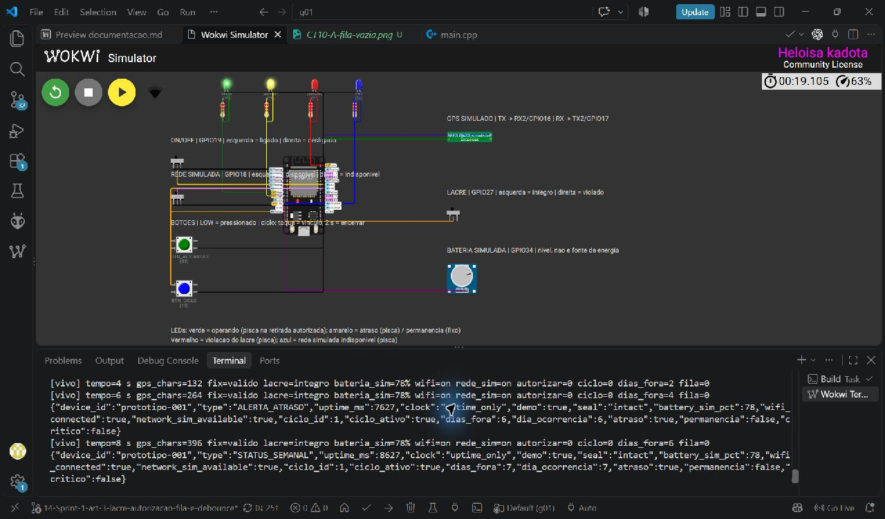

*Figura 3.4.1-CT03 — Alerta de atraso no dia 6, antes do status semanal. Fonte: captura real do simulador Wokwi for VS Code, 22/10/2026.*

</details>

<details>
<summary>CT04 — Permanência em 150 e 10 dias</summary>

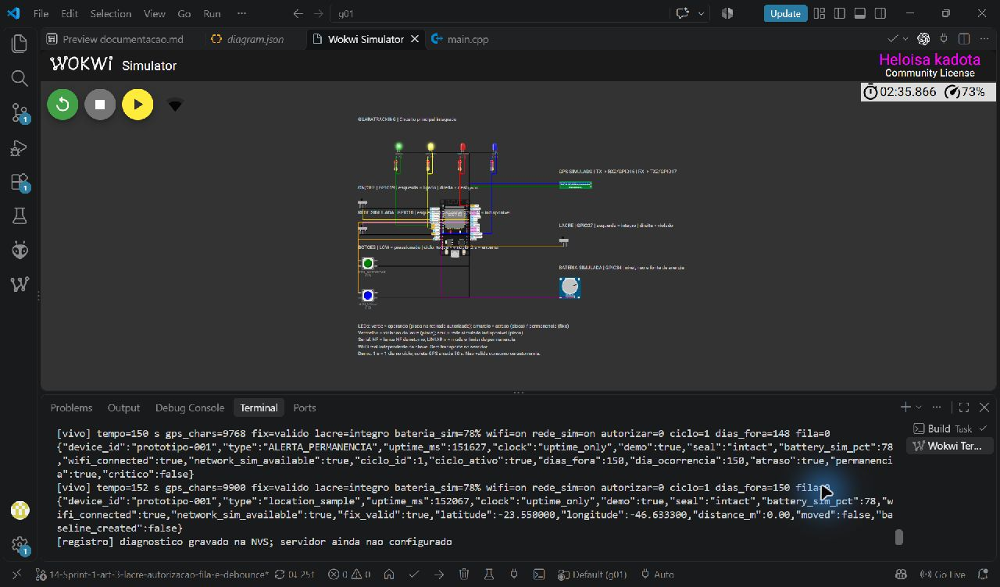

*Figura 3.4.1-CT04 — Alerta de permanência com limiar de 150 dias. Fonte: captura real do simulador Wokwi for VS Code, 22/10/2026.*

Capturas complementares: [Limiar 10](../assets/3-desenvolvimento-resultados/3.4.1-prototipo-wokwi/ct04Limiar10.png) · [Confirmação de configuração](../assets/3-desenvolvimento-resultados/3.4.1-prototipo-wokwi/CT04-configuracao.serial.txt).

</details>

<details>
<summary>CT05 — Violação do lacre</summary>

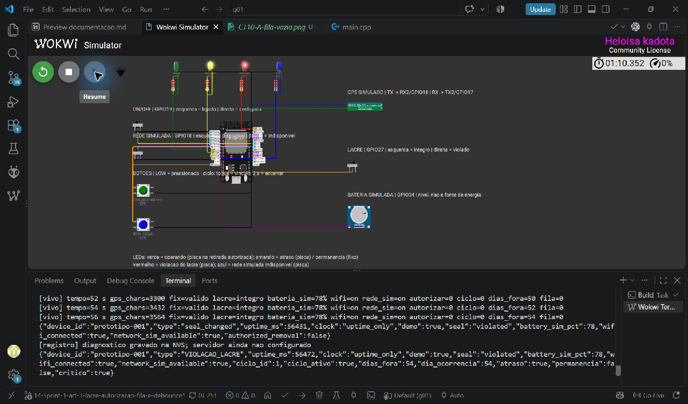

*Figura 3.4.1-CT05 — Violação crítica registrada e LED vermelho aceso. Fonte: captura real do simulador Wokwi for VS Code, 22/10/2026.*

Capturas complementares: [Estado posterior, em outra fase do piscar](../assets/3-desenvolvimento-resultados/3.4.1-prototipo-wokwi/ct05.png).

</details>

<details>
<summary>CT06 — Retirada autorizada e reaplicação</summary>

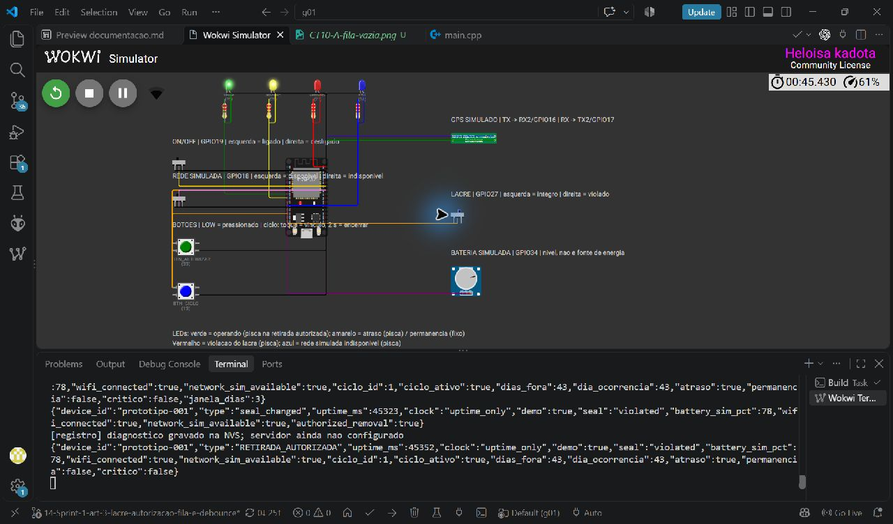

*Figura 3.4.1-CT06 — Retirada autorizada dentro da janela de três dias simulados. Fonte: captura real do simulador Wokwi for VS Code, 22/10/2026.*

Capturas complementares: [Reaplicação do lacre](../assets/3-desenvolvimento-resultados/3.4.1-prototipo-wokwi/ct06.png).

</details>

<details>
<summary>CT07 — Autorização expirada</summary>

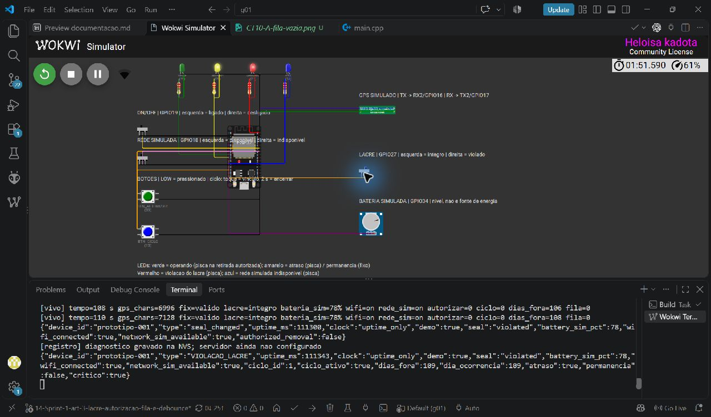

*Figura 3.4.1-CT07 — Violação após a autorização vencer. Fonte: captura real do simulador Wokwi for VS Code, 22/10/2026.*

</details>

<details>
<summary>CT08 — Evento sem conexão</summary>

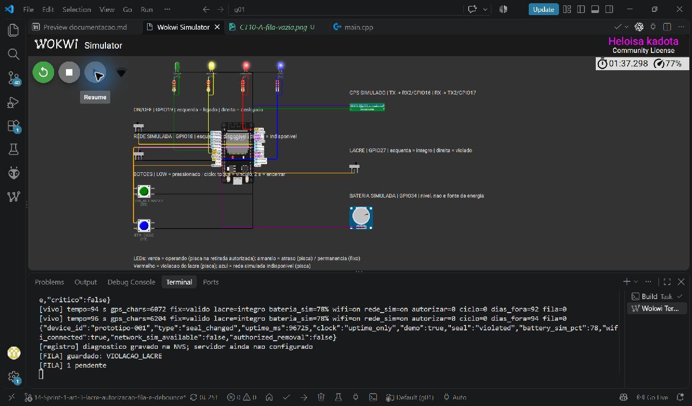

*Figura 3.4.1-CT08 — Violação guardada com um evento pendente e LEDs azul/vermelho acesos. Fonte: captura real do simulador Wokwi for VS Code, 22/10/2026.*

</details>

<details>
<summary>CT09 — Reconexão — BLOQUEADO para confirmação do servidor</summary>


*Figura 3.4.1-CT09 — Reenvio local ordenado e fila zero; não comprova confirmação do servidor. Fonte: captura real do simulador Wokwi for VS Code, 22/10/2026.*

Capturas complementares: [Dois eventos pendentes antes de reconectar](../assets/3-desenvolvimento-resultados/3.4.1-prototipo-wokwi/ct09Antes.png).

</details>

<details>
<summary>CT10 — Fila cheia — rodadas A e B</summary>

Pré-condição das duas rodadas: ciclo inativo, fila inicialmente vazia, lacre fechado e rede indisponível, evitando status periódicos na contagem. Na rodada A, uma violação e dez alterações `LIMIAR 201` a `210` provocaram três descartes dos não críticos mais antigos; a violação e os eventos 204–210 foram reenviados. Na B, doze aberturas sem autorização, separadas por onze fechamentos estáveis, produziram oito violações individuais e resumo de quatro; ambos foram esvaziados ao reconectar. Houve uma interrupção do capturador entre o armazenamento inicial da violação A e os dez comandos; os intervalos ausentes não foram reconstruídos.


*Figura 3.4.1-CT10 — Resumo de quatro violações enviado após oito individuais, com fila esvaziada. Fonte: captura real do simulador Wokwi for VS Code, 22/10/2026.*

Capturas complementares: [A: fila cheia](../assets/3-desenvolvimento-resultados/3.4.1-prototipo-wokwi/ct10ACheia.png) · [A: violação preservada](../assets/3-desenvolvimento-resultados/3.4.1-prototipo-wokwi/ct10AViolacaoPreservada.png) · [A: fila zero](../assets/3-desenvolvimento-resultados/3.4.1-prototipo-wokwi/ct10AFilaVazia.png) · [B: início do resumo](../assets/3-desenvolvimento-resultados/3.4.1-prototipo-wokwi/ct10BResumoIniciado.png) · [B: oito mais quatro pendentes](../assets/3-desenvolvimento-resultados/3.4.1-prototipo-wokwi/ct10BCheiaResumo4.png).

</details>

<details>
<summary>CT11 — Ruído e pressão mantida do botão</summary>

Foram aplicadas três pressões curtas e uma mantida, com o bounce padrão do Wokwi. A pressão mantida apareceu nos heartbeats de 62 a 88 s sem repetir a autorização. A fronteira de 50 ms não foi medida.


*Figura 3.4.1-CT11 — Uma autorização registrada na pressão mantida, sem repetição nos heartbeats seguintes. Fonte: captura real do simulador Wokwi for VS Code, 22/10/2026.*

Capturas complementares: [Botão mantido pressionado](../assets/3-desenvolvimento-resultados/3.4.1-prototipo-wokwi/ct11PressaoMantida.png).

</details>

<details>
<summary>CT12 — Bateria baixa e histerese</summary>


*Figura 3.4.1-CT12 — Segundo alerta somente após recuperação acima de 25% e nova queda. Fonte: captura real do simulador Wokwi for VS Code, 22/10/2026.*

Capturas complementares: [Primeiro alerta](../assets/3-desenvolvimento-resultados/3.4.1-prototipo-wokwi/ct12PrimeiroAlerta.png) · [22%](../assets/3-desenvolvimento-resultados/3.4.1-prototipo-wokwi/ct12RecuperacaoInsuficiente.png) · [Nova queda sem repetição](../assets/3-desenvolvimento-resultados/3.4.1-prototipo-wokwi/ct12SemRepeticao.png) · [Recuperação em 31%](../assets/3-desenvolvimento-resultados/3.4.1-prototipo-wokwi/ct12Recuperacao.png).

</details>

<details>
<summary>CT13 — Falha do sensor de bateria</summary>

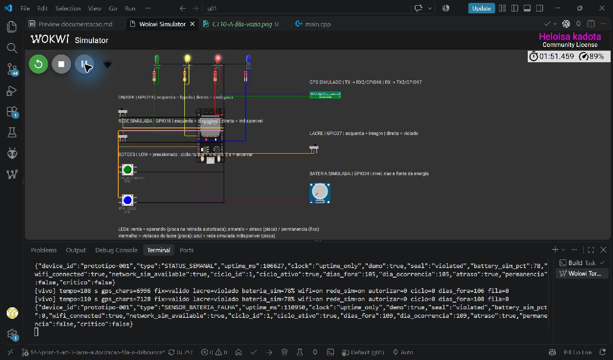

*Figura 3.4.1-CT13 — Entrada zero depois de bateria saudável gera falha do sensor, sem alerta falso de bateria baixa. Fonte: captura real do simulador Wokwi for VS Code, 22/10/2026.*

Capturas complementares: [Rodada adicional](../assets/3-desenvolvimento-resultados/3.4.1-prototipo-wokwi/ct13.png).

</details>

<details>
<summary>CT14 — Encerramento e reutilização — APROVADO</summary>

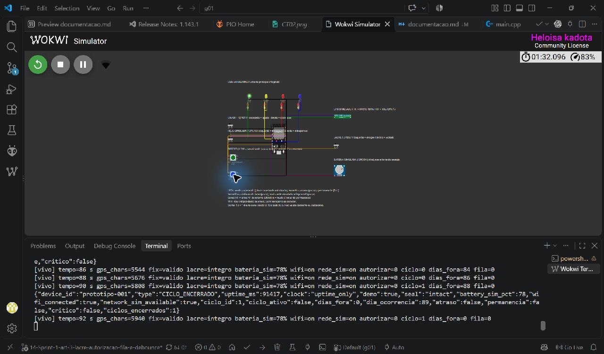

*Figura 3.4.1-CT14 — Encerramento corrigido: `ciclo_ativo=false`, `dias_fora=0` e contador 1. Fonte: captura real do simulador Wokwi for VS Code, 23/10/2026.*

Capturas complementares: [Ciclo 2 iniciado com dias zero](../assets/3-desenvolvimento-resultados/3.4.1-prototipo-wokwi/ct14CorrigidoReutilizado.png) · [Segundo encerramento com contador 2](../assets/3-desenvolvimento-resultados/3.4.1-prototipo-wokwi/ct14CorrigidoSegundoCiclo.png). A [captura anterior à correção](../assets/3-desenvolvimento-resultados/3.4.1-prototipo-wokwi/ct14.png) foi preservada como histórico e não representa o resultado do reteste.

</details>

<details>
<summary>CT15 — Recusa de vínculo simultâneo</summary>

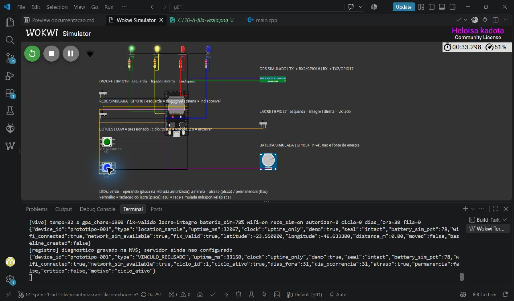

*Figura 3.4.1-CT15 — Vínculo recusado enquanto o ciclo atual está ativo. Fonte: captura real do simulador Wokwi for VS Code, 22/10/2026.*

</details>

<details>
<summary>CT16 — Encerramento recusado — rodadas A e B</summary>

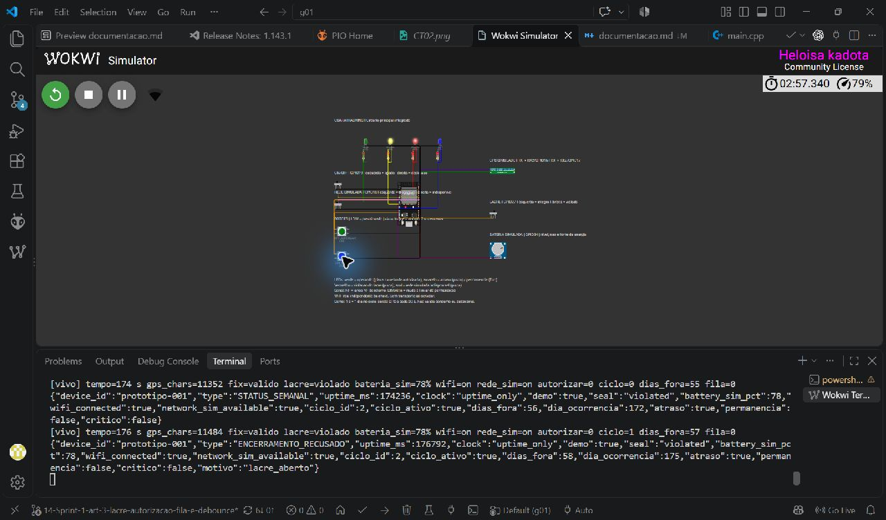

*Figura 3.4.1-CT16 — Recusa por lacre aberto, mesmo com NF de retorno lançada, na versão corrigida. Fonte: captura real do simulador Wokwi for VS Code, 23/10/2026.*

Captura complementar: [Recusa por NF ausente com lacre fechado](../assets/3-desenvolvimento-resultados/3.4.1-prototipo-wokwi/ct16CorrigidoNfAusente.png).

</details>

<details>
<summary>CT35 — Desligamento lógico e religamento</summary>


*Figura 3.4.1-CT35 — Desligamento registrado e quatro LEDs apagados. Fonte: captura real do simulador Wokwi for VS Code, 22/10/2026.*

Capturas complementares: [Novo STATUS e LEDs restaurados ao religar](../assets/3-desenvolvimento-resultados/3.4.1-prototipo-wokwi/ct35.png).

</details>

#### CT17–CT23 — ensaios complementares: execução de 23/10/2026

**Situação:** CT17, CT19, CT20, CT21 e CT23 **APROVADOS no simulador**; CT18 e CT22 **REPROVADOS**, mantendo os critérios esperados da tabela. Execução por automação local no Wokwi for VS Code 4.0.1, em 23/10/2026. O resultado caracteriza comportamento funcional simulado.

**Configuração e reprodução:** base `7777594`, ESP32 DevKit v1, ambiente `demo`, dia de 1 s, coleta de 30 s, espera GNSS de 10 s, validade de fix de 3 s e debounce do lacre de 60 ms. CT17/CT23 e a contraprova do CT18 usam o binário original (SHA-256 `103531CD7BE0D802035A2A6687D21DC33297BBB741177B91772ECCEC6AA6E601`). CT18–CT22 também usam a [instrumentação isolada de ensaio](../tests/wokwi-complementares/README.md), que inclui a lógica de produção sem mudanças e acrescenta leitura NVS, reinício e diagnóstico pelo GPIO32; SHA-256 do binário instrumentado: `2AC42AA1EB4208ECC696E74FBE4D0A3EF2DCFBA6964FEC661D918F2344A0F8AA`. O gerador fornece pulsos digitais e NMEA nos mesmos GPIOs do circuito principal; constantes e esperados não foram ajustados. Os diagramas são gerados separadamente pelo roteiro, preservando o circuito de produção.

Os logs completos ficam em arquivos externos, vinculados nos resultados. A NVS começa vazia em cada rodada nova; o CT22 reinicia a CPU na mesma instância para manter a flash. As sondas leem `q0..q15`, `p0..p7`, `pmeta`, `ctx` e `previous` diretamente com `Preferences`. Mensagens `[ensaio]` identificam a instrumentação e não são eventos de negócio.

| CT | Pré-condição e procedimento | Resultado esperado / medição | Limitação ou preparação |
|---|---|---|---|
| CT17 | Acionar lacre, autorização, ciclo, chave de rede e chave ON/OFF individualmente; repetir com rede simulada indisponível e lacre aberto. | Heartbeat mostra a leitura bruta dos dois botões, `dias_fora`, `fila` e separa `wifi` de `rede_sim`. Os LEDs seguem o estado de negócio: verde fixo com lacre íntegro e piscando na retirada autorizada, vermelho piscando na violação, amarelo no atraso/permanência e azul piscando com a rede simulada indisponível. Os botões geram os eventos de autorização e de ciclo dos CT06–CT16. | Diagnóstico de bancada. Não interpretar LED como confirmação de servidor. |
| CT18 | Com captura temporal controlada, aplicar pulsos de 20 e 40 ms no lacre, depois 10 aberturas/fechamentos estáveis de 200 ms; repetir durante espera por fix e com rede indisponível. | Zero eventos nos pulsos curtos observados; um `seal_changed` por transição estável, sem repetição enquanto o nível é mantido, com `authorized_removal=true` só na retirada autorizada; abertura sem autorização gera também `VIOLACAO_LACRE` (CT05). Registrar `L_det = t_registro_local − t_estabilizacao_contato`, perdas e duplicações; ampliar para 30 estímulos por condição ao medir p95. | Exige injeção temporizada; cliques manuais não comprovam milissegundos. Debounce atual de 60 ms; limite máximo de latência pendente. |
| CT19 | Rodada A: iniciar sem fix. Rodada B: obter posição válida, invalidar o fix e aguardar próxima coleta. Rodada C: interromper NMEA por mais de 3 s antes de solicitar nova coleta. | Sem fix recente, emitir `location_unavailable` após a espera configurada de 10 s, mais latência de processamento medida. Latitude/longitude atuais e `moved` são `null`; histórico é preservado quando disponível. O lacre continua respondendo durante a espera. | Rodada C exige controle da emissão UART no ensaio. Não aceitar só a passagem do tempo com NMEA válido chegando. A referência de comparação é a coleta válida anterior, distinta do último fix observado. |
| CT20 | Com memória de teste sem referência e fix contínuo, coletar primeiro ponto; depois pontos sintéticos separados por aproximadamente 50 m e 150 m da respectiva coleta anterior. Observar ao menos três coletas em `demo`. | Primeiro ponto: `baseline_created=true`, distância e `moved` nulos. Nas seguintes, `moved=false` para 50 m e `true` para 150 m. Com fix disponível, intervalo de 30 s mais latência de processamento; registrar desvio. | Comparar coletas válidas consecutivas. Testar fronteira de 100 m em teste matemático separado, considerando arredondamento; não alegar sete dias medidos com demo de 30 s. |
| CT21 | Iniciar fila vazia em memória de teste; gerar 17 registros, contando também coletas automáticas. Inspecionar chaves `q0` a `q15`; alternar a chave de rede. | Os primeiros 16 ocupam a fila; o 17º aparece na Serial com aviso de limite e não substitui os anteriores. A chave de rede não esvazia a fila. Medir quantos registros ficaram somente na Serial. | Caracteriza a limitação atual; confirmação de entrega, prioridade e reenvio continuam pendentes. Inspeção de NVS exige ferramenta/instrumentação de teste; capacidade final e prioridade ainda pendentes. |
| CT22 | Salvar posição A e registros conhecidos, com ciclo ativo há alguns dias e eventos na fila sem rede; reiniciar preservando flash/NVS. Sem novo fix, observar saída; depois coletar B. | Referência A, registro de diagnóstico, fila de eventos, `ciclo_id`, `dias_fora` e estado do lacre permanecem; `STATUS` com `contexto_restaurado=true`. Histórico após reinício sem idade conhecida apresenta `last_valid_age_ms=null`; novo ponto B compara com A. `uptime_ms` reinicia e não deve ser tratado como horário absoluto. | Confirmar preservação de flash no ambiente usado; se indisponível no simulador, executar em hardware. Sem acesso à NVS, não aprovar retenção da fila apenas pelo JSON da posição. |
| CT23 | Mover potenciômetro ao mínimo, meio e máximo; observar heartbeat/JSON. | Percentual sintético permanece entre 0 e 100 e acompanha a entrada; o mínimo absoluto (ADC = 0) gera `SENSOR_BATERIA_FALHA`, conforme a RN10 e o CT13. Não emitir conclusão de bateria desconectada, autonomia ou tensão física com esses dados. | ADC e percentual simulados não são medição de estado de carga de uma bateria real. |

**Resultados medidos e evidências**

| CT | Situação | Resultado observado | Evidência / log completo |
|---|---|---|---|
| CT17 | APROVADO | Leituras brutas dos dois botões, autorização/retirada, recusa de encerramento, rede indisponível com Wi-Fi conectado, fila e desligamento/religamento observados. LEDs acompanharam os estados; frequência exata não medida. | [Print](../assets/3-desenvolvimento-resultados/3.4.1-prototipo-wokwi/ct17.png) · [Serial](../assets/3-desenvolvimento-resultados/3.4.1-prototipo-wokwi/CT17-CT23.serial.txt) |
| CT18 | **REPROVADO** | Pulsos de 20/40 ms ignorados. Binário original: 20/20 transições com rede e 16/20 sem rede (4 perdas); sem duplicação observada. Rodada instrumentada: 20/20 e 14/20, respectivamente. | [Original](../assets/3-desenvolvimento-resultados/3.4.1-prototipo-wokwi/ct18Original.png) · [Serial original](../assets/3-desenvolvimento-resultados/3.4.1-prototipo-wokwi/CT18-original.serial.txt) · [Serial instrumentada](../assets/3-desenvolvimento-resultados/3.4.1-prototipo-wokwi/CT18.serial.txt) |
| CT19 | APROVADO | Três saídas sem fix em 11.630/81.630/151.630 ms, com latitude/longitude/`moved` nulos; histórico preservado nas duas últimas. NMEA interrompido de 120 a 160 s, contador parado em 7.788 caracteres. Seis transições do lacre detectadas durante as três esperas. | [Print](../assets/3-desenvolvimento-resultados/3.4.1-prototipo-wokwi/ct19.png) · [Serial](../assets/3-desenvolvimento-resultados/3.4.1-prototipo-wokwi/CT19.serial.txt) |
| CT20 | APROVADO | Primeiro ponto criou referência. Depois, 50,04 m → `moved=false` e 150,11 m → `true`; coletas em 2.068/32.067/62.067 ms, intervalos de 29.999/30.000 ms (desvios −1/0 ms de 30 s). | [Print](../assets/3-desenvolvimento-resultados/3.4.1-prototipo-wokwi/ct20.png) · [Serial](../assets/3-desenvolvimento-resultados/3.4.1-prototipo-wokwi/CT20.serial.txt) |
| CT21 | APROVADO | NVS inicialmente vazia; 17 registros gerados (1 coleta + 16 transições). `q0..q15` iguais aos primeiros 16 JSON, preservados nas sondas de 21/28 s após alternar a rede; 1 registro somente na Serial e 1 aviso de limite. | [Print NVS](../assets/3-desenvolvimento-resultados/3.4.1-prototipo-wokwi/ct21.png) · [Serial](../assets/3-desenvolvimento-resultados/3.4.1-prototipo-wokwi/CT21.serial.txt) |
| CT22 | **REPROVADO (parcial: uptime)** | `q0..q2` e `p0..p3` conhecidos antes do reset reapareceram sem alterações; referência A, lacre aberto e ciclo 1 retidos, `STATUS` restaurado com 42 dias. Sem fix: idade histórica nula; B comparou com A (150,11 m). Porém `uptime_ms` continuou crescente após o reinício (novo `STATUS` em 46.419 ms), contrariando o esperado. | [Sem fix após reset](../assets/3-desenvolvimento-resultados/3.4.1-prototipo-wokwi/ct22.png) · [B](../assets/3-desenvolvimento-resultados/3.4.1-prototipo-wokwi/ct22PontoB.png) · [Serial](../assets/3-desenvolvimento-resultados/3.4.1-prototipo-wokwi/CT22.serial.txt) |
| CT23 | APROVADO | Entrada mínima/meio/máxima resultou em 0/50/100%; todos os percentuais entre 0 e 100. Zero gerou 1 `SENSOR_BATERIA_FALHA`, sem `BATERIA_BAIXA` falso na rodada. | [Print](../assets/3-desenvolvimento-resultados/3.4.1-prototipo-wokwi/ct23.png) · [Serial](../assets/3-desenvolvimento-resultados/3.4.1-prototipo-wokwi/CT17-CT23.serial.txt) |

**Medições e pendências:** no CT18 instrumentado, a latência entre a borda e o primeiro byte do JSON foi de 60,523 a 64,926 ms com rede disponível (20 transições). A associação temporal da sonda ficou inválida em parte da rodada sem rede; os valores dessa condição foram descartados, sem editar o log bruto. A contagem foi conferida também no binário original. Não se calculou p95: faltam 30 estímulos por condição e um limite de latência acordado. A retirada autorizada positiva está na execução do CT17; as aberturas do CT18 ocorreram sem autorização.

No CT22, o log registra `SW_CPU_RESET` seguido de `TG1WDT_SYS_RESET`; a retenção NVS foi verificada, mas o relógio de uptime não reiniciou no Wokwi. A causa e o comportamento em hardware permanecem pendentes; não foi alterado o esperado para aprovar o caso. As falhas dos CT18/CT22 exigem investigação e reteste. Corte físico de energia, entrega ao servidor e validação elétrica continuam fora do que estas capturas comprovam.

<details>
<summary>CT17 — Diagnóstico das entradas e estados</summary>

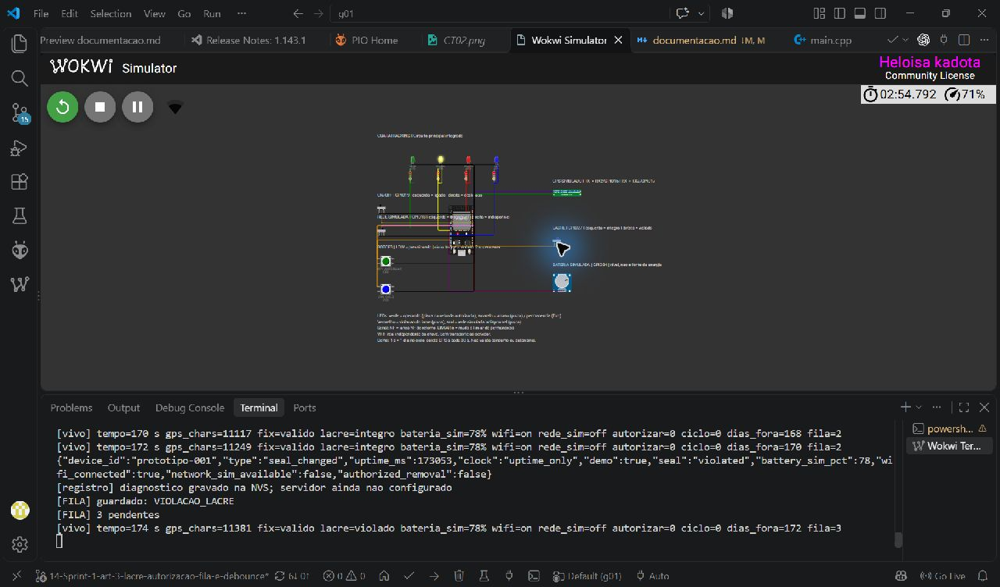

*Figura 3.4.1-CT17 — Rede simulada indisponível, Wi-Fi conectado e lacre violado. Fonte: captura real do simulador Wokwi for VS Code, 23/10/2026.*

Capturas complementares: [Autorização](../assets/3-desenvolvimento-resultados/3.4.1-prototipo-wokwi/ct17Autorizacao.png) · [Retirada autorizada](../assets/3-desenvolvimento-resultados/3.4.1-prototipo-wokwi/ct17RetiradaAutorizada.png) · [Botão de ciclo](../assets/3-desenvolvimento-resultados/3.4.1-prototipo-wokwi/ct17Ciclo.png) · [Autorização sem rede](../assets/3-desenvolvimento-resultados/3.4.1-prototipo-wokwi/ct17AutorizacaoSemRede.png) · [Desligado](../assets/3-desenvolvimento-resultados/3.4.1-prototipo-wokwi/ct17Desligado.png) · [Religado](../assets/3-desenvolvimento-resultados/3.4.1-prototipo-wokwi/ct17Religado.png).

</details>

<details>
<summary>CT18 — Transições cronometradas — REPROVADO</summary>


*Figura 3.4.1-CT18 — Contraprova com o binário original e rede indisponível. Fonte: captura real do simulador Wokwi for VS Code, 23/10/2026.*

Capturas complementares: [Rodada instrumentada](../assets/3-desenvolvimento-resultados/3.4.1-prototipo-wokwi/ct18.png).

</details>

<details>
<summary>CT19 — Ausência de fix e interrupção NMEA</summary>


*Figura 3.4.1-CT19 — Coleta sem NMEA com coordenadas atuais nulas e histórico preservado. Fonte: captura real do simulador Wokwi for VS Code, 23/10/2026.*

Capturas complementares: [Fix inválido com NMEA ativo](../assets/3-desenvolvimento-resultados/3.4.1-prototipo-wokwi/ct19FixInvalido.png).

</details>

<details>
<summary>CT20 — Comparação entre coletas válidas</summary>


*Figura 3.4.1-CT20 — Deslocamento consecutivo de 150,11 m com moved=true. Fonte: captura real do simulador Wokwi for VS Code, 23/10/2026.*

Capturas complementares: [Deslocamento de 50,04 m com moved=false](../assets/3-desenvolvimento-resultados/3.4.1-prototipo-wokwi/ct2050m.png).

</details>

<details>
<summary>CT21 — Limite de diagnóstico na NVS</summary>

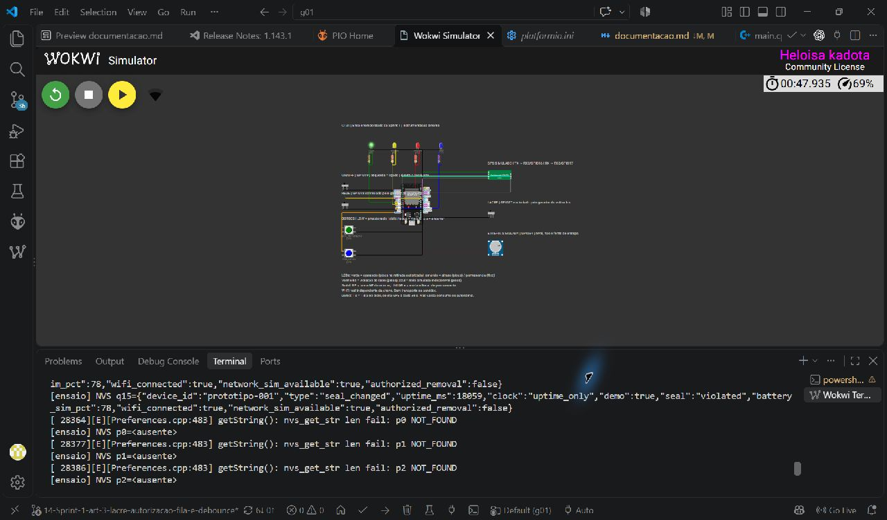

*Figura 3.4.1-CT21 — q15 preservada na inspeção posterior à alternância da rede. Fonte: captura real do simulador Wokwi for VS Code, 23/10/2026.*

</details>

<details>
<summary>CT22 — Retenção no reinício — REPROVADO no ambiente</summary>


*Figura 3.4.1-CT22 — Histórico restaurado sem fix novo e com idade desconhecida nula. Fonte: captura real do simulador Wokwi for VS Code, 23/10/2026.*

Capturas complementares: [Ponto B comparado com A após reinício](../assets/3-desenvolvimento-resultados/3.4.1-prototipo-wokwi/ct22PontoB.png).

</details>

<details>
<summary>CT23 — Faixa da entrada de bateria simulada</summary>

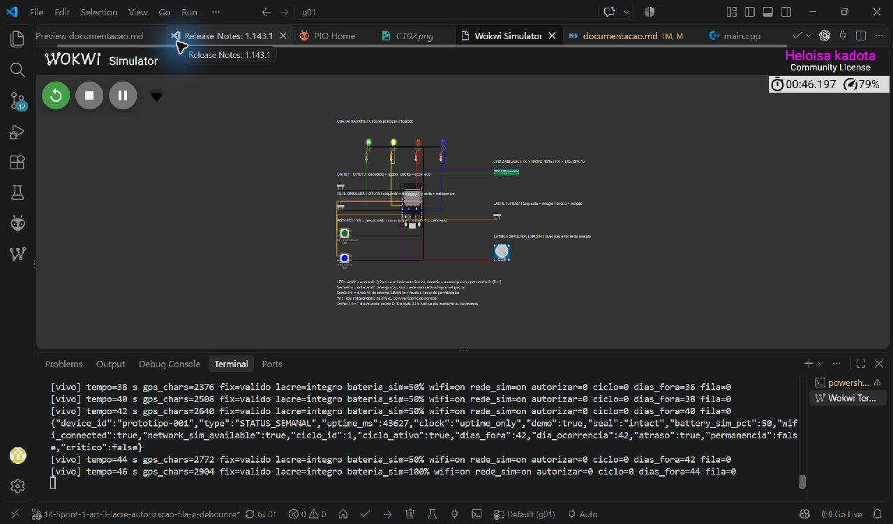

*Figura 3.4.1-CT23 — Potenciômetro no máximo com leitura sintética de 100%. Fonte: captura real do simulador Wokwi for VS Code, 23/10/2026.*

Capturas complementares: [Mínimo e falha do sensor](../assets/3-desenvolvimento-resultados/3.4.1-prototipo-wokwi/ct23Minimo.png) · [Meio em 50%](../assets/3-desenvolvimento-resultados/3.4.1-prototipo-wokwi/ct23Meio.png).

</details>

#### <a name="rodada-v2"></a>Rodada do protótipo V2 — 02 e 03/11/2026

O V2 trocou a interface local (LEDs por LCD, botões de navegação e buzzer) e passou a exigir 3 s pressionados nos botões de autorização e de ciclo. Em 30/10/2026 ganhou ainda:

- o LED vermelho de violação no GPIO13;
- os eventos de falha do GNSS;
- o boot sem ciclo: o dispositivo liga sem ciclo ativo, e o ciclo 1 só começa quando CICLO é segurado por 3 s.

Os eventos JSON e as regras de negócio dos CT01–CT35 são os do V1, já cobertos por `tests/model_tests.c` e por `tests/screen_controller_tests.cpp`. Por isso, os CTs foram repetidos com os mesmos RF/RN e o mesmo critério de negócio, e apenas os componentes de entrada e saída foram adaptados. Esta rodada substitui a de 30/10/2026, feita antes do boot sem ciclo. As aprovações do V1 ficam preservadas acima.

| CT | Procedimento ou saída no V2 | O que permanece do critério |
|---|---|---|
| CT01 | LCD aceso na tela "NF da remessa" no lugar do verde fixo; o primeiro `STATUS` sai com `ciclo_ativo=false` | `STATUS` com `dias_fora=0` e lacre íntegro |
| CT02–CT04, CT08, CT09, CT14–CT17 | Antes dos passos, CICLO segurado por 3 s faz o vínculo e abre o ciclo 1 | Os mesmos eventos, contados a partir do vínculo |
| CT03 | Tela de prazo com "ATRASO: N dias" no lugar do amarelo piscando | Um único `ALERTA_ATRASO` |
| CT04 | Sem indicação no LCD; o alerta aparece só na Serial | Um único `ALERTA_PERMANENCIA` no limiar |
| CT05, CT07 | Mensagem "VIOLACAO registrada", buzzer intermitente por até 30 s e LED vermelho no GPIO13 pulsando, no lugar do vermelho fixo | `VIOLACAO_LACRE` crítico, fora da rotina |
| CT06 | Autorização exige segurar o botão por 3 s; mensagem "Retirada autorizada" no lugar do verde piscando | `RETIRADA_AUTORIZADA` sem violação e `LACRE_REAPLICADO` |
| CT08, CT09 | Mensagens "Sem sinal / na fila: N" e "Sinal ok / enviados: N" no lugar do azul | Violação guardada e reenvio na ordem, com o dia original |
| CT11 | Toques curtos não registram nada; segurar 3 s registra uma autorização | Ruído e pressão mantida não duplicam a autorização |
| CT14, CT16 | Encerrar e iniciar o ciclo exigem segurar 3 s, no lugar de 2 s e do toque curto | Encerramento só com lacre fechado e NF de retorno |
| CT15 | **Rodada histórica V2:** o mesmo gesto inicia ou encerra; com ciclo ativo ele cai no encerramento. **Pós-#113:** comando `VINCULAR` é a tentativa explícita de novo vínculo. | Histórico: nenhum segundo ciclo; CT15-HOST posterior comprova `VINCULO_RECUSADO`; reteste Wokwi pendente. |
| CT17 | Navegação circular pelas cinco telas e leitura bruta de AVANÇAR/VOLTAR no heartbeat | Diagnóstico das entradas |
| CT35 | LCD e luz de fundo apagados e buzzer mudo no lugar dos LEDs apagados | `DISPOSITIVO_DESLIGADO`, silêncio e novo `STATUS` |

CT10, CT12, CT13, CT18 e CT23 não mudaram, porque suas saídas já eram só a Serial.

**Ambiente e reprodução.**

- **Circuito:** `src/firmware/prototipo_wokwi/diagram.json` (V2, ESP32 DevKit v1, com o LED de violação e a protoboard dupla).
- **Firmware:** `demo`, com 1 s simulado = 1 dia, prazo de 5 dias, autorização de 3 dias e fila de 8 eventos. SHA-256 do binário: `89A0F6497BB470F9364382A56DC003AD33C067F4F696977B0B29B3CA1CD1A312`. Todas as execuções usaram o mesmo binário, sem ajuste de constantes. O critério de negócio dos CTs não mudou; a conferência do CT09 passou a comparar `dias_fora` e uptime, e a do CT17 aceita os botões lidos um de cada vez.
- **Ferramentas:** duas, porque o plano gratuito do Wokwi CLI esgotou a cota mensal de minutos de CI no meio da rodada.
  - **Wokwi CLI 0.29.0, em 02/11/2026:** CT01–CT10 e CT18, exceto o CT04 com limiar 150. Os cenários de [`tests/wokwi-ci/`](../tests/wokwi-ci/run_cts.py) acionaram os controles do circuito e os comandos `NF` e `LIMIAR`.
  - **Wokwi for VS Code 4.1.0, em 03/11/2026:** os demais CTs e o CT04 com limiar 150, que passa do limite de 5 min de conexão do CLI. Os mesmos passos foram feitos à mão, com a Serial gravada pela porta RFC2217 local. Os comandos `REMESSA` e `NF` foram enviados pelo script de captura.
- **Estímulos por chip:** em dois cenários, a mão não reproduziu os estímulos, e um chip de estímulo da [rodada manual](../tests/wokwi-vscode/README.md) substituiu o controle do circuito:
  - **CT12/CT13/CT23:** o potenciômetro, no GPIO34;
  - **CT45:** o GPS e a chave de rede, no GPIO18.
- **Conferência e capturas:** o `run_cts.py` conferiu os logs com as mesmas funções (`--checar`), verificando contagens, ordem e não repetição. O CT18 não tem função no script, e seu resultado vem da leitura do log. O silêncio do CT35 não pôde ser conferido, porque a captura estava fechada nesse intervalo. As capturas mostram só o conteúdo do LCD: lido do simulador no CLI, ou recortado da tela do VS Code.

| CT | Situação | Resultado observado | Evidência e log |
|---|---|---|---|
| CT01 | APROVADO no simulador | `STATUS` com `dias_fora=0`, lacre íntegro, `ciclo_ativo=false` e contexto não restaurado; LCD em "NF da remessa / nao informada". | [LCD](../assets/3-desenvolvimento-resultados/3.4.1-prototipo-wokwi/ct01V2.png) · [Log][v2-ciclo] |
| CT02 | APROVADO no simulador | Depois do vínculo do ciclo 1, `STATUS_SEMANAL` somente nos dias 7 e 14 do ciclo. | [Log][v2-ciclo] |
| CT03 | APROVADO no simulador | Um único `ALERTA_ATRASO`, no dia 6; LCD "Prazo: dia 7/5 / ATRASO: 2 dias". | [LCD](../assets/3-desenvolvimento-resultados/3.4.1-prototipo-wokwi/ct03V2.png) · [Log][v2-ciclo] |
| CT04 | APROVADO com limiar 10 e com 150 | Um único `ALERTA_PERMANENCIA` em cada rodada, no dia 10 e no dia 150. Com 150, o vínculo saiu aos 11,6 s, e a captura do LCD foi feita no dia 162. | [LCD 10](../assets/3-desenvolvimento-resultados/3.4.1-prototipo-wokwi/ct04Limiar10V2.png) · [LCD 150](../assets/3-desenvolvimento-resultados/3.4.1-prototipo-wokwi/ct04Limiar150V2.png) · [Log 10][v2-limiar10] · [Log 150][v2-limiar150] |
| CT05 | APROVADO na detecção local | `VIOLACAO_LACRE` com `critico=true` e `LACRE_FECHADO` ao fechar; LCD "VIOLACAO registrada". | [LCD](../assets/3-desenvolvimento-resultados/3.4.1-prototipo-wokwi/ct05V2.png) · [Log][v2-lacre] |
| CT06 | APROVADO no simulador | Autorização após 3 s pressionado, `RETIRADA_AUTORIZADA` sem violação e `LACRE_REAPLICADO`; LCD "Retirada autorizada". | [LCD](../assets/3-desenvolvimento-resultados/3.4.1-prototipo-wokwi/ct06V2.png) · [Log][v2-lacre] |
| CT07 | APROVADO no simulador | Abertura 4,6 s após a autorização gerou `VIOLACAO_LACRE`, sem `RETIRADA_AUTORIZADA`. | [Log][v2-lacre] |
| CT08 | APROVADO no armazenamento simulado; tela "Sem sinal" **NÃO EXECUTADA** | Sem rede, a violação foi guardada (`[FILA] 1 pendente`) e nenhum JSON foi publicado antes da reconexão. A captura foi feita depois da violação e mostrou "VIOLACAO registrada", a mesma tela do CT05, então a tela "Sem sinal" ficou sem evidência. | [Log][v2-fila] |
| CT09 | **BLOQUEADO** para aprovação integral | Dois eventos reenviados na ordem, com o `dias_fora` e o uptime da ocorrência, anteriores aos da reconexão; fila zero e LCD "Sinal ok / enviados: 2". Continua faltando a confirmação do servidor. | [LCD](../assets/3-desenvolvimento-resultados/3.4.1-prototipo-wokwi/ct09V2.png) · [Log][v2-fila] |
| CT10 | APROVADO na fila/reenvio simulado | A: três descartes de não críticos, violação preservada e `LIMIAR` 204–210 reenviados. B: oito violações individuais e `VIOLACAO_LACRE_RESUMO` com `quantidade=4`. | [Log A][v2-fila-a] · [Log B][v2-fila-b] |
| CT11 | APROVADO nos estímulos aplicados | Três toques curtos soltos antes de 3 s, sem registro, e uma única autorização ao segurar o botão; LCD com a contagem "segure mais 2 s". Feito à mão, sem os pulsos de 20 ms do cenário automático. | [LCD](../assets/3-desenvolvimento-resultados/3.4.1-prototipo-wokwi/ct11V2Contagem.png) · [Log][v2-botao] |
| CT12 | APROVADO no simulador | Com o chip de estímulo, a sequência 17% → 22% → 17% → 31% → 17% gerou dois `BATERIA_BAIXA`, nenhum em 22% e o segundo só depois do rearme acima de 25%. | [Log][v2-bateria] |
| CT13 | APROVADO no diagnóstico simulado | Na mesma sequência, entrada zero gerou um `SENSOR_BATERIA_FALHA` e nenhum `BATERIA_BAIXA`. | [Log][v2-bateria] |
| CT14 | APROVADO no simulador | `CICLO_ENCERRADO` com `ciclo_ativo=false`, `dias_fora=0` e contador 1; novo gesto abriu o ciclo 2 com dias zero. | [LCD](../assets/3-desenvolvimento-resultados/3.4.1-prototipo-wokwi/ct14V2.png) · [Log][v2-ciclo-fim] |
| CT15 | PARCIAL — recusa de vínculo não exercitada | Com o ciclo 2 ativo, o gesto gerou `ENCERRAMENTO_RECUSADO` (`nf_retorno_ausente`) e nenhum segundo ciclo; `VINCULO_RECUSADO` não ocorreu. | [Log][v2-ciclo-fim] |
| CT16 | APROVADO nas duas recusas | `nf_retorno_ausente` com lacre fechado e `lacre_aberto` com NF lançada; ciclo mantido ativo. | [Log][v2-ciclo-fim] |
| CT17 | APROVADO no simulador | Cinco toques em AVANÇAR voltaram à tela 1 e um em VOLTAR levou à tela 5; o heartbeat mostrou `avancar=1` e `voltar=1` com cada botão pressionado. | [Prazo](../assets/3-desenvolvimento-resultados/3.4.1-prototipo-wokwi/ct17V2Tela2.png) · [Posição](../assets/3-desenvolvimento-resultados/3.4.1-prototipo-wokwi/ct17V2Tela3.png) · [Bateria](../assets/3-desenvolvimento-resultados/3.4.1-prototipo-wokwi/ct17V2Tela4.png) · [Lacre](../assets/3-desenvolvimento-resultados/3.4.1-prototipo-wokwi/ct17V2Tela5.png) · [Log][v2-interface] |
| CT18 | **REPROVADO** | Repetido com [`tests/wokwi-complementares/CT18-original`](../tests/wokwi-complementares/README.md), que aplica os estímulos ao binário da rodada, sem a sonda de instrumentação; por isso, não há latência medida. Com rede, as 20 transições estáveis viraram 20 `seal_changed`. Sem rede, as 20 também foram detectadas, mas os pulsos de 20 ms e 40 ms aos 43 s foram lidos como uma abertura: dois `seal_changed` espúrios (43011 e 43256 ms) e um `VIOLACAO_LACRE` falso. | [Log][v2-ct18] |
| CT23 | APROVADO no simulador | Entrada mínima, média e máxima resultaram em 0%, 50% e 100%, sempre dentro de 0 a 100%. | [Log][v2-bateria] |
| CT35 | APROVADO no desligamento e no religamento; **PENDENTE** no silêncio | `DISPOSITIVO_DESLIGADO` e LCD apagado; ao religar, cerca de 31 s depois pelo uptime, novo `STATUS` e LCD de volta. A captura da Serial ficou fechada nesse intervalo, então o log não comprova a ausência de heartbeat e JSON. | [Desligado](../assets/3-desenvolvimento-resultados/3.4.1-prototipo-wokwi/ct35V2Desligado.png) · [Religado](../assets/3-desenvolvimento-resultados/3.4.1-prototipo-wokwi/ct35V2Religado.png) · [Log][v2-interface] |

[v2-ciclo]: ../assets/3-desenvolvimento-resultados/3.4.1-prototipo-wokwi/v2-ct01-ct03.serial.txt
[v2-limiar10]: ../assets/3-desenvolvimento-resultados/3.4.1-prototipo-wokwi/v2-ct04-limiar10.serial.txt
[v2-limiar150]: ../assets/3-desenvolvimento-resultados/3.4.1-prototipo-wokwi/v2-ct04-limiar150.serial.txt
[v2-lacre]: ../assets/3-desenvolvimento-resultados/3.4.1-prototipo-wokwi/v2-ct05-ct07.serial.txt
[v2-fila]: ../assets/3-desenvolvimento-resultados/3.4.1-prototipo-wokwi/v2-ct08-ct09.serial.txt
[v2-fila-a]: ../assets/3-desenvolvimento-resultados/3.4.1-prototipo-wokwi/v2-ct10a.serial.txt
[v2-fila-b]: ../assets/3-desenvolvimento-resultados/3.4.1-prototipo-wokwi/v2-ct10b.serial.txt
[v2-botao]: ../assets/3-desenvolvimento-resultados/3.4.1-prototipo-wokwi/v2-ct11.serial.txt
[v2-bateria]: ../assets/3-desenvolvimento-resultados/3.4.1-prototipo-wokwi/v2-ct12-ct13-ct23.serial.txt
[v2-bateria-reteste]: ../assets/3-desenvolvimento-resultados/3.4.1-prototipo-wokwi/v2-ct12-ct13-ct23-reteste.serial.txt
[v2-ct18-reteste]: ../assets/3-desenvolvimento-resultados/3.4.1-prototipo-wokwi/v2-ct18-reteste.serial.txt
[v2-ciclo-fim]: ../assets/3-desenvolvimento-resultados/3.4.1-prototipo-wokwi/v2-ct14-ct16.serial.txt
[v2-interface]: ../assets/3-desenvolvimento-resultados/3.4.1-prototipo-wokwi/v2-ct17-ct35.serial.txt
[v2-ct18]: ../assets/3-desenvolvimento-resultados/3.4.1-prototipo-wokwi/v2-ct18.serial.txt

**Achados e limitações.** Os resultados caracterizam o comportamento funcional simulado do V2. Ficaram registrados:

- **CT18 reprovado nesta rodada.** Sem rede, um pulso curto foi lido como abertura falsa. Era defeito do firmware, não corrigido durante a rodada para não mudar o binário; a correção e o reteste estão no fim desta seção.
- **Dia da ocorrência e dias do ciclo.** Com o boot sem ciclo, `dias_fora` conta a partir do vínculo e `dia_ocorrencia` conta a partir do boot. Os dois só coincidem quando o vínculo é feito no boot. Por isso, o CT09 compara o `dias_fora` e o uptime do evento com os da reconexão.
- **Dias contam com o aparelho desligado.** No CT35, o `dias_fora` passou de 122 para 154 durante os 31 s desligado. Ao religar, o firmware emitiu de uma vez os `STATUS_SEMANAL` atrasados e o `ALERTA_PERMANENCIA` do dia 150. A carcaça continua fora da fábrica, então a contagem é coerente, mas o alerta só aparece no religamento.
- **RN01 sem teste de recusa na rodada V2 original.** À época, o botão iniciava ou encerrava o ciclo e `VINCULO_RECUSADO` era inalcançável. A issue #113 acrescentou o comando local `VINCULAR`, com **CT15-HOST aprovado** em `demo` e `weekly`, mas **sem novo resultado Wokwi ou físico**. CT-F03 ainda exige tentativa concorrente entre dispositivos na plataforma.
- **Permanência sem indicação local.** No V1, o amarelo fixo indicava a permanência. No V2, o LCD mostra só o atraso, como nas capturas do CT04, e o `ALERTA_PERMANENCIA` aparece apenas na Serial.
- **Buzzer e LED de violação não medidos.** O som, a duração de 30 s e o pulso do LED no GPIO13 não foram verificados automaticamente. Na primeira violação de cada execução, o log registra uma vez `ledc_get_duty: LEDC is not initialized`, emitido pela biblioteca do ESP32 no primeiro `tone()`. As violações seguintes não repetem o aviso, e nenhum evento foi afetado.
- **Estímulos por chip.**
  - **CT12/CT13/CT23:** o chip trocou o potenciômetro arrastado à mão, que não parava em 22% e passava várias vezes abaixo de 20%. O fundo de escala da entrada analógica do ESP32 no Wokwi ficou perto de 5,08 V, valor medido nesta rodada, e o chip foi calibrado para ele.
  - **Logs:** o do CT12/CT13/CT23 começa aos 4 s, depois do boot. O do CT04 com limiar 150 traz na primeira linha um heartbeat da simulação anterior, antes do boot. O do CT17/CT35 junta duas partes da mesma simulação, porque a captura foi reaberta durante o desligamento; o uptime é contínuo entre elas.
- **Não repetidos no V2:** os CT19–CT22, que dependem da [instrumentação complementar](../tests/wokwi-complementares/README.md). Os resultados de 23/10/2026 continuam valendo para o V1, inclusive a reprovação do CT22.
- **Continua fora do alcance destas capturas:** entrega ao servidor, precisão de 1 Hz e das fronteiras de debounce, consumo e validação elétrica.

<details>
<summary>Capturas do LCD na rodada V2</summary>

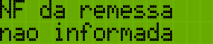

*Figura 3.4.1-CT01-V2 — LCD na inicialização, tela da NF da remessa. Fonte: captura do LCD no simulador Wokwi (Wokwi CLI), 02/11/2026.*


*Figura 3.4.1-CT03-V2 — Tela de prazo no dia 7 com atraso de dois dias. Fonte: captura do LCD no simulador Wokwi (Wokwi CLI), 02/11/2026.*


*Figura 3.4.1-CT04-V2 — Tela de prazo após o alerta de permanência com limiar 10; o LCD não indica a permanência. Fonte: captura do LCD no simulador Wokwi (Wokwi CLI), 02/11/2026.*


*Figura 3.4.1-CT11-V2 — Contagem exibida enquanto o botão de autorização está pressionado. Fonte: recorte do LCD no Wokwi for VS Code, 03/11/2026.*


*Figura 3.4.1-CT35-V2 — LCD e luz de fundo apagados com a chave ON/OFF desligada. Fonte: recorte do LCD no Wokwi for VS Code, 03/11/2026.*

Capturas complementares: [CT04 com limiar 150](../assets/3-desenvolvimento-resultados/3.4.1-prototipo-wokwi/ct04Limiar150V2.png) · [CT05 violação](../assets/3-desenvolvimento-resultados/3.4.1-prototipo-wokwi/ct05V2.png) · [CT06 retirada autorizada](../assets/3-desenvolvimento-resultados/3.4.1-prototipo-wokwi/ct06V2.png) · [CT09 reenvio](../assets/3-desenvolvimento-resultados/3.4.1-prototipo-wokwi/ct09V2.png) · [CT14 encerramento](../assets/3-desenvolvimento-resultados/3.4.1-prototipo-wokwi/ct14V2.png) · [CT35 religado](../assets/3-desenvolvimento-resultados/3.4.1-prototipo-wokwi/ct35V2Religado.png).

</details>

**Reteste de bateria e do LCD — 04 e 05/11/2026.** Depois da rodada, o firmware passou a usar a média de 16 leituras do ADC, com histerese de 1 ponto só no valor mostrado no LCD, e a acender o LCD na tela de bateria quando a bateria simulada varia 3 pontos. Por isso, CT12, CT13 e CT23 foram repetidos no Wokwi CLI 0.29.0, com o cenário de [`tests/wokwi-ci/`](../tests/wokwi-ci/run_cts.py) e o binário `demo` de SHA-256 `BFFF537F4A4E51B16EDD147624C4B254D4C03B06A87178C0C554371EDDF615D7`. Os três passaram nos mesmos critérios: dois `BATERIA_BAIXA`, um `SENSOR_BATERIA_FALHA` e faixa de 0% a 100% ([Log][v2-bateria-reteste]).

O cenário salta entre os níveis, então não percorre o limiar devagar. A descida lenta até 19% e o despertar do LCD com variação lenta foram verificados só em host, em `tests/firmware_interface_tests.cpp`. O CT40 foi repetido em 05/11/2026 no Wokwi for VS Code 4.1.0, sem mexer no potenciômetro, com o binário de SHA-256 `AE8F00D2F8048D5A6C75C3775DBFE35475D043C57774376F20FCD5740E22860A`, que difere do binário acima só no critério de despertar pela bateria, e passou no mesmo critério: o LCD apagou sem interação, o primeiro toque em AVANÇAR e em VOLTAR só acendeu a mesma tela, e o segundo navegou ([Captura 1](../assets/3-desenvolvimento-resultados/3.4.1-prototipo-wokwi/ct40AntesReteste.png) · [Captura 2](../assets/3-desenvolvimento-resultados/3.4.1-prototipo-wokwi/ct40ApagadoReteste.png) · [Captura 3](../assets/3-desenvolvimento-resultados/3.4.1-prototipo-wokwi/ct40PrimeiroAvancarReteste.png) · [Captura 4](../assets/3-desenvolvimento-resultados/3.4.1-prototipo-wokwi/ct40SegundoAvancarReteste.png) · [Captura 5](../assets/3-desenvolvimento-resultados/3.4.1-prototipo-wokwi/ct40PrimeiroVoltarReteste.png) · [Captura 6](../assets/3-desenvolvimento-resultados/3.4.1-prototipo-wokwi/ct40SegundoVoltarReteste.png)). Os demais CTs não foram repetidos com esses binários e seguem com o resultado da rodada acima.

**Reteste do CT18 — 05/11/2026: APROVADO no simulador nas contagens.** O log da rodada mostrou o `seal_changed` espúrio em 43011 ms, antes do próprio `debounce_confirmed_at_ms` de 43060 ms. A causa: a interrupção registrou a borda depois do instante lido no início do `loop()`, a subtração sem sinal deu um valor enorme, e o pulso foi confirmado sem cumprir os 60 ms de debounce. A correção em `include/seal_debounce.h` usa diferença com sinal, com teste em `tests/firmware_seal_isr_tests.cpp`.

O CT18 foi repetido no Wokwi CLI 0.29.0, com [`tests/wokwi-complementares/CT18-original`](../tests/wokwi-complementares/README.md) e o binário `demo` de SHA-256 `D0C27D6C70C8FB0388FA6DF79D98B4DCA0ECB03DC377E9AE9D08DD4C757CBB95`. As 20 transições com rede e as 20 sem rede geraram 40 `seal_changed`, sem duplicação; os pulsos de 20 ms e 40 ms não geraram evento nas duas condições, e nenhum registro saiu antes da confirmação do debounce ([Log][v2-ct18-reteste]). A latência `L_det` e o lote de 30 estímulos não foram medidos. O ensaio no protótipo físico está no CT65 da seção 3.4.2. Esse binário difere do usado no reteste de bateria só no debounce do lacre.

#### <a name="cts36-42-interface-v2"></a>CT36–CT42 — interface local do V2

Esta rodada acrescenta os comportamentos da interface do V2: navegação, prazo no LCD, alarme local, comando REMESSA, apagamento do visor, contagem dos botões e mensagens temporárias. As definições e evidências abaixo são independentes dos resultados históricos das rodadas anteriores.

**Ambiente e reprodução.** Ensaios manuais no Wokwi for VS Code, com ESP32, LCD 16x2, botões, buzzer e LED vermelho externo no GPIO13, na montagem atualizada em protoboard. O ambiente `demo` usa 1 s simulado por dia do ciclo, prazo de 5 dias e início manual por pressão de 3 s em CICLO. O encerramento exige lacre fechado e comando `NF` aceito. Os tempos de botões, mensagens, apagamento e alarme são referidos ao relógio da simulação.

**Situação dos CT36–CT42:** executados manualmente no Wokwi, com resultados resumidos abaixo, capturas e vídeos. A aprovação se limita ao comportamento funcional observado no simulador. A Serial está registrada nas capturas, sem arquivo de log separado.

| CT# | Bloco | Componente de entrada | Leitura da entrada | Componente de saída | Leitura da saída | Descrição |
|---|---|---|---|---|---|---|
| CT36 | Navegação do LCD | BTN_AVANCAR e BTN_VOLTAR | Toques curtos com o LCD aceso, percorrendo as telas nos dois sentidos | LCD 16x2 | NF → prazo → posição → bateria → lacre; retorno circular nos dois sentidos | Consultar as cinco telas; avançar da última retorna à primeira e voltar da primeira leva à última. |
| CT37 | Prazo no LCD | BTN_CICLO, relógio simulado e comando NF | Iniciar ciclo segurando CICLO por 3 s; acompanhar o prazo de 5 dias; lançar NF e encerrar com lacre fechado | LCD 16x2 | Faltam N dias; Falta 1 dia; vence hoje; ATRASO: N dias; sem ciclo ativo | Verificar a apresentação do prazo contado a partir do início manual do ciclo. |
| CT38 | Alarme local | SW_LACRE e BTN_AUTORIZAR | Abrir sem autorização; fechar antes de 30 s; em outra violação manter aberto por mais de 30 s; repetir abertura com autorização válida | Buzzer GPIO23, LED vermelho GPIO13 e LCD | Buzzer com 500 ms ligado e 500 ms desligado; para ao fechar ou após 30 s. LED pulsa enquanto violado. Retirada autorizada sem alarme | Verificar o alarme local e as duas condições de parada do buzzer; o LED continua sinalizando a violação após o limite sonoro. |
| CT39 | NF da remessa | Comando REMESSA na Serial | Enviar NF válida e 15 caracteres; testar caractere proibido, 16 caracteres e comando sem ciclo ativo | LCD e Serial | NF registrada e NF exibida; entradas inválidas recusadas, preservando a NF anterior no ciclo ativo; recusa sem ciclo | Verificar aceitação e recusas do comando. Entradas do roteiro: REMESSA NF-000123, REMESSA 123456789012345, REMESSA NF@123, REMESSA 1234567890123456 e REMESSA NF-000999 sem ciclo. |
| CT40 | Apagamento do LCD | BTN_AVANCAR e BTN_VOLTAR | Aguardar 15 s sem interação; tocar duas vezes em AVANÇAR; repetir a espera e tocar duas vezes em VOLTAR | LCD e luz de fundo | Apaga após 15 s; primeiro toque acende na mesma tela; segundo navega | Manter a chave ON/OFF ligada durante todo o ensaio; verificar despertar com ambos os botões. Não girar o potenciômetro da bateria durante a espera: o giro conta como uso e acende o LCD. |
| CT41 | Contagem dos botões | BTN_AUTORIZAR e BTN_CICLO | Para autorizar, iniciar e encerrar: soltar com cerca de 1 s; depois manter por 3 s. Encerramento com NF lançada e lacre fechado | LCD e Serial | Autorizar lacre, Iniciar ciclo ou Encerrar ciclo com segure mais N s; soltura antecipada sem ação; confirmação aos 3 s | Verificar o feedback da contagem e o cancelamento antes de completar o tempo necessário. |
| CT42 | Mensagens temporárias | SW_LACRE, BTN_AUTORIZAR e SW_REDE | Fechar após retirada autorizada e após violação; retirar sinal; gerar eventos sem rede e restabelecer sinal | LCD e Serial | Lacre fechado / reaplicado; Lacre fechado / apos violacao; Sem sinal / na fila: N; Sinal ok / enviados: N; retorno após 2 s | Verificar mensagem correspondente à ação e retorno à tela normal sem nova interação. |

**Resultados medidos e evidências**

| CT | Situação | Resultado observado | Evidência e log |
|---|---|---|---|
| CT36 | APROVADO no simulador | As cinco telas foram registradas; a navegação nos dois sentidos e o retorno circular foram confirmados na execução manual. | [Captura 1](../assets/3-desenvolvimento-resultados/3.4.1-prototipo-wokwi/ct36Nf.png) · [Captura 2](../assets/3-desenvolvimento-resultados/3.4.1-prototipo-wokwi/ct36Prazo.png) · [Captura 3](../assets/3-desenvolvimento-resultados/3.4.1-prototipo-wokwi/ct36Posicao.png) · [Captura 4](../assets/3-desenvolvimento-resultados/3.4.1-prototipo-wokwi/ct36Bateria.png) · [Captura 5](../assets/3-desenvolvimento-resultados/3.4.1-prototipo-wokwi/ct36Lacre.png) |
| CT37 | APROVADO no simulador | Registrados prazo antes do vencimento, um dia restante, vencimento no dia, atraso e ausência de ciclo após encerramento. | [Captura 1](../assets/3-desenvolvimento-resultados/3.4.1-prototipo-wokwi/ct37AntesPrazo.png) · [Captura 2](../assets/3-desenvolvimento-resultados/3.4.1-prototipo-wokwi/ct37FaltaUmDia.png) · [Captura 3](../assets/3-desenvolvimento-resultados/3.4.1-prototipo-wokwi/ct37VenceHoje.png) · [Captura 4](../assets/3-desenvolvimento-resultados/3.4.1-prototipo-wokwi/ct37Atraso.png) · [Captura 5](../assets/3-desenvolvimento-resultados/3.4.1-prototipo-wokwi/ct37SemCiclo.png) |
| CT38 | APROVADO no simulador | Alarme na violação, interrupção ao fechar e após 30 s, manutenção da sinalização luminosa com lacre violado e ausência de alarme na retirada autorizada. Fotos mostram a montagem com LED externo; os três vídeos registram os cenários sonoros. | [Captura 1](../assets/3-desenvolvimento-resultados/3.4.1-prototipo-wokwi/ct38Violacao.png) · [Captura 2](../assets/3-desenvolvimento-resultados/3.4.1-prototipo-wokwi/ct38Fechado.png) · [Captura 3](../assets/3-desenvolvimento-resultados/3.4.1-prototipo-wokwi/ct38Limite30s.png) · [Captura 4](../assets/3-desenvolvimento-resultados/3.4.1-prototipo-wokwi/ct38RetiradaAutorizada.png) · [Vídeo 5](../assets/3-desenvolvimento-resultados/3.4.1-prototipo-wokwi/ct38-limite-30s.mkv) · [Vídeo 6](../assets/3-desenvolvimento-resultados/3.4.1-prototipo-wokwi/ct38-retirada-autorizada.mkv) · [Vídeo 7](../assets/3-desenvolvimento-resultados/3.4.1-prototipo-wokwi/ct38-violacao-fechamento.mkv) |
| CT39 | APROVADO no simulador | Registradas confirmação e exibição da NF, aceitação de 15 caracteres e as três recusas. Caractere proibido e comprimento excedido usam a mesma mensagem; a identificação da entrada aplicada acompanha cada captura. | [Captura 1](../assets/3-desenvolvimento-resultados/3.4.1-prototipo-wokwi/ct39NfRegistrada.png) · [Captura 2](../assets/3-desenvolvimento-resultados/3.4.1-prototipo-wokwi/ct39TelaNf.png) · [Captura 3](../assets/3-desenvolvimento-resultados/3.4.1-prototipo-wokwi/ct39Limite15.png) · [Captura 4](../assets/3-desenvolvimento-resultados/3.4.1-prototipo-wokwi/ct39CaractereInvalido.png) · [Captura 5](../assets/3-desenvolvimento-resultados/3.4.1-prototipo-wokwi/ct39LongaDemais.png) · [Captura 6](../assets/3-desenvolvimento-resultados/3.4.1-prototipo-wokwi/ct39SemCiclo.png) |
| CT40 | APROVADO no simulador | Registrados LCD aceso e apagado, despertar sem mudança de tela e navegação no segundo toque, para ambos os botões. | [Captura 1](../assets/3-desenvolvimento-resultados/3.4.1-prototipo-wokwi/ct40Antes.png) · [Captura 2](../assets/3-desenvolvimento-resultados/3.4.1-prototipo-wokwi/ct40Apagado.png) · [Captura 3](../assets/3-desenvolvimento-resultados/3.4.1-prototipo-wokwi/ct40PrimeiroAvancar.png) · [Captura 4](../assets/3-desenvolvimento-resultados/3.4.1-prototipo-wokwi/ct40SegundoAvancar.png) · [Captura 5](../assets/3-desenvolvimento-resultados/3.4.1-prototipo-wokwi/ct40PrimeiroVoltar.png) · [Captura 6](../assets/3-desenvolvimento-resultados/3.4.1-prototipo-wokwi/ct40SegundoVoltar.png) · [Vídeo 7](../assets/3-desenvolvimento-resultados/3.4.1-prototipo-wokwi/ct40-apagamento-despertar.mkv) |
| CT41 | APROVADO no simulador | Registradas as três contagens e as mensagens de soltura antecipada; os vídeos documentam as tentativas curtas e os acionamentos completos de autorização, início e encerramento. | [Captura 1](../assets/3-desenvolvimento-resultados/3.4.1-prototipo-wokwi/ct41ContagemAutorizar.png) · [Captura 2](../assets/3-desenvolvimento-resultados/3.4.1-prototipo-wokwi/ct41ContagemIniciar.png) · [Captura 3](../assets/3-desenvolvimento-resultados/3.4.1-prototipo-wokwi/ct41ContagemEncerrar.png) · [Captura 4](../assets/3-desenvolvimento-resultados/3.4.1-prototipo-wokwi/ct41SolturaAutorizar.png) · [Captura 5](../assets/3-desenvolvimento-resultados/3.4.1-prototipo-wokwi/ct41SolturaIniciar.png) · [Captura 6](../assets/3-desenvolvimento-resultados/3.4.1-prototipo-wokwi/ct41SolturaEncerrar.png) · [Vídeo 7](../assets/3-desenvolvimento-resultados/3.4.1-prototipo-wokwi/ct41-contagem-autorizar.mkv) · [Vídeo 8](../assets/3-desenvolvimento-resultados/3.4.1-prototipo-wokwi/ct41-contagem-encerrar.mkv) · [Vídeo 9](../assets/3-desenvolvimento-resultados/3.4.1-prototipo-wokwi/ct41-contagem-iniciar.mkv) |
| CT42 | APROVADO no simulador | Registradas as quatro mensagens. Retorno à tela normal após a exibição temporária. O número N corresponde ao estado da fila na rodada. | [Captura 1](../assets/3-desenvolvimento-resultados/3.4.1-prototipo-wokwi/ct42Reaplicado.png) · [Captura 2](../assets/3-desenvolvimento-resultados/3.4.1-prototipo-wokwi/ct42AposViolacao.png) · [Captura 3](../assets/3-desenvolvimento-resultados/3.4.1-prototipo-wokwi/ct42SemSinal.png) · [Captura 4](../assets/3-desenvolvimento-resultados/3.4.1-prototipo-wokwi/ct42SinalOk.png) · [Vídeo 5](../assets/3-desenvolvimento-resultados/3.4.1-prototipo-wokwi/ct42-lacre-apos-violacao.mkv) · [Vídeo 6](../assets/3-desenvolvimento-resultados/3.4.1-prototipo-wokwi/ct42-lacre-reaplicado.mkv) · [Vídeo 7](../assets/3-desenvolvimento-resultados/3.4.1-prototipo-wokwi/ct42-sem-sinal.mkv) · [Vídeo 8](../assets/3-desenvolvimento-resultados/3.4.1-prototipo-wokwi/ct42-sinal-recuperado.mkv) |

**Limitações.** As capturas do CT39 usam a mesma mensagem para caractere inválido e comprimento excedido; os comandos indicados no procedimento distinguem os subcenários. Os registros não constituem medição de consumo nem de precisão elétrica da cadência do buzzer. A mensagem “enviados” representa reenvio simulado, sem confirmação de servidor. A data de cada tomada e a identificação do binário não acompanham este conjunto de evidências.

<a name="evidencias-ct36"></a>
<details>
<summary>CT36 — Navegação do LCD: evidências</summary>

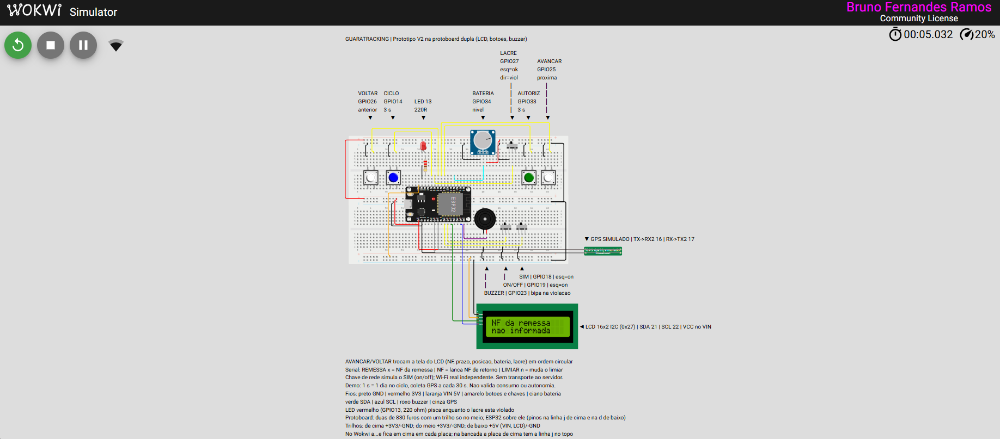

*Figura 3.4.1-CT36-1 — NF. Fonte: captura do simulador Wokwi for VS Code.*

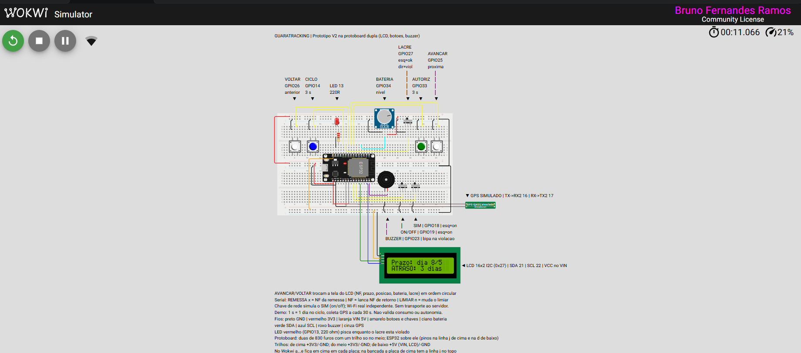

*Figura 3.4.1-CT36-2 — Prazo. Fonte: captura do simulador Wokwi for VS Code.*


*Figura 3.4.1-CT36-3 — Posição. Fonte: captura do simulador Wokwi for VS Code.*


*Figura 3.4.1-CT36-4 — Bateria. Fonte: captura do simulador Wokwi for VS Code.*


*Figura 3.4.1-CT36-5 — Lacre. Fonte: captura do simulador Wokwi for VS Code.*

</details>

<a name="evidencias-ct37"></a>
<details>
<summary>CT37 — Prazo no LCD: evidências</summary>


*Figura 3.4.1-CT37-1 — Antes do prazo. Fonte: captura do simulador Wokwi for VS Code.*


*Figura 3.4.1-CT37-2 — Um dia restante. Fonte: captura do simulador Wokwi for VS Code.*

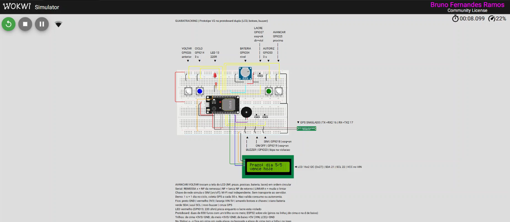

*Figura 3.4.1-CT37-3 — Vence hoje. Fonte: captura do simulador Wokwi for VS Code.*


*Figura 3.4.1-CT37-4 — Atraso. Fonte: captura do simulador Wokwi for VS Code.*


*Figura 3.4.1-CT37-5 — Sem ciclo ativo. Fonte: captura do simulador Wokwi for VS Code.*

</details>

<a name="evidencias-ct38"></a>
<details>
<summary>CT38 — Alarme local: evidências</summary>

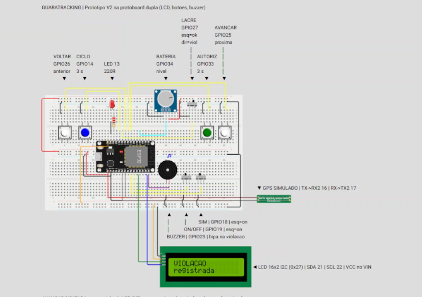

*Figura 3.4.1-CT38-1 — Violação. Fonte: captura do simulador Wokwi for VS Code.*

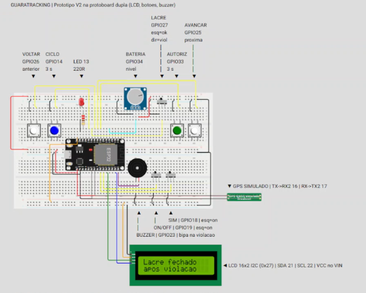

*Figura 3.4.1-CT38-2 — Lacre fechado. Fonte: captura do simulador Wokwi for VS Code.*

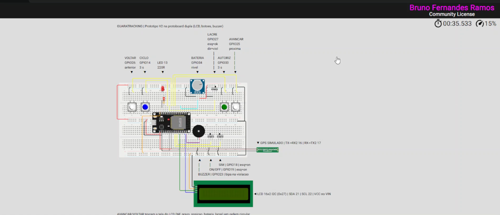

*Figura 3.4.1-CT38-3 — Limite de 30 s. Fonte: captura do simulador Wokwi for VS Code.*

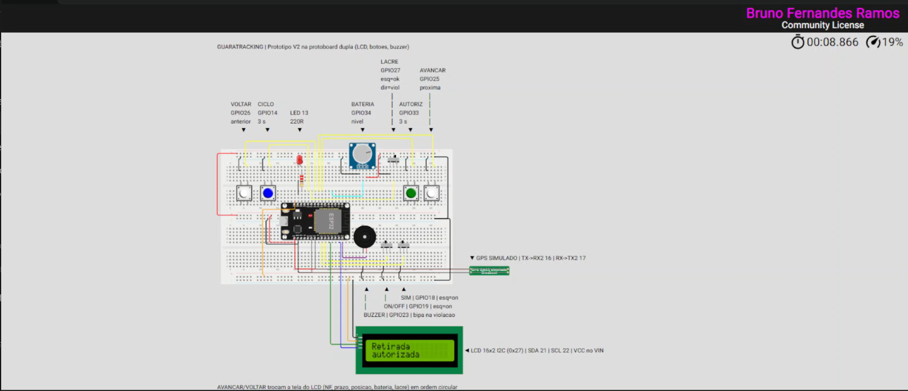

*Figura 3.4.1-CT38-4 — Retirada autorizada. Fonte: captura do simulador Wokwi for VS Code.*

Vídeos: [ct38-limite-30s](../assets/3-desenvolvimento-resultados/3.4.1-prototipo-wokwi/ct38-limite-30s.mkv) · [ct38-retirada-autorizada](../assets/3-desenvolvimento-resultados/3.4.1-prototipo-wokwi/ct38-retirada-autorizada.mkv) · [ct38-violacao-fechamento](../assets/3-desenvolvimento-resultados/3.4.1-prototipo-wokwi/ct38-violacao-fechamento.mkv).

</details>

<a name="evidencias-ct39"></a>
<details>
<summary>CT39 — NF da remessa: evidências</summary>

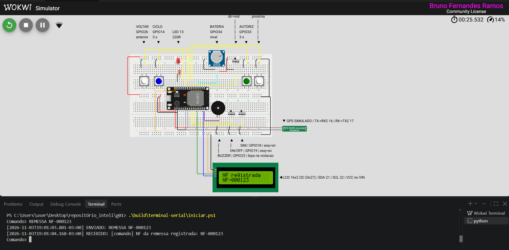

*Figura 3.4.1-CT39-1 — NF registrada. Fonte: captura do simulador Wokwi for VS Code.*

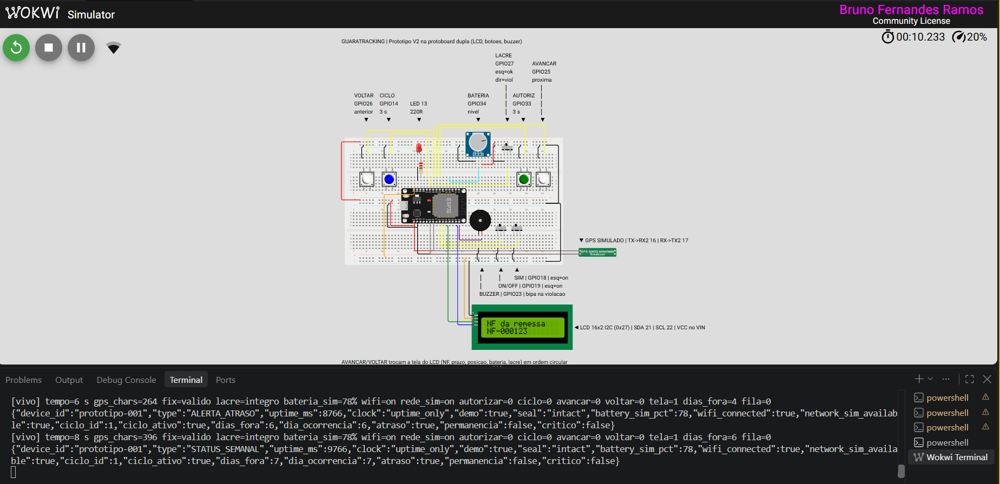

*Figura 3.4.1-CT39-2 — Tela da NF. Fonte: captura do simulador Wokwi for VS Code.*


*Figura 3.4.1-CT39-3 — Limite de 15 caracteres. Fonte: captura do simulador Wokwi for VS Code.*

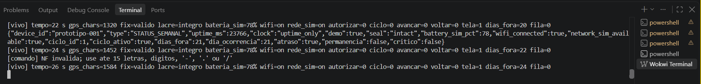

*Figura 3.4.1-CT39-4 — Recusa por caractere inválido — entrada do roteiro: REMESSA NF@123. Fonte: captura do simulador Wokwi for VS Code.*

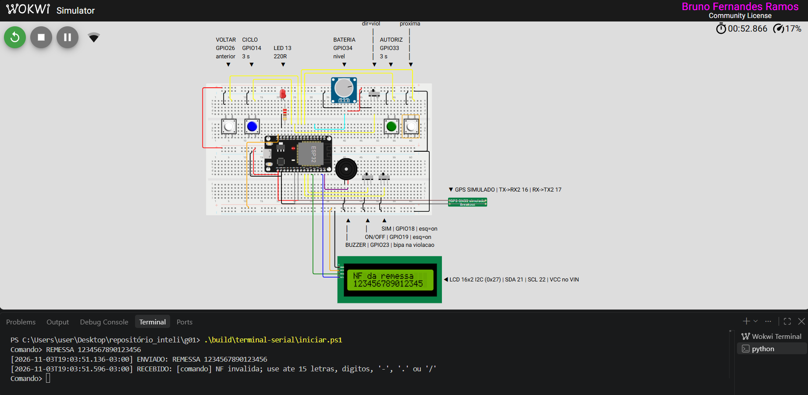

*Figura 3.4.1-CT39-5 — Recusa por comprimento — entrada do roteiro: REMESSA 1234567890123456. Fonte: captura do simulador Wokwi for VS Code.*

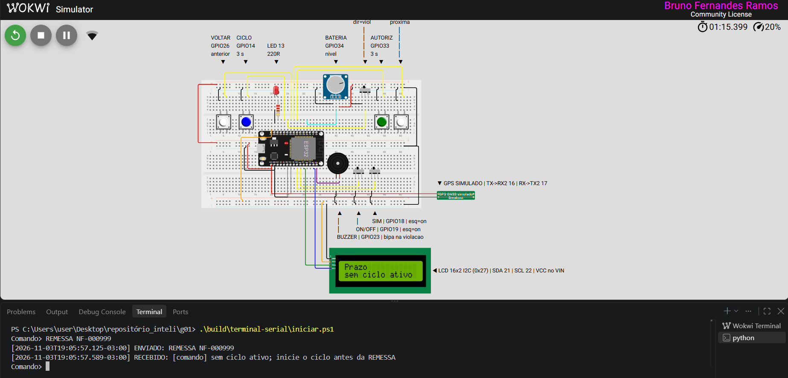

*Figura 3.4.1-CT39-6 — Recusa sem ciclo ativo. Fonte: captura do simulador Wokwi for VS Code.*

</details>

<a name="evidencias-ct40"></a>
<details>
<summary>CT40 — Apagamento do LCD: evidências</summary>

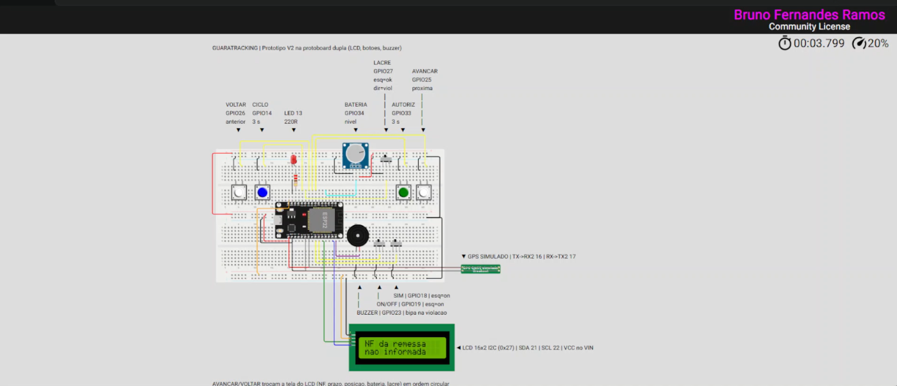

*Figura 3.4.1-CT40-1 — LCD aceso. Fonte: captura do simulador Wokwi for VS Code.*

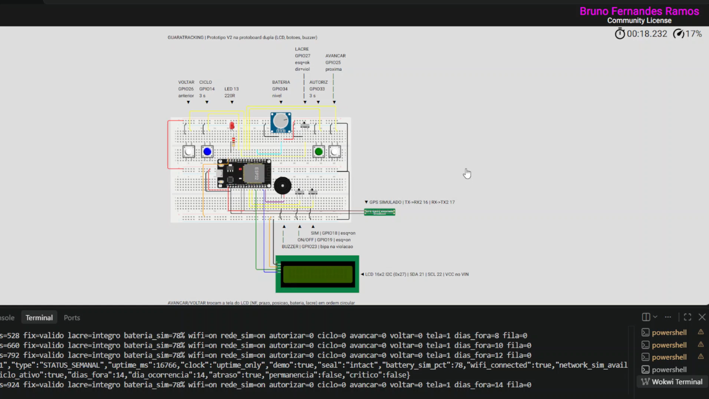

*Figura 3.4.1-CT40-2 — LCD apagado. Fonte: captura do simulador Wokwi for VS Code.*

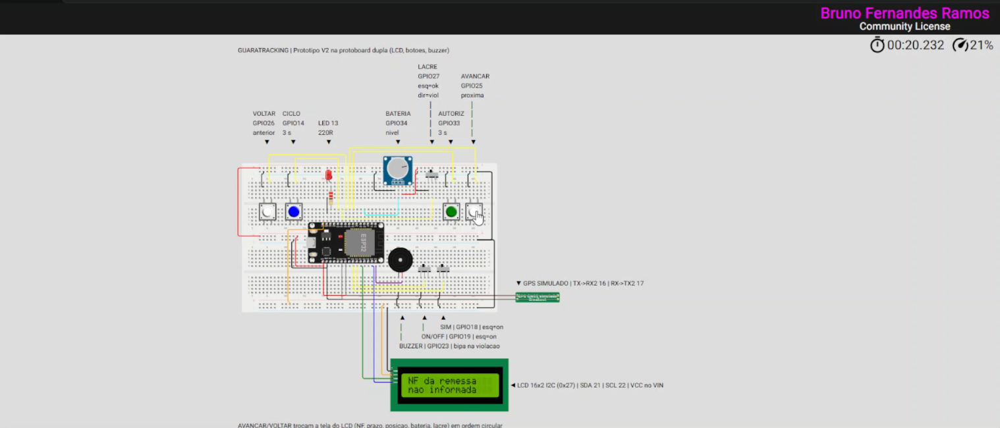

*Figura 3.4.1-CT40-3 — Primeiro toque em avançar. Fonte: captura do simulador Wokwi for VS Code.*

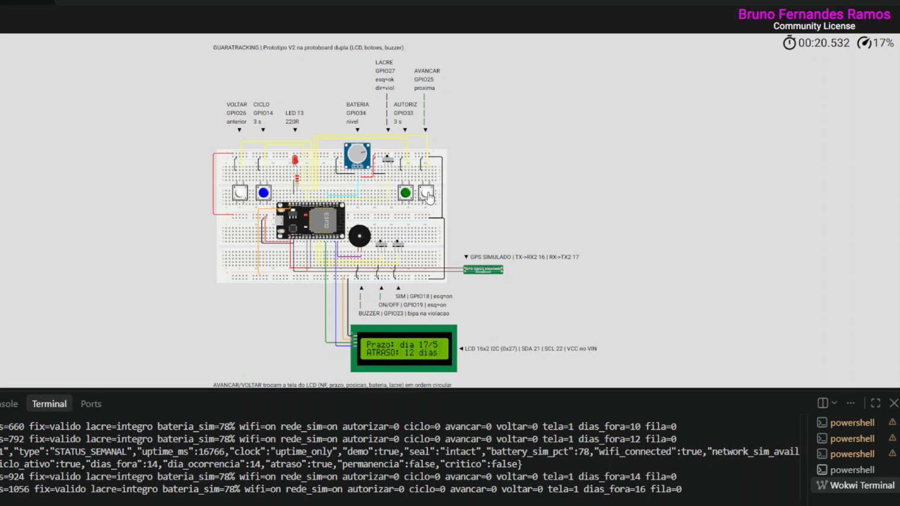

*Figura 3.4.1-CT40-4 — Segundo toque em avançar. Fonte: captura do simulador Wokwi for VS Code.*

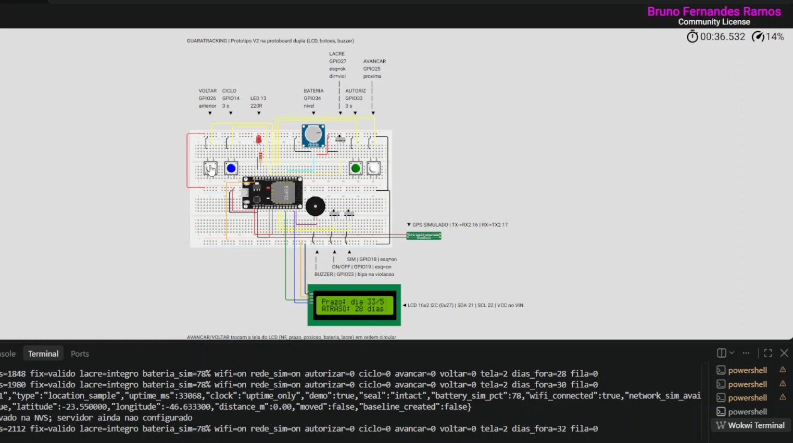

*Figura 3.4.1-CT40-5 — Primeiro toque em voltar. Fonte: captura do simulador Wokwi for VS Code.*

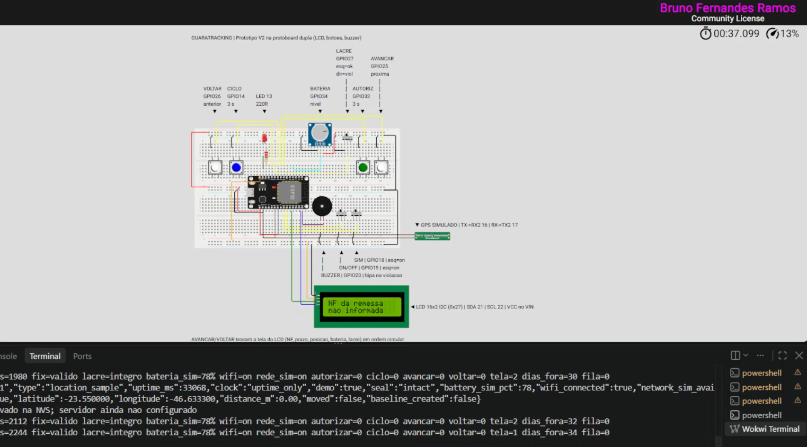

*Figura 3.4.1-CT40-6 — Segundo toque em voltar. Fonte: captura do simulador Wokwi for VS Code.*

Vídeos: [ct40-apagamento-despertar](../assets/3-desenvolvimento-resultados/3.4.1-prototipo-wokwi/ct40-apagamento-despertar.mkv).

</details>

<a name="evidencias-ct41"></a>
<details>
<summary>CT41 — Contagem dos botões: evidências</summary>

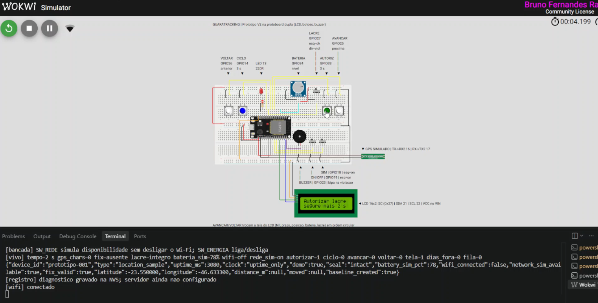

*Figura 3.4.1-CT41-1 — Contagem para autorizar. Fonte: captura do simulador Wokwi for VS Code.*

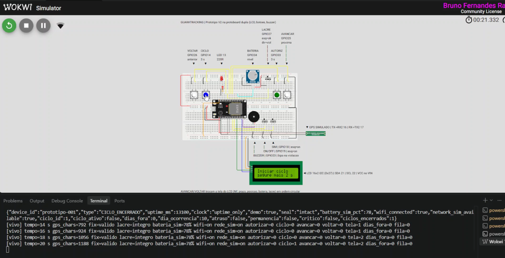

*Figura 3.4.1-CT41-2 — Contagem para iniciar. Fonte: captura do simulador Wokwi for VS Code.*

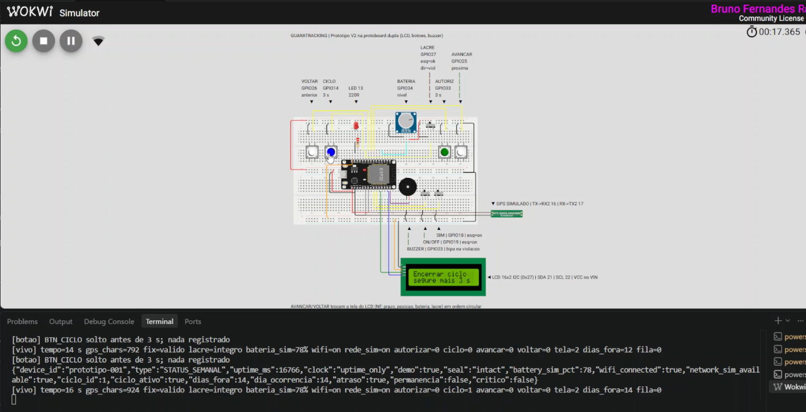

*Figura 3.4.1-CT41-3 — Contagem para encerrar. Fonte: captura do simulador Wokwi for VS Code.*

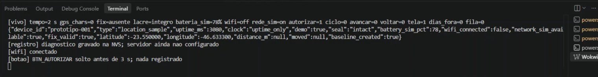

*Figura 3.4.1-CT41-4 — Soltura antes de autorizar. Fonte: captura do simulador Wokwi for VS Code.*

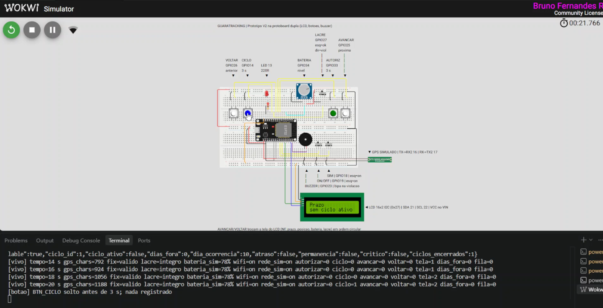

*Figura 3.4.1-CT41-5 — Soltura antes de iniciar. Fonte: captura do simulador Wokwi for VS Code.*

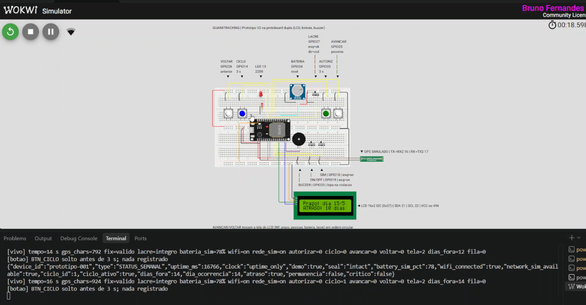

*Figura 3.4.1-CT41-6 — Soltura antes de encerrar. Fonte: captura do simulador Wokwi for VS Code.*

Vídeos: [ct41-contagem-autorizar](../assets/3-desenvolvimento-resultados/3.4.1-prototipo-wokwi/ct41-contagem-autorizar.mkv) · [ct41-contagem-encerrar](../assets/3-desenvolvimento-resultados/3.4.1-prototipo-wokwi/ct41-contagem-encerrar.mkv) · [ct41-contagem-iniciar](../assets/3-desenvolvimento-resultados/3.4.1-prototipo-wokwi/ct41-contagem-iniciar.mkv).

</details>

<a name="evidencias-ct42"></a>
<details>
<summary>CT42 — Mensagens temporárias: evidências</summary>

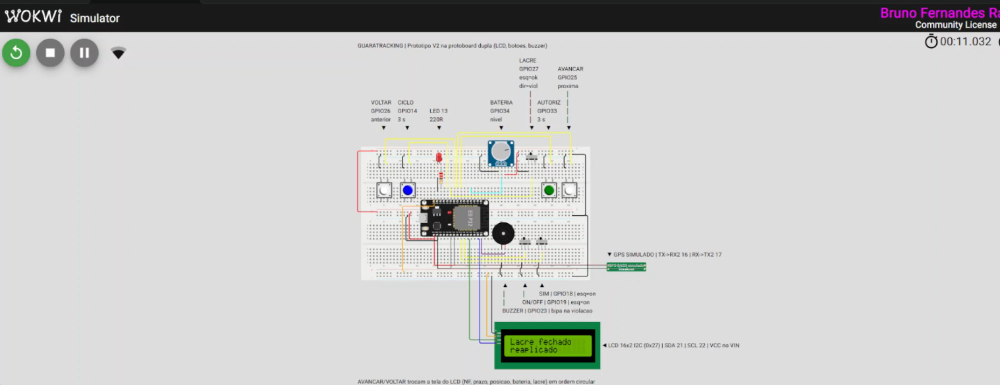

*Figura 3.4.1-CT42-1 — Lacre reaplicado. Fonte: captura do simulador Wokwi for VS Code.*

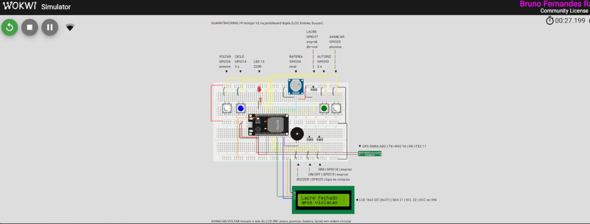

*Figura 3.4.1-CT42-2 — Fechamento após violação. Fonte: captura do simulador Wokwi for VS Code.*

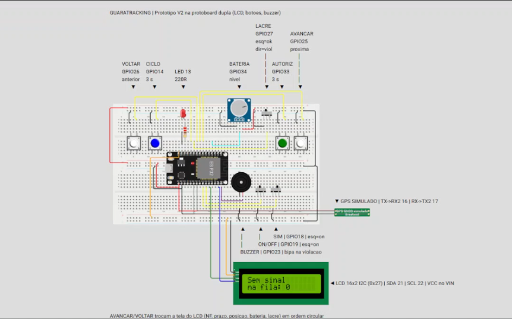

*Figura 3.4.1-CT42-3 — Sem sinal. Fonte: captura do simulador Wokwi for VS Code.*

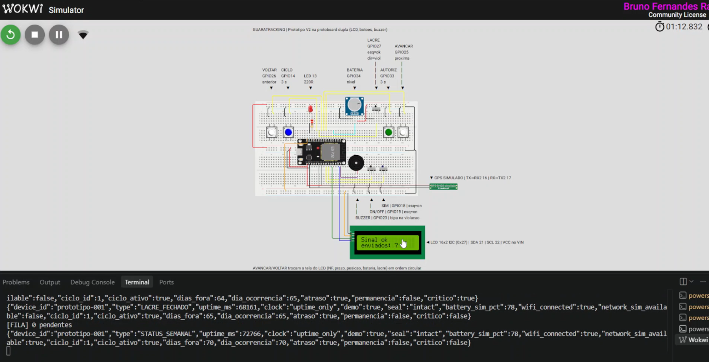

*Figura 3.4.1-CT42-4 — Sinal recuperado. Fonte: captura do simulador Wokwi for VS Code.*

Vídeos: [ct42-lacre-apos-violacao](../assets/3-desenvolvimento-resultados/3.4.1-prototipo-wokwi/ct42-lacre-apos-violacao.mkv) · [ct42-lacre-reaplicado](../assets/3-desenvolvimento-resultados/3.4.1-prototipo-wokwi/ct42-lacre-reaplicado.mkv) · [ct42-sem-sinal](../assets/3-desenvolvimento-resultados/3.4.1-prototipo-wokwi/ct42-sem-sinal.mkv) · [ct42-sinal-recuperado](../assets/3-desenvolvimento-resultados/3.4.1-prototipo-wokwi/ct42-sinal-recuperado.mkv).

</details>

#### <a name="cts43-45"></a>CT43–CT45 — posição, vínculo e GNSS no V2

CTs novos para comportamentos que o V2 acrescentou: a idade da última posição no LCD, o boot sem ciclo e os eventos de falha do GNSS. Usam o mesmo binário e o mesmo ambiente da [rodada V2](#rodada-v2), no Wokwi for VS Code, em 03/11/2026.

**CT#** | **Bloco** | **Componente de entrada** | **Leitura da entrada** | **Componente de saída** | **Leitura da saída** | **Descrição**
|----------|----------|----------|----------|----------|----------|----------|
|CT43|Última posição no LCD|GPS (controle `fixValid`) e reinício do ESP32|Sem posição salva; posição válida e depois `fixValid=0` por segundos, minutos, horas e dias; reinício preservando a NVS|LCD (tela "Ultima posicao"); Serial|"sem fix ainda"; "ha N s", "ha N min", "ha N h" e "ha N dias"; depois do reinício, "salva, sem idade" e a indicação de restauração na Serial|Esperado: o dispositivo mostra a idade da última posição válida e não inventa um horário quando ela é desconhecida (RF005; RN08).|
|CT44|Vínculo inicial|ESP32 (primeiro boot, NVS vazia), BTN_CICLO e comando `REMESSA`|Ligar sem ciclo; `REMESSA` antes do vínculo; CICLO segurado por 3 s|LCD; Serial|`STATUS` com `ciclo_ativo=false` e `dias_fora=0`; tela de prazo "sem ciclo ativo"; `REMESSA` recusada; após 3 s, `CICLO_INICIADO` com `ciclo_id=1`, "Ciclo iniciado / aguardando NF" e dias contando a partir do vínculo|Esperado: o dispositivo só entra em ciclo quando é vinculado a uma remessa (RF002, RF003; RN02).|
|CT45|Falha do GNSS|GPS (controle `fixValid`) e SW_REDE|Coleta com fix; `fixValid=0` por duas coletas ou mais; `fixValid=1`; repetir sem rede|Serial|Um `GNSS_SEM_FIX` (`motivo=sem_fix`, `satelites=0`) na primeira coleta sem posição, sem repetir nas seguintes; um `GNSS_RECUPERADO` na primeira coleta válida, com `tempo_sem_posicao_s` e `coletas_sem_fix`; sem rede, os dois entram na fila como não críticos|Esperado: perda e retorno da posição ficam registrados uma vez cada, sem encher a fila (RF005, RF010; RN08, RN09).|

| CT | Situação | Resultado observado | Evidência e log |
|---|---|---|---|
| CT43 | APROVADO em segundos e minutos; **PENDENTE** em horas, dias e restauração | Sem posição, o LCD mostrou "sem fix ainda". Depois de duas coletas válidas e de `fixValid=0`, a idade da última posição apareceu como "ha 12 s" e "ha 1 min", e as coletas sem fix registraram 28 s e 68 s. Horas e dias exigem espera em tempo real mesmo no `demo`, e a restauração exige reiniciar o ESP32 preservando a NVS; esses subcenários não foram feitos. | [Sem fix](../assets/3-desenvolvimento-resultados/3.4.1-prototipo-wokwi/ct43SemFix.png) · [Segundos](../assets/3-desenvolvimento-resultados/3.4.1-prototipo-wokwi/ct43Segundos.png) · [Minutos](../assets/3-desenvolvimento-resultados/3.4.1-prototipo-wokwi/ct43Minutos.png) · [Log][ct43-log] |
| CT44 | APROVADO no simulador | Boot com `ciclo_ativo=false` e `dias_fora=0`; tela de prazo "sem ciclo ativo"; `REMESSA NF-000123` recusada com `[comando] sem ciclo ativo…`; nenhum dia contado nem alerta antes do vínculo; CICLO segurado abriu o ciclo 1 aos 31,2 s, e o primeiro `STATUS_SEMANAL` saiu no dia 7, 6,95 s depois do vínculo. | [Boot](../assets/3-desenvolvimento-resultados/3.4.1-prototipo-wokwi/ct44Boot.png) · [Sem ciclo](../assets/3-desenvolvimento-resultados/3.4.1-prototipo-wokwi/ct44SemCiclo.png) · [Iniciado](../assets/3-desenvolvimento-resultados/3.4.1-prototipo-wokwi/ct44Iniciado.png) · [Log][ct44-log] |
| CT45 | APROVADO no simulador | Sem rede: um `GNSS_SEM_FIX` (`sem_fix`, `satelites=0`) na primeira coleta sem posição, sem repetir na segunda; um `GNSS_RECUPERADO` com `coletas_sem_fix=2` e `tempo_sem_posicao_s=70`; os dois não críticos, guardados na fila e reenviados na ordem até `[FILA] 0 pendentes`. Com rede, a perda do fix depois de coletas válidas gerou um único `GNSS_SEM_FIX` (log do CT43), e o retorno gerou `GNSS_RECUPERADO` enviado direto. | [Fila](../assets/3-desenvolvimento-resultados/3.4.1-prototipo-wokwi/ct45Fila.png) · [Log sem rede][ct45-log] · [Log com rede][ct45-rede] |

[ct43-log]: ../assets/3-desenvolvimento-resultados/3.4.1-prototipo-wokwi/ct43-posicao.serial.txt
[ct44-log]: ../assets/3-desenvolvimento-resultados/3.4.1-prototipo-wokwi/ct44-vinculo.serial.txt
[ct45-log]: ../assets/3-desenvolvimento-resultados/3.4.1-prototipo-wokwi/ct45-gnss.serial.txt
[ct45-rede]: ../assets/3-desenvolvimento-resultados/3.4.1-prototipo-wokwi/ct45-gnss-rede.serial.txt

**Achados e limitações.**

- **Motivos do GNSS:** só `sem_fix` é alcançável no simulador. O GPS simulado só alterna `fixValid` entre 0 e 1, com 8 ou 0 satélites, então `sem_dados` e `sinal_fraco` ficam sem teste até a validação física.
- **CT45 sem rede:** usou o chip de estímulo da [rodada manual](../tests/wokwi-vscode/README.md), que deixa a rede indisponível pelo GPIO18 desde o boot, devolve o fix aos 60 s e a rede aos 110 s. Nas duas tentativas à mão, a rede voltou antes do fix, e o `GNSS_RECUPERADO` não passou pela fila. Por isso, o log com rede é dessas tentativas, a partir do último boot.
- **Origem das capturas:**
  - **CT43:** a "sem fix ainda" foi tirada no início de uma execução do CT45, porque a execução do CT43 começou com fix.
  - **CT44:** as capturas do LCD são da execução no Wokwi CLI de 02/11/2026, com o mesmo binário. O log dessa execução se perdeu, e o log de evidência é a repetição no VS Code.

**Evolução do protótipo.** A seção 3.4.2 apresenta os ensaios físicos offline, e a seção 3.4.3, o protótipo com MQTT. A partir da seção 3.4.4, permanecem as orientações e os exemplos originais do template, que não são resultados de execução. A proposta de evolução do circuito e os CT24–CT34 estão no [planejamento de energia e GNSS](outros/3-desenvolvimento-resultados/3.4.1-prototipo-wokwi/planejamento-energia-gnss.md).

<a name="prototipo-fisico-offline"></a>

### 3.4.2. Protótipo Físico do Projeto (offline) (sprint 2)	

O protótipo físico leva o firmware do V2 para um ESP32 real, sem servidor. Em duas protoboards de 830 furos estão o ESP32 DevKitC, o LCD 16x2 I2C, o LED vermelho de violação (GPIO13), o buzzer, o módulo GNSS NEO-6M e sete botões. As entradas ensaiadas são o sensor digital do lacre (GPIO27), o sensor analógico de bateria, simulado por potenciômetro (GPIO34), e o GNSS (UART no GPIO16). A montagem completa está no [relatório de montagem](outros/3-desenvolvimento-resultados/3.4.2-prototipo-fisico-offline/relatorio-montagem-prototipo-fisico.md).

**Por que há sensores simulados.** Na bancada, LACRE e REDE são botões que alternam o estado a cada toque, e ON/OFF exige 3 s. O botão LACRE simula o sensor real do lacre, previsto como laço de continuidade ou reed switch, e o botão REDE simula a disponibilidade do módulo SIM. Os dois existem porque o contato definitivo depende da fixação no equipamento e a comunicação celular ainda não foi integrada; assim, a abertura do lacre e a falta de rede podem ser provocadas de forma controlada. O potenciômetro substitui a bateria pelo mesmo motivo: a bateria do dispositivo de campo, o divisor de tensão e a calibração da leitura ainda não foram montados nem medidos (CT27 e CT30, planejados), e uma descarga real não cabe num ensaio de bancada. Girando o potenciômetro, qualquer nível aparece na hora, o que permite exercitar os limiares de 20% e 25% e a falha do sensor com ADC = 0 previstos na RN10.

<p align="center">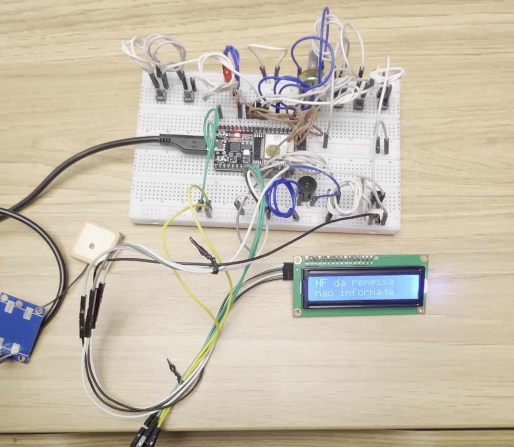</p>

*Figura 3.4.2-1 — Protótipo físico com a fiação reorganizada, visto de cima. Fonte: quadro do vídeo do CT69, 05/11/2026.*

**Código de cores da fiação.** Como o laboratório não tinha jumpers de cores variadas, a fiação seguiu um código próprio:

- **branco reto:** alimentação da protoboard;
- **branco enrolado:** os sete botões;
- **marrom, enrolado:** pinos de alimentação do ESP32 até os trilhos;
- **azul, enrolado:** demais componentes (potenciômetro, buzzer e LED).

Os jumpers fêmea do LCD e do GNSS seguem em paralelo e não têm código de cor, também por falta de jumpers.

#### Casos de teste

Condições comuns a todos os casos:

- **Ambiente:** firmware `bancada` na pinagem antiga (hoje o ambiente `bancada-antiga`; desde a Sprint 3, o `bancada` usa a montagem alternada) (o `demo` e o `weekly` esperam chaves), alimentação USB e Serial a 115200 baud. Ciclo e autorização usam tempo acelerado (1 s = 1 dia); a pressão longa continua sendo de 3 s reais.
- **Estado inicial:** antes de cada caso, conferir ciclo, autorização, lacre e fila na Serial. Com o LCD apagado, o primeiro toque só acende a tela. Alertas de prazo e status podem aparecer no meio dos casos e não são eventos de lacre duplicados.
- **Entradas digitais:** botões com `INPUT_PULLUP` (solto = HIGH, pressionado = LOW). Cada pressão de LACRE estável por 60 ms alterna o lacre; soltar não o fecha.
- **LED de violação:** pulso de 150 ms a cada 1 s só durante violação sem autorização; apagado com lacre íntegro, na retirada autorizada e depois do fechamento. Na retirada autorizada o log traz `seal="violated"` com `authorized_removal=true`, e só a violação aciona LED e buzzer.

Os casos cobrem a consulta local por Geraldo (P1-C2: CT46, CT52 e CT55), a retirada e a violação do lacre (P1-C3: CT49, CT57 e CT69), falhas que não podem se passar por estado normal (P1-C4: CT51 e CT66) e a conferência de retorno por Clarice (P2-C2: CT56 a CT58). Os RF, RN e RNF de cada caso estão na [cobertura física da RTM](#rtm-cobertura-fisica).

| CT | Descrição | Pré-condição | Procedimento de teste | Pós-condição / resultado esperado | Sensores e saídas |
|---|---|---|---|---|---|
| CT46 | Navegação das telas (RF034) | Ligado, sem ciclo; LCD aceso na tela NF | Tocar AVANÇAR cinco vezes e VOLTAR uma vez, esperando 3 s em cada tela | NF, prazo, posição, bateria, lacre e volta à NF; VOLTAR leva ao lacre; ciclo segue inativo | Botões HIGH→LOW→HIGH; LCD; `tela=` no heartbeat |
| CT47 | Abrir o ciclo (RF003) | Ligado, sem ciclo, lacre fechado | Segurar CICLO por 3 s | Contagem "segure mais N s" e "Ciclo iniciado / aguardando NF"; `CICLO_INICIADO` | Botão; LCD; Serial |
| CT48 | Toque curto não registra | Ligado, sem ciclo, sem autorização, lacre fechado | Pressionar e soltar CICLO antes de 3 s; repetir com AUTORIZAR | Nenhum `CICLO_INICIADO` nem `AUTORIZACAO_REGISTRADA`; Serial com `solto antes de 3 s` | Botões HIGH→LOW→HIGH; LCD sem mudança; LED apagado |
| CT49 | Retirada autorizada (RF007) | Ligado, sem ciclo, lacre fechado, sem alarme | Segurar AUTORIZAR por 3 s; tocar LACRE em até 3 s; tocar LACRE de novo | `AUTORIZACAO_REGISTRADA`, `RETIRADA_AUTORIZADA` e `LACRE_REAPLICADO`, sem `VIOLACAO_LACRE` | Lacre fechado→aberto→fechado; **LED apagado**; buzzer mudo; LCD "Retirada autorizada" |
| CT50 | Violação do lacre (RF006, RN05) | Ligado, sem ciclo, lacre fechado, sem autorização | Tocar LACRE; depois tocar de novo | `VIOLACAO_LACRE`; ao fechar, `LACRE_FECHADO` | Lacre fechado→aberto; **LED pisca**; buzzer toca; LCD "VIOLACAO registrada" |
| CT51 | Falha do sensor de bateria (RF019, RN10) — falha | Lacre íntegro, potenciômetro em ~75% | Ligar o GPIO34 ao GND com o jumper de ensaio; depois retirar | Com ADC = 0, `SENSOR_BATERIA_FALHA`, e não bateria vazia; ao retirar, volta a porcentagem | ADC válido→0→válido; LCD "sensor com falha"; LED apagado |
| CT52 | GNSS com fix (RF005) | NEO-6M a céu aberto, antena para cima | Aguardar o fix; ir até a tela de posição | `fix=valido`, `location_sample` válido e LCD "Ultima posicao / ha N s" | GNSS sem fix→fix; LCD; Serial |
| CT53 | Autorização isolada (RF007) | Ciclo aberto, lacre fechado | Segurar AUTORIZAR por 3 s, sem tocar em LACRE | "Autorizacao ok / vale 3 dias"; `AUTORIZACAO_REGISTRADA` | Botão; LCD; Serial |
| CT54 | ON/OFF (RF034) | Ligado, Serial aberta | Segurar ON/OFF por 3 s, esperar 10 s e segurar de novo | LCD apagado; `DISPOSITIVO_DESLIGADO`; nada na Serial enquanto desligado; novo `STATUS` | Botão; LCD; Serial |
| CT55 | LCD apaga e acorda (RF034) | Ligado, potenciômetro parado | Esperar 15 s; tocar um botão; esperar apagar; girar o potenciômetro | Apaga em 15 s; o toque acende; girar acende na tela de bateria | Sensor analógico; LCD |
| CT56 | Recusa sem NF de retorno (RF016) — falha | Ciclo aberto, lacre fechado, sem NF | Segurar CICLO por 3 s | "Nao encerrado / falta NF retorno"; `ENCERRAMENTO_RECUSADO` com `nf_retorno_ausente` | Botão; LCD; Serial |
| CT57 | Recusa com lacre aberto (RF016) — falha | Ciclo aberto, lacre aberto com autorização | Segurar CICLO por 3 s; depois fechar o lacre | "Nao encerrado / lacre aberto"; motivo `lacre_aberto`; ao fechar, `LACRE_REAPLICADO` | Lacre aberto→fechado; LCD; Serial |
| CT58 | Encerrar ciclo (RF016) | Ciclo aberto, lacre fechado | Enviar `NF`; segurar CICLO por 3 s | `NF_RETORNO_LANCADA`; "Ciclo encerrado"; `CICLO_ENCERRADO`; `dias_fora=0` | Botão; LCD; Serial |
| CT59 | NF inválida — falha | Ciclo aberto | Enviar `REMESSA NF@1`; depois `REMESSA NF-000123` | NF inválida recusada sem mudança; depois a NF é registrada | Serial; LCD |
| CT60 | Limiares da bateria (RF019, RF027; RN10) | Potenciômetro acima de 25%, lacre íntegro | Levar abaixo de 20%, a 20–25%, abaixo de 20%, acima de 25% e abaixo de 20% | Dois `BATERIA_BAIXA`, o segundo só depois do rearme acima de 25% | ADC; LCD "BAIXA"; LED apagado |
| CT61 | Contato do lacre (RF006) | Ciclo aberto, rede ligada | Tocar LACRE várias vezes, devagar | Um `seal_changed` por transição, sem duplicação | Lacre; Serial |
| CT62 | Reinício real | Ciclo aberto, lacre aberto | Cortar o USB, esperar 5 s e religar | `uptime_ms` perto de zero; ciclo e lacre restaurados da memória | Lacre e ciclo preservados; Serial |
| CT63 | Fila e reenvio (RF010) | Ciclo aberto, rede desligada | Gerar eventos de lacre e de status; religar a rede | `fila=` sobe; reenvio na ordem; fila zera; nenhuma violação falsa | Lacre; LCD; Serial |
| CT64 | Fila cheia — falha | Ciclo aberto, rede desligada | Tocar LACRE 20 vezes; religar a rede | Descarte do não crítico; `FILA_CHEIA`; `VIOLACAO_LACRE_RESUMO` no reenvio | Lacre; Serial |
| CT65 | Pulsos curtos do lacre (RF006) — falha | Jumper do GPIO32 ao GPIO27, memória limpa | Firmware de teste aplica pulsos de 20 e 40 ms e 20 toques de 200 ms, com e sem rede | Nenhum evento nos pulsos; 20 `seal_changed` por lote | Pulsos no sensor digital; Serial |
| CT66 | GNSS sem dados (RF005) — falha | A céu aberto, com fix válido | Tirar o fio do TX do módulo; recolocar sem reiniciar | `GNSS_SEM_FIX` com `sem_dados`; `GNSS_RECUPERADO` depois do fix | GNSS perde e recupera dados; LCD; Serial |
| CT69 | Violação com ciclo aberto (RF006, RF032, RF035; RN05) | Memória limpa, lacre fechado, sem autorização | Segurar CICLO por 3 s; tocar LACRE; observar o alarme; tocar LACRE de novo | `VIOLACAO_LACRE` com `ciclo_ativo=true`; ao fechar, `LACRE_FECHADO`; ciclo segue ativo | Lacre fechado→aberto→fechado; **LED apagado→pulsando→apagado**; buzzer toca e para |

#### Resultados

Execução de 05/11/2026, conferida nos vídeos e na Serial. Os tempos em ms são internos ao firmware e não medem a latência entre o estímulo físico e a sinalização.

| CT | Situação | Resultado observado | Evidência |
|---|---|---|---|
| CT46 | APROVADO | Cinco telas na ordem (`tela=` de 1 a 5 e volta a 1); VOLTAR leva à tela 5. | [Vídeo](../assets/3-desenvolvimento-resultados/3.4.2-prototipo-fisico-offline/ct46Navegacao.mp4) · [Serial](../assets/3-desenvolvimento-resultados/3.4.2-prototipo-fisico-offline/ct46-navegacao.serial.txt) |
| CT47 | APROVADO | Contagem no LCD e `CICLO_INICIADO` em 550166 ms. | [Vídeo](../assets/3-desenvolvimento-resultados/3.4.2-prototipo-fisico-offline/ct47AbrirCiclo.mp4) · [Serial](../assets/3-desenvolvimento-resultados/3.4.2-prototipo-fisico-offline/ct47-abrir-ciclo.serial.txt) |
| CT48 | APROVADO | CICLO e AUTORIZAR soltos antes de 3 s, sem nenhum evento. | [Vídeo](../assets/3-desenvolvimento-resultados/3.4.2-prototipo-fisico-offline/ct48ToqueCurto.mp4) · [Serial](../assets/3-desenvolvimento-resultados/3.4.2-prototipo-fisico-offline/ct48-toque-curto.serial.txt) |
| CT49 | APROVADO, com ressalva¹ | Lacre aberto 1,1 s após a autorização, com `authorized_removal=true`, e depois `LACRE_REAPLICADO`; LED apagado em todo o vídeo. | [Vídeo](../assets/3-desenvolvimento-resultados/3.4.2-prototipo-fisico-offline/ct49RetiradaAutorizada.mp4) · [Serial](../assets/3-desenvolvimento-resultados/3.4.2-prototipo-fisico-offline/ct49-retirada-autorizada.serial.txt) |
| CT50 | APROVADO, com ressalva¹ | `VIOLACAO_LACRE` e depois `LACRE_FECHADO`; LED pisca com período de 1,0 s e buzzer audível. | [Vídeo](../assets/3-desenvolvimento-resultados/3.4.2-prototipo-fisico-offline/ct50Violacao.mp4) · [Serial](../assets/3-desenvolvimento-resultados/3.4.2-prototipo-fisico-offline/ct50-violacao.serial.txt) |
| CT51 | APROVADO, com ressalva² | `SENSOR_BATERIA_FALHA` e LCD "sensor com falha"; a leitura voltou ao retirar o jumper. | [Vídeo](../assets/3-desenvolvimento-resultados/3.4.2-prototipo-fisico-offline/ct51FalhaSensor.mp4) · [Serial](../assets/3-desenvolvimento-resultados/3.4.2-prototipo-fisico-offline/ct51-falha-sensor.serial.txt) |
| CT52 | APROVADO, com ressalva³ | `fix=valido` aos 560 s, 35 heartbeats seguidos com fix e LCD "Ultima posicao / ha 0 s". | [Vídeo](../assets/3-desenvolvimento-resultados/3.4.2-prototipo-fisico-offline/ct52GnssFix.mp4) · [Serial](../assets/3-desenvolvimento-resultados/3.4.2-prototipo-fisico-offline/ct52-gnss-com-fix.serial.txt) |
| CT53 | APROVADO | `AUTORIZACAO_REGISTRADA`, sem abertura do lacre. | [Vídeo](../assets/3-desenvolvimento-resultados/3.4.2-prototipo-fisico-offline/ct53Ct57AutorizacaoRecusa.mp4) · [Serial](../assets/3-desenvolvimento-resultados/3.4.2-prototipo-fisico-offline/ct53-autorizacao.serial.txt) |
| CT54 | APROVADO | `DISPOSITIVO_DESLIGADO`, Serial em silêncio e novo `STATUS` ao religar; cobre no físico a pendência do CT35. | [Vídeo](../assets/3-desenvolvimento-resultados/3.4.2-prototipo-fisico-offline/ct54OnOff.mp4) · [Serial](../assets/3-desenvolvimento-resultados/3.4.2-prototipo-fisico-offline/ct54-on-off.serial.txt) |
| CT55 | APROVADO | LCD apaga cerca de 15 s após o toque (cronômetro no vídeo); girar o potenciômetro acende a tela de bateria. | [Vídeo](../assets/3-desenvolvimento-resultados/3.4.2-prototipo-fisico-offline/ct55LcdApagaAcorda.mp4) · [Serial](../assets/3-desenvolvimento-resultados/3.4.2-prototipo-fisico-offline/ct55-lcd-apaga-acorda.serial.txt) |
| CT56 | APROVADO | `ENCERRAMENTO_RECUSADO` com `nf_retorno_ausente`; ciclo segue ativo. | [Vídeo](../assets/3-desenvolvimento-resultados/3.4.2-prototipo-fisico-offline/ct56RecusaSemNf.mp4) · [Serial](../assets/3-desenvolvimento-resultados/3.4.2-prototipo-fisico-offline/ct56-recusa-sem-nf.serial.txt) |
| CT57 | APROVADO | Recusa com `lacre_aberto` e `LACRE_REAPLICADO` ao fechar. | [Vídeo](../assets/3-desenvolvimento-resultados/3.4.2-prototipo-fisico-offline/ct53Ct57AutorizacaoRecusa.mp4) · [Serial](../assets/3-desenvolvimento-resultados/3.4.2-prototipo-fisico-offline/ct57-recusa-lacre-aberto.serial.txt) |
| CT58 | APROVADO | `NF_RETORNO_LANCADA` e `CICLO_ENCERRADO` com `dias_fora=0`; LCD "Ciclo encerrado". | [Vídeo](../assets/3-desenvolvimento-resultados/3.4.2-prototipo-fisico-offline/ct58EncerrarCiclo.mp4) · [Serial](../assets/3-desenvolvimento-resultados/3.4.2-prototipo-fisico-offline/ct58-encerrar-ciclo.serial.txt) |
| CT59 | APROVADO, com ressalva⁴ | Serial recusou `REMESSA NF@1` e registrou `NF-000123`. | [Vídeo](../assets/3-desenvolvimento-resultados/3.4.2-prototipo-fisico-offline/ct59NfInvalida.mp4) · [Serial](../assets/3-desenvolvimento-resultados/3.4.2-prototipo-fisico-offline/ct59-nf-invalida.serial.txt) |
| CT60 | APROVADO | `BATERIA_BAIXA` em 502,2 s e 546,2 s (`battery_sim_pct=19`); nada em 23% nem na volta a 17% antes do rearme. | [Vídeo](../assets/3-desenvolvimento-resultados/3.4.2-prototipo-fisico-offline/ct60LimiaresBateria.mp4) · [Serial](../assets/3-desenvolvimento-resultados/3.4.2-prototipo-fisico-offline/ct60-limiares-bateria.serial.txt) |
| CT61 | APROVADO, com ressalva⁵ | 76 transições (38 aberturas, 38 fechamentos), alternadas e sem duplicação. | [Vídeo](../assets/3-desenvolvimento-resultados/3.4.2-prototipo-fisico-offline/ct61ContatoLacre.mp4) · [Serial](../assets/3-desenvolvimento-resultados/3.4.2-prototipo-fisico-offline/ct61-contato-lacre.serial.txt) |
| CT62 | APROVADO | Após o corte: `uptime_ms` 1439, `seal=violated`, ciclo 2 ativo e `contexto_restaurado=true`; repete no físico o que reprovou no CT22. | [Vídeo](../assets/3-desenvolvimento-resultados/3.4.2-prototipo-fisico-offline/ct62ReinicioReal.mp4) · [Serial](../assets/3-desenvolvimento-resultados/3.4.2-prototipo-fisico-offline/ct62-reinicio-real.serial.txt) |
| CT63 | APROVADO | Fila chegou a 8, uma `VIOLACAO_LACRE` por abertura; com a rede, 8 eventos na ordem e com os tempos originais, e fila zerada. | [Vídeo](../assets/3-desenvolvimento-resultados/3.4.2-prototipo-fisico-offline/ct63FilaReenvio.mp4) · [Serial](../assets/3-desenvolvimento-resultados/3.4.2-prototipo-fisico-offline/ct63-fila-reenvio.serial.txt) |
| CT64 | APROVADO | As 10 aberturas preservadas: 8 `VIOLACAO_LACRE` e 2 no `VIOLACAO_LACRE_RESUMO`; não críticos descartados. | [Vídeo](../assets/3-desenvolvimento-resultados/3.4.2-prototipo-fisico-offline/ct64FilaCheia.mp4) · [Serial](../assets/3-desenvolvimento-resultados/3.4.2-prototipo-fisico-offline/ct64-fila-cheia.serial.txt) |
| CT65 | APROVADO, com ressalva⁵ | Nenhum evento nos pulsos de 20 e 40 ms e 20 `seal_changed` por lote, com e sem rede; repete no físico o que reprovou no CT18. Sem vídeo: os pulsos não são visíveis. | [Serial](../assets/3-desenvolvimento-resultados/3.4.2-prototipo-fisico-offline/ct65-pulsos-lacre.serial.txt) |
| CT66 | APROVADO | `GNSS_SEM_FIX` (`sem_dados`) cerca de 10 s após tirar o fio; `GNSS_RECUPERADO` com `tempo_sem_posicao_s=110`, sem reiniciar. | [Vídeo](../assets/3-desenvolvimento-resultados/3.4.2-prototipo-fisico-offline/ct66GnssSemDados.mp4) · [Serial](../assets/3-desenvolvimento-resultados/3.4.2-prototipo-fisico-offline/ct66-gnss-sem-dados.serial.txt) |
| CT69 | APROVADO | `VIOLACAO_LACRE` com `ciclo_ativo=true` e depois `LACRE_FECHADO`; LED pisca a cada 1,0 s e apaga ao fechar; buzzer toca e para. | [Vídeo](../assets/3-desenvolvimento-resultados/3.4.2-prototipo-fisico-offline/ct69ViolacaoFechamento.mp4) · [Serial](../assets/3-desenvolvimento-resultados/3.4.2-prototipo-fisico-offline/ct69-violacao-fechamento.serial.txt) |

**Ressalvas.**

1. CT49 e CT50 rodaram sem ciclo ativo (`ciclo_ativo=false`); o CT57 e o CT69 repetem os mesmos fluxos com ciclo aberto. O som do buzzer foi conferido de ouvido, sem medir frequência nem duração.
2. No CT51 o jumper foi ligado à mão. Na tentativa do vídeo a leitura passou por menos de 20% antes de chegar a zero, então `BATERIA_BAIXA` saiu antes da falha; as tentativas de 202 s e 329 s geraram só a falha. O log traz todas as tentativas.
3. No CT52 o primeiro fix levou cerca de 9 minutos e a placa reiniciou entre o fix e as coletas registradas, sem perder o fix. A precisão não foi medida, e o NEO-6M não é o LC76G-PA escolhido para o dispositivo. As coordenadas estão mascaradas no log.
4. No CT59 o vídeo mostra só a tela final; a recusa está na Serial.
5. CT61 e CT65 usam botão ou jumper no lugar do contato real do lacre. No CT61 uma linha saiu corrompida na Serial e foi contada pelo tempo de confirmação e pela alternância.

<p align="center"><b>Telas do LCD e LED de violação</b></p>

<table>
  <tr>
    <td align="center"><a href="../assets/3-desenvolvimento-resultados/3.4.2-prototipo-fisico-offline/ct46LcdFoto.jpg">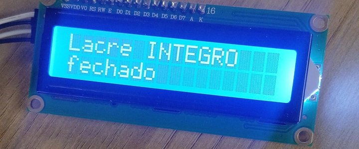</a><br>CT46 — tela do lacre</td>
    <td align="center"><a href="../assets/3-desenvolvimento-resultados/3.4.2-prototipo-fisico-offline/ct47LcdFoto.jpg"></a><br>CT47 — ciclo iniciado</td>
    <td align="center"><a href="../assets/3-desenvolvimento-resultados/3.4.2-prototipo-fisico-offline/ct48LcdFoto.jpg"></a><br>CT48 — sem mudança após toque curto</td>
  </tr>
  <tr>
    <td align="center"><a href="../assets/3-desenvolvimento-resultados/3.4.2-prototipo-fisico-offline/ct49LcdFoto.jpg"></a><br>CT49 — autorização</td>
    <td align="center"><a href="../assets/3-desenvolvimento-resultados/3.4.2-prototipo-fisico-offline/ct49RetiradaLcdFoto.jpg"></a><br>CT49 — retirada autorizada</td>
    <td align="center"><a href="../assets/3-desenvolvimento-resultados/3.4.2-prototipo-fisico-offline/ct50LcdFoto.jpg"></a><br>CT50 — violação registrada</td>
  </tr>
  <tr>
    <td align="center"><a href="../assets/3-desenvolvimento-resultados/3.4.2-prototipo-fisico-offline/ct50Violacao.mp4"></a><br>CT50 — LED aceso e apagado no pulso</td>
    <td align="center"><a href="../assets/3-desenvolvimento-resultados/3.4.2-prototipo-fisico-offline/ct69LcdViolacao.jpg"></a><br>CT69 — violação com ciclo aberto</td>
    <td align="center"><a href="../assets/3-desenvolvimento-resultados/3.4.2-prototipo-fisico-offline/ct69LcdFechado.jpg"></a><br>CT69 — lacre fechado após violação</td>
  </tr>
  <tr>
    <td align="center"><a href="../assets/3-desenvolvimento-resultados/3.4.2-prototipo-fisico-offline/ct51LcdFoto.jpg"></a><br>CT51 — sensor de bateria com falha</td>
    <td align="center"><a href="../assets/3-desenvolvimento-resultados/3.4.2-prototipo-fisico-offline/ct52LcdFoto.jpg"></a><br>CT52 — última posição a céu aberto</td>
    <td></td>
  </tr>
</table>

*Figura 3.4.2-2 — Recortes do LCD e do LED de violação nos CTs físicos; clique em cada imagem para abrir a foto completa (no LED, o vídeo). Fonte: fotos do LCD tiradas à parte da execução e quadros dos vídeos do CT50 e do CT69, 05/11/2026.*

As fotos ilustram as telas; o resultado de cada CT vem dos vídeos e da Serial.

**Limitações gerais.** Não há servidor: no CT63 e no CT64, reenviar significa publicar na Serial, sem confirmação de entrega. O potenciômetro não representa bateria, divisor nem tensão real; na rodada dos CT46 a CT52 ele teve mau contato, e a oscilação acendeu o LCD na tela de bateria no vídeo do CT47 (o contato foi refeito antes do CT55). Durante a montagem o LCD mostrou caracteres embaralhados, mitigados com I2C a 50 kHz e reinício do LCD ao acender; não há ensaio de desconexão do LCD ou do LED. Os vídeos foram comprimidos, com áudio; o CT53 e o CT57 estão no mesmo vídeo.

#### Organização do firmware

O [firmware](../src/firmware/main.cpp) mantém a inicialização em `setup()` e a coordenação em `loop()`, com procedimentos comentados e nomes descritivos: `readSeal()` filtra as entradas do lacre; `sealTransition()` distingue abertura autorizada, violação e fechamento; `readBattery()` lê o ADC e aplica a regra de bateria; `updateLed()` e `updateBuzzer()` comandam as saídas; `updateDisplay()` atualiza o LCD por meio da classe [`ScreenController`](../include/screen_controller.h). As regras de [lacre](../include/seal_rules.h) e [bateria](../include/battery_rules.h) ficam em funções próprias, e os pinos e tempos ficam em [`Config`](../include/config.h).

<details>
<summary>Binários gravados e reprodução</summary>

| CTs | Firmware | SHA-256 |
|---|---|---|
| CT46 a CT52 | `bancada` | `10D68051B5933F843DC699FEE39CAD5DA99DBB625D0FD743F407B17ED4F06F86` |
| CT53 a CT64, CT66 e CT69 | `bancada`, com o despertar do LCD corrigido | `AA6D6390660D409708342F849882950BFFA471983CB787F0DE2497A48D7683BF` |
| CT65 | [`tests/bancada-ct65`](../tests/bancada-ct65/main.cpp), que inclui o firmware de produção sem mudanças | `6CBBC406EEFC63734AD939304A24EB77F95AE8B4470CCB5986884D0096A8065C` |

Compilação: `powershell -NoProfile -ExecutionPolicy Bypass -File scripts/build.ps1 -Environment bancada` (para reproduzir estes ensaios na pinagem antiga, use `bancada-antiga`). Gravação: `pio run -e bancada -t upload`. A captura da Serial segue o [relatório de montagem](outros/3-desenvolvimento-resultados/3.4.2-prototipo-fisico-offline/relatorio-montagem-prototipo-fisico.md). Compilar e rodar os testes de lógica no computador verifica o software; uma nova execução física exige registrar o hash do binário, o estado inicial e novos logs, imagens e vídeos, preservando os resultados acima.

Quadros dos vídeos, sem ajuste: [CT46](../assets/3-desenvolvimento-resultados/3.4.2-prototipo-fisico-offline/ct46TelaLacre.png) · [CT47](../assets/3-desenvolvimento-resultados/3.4.2-prototipo-fisico-offline/ct47CicloIniciado.png) · [CT48](../assets/3-desenvolvimento-resultados/3.4.2-prototipo-fisico-offline/ct48SemMudanca.png) · [CT49](../assets/3-desenvolvimento-resultados/3.4.2-prototipo-fisico-offline/ct49RetiradaAutorizada.png) · [CT50](../assets/3-desenvolvimento-resultados/3.4.2-prototipo-fisico-offline/ct50ViolacaoRegistrada.png) · [CT51](../assets/3-desenvolvimento-resultados/3.4.2-prototipo-fisico-offline/ct51SensorFalha.png). Com realce do LCD: [CT46](../assets/3-desenvolvimento-resultados/3.4.2-prototipo-fisico-offline/ct46TelaLacreRealce.png) · [CT47](../assets/3-desenvolvimento-resultados/3.4.2-prototipo-fisico-offline/ct47CicloIniciadoRealce.png) · [CT48](../assets/3-desenvolvimento-resultados/3.4.2-prototipo-fisico-offline/ct48SemMudancaRealce.png) · [CT49](../assets/3-desenvolvimento-resultados/3.4.2-prototipo-fisico-offline/ct49RetiradaAutorizadaRealce.png) · [CT50](../assets/3-desenvolvimento-resultados/3.4.2-prototipo-fisico-offline/ct50ViolacaoRegistradaRealce.png) · [CT51](../assets/3-desenvolvimento-resultados/3.4.2-prototipo-fisico-offline/ct51SensorFalhaRealce.png).

</details>

#### Case de apresentação

Para a apresentação da sprint, o protótipo foi montado dentro de uma case de peças de Lego. Os botões ficam presos em peças brancas, o LCD fica à mostra numa abertura, a antena do GNSS fica no topo, e o potenciômetro da bateria simulada é girado por um dos furos. Na demonstração foi usado um firmware dedicado só à apresentação: a tela de posição mostra o nome do bairro mais próximo, buscado numa tabela de pontos gravada na placa ("Bairro (tabela)"), em vez da idade da última posição. Essa variante não faz parte do firmware descrito nesta seção, e os CTs acima não a usam.

<p align="center"></p>

*Figura 3.4.2-3 — Protótipo na case de Lego, com a tela de bairro do firmware de apresentação. Fonte: foto do grupo, Sprint 2.*


*Vídeo 3.4.2-1 — [Demonstração do protótipo na case](../assets/3-desenvolvimento-resultados/3.4.2-prototipo-fisico-offline/caseLegoApresentacao.mp4), em velocidade 2x (49 s). O vídeo mostra as telas de bateria, prazo, bairro e lacre; a autorização e a retirada autorizada; a violação e o fechamento do lacre; a abertura do ciclo e a recusa de encerramento sem NF de retorno; a rede desligada e religada; e o nível da bateria variando até "BAIXA". Fonte: vídeo do grupo, Sprint 2.*

A case serve à demonstração: não foi ensaiada quanto à fixação no equipamento, poeira, umidade ou impacto, e não substitui o invólucro do dispositivo de campo, cujo critério está no RNF08.4.

#### Casos planejados para a próxima sprint

Os casos abaixo estão **PLANEJADOS** e **NÃO EXECUTADOS**; nenhuma linha é resultado de teste. Os CT24 a CT34 (energia, hardware e comunicação, do [planejamento de energia e GNSS](outros/3-desenvolvimento-resultados/3.4.1-prototipo-wokwi/planejamento-energia-gnss.md)) e os CT-F28 e CT-F29 também seguem planejados, porque dependem de plataforma, comunicação, suspensão no firmware, módulo GNSS definitivo, fixação e medições que ainda não existem.

| CT | Caso | Pré-condição | Procedimento de teste | Resultado esperado | Observações |
|---|---|---|---|---|---|
| CT67 | Sem fix e sem rede | Rede desligada | Bloquear o sinal; restaurar e religar a rede | `GNSS_SEM_FIX` na fila; `GNSS_RECUPERADO`; fila zera | Relação com o CT26 |
| CT68 | Corte durante a gravação | Evento recém-gerado | Cortar o USB logo depois do evento e religar | Fila e contexto consistentes | Só entra se for repetível; relação com o CT29 |

### 3.4.3. Protótipo do Projeto com MQTT e I2C (sprint 3)	

O protótipo da seção 3.4.2 passa a se comunicar por MQTT: publica o estado e os eventos do lacre num broker e recebe comandos do dashboard. O LCD 16x2 continua no barramento I2C, e a Serial segue disponível para diagnóstico.

<!-- Esqueleto da 3.4.3. Cada subseção abaixo recebe o conteúdo da fatia correspondente do plano do Art. 8. -->

#### Exceções ao enunciado

Dois itens pedidos no enunciado não foram adicionados ao protótipo: os dois LEDs informacionais e o capacitor do debounce por hardware. A tabela explica por quê, o que cumpre o papel de cada um e onde está a evidência.

| Item do enunciado | O que o protótipo faz | Justificativa | Evidência |
|---|---|---|---|
| 2 LEDs informacionais | Nenhum LED. A violação aparece no LCD ("VIOLACAO registrada") e no buzzer; o LED vermelho do GPIO13 da seção 3.4.2 foi retirado da placa e do firmware. | O LCD já cumpre o papel dos LEDs: mostra em texto todos os estados (lacre, bateria, ciclo e posição), e um LED só repetiria essa informação. Além disso, cada LED aceso gasta energia, e o dispositivo precisa durar com bateria todo o período em que o equipamento fica fora (RNF02). | CT80 |
| Capacitor (debounce por hardware) | Debounce por firmware: o botão só conta quando o nível fica estável por `ButtonDebounceMs` (50 ms), em `updateButton()`, e o lacre por `SealDebounceMs` (60 ms), em `seal_settle()`. As constantes ficam em [`Config`](../include/config.h). | O firmware já filtra o repique do contato, inclusive pulsos curtos de 20 e 40 ms, como mostram os ensaios da seção 3.4.2. Um capacitor por botão somaria componentes sem mudar o resultado. | CT61 e CT65 (seção 3.4.2); CT79 |

O botão com debounce continua no protótipo: é o AVANÇAR (GPIO25), que troca as telas do LCD.

#### Montagem

Os casos de teste da 3.4.3 rodam em duas montagens da bancada. Elas usam os mesmos componentes da seção 3.4.2 (ESP32 DevKitC, LCD 16x2 com módulo I2C, módulo GNSS GY-GPS6MV2, buzzer, botões e potenciômetro da bateria), alimentados pelo USB, e mudam o conjunto de botões e os pinos:

- **Protótipo de 3 botões** (ambiente `bancada-3botoes`): só os botões ON/OFF, AVANÇAR e VOLTAR. O lacre, a rede, a autorização e o ciclo são simulados pelos comandos MQTT do dashboard (`lacre`, `rede`, `autorizar` e `ciclo_iniciar`). É a montagem dos CT70 a CT83.
- **Montagem alternada** (ambiente `bancada-alternada`): protótipo completo, com as chaves do lacre e da rede e os botões de autorizar e de ciclo, e com os pinos espaçados para facilitar a fiação na protoboard.

**Protótipo de 3 botões**

| Função | GPIO | Observação |
|---|---|---|
| ON/OFF | 19 | liga e desliga logicamente o dispositivo (segurar 3 s) |
| AVANÇAR | 25 | troca a tela do LCD |
| VOLTAR | 4 | volta a tela do LCD |
| Bateria (ADC) | 34 | extremos do potenciômetro em 3V3 e GND |
| Buzzer | 13 | positivo no GPIO e negativo no GND |
| LCD I2C (SDA / SCL) | 21 / 22 | VCC no 5 V e GND comum |
| GNSS | 36 (RX do ESP32) e 17 (TX do ESP32) | TX do módulo no GPIO36 e RX do módulo no GPIO17; alimentação de 5 V |

**Montagem alternada**

| Função | GPIO | Observação |
|---|---|---|
| LCD I2C (SDA / SCL) | 21 / 23 | VCC no 5 V (VIN) e GND comum |
| GNSS (RX do ESP32) | 36 | UART; alimentação de 5 V |
| ON/OFF | 19 | chave que liga e desliga logicamente o dispositivo |
| AVANÇAR | 25 | troca a tela do LCD |
| VOLTAR | 32 | volta a tela do LCD |
| AUTORIZAR | 15 | pino de boot: não segurar ao ligar |
| CICLO | 5 | pino de boot: não segurar ao ligar |
| REDE (simulação) | 16 | chave que simula a falta de rede |
| Lacre | 27 | chave que simula o lacre |
| Bateria (ADC) | 34 | leitura do potenciômetro |
| Buzzer | 12 | o GPIO12 não pode ser puxado a 3,3 V no boot |

*Figura 3.4.3-1 — Protótipo de 3 botões montado na protoboard, visto de cima, com o ESP32, o LCD, o GNSS, os botões e o buzzer ligados. Fonte: foto do grupo.*

> **IMAGEM A INCLUIR:** `prototipo3Botoes.jpg`, protótipo de 3 botões montado na protoboard, visto de cima.


*Figura 3.4.3-2 — Diagrama do protótipo de 3 botões no Wokwi, com os GPIO da tabela acima (VOLTAR no 4, buzzer no 13 e SCL no 22). O chip do GNSS simulado só existe no Wokwi local e não aparece nesta captura do Wokwi online. Fonte: captura do simulador Wokwi, 15/11/2026.*

**O que mudou desde a 3.4.2:** o LCD ganhou uma sexta tela, "Conexão" (depois da tela do lacre), com o estado do MQTT (`MQTT: conectado` ou `MQTT: sem sinal`) e a quantidade de eventos na fila; montagem de 3 botões e montagem alternada; LED de violação retirado (ver "Exceções ao enunciado"); Wi-Fi e MQTT ligados pelo `include/secrets.h`; no boot, o dispositivo conecta ao Wi-Fi de 2,4 GHz e depois ao broker. Duas observações de montagem: o USB do notebook pode não sustentar o pico de corrente do rádio com o GNSS ligado (*brownout* em loop; ver Resultados), e o contato do conector de 4 vias do módulo GNSS é frágil.

#### Comunicação MQTT

**Plataforma.** O broker é o **EMQX Cloud Serverless**, com TLS na porta 8883, usuário e senha, escolhido pelo grupo porque funciona fora da rede do Inteli, aceita WebSocket seguro (para o dashboard) e foi testado com o ESP32. Para desenvolvimento há um **EMQX 5.8.9 local no Docker** (`docker/emqx`), na porta 1883, sem TLS nem login, que só deve receber dados fictícios. O firmware usa a biblioteca PubSubClient, com a CA pública do EMQX embutida (`include/mqtt_ca_emqx.h`). As credenciais ficam só no `include/secrets.h` de cada pessoa, que o Git ignora; nunca vão para o repositório, para prints ou para a documentação. A cota do plano gratuito do EMQX é limitada, e por isso o `status` não sai a cada heartbeat.

##### Mapa dos tópicos

Todo tópico começa com o prefixo `guaratracking/<device_id>/` (no protótipo, `<device_id>` é o `MQTT_DEVICE_ID` do `secrets.h`; o padrão é `prototipo-001`). Tudo usa **QoS 0**. O dashboard **assina** `status`, `evento`, `online` e `cmd/resposta`, e **publica** em `cmd`. O broker recusa assinar `#` e `$SYS/#`.

| Tópico | Quem publica | Retido | O que vem nele |
|---|---|---|---|
| `status` | dispositivo | sim | Retrato do estado atual (lacre, bateria, ciclo, NF, fila). Sai ao conectar, a cada 60 s e logo depois de um evento que muda o estado (no mínimo 1 s entre dois) |
| `evento` | dispositivo | não | Um JSON por acontecimento (violação, ciclo, autorização, bateria, GNSS, energia). É o mesmo JSON que sai na Serial |
| `online` | dispositivo / broker | sim | Texto puro: `online` ao conectar e `offline` quando o broker perde o dispositivo (Last Will, cerca de 40 a 47 s depois da queda) |
| `cmd` | dashboard | não | O comando a executar, em JSON |
| `cmd/resposta` | dispositivo | não | O resultado de **cada** comando, em JSON |

> ⚠️ **Retido** quer dizer que o broker guarda a última mensagem e a entrega a quem assinar depois. Por isso o dashboard já abre com o `status` e o `online` mais recentes. O `evento` e a `cmd/resposta` **não** são guardados: quem não estava assinando na hora perde a mensagem.

##### Anatomia de um comando (tópico `cmd`)

O comando é um JSON plano (sem objetos dentro de objetos), de até **256 bytes**, sem a barra invertida `\`. A ordem dos campos não importa, e campos que o firmware não conhece são ignorados.

```json
{"id":"a1","acao":"rede","valor":"desligada","segundos":120}
```

| Campo | Tipo | Obrigatório | Para que serve | Limites e regras |
|---|---|---|---|---|
| `id` | texto | recomendado | Etiqueta do pedido. O dispositivo a devolve igual na resposta, para o dashboard saber **qual** comando foi respondido | até 32 caracteres. Use um valor novo a cada envio (um contador ou um sufixo aleatório) |
| `acao` | texto | **sim** | O que fazer. É o nome do comando (lista abaixo) | até 24 caracteres; só os nomes da lista |
| `valor` | texto | só em `lacre`, `rede` e `remessa` | O argumento do comando: `aberto` ou `fechado` (`lacre`), `ligada` ou `desligada` (`rede`) e o número da NF (`remessa`) | até 24 caracteres |
| `segundos` | número inteiro | só em `rede` com `desligada` | Por quanto tempo a rede simulada fica desligada. Depois disso ela volta sozinha | de 1 a 3600, sem aspas |

##### Todos os comandos, prontos para copiar

Os comandos que mexem no lacre, na rede simulada e no desligamento (`lacre`, `rede`, `ligar` e `desligar`) só valem no modo com chaves, que é o do protótipo de 3 botões. Com o dispositivo desligado, **só** `ligar` é aceito.

**Tela e energia**

| Comando (JSON) | O que faz | Efeito que o dashboard enxerga | Erros possíveis |
|---|---|---|---|
| `{"id":"1","acao":"avancar"}` | Vai para a tela seguinte do LCD e acende o visor (como o botão AVANÇAR) | só a resposta; nenhum evento | `dispositivo_desligado` |
| `{"id":"2","acao":"voltar"}` | Volta uma tela do LCD e acende o visor (como o botão VOLTAR) | só a resposta; nenhum evento | `dispositivo_desligado` |
| `{"id":"3","acao":"desligar"}` | Desliga logicamente: o LCD apaga, mas a placa continua ouvindo o `cmd` | evento `DISPOSITIVO_DESLIGADO` | `somente_modo_botoes` |
| `{"id":"4","acao":"ligar"}` | Liga de novo o dispositivo | evento `STATUS` | `somente_modo_botoes` |

**Ciclo, autorização e NF**

| Comando (JSON) | O que faz | Efeito que o dashboard enxerga | Erros possíveis |
|---|---|---|---|
| `{"id":"5","acao":"ciclo_iniciar"}` (ou `"acao":"vincular"`) | Abre o ciclo de remessa (como segurar CICLO por 3 s sem ciclo ativo) | evento `CICLO_INICIADO`; `status.ciclo_ativo` vira `true` | `ciclo_ativo` |
| `{"id":"6","acao":"remessa","valor":"NF-000123"}` | Registra o **número da NF de remessa** do ciclo ativo (RN02). O LCD mostra "NF registrada" | `status.nf` passa a trazer o número | `sem_ciclo_ativo`, `nf_invalida` |
| `{"id":"7","acao":"nf_retorno"}` | Lança a **NF de retorno**, que libera o encerramento (RN11). Vale **uma vez por ciclo** | evento `NF_RETORNO_LANCADA` | `sem_ciclo_ativo`, `nf_ja_lancada` |
| `{"id":"8","acao":"autorizar"}` | Registra a autorização de retirada, válida por 3 dias (RN06) | evento `AUTORIZACAO_REGISTRADA` | `dispositivo_desligado` |
| `{"id":"9","acao":"ciclo_encerrar"}` | Encerra o ciclo. Exige **lacre fechado** e **NF de retorno** lançada | evento `CICLO_ENCERRADO`; `status.ciclo_ativo` vira `false` | `sem_ciclo_ativo`, `encerramento_recusado` (e o evento `ENCERRAMENTO_RECUSADO` com o `motivo`) |

**Simulações da bancada**

| Comando (JSON) | O que faz | Efeito que o dashboard enxerga | Erros possíveis |
|---|---|---|---|
| `{"id":"10","acao":"lacre","valor":"aberto"}` | Simula a **abertura** do lacre | sem autorização vigente: evento `VIOLACAO_LACRE` (crítico), `status.lacre` vira `violado` e o buzzer toca; com autorização: `RETIRADA_AUTORIZADA` | `lacre_ja_aberto`, `valor_invalido`, `somente_modo_botoes` |
| `{"id":"11","acao":"lacre","valor":"fechado"}` | Simula o **fechamento** do lacre | evento `LACRE_FECHADO` (depois de violação) ou `LACRE_REAPLICADO` (depois de retirada autorizada) | `lacre_ja_fechado`, `valor_invalido`, `somente_modo_botoes` |
| `{"id":"12","acao":"rede","valor":"desligada","segundos":60}` | Tira a rede simulada por 60 s: os eventos ficam na fila e saem sozinhos quando a rede volta | `status.fila` sobe; no fim do prazo os eventos chegam em ordem | `segundos_invalido`, `valor_invalido`, `somente_modo_botoes` |
| `{"id":"13","acao":"rede","valor":"ligada"}` | Religa a rede simulada na hora e cancela o prazo | a fila é enviada | `valor_invalido`, `somente_modo_botoes` |

> ⚠️ **Atenção:** com a rede desligada o broker **não entrega** comandos ao dispositivo. Por isso o `segundos` é obrigatório: é ele que faz a rede voltar.

##### A resposta (tópico `cmd/resposta`)

Cada comando validado gera uma resposta lógica, mesmo quando é recusado. Se a publicação falhar,
o mesmo JSON fica salvo para reenvio; por isso o dashboard correlaciona e deduplica pelo `id`.

```json
{"id":"10","acao":"lacre","ok":true}
{"id":"10","acao":"lacre","ok":false,"erro":"lacre_ja_aberto"}
```

| Campo | Tipo | Quando aparece | Significado |
|---|---|---|---|
| `id` | texto | sempre | O mesmo `id` do pedido. Vazio se o JSON era ilegível |
| `acao` | texto | sempre | A mesma `acao` do pedido. Vazia se não deu para lê-la |
| `ok` | verdadeiro/falso | sempre | ✅ `true` = o comando foi **aceito, executado e, quando altera o contexto, persistido**; o efeito aparece depois em `evento` e `status`. ❌ `false` = não há sucesso confirmado; consulte `erro`, `status` e `evento` |
| `erro` | texto | só quando `ok` é `false` | O motivo da recusa ou a indicação de persistência pendente, conforme a tabela abaixo |
| `pendente` | verdadeiro | quando a NVS falha após a ação | A ação ocorreu em RAM e o firmware continuará tentando salvar; não repetir o comando |
| `motivo` | texto | encerramento recusado com ciclo ativo | Distingue `lacre_aberto` de `nf_retorno_ausente` |
| `janela_dias` | inteiro | autorização aceita | Duração da autorização segundo a RN06 |
| `valida_ate_ms` | inteiro | autorização aceita | Limite no relógio acumulado do dispositivo; não é uma data UTC |

| `erro` | O que aconteceu |
|---|---|
| `json_vazio` | O corpo da mensagem tinha 0 bytes |
| `json_invalido` | O objeto está incompleto, tem sintaxe inválida, chave repetida, conteúdo depois do `}` ou estrutura fora do contrato plano |
| `payload_grande` | Mais de 256 bytes |
| `acao_ausente` | Não há o campo `acao`, ou o JSON está ilegível |
| `acao_desconhecida` | O nome da `acao` não está na lista |
| `dispositivo_desligado` | Qualquer comando, exceto `ligar`, com o dispositivo desligado |
| `somente_modo_botoes` | `ligar`, `desligar`, `lacre` ou `rede` fora do modo com chaves |
| `valor_invalido` | O `valor` não é um dos aceitos (`aberto`/`fechado`, `ligada`/`desligada`) |
| `lacre_ja_aberto` / `lacre_ja_fechado` | O lacre já está no estado pedido |
| `segundos_invalido` | `rede` `desligada` sem `segundos`, ou fora de 1 a 3600 |
| `ciclo_ativo` | `ciclo_iniciar` com um ciclo em andamento (RN01) |
| `sem_ciclo_ativo` | `ciclo_encerrar`, `remessa` ou `nf_retorno` sem ciclo ativo |
| `nf_invalida` | `remessa` sem `valor`, com mais de 15 caracteres ou com caractere fora de letras, dígitos, `-`, `.` e `/` |
| `nf_ja_lancada` | `nf_retorno` quando a NF de retorno deste ciclo já foi lançada |
| `encerramento_recusado` | `ciclo_encerrar` com lacre aberto ou sem NF de retorno |
| `persistencia_pendente` | A ação ocorreu em RAM, mas a NVS falhou; vem com `pendente:true` e não deve ser repetida |
| `resposta_anterior_pendente` | A ação nova não foi executada porque o reenvio de uma resposta anterior ainda falhou |
| `fila_respostas_cheia` | As quatro vagas regulares estavam ocupadas; a ação nova não foi executada e sua recusa usou a vaga reservada |

O JSON inteiro é validado antes da execução, inclusive contra chaves repetidas. Para uma ação que
muda ciclo, NF, lacre ou autorização, o novo contexto é salvo antes de qualquer `ok:true` ser
publicado ou guardado para reenvio. Se a NVS falhar depois de a ação alterar a RAM ou emitir
eventos, a resposta é `persistencia_pendente`, com `pendente:true`; o `loop` continua tentando
salvar e o dashboard não repete o comando. Se `mqtt.publish()` falhar, a resposta completa entra
em uma outbox copy-on-write com dois snapshots, geração e checksum. Durante a remoção, uma falha
parcial conserva o último snapshot válido, podendo repetir a resposta enviada, mas sem apagar as
respostas posteriores que já estavam duráveis. Há quatro vagas
regulares e uma reservada para `fila_respostas_cheia`; enquanto houver pendências, o firmware
prioriza o reenvio e suspende a leitura de outro comando. Como `cmd/resposta` usa QoS 0, o
dashboard mantém timeout, deduplica pelo `id` e consulta `status`/`evento` antes de repetir uma
ação que altera estado.

##### O `status` (retido)

Um retrato do dispositivo, para o dashboard desenhar o estado atual sem esperar um evento.

```json
{"device_id":"prototipo-001","lacre":"integro","bateria_pct":68,"ciclo_ativo":false,"nf":"","dias_fora":0,"gnss_fix":false,"fila":0}
```

| Campo | Tipo | Significado |
|---|---|---|
| `device_id` | texto | Qual dispositivo é (o mesmo `<device_id>` do tópico) |
| `lacre` | texto | `integro` ou `violado` |
| `bateria_pct` | inteiro 0 a 100 | Nível da bateria (no protótipo, o potenciômetro) |
| `ciclo_ativo` | verdadeiro/falso | Há um ciclo de remessa em andamento |
| `nf` | texto | Número da NF de remessa do ciclo; vazio (`""`) se não foi informada |
| `dias_fora` | inteiro | Dias fora, contados desde a remessa (no demo, 1 s = 1 dia) |
| `gnss_fix` | verdadeiro/falso | O GNSS tem posição válida agora |
| `fila` | inteiro | Quantos eventos estão guardados esperando a conexão (RN09). Como a fila sai **antes** de o `status` ser publicado, quase sempre chega `0` |

##### Os eventos (tópico `evento`)

Um JSON por acontecimento. Todos começam com os mesmos campos:

```json
{"device_id":"prototipo-001","type":"VIOLACAO_LACRE","uptime_ms":146531,"clock":"uptime_only","demo":true,"seal":"violated","battery_sim_pct":68,"wifi_connected":true,"network_sim_available":true,"ciclo_id":1,"ciclo_ativo":false,"dias_fora":0,"dia_ocorrencia":146,"atraso":false,"permanencia":false,"critico":true}
```

| Campo | Tipo | Significado |
|---|---|---|
| `device_id` | texto | Qual dispositivo gerou o evento |
| `type` | texto | **O tipo do evento** (tabela abaixo). É por ele que o dashboard decide o que mostrar |
| `uptime_ms` | inteiro | Milissegundos desde que a placa ligou. Serve para **ordenar** eventos; não é data nem hora real |
| `clock` | texto | `uptime_only`: o dispositivo ainda não tem data e hora reais |
| `demo` | verdadeiro/falso | `true` quando o relógio do ciclo está acelerado (1 s = 1 dia) |
| `seal` | texto | `intact` ou `violated` |
| `battery_sim_pct` | inteiro | Bateria no momento |
| `wifi_connected` | verdadeiro/falso | O Wi-Fi estava conectado |
| `network_sim_available` | verdadeiro/falso | A rede simulada estava ligada |
| `ciclo_id` | inteiro | Número do ciclo (1, 2, 3...) |
| `ciclo_ativo` | verdadeiro/falso | Havia ciclo em andamento |
| `dias_fora` | inteiro | Dias fora no momento |
| `dia_ocorrencia` | inteiro | Dia do relógio em que o evento aconteceu |
| `atraso` | verdadeiro/falso | O ciclo já passou do prazo (RN04) |
| `permanencia` | verdadeiro/falso | O ciclo passou do limiar de permanência (RN04) |
| `critico` | verdadeiro/falso | 🚨 `true` nos eventos que pedem aviso imediato (violação do lacre) |

| `type` | Quando acontece | Campos a mais |
|---|---|---|
| `VIOLACAO_LACRE` | Lacre aberto sem autorização vigente (RN05) | — |
| `VIOLACAO_LACRE_RESUMO` | Violações que não couberam na fila cheia, somadas | `quantidade` e primeira/última ocorrência |
| `LACRE_FECHADO` | Lacre fechado depois de uma violação | — |
| `RETIRADA_AUTORIZADA` | Lacre aberto com autorização vigente (RN06) | — |
| `LACRE_REAPLICADO` | Lacre fechado depois de uma retirada autorizada | — |
| `AUTORIZACAO_REGISTRADA` | Autorização de retirada registrada | — |
| `CICLO_INICIADO` | Ciclo aberto | — |
| `CICLO_ENCERRADO` | Ciclo encerrado | `ciclos_encerrados` |
| `ENCERRAMENTO_RECUSADO` | Pedido de encerrar recusado | `motivo`: `sem_ciclo_ativo`, `lacre_aberto` ou `nf_retorno_ausente` |
| `VINCULO_RECUSADO` | Pedido de abrir ciclo com um ciclo ativo | `motivo`: `ciclo_ativo` |
| `NF_RETORNO_LANCADA` | NF de retorno lançada | — |
| `ALERTA_ATRASO` | O ciclo passou do prazo (uma vez por ciclo) | — |
| `ALERTA_PERMANENCIA` | O ciclo passou do limiar de permanência (uma vez por ciclo) | — |
| `LIMIAR_ALTERADO` | Limiar de permanência alterado | `limiar_dias` |
| `STATUS_SEMANAL` | Status periódico do ciclo (a cada 7 dias por padrão, RN07) | — |
| `STATUS` | Dispositivo ligado ou religado | `contexto_restaurado` |
| `BATERIA_BAIXA` | Bateria abaixo de 20% (RN10) | — |
| `SENSOR_BATERIA_FALHA` | Leitura zero da bateria: falha do sensor, não bateria vazia | — |
| `GNSS_SEM_FIX` | Perdeu a posição GNSS (RN22) | `motivo` (`sem_fix`, `sem_dados` ou `sinal_fraco`) e `satelites` |
| `GNSS_RECUPERADO` | A posição GNSS voltou | — |
| `DISPOSITIVO_DESLIGADO` | Dispositivo desligado logicamente | — |

##### Um exemplo do começo ao fim

```text
1. dashboard    → cmd           {"id":"10","acao":"lacre","valor":"aberto"}
2. dispositivo  → cmd/resposta  {"id":"10","acao":"lacre","ok":true}
3. dispositivo  → evento        {"type":"VIOLACAO_LACRE","critico":true,...}
4. dispositivo  → status        {"lacre":"violado",...}          (retido)
```

**Dicas para quem for integrar o dashboard**
- Assine `status`, `evento`, `online` e `cmd/resposta` **antes** de publicar o primeiro comando, para não perder a resposta.
- Gere um `id` novo a cada comando e case a resposta pelo `id`. Como o QoS é 0, a mensagem pode se perder; vale um tempo de espera (por exemplo 5 s) antes de tentar de novo.
- Trate o `status` como o retrato atual e o `evento` como o histórico; o `online` diz se o dispositivo está presente (`offline` chega cerca de 40 a 47 s depois de a energia cair).
- O dashboard roda no navegador e usa MQTT por WebSocket (`ws://<broker>:8083/mqtt` no broker local de desenvolvimento; a porta do WebSocket seguro do EMQX Cloud ainda não foi testada). Usuário e senha do broker nunca entram no repositório.

**Pré-requisitos.** Wi-Fi de **2,4 GHz** (o ESP32 não usa 5 GHz), sem login por navegador e com a porta **8883** liberada; a rede do Inteli provavelmente não serve, e o hotspot do celular costuma servir. Cada placa precisa de `MQTT_CLIENT_ID` e `MQTT_DEVICE_ID` próprios no `secrets.h`, senão duas placas se derrubam no mesmo broker. Os pinos 12, 5 e 15 são pinos de boot: não segurar CICLO nem AUTORIZAR ao ligar.


*Figura 3.4.3-3 — MQTT Explorer assinando `guaratracking/#`, com `online` e o `status` retidos logo depois de ligar o protótipo. Fonte: captura do MQTT Explorer, 15/11/2026.*

**Como acompanhar no MQTT Explorer.**

1. Instalar o MQTT Explorer (mqtt-explorer.com) e criar uma conexão com o host do deployment, porta 8883, TLS ligado, e o usuário e a senha MQTT do deployment (criados em *Access Control* no EMQX, e não o e-mail da conta; com o e-mail, o firmware recebe `estado=5`, não autorizado).
2. Em *Advanced*, retirar `#` e `$SYS/#` da lista de assinaturas e assinar `guaratracking/#`; o EMQX recusa a assinatura de `#`.
3. Ligar o protótipo: devem aparecer `online = online` e o `status` retidos, e o LCD mostra "MQTT ok / TLS" por 2 s.
4. Para enviar um comando, publicar em `guaratracking/<device_id>/cmd` um JSON como os acima, com texto no corpo (um Publish sem texto chega vazio e recebe `json_vazio`), e ler a resposta em `cmd/resposta`.

#### Dashboard

<!-- Telas do dashboard como figuras, com o que cada uma mostra. -->

#### Casos de teste

Condições comuns: firmware `bancada` (montagem alternada), alimentação USB estável, Serial a 115200 baud, Wi-Fi de 2,4 GHz com a porta 8883 liberada, EMQX Cloud no ar, `secrets.h` preenchido com nomes únicos e MQTT Explorer assinando `guaratracking/#`. Os CT70 em diante não alteram os CTs anteriores.

| CT | Configuração do ambiente | Ação do usuário | Resposta esperada do sistema |
|---|---|---|---|
| CT70 | Broker no ar; dispositivo sem energia | Ligar o protótipo | O LCD mostra "MQTT ok" por 2 s; o broker recebe `online = online` e o `status` retidos |
| CT71 | CT70 aprovado; lacre fechado | Abrir o lacre (violação) | O evento `VIOLACAO_LACRE` chega em `evento` no mesmo segundo; o `status` retido passa a mostrar o lacre violado; o LCD mostra "VIOLACAO registrada" e o buzzer toca |
| CT72 | CT70 aprovado; fila zerada | Desligar o Wi-Fi ou o broker, gerar eventos, restabelecer | A tela de conexão do LCD mostra `MQTT: sem sinal` e a fila subindo; ao voltar, os eventos chegam ao broker na ordem em que ocorreram e a fila zera (RN09) |
| CT73 | CT70 aprovado | Cortar a alimentação do protótipo | Em até 45 s o broker publica `offline` em `online`; ao religar, volta a `online` |
| CT74 | CT70 aprovado; dispositivo ligado | Publicar `{"id":"1","acao":"avancar"}` em `cmd`, e depois `voltar` | `cmd/resposta` devolve `ok:true` com o mesmo `id`; o LCD troca para a tela seguinte e depois volta |
| CT75 | CT74 aprovado; lacre fechado | Publicar `{"id":"2","acao":"lacre","valor":"aberto"}` e depois `"fechado"` | `ok:true` nas duas; o lacre abre e fecha como pelo botão, com o `evento` e o `status` correspondentes |
| CT76 | CT74 aprovado | Publicar `{"id":"3","acao":"abrir"}`, depois o mesmo `lacre` aberto duas vezes, e um Publish sem texto | `ok:false` com `acao_desconhecida`, `lacre_ja_aberto` e `json_vazio`; nada muda no dispositivo |
| CT77 | CT74 aprovado | Publicar `{"id":"4","acao":"rede","valor":"desligada","segundos":60}` | `ok:true`; o dispositivo fica sem rede simulada e os eventos entram na fila; ao fim dos 60 s a rede volta sozinha e a fila é enviada |
| CT78 | CT74 aprovado | Publicar `desligar` e, em seguida, `avancar` e `ligar` | `desligar` e `ligar` respondem `ok:true`; `avancar` com o dispositivo desligado responde `ok:false` com `dispositivo_desligado` |
| CT83 | CT74 aprovado; sem ciclo ativo | Publicar `remessa` e `nf_retorno` sem ciclo; iniciar o ciclo (`ciclo_iniciar`); publicar `remessa` com um número válido e um inválido; `nf_retorno` duas vezes; `ciclo_encerrar` | Sem ciclo, `remessa` e `nf_retorno` respondem `sem_ciclo_ativo`; com ciclo, a NF aparece na tela de NF do LCD, o número inválido responde `nf_invalida`, a NF de retorno é aceita uma vez (`nf_ja_lancada` na segunda) e o ciclo encerra |
| CT84 | CT74 aprovado; lacre fechado; sem ciclo ativo | Enviar JSON incompleto e outro com duas chaves `acao`; iniciar o ciclo; tentar encerrar sem NF; lançar a NF de retorno; tentar encerrar com o lacre aberto; fechar o lacre e encerrar; repetir parte do fluxo combinando comando e botão físico | Os dois JSON inválidos respondem `json_invalido` sem alterar o ciclo; as recusas informam `nf_retorno_ausente` e `lacre_aberto`; o sucesso gera `CICLO_ENCERRADO` e “Ciclo encerrado” no LCD; o botão de 3 s continua funcionando |
| CT85 | CT74 aprovado; lacre fechado | Publicar `autorizar`; abrir e fechar o lacre dentro da janela; autorizar novamente, aguardar a janela expirar e abrir o lacre | A resposta informa `janela_dias` e `valida_ate_ms`; dentro da janela ocorre `RETIRADA_AUTORIZADA` sem buzzer; após o vencimento ocorre `VIOLACAO_LACRE` com buzzer |

#### Resultados

Estado em 18/11/2026. O CT70, o CT71, o CT72, o CT73, o CT74, o CT75, o CT76, o CT77, o CT78 e o CT83 foram executados no protótipo de 3 botões contra o EMQX Cloud. Na rodada física da issue #131, partes dos CT84 e CT85 foram repetidas pelo dashboard com o dispositivo `prototipo-001-rachel`; os passos não executados continuam indicados na coluna “O que falta”.

| CT | Situação | Resultado observado | O que falta |
|---|---|---|---|
| CT70 | Aprovado | Wi-Fi e conexão TLS em cerca de 7 s depois do boot; "MQTT ok / TLS" no LCD; `online` e `status` retidos no Explorer; a fila restaurada (1 evento) é reenviada e a Serial mostra `0 pendentes` (vídeo) | Print do console do EMQX com o cliente conectado |
| CT71 | Aprovado | A violação por comando (`lacre` `aberto`) gera `VIOLACAO_LACRE` no `evento` e o `status` passa a mostrar o lacre violado; o fechamento gera `LACRE_FECHADO`; conferido com e sem ciclo ativo, no LCD e no buzzer (vídeo) | — |
| CT72 | Aprovado | Com o Wi-Fi fora, a fila subiu e a tela de conexão do LCD mostrou o MQTT sem sinal e a fila; ao religar, os eventos foram enviados na ordem e a fila zerou (vídeo) | — |
| CT73 | Aprovado | `offline` cerca de 34 s depois de tirar o USB (esperado até 45 s); o vídeo mostra a queda de energia no protótipo de 3 botões, o `online = offline` no Explorer e um cronômetro | — |
| CT74 | Aprovado | `avancar` troca para a tela seguinte e `voltar` retorna, com `ok:true` e o `id` devolvido, visíveis no Explorer e no LCD (vídeo) | — |
| CT75 | Aprovado | `lacre` `aberto` e `fechado` com `ok:true`, com o `evento` e o `status` correspondentes (vídeo) | — |
| CT76 | Aprovado | `acao_desconhecida`, `lacre_ja_aberto`, `lacre_ja_fechado` e `json_vazio` recusados com `ok:false` e o `erro` esperado, sem mudar o dispositivo; o comando recusado também acende o LCD (vídeo) | — |
| CT77 | Aprovado | `rede` desligada por tempo com `ok:true`; a fila subiu durante o prazo e, ao fim, os eventos foram enviados na ordem e a fila zerou (vídeo) | — |
| CT78 | Aprovado | `desligar` e `ligar` com `ok:true` e `avancar` desligado recusado com `dispositivo_desligado`; pelo botão ON/OFF o `evento` também muda, e o tipo observado foi `STATUS_SEMANAL` (vídeo) | — |
| CT83 | Aprovado | Executado conforme o roteiro: `remessa` e `nf_retorno` recusados sem ciclo (`sem_ciclo_ativo`); com ciclo, NF inválida recusada (`nf_invalida`) e válida exibida no LCD; NF de retorno aceita uma vez (`nf_ja_lancada` na segunda); ciclo encerrado (vídeo) | — |
| CT84 | Parcial | Pelo dashboard e no ESP32 físico: ciclo iniciado; encerramento sem NF de retorno recusado; NF de retorno registrada; encerramento aceito e ciclo finalizado. As respostas positivas e a abertura do ciclo têm captura; a recusa e o encerramento foram observados durante o ensaio da #131. | Executar JSON inválido/chave repetida, recusa com lacre aberto, botão físico, vídeo e Serial do roteiro completo |
| CT85 | Parcial | O comando `autorizar` recebeu resposta positiva correlacionada do ESP32 físico e apareceu como “Executado pelo ESP32” no dashboard. | Abrir o lacre dentro e fora da janela, comprovar `RETIRADA_AUTORIZADA`/`VIOLACAO_LACRE`, LCD e buzzer |

O relatório da rodada física da #131, com ambiente, resultados, limites e links para as capturas, está em [`issue-131-integracao-dashboard-fisica.md`](outros/reports/Sprint03/issue-131-integracao-dashboard-fisica.md). Ele também registra bateria por potenciômetro, inspeção do `status` no MQTTX, Last Will e reconexão, sem usar esses resultados para aprovar os passos do lacre que não foram executados.


<a name="evidencias-ct70"></a>
<details>
<summary>CT70 — Conexão e `status` retido: evidências</summary>

Vídeo do ensaio, com o LCD ("MQTT ok / TLS") e o Explorer (host mascarado): [Vídeo](../assets/3-desenvolvimento-resultados/3.4.3-prototipo-mqtt-i2c/ct70Conexao3Botoes.mp4).


*Figura 3.4.3-CT70-2 — `online` e `status` retidos no MQTT Explorer. Fonte: captura do MQTT Explorer, 15/11/2026.*

*Figura 3.4.3-CT70-3 — Console do EMQX com o cliente conectado (host e usuário mascarados). Fonte: captura do console do EMQX Cloud.*

> **IMAGEM A INCLUIR:** `ct70ConsoleEmqx.png`, console do EMQX com o cliente conectado (host e usuário mascarados).


*Figura 3.4.3-CT70-4 — Serial no boot: conexão ao broker, reenvio de 1 evento da fila e `0 pendentes`, com o host mascarado. Fonte: captura do terminal do PlatformIO, 15/11/2026.*

</details>

<a name="evidencias-ct71"></a>
<details>
<summary>CT71 — Violação do lacre: evidências</summary>

Vídeo do ensaio, com o LCD, o buzzer e o Explorer: [Vídeo](../assets/3-desenvolvimento-resultados/3.4.3-prototipo-mqtt-i2c/ct71Violacao3Botoes.mp4).

*Figura 3.4.3-CT71-1 — LCD com "VIOLACAO registrada". Fonte: quadro do vídeo do ensaio, 12/11/2026.*

> **IMAGEM A INCLUIR:** `ct71LcdViolacao.png`, LCD com "VIOLACAO registrada".

*Figura 3.4.3-CT71-2 — `VIOLACAO_LACRE` no tópico `evento`, com o mesmo `uptime_ms` da Serial. Fonte: captura do MQTT Explorer, 12/11/2026.*

> **IMAGEM A INCLUIR:** `ct71ExplorerViolacao.png`, `VIOLACAO_LACRE` no tópico `evento`, com o mesmo `uptime_ms` da Serial.

*Figura 3.4.3-CT71-3 — `status` retido com `"lacre":"violado"`. Fonte: captura do MQTT Explorer.*

> **IMAGEM A INCLUIR:** `ct71ExplorerStatusViolado.png`, `status` retido com `"lacre":"violado"`.

*Figura 3.4.3-CT71-4 — LCD com "Lacre fechado / apos violacao". Fonte: quadro do vídeo do ensaio, 12/11/2026.*

> **IMAGEM A INCLUIR:** `ct71LcdLacreFechado.png`, LCD com "Lacre fechado / apos violacao".

</details>

<a name="evidencias-ct72"></a>
<details>
<summary>CT72 — Fila sem rede: evidências</summary>

Vídeo do ensaio, com a Serial, o LCD e o Explorer: [Vídeo](../assets/3-desenvolvimento-resultados/3.4.3-prototipo-mqtt-i2c/ct72FilaSemRede3Botoes.mp4).

</details>

<a name="evidencias-ct73"></a>
<details>
<summary>CT73 — Queda de energia e Last Will: evidências</summary>

Vídeo da queda de energia no protótipo de 3 botões (USB desligado, LCD apagando, `online = offline` no Explorer e cronômetro; a linha do host do broker está tarjada): [Vídeo](../assets/3-desenvolvimento-resultados/3.4.3-prototipo-mqtt-i2c/ct73QuedaEnergia3Botoes.mp4).

*Figura 3.4.3-CT73-1 — `online = offline` no MQTT Explorer depois de tirar o USB, com a hora da queda anotada. Fonte: captura do MQTT Explorer.*

> **IMAGEM A INCLUIR:** `ct73ExplorerOffline.png`, `online = offline` no MQTT Explorer depois de tirar o USB, com a hora da queda anotada.

*Figura 3.4.3-CT73-2 — `online = online` depois de religar o protótipo. Fonte: captura do MQTT Explorer.*

> **IMAGEM A INCLUIR:** `ct73ExplorerOnline.png`, `online = online` depois de religar o protótipo.

</details>

<a name="evidencias-ct74-ct78"></a>
<details>
<summary>CT74 a CT78 e CT83 — Comandos do dashboard: evidências</summary>

Vídeos do ensaio, com o Explorer, o protótipo e o LCD: CT74 [Vídeo](../assets/3-desenvolvimento-resultados/3.4.3-prototipo-mqtt-i2c/ct74Comandos3Botoes.mp4), CT75 [Vídeo](../assets/3-desenvolvimento-resultados/3.4.3-prototipo-mqtt-i2c/ct75Lacre3Botoes.mp4), CT76 [Vídeo](../assets/3-desenvolvimento-resultados/3.4.3-prototipo-mqtt-i2c/ct76Recusas3Botoes.mp4), CT77 [Vídeo](../assets/3-desenvolvimento-resultados/3.4.3-prototipo-mqtt-i2c/ct77RedeDesligada3Botoes.mp4), CT78 [Vídeo](../assets/3-desenvolvimento-resultados/3.4.3-prototipo-mqtt-i2c/ct78Desligado3Botoes.mp4) e CT83 [Vídeo](../assets/3-desenvolvimento-resultados/3.4.3-prototipo-mqtt-i2c/ct83Nf3Botoes.mp4). 

</details>

**Anomalias encontradas.** (1) *Brownout* em loop no boot do rádio, três vezes no dia, com o 5 V do USB do notebook, o LCD e o GNSS; recolocar o 5 V do GNSS resolveu, e a correção definitiva é uma fonte de 5 V e 2 A ou um capacitor de 470 a 1000 µF perto do ESP32. (2) No demo (1 s = 1 dia), o `STATUS_SEMANAL` sai a cada 7 s e cobre o último `evento` no Explorer; o `status` deixou de ser republicado por eventos periódicos, mas o evento continua saindo. (3) O boot imprimia que o envio ao broker estava pendente; a mensagem foi corrigida. (4) A NF de retorno era aceita sem ciclo ativo e repetida; agora é recusada sem ciclo e lançada uma vez por ciclo (RN11). (5) O firmware agora registra se a assinatura de `cmd` foi enviada, mas, com o PubSubClient, não sabe se a ACL do broker a aceitou. (6) Em uma das montagens, o GNSS só recebe caracteres quando se mexe nos fios, por mau contato no conector de 4 vias.

#### Organização do firmware

Tudo do MQTT fica em `src/firmware/main.cpp`, dentro de `#if MQTT_ENABLED`; sem MQTT, o firmware se comporta como na 3.4.2. Os tópicos (`TopicStatus`, `TopicEvento`, `TopicOnline`, `TopicCmd` e `TopicCmdResposta`) e os tempos (`MqttStatusMs` de 60 s e `MqttStatusMinMs` de 1 s) são constantes no início do bloco do MQTT; os pinos ficam em `include/config.h`.

| Função | O que faz |
|---|---|
| `updateMqtt()` | Mantém o Wi-Fi e o broker, conecta com o Last Will em `online`, assina `cmd`, reenvia a fila e republica o `status` |
| `publishEvent()` | Envia o JSON do evento à Serial e ao tópico `evento`; se não sair, o evento fica na fila (RN09) |
| `publishMqttStatus()` | Publica o `status` retido |
| `handleDashboardCommand()` | Valida e executa o comando de `cmd` e responde em `cmd/resposta` com `{id,acao,ok[,erro]}` |
| `dashboard_cmd.h` | Lê o JSON do comando (id, ação, valor e segundos) e os limites do payload, testado no host por `scripts/verify-host.sh` |

### 3.4.4. Protótipo Físico do Projeto (online) (sprint 4)	

_Aqui você deve registrar diversas situações de uso de seu sistema como um todo, indicando exemplos de ação do usuário e resposta do sistema, apontando como o ambiente deverá estar configurado para receber a ação e produzir a resposta. Estes registros serão utilizados para testar seu sistema, portanto, descreva várias situações, incluindo não apenas casos de sucesso, mas também de falha nos comportamentos do sistema. <br>
**Desta vez, utilize diagramas de sequência UML para descrever os fluxos de teste do sistema.** <br>
Siga as nomenclaturas e convenções já utilizadas anteriormente, e não se esqueça dos alinhamentos de negócios e experiência do usuário para pensar em situações representativas. Inclua figuras do protótipo físico e dashboards, além de descrições dos testes realizados para ilustrar o funcionamento do protótipo._

### 3.4.5. Protótipo Final do Projeto (sprint 5)	

_Registre as situações de uso do sistema revisadas utilizando a modelagem UML para descrever os fluxos de teste. <br>
Também inclua figuras da versão final do protótipo físico e dashboards, além de descrições dos testes realizados para ilustrar o funcionamento do protótipo._

## <a name="c4"></a>4. Conclusões e Recomendações

_Escreva, de forma resumida, sobre os principais resultados do seu projeto e faça recomendações formais ao seu parceiro de projeto em relação ao uso dessa solução. Você pode aproveitar este espaço para comentar sobre possíveis materiais extras._

## <a name="c5"></a>5. Referências

1. CERRADINHOBIO. *CerradinhoBio supera R$ 1,5 bilhão de EBITDA e amplia lucro em 90% na Safra 2025/2026*. Disponível em: https://www.cerradinhobio.com.br/news/cerradinhobio-supera-r-15-bilhao-de-ebitda-e-amplia-lucro-em-90-na-safra-2025-2026/. Acesso em: 15 out. 2026.
2. CERRADINHOBIO. *Nossos Números/Dados de Produção*. Disponível em: https://www.cerradinhobio.com.br/a-companhia/nossos-numeros-dados-de-producao/. Acesso em: 15 out. 2026.
3. CERRADINHOBIO. *CerradinhoBio*. Disponível em: https://www.cerradinhobio.com.br/negocios-e-atividades/cerradinhobio/. Acesso em: 15 out. 2026.
4. CERRADINHOBIO. *Nossos Produtos*. Disponível em: https://www.cerradinhobio.com.br/negocios-e-atividades/nossos-produtos/. Acesso em: 15 out. 2026.
5. CERRADINHOBIO. *CerradinhoBio tem 3T24/25 com aumento de receita, expansão da produção de açúcar e melhora nos indicadores financeiros*. Disponível em: https://www.cerradinhobio.com.br/news/cerradinhobio-tem-3t24-25-com-aumento-de-receita-expansao-da-producao-de-acucar-e-melhora-nos-indicadores-financeiros/. Acesso em: 15 out. 2026.
6. CERRADINHO. *TAPI Cerradinho: Rastreamento de Ativos IoT*. Documento de referência do projeto fornecido pelo parceiro, 2026.
7. RAÍZEN. *Relatório integrado — safra 2024/25*. Disponível em: https://www.raizen.com.br/archives_files/archive81-raizen-rs24-25.pdf. Acesso em: 19 out. 2026.
8. SÃO MARTINHO. *Relatório da Administração — safra 2024/25*. Disponível em: https://ri.saomartinho.com.br/Download.aspx?Arquivo=MTU+51Kmm5DdaZuzsVXkAw%3D%3D&IdCanal=3kK+JHozjxal5isJwnwwEA%3D%3D&linguagem=pt. Acesso em: 19 out. 2026.
9. BP. *bp bioenergy — operações e capacidade de produção no Brasil*. Disponível em: https://www.bp.com/pt_br/brazil/home/produtos-e-servicos/bp-bunge-bioenergia.html. Acesso em: 19 out. 2026.
10. FS. *Etanol, unidades e capacidade de produção*. Disponível em: https://www.fs.agr.br/. Acesso em: 19 out. 2026.
11. INPASA. *Inauguração da unidade de Balsas e capacidade instalada*. Disponível em: https://www.inpasa.com.br/sala-de-imprensa/inpasa-inaugura-nova-unidade-em-balsas-ma-com-investimento-de-r-2-5-bilhoes-e-reforca-lideranca-no-etanol-de-graos/1023408. Acesso em: 19 out. 2026.
12. EPE. *Análise de Conjuntura dos Biocombustíveis 2025*. Disponível em: https://www.epe.gov.br/pt/publicacoes-dados-abertos/publicacoes/analise-de-conjuntura-dos-biocombustiveis-2025. Acesso em: 19 out. 2026.
13. ANP. *RenovaBio — metas, CBIOs e comprovação*. Disponível em: https://www.gov.br/anp/pt-br/assuntos/renovabio. Acesso em: 19 out. 2026.
14. BRASIL. *Lei nº 14.993, de 8 de outubro de 2024 — Lei do Combustível do Futuro*. Disponível em: https://www.planalto.gov.br/ccivil_03/_ato2023-2026/2024/lei/l14993.htm. Acesso em: 19 out. 2026.
15. ANP. *Combustível Sustentável de Aviação (SAF)*. Disponível em: https://www.gov.br/anp/pt-br/assuntos/saf. Acesso em: 19 out. 2026.
16. ANP. *Biometano*. Disponível em: https://www.gov.br/anp/pt-br/assuntos/producao-e-fornecimento-de-biocombustiveis/biometano. Acesso em: 19 out. 2026.
17. ROCK CONTENT. *As 5 forças de Porter: o que são, para que servem e como aplicar?* Disponível em: https://rockcontent.com/br/blog/5-forcas-de-porter/. Acesso em: 19 out. 2026.
18. RAÍZEN. *Raízen e produtores de cana-de-açúcar debatem perspectivas para o ano-safra no Fórum de Mercado*. Disponível em: https://www.raizen.com.br/sala-de-imprensa/raizen-e-produtores-de-cana-de-acucar-debatem-perspectivas-para-o-ano-safra-no-forum-de-mercado. Acesso em: 20 out. 2026.
19. SÃO MARTINHO. *Formulário de Referência 2025*. Disponível em: https://ri.saomartinho.com.br/Download.aspx?Arquivo=zp29unVyAKR4rxhHtOgKfQ%3D%3D&IdCanal=3kK+JHozjxal5isJwnwwEA%3D%3D&linguagem=pt. Acesso em: 20 out. 2026.
20. INTELI. *5 forças template.jpeg*. Pasta de templates de negócios do projeto, 2022. Disponível em: https://drive.google.com/file/d/1Kr8A2GRrTDUFi5JslJQd7LWVOwyn8E_c/view. Acesso em: 20 out. 2026.
21. ESPRESSIF SYSTEMS. *Sleep Modes — ESP32, ESP-IDF v4.4.3*. Disponível em: https://docs.espressif.com/projects/esp-idf/en/v4.4.3/esp32/api-reference/system/sleep_modes.html. Acesso em: 21 out. 2026.
22. ESPRESSIF SYSTEMS. *System Time — ESP32, ESP-IDF v4.4.3*. Disponível em: https://docs.espressif.com/projects/esp-idf/en/v4.4.3/esp32/api-reference/system/system_time.html. Acesso em: 21 out. 2026.
23. U-BLOX. *MAX-M10S Data Sheet*. UBX-20035208, revisão R08, 30 jan. 2026. Disponível em: https://content.u-blox.com/sites/default/files/MAX-M10S_DataSheet_UBX-20035208.pdf. Acesso em: 21 out. 2026.
24. QUECTEL. *LC76G Series Hardware Design*. Versão 1.3, 25 nov. 2024. Disponível em: https://www.quectel.com/content/uploads/2023/05/Quectel_LC76G_Series_Hardware_Design_V1.3.pdf. Acesso em: 21 out. 2026.
25. WOKWI. *Supported Hardware*. Disponível em: https://docs.wokwi.com/getting-started/supported-hardware. Acesso em: 21 out. 2026.
26. WOKWI. *Custom Chips API — Getting Started*. Disponível em: https://docs.wokwi.com/chips-api/getting-started. Acesso em: 21 out. 2026.
27. DOURADO, Leonardo. *Adulto sorridente com óculos de sol na Bahia ao ar livre*. Pexels. Disponível em: https://www.pexels.com/pt-br/foto/adulto-sorridente-com-oculos-de-sol-na-bahia-ao-ar-livre-33504932/. Acesso em: 23 out. 2026.
28. MAGNIFIC. *Homem sênior que sorri*. Disponível em: https://www.magnific.com/br/fotos-gratis/homem-senior-que-sorri_990260.htm. Acesso em: 23 out. 2026.
29. ANTHROPIC. *Claude*, modelo Opus 5.5. Assistente de IA usado na diagramação e nas ilustrações dos cards das personas. Disponível em: https://claude.ai. Acesso em: 23 out. 2026.
30. PEXELS. *Licença*. Disponível em: https://www.pexels.com/pt-br/licenca/. Acesso em: 23 out. 2026.
31. OPENAI. *ChatGPT*. Assistente de IA usado para gerar a foto do rosto da persona Clarice. Disponível em: https://chatgpt.com. Acesso em: 23 out. 2026.
32. INTELI. *Value Proposition Canvas - template png*. Pasta de templates de negócios do projeto, 2022. Disponível em: https://drive.google.com/file/d/1vom1OaLU4NgDpoQ9vIaJ2lpS2YoGcUjM/view. Acesso em: 22 out. 2026.
33. CERRADINHO. *Kick-off do projeto de rastreamento de ativos com o parceiro*. Reunião de alinhamento, 16 out. 2026.
34. DIGIKEY. *Quectel LC76GPATA*. Preço de referência US$ 49,10 e consulta de estoque. Disponível em: https://www.digikey.com/en/products/detail/quectel/LC76GPATA/26239330. Acesso em: 22 out. 2026.
35. BANCO CENTRAL DO BRASIL. *Cotações e boletins — dólar dos Estados Unidos, PTAX de venda*. Cotação de 22 out. 2026: R$ 5,0383 por US$ 1. Disponível em: https://ptax.bcb.gov.br/ptax_internet/consultarUltimaCotacaoDolar.do. Acesso em: 22 out. 2026.
36. PORTAL SALÁRIO. *Engenheiro de hardware computacional — CBO 2122-10*. Base salarial do Novo CAGED; valor horário de referência: R$ 68,47. Disponível em: https://www.salario.com.br/profissao/engenheiro-de-hardware-computacional-cbo-212210/. Acesso em: 23 out. 2026.
37. PORTAL SALÁRIO. *Pesquisador em ciências da computação e informática — CBO 2031-05*. Base salarial do Novo CAGED; valor horário de referência: R$ 54,95. Disponível em: https://www.salario.com.br/profissao/pesquisador-em-ciencias-da-computacao-e-informatica-cbo-203105/. Acesso em: 23 out. 2026.
38. PORTAL SALÁRIO. *Analista de sistemas — CBO 2124-05*. Base salarial do Novo CAGED; valor horário de referência: R$ 40,28. Disponível em: https://www.salario.com.br/profissao/analista-de-sistemas-informatica-cbo-212405/. Acesso em: 23 out. 2026.
39. PORTAL SALÁRIO. *Engenheiro de software computacional básico — CBO 2122-15*. Base salarial do Novo CAGED; valor horário de referência: R$ 70,73. Disponível em: https://www.salario.com.br/profissao/engenheiro-de-software-computacional-basico-cbo-212215/. Acesso em: 23 out. 2026.
40. BRASIL. *Lei nº 13.709, de 14 de agosto de 2018 — Lei Geral de Proteção de Dados Pessoais (texto compilado)*. Disponível em: https://www.planalto.gov.br/ccivil_03/_ato2015-2018/2018/lei/l13709compilado.htm. Acesso em: 23 out. 2026.
41. AUTORIDADE NACIONAL DE PROTEÇÃO DE DADOS. *Guia orientativo para definições dos agentes de tratamento de dados pessoais e do encarregado*. Disponível em: https://www.gov.br/anpd/pt-br/centrais-de-conteudo/materiais-educativos-e-publicacoes/guia-orientativo-para-definicoes-dos-agentes-de-tratamento-de-dados-pessoais-e-do-encarregado. Acesso em: 23 out. 2026.
42. INTELI. *Templates de Negócios do Módulo 4*. Pasta compartilhada da disciplina. Disponível em: https://drive.google.com/drive/folders/1lTqisJ_gxxtc5J5aXM8ula2kQ4MsII_M?usp=sharing. Acesso em: 23 out. 2026.
43. DIGIKITS. *ESP32 DevKit V1 WiFi Bluetooth ESP-WROOM-32*. Disponível em: https://www.digikits.com.br/esp32. Acesso em: 23 out. 2026.
44. SOLDERED. *Active GPS antenna, SMA connector*. Preço de referência US$ 14,65. Disponível em: https://soldered.com/products/active-gps-antenna-sma-connector. Acesso em: 23 out. 2026.
45. ADAFRUIT INDUSTRIES. *Lithium Ion Battery — 3.7 V 2000 mAh*. Micro Center; preço de referência US$ 12,49. Disponível em: https://www.microcenter.com/quickView/503621/adafruit-industries-lithium-ion-battery-37v-2000mah. Acesso em: 23 out. 2026.
46. SHOPEE. *Módulo carregador USB Tipo C bateria TP4056*. Anúncio via Escorrega o Preço. Disponível em: https://escorregaopreco.com.br/ofertas/shopee/2115649. Acesso em: 23 out. 2026.
47. CAMELCAMELCAMEL. *MC-38 Surface Mount Wired NC Door Sensor Alarm Magnetic Reed Switch, 10 pares*. Histórico de preço Amazon; referência US$ 14,59 por 10 pares. Disponível em: https://camelcamelcamel.com/product/B0FXH9PTWR. Acesso em: 23 out. 2026.
48. NEWEGG BUSINESS. *Caixa de junção ABS IP65 100 × 68 × 50 mm*. Preço de referência US$ 10,99. Disponível em: https://www.neweggbusiness.com/p/9B-072-001K-007A7. Acesso em: 23 out. 2026.
49. MAGAZINE LUIZA. *Abraçadeira de nylon Melfi 3,6 × 300 mm, 100 peças*. Preço de referência R$ 28,55. Disponível em: https://www.magazineluiza.com.br/busca/abracadeira+nylon+melfi+branca+48mmx300mm+com+100+pecas/. Acesso em: 23 out. 2026.
50. ROBOTSHOP. *M5Stack SIM7080G CAT-M/NB-IoT Unit*. Preço de referência US$ 38,84. Disponível em: https://www.robotshop.com/es/products/m5stack-sim7080g-cat-m-nb-iot-unit. Acesso em: 23 out. 2026.
51. MAGAZINE LUIZA. *Placa fenolite 10 × 10 furada, kit com 3 placas*. Preço de referência R$ 46,97 o kit. Disponível em: https://m.magazineluiza.com.br/busca/kit+fenolite/. Acesso em: 23 out. 2026.
52. CURTO CIRCUITO. *LEDs, resistores, chaves táteis e jumpers*. Disponível em: https://curtocircuito.com.br/componentes/leds. Acesso em: 23 out. 2026.
53. ROBOCORE. *Mini chave liga-desliga e potenciômetro linear 10 kΩ*. Disponível em: https://www.robocore.net/botao-chave. Acesso em: 23 out. 2026.
54. ISO/IEC. *ISO/IEC 25010:2011 — Systems and software engineering — Systems and software Quality Requirements and Evaluation (SQuaRE) — System and software quality models*. 1ª ed., 2011 (substituída pela edição de 2023). Disponível em: https://www.iso.org/standard/35733.html. Acesso em: 28 out. 2026.
55. SOUTH SAFE. *Lacre de segurança numerado para caminhão, 30 cm, pacote com 100*. Preço de referência: R$ 95,58. Disponível em: https://www.southsafe.com.br/produto/lacre-de-seguranca-numerado-p-caminhao-30cm-amarelo-pac-c-100/155652. Acesso em: 4 nov. 2026.
56. SENAI PERNAMBUCO. *Gerenciamento da Manutenção*. Disponível em: https://www.pe.senai.br/cursos/gerenciamento-da-manutencao/. Acesso em: 4 nov. 2026.
57. SENAC SÃO PAULO. *Assistente Fiscal*. Disponível em: https://www.sp.senac.br/cursos-livres/curso-de-assistente-fiscal. Acesso em: 4 nov. 2026.
58. SENAC SÃO PAULO. *Técnico em Logística*. Disponível em: https://www.sp.senac.br/cursos-tecnicos/curso-tecnico-em-logistica-presencial-ead. Acesso em: 4 nov. 2026.
59. BRASILAGRO. *CerradinhoBio ampliou lucro em 90% em 2025/26 e aposta em etanol de milho*. Disponível em: https://www.brasilagro.com.br/conteudo/cerradinhobio-ampliou-lucro-em-90-em-202526-e-aposta-grao.html. Acesso em: 4 nov. 2026.
60. AGÊNCIA NACIONAL DO PETRÓLEO, GÁS NATURAL E BIOCOMBUSTÍVEIS. *Revendedores de combustíveis: ANP divulga orientações devido à chegada do E30 e B15*. Disponível em: https://www.gov.br/anp/pt-br/canais_atendimento/imprensa/noticias-comunicados/revendedores-de-combustiveis-anp-divulga-orientacoes-devido-a-chegada-do-e30-e-b15/. Acesso em: 4 nov. 2026.
61. ISO/IEC. *ISO/IEC 25010:2023 — Systems and software engineering — Systems and software Quality Requirements and Evaluation (SQuaRE) — Product quality model*. 2ª ed., 2023 (nove características). Disponível em: https://www.iso.org/standard/78176.html. Acesso em: 6 nov. 2026.
62. OPENSTAX. *University Physics Volume 2: 10.5 RC Circuits*. Disponível em: https://openstax.org/books/university-physics-volume-2/pages/10-5-rc-circuits. Acesso em: 11 nov. 2026.
63. INTELI. *Artefato de Física: Análise Experimental de Circuito RC*. Módulo 2025.2B.IN04, nov. 2025. Material da disciplina. Disponível em: https://drive.google.com/file/d/1tWtIaKf3IM3JIPH30g9S8Dw9lX_doyTs/view?usp=sharing.
64. <a name="ref-64"></a>INTERNATIONAL TELECOMMUNICATION UNION. *Information technology — Open Distributed Processing — Reference Model: Overview*. Recomendação ITU-T X.901 (08/1997), também publicada como ISO/IEC 10746-1. Genebra: ITU, 1997. Disponível em: [ITU-T X.901](https://www.itu.int/rec/T-REC-X.901-199708-I/en). Acesso em: 10 nov. 2026.
65. <a name="ref-65"></a>INTERNATIONAL TELECOMMUNICATION UNION. *Information technology — Open distributed processing — Reference model: Architecture*. Recomendação ITU-T X.903 (10/2009), também publicada como ISO/IEC 10746-3. Genebra: ITU, 2009. Disponível em: [ITU-T X.903](https://www.itu.int/rec/T-REC-X.903-200910-I/en). Acesso em: 10 nov. 2026.
66. <a name="ref-66"></a>WASHIZAKI, Hironori (ed.). *Guide to the Software Engineering Body of Knowledge (SWEBOK Guide)*. Versão 4.0a, lançamento de agosto de 2026. IEEE Computer Society, 2026. Disponível em: [SWEBOK Guide — PDF](https://ieeecs-media.computer.org/media/education/swebok/swebok-v4.pdf). Acesso em: 10 nov. 2026.
67. <a name="ref-67"></a>NICHICON. *Aluminum electrolytic capacitors: UVR series, miniature sized*. Catálogo CAT.8100M. Disponível em: https://www.nichicon.co.jp/english/series_items/catalog_pdf/e-uvr.pdf. Acesso em: 18 nov. 2026.
68. <a name="ref-68"></a>MINIPA DO BRASIL. *Multímetro digital modelo ET-1002: proposta técnica*. 2012. Disponível em: https://global.cdn.magazord.com.br/casadainstrumentacao/img/2022/11/produto/180/et-1002-minipa-proposta-tecnica.pdf. Acesso em: 18 nov. 2026.
69. <a name="ref-69"></a>NIPPON CHEMI-CON. *Technical note: judicious use of aluminum electrolytic capacitors*. CAT. No. E1001A, 2026. Disponível em: https://www.chemi-con.co.jp/products/relatedfiles/capacitor/catalog/al-technote-e.pdf. Acesso em: 18 nov. 2026.

## <a name="c6"></a>6. Anexos

### 6.1. Artefato de Física — Circuito RC

#### 6.1.1. Fundamentação teórica

No circuito proposto, apresentado na Figura 6.1-1, R1 e R2 estão em paralelo, e essa associação está em série com o capacitor e a fonte de 5 V.


*Figura 6.1-1 — Circuito proposto para o experimento. Fonte: Inteli [63].*

A resistência usada no modelo de carga é a equivalente da associação:

$$
R_{\mathrm{eq}}=\frac{R_1R_2}{R_1+R_2}
$$

Ao ligar a fonte, o capacitor inicialmente descarregado acumula cargas opostas em suas placas. Sua tensão cresce rapidamente no início e depois mais lentamente; a corrente diminui à medida que a tensão no capacitor se aproxima da alimentação [62].

Para componentes ideais, alimentação constante e condição inicial $V_C(0)=0$, o modelo é [62]:

$$
V_C(t)=V_f\left(1-e^{-t/\tau}\right),\qquad \tau=R_{\mathrm{eq}}C
$$

| Símbolo | Grandeza | Unidade |
|---|---|---|
| $V_C(t)$ | Tensão no capacitor no instante $t$ | volt (V) |
| $V_f$ | Tensão final, igual à alimentação no modelo ideal | volt (V) |
| $t$ | Tempo desde o início da carga | segundo (s) |
| $\tau$ | Constante de tempo | segundo (s) |
| $R_{\mathrm{eq}}$ | Resistência equivalente | ohm (Ω) |
| $C$ | Capacitância | farad (F) |

O número $e$ é a base do logaritmo natural. A constante $\tau$ caracteriza a rapidez da carga: aumentar a resistência equivalente ou a capacitância aumenta o tempo necessário para atingir a mesma fração da tensão final [62].

Substituindo $t=\tau$:

$$
\frac{V_C(\tau)}{V_f}=1-e^{-1}\approx0{,}632
$$

Logo, após uma constante de tempo, a tensão atinge aproximadamente **63,2% do valor final**. Como $Q=CV_C$, a carga atinge a mesma porcentagem [62]. Para a alimentação nominal de 5 V deste experimento, isso corresponde a aproximadamente **3,16 V**, valor teórico, não medido. O capacitor ainda não está totalmente carregado: no modelo ideal, sua tensão se aproxima assintoticamente da alimentação.

#### 6.1.2. Projeto e cálculo

O circuito proposto deve apresentar uma constante de tempo próxima de 60 s, dentro do intervalo de 50 a 70 s. Para o grupo 1, o dimensionamento considera $R_1=68\,\mathrm{k\Omega}$ e $C=2200\,\mathrm{\mu F}$. Os valores disponíveis para R2 são 33 kΩ, 39 kΩ, 43 kΩ e 47 kΩ. Os cálculos abaixo utilizam valores nominais; não representam medições dos componentes ou resultados experimentais.

**Conversão das unidades e resistência equivalente desejada**

Para aplicar $\tau=R_{\mathrm{eq}}C$, convertem-se a resistência para ohms e a capacitância para farads:

$$
R_1=68\,000\,\Omega,\qquad C=2200\times10^{-6}\,\mathrm{F}=0{,}0022\,\mathrm{F}
$$

Com a meta de $\tau_{\mathrm{alvo}}=60\,\mathrm{s}$:

$$
R_{\mathrm{eq,alvo}}=\frac{\tau_{\mathrm{alvo}}}{C}
=\frac{60}{0{,}0022}\,\Omega
\approx27\,272{,}73\,\Omega=27{,}27\,\mathrm{k\Omega}
$$

**Determinação de R2**

Como R1 e R2 estão em paralelo, a resistência equivalente é:

$$
R_{\mathrm{eq}}=\frac{R_1R_2}{R_1+R_2}
$$

Isolando R2, passo a passo:

$$
R_{\mathrm{eq}}(R_1+R_2)=R_1R_2
$$

$$
R_{\mathrm{eq}}R_1=R_2(R_1-R_{\mathrm{eq}})
$$

$$
R_2=\frac{R_{\mathrm{eq}}R_1}{R_1-R_{\mathrm{eq}}}
=\frac{(60/0{,}0022)\times68\,000}{68\,000-(60/0{,}0022)}\,\Omega
\approx45\,535{,}71\,\Omega=45{,}54\,\mathrm{k\Omega}
$$

**Escolha entre os valores disponíveis**

A tabela compara cada opção com o valor calculado, mantendo a precisão nos cálculos e arredondando somente os resultados apresentados.

| R2 disponível | Diferença absoluta em relação a 45,54 kΩ, aproximadamente |
|---|---|
| 33 kΩ | 12,54 kΩ |
| 39 kΩ | 6,54 kΩ |
| 43 kΩ | 2,54 kΩ |
| **47 kΩ** | **1,46 kΩ** |

Seleciona-se **R2 = 47 kΩ**, pois apresenta a menor diferença em relação ao valor necessário para atingir a meta de 60 s.

**Resistência equivalente e constante de tempo finais**

Substituindo os valores nominais escolhidos:

$$
R_{\mathrm{eq,final}}=\frac{68\,000\times47\,000}{68\,000+47\,000}\,\Omega
=\frac{3\,196\,000\,000}{115\,000}\,\Omega
\approx27\,791{,}30\,\Omega=27{,}79\,\mathrm{k\Omega}
$$

A constante de tempo teórica final é:

$$
\tau_{\mathrm{teorico}}=R_{\mathrm{eq,final}}C
=\frac{68\,000\times47\,000}{68\,000+47\,000}\times0{,}0022\,\mathrm{s}
\approx61{,}14\,\mathrm{s}
$$

O resultado fica aproximadamente 1,14 s acima da meta de 60 s e atende ao intervalo exigido:

$$
50\,\mathrm{s}\leq61{,}14\,\mathrm{s}\leq70\,\mathrm{s}
$$

Assim, o dimensionamento seleciona **R1 = 68 kΩ, R2 = 47 kΩ e C = 2200 µF**, com **τ teórico ≈ 61,14 s**. Esse valor será a referência para comparar o comportamento experimental com o modelo de carga.

#### 6.1.3. Montagem do Circuito

O circuito foi montado em protoboard com os componentes definidos na seção 6.1.2: R1 = 68 kΩ e R2 = 47 kΩ ligados em paralelo, formando R_eq, em série com um capacitor eletrolítico de 2200 µF / 10 V (105 °C). A alimentação vem do pino 5V de uma ESP32 conectada ao computador por USB, e o GND da placa fecha o circuito. O terminal negativo do capacitor, marcado pela faixa no corpo do componente, fica ligado ao GND. A carga começa quando o jumper de alimentação é encaixado no pino 5V. Para descarregar o capacitor antes de cada ensaio, o mesmo jumper é passado para o GND, e o capacitor se descarrega pelos próprios resistores.

A tensão no capacitor (Vc) foi medida com um multímetro digital Minipa ET-1002 ligado em paralelo com ele. Os resistores também foram medidos fora do circuito e deram R1 = 67,3 kΩ e R2 = 47,1 kΩ. As Figuras 6.1-2 e 6.1-3 mostram o circuito montado, visto de cima e em detalhe.


*Figura 6.1-2 — Circuito RC montado na protoboard, visto de cima. Fonte: foto do grupo, 2026.*


*Figura 6.1-3 — Detalhe do capacitor de 2200 µF e dos resistores R1 e R2 em paralelo. Fonte: foto do grupo, 2026.*

#### 6.1.4. Coleta de Dados

Antes do ensaio, o capacitor foi descarregado até o multímetro indicar 0,00 V. O multímetro ficou na escala de 20 V DC, com resolução de 0,01 V. A impedância de entrada dele na tensão DC é de pelo menos 1 MΩ [68], cerca de 36 vezes R_eq. Como ele ficou em paralelo com o capacitor durante todo o ensaio, esse efeito é considerado na seção 6.1.7. Todo o ensaio foi filmado com o display do multímetro enquadrado, e o instante t = 0 é o quadro em que o jumper encosta no pino 5V, quando a leitura deixa de ser 0,00 V.

Os valores da Tabela 6.1-2 foram lidos depois, quadro a quadro, nos tempos pedidos no roteiro: o ponto inicial, 20 pontos a cada 3 s no primeiro minuto, 20 pontos a cada 6 s entre 1 e 3 min e 10 pontos a cada 12 s entre 3 e 5 min, num total de 51 medições. Depois da carga, foram medidas a tensão da fonte, V₀ = 4,60 V (do pino 5V ao GND), e a tensão em que o capacitor se estabilizou, V∞ = 4,37 V. A Tabela 6.1-1 reúne os parâmetros do circuito.

| Grandeza | Nominal | Medido |
|---|---|---|
| R1 | 68 kΩ | 67,3 kΩ |
| R2 | 47 kΩ | 47,1 kΩ |
| R_eq = R1 ∥ R2 | 27,8 kΩ | 27,7 kΩ |
| C | 2200 µF (±20 %) | não medido (o multímetro não mede capacitância) |
| V₀ (pino 5V até GND) | 5,00 V | 4,60 V |
| V∞ (tensão final no capacitor) | igual a V₀ | 4,37 V |
| τ = R_eq · C | 61,1 s | 61,0 s (com os R medidos) |

*Tabela 6.1-1 — Parâmetros nominais e medidos do circuito RC. Fonte: medições do grupo, 16/11/2026.*

| n | Tempo t (s) | Tensão no capacitor Vc (V) |
|---|---|---|
| 0 | 0 | 0,00 |
| 1 | 3 | 0,22 |
| 2 | 6 | 0,41 |
| 3 | 9 | 0,60 |
| 4 | 12 | 0,77 |
| 5 | 15 | 0,95 |
| 6 | 18 | 1,09 |
| 7 | 21 | 1,26 |
| 8 | 24 | 1,39 |
| 9 | 27 | 1,53 |
| 10 | 30 | 1,65 |
| 11 | 33 | 1,79 |
| 12 | 36 | 1,89 |
| 13 | 39 | 2,01 |
| 14 | 42 | 2,11 |
| 15 | 45 | 2,22 |
| 16 | 48 | 2,31 |
| 17 | 51 | 2,41 |
| 18 | 54 | 2,49 |
| 19 | 57 | 2,58 |
| 20 | 60 | 2,65 |
| 21 | 66 | 2,80 |
| 22 | 72 | 2,92 |
| 23 | 78 | 3,04 |
| 24 | 84 | 3,13 |
| 25 | 90 | 3,22 |
| 26 | 96 | 3,29 |
| 27 | 102 | 3,36 |
| 28 | 108 | 3,43 |
| 29 | 114 | 3,49 |
| 30 | 120 | 3,54 |
| 31 | 126 | 3,59 |
| 32 | 132 | 3,64 |
| 33 | 138 | 3,69 |
| 34 | 144 | 3,73 |
| 35 | 150 | 3,76 |
| 36 | 156 | 3,81 |
| 37 | 162 | 3,84 |
| 38 | 168 | 3,87 |
| 39 | 174 | 3,90 |
| 40 | 180 | 3,93 |
| 41 | 192 | 3,98 |
| 42 | 204 | 4,03 |
| 43 | 216 | 4,07 |
| 44 | 228 | 4,10 |
| 45 | 240 | 4,13 |
| 46 | 252 | 4,16 |
| 47 | 264 | 4,18 |
| 48 | 276 | 4,20 |
| 49 | 288 | 4,22 |
| 50 | 300 | 4,24 |

*Tabela 6.1-2 — Tensão no capacitor durante a carga. Fonte: leitura quadro a quadro do vídeo da coleta, 16/11/2026.*

A incerteza de leitura é de ±0,01 V na tensão (resolução do multímetro) e de cerca de ±0,5 s no tempo, por causa da taxa de atualização do display e da marcação do instante em que o jumper encosta no pino. O vídeo da coleta está disponível em [Vídeo](../assets/6-anexos/6.1-circuito-rc/coletaRc.mp4). Ele foi acelerado 8 vezes até os 5 minutos e 32 vezes depois disso, e tem um cronômetro sobreposto que marca o tempo real do ensaio.

#### 6.1.5. Gráfico Teórico × Experimental

Os 51 pares de tempo e tensão da Tabela 6.1-2 foram plotados no Microsoft Excel como um gráfico de dispersão. O tempo $t$, em segundos, está no eixo horizontal, e a tensão no capacitor $V_C$, em volts, no eixo vertical. Cada ponto é uma leitura do multímetro. Os pontos não foram ligados por linhas, porque não há medições entre eles. A mesma figura traz a curva teórica $V_C(t)$, descrita na seção 6.1.6, para que medida e modelo possam ser comparados diretamente.


*Figura 6.1-4 — Carga do capacitor no circuito RC: dados experimentais (pontos) e curva teórica (linha). Fonte: elaborado pelo grupo a partir da Tabela 6.1-2, 2026.*

#### 6.1.6. Análise Comparativa

A curva teórica da Figura 6.1-4 usa a equação da seção 6.1.1, $V_C(t)=V_f\left(1-e^{-t/\tau}\right)$, com dois parâmetros:

- **$\tau = 61{,}14\ \text{s}$**, a constante de tempo teórica calculada na seção 6.1.2 com os valores nominais de R1, R2 e C.
- **$V_f = 4{,}60\ \text{V}$**, a tensão medida no pino 5V da ESP32 (Tabela 6.1-1).

O valor de 5 V é só o nominal do pino. A tensão que de fato carregou o capacitor foi 4,60 V, por causa da queda no circuito de alimentação da placa. Com 5 V, boa parte da distância entre a curva e os pontos viria de uma fonte que não existiu no ensaio. Ela não diria nada sobre o comportamento do circuito. A tensão final do capacitor, $V_\infty = 4{,}37\ \text{V}$, também não entra na curva: ela é um resultado do experimento, e usá-la seria ajustar o modelo aos próprios dados. Como $V_0$ foi medido uma vez, depois da carga, e variou entre 4,40 V e 4,60 V de um ensaio para outro, a curva tem uma incerteza da mesma ordem na tensão final.

A Tabela 6.1-3 compara alguns instantes da Tabela 6.1-2 com os valores da curva teórica.

| Tempo t (s) | Vc teórico (V) | Vc medido (V) | Diferença (V) | Diferença relativa ao teórico |
|---|---|---|---|---|
| 3 | 0,22 | 0,22 | 0,00 | 0 % |
| 30 | 1,78 | 1,65 | 0,13 | 7 % |
| 60 | 2,88 | 2,65 | 0,23 | 8 % |
| 120 | 3,95 | 3,54 | 0,41 | 10 % |
| 180 | 4,36 | 3,93 | 0,43 | 10 % |
| 300 | 4,57 | 4,24 | 0,33 | 7 % |

*Tabela 6.1-3 — Tensão teórica ($V_f$ = 4,60 V, τ = 61,14 s) e medida em instantes selecionados. Fonte: elaborado pelo grupo a partir da Tabela 6.1-2, 2026.*

Os pontos experimentais têm a mesma forma da curva teórica: sobem rápido no início e desaceleram conforme o capacitor carrega. Nos primeiros segundos, medida e teoria coincidem. A partir de cerca de 30 s, os pontos ficam sempre abaixo da curva. A diferença chega a cerca de 0,4 V entre 120 s e 180 s e diminui um pouco até 300 s. A seção 6.1.7 determina a constante de tempo experimental e discute as causas dessa diferença.

#### 6.1.7. Interpretação e Conclusão

O gráfico da seção 6.1.5 mostra que os pontos experimentais seguem a forma exponencial prevista pelo modelo: a tensão sobe rápido no início e desacelera conforme o capacitor se aproxima da carga máxima. Nos primeiros segundos, medida e teoria praticamente coincidem. Em t = 3 s, a tensão medida (0,22 V) é igual à teórica, e o capacitor carregou no início a cerca de 0,073 V/s, contra os 0,075 V/s previstos por V₀/τ = 4,60 V / 61,1 s.

A partir de uns 30 s, os pontos passam a ficar sempre abaixo da curva teórica. A diferença cresce até cerca de 0,4 V (10 %) entre 120 s e 180 s e cai um pouco no fim do intervalo, chegando a 0,33 V em t = 300 s. A tensão no capacitor também nunca chegou à da fonte: ela subiu devagar até se estabilizar em V∞ = 4,37 V, enquanto a fonte media V₀ = 4,60 V. Num circuito RC ideal, a corrente zera ao fim da carga e o capacitor atinge V₀, então essa diferença indica que alguma corrente continuou saindo do nó do capacitor para o GND.

Parte dessa corrente passa pelo próprio multímetro. Na tensão DC, o ET-1002 tem impedância de entrada de pelo menos 1 MΩ [68], e ele ficou em paralelo com o capacitor durante todo o ensaio. O resto é corrente de fuga do capacitor eletrolítico, cujo dielétrico não isola perfeitamente. Os dois efeitos podem ser representados por uma única resistência R_p em paralelo com o capacitor, que forma um divisor de tensão com R_eq. Para a tensão final ser 4,37 V, essa resistência precisa valer:

$$R_{p} = R_{eq} \cdot \frac{V_\infty}{V_0 - V_\infty} = 27{,}7\ \text{k}\Omega \cdot \frac{4{,}37\ \text{V}}{4{,}60\ \text{V} - 4{,}37\ \text{V}} \approx 526\ \text{k}\Omega$$

Só o multímetro já levaria a tensão final para cerca de 4,48 V. O restante corresponde a uma fuga do capacitor da ordem de 1,1 MΩ.

Pelo teorema de Thévenin, essa resistência em paralelo também muda a constante de tempo: o capacitor passa a carregar por R_eq ∥ R_p ≈ 26,3 kΩ, o que dá τ ≈ 57,9 s. A carga fica um pouco mais rápida, mas tende a uma tensão menor que V₀, e por isso a curva medida fica abaixo da teórica. A inclinação inicial não muda, porque a razão entre a tensão final e τ continua igual a V₀/(R_eq·C), o que bate com a concordância dos primeiros segundos.

Esse modelo, porém, não explica a curva inteira. Com uma resistência fixa, a tensão já estaria em cerca de 4,35 V aos 300 s, mas o valor medido foi 4,24 V, e o capacitor ainda subiu devagar até 4,37 V por volta dos 9 minutos. Uma única exponencial também não se ajusta a todos os pontos: usando só os primeiros 120 s, o ajuste dá τ ≈ 56 s e tensão final de 4,02 V; usando os 300 s, dá τ ≈ 60 s e 4,17 V. Essa cauda lenta é compatível com dois comportamentos de eletrolíticos: a corrente de fuga diminui aos poucos depois que a tensão é aplicada, e o dielétrico continua absorvendo carga lentamente (absorção dielétrica) [69].

Por causa disso, o τ experimental depende da tensão final adotada. A Tabela 6.1-4 reúne as três estimativas calculadas a partir da Tabela 6.1-2.

| Método | Tensão final usada | τ experimental | Desvio em relação a 61,1 s |
|---|---|---|---|
| 63,2 % da tensão em que o capacitor se estabilizou | 4,37 V (medida) | 64,5 s | +5,5 % |
| 63,2 % da tensão da fonte | 4,60 V (medida) | 71,4 s | +16,9 % |
| Ajuste por mínimos quadrados dos 51 pontos, com tensão final e τ livres | 4,17 V (ajustada) | 60,4 ± 0,5 s | −1,1 % |

*Tabela 6.1-4 — Estimativas do τ experimental. Fonte: cálculos do grupo a partir da Tabela 6.1-2.*

A estimativa principal usa V∞ = 4,37 V, porque é a tensão em que o capacitor de fato se estabilizou. Com o multímetro e a fuga em paralelo, ele nunca chegaria a 4,60 V, então 63,2 % de V₀ não corresponde a nenhum ponto característico da carga real e superestima τ. Com 0,632 × 4,37 V ≈ 2,76 V, o valor fica entre t = 60 s (2,65 V) e t = 66 s (2,80 V) na Tabela 6.1-2. Interpolando linearmente:

$$\tau_{exp} \approx 60\ \text{s} + \frac{2{,}76 - 2{,}65}{2{,}80 - 2{,}65} \cdot 6\ \text{s} \approx 64{,}5\ \text{s}$$

Em relação ao valor teórico da seção 6.1.2 (τ ≈ 61,1 s), o desvio é de:

$$\frac{64{,}5 - 61{,}1}{61{,}1} \times 100\% \approx 5{,}5\%$$

O ajuste de curva, que usa os 51 pontos de uma vez, dá uma segunda estimativa de 60,4 s, cerca de 1 % abaixo do teórico. As duas ficam dentro da faixa de projeto de 60 ± 10 s. A diferença de uns 4 s entre elas vem da cauda lenta: o V∞ de 4,37 V inclui a subida que aconteceu depois dos 5 minutos, e o ajuste de 0 a 300 s não chega a vê-la.

A maior incerteza do valor teórico é a tolerância do capacitor. Eletrolíticos de alumínio costumam ter ±20 % de tolerância na capacitância [67], o que, sozinho, permite τ entre aproximadamente 49 s e 73 s e cobre as três estimativas da Tabela 6.1-4. Não deu para medir a capacitância real, porque o multímetro usado não tem essa função. Os resistores pesam bem menos: medidos fora do circuito, deram R1 = 67,3 kΩ e R2 = 47,1 kΩ, no máximo 1 % longe dos valores nominais. Com eles, R_eq = 27,7 kΩ e τ = 61,0 s, uma diferença desprezível em relação ao τ nominal.

O multímetro e a corrente de fuga, discutidos acima, baixam a tensão final e deixam a curva medida abaixo da teórica a partir dos 30 s. A fonte também contribui: o pino 5V da ESP32 recebe a tensão da porta USB através de um diodo de proteção, por isso ficou abaixo de 5 V (4,60 V), e variou entre os ensaios, de 4,40 V a 4,60 V. Por fim, o multímetro tem resolução de 0,01 V e atualiza o display poucas vezes por segundo. Junto com a marcação do instante t = 0 (o contato do jumper), isso dá uma incerteza de cerca de ±0,5 s nos tempos, que pesa mais nos primeiros pontos, quando a tensão muda mais rápido.

Em resumo, o experimento reproduziu a carga exponencial de um capacitor num circuito RC. O τ experimental ficou entre 60,4 s (ajuste de curva) e 64,5 s (63,2 % da tensão final medida), no máximo 5,5 % longe do teórico de 61,1 s, dentro da margem de projeto e da tolerância do capacitor. O modelo ideal descreve bem o início da carga, mas não o final: o multímetro em paralelo e a fuga do eletrolítico fazem a tensão se estabilizar abaixo da fonte, e a fuga que diminui com o tempo e a absorção dielétrica deixam uma cauda lenta que uma única exponencial não acompanha. Para uma comparação mais precisa, o próximo passo seria medir a capacitância real com um capacímetro, usar uma fonte regulada e medir a tensão com um instrumento de impedância de entrada maior (de 10 MΩ, por exemplo).
