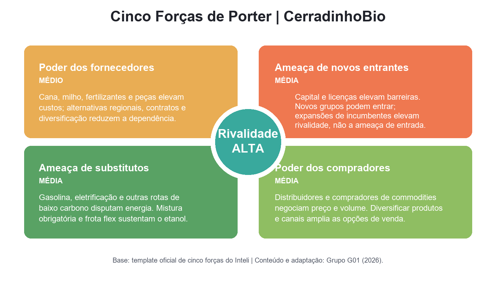
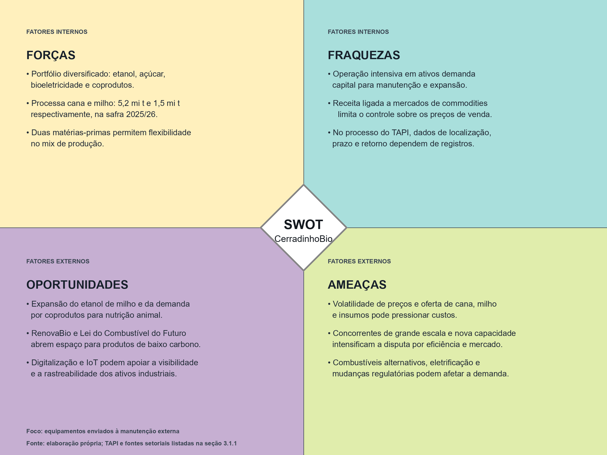

# Documentação IoTDoc - Módulo 4 - Inteli

**_Os trechos em itálico servem apenas como guia para o preenchimento da seção. Por esse motivo, não devem fazer parte da documentação final_**

## Nome do Grupo

#### Nomes dos integrantes do grupo

## Sumário

[1. Introdução](#c1)

[2. Metodologia](#c2)

[3. Desenvolvimento e Resultados](#c3)

[4. Conclusões e Recomendações](#c4)

[5. Referências](#c5)

 

# 1. Introdução (sprint 1)

A CerradinhoBio é uma companhia brasileira de capital aberto, com ações negociadas na B3, e integra o Grupo Cerradinho [3]. Atua em bioenergia a partir de cana-de-açúcar e milho: produz etanol, energia elétrica renovável gerada com biomassa, açúcar VHP e coprodutos do milho, como DDGS, WDG e óleo [4]. Suas operações estão em Chapadão do Céu (GO), onde ficam o negócio de cana e uma unidade de etanol de milho, e em Maracaju (MS), que também abriga uma unidade de etanol de milho [2]. Na safra 2025/26, a companhia registrou receita líquida consolidada de R$ 4,288 bilhões [1] e processou 5,2 milhões de toneladas de cana e 1,5 milhão de toneladas de milho; a capacidade instalada da fábrica de açúcar é de 550 mil toneladas por ano [2]. Como referência de porte de pessoal, a companhia informava cerca de 3.800 empregos diretos e indiretos em sua apresentação institucional publicada durante a safra 2024/25 [5]. A empresa se posiciona entre os maiores complexos industriais sucroenergéticos do Brasil e entre os maiores produtores de etanol do país [3, 4].

**Problema do projeto.** O acompanhamento de equipamentos enviados à manutenção externa depende de registros e contatos entre áreas e fornecedores. A dificuldade de consolidar localização, nota fiscal de remessa, prazo previsto e data de retorno reduz a visibilidade dos ativos em terceiros e exige cobranças manuais. Permanência total e atraso em relação ao prazo combinado são informações distintas e precisam ser analisadas separadamente.

## 1.1 Objetivos

**Objetivo geral.** Melhorar o controle dos equipamentos enviados a fornecedores para manutenção externa, desde a saída até o retorno.

**Objetivos específicos.** Ampliar a visibilidade dos ativos enquanto estão com terceiros; associar cada ciclo de envio à respectiva nota fiscal; distinguir permanência prolongada de atraso em relação ao prazo previsto; reduzir o esforço de consulta e cobrança manual; e preservar o histórico dos ciclos e movimentações.

## 1.2 Proposta da solução

A proposta reúne um dispositivo reutilizável, fixado ao equipamento com um lacre, e uma plataforma para consultar ativos, ciclos de manutenção, última localização e histórico. No cadastro, cada ciclo relaciona equipamento, fornecedor e nota fiscal, preservando os dados de saída e retorno. A plataforma compara o tempo decorrido desde a saída com o prazo previsto: assim, evidencia a permanência total do ativo e identifica separadamente quando o prazo combinado foi ultrapassado. A localização e o estado do ciclo ampliam a visibilidade dos equipamentos em terceiros; alertas configuráveis destacam casos para acompanhamento e pretendem reduzir consultas e cobranças manuais; o histórico registra os ciclos sucessivos; e uma API disponibiliza esses dados para análise em ferramentas de BI. No protótipo, a comunicação será demonstrada por Wi-Fi em cenário controlado. Como a disponibilidade de Wi-Fi nas oficinas de terceiros não é pressuposta, o canal de comunicação para produção será escolhido em sprint posterior, após comparação das alternativas em uma matriz que considere cobertura nos fornecedores, autonomia, confiabilidade, custo e escalabilidade, conforme o TAPI do projeto [6].

## 1.3 Justificativa

A centralização das informações pode facilitar a consulta da situação de cada equipamento, dar rastreabilidade documental aos envios e destacar casos que precisam de acompanhamento. O dispositivo reutilizável, o vínculo entre ativo, ciclo e nota fiscal, o histórico preservado entre usos e a disponibilização dos dados para BI compõem os diferenciais da proposta. A identificação mais rápida de pendências pode contribuir para reduzir o tempo de permanência e as perdas de ativos, mas esses resultados dependem do tratamento dos alertas pelos responsáveis e devem ser medidos; não são garantidos pelo protótipo, conforme os objetivos definidos no TAPI do projeto [6].

# 2. Metodologia (sprint 3)

_Descreva as etapas da metodologia RM-ODP que foram utilizadas para o desenvolvimento, citando o referencial teórico. Você deve apenas enunciar os métodos, sem dizer ainda como ele foi aplicado e quais resultados obtidos._

# 3. Desenvolvimento e Resultados 

## 3.1. Domínio de Fundamentos de Negócio

_Link para os templates de negócios: https://drive.google.com/drive/folders/1lTqisJ_gxxtc5J5aXM8ula2kQ4MsII_M?usp=sharing_

### 3.1.1. Contexto da Indústria (sprint 1)	

**Parceiro:** CerradinhoBio
**Setor analisado:** bioenergia e indústria sucroenergética brasileira, incluindo etanol de cana e de milho, açúcar, bioeletricidade e coprodutos.

#### Concorrência

A CerradinhoBio compete com grupos integrados de açúcar, etanol e bioenergia e, no segmento de etanol de milho, com produtores especializados. Entre os principais concorrentes estão a **Raízen** [19], a **São Martinho** [20] e a **bp bioenergy** [10] (antiga joint venture BP Bunge Bioenergia, adquirida integralmente pela bp em 2024). Para comparar a escala no segmento de cana, as empresas divulgam capacidade anual de moagem de aproximadamente 105 milhões de toneladas para a Raízen [19] e 32 milhões para a bp bioenergy [10]; a São Martinho projeta capacidade plena de 24 milhões de toneladas na safra 2026/27 [20]. No etanol de milho, a **FS** [11] informa capacidade anual de 2,6 bilhões de litros e a **Inpasa** [12] reporta 5,8 bilhões após a expansão de suas unidades. São indicadores de capacidade publicados em períodos diferentes; não representam produção realizada no mesmo ano nem participação de mercado.

#### Modelo de negócio

A CerradinhoBio opera um modelo B2B integrado e intensivo em ativos: transforma cana-de-açúcar e milho em etanol, açúcar VHP, bioeletricidade e coprodutos de milho destinados principalmente à nutrição animal [4], comercializados para distribuidores de combustíveis, clientes industriais e de alimentos para animais, compradores de açúcar e agentes do setor elétrico. A diversificação entre matérias-primas e produtos permite ajustar o mix de produção às condições de mercado; a venda de coprodutos também ajuda a compensar parte do custo do milho. A companhia participa ainda do mercado de créditos de descarbonização (CBIOs) por meio de sua produção certificada no RenovaBio [14]. O desempenho depende de escala e eficiência agrícola e industrial, logística de matéria-prima e produtos, capital para manutenção e expansão e exposição à sazonalidade e à volatilidade dos preços de commodities. Na safra 2025/26, a empresa informou processamento de 5,2 milhões de toneladas de cana e 1,5 milhão de toneladas de milho, além de produção equivalente de 865 mil m³ de etanol hidratado, dos quais 687 milhões de litros vieram do milho [2].

#### Tendências

O setor amplia a produção de etanol de milho, que complementa a oferta de cana e aproveita a disponibilidade de grãos e a demanda por coprodutos; a EPE [13] registrou produção total brasileira de etanol de 36,2 bilhões de litros em 2025, com expansão do milho compensando a queda da cana. O RenovaBio [14] e os CBIOs mantêm um mecanismo de incentivo à descarbonização, enquanto a Lei do Combustível do Futuro [15] cria oportunidades e novas exigências para biometano e combustível sustentável de aviação (SAF): para operadores aéreos, a redução mínima de emissões começa em 1% em 2027 e cresce gradualmente até 10% em 2037 (ANP — SAF [16] e ANP — biometano [17]). Outra frente é digitalizar a manutenção e a gestão de ativos industriais — por exemplo, consolidar registros, localização, prazos e alertas — para dar mais visibilidade à operação e apoiar decisões com dados; os benefícios dependem da qualidade da implantação e da atuação dos responsáveis.

#### Cinco Forças de Porter — perspectiva da CerradinhoBio

Escala qualitativa: **baixa**, **média** ou **alta**. A intensidade indica quanto a força tende a pressionar a atratividade e a rentabilidade da CerradinhoBio no setor, consideradas as condições descritas abaixo. A análise segue o referencial das cinco forças de Porter [18] e a figura foi preenchida sobre o template oficial de cinco forças do Inteli [21].

*Figura — Cinco Forças de Porter, preenchidas pela perspectiva da CerradinhoBio. Fonte: template oficial de negócios do Inteli [21]; conteúdo e adaptação: Grupo G01 (2026).*

| Força | Intensidade | Justificativa do ponto de vista da CerradinhoBio |
|---|---|---|
| **Rivalidade entre concorrentes** | **Alta** | Há grandes grupos de cana com escala e portfólios diversificados e produtores de milho em rápida expansão. Etanol e açúcar são produtos amplamente negociados e sujeitos a preços de mercado; isso limita a diferenciação puramente pelo produto e intensifica a disputa por eficiência agrícola e industrial, matéria-prima, logística e contratos de venda. A flexibilidade entre cana, milho, açúcar, energia e coprodutos pode ajudar a CerradinhoBio a responder a ciclos de preço, mas exige disciplina de custos e investimento. |
| **Poder de barganha dos fornecedores** | **Médio** | O milho, a cana adquirida de terceiros onde aplicável, fertilizantes, combustíveis, peças e equipamentos especializados podem pressionar custos, especialmente diante de sazonalidade, distância logística ou fornecedores concentrados. Em contrapartida, há alternativas de fornecimento para vários insumos, contratos e possibilidade de integração/produção agrícola própria; a operação com duas matérias-primas também reduz a dependência de uma única cadeia. O poder varia por insumo, região e safra, portanto recomenda-se acompanhar concentração e custo posto na usina por categoria. |
| **Poder de barganha dos compradores** | **Média** | Parte relevante da produção é vendida em mercados de commodities e passa por distribuidores, tradings e compradores industriais com escala, capacidade de comparar fornecedores e negociar grandes volumes. Isso limita a influência individual do produtor sobre o preço. A diversificação entre etanol, açúcar, energia, coprodutos e CBIOs amplia os canais de receita e reduz a dependência de um único comprador, embora cada mercado tenha sua própria concentração, especificação e dinâmica contratual. |
| **Ameaça de novos entrantes** | **Média** | Uma nova usina de cana ou biorrefinaria de milho exige capital elevado, escala, acesso confiável à matéria-prima, logística, licenciamento, tecnologia e tempo de implantação e ramp-up, o que cria barreiras importantes. Ainda assim, empresas do agronegócio e investidores podem financiar unidades novas, especialmente no milho, onde grãos e infraestrutura regional favorecem projetos. A entrada de novos grupos pode elevar a ameaça; ampliações realizadas por empresas já atuantes não são novos entrantes e reforçam principalmente a rivalidade entre concorrentes. |
| **Ameaça de produtos substitutos** | **Média** | Gasolina e outros combustíveis podem competir com o etanol no transporte; eletrificação, eficiência energética e outras rotas de baixo carbono podem reduzir demanda de longo prazo. Para açúcar, existem adoçantes alternativos; para energia e coprodutos, há outras fontes e ingredientes. Por outro lado, a mistura obrigatória de etanol na gasolina, a frota flex, as metas de descarbonização e a versatilidade do portfólio ajudam a sustentar mercados atuais e a abrir novas aplicações, como SAF e biometano. |

#### Síntese estratégica

O ambiente competitivo é mais pressionado pela rivalidade e pelo poder dos compradores, pois escala, custos e preços de commodities têm peso elevado. Para a CerradinhoBio, as prioridades estratégicas são preservar eficiência e confiabilidade dos ativos, proteger o abastecimento de cana e milho, ampliar a flexibilidade de mix e desenvolver canais de maior valor para coprodutos e combustíveis de baixo carbono. A digitalização da manutenção pode apoiar a disponibilidade e a gestão patrimonial; no projeto de rastreamento, sua contribuição específica é aumentar a visibilidade de equipamentos em manutenção externa, sem pressupor redução de prazo ou perdas antes de medir os resultados do piloto [6].

### 3.1.2. Análise SWOT (sprint 1)	

*Figura 3.1.2 — Análise SWOT da CerradinhoBio, com foco em equipamentos enviados à manutenção externa. Fonte: elaboração própria, com base no TAPI do projeto [6], nos dados de produção da CerradinhoBio [2], em seus produtos [4] e nas fontes setoriais vinculadas na seção 3.1.1.*

**Escopo:** análise da CerradinhoBio, com foco nas condições do negócio e na gestão de equipamentos enviados para manutenção externa. Forças e fraquezas representam fatores internos; oportunidades e ameaças, fatores externos. A síntese considera o contexto da indústria descrito na seção 3.1.1 e o TAPI do projeto.

**Leitura para o projeto:** o portfólio diversificado e a escala de processamento da CerradinhoBio oferecem contexto favorável para testar uma rotina de rastreabilidade reutilizável. A dependência de registros e contatos entre áreas e fornecedores é uma fragilidade do processo de manutenção externa descrito no TAPI, a validar com o parceiro. A expansão do etanol e as políticas de descarbonização abrem oportunidades para a companhia; concorrência em escala, volatilidade de insumos e substitutos energéticos compõem ameaças externas. **PENDENTE DE VALIDAÇÃO:** quantificar a dor operacional (volume de remessas, tempo fora, atrasos e esforço de consulta) com os dados da última safra, ainda a serem disponibilizados conforme o TAPI.

### 3.1.3. Descrição da Solução a ser Desenvolvida (sprint 1)	

#### 3.1.3.1 Qual é o problema a ser resolvido

Quando um equipamento da CerradinhoBio é enviado a um fornecedor externo para manutenção, as informações sobre localização, nota fiscal de remessa, prazo previsto e retorno dependem de registros e contatos entre áreas e fornecedor. Sem uma visão consolidada, a Gestão Patrimonial, a Controladoria e a Manutenção podem ter dificuldade para saber onde está cada ativo, há quanto tempo está fora e se o prazo combinado foi ultrapassado, além de precisar fazer consultas e cobranças manuais. O TAPI identifica essa necessidade [6]. **PENDENTE DE VALIDAÇÃO:** demonstrar a dimensão da dor — volume de remessas, permanência, atrasos e casos críticos — com dados da última safra a serem disponibilizados pelo parceiro; não se presume redução de perdas ou de prazo antes dessa análise.

#### 3.1.3.2 Qual a solução proposta (visão de negócios)

Propor um processo de rastreabilidade para equipamentos em manutenção externa, apoiado por dispositivos reutilizáveis e por um registro digital de cada ciclo [6]. A solução reunirá equipamento, fornecedor, responsável, nota fiscal, saída, prazo previsto, retornos de localização, comunicação, bateria, estado do lacre e alertas em uma consulta centralizada, com API para disponibilizar os dados ao BI. O piloto deverá validar a utilidade operacional e a viabilidade técnica e econômica antes de qualquer decisão de expansão. A tecnologia de localização e comunicação será escolhida após comparação de alternativas; a solução não pressupõe rastreamento contínuo ou posicionamento indoor preciso.

#### 3.1.3.3 Como a solução proposta deverá ser utilizada

1. **Solicitação e aprovação:** a área responsável solicita o envio do equipamento à manutenção externa e registra a aprovação conforme o processo da CerradinhoBio.
2. **Cadastro do ciclo:** o operador registra equipamento, fornecedor, responsável, nota fiscal de remessa e prazo previsto de retorno.
3. **Vínculo e lacre:** associa um dispositivo disponível ao equipamento, confere a fixação e registra a identificação do lacre. O sistema mantém um único vínculo ativo por dispositivo e preserva os ciclos anteriores.
4. **Saída e acompanhamento:** na saída, registra a data e inicia o ciclo. Durante a permanência externa, consulta a última localização válida, sua data e hora, a última comunicação, a bateria, o estado do lacre e os dias fora. As atualizações serão periódicas, com frequência semanal configurável como referência do piloto.
5. **Alertas e tratamento:** o sistema sinaliza, separadamente, o vencimento do prazo previsto, a permanência acima do limiar configurado (150 dias como referência inicial), a falta de comunicação, bateria baixa e violação ou retirada do lacre. O responsável verifica o caso, toma as providências e registra o tratamento. Uma retirada necessária ao reparo deve seguir fluxo de autorização, registro e reinstalação com novo lacre. Sem conexão, os eventos ficam armazenados para envio posterior; alertas fora da rotina dependem de conectividade.
6. **Retorno e liberação:** no retorno, o operador confere o equipamento, registra a data e encerra o ciclo. Depois da conferência e retirada do dispositivo, libera-o para outro equipamento sem apagar o histórico.

Os papéis de cadastro, aprovação, instalação, autorização de retirada, tratamento de alertas e conferência do retorno devem ser confirmados com o parceiro.

#### 3.1.3.4 Quais os benefícios trazidos pela solução proposta

- Visão consolidada dos equipamentos que estão fora, seus fornecedores, documentos associados, prazos e última localização válida.
- Mais facilidade para identificar itens atrasados ou acima do limiar de permanência e direcionar a consulta ao responsável adequado.
- Histórico rastreável de saídas, localizações, alertas, retiradas autorizadas, retornos e reutilização dos dispositivos.
- Menos dependência de consultas manuais para responder onde está um equipamento e qual é sua situação, benefício a medir no piloto.
- Base de dados via API para análise em BI e evidências para decidir se a solução deve evoluir.
- Reutilização dos dispositivos entre ciclos, condicionada à integridade, autonomia e viabilidade de operação demonstradas.

Redução do tempo de manutenção, de perdas ou de custos e ganhos ambientais são resultados potenciais, não garantidos pelo protótipo; dependem da resposta às informações e deverão ser avaliados com dados.

#### 3.1.3.5 Qual será o critério de sucesso e qual medida será utilizada para o avaliar

**Critério de sucesso:** demonstrar, no piloto, o ciclo completo de rastreabilidade de equipamentos, com dados consultáveis e históricos preservados, localização periódica útil, alertas tratados por responsáveis definidos e reutilização sem vínculo simultâneo indevido. O TAPI prevê pelo menos cinco equipamentos reais ou representativos e exige que as metas sejam acordadas antes dos testes. Os valores abaixo são **propostas para validação com a CerradinhoBio antes do início dos ensaios**, não resultados já obtidos.

| Indicador proposto | Medida e meta inicial proposta |
|---|---|
| Localização atualizada | Percentual de tentativas semanais programadas que geram uma localização externa válida: **≥ 90%**, em percurso e condições de teste previamente definidos. Registrar também o percentual de ciclos ativos com posição válida nos últimos sete dias. |
| Consulta do ativo | Tempo entre a busca pelo identificador do equipamento e a exibição da situação completa: **≤ 2 minutos em pelo menos 90%** das consultas de teste. |
| Alerta de violação | Tempo entre a violação detectada e a disponibilização do alerta: **≤ 15 minutos em cenário com conexão**. Em cenário sem conexão, confirmar o armazenamento e o envio após o restabelecimento, registrando a latência observada. |
| Falsos alertas | Alertas sem evento correspondente divididos pelo total de alertas avaliados: **≤ 5%** no conjunto de ensaios acordado. |
| Integridade do ciclo | Ciclos de saída e retorno com equipamento, fornecedor, referência documental, datas e vínculo do dispositivo corretamente registrados: **100% dos ciclos de teste**; nenhuma associação ativa duplicada após reutilização. |

O ensaio deve incluir retirada autorizada do lacre, indisponibilidade de conexão, retorno e liberação do dispositivo. A permanência de 150 dias e outros limiares pode ser verificada com datas simuladas, mas ensaios curtos não comprovam autonomia real por 150 dias. O relatório deverá separar valores medidos, estimativas e limitações, e apresentar os resultados também por percurso ou condição de cobertura para evitar que uma média esconda pontos sem localização.
	
### 3.1.4. Value Proposition Canvas (sprint 1)	

_O Canvas da proposta de valor deve ser feito considerando a solução que vocês estão desenvolvendo. Usar o template disponível no drive da turma._     

### 3.1.5. Matriz de Riscos (sprint 1)

  
<strong>Figura 1 — Matriz de riscos do projeto</strong>

  
  
<em>Fonte: Elaborado pelos autores (2026).</em>

Probabilidade: 10%, 30%, 50%, 70% ou 90%; impacto: muito baixo a muito alto. Os códigos seguem esses cruzamentos. 150 dias é limiar de alerta, não autonomia.

| ID | Causa e efeito | Prob. | Impacto | Justificativa | Resposta | Responsável |
|---|---|---:|---:|---|---|---|
| R01 | Safra atrasada → diagnóstico impreciso. | 50% | Moderado | Dependência externa. | Mitigar: validar hipóteses. | Negócios |
| R02 | Cobertura ou metal → perda do GNSS. | 70% | Muito alto | Obstáculos degradam sinais. | Mitigar: guardar posição e testar antenas. | Hardware |
| R03 | Ensaio curto → autonomia incerta. | 70% | Alto | Ciclos prolongados. | Mitigar: medir e projetar consumo. | Hardware |
| R04 | Oficina sem Wi-Fi → eventos retidos. | 90% | Alto | Rede externa incerta. | Mitigar: armazenar e avaliar celular. | Conectividade |
| R05 | Ruído ou abertura autorizada → falso alerta. | 50% | Alto | Eventos legítimos parecem violações. | Mitigar: debounce e autorização. | Firmware |
| R06 | Fixação inadequada → dano ou reparo prejudicado. | 50% | Muito alto | Formatos variam. | Evitar: fixação removível testada. | Hardware |
| R07 | Água ou lavagem → falha eletrônica. | 70% | Muito alto | Exposição provável. | Mitigar: vedação e ensaio. | Hardware |
| R08 | Conectividade cara → escala inviável. | 50% | Alto | Custo recorrente. | Mitigar: comparar tecnologias e planos. | Produto |
| R09 | Fornecedores indisponíveis → piloto limitado. | 50% | Moderado | Dependência de terceiros. | Mitigar: antecipar agenda e simular. | PO |
| R10 | Dado restrito publicado → exposição indevida. | 30% | Muito alto | Informações sensíveis. | Evitar: dados fictícios e revisão. | Dados/LGPD |

**Oportunidades:** O01 — rastreador reutilizável reduz custo por ciclo (70%; alto; explorar modularidade; Produto). O02 — integração com BI agiliza decisões (70%; alto; explorar API autenticada; Software).

### 3.1.6. Política de Privacidade de acordo com a LGPD (sprint 1)	

Política preliminar, sem aprovação jurídica da CerradinhoBio.

#### 3.1.6.1 Informações gerais

A solução acompanha equipamentos da CerradinhoBio em manutenção externa.

#### 3.1.6.2 Tratamento de dados

O tratamento seguirá a LGPD. Correspondência com o rascunho de RF do Luis: **PENDENTE DE VALIDAÇÃO**.

#### 3.1.6.3 Dados coletados

Serão tratados nome, e-mail corporativo, cargo, perfil, logs, IP e horário dos usuários; responsáveis por ciclos e alertas; e contatos profissionais de fornecedores. Dados do equipamento não são pessoais por si só; sua localização pode identificar indiretamente o motorista.

#### 3.1.6.4 Fonte dos dados

Fontes: titulares, responsáveis, fornecedores, painel e equipamentos.

#### 3.1.6.5 Finalidades

Servirão à autenticação, acesso, auditoria, ciclos, alertas, suporte e comunicação. Será mantida apenas a última posição válida, atualizada semanalmente, sem rastreamento contínuo, conforme restrições 1 e 5 do TAPI.

#### 3.1.6.6 Armazenamento

Cadastros, logs, ciclos e alertas ficarão no backend/banco em nuvem; mensagens, no broker. Provedor, região e tecnologias: **PENDENTE DE VALIDAÇÃO**.

#### 3.1.6.7 Retenção

Cadastros e permissões serão conservados enquanto ativos; logs, pelo período de auditoria; ciclos e alertas, enquanto necessários ao histórico; contatos, durante a relação operacional; localização, até sua substituição semanal; cookies, durante a sessão. Depois, haverá exclusão ou anonimização. Prazos: **PENDENTE DE VALIDAÇÃO**.

#### 3.1.6.8 Cookies

Se previstos no painel, serão usados somente cookies de sessão necessários.

#### 3.1.6.9 Compartilhamento

O compartilhamento necessário abrangerá provedores de nuvem, broker e conectividade.

#### 3.1.6.10 Segurança

Serão aplicados autenticação, acesso restrito, auditoria e proteção de credenciais.

#### 3.1.6.11 Direitos dos titulares

O titular poderá pedir confirmação, acesso, correção, anonimização, bloqueio, eliminação e informações sobre compartilhamento.

#### 3.1.6.12 Exercício dos direitos

Solicitações serão recebidas pelo canal oficial, terão identidade e escopo verificados, serão registradas, analisadas e respondidas. Canal: **PENDENTE DE VALIDAÇÃO**.

#### 3.1.6.13 DPO/Encarregado

O encarregado e seu contato serão indicados pela CerradinhoBio: **PENDENTE DE VALIDAÇÃO**.

### 3.1.7. Bill of Material (BOM) (sprint 1)
_BOM (Bill of Material) pode ser definido como uma lista completa de materiais, que detalha todos os itens necessários para construir, fabricar ou reparar um produto. Deve-se preencher o template fornecido.

**Componente GNSS definido em 21/10/2026:** Quectel LC76G, variante **PA**, uma unidade por dispositivo. A placa de desenvolvimento ou montagem, antena, circuito de alimentação/backup, fornecedor e preço continuam **PENDENTE DE VALIDAÇÃO**. Esta definição deve integrar a BOM completa; não representa compra ou ensaio físico realizado. A decisão e o contrato de simulação estão no [planejamento de energia e GNSS](outros/planejamento-energia-gnss.md#5-gnss-escolhido-quectel-lc76g-pa).

## 3.2. Domínio de Fundamentos de Experiência de Usuário 

### 3.2.1. Personas (sprint 1)	

#### Introdução às personas

#### Introdução às personas

As personas orientam o desenvolvimento da solução de rastreamento de equipamentos em manutenção externa da Cerradinho a partir dos objetivos, dificuldades e necessidades dos usuários. Os perfis consideram seus cenários de uso e letramento digital, distinguindo informações fundamentadas na pesquisa de hipóteses pendentes de validação.

### 3.2.2. Jornada do Usuário e Storyboard (sprint 2)	

_Coloque aqui seu Mapa de Jornada do Usuário (seguindo as instruções na descrição do artefato)_

_Coloque aqui seu Storyboard (seguindo as instruções na descrição do artefato)_

## 3.3. Solução Técnica	

_Nesta seção, detalhe a especificação da solução, de acordo com o disposto nas subseções._

### 3.3.1. Requisitos Funcionais (sprint 1, refinar e atualizar até sprint 5)

Os requisitos abaixo saem do TAPI (MVP 1 a 7 e fluxo básico), da avaliação do protótipo e do kick-off com a Cerradinho (16/10/2026). A prioridade segue o que o parceiro chamou de indispensável no kick-off: alerta de lacre, alerta de prazo e geolocalização. Um RF só passa a `Simulado no Wokwi` depois que o caso de teste correspondente (seção 3.4.1) é executado e passa. Os IDs estão congelados: um RF removido não libera o número, e um RF novo entra no fim da lista.

| ID    | Descrição | Origem | Prioridade | Status |
|-------|-----------|--------|------------|--------|
| RF001 | O sistema deve cadastrar o equipamento com identificador próprio, descrição e foto. | TAPI MVP 1 | Alta | Planejado |
| RF002 | O sistema deve abrir um ciclo de manutenção externa com NF de remessa (número e data de emissão), fornecedor, responsável e prazo previsto de retorno. | TAPI MVP 3 | Alta | Planejado |
| RF003 | O sistema deve vincular um dispositivo a um ciclo de manutenção aberto. | TAPI MVP 3 | Alta | Planejado |
| RF004 | O sistema deve recusar o vínculo de um dispositivo que já está em um ciclo ativo. | Fluxo básico | Alta | Planejado |
| RF005 | O sistema deve coletar a posição GNSS na rotina de envio e guardar a última localização válida com data e hora. | TAPI MVP 2 | Alta | Planejado |
| RF006 | O sistema deve monitorar o lacre e detectar sua abertura ou rompimento. | TAPI MVP 5 | Alta | Planejado |
| RF007 | O sistema deve registrar a retirada autorizada e a reaplicação do lacre sem gerar alerta de violação. | TAPI MVP 5 | Alta | Planejado |
| RF008 | O sistema deve conectar-se à rede Wi‑Fi e reconectar automaticamente quando a conexão cair. | Avaliação do protótipo | Alta | Planejado |
| RF009 | O sistema deve publicar status e eventos no broker MQTT, em JSON, no tópico do dispositivo. | TAPI MVP 6 | Alta | Planejado |
| RF010 | O sistema deve guardar os eventos gerados sem conexão e enviá-los na ordem em que ocorreram quando a conexão voltar. | TAPI MVP 5 | Alta | Planejado |
| RF011 | O sistema deve enviar um status periódico, semanal por padrão e configurável. | TAPI MVP 4 | Alta | Planejado |
| RF012 | O sistema deve calcular os dias fora a partir da data de emissão da NF de remessa. | TAPI MVP 4; Kick-off com a Cerradinho (16/10/2026) | Alta | Planejado |
| RF013 | O sistema deve emitir um alerta de atraso quando os dias fora passam do prazo previsto de retorno. | TAPI MVP 3 | Alta | Planejado |
| RF014 | O sistema deve emitir um alerta de permanência quando os dias fora atingem o limiar do ciclo (150 dias por padrão, configurável). | TAPI MVP 4 | Alta | Planejado |
| RF015 | O sistema deve listar os equipamentos fora com última localização válida, dias fora, prazo, bateria e estado do lacre. | TAPI MVP 6 | Alta | Planejado |
| RF016 | O sistema deve encerrar o ciclo somente com a NF de retorno lançada e o lacre fechado. | Fluxo básico | Alta | Planejado |
| RF017 | O sistema deve liberar o dispositivo do ciclo encerrado para um novo vínculo, preservando o histórico. | TAPI MVP 3; fluxo básico | Alta | Planejado |
| RF018 | O sistema deve notificar o responsável do ciclo a cada alerta, com o e-mail como canal inicial. | Fluxo básico; Kick-off com a Cerradinho (16/10/2026) | Alta | Planejado |
| RF019 | O sistema deve medir o nível de bateria e enviá-lo em cada mensagem. | TAPI MVP 6 | Média | Planejado |
| RF020 | O sistema deve cadastrar os dispositivos na plataforma, cada um com identificador e credencial próprios. | TAPI MVP 3 | Média | Planejado |
| RF021 | O sistema deve autenticar os usuários do painel com credencial individual e perfil de acesso. | TAPI MVP 6 | Média | Planejado |
| RF022 | O sistema deve exibir gráficos e mapa com equipamentos por faixa de dias fora, alertas por tipo e última posição de cada equipamento. | TAPI MVP 6 | Média | Planejado |
| RF023 | O sistema deve registrar o tratamento de um alerta com responsável, data e decisão. | Fluxo básico | Média | Planejado |
| RF024 | O sistema deve oferecer uma API autenticada e documentada para consulta dos dados por ferramentas de BI. | TAPI MVP 6 | Média | Planejado |
| RF025 | O sistema deve emitir um alerta quando um dispositivo passa do período esperado sem se comunicar. | Kick-off com a Cerradinho (16/10/2026) | Média | Planejado |
| RF026 | O sistema deve emitir um alerta quando os dias fora atingem a data limite legal do ciclo. | Kick-off com a Cerradinho (16/10/2026) | Média | Planejado |
| RF027 | O sistema deve emitir um alerta quando o nível de bateria fica abaixo do limite mínimo. | TAPI MVP 6 | Média | Planejado |

Itens técnicos da avaliação: coleta de dados via sensor (RF005, RF006, RF019) · definição de devices na plataforma (RF003, RF020) · chave de identificação de usuário e acesso ao dashboard (RF021) · conexão Wi‑Fi (RF008) · formatação de dados para MQTT (RF009) · representação gráfica dos dados coletados (RF015, RF022).

### 3.3.2. Regras de Negócio (sprint 1, refinar até sprint 5)

As regras abaixo restringem o comportamento descrito nos RFs da seção 3.3.1 e vêm das mesmas fontes: TAPI e kick-off com a Cerradinho (16/10/2026), além do regulamento do ICMS de Goiás no caso do prazo legal. Os valores marcados como `PENDENTE DE VALIDAÇÃO` são valores de teste usados no protótipo da seção 3.4.1 e serão definidos com o parceiro. Os casos de teste da 3.4.1 indicam qual RN verificam.

| ID   | Descrição | Origem | RF associado |
|------|-----------|--------|--------------|
| RN01 | Um dispositivo só pode estar vinculado a um ciclo ativo por vez, e um equipamento só pode ter um ciclo ativo por vez. | Fluxo básico | RF003, RF004 |
| RN02 | Um ciclo só pode ser aberto com NF de remessa (número e data de emissão), fornecedor, responsável e prazo previsto de retorno preenchidos. | TAPI MVP 3 | RF002 |
| RN03 | O limiar de permanência é de 150 dias por padrão e pode ser alterado em cada ciclo para qualquer número inteiro de dias maior que zero. | TAPI MVP 4; Kick-off com a Cerradinho (16/10/2026) | RF014 |
| RN04 | Atraso e permanência são alertas distintos, podem estar ativos ao mesmo tempo e cada um é emitido uma única vez por ciclo. | TAPI MVP 3 e 4 | RF013, RF014 |
| RN05 | A abertura do lacre sem autorização vigente é violação crítica e é enviada na hora, fora da rotina de status periódico. | TAPI MVP 5 | RF006 |
| RN06 | A autorização de retirada vale por 3 dias a partir do registro; a abertura do lacre depois desse prazo é tratada como violação. Prazo de 3 dias: `PENDENTE DE VALIDAÇÃO` | TAPI MVP 5 | RF007 |
| RN07 | O status periódico é enviado a cada 7 dias por padrão, com frequência configurável até diária. | TAPI MVP 4 | RF011 |
| RN08 | Uma posição GNSS é válida quando o receptor tem fix, a posição traz data e hora do próprio GNSS e o HDOP é de no máximo 2,0. A última localização válida só é atualizada com uma posição válida; sem ela, a anterior é mantida. Última comunicação e última localização válida são registradas em campos distintos. HDOP máximo de 2,0: `PENDENTE DE VALIDAÇÃO` | TAPI MVP 6 | RF005, RF015 |
| RN09 | Sem conexão, o dispositivo guarda até 8 eventos; com a fila cheia, descarta o evento não crítico mais antigo e nunca descarta uma violação. Cada evento mantém a hora em que ocorreu, e a plataforma registra a hora de recebimento à parte. Capacidade de 8 eventos: `PENDENTE DE VALIDAÇÃO` | TAPI MVP 5 | RF010 |
| RN10 | O alerta de bateria baixa é emitido uma vez quando o nível fica abaixo de 20% e só volta a ser emitido depois que o nível passa de 25%. Leitura zero é falha do sensor, não bateria vazia. Limites de 20% e 25%: `PENDENTE DE VALIDAÇÃO` | TAPI MVP 6 | RF019, RF027 |
| RN11 | O encerramento do ciclo é recusado enquanto o lacre estiver aberto ou a NF de retorno não estiver lançada, e o histórico do ciclo encerrado nunca é apagado. | Fluxo básico | RF016, RF017 |
| RN12 | Uma prorrogação (retorno e nova remessa simbólicos) abre um novo ciclo do mesmo equipamento e do mesmo dispositivo, e os dias fora passam a contar da emissão da nova NF de remessa. | Kick-off com a Cerradinho (16/10/2026) | RF012, RF017 |
| RN13 | A data limite legal do ciclo é de 270 dias para destino em GO e de 360 dias para destino fora de GO, contados da saída, ou seja, da emissão da NF de remessa. Vigência dos prazos: `PENDENTE DE VALIDAÇÃO` com o fiscal da Cerradinho | RCTE/GO (Decreto nº 4.852/1997), art. 79, I, "s", 1 (270 dias, saída interna) e Anexo IX, art. 6º, IV (360 dias, saída interestadual), na redação do Decreto nº 7.815/2013; Kick-off com a Cerradinho (16/10/2026) | RF012, RF026 |
| RN14 | Um dispositivo é considerado sem comunicação quando passa de dois intervalos de status periódico sem enviar nenhuma mensagem (14 dias com o padrão de 7 dias); o alerta é emitido uma vez e só volta a ser emitido depois de uma nova comunicação. Dois intervalos: `PENDENTE DE VALIDAÇÃO` | Kick-off com a Cerradinho (16/10/2026) | RF025 |
| RN15 | O painel e a API só respondem a usuário autenticado; sem credencial válida, o acesso é negado e nenhum dado é exibido. | TAPI MVP 6 | RF021, RF024 |
| RN16 | Mensagem de dispositivo não cadastrado ou com credencial inválida é rejeitada e não altera nenhum ciclo. | TAPI MVP 3 | RF020 |

**Compatibilidade entre requisitos e circuito atual.** RF001–RF027 e RN01–RN16 seguem a `develop`. A integração preserva o circuito e o firmware locais; as diferenças abaixo não representam requisitos já atendidos.

| Regra da develop | Situação atual / tratamento na integração |
|---|---|
| RN05 — envio da violação fora da rotina periódica | Preservar registro local independente de GNSS/rede. Entrega ao servidor ainda não implementada; manter limites de latência pendentes com o parceiro. “Na hora” não define SLA nem garante entrega sem conexão. |
| RN08 — data/hora GNSS e HDOP máximo de 2,0 | O firmware atual verifica validade, idade e satélites, mas não aplica esse limite de HDOP nem persiste data/hora absoluta. Registrar adequação futura do driver LC76G-PA; limite de HDOP ainda pendente. |
| RN09 — fila de 8 com prioridade para críticos | Preservar os 16 registros atuais e o CT21. Os 8 eventos são um valor proposto na regra. Prioridade, reenvio e saturação quando todos forem críticos ainda precisam ser definidos/implementados; fila finita não garante retenção ilimitada. |
| RN10 — leitura zero considerada falha | Preservar o CT23: no potenciômetro atual, zero é mínimo válido. Diagnóstico físico de falha depende do circuito, do CT13 e do CT30 previsto no [planejamento de energia e GNSS](outros/planejamento-energia-gnss.md). |
| RN11 — encerramento exige lacre fechado e NF de retorno | Incorporar a condição aos CT14/CT16 planejados. O botão atual continua apenas em diagnóstico. |

### 3.3.3. Requisitos Não Funcionais — 8 Eixos ISO/IEC 25010 (sprints 2 a 5)

*Preencha os 8 eixos. Cada eixo deve ter ao menos um RNF verificável (com métrica, limite ou critério concreto) ou justificativa explícita de ausência. Evolua do conceitual (sprint 2) ao técnico mensurável (sprint 5).*

| Eixo                     | Requisito | Métrica / Critério | Justificativa |
|--------------------------|-----------|--------------------|---------------|
| USAB — Usabilidade       | ...       | ...                | ...           |
| CONF — Confiabilidade    | ...       | ...                | ...           |
| DES — Desempenho         | ...       | p95 < X ms         | ...           |
| SUP — Suportabilidade    | ...       | ...                | ...           |
| SEG — Segurança          | ...       | ...                | ...           |
| CAP — Capacidade         | ...       | ...                | ...           |
| REST — Restrições Design | ...       | ...                | ...           |
| ORG — Organizacionais    | ...       | ...                | ...           |

### 3.3.4. Matriz de Rastreabilidade (RTM) (sprints 1 a 5)

Rastreabilidade dos cenários da Sprint 1, vinculada aos RF e RN de negócio. A matriz não indica testes executados nem cobre integralmente os 27 RFs: prorrogação, prazo legal, ausência de comunicação e autenticação da plataforma/dispositivo ainda precisam de cobertura específica. Os CT01–CT16 descrevem comportamento planejado; CT17–CT23 caracterizam o firmware integrado atual.

| Necessidade | RF | RN de negócio | Casos de teste | Evidência a produzir |
|---|---|---|---|---|
| Detecção do lacre independente de GNSS/rede | RF006, RF009, RF010 | RN05, RN09 | CT05, CT08, CT18 | Estímulos e eventos com tempos, perdas e duplicações. |
| Última localização válida identificável | RF005, RF015 | RN08 | CT19, CT20, CT22 | JSON, referência antes/depois e condições de fix. |
| Eventos preservados sem rede | RF010 | RN09 | CT09, CT10, CT21, CT22 | Fila antes/depois; CT21 caracteriza a capacidade atual, sem comprovar reenvio. |
| Autorização de retirada | RF007 | RN05, RN06 | CT06, CT07, CT11 | Estímulos e decisões da futura lógica de autorização. |
| Ciclos e prazos | RF004, RF011–RF014, RF016, RF017 | RN01, RN03, RN04, RN07, RN11 | CT02–CT04, CT14–CT16 | Estado do ciclo e eventos nos limites de tempo. |
| Diagnóstico do circuito | Transversal | Transversal | CT01, CT17–CT23 | Versão, configuração, estímulos e logs. |
| Leitura e diagnóstico de bateria | RF019, RF027 | RN10 | CT12, CT13, CT23 | Leituras sintéticas; CT13 depende de interface física com diagnóstico. |

A proposta de RNFs, a máquina de estados de energia e os CT24–CT34 estão no [planejamento de energia e GNSS](outros/planejamento-energia-gnss.md), para revisão nas próximas sprints.

### 3.3.5. Arquitetura da Solução (sprint 3)

_Vídeo de explicação sobre a arquitetura da solução: (coloque aqui o link do vídeo)_

_Descreva a arquitetura técnica da solução de forma detalhada (visão de arquitetura).

Justifique como a arquitetura suporta os requisitos funcionais e não funcionais.

O diagrama de arquitetura deve:_
- _Mostrar microcontroladores, incluindo descrições de sua função no sistema (por exemplo: "Irá processar o sinal dos sensores a cada X minutos")_
- _Mostrar sensores, incluindo descrição de função e especificações técnicas do tipo de informação que será coletada_
- _Mostrar apresentadores de informação (displays), incluindo descrição de que tipo de informação será apresentada (por exemplo, "Mostrar temperatura dos sensores")_
- _Mostrar atuadores, caso existam na solução, incluindo descrições do que irão acionar (por exemplo, "Ligar motor de irrigação durante x minutos")_
- _Mostrar o broker MQTT e o dashboard que é a interface do usuário_
- _Mostrar ligações entre os elementos (com fio ou sem fio) – incluindo conexões com sensores e atuadores, conexão com WiFi, entre outros_

### 3.3.6. Arquitetura do Protótipo(sprint 4)	

_Vídeo de explicação sobre a arquitetura do protótipo físico: (coloque aqui o link do vídeo)_

_Descreva as tecnologias utilizadas de forma detalhada (visão de tecnologia).

Descreva a arquitetura usando um diagrama de blocos similar à visão anterior, porém especificando as tecnologias utilizadas. O diagrama de arquitetura deve:_
- _Mostrar microcontroladores, incluindo descrições de sua função no sistema (por exemplo: "Irá processar o sinal dos sensores a cada X minutos")_
- _Mostrar sensores, incluindo descrição de função e especificações técnicas do tipo de informação que será coletada_
- _Mostrar apresentadores de informação (displays), incluindo descrição de que tipo de informação será apresentada (por exemplo, "Mostrar temperatura dos sensores")_
- _Mostrar atuadores, caso existam na solução, incluindo descrições do que irão acionar (por exemplo, "Ligar motor de irrigação durante x minutos")_
- _Mostrar o broker MQTT e o dashboard que é a interface do usuário_
- _Mostrar ligações entre os elementos (com fio ou sem fio) – incluindo conexões com sensores e atuadores, conexão com WiFi, entre outros._
_Faça uma tabela dos possíveis componentes utilizados. Todos os componentes devem estar presentes na arquitetura._

| **Componente** | **Descrição** | **Tipo** | 
|----------|----------|----------|
|E.g. ESP32 WROOM 32 Devkit|E.g. Trata-se de um microcontrolador amplamente usado na indústria e em projetos educacionais, que possui interfaces mais amigáveis para conexão de componentes diversos...|E.g. Microcontrolador|
|E.g. sensor XPTO|E.g. Este sensor mede o sinal de XYZ em unidades q/s, e possui tolerância de abcd...|E.g. Sensor|

### 3.3.7. Arquitetura Refinada da Solução (sprint 5)	

_Descreva a revisão da arquitetura técnica da solução de forma detalhada (visão de arquitetura).  

Justifique como a arquitetura suporta os requisitos funcionais e não funcionais.  

A revisão deverá incluir comentários sobre cada ponto levantado, mostrando como os ajustes foram realizados, além da descrição da arquitetura revisada._

## 3.4. Resultados	

_Nesta seção, detalhe os resultados obtidos com a implementação, de acordo com o disposto nas subseções._

### 3.4.1. Protótipo Inicial do Projeto usando o Simulador Wokwi (sprint 1)

**Link do protótipo:** https://wokwi.com/projects/478276108359405569

**Circuito principal integrado (21/10/2026):** o arquivo local de referência é
[`src/firmware/prototipo_wokwi/diagram.json`](../src/firmware/prototipo_wokwi/diagram.json),
com ESP32 DevKit v1, GPS/GNSS customizado, lacre no GPIO27, potenciômetro no GPIO34,
LEDs verde/amarelo/vermelho/azul nos GPIO25/26/23/14, botões nos GPIO33/13 e chave
de rede no GPIO18. O [guia do circuito](../src/firmware/prototipo_wokwi/README.md)
contém a pinagem e o roteiro de diagnóstico. As configurações `wokwi.toml` e
`wokwi.weekly.toml` ficam nessa mesma pasta e são selecionadas por **Wokwi: Select Config File**.
O projeto público acima e a Figura 1 representam a versão anterior.

Na Sprint 1 o dispositivo é simulado no Wokwi com um ESP32 DevKit. Cada entrada do circuito representa uma situação física do rastreador: o lacre (`SW_LACRE`), a disponibilidade de conexão (`SW_REDE`), a autorização de retirada (`BTN_AUTORIZAR`), o encerramento ou vínculo de ciclo (`BTN_CICLO`) e o nível da bateria (`POT_BATERIA`). Os LEDs representam estados para inspeção e o Monitor Serial mostra os registros JSON. Não há transporte implementado para servidor ou broker. A integração local inclui GNSS simulado; a validação do hardware GNSS permanece para a Sprint 2.

Na integração atual, o firmware principal já tem o ciclo da issue #13: conta os dias
fora, envia o `STATUS` ao ligar e o `STATUS_SEMANAL` a cada 7 dias, e emite os alertas
de atraso e de permanência. Verde indica lacre íntegro, amarelo pisca no atraso e fica
fixo na permanência, vermelho pisca na violação e azul pisca com a rede simulada
indisponível. Os botões continuam só com leitura de diagnóstico no heartbeat; a
autorização, a fila e o debounce dos botões entram com a issue #14. A chave de rede
não desliga o Wi-Fi virtual; os estados são apresentados separadamente.

**Tempo e parâmetros atuais.** O firmware principal usa `demo` com coleta a cada 30 s ou `weekly` com sete dias. No `demo`, o ciclo usa a escala `1 s = 1 dia` dos CT02–CT04 (`Config::DayMs`); no `weekly`, o dia é real. O intervalo de coleta é contado a partir da conclusão da coleta anterior, incluindo nova espera de fix quando necessária.

| Parâmetro técnico atual | Valor / comportamento | Fonte |
|---|---|---|
| Intervalo de coleta | 30 s (`demo`) / 7 dias (`weekly`) | `Config::SampleIntervalMs` |
| Espera máxima por fix / idade máxima do fix | 10 s / 3 s | `Config::GpsWaitMs` / `Config::FixMaxAgeMs` |
| Debounce do lacre | 60 ms; botões ainda em diagnóstico | `Config::SealDebounceMs` |
| Fila local | 16 registros; antigos preservados, novo apenas na Serial se cheia | `Config::QueueCapacity` e `enqueue()` |
| Movimento entre coletas válidas | Distância estritamente maior que 100 m | `Config::MovementThresholdM` |
| Heartbeat / tentativa de reconexão Wi-Fi | 2 s / 30 s quando desconectado | `Config::HeartbeatMs` / `Config::WifiRetryMs` |

**Valores propostos para testes de negócio.** Nos cenários de ciclo, a contagem de dias fora parte da emissão da NF de remessa, conforme RF012; não corresponde ao `uptime_ms` atual. A tabela seguinte não substitui a configuração atual. O TAPI fixa a referência de 150 dias para permanência e o status semanal; as demais metas dependem do parceiro. Tempo de chegada da autorização e possibilidade de autorização antecipada continuam **PENDENTE DE VALIDAÇÃO**.

| Parâmetro | Valor de teste | Origem |
|---|---|---|
| Status periódico | 7 dias | TAPI ("uma vez por semana, com frequência ajustável") |
| Limiar de permanência | 150 dias (também testado com 10) | TAPI ("150 dias como referência inicial"; MVP 4 pede outros limiares) |
| Prazo previsto de retorno | 5 dias | Valor de teste — `PENDENTE DE VALIDAÇÃO` |
| Janela de autorização de retirada | 3 dias | Valor de teste — `PENDENTE DE VALIDAÇÃO` |
| Capacidade da fila sem conexão | Atual: 16 eventos; dimensionamento final pendente | A proposta anterior de 8 não corresponde ao firmware atual |
| Bateria baixa / recuperada | 20% / 25% | Valor de teste — `PENDENTE DE VALIDAÇÃO` |

**LEDs simultâneos.** Cada LED representa um estado independente e podem acender juntos: verde e vermelho seguem o estado estável do lacre, amarelo segue o ciclo (piscando no atraso, fixo na permanência) e azul pisca com a rede simulada indisponível. O verde piscando da retirada autorizada entra com a issue #14.

**Do simulador ao dispositivo real.** O alvo principal compila `src/firmware/main.cpp`. O `sketch.ino` da pasta do circuito é um teste independente de bancada. A migração física exige validar interfaces, alimentação, sensores e firmware; não é apenas trocar fontes de leitura.

| Componente no Wokwi | O que representa no dispositivo real |
|---|---|
| ESP32 DevKit | Microcontrolador do rastreador |
| SW_LACRE (chave deslizante) | Sensor do lacre (laço de continuidade ou reed switch) |
| BTN_AUTORIZAR (botão) | Autorização de retirada registrada pelo responsável (no produto, vinda da plataforma) |
| BTN_CICLO (botão) | Encerramento do ciclo ou novo vínculo, feitos na conferência de retorno |
| POT_BATERIA (potenciômetro) | Percentual sintético; medição física, calibração e diagnóstico do divisor ainda pendentes |
| SW_REDE (chave deslizante) | Disponibilidade simulada, independente do Wi-Fi; hoje não interrompe transporte nem esvazia fila |
| LEDs | Diagnóstico local; política futura de indicação e duração depende da implementação |
| Monitor Serial (JSON) | Registro local; não comprova publicação MQTT ou recebimento pela plataforma |

A versão inicial pública não inclui localização. O circuito principal local inclui
GPS/GNSS customizado nos GPIO16/17; ele não modela recepção de satélites nem consumo real.

**Situação dos CT01–CT16:** CT01 a CT04 estão implementados no firmware principal (issue #13) e verificados nos testes de lógica de `tests/model_tests.c`; a execução no Wokwi é registrada com os prints de cada CT. Os demais descrevem a lógica das próximas integrações. Seus RF/RN seguem as definições de 3.3.1/3.3.2; divergências com a implementação estão explicitadas em 3.3.2. CT17–CT23 caracterizam funções atuais. Os CT24–CT34 de evolução e validação física ficam no [planejamento de energia e GNSS](outros/planejamento-energia-gnss.md). Compilação e testes matemáticos isolados não comprovam aprovação destes cenários.

*Figura 1 — Circuito anterior do protótipo no Wokwi, com o Monitor Serial aberto, antes da integração local do GPS.*

Fonte: elaboração própria, captura do simulador Wokwi.

**CT#** | **Bloco** | **Componente de entrada** | **Leitura da entrada** | **Componente de saída** | **Leitura da saída** | **Descrição**
|----------|----------|----------|----------|----------|----------|----------|
|CT01|Inicialização|SW_LACRE e SW_REDE|Lacre fechado e rede disponível ao ligar|LED verde; Serial|Verde fixo, demais apagados; JSON `STATUS` com `dias_fora=0`, `seal="intact"`|Esperado: Ao ligar com o lacre íntegro e conexão, o dispositivo indica operação normal e publica o primeiro status (RF009).|
|CT02|Status periódico|Relógio simulado (1 s = 1 dia)|Dias 7 e 14 de ciclo|Serial|Um `STATUS_SEMANAL` no dia 7 e outro no dia 14, nenhum fora desses dias|Esperado: O status é enviado a cada 7 dias, como pede o TAPI (RF011, RF009; RN07).|
|CT03|Prazo e atraso|Relógio simulado (1 s = 1 dia)|`dias_fora` passa do prazo previsto (5) e fica abaixo do limiar|LED amarelo; Serial|Amarelo piscando a 1 Hz; `ALERTA_ATRASO` emitido uma única vez|Esperado: O equipamento passou da data prevista de retorno, o que é diferente de permanência prolongada (RF013, RF012; RN04).|
|CT04|Permanência|Relógio simulado (1 s = 1 dia)|`dias_fora` atinge o limiar (rodar com 10 e com 150)|LED amarelo; Serial|Amarelo fixo; `ALERTA_PERMANENCIA` emitido uma única vez em cada rodada|Esperado: Testa o limiar configurável com o valor de referência e um valor alternativo, como pede o MVP 4 do TAPI (RF014, RF012; RN03, RN04).|
|CT05|Lacre|SW_LACRE|Lacre aberto sem autorização|LED vermelho; Serial|Vermelho piscando; `VIOLACAO_LACRE` é registrado sem esperar GNSS/rede, fora da rotina semanal|Esperado: Abertura não autorizada gera registro local; medir entrega separadamente da detecção local, com limite a validar com o parceiro (RF006; RN05).|
|CT06|Retirada autorizada|BTN_AUTORIZAR e SW_LACRE|Botão pressionado; lacre aberto dentro da janela de 3 dias e depois fechado|LED verde; Serial|Verde piscando durante a retirada; `RETIRADA_AUTORIZADA` sem alerta; ao fechar, `LACRE_REAPLICADO` e verde fixo|Esperado: Fluxo de retirada autorizada para o reparo, com reaplicação do lacre (RF007; RN06).|
|CT07|Autorização expirada|BTN_AUTORIZAR e SW_LACRE|Botão pressionado; lacre aberto depois de mais de 3 dias|LED vermelho; Serial|Mesmo resultado do CT05: `VIOLACAO_LACRE`|Esperado: Autorização vencida não libera a abertura (RF006; RN05, RN06).|
|CT08|Sem conexão|SW_REDE e SW_LACRE|Rede indisponível; lacre aberto sem autorização|LEDs azul e vermelho; Serial|Azul e vermelho piscando; nada publicado; `VIOLACAO_LACRE` guardada na fila; Serial mostra `[FILA] 1 pendente`|Esperado: Sem conexão, o evento crítico deve ficar guardado para envio posterior dentro da capacidade disponível; saturação é tratada no CT10 (RF010, RF008; RN05, RN09).|
|CT09|Reconexão|SW_REDE|Rede volta a ficar disponível|LED azul; Serial|Eventos pendentes publicados na ordem, com o dia original de ocorrência; azul apaga|Esperado: Ao reconectar, registros confirmados pelo servidor são removidos sem perder o horário de ocorrência (RF010, RF008; RN09).|
|CT10|Fila cheia (evolução)|SW_REDE e entradas que geram eventos|Exceder a capacidade configurada; repetir com fila mista e só críticos|Serial e memória|Prioridade e descarte conforme política aprovada; contador de perdas e saturação explícitos|Planejado. Definir capacidade e política quando todos forem críticos; não prometer retenção ilimitada. O comportamento atual de 16 registros é caracterizado no CT21 (RF010; RN09).|
|CT11|Ruído de botão|BTN_AUTORIZAR|Pressões rápidas (ruído de contato) e depois o botão segurado por 3 s|Serial|Um único evento por pressão real (debounce do botão a definir; os 60 ms atuais se aplicam ao lacre, detecção por borda); segurar não repete o evento|Esperado: Leituras falsas do botão não geram autorizações em duplicidade (RF007).|
|CT12|Bateria|POT_BATERIA|Nível abaixo de 20%, depois acima de 25%|Serial|`BATERIA_BAIXA` uma única vez; não repete até voltar a 25% (histerese)|Esperado: O alerta de bateria não fica oscilando perto do limite (RF019, RF027; RN10).|
|CT13|Falha do sensor de bateria (evolução)|Circuito físico de medição com diagnóstico|Injetar abertura/curto conforme interface definida|Serial|Distinguir falha somente quando houver evidência elétrica independente|Planejado, depende de hardware. ADC = 0 isoladamente não distingue desconexão de nível mínimo. O potenciômetro atual produz 0% válido no mínimo; verificar no CT23 (RF019, RF027; RN10).|
|CT14|Encerramento|BTN_CICLO e SW_LACRE|NF de retorno lançada; lacre fechado; botão segurado por 2 s|Serial|`CICLO_ENCERRADO`; `dias_fora` zera; `ciclo_id` sobe; contador de ciclos preservado|Esperado: Encerrar o ciclo libera o dispositivo sem apagar o histórico (RF016, RF017; RN11).|
|CT15|Vínculo simultâneo|BTN_CICLO|Ciclo ativo; toque curto (tentativa de novo vínculo)|Serial|`VINCULO_RECUSADO`; o ciclo atual continua igual|Esperado: Impede vínculos simultâneos indevidos, como pede o TAPI (RF004; RN01).|
|CT16|Encerramento recusado|BTN_CICLO e SW_LACRE|Rodada A: lacre aberto e NF lançada. Rodada B: lacre fechado e NF ausente; solicitar encerramento em ambas|Serial|`ENCERRAMENTO_RECUSADO`; o ciclo continua ativo|Esperado: O ciclo só pode ser encerrado com o lacre fechado e a NF de retorno lançada (RF016; RN11).|

#### Casos aplicáveis ao firmware integrado atual

**Situação: planejados; nenhuma execução destes CTs foi realizada nesta revisão documental.** Usar o circuito local e o ambiente `demo`, registrar as alterações locais e as constantes efetivas. Começar com memória de teste conhecida quando exigido, preservando qualquer dado anterior. Registrar versão do firmware, log Serial completo e estímulos; inspecionar NVS quando o critério exigir conteúdo persistido. Uma mensagem de log sozinha não comprova retenção após falta de energia.

| CT | Pré-condição e procedimento | Resultado esperado / medição | Limitação ou preparação |
|---|---|---|---|
| CT17 | Acionar lacre, autorização, ciclo e chave de rede individualmente; repetir com rede simulada indisponível e lacre aberto. | Verde/vermelho acompanham lacre estável; azul acompanha rede simulada. Heartbeat mostra ambos os botões e separa `wifi` de `rede_sim`. Nenhum botão autoriza retirada ou encerra ciclo no firmware atual. | Diagnóstico atual. Não interpretar LED como confirmação de servidor. |
| CT18 | Com captura temporal controlada, aplicar pulsos de 20 e 40 ms no lacre, depois 10 aberturas/fechamentos estáveis de 200 ms; repetir durante espera por fix e com rede indisponível. | Zero eventos nos pulsos curtos observados; um `seal_changed` por transição estável, sem repetição enquanto o nível é mantido. `authorized_removal=null`. Registrar `L_det = t_registro_local − t_estabilizacao_contato`, perdas e duplicações; ampliar para 30 estímulos por condição ao medir p95. | Exige injeção temporizada; cliques manuais não comprovam milissegundos. Debounce atual de 60 ms; limite máximo de latência pendente. |
| CT19 | Rodada A: iniciar sem fix. Rodada B: obter posição válida, invalidar o fix e aguardar próxima coleta. Rodada C: interromper NMEA por mais de 3 s antes de solicitar nova coleta. | Sem fix recente, emitir `location_unavailable` após a espera configurada de 10 s, mais latência de processamento medida. Latitude/longitude atuais e `moved` são `null`; histórico é preservado quando disponível. O lacre continua respondendo durante a espera. | Rodada C exige controle da emissão UART no ensaio. Não aceitar só a passagem do tempo com NMEA válido chegando. A referência de comparação é a coleta válida anterior, distinta do último fix observado. |
| CT20 | Com memória de teste sem referência e fix contínuo, coletar primeiro ponto; depois pontos sintéticos separados por aproximadamente 50 m e 150 m da respectiva coleta anterior. Observar ao menos três coletas em `demo`. | Primeiro ponto: `baseline_created=true`, distância e `moved` nulos. Nas seguintes, `moved=false` para 50 m e `true` para 150 m. Com fix disponível, intervalo de 30 s mais latência de processamento; registrar desvio. | Comparar coletas válidas consecutivas. Testar fronteira de 100 m em teste matemático separado, considerando arredondamento; não alegar sete dias medidos com demo de 30 s. |
| CT21 | Iniciar fila vazia em memória de teste; gerar 17 registros, contando também coletas automáticas. Inspecionar chaves `q0` a `q15`; alternar a chave de rede. | Os primeiros 16 ocupam a fila; o 17º aparece na Serial com aviso de limite e não substitui os anteriores. A chave de rede não esvazia a fila. Medir quantos registros ficaram somente na Serial. | Caracteriza a limitação atual; confirmação de entrega, prioridade e reenvio continuam pendentes. Inspeção de NVS exige ferramenta/instrumentação de teste; capacidade final e prioridade ainda pendentes. |
| CT22 | Salvar posição A e registros conhecidos; reiniciar preservando flash/NVS. Sem novo fix, observar saída; depois coletar B. | Referência A e fila permanecem. Histórico após reinício sem idade conhecida apresenta `last_valid_age_ms=null`; novo ponto B compara com A. `uptime_ms` reinicia e não deve ser tratado como horário absoluto. | Confirmar preservação de flash no ambiente usado; se indisponível no simulador, executar em hardware. Sem acesso à NVS, não aprovar retenção da fila apenas pelo JSON da posição. |
| CT23 | Mover potenciômetro ao mínimo, meio e máximo; observar heartbeat/JSON. | Percentual sintético permanece entre 0 e 100 e acompanha a entrada; zero representa mínimo válido. Não emitir conclusão de bateria desconectada, autonomia ou tensão física com esses dados. | ADC e percentual simulados não são medição de estado de carga de uma bateria real. |

**Registro de execução a preencher para cada CT:** data; responsável; versão e alterações locais; configuração; ambiente; pré-condições; estímulos e quantidade de repetições; resultado medido; critério utilizado; situação (`NÃO EXECUTADO`, `BLOQUEADO`, `APROVADO` ou `REPROVADO`); evidência; limitações. Fotos do simulador podem ficar em `assets/wokwi/CTnn.png`; medições e logs anonimizados devem acompanhar o registro, sem usar relatórios internos como evidência. Não criar arquivos de evidência vazios nem marcar teste aprovado antes da execução.

**Próximas sprints.** As seções seguintes mantêm as orientações e os exemplos originais do template. Seus exemplos de CT não são resultados de execução. A proposta de evolução do circuito e os CT24–CT34 estão no [planejamento de energia e GNSS](outros/planejamento-energia-gnss.md).

### 3.4.2. Protótipo Físico do Projeto (offline) (sprint 2)	

_Aqui você deve registrar diversas situações de teste, indicando exemplos de leitura (entrada) e escrita (saída) apresentadas pelo seu sistema físico. Estes registros serão utilizados para testar seus componentes, portanto, descreva várias situações, incluindo não apenas casos de sucesso, mas também de possíveis falhas nas leituras de entradas e saídas.  
Siga as nomenclaturas e convenções já utilizadas anteriormente, e não se esqueça dos alinhamentos de negócios e experiência do usuário para pensar em situações representativas. Inclua figuras do protótipo físico e descrições dos testes realizados para ilustrar o funcionamento do protótipo. Continue a numeração de CT a partir da tabela anterior. A tabela a seguir serve como exemplo._

**CT#** | **Descrição** | **Pré-condição** | **Procedimento de teste** | **Pós-condição/Resultado esperado** | **Observações** (opcional)
|----------|----------|----------|----------|----------|----------|
|CT11|ex. Verificação de conexão de rede bem-sucedida. | ex. O dispositivo está desligado.| ex. Ligue o dispositivo, aguarde alguns segundos e verifique se ele estabelece uma conexão bem-sucedida com a rede Wi-Fi. | ex. O LED verde indicador de conexão acende de forma contínua, sinalizando uma conexão bem-sucedida à rede. |

### 3.4.3. Protótipo do Projeto com MQTT e I2C (sprint 3)	

_Aqui você deve registrar diversas situações de uso de seu sistema como um todo, indicando exemplos de ação do usuário e resposta do sistema, apontando como o ambiente deverá estar configurado para receber a ação e produzir a resposta. Estes registros serão utilizados para testar seu sistema, portanto, descreva várias situações, incluindo não apenas casos de sucesso, mas também de falha nos comportamentos do sistema.  
Siga as nomenclaturas e convenções já utilizadas anteriormente, e não se esqueça dos alinhamentos de negócios e experiência do usuário para pensar em situações representativas. Inclua figuras do protótipo físico e dashboards, além de descrições dos testes realizados para ilustrar o funcionamento do protótipo. Continue a numeração de CT a partir da tabela anterior. A tabela a seguir serve como exemplo._

**CT#** | **Configuração do ambiente** | **Ação do usuário** | **Resposta esperada do sistema** 
|----------|----------|----------|----------|
|CT21|ex. precisa de um computador conectado na interface, dois ou mais dispositivos que simulem o posicionamento de um item X no espaço físico etc. | ex. usuário logado busca a localização do item X, que está ativo e operando normalmente | ex. interface do sistema acessa os dados da última localização registrada do item X e apresenta, constando local e horário de última atualização | 

### 3.4.4. Protótipo Físico do Projeto (online) (sprint 4)	

_Aqui você deve registrar diversas situações de uso de seu sistema como um todo, indicando exemplos de ação do usuário e resposta do sistema, apontando como o ambiente deverá estar configurado para receber a ação e produzir a resposta. Estes registros serão utilizados para testar seu sistema, portanto, descreva várias situações, incluindo não apenas casos de sucesso, mas também de falha nos comportamentos do sistema.  
**Desta vez, utilize diagramas de sequência UML para descrever os fluxos de teste do sistema.**  
Siga as nomenclaturas e convenções já utilizadas anteriormente, e não se esqueça dos alinhamentos de negócios e experiência do usuário para pensar em situações representativas. Inclua figuras do protótipo físico e dashboards, além de descrições dos testes realizados para ilustrar o funcionamento do protótipo._

### 3.4.5. Protótipo Final do Projeto (sprint 5)	

_Registre as situações de uso do sistema revisadas utilizando a modelagem UML para descrever os fluxos de teste.  
Também inclua figuras da versão final do protótipo físico e dashboards, além de descrições dos testes realizados para ilustrar o funcionamento do protótipo._

## 4. Conclusões e Recomendações

_Escreva, de forma resumida, sobre os principais resultados do seu projeto e faça recomendações formais ao seu parceiro de projeto em relação ao uso dessa solução. Você pode aproveitar este espaço para comentar sobre possíveis materiais extras._

## 5. Referências

1. CERRADINHOBIO. *CerradinhoBio supera R$ 1,5 bilhão de EBITDA e amplia lucro em 90% na Safra 2025/2026*. Disponível em: https://www.cerradinhobio.com.br/news/cerradinhobio-supera-r-15-bilhao-de-ebitda-e-amplia-lucro-em-90-na-safra-2025-2026/. Acesso em: 15 out. 2026.
2. CERRADINHOBIO. *Nossos Números/Dados de Produção*. Disponível em: https://www.cerradinhobio.com.br/a-companhia/nossos-numeros-dados-de-producao/. Acesso em: 19 out. 2026.
3. CERRADINHOBIO. *CerradinhoBio*. Disponível em: https://www.cerradinhobio.com.br/negocios-e-atividades/cerradinhobio/. Acesso em: 15 out. 2026.
4. CERRADINHOBIO. *Nossos Produtos*. Disponível em: https://www.cerradinhobio.com.br/negocios-e-atividades/nossos-produtos/. Acesso em: 15 out. 2026.
5. CERRADINHOBIO. *CerradinhoBio tem 3T24/25 com aumento de receita, expansão da produção de açúcar e melhora nos indicadores financeiros*. Disponível em: https://www.cerradinhobio.com.br/news/cerradinhobio-tem-3t24-25-com-aumento-de-receita-expansao-da-producao-de-acucar-e-melhora-nos-indicadores-financeiros/. Acesso em: 15 out. 2026.
6. CERRADINHO. *TAPI Cerradinho: Rastreamento de Ativos IoT*. Documento de referência do projeto fornecido pelo parceiro, 2026.
7. RAÍZEN. *Relatório integrado — safra 2024/25*. Disponível em: https://www.raizen.com.br/archives_files/archive81-raizen-rs24-25.pdf. Acesso em: 19 out. 2026.
8. CERRADINHOBIO. *Nossos produtos*. Disponível em: https://www.cerradinhobio.com.br/negocios-e-atividades/nossos-produtos/. Acesso em: 19 out. 2026.
9. SÃO MARTINHO. *Relatório da Administração — safra 2024/25*. Disponível em: https://ri.saomartinho.com.br/Download.aspx?Arquivo=MTU+51Kmm5DdaZuzsVXkAw%3D%3D&IdCanal=3kK+JHozjxal5isJwnwwEA%3D%3D&linguagem=pt. Acesso em: 19 out. 2026.
10. BP. *bp bioenergy — operações e capacidade de produção no Brasil*. Disponível em: https://www.bp.com/pt_br/brazil/home/produtos-e-servicos/bp-bunge-bioenergia.html. Acesso em: 19 out. 2026.
11. FS. *Etanol, unidades e capacidade de produção*. Disponível em: https://www.fs.agr.br/. Acesso em: 19 out. 2026.
12. INPASA. *Inauguração da unidade de Balsas e capacidade instalada*. Disponível em: https://www.inpasa.com.br/sala-de-imprensa/inpasa-inaugura-nova-unidade-em-balsas-ma-com-investimento-de-r-2-5-bilhoes-e-reforca-lideranca-no-etanol-de-graos/1023408. Acesso em: 19 out. 2026.
13. EPE. *Análise de Conjuntura dos Biocombustíveis 2025*. Disponível em: https://www.epe.gov.br/pt/publicacoes-dados-abertos/publicacoes/analise-de-conjuntura-dos-biocombustiveis-2025. Acesso em: 19 out. 2026.
14. ANP. *RenovaBio — metas, CBIOs e comprovação*. Disponível em: https://www.gov.br/anp/pt-br/assuntos/renovabio. Acesso em: 19 out. 2026.
15. BRASIL. *Lei nº 14.993, de 8 de outubro de 2024 — Lei do Combustível do Futuro*. Disponível em: https://www.planalto.gov.br/ccivil_03/_ato2023-2026/2024/lei/l14993.htm. Acesso em: 19 out. 2026.
16. ANP. *Combustível Sustentável de Aviação (SAF)*. Disponível em: https://www.gov.br/anp/pt-br/assuntos/saf. Acesso em: 19 out. 2026.
17. ANP. *Biometano*. Disponível em: https://www.gov.br/anp/pt-br/assuntos/producao-e-fornecimento-de-biocombustiveis/biometano. Acesso em: 19 out. 2026.
18. ROCK CONTENT. *As 5 forças de Porter: o que são, para que servem e como aplicar?* Disponível em: https://rockcontent.com/br/blog/5-forcas-de-porter/. Acesso em: 19 out. 2026.
19. RAÍZEN. *Raízen e produtores de cana-de-açúcar debatem perspectivas para o ano-safra no Fórum de Mercado*. Disponível em: https://www.raizen.com.br/sala-de-imprensa/raizen-e-produtores-de-cana-de-acucar-debatem-perspectivas-para-o-ano-safra-no-forum-de-mercado. Acesso em: 20 out. 2026.
20. SÃO MARTINHO. *Formulário de Referência 2025*. Disponível em: https://ri.saomartinho.com.br/Download.aspx?Arquivo=zp29unVyAKR4rxhHtOgKfQ%3D%3D&IdCanal=3kK+JHozjxal5isJwnwwEA%3D%3D&linguagem=pt. Acesso em: 20 out. 2026.
21. INTELI. *5 forças template.jpeg*. Pasta de templates de negócios do projeto, 2022. Disponível em: https://drive.google.com/file/d/1Kr8A2GRrTDUFi5JslJQd7LWVOwyn8E_c/view. Acesso em: 20 out. 2026.
22. ESPRESSIF SYSTEMS. *Sleep Modes — ESP32, ESP-IDF v4.4.3*. Disponível em: https://docs.espressif.com/projects/esp-idf/en/v4.4.3/esp32/api-reference/system/sleep_modes.html. Acesso em: 21 out. 2026.
23. ESPRESSIF SYSTEMS. *System Time — ESP32, ESP-IDF v4.4.3*. Disponível em: https://docs.espressif.com/projects/esp-idf/en/v4.4.3/esp32/api-reference/system/system_time.html. Acesso em: 21 out. 2026.
24. U-BLOX. *MAX-M10S Data Sheet*. UBX-20035208, revisão R08, 30 jan. 2026. Disponível em: https://content.u-blox.com/sites/default/files/MAX-M10S_DataSheet_UBX-20035208.pdf. Acesso em: 21 out. 2026.
25. QUECTEL. *LC76G Series Hardware Design*. Versão 1.3, 25 nov. 2024. Disponível em: https://www.quectel.com/content/uploads/2023/05/Quectel_LC76G_Series_Hardware_Design_V1.3.pdf. Acesso em: 21 out. 2026.
26. WOKWI. *Supported Hardware*. Disponível em: https://docs.wokwi.com/getting-started/supported-hardware. Acesso em: 21 out. 2026.
27. WOKWI. *Custom Chips API — Getting Started*. Disponível em: https://docs.wokwi.com/chips-api/getting-started. Acesso em: 21 out. 2026.
