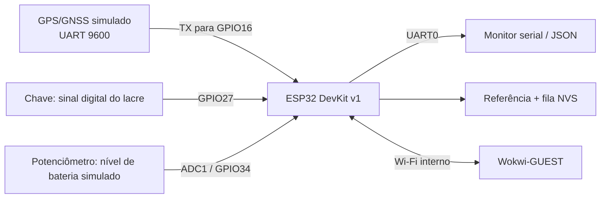

# Modelagem inicial dos circuitos

## Objetivo confirmado

Verificar se um ativo enviado à manutenção externa mudou de lugar entre leituras
semanais, mostrar a última localização válida, acompanhar o lacre e representar
o nível de bateria. Esta versão usa ESP32 e não precisa de acelerômetro.

A localização vem de GNSS; o envio de dados depende de outro canal. Um receptor
GNSS não fornece internet. Na bancada virtual, usamos o Wi-Fi integrado do ESP32.
A tecnologia de comunicação em campo continua pendente de avaliação de cobertura.

## Blocos

GPS, chave e potenciômetro estão ligados ao 3V3/GND quando aplicável. A alimentação
do ESP32 na simulação é virtual. O potenciômetro não fornece energia à placa.

## Pinagem inicial

| Sinal | Componente | ESP32 | Observação |
|---|---|---|---|
| GPS TX | chip-gps:TX | GPIO16 / RX2 | Recepção do ESP32 |
| GPS RX | chip-gps:RX | GPIO17 / TX2 | Reservado; o modelo não interpreta comandos |
| GPS alimentação | VCC / GND | 3V3 / GND | Pinos visuais, sem consumo elétrico simulado |
| Lacre | Comum da chave, pino 2 | GPIO27 / D27 | INPUT_PULLUP |
| Lacre íntegro | Chave, pino 1 | GND | Esquerda = LOW |
| Lacre violado | Chave, pino 3 | Sem conexão | Direita = HIGH pelo pull-up |
| Bateria simulada | Potenciômetro SIG | GPIO34 / D34 | ADC1, compatível com uso de Wi-Fi |
| Potenciômetro | VCC / GND | 3V3 / GND | Apenas controle sintético |
| Diagnóstico TX | UART0 / TX0 | Monitor RX | Não usar UART2 para este diagnóstico |
| Diagnóstico RX | UART0 / RX0 | Monitor TX | Console a 115200 baud |

## Modelo GPS

Um Custom Chip envia sentenças GGA com checksum NMEA e tempo virtual a 9600 baud.
A cada segundo, lê latitude, longitude e `fixValid` dos controles do simulador.
Coordenadas iniciais são fictícias de demonstração, sem relação com ativos reais.

`fixValid=0` emite qualidade de fix zero e nenhum satélite. O firmware deixa de
considerar a posição disponível. O chip não modela antena, recepção de satélites,
tempo de aquisição real, consumo, tensão, obstáculos ou sensibilidade GNSS.

## Regra de comparação

1. A primeira amostra válida estabelece a referência.
2. Cada coleta válida posterior usa a distância geográfica até a amostra válida
   anterior. Distância acima de 100 m gera `moved=true`; abaixo ou igual, false.
3. Mesmo sem movimento, o ponto passa a ser a referência da próxima coleta.
4. Uma coleta sem fix não altera a referência nem conclui que o ativo ficou parado.
5. Um deslocamento seguido de retorno entre coletas não é detectado por esta regra.

A tolerância é configurável e precisa de validação em campo. Na ausência de
amostra em uma semana, a comparação seguinte será com a última coleta válida,
e não necessariamente com a semana imediatamente anterior.

## Lacre e bateria físicos

O sensor infravermelho real ainda precisa de escolha e montagem: o rompimento ou
a retirada devem alterar seu sinal de maneira confiável. Presença óptica, sozinha,
não comprova integridade. Avaliar material do lacre, sujeira, vibração, luz ambiente,
remoção autorizada, proteção da caixa e níveis de sinal compatíveis com 3,3 V.
O receptor IR de controle remoto do Wokwi não substitui essa validação.

Para a bateria, definir química, capacidade, proteção, carregamento, reguladores,
consumo de repouso, corrente de pico do modem e circuito de medição. Não conectar
uma célula de lítio diretamente ao pino 3V3 ou ao ADC. O circuito físico deverá
seguir as especificações das placas efetivamente escolhidas.

Para localização externa em trânsito, avaliar modem e antena de rede celular ou
outra tecnologia com cobertura adequada. Não assumir Wi-Fi dos fornecedores.

## Relação com o TAPI

Os documentos de referência foram consultados na preparação local e não
foram copiados para este repositório. Este resumo preserva o escopo, sem copiar dados internos:

| Requisito | Tratamento nesta etapa |
|---|---|
| Localização e status semanais, frequência ajustável | Ambiente demo e ambiente semanal; configuração centralizada |
| Última posição válida | Referência em NVS; posição recente em RAM; ausência de fix explícita |
| Horário da posição e da comunicação | Pendente de relógio UTC confiável; nesta versão usa uptime identificado |
| Retirada/rompimento do lacre fora da rotina semanal | Chave simulada com debounce e evento local |
| Guardar eventos sem conexão e enviar depois | Fila NVS limitada implementada; transporte, confirmação e reenvio pendentes |
| Retirada autorizada para reparo | Pendente; campo `authorized_removal=null`, sem inferência automática |
| Bateria e autonomia | Somente nível sintético; consumo e autonomia exigem medição física |
| API, BI, ciclos e notas fiscais | Etapas posteriores, fora da modelagem inicial dos circuitos |
| Permanência configurável, referência de 150 dias | Regra de plataforma futura, não confundir com intervalo de localização |
| Resistência à água e reutilização | Validação física futura |

Não afirmar que esta etapa conclui o MVP integral do TAPI. Também não pressupor
GPS como tecnologia definitivamente aprovada: é a arquitetura inicial escolhida
pelo usuário para o protótipo.

## Contrato preliminar de integração

O firmware emite um objeto JSON por amostra ou evento. O identificador é fictício.
`type` pode ser `location_sample`, `location_unavailable` ou `seal_changed`.
Use `battery_sim_pct`, e não um campo que sugira medição real. `uptime_ms` não é
UTC e reinicia junto com o dispositivo; o campo `clock` explicita essa limitação.

Uma futura integração deve adicionar ID único de evento, associação dispositivo/
ativo/ciclo, timestamps UTC e estado de sincronização do relógio, autenticação,
confirmação de recebimento e reenvio sem duplicação. Não apagar a fila antes de
confirmar a entrega. Vincular o equipamento ao ciclo na plataforma, mantendo o
histórico de reutilização sem criar vínculos simultâneos indevidos.
