# Planejamento de energia e GNSS

**Situação: proposta para as próximas sprints, ainda não implementada.** Este documento preserva o estudo de baixo consumo, os critérios mensuráveis e os testes futuros. As seções das Sprints 2 a 5 da [documentação principal](../../../documentacao.md) permanecem no template original; o conteúdo abaixo deve ser revisado antes de incorporá-lo às respectivas entregas.

**Decisões e pendências de 21/10/2026:** o módulo de referência é o Quectel LC76G-PA. A adaptação do chip Wokwi está pendente. Autonomia, latência de alerta, tempo de chegada da autorização e duração máxima sem conexão continuam **PENDENTE DE VALIDAÇÃO** com o parceiro. A possibilidade de autorização antecipada não foi aprovada.

## 1. Máquina de estados proposta

**Estado atual.** O [firmware principal](../../../../src/firmware/main.cpp) mantém o ESP32 ativo, recebe NMEA continuamente, verifica o lacre por polling, tenta reconectar o Wi-Fi e mantém LEDs de diagnóstico conforme as entradas. Há JSON na Serial e fila em NVS, sem entrega ao servidor. Ainda não há suspensão, controle de alimentação do GNSS, confirmação de entrega ou lógica de autorização/ciclo. Os valores atuais estão em [`include/config.h`](../../../../include/config.h).

O diagrama mostra quatro estados principais do gerenciamento de energia. As ações e as condições de saída ficam nas tabelas, evitando cruzamentos de setas. Lacre, autorização, ciclo e fila têm seus próprios estados de negócio. Esta visão não descreve uma funcionalidade já presente no firmware.

*Figura P1 — Visão geral dos estados de energia. Azul: fases ativas; verde: suspensão. Fonte: elaboração própria. [Fonte editável em Mermaid](../../../../assets/3-desenvolvimento-resultados/3.4.1-prototipo-wokwi/estadosEnergia.mmd).*

| Estado | Responsabilidade | Condição de saída |
|---|---|---|
| Preparando tarefas | Restaurar contexto e prazos, identificar a causa do despertar e registrar eventos locais pendentes. | Contexto consistente e gravações necessárias confirmadas; sem evento novo, seguir após avaliar os prazos. |
| Executando tarefas | Coletar posição e comunicar somente quando devido; atender o lacre durante todas as esperas. | Tarefas concluídas ou orçamentos esgotados. Sem fix, manter a posição histórica; sem confirmação de entrega, manter a fila. |
| Preparando suspensão | Persistir contexto, calcular o próximo prazo absoluto, desligar recursos dispensáveis e armar o despertar. | Suspender somente com contexto salvo, nenhuma tarefa imediata pendente e despertar armado. Novo evento retorna à preparação. |
| Suspenso | Aguardar temporizador ou entrada de despertar habilitada. | O estímulo inicia nova preparação; o nível mantido do lacre deve ser rearmado sem gerar despertares repetidos. |

**Interrupções e falhas.** Um evento de lacre tem prioridade em qualquer estado ativo e não espera GNSS ou rede. Falha de gravação impede seguir o caminho normal de suspensão: sinalizar a falha e aplicar uma política de contingência, ainda a definir. O diagrama mostra o ciclo normal; as exceções e suas condições estão abaixo.

| Condição / transição | Ação e condição de saída | Validação |
|---|---|---|
| Evento de lacre em qualquer estado ativo | Capturar e registrar a transição estável sem esperar GNSS/rede; priorizar seu tratamento. Aquisição e comunicação devem continuar atendendo essa entrada. | CT18, CT24 e CT26. |
| Coleta devida | Alimentar GNSS conforme o módulo; sair com fix válido ou orçamento esgotado. Falha conserva posição histórica. Coleta adicional por violação depende da política acordada. | CT19, CT26 e CT28. |
| Comunicação devida | Aplicar janela, limite de tentativas e espera entre elas; sem confirmação, conservar registros. Periodicidade de escuta depende de `L_aut`, pendente com o parceiro. | CT26, CT32 e CT33. |
| Preparação da suspensão | Salvar contexto, calcular o próximo prazo absoluto, desligar recursos dispensáveis e armar despertar. Entrada mantida não pode causar reinícios repetidos. | CT24, CT25 e CT29. |
| Falha de memória | Expor falha sem declarar o evento persistido. Definir contingência, limite de tentativas e eventual suspensão antes da implementação. | CT29. |

## 2. Integração elétrica proposta

**Integração elétrica proposta.** Avaliar chave de alimentação do GNSS, backup opcional, regulador de baixo consumo e LEDs usados por tempo limitado. Um contato mecânico pode despertar o ESP32; a detecção deve continuar disponível enquanto os demais blocos dormem. Aumentar resistores dos LEDs trata somente essa parcela do consumo. A escolha depende do CT27; os resistores atuais de 220 Ω permanecem no circuito de bancada.

No ESP32 clássico, o GPIO27 do lacre é elegível para despertar por RTC; o GPIO18 da chave de rede não é. O despertar externo é por nível, exigindo rearme com lacre aberto. Os botões nos GPIO33/13 exigem estratégia compatível com as polaridades: EXT1 oferece `ANY_HIGH` ou `ALL_LOW`, não qualquer botão ativo em LOW. A polarização deve permanecer válida na suspensão. [Documentação de suspensão do ESP32](https://docs.espressif.com/projects/esp-idf/en/v4.4.3/esp32/api-reference/system/sleep_modes.html).

O atual `clock="uptime_only"`, baseado em `millis()`, não comprova data/hora após reinício. A evolução precisa preservar prazos, declarar qualidade do relógio e definir sincronização e tolerância à deriva. [Documentação de tempo do ESP32](https://docs.espressif.com/projects/esp-idf/en/v4.4.3/esp32/api-reference/system/system_time.html).

## 3. Regras e critérios propostos

### 3.1. Regras técnicas

**Regras propostas para operação com bateria (21/10/2026).** Os identificadores `RN-TEC` complementam RN01–RN16 e não representam aprovação do parceiro.

| ID | Regra proposta | Situação |
|---|---|---|
| RN-TEC01 | Registrar a mudança estável do lacre independentemente de GNSS ou conexão. Separar detecção local de entrega do alerta. | Registro local existente; autorização e entrega pendentes. |
| RN-TEC02 | Preservar a última posição válida quando a coleta falhar, identificando-a como histórica e informando sua idade quando conhecida. Ausência de fix não vira coordenadas zero. | Parcial: referência em NVS existente; horário absoluto persistente pendente. |
| RN-TEC03 | Manter eventos até confirmação de recebimento. Dimensionar a fila para o período sem rede e definir saturação, inclusive quando todos os registros forem críticos. | Fila local existente; confirmação, prioridade e política final pendentes. |
| RN-TEC04 | Despertar por eventos e tarefas agendadas, mantendo a detecção do lacre disponível. Limitar aquisições e tentativas de comunicação por orçamentos configurados. | Suspensão e controle de alimentação pendentes. |
| RN-TEC05 | Validar identidade, dispositivo/ciclo, validade e política de revogação antes de aceitar uma autorização. | **PENDENTE DE VALIDAÇÃO:** prazo de chegada e possibilidade de autorização previamente armazenada. Não assumir autorização antecipada como requisito aprovado. |
| RN-TEC06 | Preservar ciclo, eventos e vencimentos durante suspensão e reinício. Despertar por lacre não deve adiar o próximo status periódico. | Hoje só há persistência da referência de posição e dos registros da fila. |

### 3.2. Critérios mensuráveis

Os critérios mensuráveis propostos ficam nesta seção; os procedimentos futuros estão na seção 6, ligados pela matriz 3.3 deste documento. Quando aprovados, os RNFs devem integrar a seção 3.3.3 e os testes a seção 3.4 da documentação principal. Cada critério informa condição de ensaio, métrica, limite, método e situação. Valores atuais do firmware não são SLA aprovado pelo parceiro. Propostas dependem de revisão; metas ausentes ficam como **PENDENTE DE VALIDAÇÃO**, sem resultado de aprovação.

**Situação confirmada pelo grupo em 21/10/2026:** ainda não há metas acordadas de autonomia, entrega de alertas ou duração máxima sem conexão. O tempo de autorização também depende de confirmação com o parceiro.

| ID / Eixo | Requisito e métrica | Critério e situação | Verificação |
|---|---|---|---|
| RNF-USAB01 / USAB | Distinguir posição atual, histórica e ausente. | Proposto: nenhuma coleta sem fix apresentada como atual; idade desconhecida explícita. Interface pendente. | CT19, CT22 e CT32; comparar JSON e interface quando disponível. |
| RNF-CONF01 / CONF | Detectar mudanças estáveis do lacre sem duplicações por ruído. | Atual: debounce do lacre de 60 ms. Proposto: zero duplicações por transição estável e zero eventos para pulsos observados menores que 60 ms no lote controlado. | CT18, CT24 e CT31; contar eventos ausentes, extras e falsos alertas. |
| RNF-CONF02 / CONF | Preservar registros confirmados em memória e a referência de posição. | Proposto: zero registros já confirmados como gravados perdidos no lote de reinícios; zero referência inválida aceita. Sobrecarga deve ser explícita. | CT21, CT22, CT29 e CT33; comparar conteúdo antes/depois. |
| RNF-DES01 / DES | Separar detecção local, entrega de alerta e autorização. | `L_det = t_registro_local − t_estabilizacao_contato`; `L_alerta = t_recebimento_servidor − t_estabilizacao_contato`; `L_aut = t_validacao_dispositivo − t_emissao_plataforma`. Limites e condições de rede: **PENDENTE DE VALIDAÇÃO**. | CT18 e CT32; protocolo inicial proposto de 30 estímulos por condição; registrar p95, máximo, perdas e incerteza temporal. |
| RNF-DES02 / DES | Limitar tempo de GNSS e comunicação ativos, inclusive sem cobertura. | Atual: espera de fix de 10 s por coleta e idade máxima de fix de 3 s; não são metas do módulo físico. Orçamentos futuros de GNSS, rádio, tentativas e espera: **PENDENTE DE VALIDAÇÃO**. | CT19, CT26 e CT28; medir duração por estado, tentativas e falhas. |
| RNF-DES03 / DES | Estimar autonomia pelo consumo do conjunto. | Medir corrente de repouso, picos, carga por aquisição/envio e carga diária equivalente. Autonomia mínima `A_min`, bateria e perfil de eventos: **PENDENTE DE VALIDAÇÃO**. Os 150 dias de permanência não definem autonomia. | CT27; medir na alimentação do conjunto, incluindo regulador, LEDs, sensores, GNSS e comunicação. |
| RNF-SUP01 / SUP | Permitir diagnóstico reproduzível. | Proposto: todos os ensaios identificam versão/configuração e estímulos. Futuro registro inclui estado, causa de despertar, ID do evento e qualidade do relógio. | CT17, CT24 e CT29; conferir logs sem credenciais ou dados reais. |
| RNF-SUP02 / SUP | Simular o Quectel LC76G, variante PA, escolhido para o dispositivo físico. | O mesmo driver GNSS deve funcionar no módulo real e no Wokwi, usando as interfaces, mensagens e transições descritas no contrato de simulação na seção 5 deste documento. Placa e versão de firmware do módulo ainda precisam ser definidas; adaptação do simulador pendente. | CT26 e CT28; comparar sequências de comandos/respostas e estados para todos os cenários do contrato. Tempos sintéticos e consumo estimado devem ser identificados. |
| RNF-SEG01 / SEG | Impedir autorização por comandos inválidos. | Proposto: zero comandos adulterados, de outro dispositivo/ciclo ou expirados aceitos no lote. Política sem rede, revogação e relógio incerto: **PENDENTE DE VALIDAÇÃO**. Botão de bancada não comprova segurança. | CT34; exige canal de autorização implementado. |
| RNF-CAP01 / CAP | Suportar o período acordado sem rede e expor saturação. | Atual: 16 registros persistentes, sem reenvio; o 17º fica apenas na Serial. Capacidade final, volume de eventos e duração sem rede `D_offline`: **PENDENTE DE VALIDAÇÃO**. Dimensionar registros e bytes. | CT21 e CT33; medir ocupação, perdas por classe, retenção e tempo de esvaziamento. |
| RNF-REST01 / REST | Despertar por temporizador/lacre e preservar prazos. | Proposto: um tratamento por estímulo estável, sem despertares repetidos pelo mesmo nível mantido; nenhum prazo reiniciado pelo despertar. Tolerância do relógio e pulso mínimo detectável: **PENDENTE DE VALIDAÇÃO**. | CT24, CT25 e CT29; validar também no ESP32 físico. |
| RNF-REST02 / REST | Adequar fixação, contato e invólucro ao uso. | Limites de água, temperatura, poeira, vibração, força de fixação e posição da antena: **PENDENTE DE VALIDAÇÃO**. Não atribuir classificação IP sem ensaio correspondente. | CT28 e CT31; registrar condições, duração, falhas e infiltração. |
| RNF-ORG01 / ORG | Manter rastreabilidade e separar plano de evidência. | Proposto: todo CT executado contém versão, configuração, procedimento, resultado medido, critério e evidência anonimizada; pendências não aparecem como aprovadas. | Revisão da matriz 3.3 deste documento e dos registros de execução vinculados aos CTs. |

**Como fechar as metas.** O parceiro define a necessidade operacional: latência máxima de autorização e alerta, autonomia, período sem rede, frequência de eventos e condições de uso. A equipe mede a viabilidade antes de acordar limites; registrar data e origem da aprovação junto ao valor. Ensaios temporais usam relógios sincronizados ou a mesma base de captura. Sem isso, informar a incerteza; não apresentar latência ponta a ponta como exata.

**Cálculo de autonomia.** Integrar a corrente medida na bateria: `Q_dia [mAh] = soma(I_i [mA] × t_i [h])` no perfil diário equivalente; `A_estimada [dias] = Q_util [mAh] / Q_dia [mAh/dia]`. Declarar capacidade útil e hipóteses de temperatura, envelhecimento, limite de descarga e autodescarga. Para coleta semanal, distribuir a carga do ciclo completo pelos sete dias e acrescentar eventos e tentativas de rede do perfil. Medir também picos e quedas de tensão. Comparar boa cobertura, falta de GNSS e falta de rede. Wokwi não comprova autonomia; ensaio curto produz estimativa, não comprovação de operação por meses.

### 3.3. Rastreabilidade do planejamento

Rastreabilidade técnica proposta, vinculada aos RF e RN de negócio das seções 3.3.1 e 3.3.2 da [documentação](../../../documentacao.md). A matriz não indica testes executados nem cobre integralmente os 27 RFs: prorrogação, prazo legal, ausência de comunicação e autenticação da plataforma/dispositivo ainda precisam de cobertura específica além dos cenários embarcados abaixo.

| Necessidade | RF | RN de negócio | Regra técnica proposta | RNF | Casos de teste | Evidência a produzir |
|---|---|---|---|---|---|---|
| Detecção do lacre independente de GNSS/rede | RF006, RF009, RF010 | RN05, RN09 | RN-TEC01 | RNF-CONF01, RNF-DES01 | CT05, CT08, CT18, CT24, CT31, CT32 | Estímulos e eventos com tempos. |
| Última localização válida identificável | RF005, RF015 | RN08 | RN-TEC02 | RNF-USAB01, RNF-DES02 | CT19, CT20, CT22, CT28, CT32 | JSON, referência e condições de recepção. |
| Eventos preservados sem rede | RF010 | RN09 | RN-TEC03 | RNF-CONF02, RNF-CAP01 | CT09, CT10, CT21, CT29, CT33 | Fila antes/depois e confirmações do servidor. |
| Autonomia e tentativas limitadas | RF005, RF008, RF011 | RN07, RN08 | RN-TEC04 | RNF-DES02, RNF-DES03, RNF-REST01 | CT24, CT26, CT27, CT28 | Transições e medições de corrente/tempo. |
| Autorização válida no prazo acordado | RF007 | RN05, RN06 | RN-TEC05 | RNF-SEG01, RNF-DES01 | CT06, CT07, CT11, CT32, CT34 | Comandos sintéticos, decisões e latências. |
| Ciclos e prazos preservados | RF004, RF011–RF014, RF016, RF017 | RN01, RN03, RN04, RN07, RN11 | RN-TEC06 | RNF-CONF02, RNF-REST01 | CT02–CT04, CT14–CT16, CT25, CT29 | Estado antes/depois de suspensão e reinício. |
| Diagnóstico reproduzível | Transversal | Transversal | RN-TEC01–RN-TEC06 | RNF-SUP01, RNF-ORG01 | CT17–CT34 | Versão, configuração e registro de execução. |
| Simulador correspondente ao módulo GNSS escolhido | RF005 | RN08 | RN-TEC02, RN-TEC04 | RNF-SUP02 | CT26, CT28 | Contrato de interface e comparação de comandos/respostas entre simulação e hardware. |
| Bateria, fixação e condições físicas | RF006, RF019, RF027 | RN05, RN10 | RN-TEC01, RN-TEC04 | RNF-DES03, RNF-REST02 | CT12, CT13, CT23, CT27–CT31 | Medições, fotos e condições do ensaio. |

## 4. Como registrar e validar

Os CT01–CT23 permanecem na seção 3.4.1 da [documentação principal](../../../documentacao.md). Os CT24–CT34 abaixo estão reservados ao planejamento futuro e não são resultados da Sprint 1. Os exemplos CT11/CT21 nas seções ainda não preenchidas do template não representam novos casos executados.

Antes de executar, definir metas e condições, identificar versão e configuração e registrar os dados medidos. Usar o registro de execução da seção 3.4.1. Para critérios ainda sem limite acordado, informar a medição e manter a aprovação pendente. Consumo, recepção GNSS, fixação e exposição à água exigem validação física.

## 5. GNSS escolhido: Quectel LC76G-PA

**Decisão de 21/10/2026:** adotar o **Quectel LC76G, variante PA**, como módulo GNSS de referência do projeto e do modelo no Wokwi. A escolha considera UART/NMEA, alimentação de 3,3 V e modo de backup; aquisição na instalação e consumo do conjunto ainda exigem ensaio. A comparação abaixo registra a alternativa considerada. GNSS fornece localização; a plataforma ainda exige um meio de comunicação separado.

| Opção | Vantagens para o projeto | Limitações / custo de integração |
|---|---|---|
| GPS customizado atual no Wokwi | Coordenadas e validade do fix controláveis para testes repetíveis. Pode ganhar estados de alimentação, atraso de aquisição e falhas pela Chips API. | Hoje gera GGA por UART a 9600 baud; não processa suspensão nem modela consumo ou backup. Sua extensão valida lógica, não comportamento elétrico de módulo comercial. |
| u-blox MAX-M10S — alternativa considerada | UART/NMEA, modos de economia e backup por hardware. Backup típico de **28 µA**, nas condições `V_BCKP=3,3 V`, `VCC=V_IO=0 V`. | Verificar alimentação, nível de I/O e sequência de desligamento; escolher placa que exponha os sinais necessários. Consumo de placa, regulador e antena entra no ensaio. [Ficha R08](https://content.u-blox.com/sites/default/files/MAX-M10S_DataSheet_UBX-20035208.pdf). |
| **Quectel LC76G, variante PA — escolhido** | UART/NMEA e alimentação de 3,3 V na PA; backup típico de **13 µA**, com `V_BCKP` mantido, nas condições do fabricante. | Backup exige comando `PAIR650` e corte de VCC conforme o fabricante. Conferir a configuração UART da versão adquirida e compatibilizar com o firmware. A variante PB usa 1,8 V e não é substituição elétrica direta. [Hardware Design V1.3](https://www.quectel.com/content/uploads/2023/05/Quectel_LC76G_Series_Hardware_Design_V1.3.pdf). |

Não foi encontrado GPS nativo com esses recursos no [catálogo oficial do Wokwi](https://docs.wokwi.com/getting-started/supported-hardware); isso não exclui projetos comunitários. O [chip próprio do projeto](../../../../chips/gps.chip.c) pode ser evoluído com a [Chips API](https://docs.wokwi.com/chips-api/getting-started).

**Diretriz de integração e simulação:** adaptar o chip do Wokwi ao **LC76G-PA**, reproduzindo os comportamentos usados pelo projeto. O gerador genérico atual ainda não satisfaz essa correspondência. A placa física deve permitir acesso a VCC, V_BCKP e UART para executar as sequências de energia. Validar o módulo escolhido pelo CT28 e medir `Q_ciclo = Q_backup + Q_aquisicao + Q_processamento + Q_comunicacao` na mesma alimentação de referência. Para intervalos semanais, comparar backup e desligamento completo; preservar dados não garante fix rápido após qualquer intervalo. Antena, céu obstruído e metal entram no ensaio. Rever o limite atual de 10 s após medições. Preço, estoque, placa e versão de firmware do módulo: **PENDENTE DE VALIDAÇÃO**.

**Contrato de simulação do LC76G-PA (RNF-SUP02).** Modelo e variante definidos; registrar a versão de firmware/protocolo da unidade adquirida antes de concluir a compatibilidade. A referência de hardware é o documento Quectel V1.3. A implementação do simulador ainda está pendente.

| Aspecto | Correspondência exigida | Como verificar |
|---|---|---|
| Interface e mensagens | Pinagem utilizada, UART e configuração compatíveis com LC76G-PA; sentenças NMEA, validade e checksums consumidos pelo mesmo driver. Comandos PAIR utilizados e respostas devem seguir a versão de protocolo adotada. | Capturar tráfego dos dois ambientes e comparar campos e decisões do driver; não aprovar apenas porque ambos produzem latitude/longitude. Os 9600 baud atuais não comprovam a configuração de fábrica do módulo adquirido. |
| Alimentação e backup | Modelar desligado, aquisição, fix e backup. Para entrar em backup: enviar `$PAIR650,0*25`, cortar VCC e manter V_BCKP; para sair, restaurar VCC, respeitando a sequência do Hardware Design V1.3. Representar também perda do backup e reset. | Conferir disponibilidade da UART, retenção de contexto e retomada. Corte de VCC sem o comando prévio não deve ser tratado como entrada normal em backup. Sinais auxiliares exclusivos do ensaio devem ficar identificados como simulação; não inventar pino físico de controle. |
| Aquisição e falhas | Permitir atraso de aquisição, falta de fix, fix desatualizado e interrupção de UART. Tempos de ficha técnica são parâmetros de cenário, não garantias de recepção física. | Executar CT19 e CT26; calibrar cenários com medições do CT28, mantendo explícito o que é sintético. |
| Limites do modelo | Declarar funções não simuladas, como recepção de RF, desempenho real da antena e corrente elétrica. Valores de consumo atribuídos por estado são estimativas. | CT27 continua obrigatório para consumo físico; não apresentar modelo lógico como validação de autonomia. |

## 6. Casos de teste futuros

### 6.1. Gerenciamento de energia — CT24–CT26

**Situação: bloqueados por implementação; não executados.** Exigem máquina de estados, observabilidade e simulação de alimentação/tempo. O chip GNSS atual não modela esses estados. Aplicar primeiro em modelo/teste controlado e depois confirmar no hardware. Metas de negócio pendentes impedem aprovação correspondente.

| CT | Pré-condição e procedimento | Critério proposto | Dependência |
|---|---|---|---|
| CT24 | Suspender; abrir lacre e mantê-lo aberto por 60 s; fechar/reabrir; repetir abertura durante aquisição, comunicação e preparação da suspensão. Testar também temporizador e cada botão habilitado para despertar. | Uma ocorrência por transição estável, nenhuma perda no lote e nenhum ciclo repetido de despertar causado pelo mesmo nível mantido. Identificar causa e estado em log; medir latência. | Definir rearme por nível, polarização, combinações RTC e pulso mínimo detectável. GPIO18 não serve como despertar RTC no ESP32 clássico. Repetir fisicamente. |
| CT25 | Com relógio controlado, atravessar vencimento de status e de autorização durante suspensão; provocar despertar por lacre antes do status e reinício em cada etapa. | Próximo prazo não é adiado pelo evento; vencimentos e ciclo persistem; autorização expirada não vira válida após reinício. Verificar regras nos limites de tempo e quando o relógio é incerto. | Agendamento persistente, relógio confiável e regras de ciclo/autorização; tolerâncias e política para relógio incerto pendentes. |
| CT26 | Manter GNSS sem fix e rede indisponível por vários ciclos; depois restaurar. Injetar evento de lacre durante cada espera. | Aquisição e comunicação terminam dentro dos orçamentos configurados; número de tentativas respeita limite e espera entre elas. Detectar lacre, conservar fila e retomar suspensão quando permitido, sem repetição ilimitada de tentativas. | Orçamentos, política de escuta/autorização e retomada definidos. Verificar comandos de alimentação e duração em log; consumo somente no CT27. |

**Verificação adicional do CT26 — correspondência com LC76G-PA:** após implementar o modelo, executar com o mesmo driver os cenários de partida, comando `$PAIR650,0*25`, corte da alimentação principal com e sem comando prévio, backup mantido/perdido, retorno da alimentação, falta de fix e recuperação. Comparar mensagens e transições com o contrato da seção 5 deste documento e o CT28. Comandos inválidos devem seguir a resposta documentada do módulo. Funções não suportadas pelo modelo devem ser declaradas; nenhum atalho exclusivo do firmware de simulação pode substituir a interface GNSS real.

### 6.2. Protótipo físico — CT27–CT31

**Plano físico, não executado.** Definir componentes, condições e metas antes dos ensaios. Estes casos podem evoluir nas sprints seguintes. Fotos da montagem e medições devem ser adicionadas quando produzidas, distinguindo medição de estimativa.

| CT | Procedimento e condições | Métricas / critério | Pendências |
|---|---|---|---|
| CT27 | Medir na alimentação do conjunto, sem alimentação paralela por USB. Capturar repouso, despertar, GNSS, escrita em memória e comunicação. Comparar circuito atual e versão de baixo consumo com o mesmo perfil de eventos; repetir sem cobertura. | Corrente média/de repouso, picos, duração e carga por estado; calcular `Q_dia` e autonomia estimada conforme RNF-DES03. Registrar instrumento, resolução, taxa de amostragem, tensão e temperatura. Medir corrente do contato fechado, LEDs, regulador e divisor de bateria. | Bateria e autonomia-alvo a confirmar. Instrumento deve capturar pulsos de corrente; não somar diretamente correntes medidas em tensões diferentes. LEDs com acionamento limitado e divisor comutado são hipóteses a comparar. |
| CT28 | Ensaiar o Quectel LC76G-PA escolhido em partida sem dados de backup, retomada com backup e desligamento completo, conforme sequência do fabricante. Repetir com antena instalada no invólucro, próximo a metal, a céu aberto e sob cobertura. Registrar placa, firmware, configuração UART e intervalo real entre aquisições; comparar tráfego e estados com o modelo Wokwi do CT26. | Tempo até primeira posição válida, taxa de obtenção de fix dentro do orçamento, erro contra referência conhecida, carga por aquisição e carga de backup. Sem fix, manter histórico identificado. | Critérios de precisão, taxa de sucesso e orçamento pendentes. Antena e placa influenciam resultado; não prometer posicionamento indoor. A simulação de sete dias não substitui retenção física por sete dias. |
| CT29 | Interromper alimentação/reiniciar antes, durante e após gravação, aquisição e preparação da suspensão; testar falha de escrita com injeção controlada. Observar tensão nos picos de rádio/GNSS. | Preservar registros cuja gravação foi confirmada e recuperar estado consistente; dados incompletos devem ser rejeitados ou sinalizados. Falha não aparece como gravação bem-sucedida; medir perdas e reinícios por queda de tensão. | Usar memória de teste e fonte controlada. Estados de ciclo/prazos dependem de implementação; a referência de posição atual já pode ser caracterizada. |
| CT30 | Comparar leitura de bateria com instrumento de referência em vários pontos da faixa permitida; injetar falhas de medição conforme o circuito e acionar limiares de bateria baixa/recuperada. | Erro de tensão e repetibilidade; alarme e histerese conforme limites aprovados. Distinguir diagnóstico elétrico de inferência por ADC; não equiparar tensão linear a percentual sem modelo de bateria. | Divisor, proteção, calibração, bateria, limites e diagnóstico ainda a definir; não aplicar tensão da célula diretamente ao GPIO34. |
| CT31 | Ensaiar fixação, abertura/reaplicação do lacre, vibração e exposição à água nas condições previamente acordadas; verificar contato e operação antes/depois. | Contar violações detectadas, falsos alertas, falhas de contato, deslocamento e infiltração; verificar repetibilidade e latência após ensaio. | Definir método, força, duração, temperatura, água e critério de aceitação antes da execução. Ensaio do protótipo não implica certificação IP. |

### 6.3. Comunicação e autorização — CT32–CT34

**Plano de integração, não executado; bloqueado por transporte e plataforma.** JSON na Serial e Wi-Fi conectado não comprovam recebimento no servidor. A escolha do meio de comunicação deve considerar a cobertura real, sem presumir Wi-Fi disponível nas oficinas. Os ensaios abaixo também se aplicam caso seja escolhido outro transporte.

| CT | Configuração e procedimento | Resultado esperado / medição | Pendências |
|---|---|---|---|
| CT32 | Com relógios sincronizados, gerar abertura de lacre e emitir autorização em momentos distintos do ciclo de escuta. Repetir com dispositivo ativo, suspenso, sem GNSS, com rede e após interrupção de rede. | Medir separadamente `L_det`, `L_alerta` e `L_aut`, p95, máximo e perdas. Em indisponibilidade, registrar duração sem rede e tempo desde reconexão até entrega, sem esconder atraso total. Interface distingue posição histórica e atual. | Limites com parceiro, transporte, observabilidade e política de escuta. Não assumir autorização previamente salva nem prometer resposta em segundos com rádio desligado. |
| CT33 | Acumular eventos mistos e apenas críticos; exceder capacidade; restaurar rede; perder confirmações e reiniciar durante reenvio. | Dentro da capacidade acordada, eventos são entregues sem perda; registros saem da fila somente após confirmação definida. Retransmissões mantêm ID e não duplicam ocorrência no servidor. Saturação segue política aprovada e expõe perdas por classe. | Definir o que a confirmação garante (broker ou persistência da aplicação), IDs, prioridade, política de saturação e `D_offline`. |
| CT34 | Enviar comando válido, expirado, adulterado, repetido e destinado a outro dispositivo/ciclo; testar reinício, relógio incerto e revogação com dispositivo desconectado. | Rejeitar comandos inválidos e registrar motivo. Para comando válido, respeitar janela e vínculo aprovados; reenvio não deve ampliar validade. Operação offline/revogação deve seguir regra expressamente acordada. | Autenticação, autorização, armazenamento e relógio ainda pendentes. Um botão local de diagnóstico não substitui este ensaio. |
