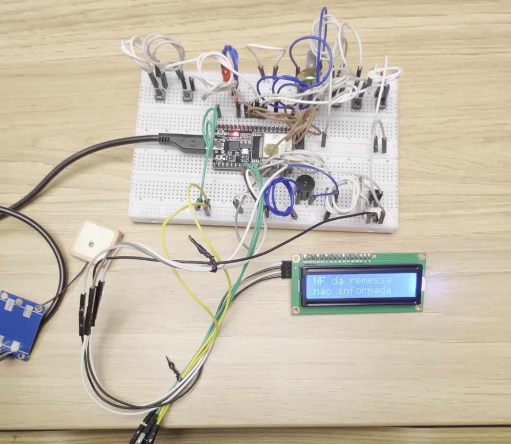

# Relatório de montagem do protótipo físico

Este relatório descreve como o protótipo físico offline foi montado, quais problemas surgiram na bancada e o que ainda limita a montagem. Os resultados dos casos de teste estão na [seção 3.4.2 da documentação](../../../documentacao.md).

**Situação em 05/11/2026:** o protótipo funciona na bancada, alimentado pelo USB do computador. A fiação foi reorganizada nessa data. As posições da seção 4 são da montagem anterior, servem de referência e devem ser conferidas na placa.



*Figura 1 — Protótipo físico com a fiação reorganizada, visto de cima. Fonte: quadro de vídeo, 05/11/2026.*

## 1. Componentes

| Componente | Qtd. | Função |
|---|---|---|
| ESP32-DevKitC com módulo ESP-32U e antena Wi-Fi | 1 | Controlador |
| Protoboard de 830 furos | 2 | Base da montagem, unidas pelo lado maior |
| LCD 16x2 com módulo I2C | 1 | Telas de status |
| Botão de toque | 7 | VOLTAR, AVANÇAR, CICLO, AUTORIZAR, LACRE, REDE e ON/OFF |
| Potenciômetro de 10 kΩ | 1 | Bateria simulada |
| Buzzer | 1 | Alarme de violação |
| LED vermelho e resistor de 220 Ω | 1 | Indicador de violação |
| Módulo GNSS GY-GPS6MV2 (NEO-6M) com antena | 1 | Posição |
| Jumpers | — | Ligações |

## 2. Ligações ao ESP32

Os pinos abaixo são os usados pelo firmware. Botões ligam o pino ao GND e usam o pull-up interno do ESP32, então não precisam de resistor externo.

A coluna **Montagem dos CTs** é a usada nos casos de teste da seção 3.4.2, que continuam valendo para ela. A **montagem alternada** troca sete pinos (em negrito), usa o ambiente `bancada-alternada` (seção 5) e não tem o LED: ele foi retirado da placa e do firmware, e a violação aparece no LCD e no buzzer (seção 3.4.3 da documentação).

| Componente | Sinal | Montagem dos CTs | Montagem alternada |
|---|---|---|---|
| LCD | SDA | 21 | 21 |
| LCD | SCL | 22 | **23** |
| Botão AVANÇAR | Entrada | 25 | 25 |
| Botão VOLTAR | Entrada | 26 | **32** |
| Botão CICLO | Entrada | 14 | **5** |
| Botão AUTORIZAR | Entrada | 33 | **15** |
| Botão LACRE | Entrada | 27 | 27 |
| Botão REDE | Entrada | 18 | **16** |
| Botão ON/OFF | Entrada | 19 | 19 |
| Potenciômetro | Pino do meio | 34 | 34 |
| Buzzer | Positivo | 23 | **12** |
| LED, pelo resistor de 220 Ω | Anodo | 13 | — (retirado) |
| GNSS | TX do módulo | 16 | **36 (VP)** |
| GNSS | RX do módulo (opcional) | 17 | 17 |

Nenhum botão pode ir para os GPIO34 a 39: esses pinos só leem e não têm pull-up interno, então o botão nunca mudaria de nível. O firmware recusa essa configuração na compilação.

## 3. Alimentação

| Tensão | Alimenta |
|---|---|
| 5 V, do pino 5V do ESP32 | LCD e GNSS |
| 3,3 V, do pino 3V3 do ESP32 | Potenciômetro |

Todo o conjunto é alimentado pelo USB do computador. O GPIO34 recebe no máximo 3,3 V, porque o potenciômetro fica entre 3V3 e GND.

O GND do ESP32 é a referência comum dos trilhos, do LCD, do GNSS e do potenciômetro. O catodo do LED e o negativo do buzzer retornam ao GND; o anodo do LED recebe o GPIO13 pelo resistor de 220 Ω. A foto registra a organização observada: botões na região superior, ESP32 ao centro, potenciômetro e buzzer abaixo; LCD e GNSS ficam externos às protoboards, ligados por jumpers. As posições históricas abaixo não substituem a conferência elétrica de cada ligação.

## 4. Posições de referência

As posições usam a notação do guia de montagem: "cima" e "baixo" indicam a protoboard, seguidas da fileira e da coluna. Elas valem para a montagem anterior à reorganização dos fios. O guia previa chaves para lacre, rede e ON/OFF; na bancada, esses três são botões, então suas posições não constam aqui.

| Componente | Posição |
|---|---|
| ESP32-DevKitC, fileira 5V a 3V3 | cima 20a a 38a |
| ESP32-DevKitC, fileira CLK a GND | baixo 20g a 38g |
| Botão VOLTAR | cima 28f, 28i, 30f, 30i |
| Botão AVANÇAR | cima 32f, 32i, 34f, 34i |
| Botão CICLO | cima 37f, 37i, 39f, 39i |
| Botão AUTORIZAR | cima 41f, 41i, 43f, 43i |
| Resistor do LED | cima 24e a 24f |
| LED | anodo em cima 24h, catodo em cima 25h |
| Buzzer | negativo em baixo 38a, positivo em baixo 41a |
| Potenciômetro | cima 48j, 50j, 52j |
| GNSS | VCC em baixo 11d, RX em 12d, TX em 13d, GND em 14d |

Os 5 V chegam ao GNSS por dois trechos: do ESP32 (cima 20e) ao trilho positivo de baixo, e desse trilho a baixo 11e. Sem o primeiro trecho, o LCD continua funcionando e só o GNSS fica sem energia.

## 5. Firmware da bancada

A placa usa o ambiente `bancada`, que trata lacre, rede e ON/OFF como botões. O ambiente `demo` espera chaves e lê o ON/OFF como desligado, e a placa parece não responder.

```bash
pio run -e bancada
pio run -e bancada -t upload
pio device monitor -b 115200
```

No PowerShell, também é possível compilar com `scripts/build.ps1 -Environment bancada`. Essa opção usa o GNSS real e dispensa a compilação do chip customizado do Wokwi.

Com a placa ligada, a Serial a 115200 baud mostra a linha `[vivo]` a cada 2 s.

Na montagem alternada, troque `bancada` por `bancada-alternada` nos comandos acima. Os ambientes `demo`, `weekly` e `bancada` continuam nos pinos antigos, então o Wokwi e os CTs já executados não mudam.

**Pinos de boot da montagem alternada.** O GPIO5 (CICLO), o GPIO12 (buzzer) e o GPIO15 (AUTORIZAR) influenciam a partida do ESP32. Não segure CICLO nem AUTORIZAR ao ligar a placa, e nada pode puxar o GPIO12 para 3,3 V: com ele em nível alto no boot, o ESP32 escolhe 1,8 V para a memória flash e não parte.

## 6. Conferência da montagem

| Item | Como conferir | Esperado |
|---|---|---|
| Boot | Abrir a Serial | `STATUS` e linhas `[vivo]` |
| LCD | Tocar AVANÇAR | As cinco telas, sem caracteres embaralhados |
| Lacre | Tocar LACRE | `lacre=` muda no `[vivo]` |
| LED e buzzer | Abrir o lacre sem autorização | LED pisca e buzzer toca |
| Bateria | Parar o potenciômetro | `bateria_sim=` estável |
| GNSS | Observar `gps_chars` | Sobe mais de 100 caracteres por segundo |

## 7. Problemas encontrados

| Problema | Sintoma | Causa | Solução |
|---|---|---|---|
| Firmware incompatível | Placa sem `[vivo]`, parecendo travada | Ambiente `demo` em montagem com botões | Gravar o ambiente `bancada` |
| LCD embaralhado | Caracteres incorretos no visor | Fios longos na protoboard corrompem o I2C | I2C a 50 kHz e reinício do LCD ao acender, só na bancada |
| Potenciômetro com mau contato | Leitura oscila, e o LCD acende sozinho na tela de bateria | Contato ruim no cursor | Refazer o contato do potenciômetro |
| GNSS sem dados | `gps_chars` parado e GPIO16 em nível baixo | Ligação do módulo | Refazer VCC, GND e TX, conferindo as posições |
| Primeiro fix demorado | `fix=ausente` em ambiente fechado | Módulo sem visão do céu | Testar a céu aberto; o primeiro fix levou cerca de 9 minutos |
| Fiação embolada | Jumpers longos dificultavam a leitura da montagem | Fios maiores que o necessário | Reorganização dos fios em 05/11/2026 |

## 8. Limitações

- **Sem bateria:** o conjunto depende do USB, e o potenciômetro não representa bateria, divisor nem tensão real.
- **Sensores simulados:** o botão LACRE simula o sensor real do lacre, e o botão REDE simula a disponibilidade do módulo SIM.
- **Módulo GNSS:** a bancada usa o NEO-6M, e não o Quectel LC76G-PA escolhido para o dispositivo.
- **Sem medição elétrica:** consumo, corrente total e níveis do barramento I2C não foram medidos.
- **Sem invólucro:** fixação, vibração e proteção não foram avaliadas.
