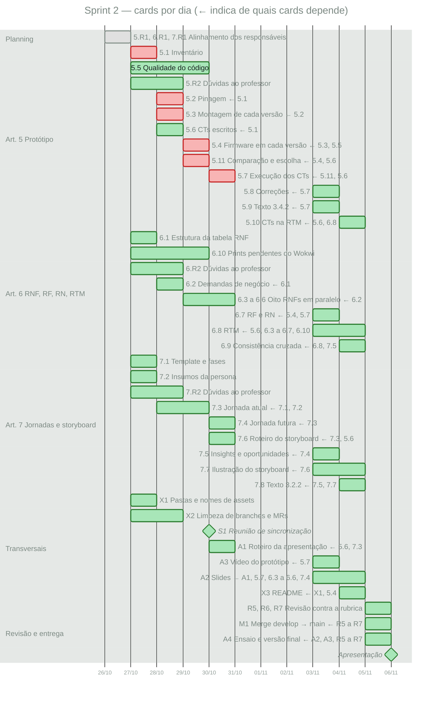
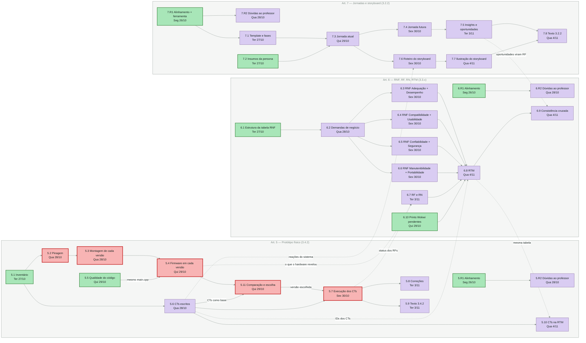
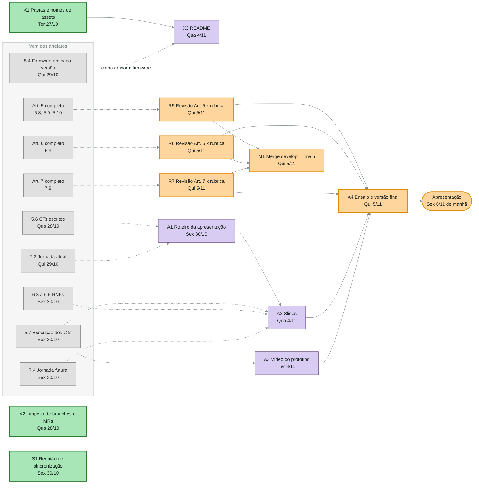

# Planning Sprint 2 — tópicos dos artefatos 5, 6 e 7

São 47 cards sem pessoas atribuídas: 13 do Art. 5, 12 do Art. 6, 10 do Art. 7 e 12 transversais (repositório, apresentação, revisão e merge). Seg 26/10 é só a planning. O build e os ajustes finos vão de ter 27/10 a qua 4/11. Na qui 5/11 acontecem a revisão final contra a rubrica, o merge da develop na main e a entrega. A apresentação é na sex 6/11 de manhã e fica pronta na quinta.

Enunciados e rubricas: [ArtefatosDaSp2.md](ArtefatosDaSp2.md).

O documento segue a ordem em que é usado: primeiro **quando** (calendário), depois **o quê** (cards), **em que ordem** (dependências) e por fim **como a sprint roda** (planning, revisões, sincronização e entrega).

## Sumário

- [1. Calendário](#1-calendário)
- [2. Visão por dia](#2-visão-por-dia)
- [3. Cards por artefato](#3-cards-por-artefato)
  - [3.1 Artefato 5 — Protótipo físico offline (seção 3.4.2)](#31-artefato-5--protótipo-físico-offline-seção-342)
  - [3.2 Artefato 6 — RNFs (3.3.3) e atualização de RF, RN e RTM](#32-artefato-6--rnfs-333-e-atualização-de-rf-rn-e-rtm)
  - [3.3 Artefato 7 — Jornadas atual e futura e storyboard (seção 3.2.2)](#33-artefato-7--jornadas-atual-e-futura-e-storyboard-seção-322)
  - [3.4 Cards transversais — repositório, apresentação, revisão e merge](#34-cards-transversais--repositório-apresentação-revisão-e-merge)
- [4. Dependências](#4-dependências)
  - [4.1 Fluxo dos artefatos 5, 6 e 7](#41-fluxo-dos-artefatos-5-6-e-7)
  - [4.2 Fluxo de repositório, apresentação, revisão e entrega](#42-fluxo-de-repositório-apresentação-revisão-e-entrega)
  - [4.3 Por que cada card espera e quanto sobra de folga](#43-por-que-cada-card-espera-e-quanto-sobra-de-folga)
- [5. Como a sprint roda](#5-como-a-sprint-roda)
  - [5.1 Planning — seg 26/10](#51-planning--seg-2610)
  - [5.2 Revisões ao longo da sprint](#52-revisões-ao-longo-da-sprint)
  - [5.3 Reunião de sincronização — sex 30/10](#53-reunião-de-sincronização--sex-3010)
  - [5.4 Revisão final e entrega — qui 5/11](#54-revisão-final-e-entrega--qui-511)
- [6. Decisões da planning](#6-decisões-da-planning)

## 1. Calendário

Os 9 dias úteis contam de seg 26/10 a sex 6/11, sem o feriado de Finados (seg 2/11). Cada card tem um prazo; a tabela mostra o que fecha em cada dia.

| Dia | Data | Fase | Art. 5 — Protótipo físico | Art. 6 — RNF, RF, RN, RTM | Art. 7 — Jornadas e storyboard | Transversais | Gate no fim do dia |
| --- | --- | --- | --- | --- | --- | --- | --- |
| 1 | Seg 26/10 | Planning | — | — | — | Responsáveis, equipes e cards de cada artefato (5.R1, 6.R1, 7.R1) | Cards criados e atribuídos |
| 2 | Ter 27/10 | Alinhamento | 5.1 inventário · 5.5 qualidade do código (início) | 6.1 taxonomia · 6.10 prints do Wokwi (início) | 7.1 template · 7.2 insumos | X1 pastas e nomes de assets | Ferramentas escolhidas e primeiros cards em andamento |
| 3 | Qua 28/10 | Base | 5.R2 dúvidas ao professor · 5.2 pinagem · 5.3 montagem · 5.6 CTs escritos | 6.R2 dúvidas ao professor · 6.2 demandas de negócio | 7.R2 dúvidas ao professor · 7.3 jornada atual (início) | X2 limpeza de branches e MRs | CTs numerados e publicados para o Art. 6 e o Art. 7 |
| 4 | Qui 29/10 | Construção | 5.4 firmware em cada versão · 5.5 fecha · 5.11 comparação e escolha da versão | 6.3 a 6.6 RNFs em paralelo · 6.10 fecha | 7.3 jornada atual fecha | — | ESP32 lê sensores e acende LEDs no protoboard; versão final escolhida; jornada atual pronta |
| 5 | Sex 30/10 | Construção | 5.7 execução dos CTs | 6.3 a 6.6 fecham | 7.4 jornada futura · 7.6 roteiro do storyboard | A1 roteiro da apresentação · S1 reunião de sincronização | 8 RNFs escritos; CTs executados; responsáveis revisam os cards |
| — | Seg 2/11 | Feriado | — | — | — | — | — |
| 6 | Ter 3/11 | Integração | 5.8 correções · 5.9 texto da 3.4.2 | 6.7 RF e RN · 6.8 RTM (início) | 7.5 insights · 7.7 cenas do storyboard (início) | A2 slides (início) · A3 vídeo do protótipo | Todo conteúdo existe em branch |
| 7 | Qua 4/11 | Ajustes finos | 5.10 CTs na RTM | 6.8 RTM fecha · 6.9 consistência cruzada | 7.7 fecha · 7.8 texto da 3.2.2 | X3 README · A2 slides fecham | Tudo mergeado na develop |
| 8 | Qui 5/11 | Revisão e entrega | R5 revisão contra a rubrica | R6 revisão contra a rubrica | R7 revisão contra a rubrica | M1 merge develop → main · A4 ensaio e versão final | Entregue; apresentação pronta |
| 9 | Sex 6/11 | Apresentação | — | — | — | Apresentação de manhã | — |

## 2. Visão por dia

Cada coluna é um dia, e cada barra vai do início ao prazo do card. A legenda explica cores e símbolos.

**Legenda**

| Símbolo | Significado |
| --- | --- |
| 🟩 Barra verde | Card; vai do dia em que começa até o prazo |
| 🟥 Barra rosa com borda vermelha | Caminho crítico do protótipo: sem folga, um dia de atraso empurra o resto |
| ⬜ Barra cinza | Feito na própria planning (alinhamento dos responsáveis) |
| ◆ Losango | Marco de um dia: reunião de sincronização e apresentação |
| `←` no nome | Cards de que este depende (ex.: `5.4 ← 5.3, 5.5`) |
| Dia sem barras | Fim de semana ou feriado de 2/11 |
| Faixas à esquerda | Grupo do card: Planning, Art. 5, Art. 6, Art. 7, Transversais, Revisão e entrega |

## 3. Cards por artefato

Cada card nasce de uma frase do enunciado ou de uma exigência da rubrica; a coluna "Critério" mostra qual. Os cards R1 e R2 são do responsável de cada artefato.

### 3.1 Artefato 5 — Protótipo físico offline (seção 3.4.2)

O firmware do Wokwi já existe (`src/firmware/main.cpp` e os `include/*_rules.h`), então o trabalho é levar esse circuito para o protoboard, testar e registrar. A equipe do Art. 5 decidiu que **cada integrante monta a própria versão física** do protótipo (5.3 e 5.4); depois as versões são comparadas e o grupo escolhe a melhor (5.11), que é a usada nos CTs, nas evidências e na seção 3.4.2. No nível Avançado a rubrica pede quatro coisas: pelo menos 3 CTs completos, ESP32 com sensor no protoboard e fios organizados, resultados documentados com prints e vídeos, e código com nomes descritivos e funções comentadas.

| # | Tópico (vira card) | Pronto quando | Critério da rubrica | Depende de | Prazo | Tamanho |
| --- | --- | --- | --- | --- | --- | --- |
| 5.R1 | Responsável: alinhar o artefato com o time | Enunciado e rubrica apresentados ao grupo; cards divididos; o que roda em paralelo combinado; ao longo da sprint, informações trocadas entre cards e cards criados ou excluídos quando preciso (checagem na sex 30/10) | Todos | — | Seg 26/10, na planning (divisão) · Ter 3/11 (último ajuste de cards) | M |
| 5.R2 | Responsável: levar ao professor o que o enunciado não diz | Respostas registradas no card: numeração dos CTs físicos (CT36 em diante, como diz o texto-guia, ou CT27 a CT31 já planejados), se o GNSS precisa estar no protótipo offline, onde ficam os vídeos | Todos | 5.R1 | Qua 28/10 | P |
| 5.1 | Inventário dos componentes físicos e recorte do protótipo offline | Lista do que o grupo tem (reed switch ou chave, pot ou divisor, LEDs, botões, GNSS LC76G) e do que fica fora (Wi‑Fi, MQTT); BOM da 3.1.7 conferida; confirmado que há kit (ESP32, protoboard e componentes) para cada integrante montar a sua versão | Sensor conectado ao ESP32 | — | Ter 27/10 | P |
| 5.2 | Pinagem e esquema elétrico do circuito físico | Esquema (Fritzing ou foto anotada) mantendo os GPIOs do Wokwi (27, 34, 25, 26, 23, 14, 33, 13, 18, 19) | Organização dos fios | 5.1 | Qua 28/10 | M |
| 5.3 | Montagem no protoboard com fios organizados, uma versão por integrante | Cada integrante do Art. 5 com o seu circuito montado a partir do mesmo esquema (5.2), cores de fio padronizadas, foto de cima e de lado de cada versão | Protótipo no protoboard | 5.2 | Qua 28/10 | G |
| 5.5 | Auditoria de qualidade do código | Nomes descritivos, uma responsabilidade por função, comentário em cada função; `tests/model_tests.c` continua passando | Nomes, funções e comentários (separa o 75% do 100%) | — | Qui 29/10 | M |
| 5.6 | Casos de teste do protótipo físico | Tabela no formato do template (descrição, pré-condição, procedimento, pós-condição) com sucesso e falha: lacre aberto, ruído no contato, divisor desconectado, botão com ruído, GNSS sem fix | 3 CTs ou mais com mudança de sensor e resultado nos LEDs | 5.1 | Qua 28/10 | G |
| 5.4 | Firmware rodando no hardware real, em cada versão | Ambiente PlatformIO para a placa física compila e grava em todas as versões; leituras reais de lacre, bateria e botões aparecem no Serial de cada uma | Leituras e saídas | 5.3, 5.5 | Qui 29/10 | G |
| 5.11 | Comparação das versões e escolha da melhor | Tabela comparando as versões (fios organizados, leituras corretas no Serial, LEDs reagindo aos sensores, firmeza dos contatos, facilidade de demonstrar), com foto de cada uma; versão escolhida e motivo registrados no card | Protótipo no protoboard com fios organizados | 5.4, 5.6 | Qui 29/10 | M |
| 5.7 | Execução dos CTs e registro de evidências | Cada CT, executado na versão escolhida, com print do Serial, foto e vídeo curto em `assets/` e situação APROVADO ou REPROVADO | Resultados documentados | 5.11, 5.6 | Sex 30/10 | GG |
| 5.8 | Correção das falhas e reexecução | CTs reprovados corrigidos ou registrados como falha com motivo | Resultados alinhados ao esperado | 5.7 | Ter 3/11 | M |
| 5.9 | Texto da seção 3.4.2 | Introdução, resumo da comparação das versões e motivo da escolha, figuras com legenda e fonte, tabela de CTs, links dos vídeos, texto-guia removido | Figuras e descrição dos testes | 5.7 | Ter 3/11 | M |
| 5.10 | CTs novos na RTM | Cada CT da 3.4.2 ligado a RF e RN na 3.3.4, feito junto com o 6.8 | Atualizar a RTM | 5.6, 6.8 | Qua 4/11 | P |

### 3.2 Artefato 6 — RNFs (3.3.3) e atualização de RF, RN e RTM

O Avançado pede 8 RNFs diferentes conforme a ISO 25010, cada um com métrica ou critério de teste e justificativa, e RF, RN e RTM atualizados "de forma satisfatória". Seguimos o que o enunciado escreve: ISO 25010 e IDs `RNF01`, `RNF02`… A tabela do template usa eixos FURPS+ (USAB, CONF, DES…), então o responsável confirma com o professor se pode trocá-la (6.R2). Os 14 RNFs propostos no `planejamento-energia-gnss.md` servem de matéria-prima.

| # | Tópico (vira card) | Pronto quando | Critério da rubrica | Depende de | Prazo | Tamanho |
| --- | --- | --- | --- | --- | --- | --- |
| 6.R1 | Responsável: alinhar o artefato com o time | Enunciado e rubrica apresentados; cards divididos; os 4 cards de RNF (6.3 a 6.6) combinados para rodar em paralelo; ao longo da sprint, informações trocadas entre cards e cards criados ou excluídos quando preciso (checagem na sex 30/10) | Todos | — | Seg 26/10, na planning (divisão) · Ter 3/11 (último ajuste de cards) | M |
| 6.R2 | Responsável: levar ao professor o que o enunciado não diz | Respostas registradas no card: se a tabela FURPS+ do template pode virar as 8 características da ISO 25010; o que conta como atualização "satisfatória" de RF, RN e RTM; se a RTM deve ganhar coluna de RNF | Todos | 6.R1 | Qua 28/10 | P |
| 6.1 | Estrutura da tabela de RNFs | Tabela da 3.3.3 com as 8 características da ISO 25010 e IDs `RNF01`…`RNF08`, colunas de métrica e justificativa | Conforme a ISO 25010 | — | Ter 27/10 | P |
| 6.10 | Prints pendentes do Wokwi (dívida da Sprint 1) | Os prints marcados `PENDENTE DE EVIDÊNCIA` na RTM (CT01 a CT23, CT35) capturados em `assets/wokwi/` | RTM satisfatória | — | Qui 29/10 | M |
| 6.2 | Demandas de negócio que geram RNF | Lista ligando TAPI, kick-off e personas a cada característica (autonomia da bateria, operação sem cobertura, lacre, LGPD, BI) | Justificativa referenciando o negócio | 6.1 | Qua 28/10 | M |
| 6.3 | RNFs de Adequação funcional e Eficiência de desempenho | 2 RNFs com métrica verificável e justificativa | 8 RNFs diferentes | 6.2 | Sex 30/10 | M |
| 6.4 | RNFs de Compatibilidade e Usabilidade | Idem | 8 RNFs diferentes | 6.2 | Sex 30/10 | M |
| 6.5 | RNFs de Confiabilidade e Segurança | Idem, aproveitando RNF-CONF01, CONF02 e SEG01 do planejamento | 8 RNFs diferentes | 6.2 | Sex 30/10 | M |
| 6.6 | RNFs de Manutenibilidade e Portabilidade | Idem, aproveitando RNF-SUP01 e SUP02 | 8 RNFs diferentes | 6.2 | Sex 30/10 | M |
| 6.7 | Atualização de RF (3.3.1) e RN (3.3.2) | Status dos RFs verificados no protótipo físico; RF ou RN novos que o hardware revelou; `PENDENTE DE VALIDAÇÃO` resolvidos com o que o parceiro já respondeu; tabela de compatibilidade revista | RFs e RNs atualizados de forma satisfatória | 5.4, 5.7 | Ter 3/11 | G |
| 6.8 | Atualização da RTM (3.3.4) | CTs da 3.4.2 incluídos, RNFs ligados, linhas "CT a definir" revistas, prints da 6.10 no lugar dos pendentes | RTM atualizada de forma satisfatória | 5.6, 6.3 a 6.7, 6.10 | Qua 4/11 | G |
| 6.9 | Consistência cruzada | Cada RF, RN, RNF e CT citado existe e bate entre 3.3.1, 3.3.2, 3.3.3, 3.3.4 e 3.4.2; RFs novos vindos das oportunidades da jornada (7.5) incluídos; texto-guia removido | Atualização satisfatória | 6.8, 7.5 | Qua 4/11 | M |

### 3.3 Artefato 7 — Jornadas atual e futura e storyboard (seção 3.2.2)

O foco é a persona principal, Geraldo (analista de PCM). A avaliação é qualitativa: coerência, profundidade, contraste entre atual e futura, qualidade dos templates, insights e a descrição do processo de construção, incluindo o uso de IA. Os reports do kick-off ajudam a entender o fluxo, mas pela regra do grupo não podem ser citados como evidência.

| # | Tópico (vira card) | Pronto quando | Critério avaliado | Depende de | Prazo | Tamanho |
| --- | --- | --- | --- | --- | --- | --- |
| 7.R1 | Responsável: alinhar o artefato com o time | Enunciado apresentado; ferramenta escolhida (Claude Design, Figma ou Canva); cards divididos; o que roda em paralelo combinado (7.4 e 7.6 na sex 30/10); ao longo da sprint, informações trocadas entre cards e cards criados ou excluídos quando preciso | Todos | — | Seg 26/10, na planning (divisão) · Ter 3/11 (último ajuste de cards) | M |
| 7.R2 | Responsável: levar ao professor o que o enunciado não diz | Respostas registradas no card: quantidade esperada de cenas no storyboard, se as cenas podem ser geradas por IA, se as jornadas cobrem só a persona principal ou também as outras | Todos | 7.R1 | Qua 28/10 | P |
| 7.1 | Template das jornadas e fases comuns | Template montado na ferramenta escolhida; mesmas fases nas duas jornadas, com início e fim definidos, para o contraste ficar lado a lado | Qualidade dos templates | 7.R1 | Ter 27/10 | P |
| 7.2 | Insumos da persona | Dores, objetivos e situações do Geraldo tirados da 3.2.1, 3.1.3 e do fluxo de remessa para conserto | Relação com a persona | — | Ter 27/10 | M |
| 7.3 | Jornada atual | Fases, ações, pensamentos, sentimentos, touchpoints, curva emocional com picos e vales, oportunidades | Coerência e profundidade | 7.1, 7.2 | Qui 29/10 | G |
| 7.4 | Jornada futura | Mesma estrutura, mostrando como alertas, lacre e painel mudam cada fase | Contraste atual × futura | 7.3 | Sex 30/10 | G |
| 7.6 | Roteiro do storyboard | 6 a 8 cenas, cada uma com ambiente, circunstância, ação ou decisão do usuário e reação do sistema, coerente com os CTs (LEDs, alertas) | Sequência lógica | 7.3, 5.6 | Sex 30/10 | M |
| 7.5 | Insights e oportunidades | Texto curto com os insights e uma tabela de contraste por fase; oportunidades que pedem RF novo enviadas ao Art. 6 | Qualidade dos insights | 7.4 | Ter 3/11 | M |
| 7.7 | Ilustração e montagem do storyboard | Cenas desenhadas ou geradas, com estilo coerente com as personas, exportadas para `assets/` | Clareza visual | 7.6 | Qua 4/11 | GG |
| 7.8 | Texto da seção 3.2.2 | Figuras com legenda e fonte, descrição do processo de construção, parágrafo de uso de IA, texto-guia removido | Descrição do processo e do uso de IA | 7.5, 7.7 | Qua 4/11 | M |

### 3.4 Cards transversais — repositório, apresentação, revisão e merge

Estes cards não pertencem a um artefato. A apresentação é na sexta 6/11 de manhã, então tudo dela fecha na quinta, e o ensaio acontece depois da revisão contra a rubrica para os slides mostrarem a versão final.

| # | Tópico (vira card) | Pronto quando | Depende de | Prazo | Tamanho |
| --- | --- | --- | --- | --- | --- |
| X1 | Pastas e nomes dos assets da Sprint 2 | Pastas criadas (ex.: `assets/fisico/`, `assets/ux/`) e padrão de nomes combinado, para todo mundo salvar no lugar certo desde o início | — | Ter 27/10 | P |
| X2 | Limpeza de branches e MRs da Sprint 1 | Branches já mergeadas removidas do remoto, MRs abertos fechados ou mergeados, cards da Sprint 1 encerrados | — | Qua 28/10 | M |
| S1 | Reunião de sincronização do time | Cada equipe contou o que fez, o que falta e o que travou; tabela de dependências revista; cards trocados, divididos ou criados | Cards de todos os artefatos | Sex 30/10 (ou ter 3/11 de manhã) | P |
| X3 | README do repositório atualizado | Estrutura de pastas, como gravar o firmware no ESP32 físico, status da Sprint 2 | 5.4, X1 | Qua 4/11 | M |
| A1 | Roteiro da apresentação | Sequência, tempo por parte, o que cada artefato mostra e quem fala | Escopo dos artefatos (5.6, 7.3) | Sex 30/10 | M |
| A2 | Slides da apresentação | Slides no estilo da Sprint 1 com protótipo físico, RNFs e jornadas | A1, 5.7, 6.3 a 6.6, 7.4 | Qua 4/11 | GG |
| A3 | Vídeo e fotos do protótipo para a apresentação | Demo curta gravada (ou roteiro de demo ao vivo) e fotos boas do circuito | 5.7 | Ter 3/11 | M |
| R5 | Revisão do Art. 5 contra a rubrica | Feita por quem não trabalhou no Art. 5; cada exigência do Avançado marcada; o que faltar corrigido no dia | Todos os cards do Art. 5 | Qui 5/11 | M |
| R6 | Revisão do Art. 6 contra a rubrica | Idem para o Art. 6 | Todos os cards do Art. 6 | Qui 5/11 | M |
| R7 | Revisão do Art. 7 contra a rubrica | Idem para o Art. 7 | Todos os cards do Art. 7 | Qui 5/11 | M |
| M1 | Merge da develop na main e entrega | MRs revisados, develop mergeada na main, entrega feita | R5, R6, R7 | Qui 5/11 | P |
| A4 | Ensaio e versão final da apresentação | Slides ajustados ao que ficou depois da revisão; ensaio cronometrado | A2, A3, R5 a R7 | Qui 5/11 | M |

## 4. Dependências

O caminho crítico é o protótipo físico: 5.1 → 5.2 → 5.3 → 5.4 → 5.11 → 5.7. Ele não tem folga, e um dia de atraso na montagem atrasa a RTM (6.7, 6.8), o vídeo (A3) e os slides (A2).

Como ler: uma seta vai do card que entrega para o card que espera. A legenda fica abaixo de cada diagrama. Os arquivos `.mmd` desta pasta têm os mesmos diagramas para abrir no [Mermaid Live](https://mermaid.live).

### 4.1 Fluxo dos artefatos 5, 6 e 7

**Legenda**

| Símbolo | Significado |
| --- | --- |
| 🟩 Caixa verde | Pode começar sem esperar nenhum outro card |
| 🟥 Caixa com borda vermelha | Caminho crítico do protótipo, sem folga |
| 🟪 Caixa lilás | Card que espera outro card terminar |
| Seta cheia `→` | Dependência dentro do mesmo artefato |
| Seta tracejada `⇢` | Dependência entre artefatos; o texto na seta diz o que é entregue |
| Data na caixa | Prazo do card |

### 4.2 Fluxo de repositório, apresentação, revisão e entrega

**Legenda**

| Símbolo | Significado |
| --- | --- |
| ⬜ Caixa cinza (coluna "Vem dos artefatos") | Card de um artefato que alimenta um card transversal |
| 🟩 Caixa verde | Pode começar sem esperar nenhum outro card |
| 🟪 Caixa lilás | Card transversal que espera outro card |
| 🟧 Caixa laranja | Revisão contra a rubrica, merge e ensaio, todos na qui 5/11 |
| ⬭ Forma arredondada | Apresentação, sex 6/11 de manhã |
| Seta cheia `→` | Dependência entre cards transversais |
| Seta tracejada `⇢` | Card de artefato alimentando um transversal |

**Podem começar já na ter 27/10, sem esperar ninguém:** 5.1 Inventário, 5.5 Qualidade do código, 6.1 Estrutura da tabela de RNFs, 6.10 Prints pendentes do Wokwi, 7.2 Insumos da persona, X1 Pastas e nomes de assets, X2 Limpeza de branches e MRs. Os cards 7.1 e os R2 só precisam do alinhamento feito na planning.

### 4.3 Por que cada card espera e quanto sobra de folga

Cada linha diz quem espera, por quê e quanto tempo sobra entre a entrega e o uso.

| Card que espera | Espera por | Por que depende | O que precisa chegar | Entregue até | Usado a partir de | Folga |
| --- | --- | --- | --- | --- | --- | --- |
| 5.2 Pinagem | 5.1 Inventário | Só dá para desenhar o esquema com os componentes que o grupo tem | Lista de componentes | Ter 27/10 | Qua 28/10 | 0 |
| 5.3 Montagem | 5.2 Pinagem | Todas as versões seguem o mesmo esquema, para a comparação ser justa | Esquema elétrico | Qua 28/10 (manhã) | Qua 28/10 (tarde) | Mesmo dia |
| 5.4 Firmware no hardware | 5.3 Montagem | O firmware só lê sensores reais com o circuito montado | Protoboard montado | Qua 28/10 | Qui 29/10 | 0 |
| 5.4 Firmware no hardware | 5.5 Qualidade do código | Os dois mexem no `main.cpp`; refatorar depois geraria conflito e evidências de código antigo | Refatoração mergeada | Qui 29/10 (manhã) | Qui 29/10 (tarde) | Mesmo dia |
| 5.11 Comparação e escolha | 5.4 e 5.6 | Só dá para comparar versões que já rodam o firmware; os CTs escritos servem de roteiro da comparação | Firmware gravado em cada versão e tabela de CTs | Qui 29/10 (manhã) | Qui 29/10 (tarde) | Mesmo dia |
| 5.7 Execução dos CTs | 5.11 e 5.6 | As evidências saem da versão escolhida, com os CTs escritos | Versão escolhida e tabela de CTs | Qui 29/10 | Sex 30/10 | 0 |
| 6.7 RF e RN | 5.4 e 5.7 | Um RF só muda de status depois que o CT físico passou | Resultado dos CTs | Sex 30/10 | Ter 3/11 | 0 |
| 6.3 a 6.6 RNFs | 6.2 Demandas | A justificativa de cada RNF cita uma demanda de negócio | Lista de demandas | Qua 28/10 | Qui 29/10 | 0 |
| 6.8 RTM e 5.10 | 5.6 CTs escritos | A RTM liga cada CT a RF e RN, então precisa dos IDs | Numeração dos CTs | Qua 28/10 | Ter 3/11 | 2 dias |
| 6.8 RTM | 6.3 a 6.6 e 6.10 | A RTM liga os RNFs e troca os prints pendentes | RNFs escritos e prints | Sex 30/10 | Ter 3/11 | 0 |
| 7.4 Jornada futura | 7.3 Jornada atual | A futura usa as mesmas fases para o contraste aparecer | Jornada atual | Qui 29/10 | Sex 30/10 | 0 |
| 7.6 Roteiro do storyboard | 5.6 CTs escritos | As reações do sistema no storyboard têm de ser as mesmas dos CTs (vermelho na violação, amarelo no atraso) | Tabela de CTs | Qua 28/10 | Sex 30/10 | 1 dia |
| 6.9 Consistência | 7.5 Insights | Oportunidades da jornada futura podem virar RF novo | Lista de oportunidades | Ter 3/11 | Qua 4/11 | 0 |
| A2 Slides | 5.7, 6.3 a 6.6, 7.4 | Os slides mostram conteúdo real, não rascunho | Resultados, RNFs e jornada futura | Sex 30/10 | Ter 3/11 | 0 |
| A3 Vídeo do protótipo | 5.7 Execução | A demo mostra o protótipo já testado | CTs executados | Sex 30/10 | Ter 3/11 | 0 |
| R5 a R7 Revisão | Todos os cards do artefato | A revisão confere a versão final contra a rubrica | Tudo na develop | Qua 4/11 | Qui 5/11 | 0 |
| M1 Merge e A4 Ensaio | R5 a R7 | Merge e slides finais só depois das correções da revisão | Revisão concluída | Qui 5/11 (manhã) | Qui 5/11 (tarde) | Mesmo dia |

Como 3.2.2, 3.3.x e 3.4.2 ficam no mesmo `documentacao.md`, cada card edita só a sua seção e o MR é pequeno. Os responsáveis olham esta tabela na reunião de sex 30/10: se algum "entregue até" escorregou, é ali que se troca ou divide card.

## 5. Como a sprint roda

### 5.1 Planning — seg 26/10

Na planning cada responsável já faz o alinhamento do seu artefato (5.R1, 6.R1 e 7.R1): cada equipe sai com os próprios cards, e o build começa no dia seguinte. São cerca de 2 horas.

1. **Abertura, 15 min.** Apresentar este documento: calendário, prazo da quinta 5/11 e caminho crítico do protótipo. As tabelas são ponto de partida, não os cards definitivos.
2. **Equipes, 5 min.** Definir os 3 responsáveis e as equipes. Sugestão: 3 pessoas no Art. 5, que tem os cards mais pesados e nenhuma folga, e 2 em cada um dos outros.
3. **Trabalho por equipe, 40 min.** Cada equipe lê enunciado e rubrica, ajusta os tópicos e cria os próprios cards com tamanho e prazo. Cada uma preenche duas listas: "o que espero de outro artefato e até quando" e "o que entrego para outro artefato e até quando". A tabela abaixo serve de ponto de partida.
4. **Rodada geral, 30 min.** Cada responsável apresenta as duas listas em 5 minutos. Onde o "preciso até" de uma equipe cai antes do "entrego até" de outra, resolve-se ali. No fim, distribuir os cards transversais (repositório, apresentação, revisores da quinta).
5. **Fechamento, 10 min.** Cards no GitLab até o fim do dia; reunião de sincronização na sex 30/10.

#### Sugestão para as duas listas

Ponto de partida para cada equipe conferir as listas que montar no bloco 3 da planning. Foi tirado da tabela 4.3.

| Artefato | O que espera de outro artefato | Até quando | O que entrega para outro artefato | Até quando |
| --- | --- | --- | --- | --- |
| Art. 5 — Protótipo físico | Nada de outro artefato; só as linhas dos seus CTs na RTM, feitas junto com o Art. 6 (6.8) | Qua 4/11 | Ao Art. 6: numeração e tabela dos CTs (5.6) | Qua 28/10 |
| | | | Ao Art. 7: reações do sistema em cada CT, para o storyboard (5.6) | Qua 28/10 |
| | | | Ao Art. 6 e à apresentação: versão escolhida (5.11) e resultados dos CTs, fotos e vídeos (5.7) | Sex 30/10 |
| | | | Ao README (X3): como gravar o firmware no ESP32 físico (5.4) | Qui 29/10 |
| Art. 6 — RNF, RF, RN, RTM | Do Art. 5: numeração dos CTs (5.6) | Qua 28/10 | Ao Art. 5: linhas dos CTs físicos na RTM (6.8) | Qua 4/11 |
| | Do Art. 5: resultado dos CTs, para mudar o status dos RFs (5.7) | Sex 30/10 | À apresentação: os 8 RNFs (6.3 a 6.6) | Sex 30/10 |
| | Do Art. 7: oportunidades que viram RF novo (7.5) | Ter 3/11 | | |
| Art. 7 — Jornadas e storyboard | Do Art. 5: reações do sistema em cada CT (5.6) | Qua 28/10 | Ao Art. 6: oportunidades que pedem RF novo (7.5) | Ter 3/11 |
| | | | À apresentação: jornada futura (7.4) | Sex 30/10 |

### 5.2 Revisões ao longo da sprint

As revisões acontecem ao longo da sprint, card a card, e não se acumulam na quinta.

1. Quem termina um card abre o MR, move o card para **Waiting Review** e avisa no grupo.
2. Quem estiver livre pega a revisão, de preferência alguém da mesma equipe, que conhece o conteúdo. Se o card entrega algo para outro artefato (CTs, oportunidades), revisa alguém da equipe que vai usar.
3. A revisão sai em até 1 dia útil e confere o "Pronto quando" e o critério da rubrica do card, não só o texto. O autor corrige, e o MR entra na develop.
4. Ninguém revisa o próprio card.

### 5.3 Reunião de sincronização — sex 30/10

Cada equipe conta, em 5 a 10 minutos, o que fez, o que falta e o que ficou travado, para o time inteiro entender os outros artefatos. A sexta é o meio da sprint e o último dia antes do feriado; se não der, a reunião passa para ter 3/11 de manhã. Ela termina com a tabela de dependências revista: o que escorregou vira troca, divisão ou novo card. É o card S1.

### 5.4 Revisão final e entrega — qui 5/11

Na quinta, cada artefato é revisado por quem não trabalhou nele, com a rubrica aberta, marcando cada exigência do nível Avançado. O que faltar vira ajuste no mesmo dia, antes do merge. Como tudo já foi revisado card a card (5.2), a quinta só confere o artefato inteiro. Depois do merge, o ensaio (A4) fecha a apresentação com a versão final.

## 6. Decisões da planning

| Tema | Decisão | Onde entrou |
| --- | --- | --- |
| Calendário | Seg 26/10 só planning; build até qua 4/11; entrega e merge na qui 5/11; apresentação sex 6/11 de manhã | Calendário |
| RNF | Seguir o enunciado (ISO 25010, `RNF01`…); o que ele não diz vai ao professor | 6.1, 6.R2 |
| Componentes do protótipo | Em aberto | 5.1 e 5.R2 |
| Protótipo físico | Cada integrante do Art. 5 monta a própria versão; o grupo compara as versões e escolhe a melhor, que vai para os CTs e a 3.4.2 | 5.3, 5.4, 5.11 |
| Numeração de CT | Em aberto; o texto-guia da 3.4.2 sugere continuar no CT36 | 5.R2 |
| Prints pendentes do Wokwi | Entra na sprint | 6.10 |
| Ferramenta das jornadas | O responsável decide (Claude Design, Figma ou Canva) | 7.R1 |
| Revisões | Contínuas, card a card; a quinta é só a conferência final contra a rubrica | Como funcionam as revisões |
