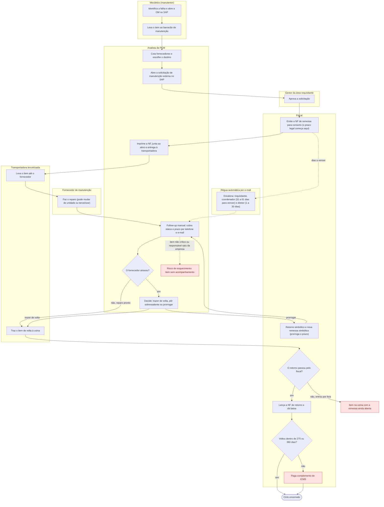
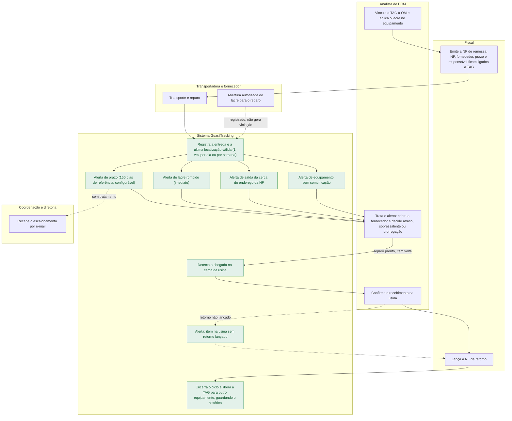

# Fluxo da remessa para conserto: hoje e com a TAG

> **Pergunta investigada:** como um equipamento sai da Cerradinho para manutenção externa e volta, quem age em cada etapa e onde o acompanhamento se perde.
> **O que foi feito:** fluxogramas em Mermaid com o responsável por cada etapa e reconstrução do fluxo a partir da fala do parceiro no kick-off [13:33–14:45, 34:28–37:30, 47:37] e do slide "Fluxos de saída de materiais | como funciona hoje e como poderá funcionar".
> **Evidência:** transcrição do kick-off (16/10/2026) e o slide 5 da apresentação da Cerradinho. Minutos entre colchetes.
> **Em aberto:** o passo a passo real de um caso com NF de exemplo (prometido pelo parceiro em vídeo); quem cola fisicamente a NF e a TAG no barracão; como o fornecedor informa que mudou o item de unidade; o que acontece com o dispositivo quando há retorno simbólico.
> **Alimenta:** diagnóstico do fluxo atual (entregável pedido no kick-off), regras de negócio e jornada do usuário na `documentacao.md`.
> **Implicação:** o ciclo do dispositivo não pode fechar quando o equipamento chega na usina, só quando o retorno é lançado no fiscal; e o sistema precisa aceitar prorrogação (retorno simbólico) e mudança de endereço legítima sem tratar como violação.

## 1. Fluxo atual (slide: "acompanhamento depende da memória da equipe")

Cada bloco é quem executa a etapa. As setas pontilhadas são avisos ou riscos, e os blocos em vermelho são onde o processo vaza dinheiro ou controle.

O mesmo fluxo, etapa por etapa:

| # | Etapa | Quem faz | Sistema | Onde falha |
|---|---|---|---|---|
| 1 | Equipamento quebra; o mecânico/manutentor identifica que precisa de reparo externo e abre a **ordem de manutenção (OM)** | Mecânico (manutentor) | SAP | — |
| 2 | Leva o item ao centro/barracão de manutenção | Mecânico | — | Peças sem plaqueta de patrimônio (ex.: ventoinha de um motor) ficam sem identificação própria [45:37] |
| 3 | Cota fornecedores e escolhe para onde enviar | Analista de PCM | — | — |
| 4 | Abre a solicitação de manutenção externa (requisição/RM) | Analista de PCM (requisitante) | SAP | — |
| 5 | Aprovação da solicitação | Gestor da área | SAP | — |
| 6 | Emite a **NF de remessa para conserto** (com fornecedor e endereço) | Fiscal | SAP / Gama Soft | O prazo legal (270/360 dias) começa a contar aqui [42:03] |
| 7 | Imprime a NF, junta ao ativo e entrega à transportadora | Analista de PCM | — | — |
| 8 | Transporte até o fornecedor (99% rodoviário, >90% terceirizado) | Transportadora | — | Sem visibilidade no trajeto |
| 9 | Reparo; o fornecedor pode mandar a outra unidade ou terceirizar [1:00:37] | Fornecedor | — | A Cerradinho "muitas vezes nem fica sabendo" |
| 10 | **Follow-up manual**: cobrar status e prazo, decidir sobressalente em caso de atraso | Analista de PCM | SharePoint, planilha (nem toda área tem) | **Risco de esquecimento** (slide). Quem enviou sai da empresa e o controle some [21:31] |
| 11 | Escalonamento automático por e-mail conforme os dias a vencer: requisitante, coordenador, diretor [36:09] | Rotina fiscal/BI | SAP + e-mail | Só olha prazo fiscal, não onde o item está |
| 12 | Perto do vencimento: retorno físico **ou** retorno simbólico + nova remessa simbólica (prorroga o prazo, nova NF) [37:04] | Fiscal | SAP | Novo ciclo documental para o mesmo item físico |
| 13 | Retorno físico à usina | Transportadora | — | Às vezes o item entra "por fora", sem passar no fiscal [47:37] |
| 14 | Lançamento da NF de retorno e baixa | Fiscal | SAP | Se não lança, o processo fica aberto e pode gerar ICMS indevido |
| 15 | Se passou do prazo legal: complemento de ICMS | Fiscal | — | R$ 602.969 na safra 24/25 |

Um ponto que o analista de logística apontou: quando o complemento de ICMS era pago, o item saía da base de acompanhamento, mesmo sem ter voltado. Ele corrigiu isso no BI dele: só dá baixa quando o item realmente retorna [53:16].

## 2. Fluxo proposto com TAG (slide)

Os blocos em verde são o que a solução faz sozinha; os demais continuam com as pessoas.

| # | Etapa do slide | O que o sistema registra | Requisito ligado |
|---|---|---|---|
| 1 | **TAG vinculada à OM** | Identificação única do motor/peça, mesmo sem plaqueta de patrimônio | Cadastro equipamento–dispositivo; dispositivo reutilizável |
| 2 | **Saída e NF registradas** | NF de remessa, fornecedor, endereço, prazo previsto, responsável, área requisitante | Vínculo do ciclo à NF; prazo configurável |
| 3 | **Entrega registrada** | Fornecedor, status, prazo previsto | Última localização válida; cerca no endereço da NF |
| 4 | **Alertas para a manutenção** | Prazo vencendo, status sem atualização, lacre rompido, saída da cerca | Alerta de permanência (150 dias, configurável), alerta de lacre imediato, alerta de "sem comunicação" |
| 5 | **Retorno e encerramento** | Equipe confirma recebimento e baixa | Encerrar só após o lançamento fiscal do retorno; liberar o dispositivo |

Rodapé do slide: "Histórico do equipamento e responsável pelo acompanhamento até o retorno". Ou seja, o valor principal está em **sempre ter um dono visível** para cada item fora, não só na localização.

## 3. Regras de negócio que saíram da conversa

1. **Contagem do prazo** começa na emissão da NF de saída, não na saída física [42:03].
2. **Prazos:** legal de 270 dias (dentro de GO) e 360 dias (fora de GO); alerta interno de referência aos 150 dias; diretoria cobra a partir de 180 [54:06]; a área pode configurar prazos curtos, como 30 dias [54:30].
3. **Escalonamento** deve seguir a régua que já existe: requisitante, depois coordenador, depois diretor [36:09, 44:27].
4. **Encerramento** só com o retorno lançado no fiscal. Item na usina sem lançamento gera alerta para requisitante, coordenação e fiscal [47:37, 49:17].
5. **Prorrogação** por retorno simbólico gera um novo ciclo documental; o dispositivo pode continuar no mesmo item físico.
6. **Mudança de unidade** do fornecedor ou terceirização do reparo é caminho legítimo; deve atualizar a localização esperada, não disparar alerta de violação.
7. **Lacre:** registrar abertura autorizada e violação; alerta de violação o mais rápido possível (10–30 min) [1:17:20, 1:29:11].
8. **Cerca eletrônica:** alerta ao sair do endereço da NF ou da rota, e aviso de chegada de volta à usina [46:47, 49:17].
9. **Lotes:** itens baratos saem em quantidade e voltam fracionados (ex.: saíram 50, faltam 2) [1:07:53]. Fora do foco do MVP, mas afeta o modelo de dados se um dia escalar.

## 4. Onde a TAG resolve e onde não resolve

| Dor | A TAG resolve? |
|---|---|
| Esquecer o item no fornecedor | Sim: alerta de prazo com escalonamento e um responsável visível |
| Não saber onde o item está | Sim: última localização válida e cerca no endereço da NF |
| Troca de peça ou violação no fornecedor | Em parte: alerta de lacre; não prova que a peça devolvida é a mesma |
| Item voltou mas não foi lançado no fiscal | Em parte: a cerca da usina avisa a chegada; o lançamento continua manual |
| ICMS por prazo vencido | Indiretamente: avisa antes; quem decide retornar ou prorrogar é o PCM e o fiscal |
| Responsável saiu da empresa | Sim, se o cadastro guardar área e responsável e o alerta for para e-mail de setor |
