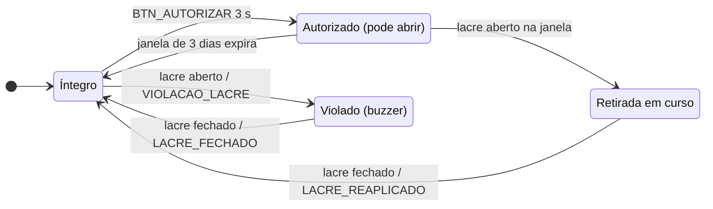

# Circuito principal Wokwi: GuaráTracking

Esta pasta reúne o circuito principal do protótipo V2: ESP32 DevKit v1, GPS/GNSS
customizado, lacre, bateria simulada, display LCD 16x2 I2C, botões de avançar e
voltar, buzzer, botões de autorização e de ciclo, chave de rede simulada (on/off do
módulo SIM) e chave ON/OFF. No V1, quatro LEDs com resistores de 220 Ω indicavam os
estados; no V2 eles deram lugar ao LCD e ao buzzer, e ficou só o LED vermelho de violação no
GPIO13, mantido porque a rubrica do Art. 5 pede resultado em LED. O dispositivo liga sem ciclo; segurar CICLO por 3 s faz o vínculo e abre o ciclo, e `REMESSA x` registra a NF. Falhas do GNSS geram
`GNSS_SEM_FIX` (motivo `sem_fix`, `sem_dados` ou `sinal_fraco`) e `GNSS_RECUPERADO`, uma vez por falha.

O firmware principal preserva a comparação de posições, o debounce do lacre e a
registro NVS de diagnóstico existentes, tem o ciclo (dias fora, status semanal e alertas de
atraso e de permanência, CT02–CT04) e as regras dos CT05–CT16: retirada autorizada, violação do
lacre, fila de eventos sem rede, debounce dos botões, bateria baixa, encerramento e
vínculo de ciclo, além do registro de desligamento pela chave ON/OFF. O V2 mudou só a
interface (LCD, botões de navegação, buzzer e pressionamento de 3 s); os eventos JSON e
as regras de negócio são os mesmos do V1. JSON na serial
e Wi-Fi conectado não representam envio confirmado a servidor ou broker.

## Módulo GNSS de referência

O módulo físico escolhido em 21/10/2026 é o **Quectel LC76G, variante PA**.
O chip customizado desta pasta ainda é um gerador genérico de NMEA: sua adaptação
ao protocolo e aos estados de energia do LC76G-PA está pendente. O modelo deverá
usar o mesmo driver GNSS do dispositivo físico, incluindo os comandos PAIR usados,
entrada/saída de backup e falhas de aquisição. A placa e a versão de firmware
do módulo ainda precisam ser definidas.

O contrato de simulação e os CT26/CT28 estão no
[planejamento de energia e GNSS](../../../document/outros/3-desenvolvimento-resultados/3.4.1-prototipo-wokwi/planejamento-energia-gnss.md).
Os 9600 baud da configuração atual descrevem o simulador; conferir a configuração
da unidade física antes de integrar. Consumo e autonomia exigem ensaios físicos.

## Arquivos

| Arquivo | Conteúdo |
|---|---|
| `diagram.json` | Único diagrama principal, com todos os componentes integrados. |
| `wokwi.toml` | Simulação demo: firmware compilado na raiz, coleta a cada 30 s e serial RFC2217 na porta 4000. |
| `wokwi.weekly.toml` | Mesmo circuito com coleta a cada sete dias reais. |
| `../main.cpp` | Firmware principal compilado pelo PlatformIO. |
| `../../../include/cycle_rules.h` | Regras do ciclo (CT02–CT04), testadas em `tests/model_tests.c`. |
| `../../../include/seal_rules.h`, `event_queue.h`, `battery_rules.h` | Regras de lacre, fila sem rede e bateria (CT05–CT13), testadas em `tests/model_tests.c`. |
| `../../../include/sim_clock.h` | Relógio de 64 bits do ciclo, que atravessa a volta do `millis()`, testado em `tests/model_tests.c`. |
| `../../../include/screen_controller.h` | Classe `ScreenController`: monta as telas do LCD e a navegação, testada em `tests/screen_controller_tests.cpp`. |
| `../../../include/config.h` | Pinagem e parâmetros centralizados do firmware principal. |
| `sketch.ino` | Teste isolado de ligações, excluído da compilação principal. Conta caracteres do GPS, sem interpretar posição. |

## Mapa de pinos

| Componente | Pino | Modo | Função atual de bancada |
|---|---|---|---|
| GPS TX → ESP RX2 | GPIO 16 | UART2 RX, 9600 baud | Recepção das sentenças GNSS simuladas |
| GPS RX ← ESP TX2 | GPIO 17 | UART2 TX, 9600 baud | Reservado; o modelo não interpreta comandos |
| Lacre (`seal`) | GPIO 27 | `INPUT_PULLUP` | Esquerda = íntegro/LOW; direita = violado/HIGH |
| Bateria (`battery`) | GPIO 34 (ADC1) | analógico | Nível sintético de 0 a 100%, sem alimentação real |
| LCD 16x2 I2C (`lcd`) | GPIO 21 (SDA) e 22 (SCL) | I2C, endereço 0x27 | Telas de status; VCC no VIN e GND comum |
| BTN_AVANCAR (`btn_avancar`) | GPIO 25 | `INPUT_PULLUP` | Próxima tela, em ordem circular |
| BTN_VOLTAR (`btn_voltar`) | GPIO 26 | `INPUT_PULLUP` | Tela anterior, em ordem circular |
| LED de violação (`led`, `r_led`) | GPIO 13 | saída, resistor de 220 Ω | LED vermelho pisca (pulso de 150 ms por segundo) enquanto o lacre está violado; apaga com a chave ON/OFF desligada |
| Buzzer (`buzzer`) | GPIO 23 | saída (`tone`) | Bipe intermitente na violação do lacre; GPIO27 permanece exclusivo do lacre |
| SW_REDE (`sw_rede`) | GPIO 18 | `INPUT_PULLUP` | Simula a chave on/off do módulo SIM: esquerda = disponível/LOW; direita = indisponível/HIGH |
| SW_ENERGIA (`sw_energia`) | GPIO 19 | `INPUT_PULLUP` | ON/OFF: esquerda = ligado/LOW; direita = desligado/HIGH |
| BTN_AUTORIZAR (`btn_autorizar`) | GPIO 33 | `INPUT_PULLUP` | Segurar 3 s registra a autorização de retirada, válida por 3 dias |
| BTN_CICLO (`btn_ciclo`) | GPIO 14 | `INPUT_PULLUP` | Segurar 3 s inicia o ciclo (sem ciclo ativo) ou pede o encerramento (com ciclo ativo) |

O diagrama reproduz a bancada: duas protoboards de 830 furos empilhadas (`bb1` em cima, `bb2` embaixo) com um único trilho de alimentação no meio, e o ESP32 e os componentes encaixados nos furos, com jumpers entre eles. Para isso `bb2` fica sobreposta a `bb1`: o trilho de cima de `bb2` cobre o de baixo de `bb1`, que fica escondido e sem uso (o validador cobra isso). O ESP32 fica sobre o trilho do meio, com os pinos da esquerda (VIN…EN) na linha j de `bb1` e os da direita (3V3…D23) na linha d de `bb2`; embaixo sobra só a linha e livre, como na bancada. Botões, lacre, potenciômetro e LED ficam em `bb1`; chaves de rede e ON/OFF e o buzzer em `bb2`; LCD e GPS fora das placas. Trilhos: o de cima (`bb1:tp/tn`) e o do meio (`bb2:tp/tn`) levam 3V3 e GND; o de baixo (`bb2:bp/bn`) leva 5 V do VIN (só o LCD) e GND. Jumpers nas bordas unem os trilhos de mesma tensão. Em cada placa do Wokwi a linha a fica em cima; na bancada a placa de cima tem a linha j no topo. O GPS continua ligado direto no 3V3 e no GND do ESP32. O buzzer tem o terminal positivo no
GPIO23 e o negativo no GND. Os botões atravessam o canal central; o GPIO vai na coluna dos contatos 1 e o GND na dos contatos 2. As chaves usam o terminal 2 no GPIO, o terminal 1 no GND
e o terminal 3 aberto. Não há segundo lacre nem segundo potenciômetro.

`network_sim_available` informa a chave; `wifi_connected` informa a conexão real
do Wi-Fi virtual. A chave não desliga o rádio nem implementa transporte ou reenvio.

## Como rodar

1. Abra a raiz `g01` no VS Code. Instale as extensões recomendadas e use sua licença Wokwi.
2. Execute os comandos abaixo no terminal da raiz:

```powershell
powershell -NoProfile -ExecutionPolicy Bypass -File .\scripts\setup.ps1
powershell -NoProfile -ExecutionPolicy Bypass -File .\scripts\build.ps1
powershell -NoProfile -ExecutionPolicy Bypass -File .\scripts\build.ps1 -Environment weekly
powershell -NoProfile -ExecutionPolicy Bypass -File .\scripts\verify.ps1
```

3. Em **F1 → Wokwi: Select Config File**, selecione o `wokwi.toml` desta pasta.
4. Execute **F1 → Wokwi: Start Simulator**. Para visualizar a montagem, abra o `diagram.json` desta pasta.
5. Para o intervalo semanal real, selecione o `wokwi.weekly.toml` desta pasta.

Na placa física (DevKitC V4 na protoboard dupla), grave o ambiente `bancada`: é o demo com
botões no lugar das chaves deslizantes (`SWITCH_BUTTONS=1`). LACRE (GPIO27) e REDE (GPIO18)
alternam a cada toque; ON/OFF (GPIO19) liga ou desliga segurando 3 s. O aparelho começa ligado,
com o lacre fechado e com sinal. O Wokwi e os ambientes `demo` e `weekly` seguem com as chaves.

```powershell
pio run -e bancada -t upload
pio device monitor
```

Os caminhos do firmware e do chip nos TOMLs são relativos a esta pasta e apontam
para `.pio/` e `chips/` na raiz. O PlatformIO seleciona somente `src/firmware/main.cpp`,
evitando compilar o `sketch.ino` de teste junto com o firmware principal.

## Roteiro do circuito integrado

| Ação | Resultado esperado |
|---|---|
| Iniciar com as chaves à esquerda | LCD aceso na tela "NF da remessa"; `STATUS` com `dias_fora=0`; heartbeat a cada 2 s |
| Digitar `REMESSA NF-000123` no Serial | LCD mostra "NF registrada" e, na tela de NF, o número informado |
| Pressionar BTN_AVANCAR e BTN_VOLTAR | Telas NF → prazo → última posição → bateria → lacre → NF, e no sentido inverso |
| Mover o lacre à direita | Após o debounce, `VIOLACAO_LACRE`, buzzer bipando, mensagem "VIOLACAO registrada" e tela de lacre em "Lacre VIOLADO" |
| Tocar rapidamente BTN_AUTORIZAR | Nada é registrado; o Serial informa que o botão foi solto antes de 3 s |
| Segurar BTN_AUTORIZAR por 3 s | LCD conta "segure mais N s" e depois mostra "Autorizacao ok"; `AUTORIZACAO_REGISTRADA`; abrir o lacre em até 3 s gera `RETIRADA_AUTORIZADA`, sem buzzer, e "Lacre AUTORIZADO" |
| Segurar BTN_CICLO por 3 s | Com ciclo ativo: encerramento (exige lacre fechado e `NF` no Serial) ou `ENCERRAMENTO_RECUSADO`; sem ciclo ativo: `CICLO_INICIADO` |
| Mover SW_ENERGIA à direita | `DISPOSITIVO_DESLIGADO`, LCD apagado e buzzer mudo; de volta à esquerda, novo `STATUS` |
| Mover SW_REDE à direita | Mensagem "Sem sinal", `rede_sim=off` e eventos na fila; de volta à esquerda, "Sinal ok" com quantos foram enviados. Wi-Fi real continua com diagnóstico independente |
| Girar o potenciômetro | `bateria_sim` muda no heartbeat e na tela de bateria |
| GPS com fix válido | `gps_chars` aumenta; posição é coletada e comparada com a última referência válida |
| GPS com `fixValid=0` | Reporta falta de fix e preserva a referência anterior |

Pressione os botões durante um heartbeat para conferir sua leitura periódica.
Comandos no Monitor Serial: `REMESSA x` informa a NF da remessa do ciclo ativo (até
15 letras, dígitos, `-`, `.` ou `/`), `NF` lança a NF de retorno (os dois representam
a plataforma) e `LIMIAR n` muda o limiar de permanência do ciclo (RN03). O modo semanal não valida autonomia.

## Validação da integração — 21/10/2026

| Verificação executada | Resultado |
|---|---|
| `scripts/setup.ps1` | Dependências disponíveis e ferramentas verificadas |
| `scripts/build.ps1` | Demo compilada com sucesso |
| `scripts/build.ps1 -Environment weekly` | Semanal compilada com sucesso |
| `scripts/verify.ps1` | Testes de lógica, consistência do circuito/configuração e linter oficial aprovados |

O compilador emitiu um aviso de fallthrough na dependência TinyGPSPlus 1.0.3.
O linter terminou sem erros nem warnings e informou que a placa DevKit v1 usa um
tipo não documentado no catálogo atual. A placa foi preservada para compatibilidade
com o circuito e a configuração anteriores.

A simulação interativa não foi executada nesta integração; não havia token CLI
disponível. O roteiro visual acima e a validação física permanecem pendentes.
Compilação e testes locais não comprovam consumo, autonomia ou entrega ao servidor.

## Evidências anteriores

- `assets/3-desenvolvimento-resultados/3.4.1-prototipo-wokwi/circuito.png`: circuito anterior do teste de ligação, sem o GPS integrado.
- Projeto público anterior: https://wokwi.com/projects/478276108359405569

O projeto público e a captura anterior não foram atualizados por esta integração.
O roteiro acima descreve resultados esperados; não é evidência de execução visual.

## Teste de ligação

Executado em 19/out/2026 no projeto público. Evidência: `assets/3-desenvolvimento-resultados/3.4.1-prototipo-wokwi/circuito.png`.
O teste usou a versão V1 do `sketch.ino`, com LEDs. A versão atual troca os LEDs pelo
buzzer e lê também os botões de navegação; ainda não foi executada.

| Ação | Esperado | Resultado |
|---|---|---|
| Nada acionado | LEDs apagados; `lacre=1 rede=1 autorizar=1 ciclo=1` | Passou |
| SW_LACRE acionada | LED verde aceso; `lacre=0` | Passou |
| SW_REDE acionada | LED azul aceso; `rede=0` | Passou |
| BTN_AUTORIZAR pressionado | LED amarelo aceso; `autorizar=0` | Passou |
| BTN_CICLO pressionado | LED vermelho aceso; `ciclo=0` | Passou |
| POT_BATERIA de um extremo ao outro | `bateria_adc` de 0 a ~4095 | Passou |

## Tempo simulado e prazos (CT02–CT04)

O ciclo fica em `include/cycle_rules.h` e é chamado pelo `main.cpp` a cada volta do
`loop()`, sem `delay()`. No ambiente `demo`, 1 segundo real equivale a 1 dia
(`Config::DayMs`); no `weekly`, o dia é real. Os dias vêm de um relógio de 64 bits
(`include/sim_clock.h`) que acumula os intervalos do `millis()`, porque o contador de 32 bits
dá a volta em ~49,7 dias. As constantes ficam no `include/config.h`.

| Constante | Valor | O que controla |
|---|---|---|
| `StatusIntervalDays` | 7 | `STATUS_SEMANAL` a cada 7 dias de ciclo |
| `ExpectedReturnDays` | 5 | Acima disso, `ALERTA_ATRASO` e "ATRASO: N dias" na tela de prazo |
| `StayThresholdDays` | 150 | Ao atingir, `ALERTA_PERMANENCIA` |

Cada alerta sai uma única vez por ciclo, e os dois podem coexistir; mudar o limiar
pelo comando `LIMIAR n` não rearma um alerta já emitido no ciclo (RN04). Ao ligar pela
primeira vez, o dispositivo publica um `STATUS` com `dias_fora=0`; depois de um reinício,
o `STATUS` traz o ciclo restaurado da NVS e `contexto_restaurado=true`. Em hardware real,
apague a NVS antes de repetir um CT que parte do ciclo 1. Os eventos usam o mesmo JSON dos
demais registros, com `ciclo_id`, `dias_fora`, `atraso` e `permanencia`, e o heartbeat
mostra `dias_fora`.

Para o CT04 com limiar 10, troque `StayThresholdDays` para `10`, recompile, rode e
depois volte para `150`.

## Lacre, autorização, fila, bateria e ON/OFF (CT05–CT16, CT35)

| Regra | Comportamento | Onde |
|---|---|---|
| Violação (RN05) | Lacre aberto sem autorização vigente gera `VIOLACAO_LACRE` na hora, marcado como crítico; o buzzer bipa até o lacre fechar (`LACRE_FECHADO`) ou por no máximo `BuzzerAlarmMs` (30 s) | `seal_rules.h`, `main.cpp` |
| Retirada autorizada (RN06) | Segurar `BTN_AUTORIZAR` por 3 s registra uma autorização que vale por `AuthorizationWindowDays` (3 dias = 3 s no demo), medidos em ms desde o registro, e é consumida na abertura: `RETIRADA_AUTORIZADA`, sem buzzer, e `LACRE_REAPLICADO` ao fechar | `seal_rules.h` |
| Fila sem rede (RN09) | Com `SW_REDE` à direita, os eventos vão para a fila (8), gravada na NVS (`p0`–`p7`); cheia, sai o não crítico mais antigo. Com as 8 posições ocupadas por violações, as seguintes entram num único resumo (quantidade, primeira e última ocorrência), também na NVS. Ao reconectar, saem na ordem com `dia_ocorrencia` e, por último, o `VIOLACAO_LACRE_RESUMO`, que é zerado após o envio; nenhuma violação é perdida (CT10) | `event_queue.h` |
| Botões | Debounce de 50 ms e evento por borda; segurar não repete. Ciclo e autorização só valem com 3 s (`LongPressMs`); avançar e voltar reagem ao toque | `main.cpp` |
| Bateria (RN10) | `BATERIA_BAIXA` uma vez abaixo de 20%, rearma acima de 25%; ADC = 0 gera `SENSOR_BATERIA_FALHA` | `battery_rules.h` |
| Ciclo (RN01, RN11; #113) | Segurar CICLO por 3 s: inicia quando inativo; com ciclo ativo, solicita encerramento (`CICLO_ENCERRADO` apenas com lacre fechado e NF de retorno; senão `ENCERRAMENTO_RECUSADO`). Enviar `VINCULAR` no **Monitor Serial local** é a tentativa explícita de novo vínculo, inclusive com ciclo ativo: nesse caso emite `VINCULO_RECUSADO` (`motivo=ciclo_ativo`) sem fechar ou substituir o ciclo. CT15-HOST passou nos modos demo e weekly; novo CT15 no Wokwi ainda não executado. Este comando não prova integração com a plataforma. | `main.cpp`, `tests/firmware_link_command_tests.cpp` |
| ON/OFF (desligamento lógico) | Desligar gera `DISPOSITIVO_DESLIGADO`, apaga o LCD, silencia o buzzer e suspende leituras e publicações, sem cortar a energia do ESP32; o relógio do ciclo continua. Religar gera `STATUS` | `main.cpp` |
| Reinício | Contexto do ciclo, do lacre e da NF da remessa (`ctx`, versão 2) e fila de eventos voltam da NVS; o `STATUS` traz `contexto_restaurado`. Um contexto da versão 1 não é restaurado. Ligar com o lacre aberto gera `VIOLACAO_LACRE` | `main.cpp` |

O `seal_changed` que aparece no Serial é o registro local de diagnóstico (NVS `q0`–`q15`, CT18 e
CT21); os eventos de negócio são os de nome em maiúsculas.

## Protótipo V2: LCD, navegação e buzzer

O LCD mostra uma tela por vez. BTN_AVANCAR e BTN_VOLTAR percorrem as cinco telas em
ordem circular. Enquanto BTN_CICLO ou BTN_AUTORIZAR estão pressionados, o LCD mostra a
contagem até os 3 s. Depois de cada ação dos botões e de cada mudança do lacre ou da
chave de sinal, uma mensagem curta fica 2 s por cima da tela ("Ciclo iniciado",
"Autorizacao ok", "VIOLACAO registrada", "Retirada autorizada", "Lacre fechado",
"Sinal ok / enviados: N", "Sem sinal / na fila: N") e acende o visor se estiver apagado.
O LCD só é reescrito quando o texto muda e apaga, com a luz de fundo, depois de 15 s sem
uso (`LcdTimeoutMs`), porque a luz de fundo é o maior consumo do visor. Qualquer botão o
acende de novo; com o visor apagado, o primeiro toque em avançar ou voltar só acende,
sem trocar a tela. Uma variação de 3 pontos na bateria simulada, mesmo lenta, também acende
o visor e abre a tela de bateria.

| Tela | Linha 1 | Linha 2 |
|---|---|---|
| NF | `NF da remessa` | Número recebido pelo comando `REMESSA`, ou `nao informada` |
| Prazo | `Prazo: dia 12/30` (dias decorridos / prazo previsto) | `Faltam 18 dias`, `vence hoje` ou `ATRASO: 5 dias`; sem ciclo, `sem ciclo ativo` |
| Última posição | `Ultima posicao` | `ha 40 s`, `ha 3 h`, `ha 2 dias`; `sem fix ainda`, ou `salva, sem idade` para o ponto restaurado da NVS |
| Bateria | `Bateria: 78%` | `normal`, `BAIXA` ou `sensor com falha` |
| Lacre | `Lacre INTEGRO`, `Lacre AUTORIZADO` ou `Lacre VIOLADO` | `fechado`, `pode ser aberto`, `aberto p/ reparo` ou `aberto sem autor` |

A tela de prazo mostra o dia atual em relação ao prazo, em vez de "35/30", porque a
segunda linha já diz quanto falta ou quanto passou. A tela de posição mostra há quanto
tempo foi obtida a última posição válida, que é o dado útil em campo; as coordenadas
seguem no JSON. A tela de lacre fica em "AUTORIZADO" enquanto há autorização vigente ou
retirada autorizada em curso.



*Estados do lacre exibidos no LCD no protótipo V2. O buzzer só toca em "Violado" e para
ao fechar o lacre ou depois de 30 s. Fonte: elaboração própria a partir de `seal_rules.h`.*

No V2 físico, a chave de rede do Wokwi representa a chave on/off do módulo SIM, e o
Wi-Fi continua como meio de envio da simulação. Autorização remota, módulo SIM real,
dimensionamento da bateria e montagem física ficam fora desta versão do firmware.

## Publicação no Wokwi web

A URL pública do projeto é uma versão anterior de diagnóstico, diferente do firmware principal (`../main.cpp`). Para atualizá-la:

1. Na raiz, executar `python scripts/export-wokwi.py`, que gera `build/wokwi-publicacao/` com o sketch principal, os headers, o `diagram.json`, o chip GPS customizado e `libraries.txt`. O script não publica nem comprova a compilação no Wokwi web.
2. Abrir o projeto da conta do grupo no Wokwi, substituir os arquivos pelos do pacote e conferir se o chip GPS customizado é aceito. Se a plataforma não aceitar o chip, manter a simulação integrada na extensão do VS Code e registrar isso na documentação.
3. Rodar o projeto e conferir ao menos o CT01 (LCD aceso e `STATUS` na Serial) antes de salvar.
4. Registrar na seção 3.4.1 a URL, o commit e a data da publicação.
